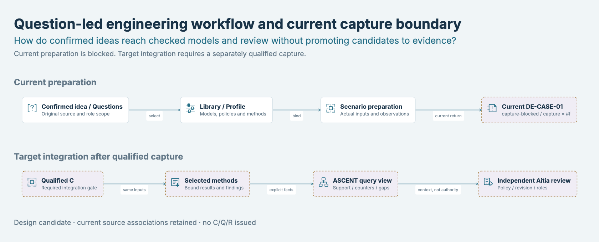
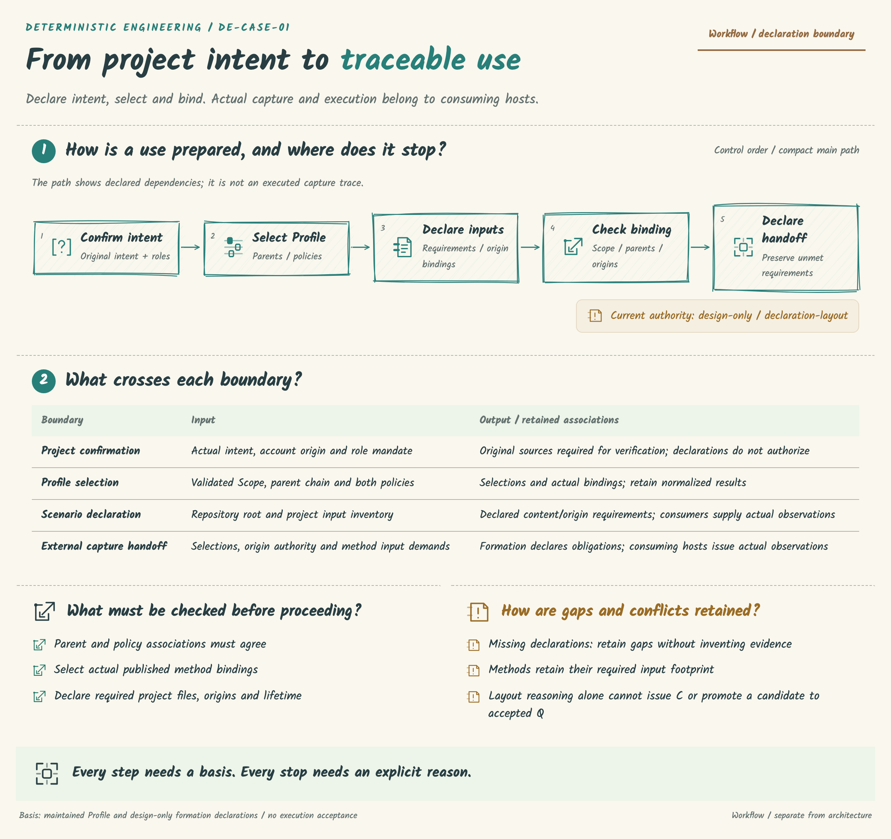
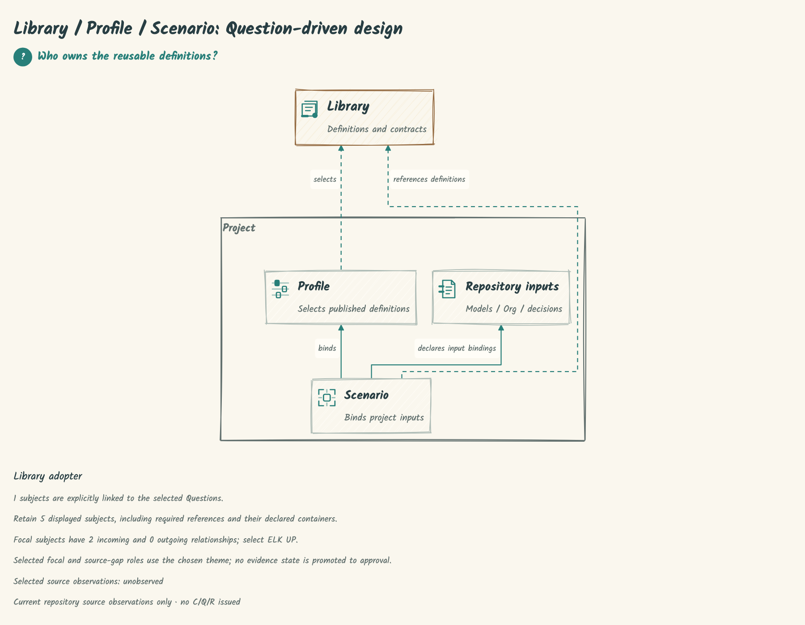
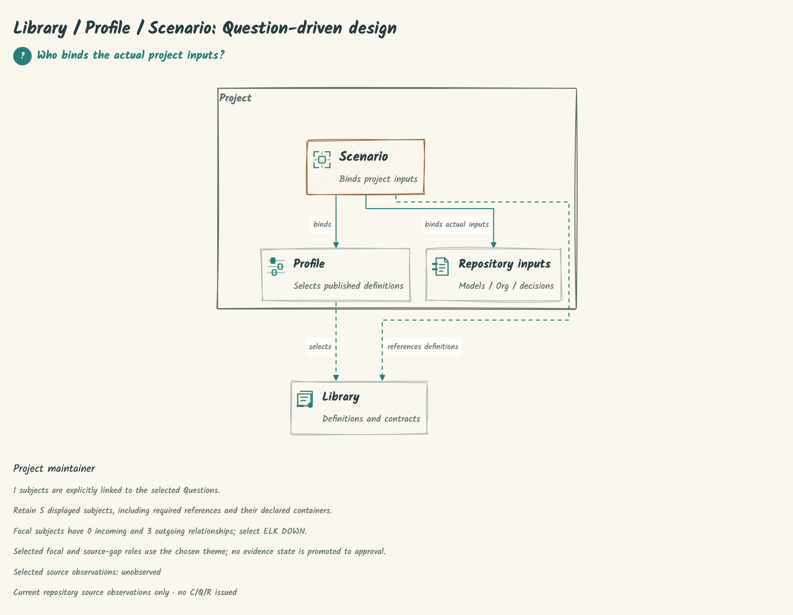
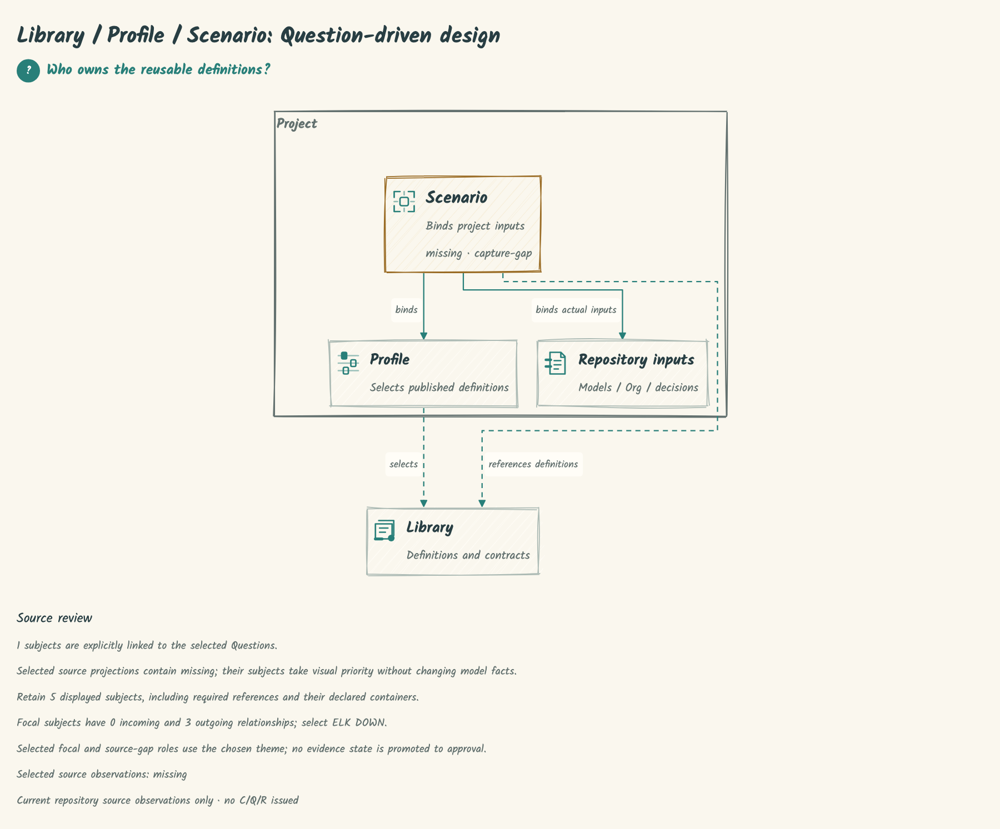

# SPDX-FileCopyrightText: 2026 hardenedlinux Linux Team and Contributors
#
# SPDX-License-Identifier: LGPL-2.1-or-later

#+TITLE: Deterministic Engineering
#+SUBTITLE: Reusable engineering knowledge, checked project choices, traceable views
#+LANGUAGE: en
#+OPTIONS: toc:2 num:nil

* Library boundary and current organization
:PROPERTIES:
:CUSTOM_ID: engineering-ownership
:STATUS: refactor-in-progress
:END:

This repository maintains reusable engineering types, models, rules, Feature
contracts, verification obligations and evidence data contracts. It does not
implement an App Server, model provider, agent Runtime or platform authorization
recovery. Those are consuming-ecosystem responsibilities.

Business Scheme Modules share one flat =library/<module-name>/= tree. Native
Yuanxu =tags:= and =profile:= classify and select the same declared leaves;
classification does not create deeper directory layers or another loader.
Profiles are native Modules. Test sequences are not artificial Review Modules.

#+BEGIN_EXAMPLE
library/<module-name>/    Native types, objects, config, methods and Interface roles
languages-engineering/   Language-native subjects and verification inputs
t/*-test.ss             Development checks through native gerbil test
init.ss                  One declarative Yuanxu selection
build.ss                 Native init.exports std-make-spec only
#+END_EXAMPLE

[[file:docs/10-19-design/10-architecture/10.148-flat-declarative-library-boundary.org][10.141]] records the current boundary, the SysML organization declaration and
remaining acceptance gates;  is its paired view. The current migration is
not fully accepted. Older case notes below describe historical designs and
receipts; they do not qualify the changed source tree.

* Purpose
:PROPERTIES:
:CUSTOM_ID: purpose
:END:

Deterministic Engineering is a Library for organizing engineering work around
explicit Questions, models, obligations, methods and evidence. A downstream
repository selects reusable definitions, binds its own project inputs and keeps
its architecture, documents and decisions associated with the checks behind them.

Scheme/POO owns the engineering declarations and composition. ASCENT answers
declared relational questions. Rust, QNT, Lean and SysML provide selected method
capabilities. The TypeScript render package presents the selected model and
source context through static D2, HTML, SVG and PNG artifacts.

* Architecture at a glance
The following upstream case figures retain their captured baseline. They do not
qualify the current Library-boundary refactor; its current organization is recorded
in [[file:docs/10-19-design/10-architecture/10.148-flat-declarative-library-boundary.org][10.148]].

This is the engineering organization used by this repository: the Library
publishes reusable definitions, a Profile selects them, and a Scenario binds
actual project inputs. The project boundary owns its architecture model, Org
artifacts and decisions. The complete overview includes the numbered purpose,
core architecture, independent boundaries and project artifacts, followed by
current source observations and open gaps. Arrows point to dependencies.

[[file:docs/90-99-views/90-architecture-views/90.132-library-profile-scenario-architecture-sketchbook.png]]

[[file:docs/90-99-views/90-architecture-views/90.132-library-profile-scenario-architecture-sketchbook-detail.png][Ownership component detail]] · [[file:docs/90-99-views/90-architecture-views/90.132-library-profile-scenario-architecture.d2][Questions and editable D2]] · [[file:project.sysml][Project SysML]]

Selected Rust, QNT, Lean and SysML methods consume the project's bound inputs
and retain their result semantics and source associations. ASCENT derives answers
from declared facts and rules; Aitia owns independent policy-bound review.
The TS Library presents these models and associations. Rendering does not grant
evidence or review authority. This Case currently remains =capture-blocked=.

* Component: Library, Profile and Scenario
| Part | Owns | Project use |
|------+-------+-------------|
| Library | Reusable models, obligations, method bindings, policies and contracts | Publishes definitions and their identities |
| Profile | Model/parent selection, two policies, methods, catalog and mapping choices | Selects published definitions without copying their ownership |
| Scenario | Repository inputs, origins, associations and capture preparation | Binds the selected definitions to one project use |
| Project | Confirmed intent, responsibility and use scope | Composes the selected Profile and Scenario |

The source contracts and declarations are authoritative. Version identity
is read from its owning declaration or package metadata, not from a namespace,
diagram or duplicated version table.

* Component: repository dependencies
:PROPERTIES:
:CUSTOM_ID: engineering-ownership
:END:

<<architecture>>
The arrows below describe responsibilities and dependencies, not execution order.
The README uses one sketchbook visual language. Other styles remain available through
the [[file:packages/render/README.org][render package]] and its declared D2 variants.
Aitia's end-to-end review integration remains a target boundary for this Case.

[[file:docs/90-99-views/90-architecture-views/90.135-library-project-architecture.svg][Detailed repository dependency diagram]]

[[file:docs/90-99-views/90-architecture-views/90.135-library-project-architecture.d2][Editable D2]] · [[file:project.sysml][Project SysML model]] · [[file:docs/10-19-design/10-architecture/10.137-domain-owned-catalogs-and-native-drivers.org][Engineering ownership]]

| Source | Responsibility |
|--------+----------------|
| [[file:library/][library/]] | Flat native Scheme Modules: generic domain models, specializations, Profiles, obligations and evidence contracts; classified through Yuanxu tags/profile |
| [[file:languages-engineering/][languages-engineering/]] | Language-native subjects and verification inputs |
| [[file:t/][t/]] | Development verification and test-only tool effects |
| [[file:packages/render/][packages/render/]] | Existing TS static-render Library, Node/Bun export and Sharp compression |
| [[file:docs/][docs/]] | Org arguments, SysML organization, D2 sources and source-bound rendered views |

The root [[file:init.ss][init.ss]] uses Yuanxu's declared module loading. The
[[file:build.ss][build.ss]] consumes the root =init.exports= =std-make-spec=. This repository reuses
POO/Core/Flow/module and contract mechanisms; it does not define another package
loader or model runtime.

* Engineering workflow
The LLM agent chooses investigations and proposes Library extensions; ASCENT
exposes evidence and changed premises; Aitia retains admission and authorization.
These relationships form a feedback loop, not a fixed sequence of agent actions. The actual
[[file:scenarios/project-formation/func.ss][capture preparation source]] still returns
=capture-blocked= and =capture = #f= for DE-CASE-01. A diagram or successful render
does not issue a capture, accepted query view, review result or authorization.

[[file:docs/90-99-views/90-architecture-views/90.02-agent-evidence-loop.d2][Editable D2]] ·  · [[file:docs/10-19-design/10-architecture/10.31-architecture-document-and-decision-contracts.org][Architecture/document/decision contracts]]

Methods and content checks must keep their actual inputs, result semantics,
source/revision associations and open findings. ASCENT reasoning consumes explicit
facts and rules; support does not grant execution authority. Aitia review and
actual publication/use retain their own policy and responsibility boundaries.

* Component: SDK model adaptation
The SDKs own syntax and model semantics. Render adapters retain their identities
and explicitly bind model/view/source snapshots before scene composition.

[[file:docs/90-99-views/90-architecture-views/90.136-model-adaptation-boundaries.svg]]

[[file:docs/10-19-design/10-architecture/10.143-sdk-model-adaptation-audit.org][Source audit and positive/negative controls]]

* Component: static render package
[[file:packages/render/README.org][@deterministic-engineering/render]] is a static, functional Library.
Questions, copy, model/source links and resource selection stay in D2/SysML and
the project declarations. Domain composition is a pure function. Export effects
measure actual browser text/fonts/images and return artifacts plus rendering facts.

| Choice | Declaration / extension boundary |
|--------+---------------------------------|
| Diagram kind | Open project identifier; architecture and Workflow purposes stay separate |
| Organization | Project =layout= / =presentation= and a domain compositor |
| Visual style | Ordered immutable theme layers: typography, surfaces, strokes, palette and spacing |
| Icons | Ordered project-selected SVG packs, independently replaceable |
| Variant | D2-selected kind, layout, themes and icon packs over the same captured model |

The package reuses D2 model compilation, ELK.js scene layout/routing, parse5 HTML parsing, Rough.js
options/primitives, XYFlow connector paths and Playwright export. It has no
interactive whiteboard or React runtime. Sharp encodes lossless PNG/WebP;
=preferredRaster= selects the smaller actual raster with its MIME type, while SVG
remains the vector output. Lossy compression is an explicit export choice. A node diagram or swimlane is one example,
not the framework's entire diagram vocabulary.

** Real Library / Profile / Scenario Case
The =project-owned= variants select kinds, a theme and a glyph pack defined only
in the consumer. Their source associations and current blocked state stay intact.

Architecture: [[file:docs/90-99-views/90-architecture-views/90.132-library-profile-scenario-architecture.d2][D2]] · [[file:docs/90-99-views/90-architecture-views/90.132-library-profile-scenario-architecture-sketchbook.png][Complete hand-drawn architecture]]

Workflow: [[file:docs/90-99-views/90-architecture-views/90.133-capture-preparation-workflow.d2][D2]] · 

** Development and verification
Use the declared Bun version from [[file:.github/workflows/render.yml][render CI]] and its pinned
package/browser dependencies. Run from the repository root:

#+begin_src sh
bun install --frozen-lockfile
bunx playwright install chromium
bun run typecheck
bun run test
bun run test:export
#+end_src

Run the package-owned cases from the same repository root:

#+begin_src sh
bun run test:examples
bun run example:case
bun run example:compare
bun run example:overviews
#+end_src

Candidate outputs and source/browser receipts are written to =.cache/render/=.
Tests include unknown declarations, model/source mutation, invalid relations and
ports, hidden Questions, unsupported primitives and failed image loading.
The Linux/macOS workflow runs the same entries with the existing resource
bounds. [[https://github.com/hardenedlinux/deterministic-engineering/actions/workflows/render.yml][Render CI checks]]
are authoritative for the actual tested commit.

The [[file:docs/90-99-views/90-architecture-views/90.129-functional-architecture-rendering.svg][render architecture]] and
[[file:docs/90-99-views/90-architecture-views/90.130-llm-assisted-model-view-workflow.svg][view-authoring Workflow]]
are distinct current diagrams. Their D2 sources are maintained alongside the SVGs
and rendered through the measured TS scene API. The active SVGs and PNGs come from
the same font-settled scene; the old raw-D2 rendering path has been removed.

The repository-root =package.json= is the Render version and dependency source.
Downstreams install the reviewed Git revision with Bun; Release attachments are
optional distribution. Each D2 compilation owns an ephemeral process and worker;
the Promise settles only after native process close, including IPC failure paths.
No compiler pool or fallback renderer is introduced. See the
[[file:docs/10-19-design/10-architecture/10.146-taste-selection-and-reuse.org][compiler lifecycle and release audit]] for acceptance and downstream recovery.

* Scheme package entrypoints
The canonical dependency/prelude declaration is [[file:gerbil.pkg][gerbil.pkg]]. The compiler is
Gerbil; package commands own dependency resolution, checkout, manifests,
compilation and loading. Current commands and existing budgets live in [[file:Justfile][Justfile]]:

#+begin_src sh
just deps
just build
just test
#+end_src

These Scheme/package gates are separate from TS rendering qualification.
Historical dependency/cohort results retain their original scope; this render PR
does not establish a fresh full Scheme cold-build or runtime admission result.

* Design, cases and review
- [[file:docs/00-09-project/00-documentation/00.01-index.org][Documentation index]] — the complete design/research history.
- [[file:docs/10-19-design/10-architecture/10.142-declarative-render-extensibility-audit.org][Current render audit]] — fixed assumptions removed, owners, extension contracts and controls.
- [[file:docs/10-19-design/10-architecture/10.141-cross-language-diagram-renderer-research.org][Rendering research]] — references and decisions behind the visual approach.
- [[file:docs/10-19-design/10-architecture/10.30-current-repository-engineering-case.org][DE-CASE-01]] — this Library as the engineering case.
- [[file:docs/20-29-cases/20-gateway/20.01-gateway-sdlc.org][Gateway case]] — application questions, obligations and open work.
- [[file:docs/90-99-views/90-architecture-views/90.01-index.org][Current and historical view index]] — architecture and Workflow artifacts with explicit scope.

The repository is under active design and refactoring. Candidate models, source
observations, rendered explanations, method evidence and independent review results
remain distinct. Open findings and counterevidence stay visible for audit.

* Functional rendering resources
Render-owned examples live under [[file:packages/render/examples/][packages/render/examples/]].
Visual styles, palettes, typography, density, ELK preferences and icon packs
compose independently. Model Questions/content remain in D2/SysML; optional pure
heading parts distinguish Question role markers from domain Answer glyphs and
measure the complete group. The default exported canvas is explicit, with an
optional transparent mode. See [[file:docs/10-19-design/10-architecture/10.144-functional-themes-layouts-and-package-examples.org][10.144 contracts and acceptance]].

Detailed architecture: [[file:docs/90-99-views/90-architecture-views/90.135-library-project-architecture.png][Sketchbook dependency view]].
Workflow: [[file:docs/90-99-views/90-architecture-views/90.130-llm-assisted-model-view-workflow.png][Sketchbook authoring Workflow]].

* Component: Design and Taste

[[file:packages/render/src/design.ts][Design]] declares the reader, message and model fidelity.
[[file:packages/render/src/taste.ts][Taste]] composes pure choices before rendering and
inspection after export. Questions select subjects, source observations select gaps,
and the existing ELK layout measures and routes the resulting view. Themes remain
replaceable resources. No Case-specific drawing recipe is selected in TypeScript.

The same Library / Profile / Scenario model is shown with changed input Questions
and selected evidence, using one program and one hand-drawn style:

[[file:docs/90-99-views/90-architecture-views/90.138-library-design-taste-choices-comparison.png]]

 ·  · .
The source gap is an observed declaration, not issued evidence or an accepted capture.
Selection reasons and input fingerprints remain attached to the exported receipt;
changed inputs require selection and rendering again.

[[file:docs/90-99-views/90-architecture-views/90.138-library-design-taste-choices.d2][Editable D2]] · [[file:docs/10-19-design/10-architecture/10.146-taste-selection-and-reuse.org][Selection, licensing and acceptance]].

* Licensing

This repository follows REUSE with SPDX comment headers, file-specific notices,
and standard sidecars for binary and strict JSON files. See [[file:LICENSING.org][licensing]]
and [[file:packages/render/THIRD-PARTY.org][rendering asset attribution]].
