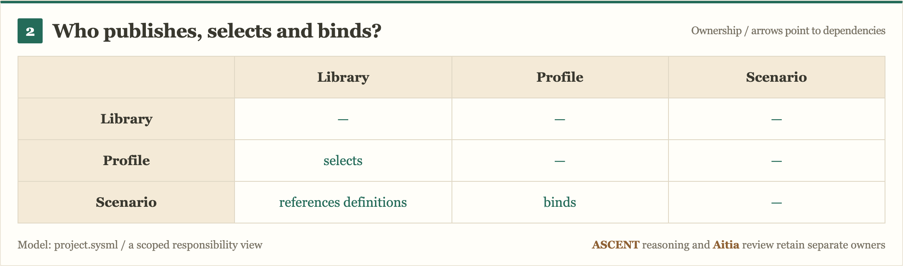
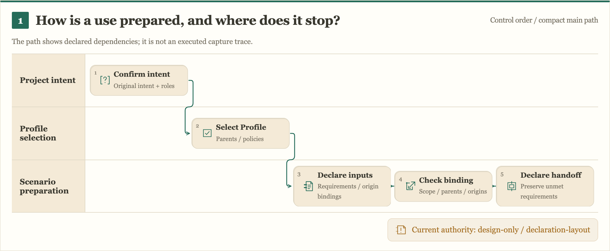

#+TITLE: Deterministic Engineering
#+SUBTITLE: Reusable engineering knowledge, checked project choices, traceable views
#+LANGUAGE: en
#+OPTIONS: toc:2 num:nil

* Purpose
:PROPERTIES:
:CUSTOM_ID: purpose
:END:

Deterministic Engineering is a Library for organizing engineering work around
explicit Questions, models, obligations, methods and evidence. A downstream
repository selects reusable definitions, binds its own project inputs and keeps
its architecture, documents and decisions associated with the checks behind them.

Scheme/POO owns the engineering declarations and composition. ASCENT answers
declared relational questions. Rust, QNT, Lean and SysML provide selected method
capabilities. The TypeScript render package presents the selected model and
source context through static D2, HTML, SVG and PNG artifacts.

* Library, Profile and Scenario
| Part | Owns | Project use |
|------+-------+-------------|
| Library | Reusable models, obligations, method bindings, policies and contracts | Publishes definitions and their identities |
| Profile | Model/parent selection, two policies, methods, catalog and mapping choices | Selects published definitions without copying their ownership |
| Scenario | Repository inputs, origins, associations and capture preparation | Binds the selected definitions to one project use |
| Project | Confirmed intent, responsibility and use scope | Composes the selected Profile and Scenario |

The source contracts and native declarations are authoritative. Version identity
is read from its owning declaration or package metadata, not from a namespace,
diagram or duplicated version table.

* Repository architecture
:PROPERTIES:
:CUSTOM_ID: engineering-ownership
:END:

<<architecture>>
The arrows below describe responsibilities and dependencies, not execution order.
The same captured model also has [[file:docs/90-99-views/90-architecture-views/90.135-library-project-architecture-sketchbook.svg][hand-drawn]]
and [[file:docs/90-99-views/90-architecture-views/90.135-library-project-architecture-node-editor.svg][technical-node]] visual variants selected in D2.
Aitia's end-to-end review integration remains a target boundary for this Case.

[[file:docs/90-99-views/90-architecture-views/90.135-library-project-architecture.svg]]

[[file:docs/90-99-views/90-architecture-views/90.135-library-project-architecture.d2][Editable D2]] · [[file:project.sysml][Project SysML model]] · [[file:docs/10-19-design/10-architecture/10.137-domain-owned-catalogs-and-native-drivers.org][Engineering ownership]]

| Source | Responsibility |
|--------+----------------|
| [[file:library/][library/]] | Domain definitions and Scheme drivers, including project organization and concurrency/resource control |
| [[file:profiles/][profiles/]] | Independent project and workload choices |
| [[file:scenarios/][scenarios/]] | Application bindings, input acquisition and source adapters |
| [[file:projects/][projects/]] | Actual project entrypoints and project test policy |
| [[file:languages-engineering/][languages-engineering/]] | Target-language projects and source, including Rust/Cargo inputs |
| [[file:packages/render/][packages/render/]] | Functional static-rendering package and optional OpenSysML SDK projection |
| [[file:examples/render/][examples/render/]] | Real downstream render consumer and domain-specific compositions |
| [[file:docs/][docs/]] | Org design arguments, D2 projections, decisions and candidate image snapshots |

The root [[file:init.ss][init.ss]] uses Yuanxu's declared module loading. The native
[[file:build.ss][build.ss]] consumes declared public roots. This repository reuses
POO/Core/Flow/module and contract mechanisms; it does not define another package
loader or model runtime.

* Engineering workflow
This diagram expresses the intended integration and its current stop. The actual
[[file:scenarios/project-formation/func.ss][capture preparation source]] still returns
=capture-blocked= and =capture = #f= for DE-CASE-01. A diagram or successful render
does not issue a capture, accepted query view, review result or authorization.

[[file:docs/90-99-views/90-architecture-views/90.02-agent-evidence-loop.svg]]

[[file:docs/90-99-views/90-architecture-views/90.02-agent-evidence-loop.d2][Editable D2]] · [[file:docs/10-19-design/10-architecture/10.31-architecture-document-and-decision-contracts.org][Architecture/document/decision contracts]]

Methods and content checks must keep their actual inputs, result semantics,
source/revision associations and open findings. ASCENT reasoning consumes explicit
facts and rules; support does not grant execution authority. Aitia review and
actual publication/use retain their own policy and responsibility boundaries.

* Static render package
[[file:packages/render/README.org][@deterministic-engineering/render]] is a static, functional Library.
Questions, copy, model/source links and resource selection stay in D2/SysML and
the project declarations. Domain composition is a pure function. Export effects
measure actual browser text/fonts/images and return artifacts plus rendering facts.

| Choice | Declaration / extension boundary |
|--------+---------------------------------|
| Diagram kind | Open project identifier; architecture and Workflow purposes stay separate |
| Organization | Project =layout= / =presentation= and a domain compositor |
| Visual style | Ordered immutable theme layers: typography, surfaces, strokes, palette and spacing |
| Icons | Ordered project-selected SVG packs, independently replaceable |
| Variant | D2-selected kind, layout, themes and icon packs over the same captured model |

The package reuses D2 model compilation, ELK.js scene layout/routing, parse5 HTML parsing, Rough.js
options/primitives, XYFlow connector paths and Playwright export. It has no
interactive whiteboard or React runtime. A node diagram or swimlane is one example,
not the framework's entire diagram vocabulary.

** Real Library / Profile / Scenario Case
The =project-owned= variants select kinds, a theme and a glyph pack defined only
in the consumer. Their source associations and current blocked state stay intact.

Architecture: [[file:docs/90-99-views/90-architecture-views/90.132-library-profile-scenario-architecture.d2][D2]] · [[file:docs/90-99-views/90-architecture-views/90.132-library-profile-scenario-architecture-comparison.png][Hand-drawn, node, matrix and project-owned comparisons]]

Workflow: [[file:docs/90-99-views/90-architecture-views/90.133-capture-preparation-workflow.d2][D2]] · [[file:docs/90-99-views/90-architecture-views/90.133-capture-preparation-workflow-comparison.png][Hand-drawn, node, swimlane and project-owned comparisons]]

** Development and verification
Use the declared Bun version from [[file:.github/workflows/render.yml][render CI]] and its pinned
package/browser dependencies. Run in =packages/render=:

#+begin_src sh
bun install --frozen-lockfile
bunx playwright install chromium
bun run typecheck
bun test
bun run test:export
#+end_src

Run the actual consumer in =examples/render=:

#+begin_src sh
bun install --frozen-lockfile
bun run typecheck
bun test
bun run case
bun run compare
bun run overviews
#+end_src

Candidate outputs and source/browser receipts are written to =.cache/render/=.
Tests include unknown declarations, model/source mutation, invalid relations and
ports, hidden Questions, unsupported primitives and failed image loading.
The Linux/macOS workflow runs the same native entries with the existing resource
bounds. [[https://github.com/hardenedlinux/deterministic-engineering/pull/2/checks][PR checks]]
are authoritative for the actual tested commit.

The [[file:docs/90-99-views/90-architecture-views/90.129-functional-architecture-rendering.svg][render architecture]] and
[[file:docs/90-99-views/90-architecture-views/90.130-llm-assisted-model-view-workflow.svg][view-authoring Workflow]]
are distinct current diagrams. Their D2 sources are maintained alongside the SVGs
and rendered through the measured TS scene API. The active SVGs and PNGs come from
the same font-settled scene; the old raw-D2 rendering path has been removed.

* Scheme package entrypoints
The canonical dependency/prelude declaration is [[file:gerbil.pkg][gerbil.pkg]]. The compiler is
Gerbil; native package commands own dependency resolution, checkout, manifests,
compilation and loading. Current commands and existing budgets live in [[file:Justfile][Justfile]]:

#+begin_src sh
just deps
just build
just test
just test-project-formation
#+end_src

These Scheme/package gates are separate from TS rendering qualification.
Historical dependency/cohort results retain their original scope; this render PR
does not establish a fresh full Scheme cold-build or runtime admission result.

* Design, cases and review
- [[file:docs/00-09-project/00-documentation/00.01-index.org][Documentation index]] — the complete design/research history.
- [[file:docs/10-19-design/10-architecture/10.142-declarative-render-extensibility-audit.org][Current render audit]] — fixed assumptions removed, owners, extension contracts and controls.
- [[file:docs/10-19-design/10-architecture/10.141-cross-language-diagram-renderer-research.org][Rendering research]] — references and decisions behind the visual approach.
- [[file:docs/10-19-design/10-architecture/10.30-current-repository-engineering-case.org][DE-CASE-01]] — this Library as the engineering case.
- [[file:docs/20-29-cases/20-gateway/20.01-gateway-sdlc.org][Gateway case]] — application questions, obligations and open work.
- [[file:docs/90-99-views/90-architecture-views/90.01-index.org][Current and historical view index]] — architecture and Workflow artifacts with explicit scope.

The repository is under active design and refactoring. Candidate models, source
observations, rendered explanations, method evidence and independent review results
remain distinct. Open findings and counterevidence stay visible for audit.
