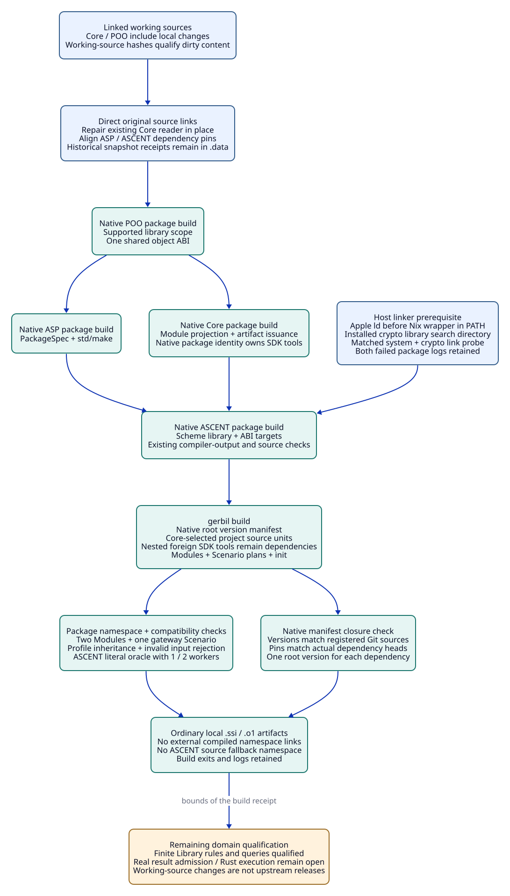

#+TITLE: 00.03 Scheme Package and Native Module Selection
#+LANGUAGE: en
#+PROPERTY: JD_ID 00.03
#+OPTIONS: toc:2 num:nil
#+STARTUP: overview
#+FILETAGS: :setup:scheme:package:bootstrap:

[[file:00.01-index.org][Index]] | [[file:00.02-local-package-links.org][Earlier package-link setup]] | [[file:../../10-19-design/10-architecture/10.06-poo-ascent-integration.org][POO/ASCENT integration design]]

* Initial package bootstrap (historical)
:PROPERTIES:
:CUSTOM_ID: scheme-package-bootstrap
:OBSERVED_DATE: 2026-10-19
:STATUS: historical-empty-entry-build-and-import-passed
:END:

The initial bootstrap established a Gerbil Scheme package with prefix deterministic-engineering.
The installed package manager's template was inspected through gerbil pkg new
in a temporary directory. That initial stage used its standard package declaration
and std/build-script library build mechanism, with a single inert entry module.
It does not include the template's sample application or an executable CLI.

#+NAME: package-bootstrap-files
| Tracked source position | Responsibility |
|-------------------------+----------------|
| [[file:../../../gerbil.pkg][gerbil.pkg]] | Package prefix; no external dependencies while the entry imports none |
| [[file:../../../build.ss][build.ss]] | Executable standard Gerbil build entry compiling init |
| [[file:../../../init.ss][init.ss]] | Importable :deterministic-engineering/init module with no exported domain API or eager work |
| [[file:../../../.gitignore][.gitignore]] | Existing local .gerbil state and generated root manifest.ss remain ignored |

From the repository root, the following commands completed with exit status0:

#+NAME: package-bootstrap-verification
#+begin_src sh :eval never :exports code
gerbil build
gerbil pkg env gxi -e '(begin (import :deterministic-engineering/init) (displayln "PACKAGE-IMPORT-OK"))'
#+end_src

Build output included compile init. The import command printed
PACKAGE-IMPORT-OK. Generated init.ssi, init.o1 and compiler metadata are under
.gerbil/lib/deterministic-engineering/. The package manager generated manifest.ss;
these are local generated artifacts, not manually supplied success receipts.
A standard-library deprecation warning did not prevent successful exit.

* Initial dependency-bearing attempt and qualification boundary
:PROPERTIES:
:CUSTOM_ID: scheme-package-dependency-boundary
:END:

An initial draft declared Core and ASCENT dependencies before the entry imported
either. gerbil build failed with exit70 while generating dependency manifests:
local metadata for github.com/tao3k/asp-gerbil-scheme.manifest was missing.
No upstream compilation or complete dependency qualification occurred.

That earlier minimal package declared only its own prefix because its entry
had no external imports. Existing local POO Flow/Core/ASCENT source links remain
untouched; a source link alone does not supply transitive manifests or compiled
imports. No dependency receipt was fabricated, dependency installation attempted,
or upstream checkout edited to make this bootstrap pass.

The historical success above did not qualify Core/ASCENT integration. The new
selection below supersedes the empty entry; its checks are reported separately.

The earlier 00.02 observation that no root gerbil.pkg existed is historical.
The root declaration now enables native project-context selection; explicit
GERBIL_PATH remains available for intentional environment overrides.

* Current Library application
:PROPERTIES:
:CUSTOM_ID: current-library-application
:END:

[[file:../../10-19-design/10-architecture/10.12-gateway-library-registration-and-runtime-dependencies.org][10.12]] supersedes the original four-publication shape below: two existing
Modules now publish Library knowledge and actual ASCENT rules, Profiles live in
profiles/gateway.ss, and one gateway-review Scenario binds them. The former
resource-check Scenario was duplicated scaffolding and is removed. All Scheme
tests now live in t/*-test.ss and export native std/test suites. The commands and
receipts below describe their respective historical source cuts, not unchanged
qualification of the current semantics. Use the 10.12 commands for current tests.

The subsequent [[file:../../10-19-design/10-architecture/10.22-domain-library-delivery-and-native-admission.org][10.22 delivery]] directly places resource assets under their domain
Library, adds the required generic parent publication and binds native review to
one captured input. Its root =Justfile= is the current bounded verification
entrypoint. The first-selection tables below remain historical observations.

* Historical first Module selection and design ownership
:PROPERTIES:
:CUSTOM_ID: native-design-module-selection
:OBSERVED_DATE: 2026-10-19
:STATUS: native-package-build-and-independent-checks-passed
:END:

[[file:../../../init.ss][init.ss]] now uses Core's native poo-flow! declaration with explicit
Modules and Scenarios windows. It selects two semantic Modules and two inert
Scenario plan publications. There is one Core selection and build projection.
No directory scan or second module resolver has been added.

#+NAME: package-native-module-owners
| Source owner | Published design values | Design contract |
|--------------+-------------------------+-----------------|
| [[file:../../../library/concurrency/resource-control/backpressure-memory/rust/interface.ss][gateway-domain]] | LocalProfile C1, inherited Cap2Profile C2 and CacheProfile; backpressure-memory Catalog metadata; Profile Contract | 10.06 parameter ownership; 10.09-10.11 resource trajectories |
| [[file:../../../modules/resource-evidence/interface.ss][gateway-evidence]] | Native ASCENT Evidence schema constructor and relation metadata; explicit Domain requirement | 10.06-10.07 evidence boundary; 20.04 queries; 30.04 oracle packages |
| [[file:../../../scenarios/gateway-review/interface.ss][gateway-review]] | Inert design-review Scenario plan with a selected Profile; explicit Domain and Evidence requirements | Capacity, cache and source change review in 20.04-20.07 |
| gateway-resource-check (historical; duplicate removed) | Inert resource-review Scenario plan with a selected Profile; explicit Domain and Evidence requirements | Backpressure, capacity, stall, retry and joint budgets in 10.09-10.11 |

The nested [[file:../../../modules/gerbil.pkg][modules/gerbil.pkg]] and [[file:../../../scenarios/gerbil.pkg][scenarios/gerbil.pkg]] use Core's existing
module-prelude. Native compilation therefore receives the same Module declaration
and role-import semantics as Core's own modules. The required types, objects,
config and interface roles are present; gateway-evidence also owns func.ss.
Its func role imports the native ASCENT Evidence DSL directly. Scenario defaults
select LocalProfile explicitly; overriding a Domain publication does not
automatically rewrite an already selected Scenario Profile. A consumer must bind
the intended Profile occurrence in its configuration or derive its Scenario plan.

[[file:../../../build.ss][build.ss]] obtains its selected source specification from init.build-spec and
runs compilation through init.build-run and std/build-script. The selected roles
are not duplicated in a manually maintained compilation list. The sole retained
ordinary root is init. The build-output directory is supplied by Core at compile
time, preserving Core's artifact issuance boundary.

#+NAME: module-selection-boundaries
| Value or interface | Current boundary |
|--------------------+------------------|
| Domain Profiles | Abstract positive integer parameters and a cache flag; C2 overrides capacity only. They are native inherited POO values, not claims that a budget is sufficient |
| Catalog metadata | Stable Library key and document/lifecycle references; no measured Rust result or complete lifecycle proof |
| Scenario plan | Purpose and Profile binding; no execution protocol, effect, gateway implementation or authorization |
| Evidence constructor | Native define-evidence source/output schema, explicitly schema-only; no domain inference or automatic registration |
| Relation references | Caller-supplied strings scoped by usage; the full claim/witness/T/V/A/cut contracts remain design obligations, not validated string contents |
| Output relations | obligation/support/counter/pending are declared with no rules or facts; declaring their names cannot satisfy any obligation |
| Dependencies | Real package imports declared in root gerbil.pkg; local linked source and reused compiled dependencies require their own qualification |

The minimal schema is a publication seam for the documented domain contracts,
not a replacement for those contracts or a second evidence engine. Independent
oracle/gold, rejection, invalidation, reuse and method admission are still the
Org design until their actual rules and owners are implemented and checked.

** Earlier source-only build and qualification observations
:PROPERTIES:
:CUSTOM_ID: native-module-qualification
:END:

The first selection attempt rejected missing required config roles. A later
attempt rejected a Scenario export that referenced its same-named initializer;
using the distinct ScenarioPlan prototype preserves the intended binding.
Native compilation also exposed the required nested module-prelude declarations.
These failures were corrected in the package sources.

The previously compiled ASCENT dependency failed at object initialization against
the currently linked POO ABI. That earlier local verification read ASCENT from its
linked source, while reusing the existing Core/POO compiled library environment.
This is source integration evidence, not a fresh build of every upstream package.
The local .gerbil library links are ignored environment state, not tracked build
inputs or a replacement package resolver.

The following commands completed with exit0 from this repository's local
dependency environment:

#+NAME: native-module-verification
#+begin_src sh :eval never :exports code
gerbil pkg env gxi build.ss compile
gerbil pkg env gxi t/module-design-test.ss
gerbil pkg env gxi -e '(begin (import :deterministic-engineering/init) (displayln "PACKAGE-MODULE-IMPORT-OK"))'
#+end_src

The selected build compiled 18 units: the two Module role sets, both Scenario
role sets and init. [[file:../../../t/module-design-test.ss][The focused Scheme qualification]] printed
MODULE-DESIGN-QUALIFICATION-OK. It demanded all four exported scopes, validated
the three Profiles, checked inherited C2 fields and the independent cache flag,
rejected zero capacity, checked the Catalog key and Scenario purposes, constructed
a native Evidence module with no domain rules, and rechecked the build inputs.
The compiled package entry also imported successfully and printed
PACKAGE-MODULE-IMPORT-OK. These are declaration/selection checks, not tests of
domain inference or runtime.

The default gerbil build command was also attempted and failed with exit70
before compilation: the project lacks gerbil-poo.manifest in its local package
metadata. Earlier attempts also lacked the ASP manifest. Native package-manager
closure remained open in that receipt. Core and ASCENT also declare different pinned transitive
POO revisions; this source-based check does not resolve or certify those pins.
No manifests were fabricated or copied from a different historical environment,
and no linked upstream checkout was rebuilt or edited to force a green result.

That earlier local source build used .gerbil/lib/core and .gerbil/lib/clan links to the
existing POO Flow compiled library tree; .gerbil/lib/gerbil-ascent points to the
linked ASCENT source root. These are explicit local prerequisites for reproducing
this receipt. The current closure below supersedes those source/library links; a fresh
environment still needs the corresponding dependency sources and native build. The package declarations retain their real imports and dependencies.

* Native dependency compatibility and package build
:PROPERTIES:
:CUSTOM_ID: native-dependency-closure
:OBSERVED_DATE: 2026-10-19
:STATUS: native-dependency-project-builds-and-checks-passed
:END:

The earlier missing manifests came from linking sources without building their
transitive packages. The earlier ASCENT object-initialization failure also mixed
old compiled artifacts with a newer POO ABI. Dependency declarations are retained.
The repair builds the actual dependency packages rather than removing imports,
writing manifest contents by hand, or reusing historical manifest files.

** Direct linked sources and native package ownership

The active links point directly to the original POO, Core, ASP and ASCENT source
workspaces. Core's existing publication reader is repaired in place. ASP's POO
pin and ASCENT's Core/ASP pins are aligned with the registered source Git heads;
Core already declares the selected POO head. No dependency is deleted. There is
no patch delivery directory, replacement framework or separate dependency engine.
Existing unrelated source changes remain in their original workspaces.

#+NAME: native-dependency-alignment
| Package | Direct linked source | Compatibility treatment | Native owner |
|---------+----------------------+-------------------------+--------------|
| gerbil-poo | poo-flow/.gerbil/pkg/github.com/tao3k/gerbil-poo | Shared working-source object ABI | Existing POO build.ss, supported library scope |
| poo-flow-core | poo-flow/core | Native package ownership check in existing reader | Core Module projection and native compiler |
| asp-gerbil-scheme | asp-gerbil-scheme | POO pin matches registered POO head | ASP PackageSpec and std/make |
| gerbil-ascent | gerbil-ascent | Core and ASP pins match their registered heads | ASCENT package build and native ABI targets |
| deterministic-engineering | This workspace | Retain all root dependencies and Module imports | Project build.ss and Core artifact issuance |

The [[file:../../../.data/package-integration-20261019/receipts/live-source-repair.json][direct-source repair receipt]] records source paths, Git heads, original status,
reader bytes and before/after dependency declarations. A Git head or native
version label does not identify dirty working-source contents. Source-cut hashes
and native build guards qualify those contents separately; subsequent edits
require revalidation. No upstream commit, push or remote CI is implied.

Earlier isolated builds under .data/package-integration-20261019/ are historical
diagnostic controls. Their [[file:../../../.data/package-integration-20261019/source-receipt.json][source receipt]] and failed/successful logs remain for
review, but those copies are no longer the registered dependency sources.
The four former .gerbil/lib namespace symlinks to external compiled trees or
ASCENT source were removed. Native compilation writes ordinary files into this
project's .gerbil/lib. The POO Flow research link remains a research input.

** Build graph and independent checks

The native package build commands are dependency ordered. Core and ASP each
consume the completed POO build; ASCENT consumes both completed builds. The
supported GERBIL_BUILD_SCOPE=library selects POO's library inventory rather than
its additional functional test groups. GERBIL_BUILD_CORES=4 bounds native compiler
jobs. No new scheduler, dependency engine or domain runtime is introduced.

#+NAME: native-dependency-build-commands
#+begin_src sh :eval never :exports code
export GERBIL_BUILD_SCOPE=library
export GERBIL_BUILD_CORES=4
# This macOS host needs Apple ld before its Nix linker wrapper.
export PATH="/usr/bin:/opt/homebrew/bin:$PATH"
# Use the installed crypto library search directory.
export LIBRARY_PATH="/opt/homebrew/lib${LIBRARY_PATH:+:$LIBRARY_PATH}"
gerbil pkg build github.com/tao3k/gerbil-poo
gerbil pkg build github.com/tao3k/poo-flow-core
gerbil pkg build github.com/tao3k/asp-gerbil-scheme
gerbil pkg build github.com/tao3k/gerbil-ascent
gerbil build
gerbil pkg env gxi t/module-design-test.ss
gerbil pkg env gxi t/dependency-compatibility-test.ss
gerbil pkg env gxi t/package-metadata-test.ss
#+end_src

[[file:../../../t/module-design-test.ss][The Module qualification]] now imports :deterministic-engineering/init through
the package namespace. [[file:../../../t/dependency-compatibility-test.ss][The dependency compatibility check]] evaluates a small native
ASCENT Evidence Program with one and two workers. Its independent literal oracle
expects input rows 0,1,2 filtered by value<2 to produce exactly 0,1; another
invocation with input3 must produce no answers. A non-integer source row must be
rejected. This exercises the shared POO ABI, typed relation admission and native
reasoning rather than relying on an empty import alone. It is not gateway gold,
a performance benchmark or a proof of every upstream behavior.

[[file:../../../t/package-metadata-test.ss][The native metadata check]] reads declarations through Gerbil
pkg-plist, compares generated package versions with git describe for each
registered source, checks dependency pins against the registered Git heads, and
requires one matching root-manifest entry for every dependency. It also requires
ordinary local library directories and regular .ssi/.o1 files for dependency and
project Module imports. It neither manufactures metadata nor selects dependencies.

The first complete ASCENT package attempt compiled its Scheme inventory but
failed linking libascent: ld could not find -lcrypto. The existing Homebrew
libcrypto.dylib is under /opt/homebrew/lib; that directory was missing from the
GCC linker search path. A minimal C program linked with -lcrypto and exited0
when LIBRARY_PATH included that directory. The [[file:../../../.data/package-integration-20261019/receipts/host-link-environment.json][host-link receipt]] records the
compiler, resolved library and environment. This is a host prerequisite, not a
change to the POO/ASCENT language contract.

The failed ASCENT log and exit70 receipt are retained. Its native artifact guard
requires rebuilding after an incomplete package attempt; the retry runs the same
full package target with the corrected linker environment. No ABI target or
artifact admission check is removed.

The crypto-path retry produced libascent but failed linking ascent-develop with
unresolved macOS system symbols, including calloc and puts. The host PATH selected
a Nix ld wrapper before /usr/bin/ld. A matched C probe using calloc/puts/free plus
-lcrypto failed under that linker selection and passed with /usr/bin first in
PATH and the crypto library directory retained. This second failed package log
and exit70 receipt are also preserved. The corrected package retry uses Apple ld
through PATH; it does not weaken symbol resolution or remove the executable.

A generated .manifest file alone is insufficient acceptance: the native package
manager writes metadata before compiling. This record requires the package exit,
completed local artifacts and independent import/compatibility checks together.
The original root checkout also contains uncommitted Module work; its native
version label alone is not a digest of those working files. The [[file:../../../.data/package-integration-20261019/receipts/project-source-inputs.json][project input receipt]]
records the selected package/source/test bytes separately from version labels.

The first native root build then rejected compiler identity
core/module-system/source/role-forms outside the deterministic-engineering prefix.
Core's publication reader had added a canonical SDK tool as a consumer compiler
input because the linked SDK happened to reside under the consumer's .data tree.
The existing final prefix check correctly refused that foreign compiler entry.
The project failure log and exit70 receipt are retained.

The direct Core reader correction keeps filesystem confinement and additionally compares
the actual native compiler identity with the kernel's package prefix obtained
through the SDK core-library-package-path-prefix API. SDK sources remain guarded
as tool dependencies; they become compiler entries only when the native package
owner matches. The build-package prefix refusal remains intact. This is an
ownership correction in the existing reader, not a post-filter of failing build
entries, a source-name allow-list or a second resolver. Rebuilding Core itself is
the control that must retain its own tool sources; rebuilding this consumer is
the regression that must exclude the nested foreign tools. The correction is
written directly to the linked Core source, and ASCENT uses that same registered
Core workspace. Its Git pin names the actual base commit; the repair receipt and
source hashes separately identify uncommitted content. A fresh checkout of that
base commit alone does not include these working-source changes.

** Historical linked-source result before Library inference
:PROPERTIES:
:CUSTOM_ID: direct-linked-build-results
:STATUS: historical-passed-local-direct-linked-sources
:END:

#+NAME: direct-linked-package-build-results
| Check | Actual result | Local receipt |
|-------+---------------+---------------|
| POO native library package | exit0 | receipts/live-poo.json |
| Core native package, original reader repaired in place | exit0 | receipts/live-core.json |
| ASP native library package, aligned POO pin | exit0 | receipts/live-asp.json |
| ASCENT native library and ABI targets, aligned Core/ASP pins | exit0 | receipts/live-ascent.json |
| Standard project gerbil build | exit0 | receipts/live-project.json |
| Package namespace and four scopes | exit0; MODULE-DESIGN-QUALIFICATION-OK | receipts/live-module-imports.json |
| ASCENT finite oracle, two worker settings, invalid source type | exit0; DEPENDENCY-COMPATIBILITY-OK | receipts/live-dependency-compatibility.json |
| Native versions, pins and local import artifacts | exit0; NATIVE-PACKAGE-METADATA-OK | receipts/live-package-metadata.json |
| Native ascent-develop startup | exit0; NATIVE-ASCENT-EXECUTABLE-OK | receipts/live-native-executable.json |

[[file:../../../.data/package-integration-20261019/receipts/live-qualified-build-summary.json][The direct-source summary]] binds these actual command exits and logs to the
registered original source paths. Native package management generates every
manifest; its version labels are checked rather than replaced. All dependencies
remain declared. The builds use this project's ordinary local artifact tree.

[[file:../../../.data/package-integration-20261019/receipts/live-source-cut-review.json][The source-cut review]] compares file hashes around the builds and checks,
including a separate pre-ASCENT capture because its original workspace was
changing concurrently. Generated formal-run logs are distinguished from Scheme
compilation inputs. The review is bounded to the recorded source cut, not future
edits. A base Git pin alone cannot reproduce uncommitted changes. This closes the
local missing-manifest/build/import gate; fresh remote installation, upstream
CI, full upstream suites and gateway domain/runtime semantics remain separate.

** Historical result for the captured integration
:PROPERTIES:
:CUSTOM_ID: native-dependency-build-results
:STATUS: passed-local-captured-integration
:END:

#+NAME: native-package-build-results
| Check | Actual result | Local receipt |
|-------+---------------+---------------|
| POO native library package | exit0 | receipts/poo.json |
| Core native package with ownership correction | exit0 | receipts/core-package-boundary.json |
| ASP native library package | exit0 | receipts/asp.json |
| ASCENT native library and ABI targets using corrected Core | exit0 | receipts/ascent-core-boundary.json |
| Standard project gerbil build | exit0; 18 selected own source units compiled | receipts/project-package-boundary.json |
| Package namespace and all four scopes | exit0; MODULE-DESIGN-QUALIFICATION-OK | receipts/module-imports.json |
| Native ASCENT finite oracle and invalid source type | exit0; DEPENDENCY-COMPATIBILITY-OK | receipts/dependency-compatibility-runtime.json |
| Native metadata, dependency pins and regular import artifacts | exit0; NATIVE-PACKAGE-METADATA-OK | receipts/package-metadata.json |
| Rebuilt ascent-develop --eval startup | exit0; NATIVE-ASCENT-EXECUTABLE-OK | receipts/native-executable-current.json |

[[file:../../../.data/package-integration-20261019/receipts/qualified-build-summary.json][The qualified build summary]] links each success to its actual native command,
exit and log; earlier failed attempts remain beside it. The compatibility fixture
initially used sorting-module names unavailable in this SDK. Its final form uses
the SDK's list-sort, retains the same literal oracle, and avoids a same-named POO
slot initializer by capturing input-rows explicitly. Those fixture import failures
are retained as test failures, not relabeled as package failures or passes.

[[file:../../../.data/package-integration-20261019/receipts/qualification-source-inputs.json][The final qualification source receipt]] binds the actual test bytes and historical correction artifact.
It confirms that native project sources did not change after their build; the
compatibility-test correction is identified separately from the earlier source
capture. The historical correction was checked against the captured Core source.
The active repair is now maintained directly in the original linked Core source.

That historical missing-manifest result applies to the captured integration.
The default project build passed with no LIBRARY_PATH override after its native
dependencies were installed. The host PATH/library prerequisites above remain
necessary when rebuilding the dependency executables on this machine. The
checks do not establish that the original old pins, concurrent later source edits,
a fresh remote install, all upstream tests, gateway domain rules or SDLC runtime
behavior have passed. The local integration commits and Core correction have
not been published upstream.

#+CAPTION: Native init selects design Modules and Scenario plans; compilation, evidence semantics and execution have distinct qualification boundaries.

[[file:../../90-99-views/90-architecture-views/90.56-scheme-package-bootstrap.d2][Editable D2 source]].
