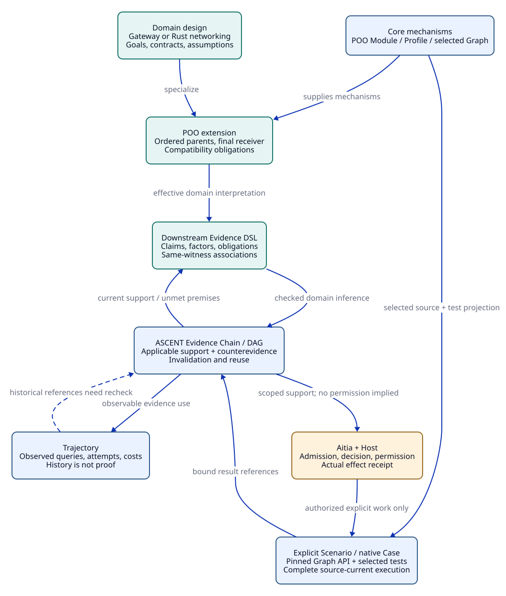

# SPDX-FileCopyrightText: 2026 tao3k team and Contributors
#
# SPDX-License-Identifier: LGPL-2.1-only

#+TITLE: 10.01 Core Engineering Design Model
#+LANGUAGE: en
#+PROPERTY: JD_ID 10.01
#+OPTIONS: toc:3 num:nil
#+STARTUP: overview
#+TODO: OPEN REVIEW | RESOLVED
#+FILETAGS: :design:model:
#+MACRO: scope Design proposal; no implementation or verification receipt is supplied here.

{{{scope}}}

[[file:../../../README.org][Repository overview]] | [[file:10.03-upstream-capabilities.org][Upstream sources]] | [[file:../../20-29-cases/20-gateway/20.01-gateway-sdlc.org][Gateway walkthrough]]

The [[file:10.02-domain-and-rules.org][domain and finite-rule contract]] specializes this model with typed relation
planes, organizational composition, bounded templates and projection requirements.
The [[file:../../20-29-cases/20-gateway/20.02-gateway-obligation-ledger.org][gateway ledger]] and [[file:../../30-39-evaluation/30-benchmarks/30.01-benchmark-design.org][evaluation protocol]] give its detailed review and measurement plans.

Read these domain obligations within the [[file:10.04-evidence-driven-workflow.org][ASCENT evidence-driven architecture]].
Evidence Chain/DAG and Trajectory remain the reusable owners of current support,
dependencies and observable reasoning history; obligation derivation is a domain
application of that system. The [[file:../../30-39-evaluation/30-benchmarks/30.02-gateway-minimal-benchmark.org][minimal pilot]] makes their gateway mapping explicit.

* Semantic boundary and identities
:PROPERTIES:
:CUSTOM_ID: model-boundary
:STATUS: proposed
:END:

This model defines what the engineering Library must mean before its surface
syntax or storage representation is chosen. The design-facing vocabulary belongs
to this repository. Upstream names cited in the [[file:10.03-upstream-capabilities.org][capability map]] retain their
own, usually narrower, meanings.

A stable name identifies a design lineage. An immutable revision identifies a
particular definition. A project snapshot fixes the transitive Library closure,
parent order, effective values, requirements, assumptions, contracts, rules,
models, profiles, and interpretation versions. Resolving a mutable tag again
creates a new candidate snapshot; it cannot silently mutate an accepted one.

Separate identities bind the implementation artifact and source tree, execution
environment, evidence production, and decision. A design digest alone cannot
identify a tested binary. Content identity establishes correspondence, not source
authority; provenance and authority require their own admission policy.

#+NAME: model-entities
| Entity | Required meaning |
|--------+------------------|
| Library entry | Versioned reusable design, applicability, parents, extension points, contracts, obligations, owner |
| Project snapshot | Resolved entry closure, effective composition, requirement and environment identities |
| Assumption | Precise premise, scope, origin, validity condition, monitor or review method |
| Contract | Preconditions, postconditions, invariants, observations, scope, consumers |
| Claim | A proposition under explicit assumptions, with an argument and required support |
| Obligation | Target, context, derivation origin, method-specific acceptance criteria, owner, dependencies |
| Evidence artifact | Immutable observation, proof, trace, review, or measurement and its production inputs |
| Admission | Decision that an artifact satisfies a particular obligation in a particular context |
| Engineering decision | Scoped acceptance, refusal, or recorded deviation for an exact target |
| Change | Before/after identities, write footprint, dependency impact, newly required work |

* POO composition and extension
:PROPERTIES:
:CUSTOM_ID: poo-composition
:STATUS: proposed
:END:

#+CAPTION: Existing Core mechanisms compose domain knowledge and evidence associations.

[[file:../../90-99-views/90-architecture-views/90.03-domain-evidence-graph.d2][D2 source]]; [[file:../../90-99-views/90-architecture-views/90.01-index.org][paired Org/D2 maintenance contract]].

** Resolve behavior before interpreting claims

A prototype provides reusable values, computations, and extension points. A child
may replace a complete value or refine a value by reading and extending its prior
definition. These operations have different meanings. Pure algorithms remain
named functions; the design object owns their role, configuration, and contracts.

Composition fixes ordered parents and the resolver interpretation, rejects
invalid ancestry or precedence conflicts, and records the effective provider of
each observed value. Parent order is semantic input. Independently valid parents
can yield an invalid child. A successful resolver provides a deterministic object
interpretation; domain contracts still require checking against the final object.

Open-recursive observations must refer to the intended final receiver, including
inherited computations affected by child overrides. The snapshot records the
resolved observations and their dependencies. Divergent observations, hidden host
effects, and dynamic reads without an admitted dependency interpretation prevent
snapshot completion or force conservative recomputation.[fn:termination]

The [[file:10.03-upstream-capabilities.org::#lean-composition][Lean composition sources]] provide relevant typed and checked construction.
They do not establish that arbitrary Scheme design definitions have identical
semantics. That correspondence is an explicit integration obligation.

** Four distinct extension operations

#+NAME: extension-semantics
| Operation | Effect | Required check |
|-----------+--------+----------------|
| Replacement | Set a complete effective value | Recheck consumers and every affected obligation |
| Value refinement | Compute a new value using an existing one | Check final-value dependencies and termination |
| Contract strengthening | Retain old acceptance conditions and add requirements | Establish conjunction and diagnostic ordering for the admitted interpretation |
| Behavioral refinement | Replace behavior while preserving a promised contract | Prove a relation over allowed inputs, outcomes, traces, and failures |

Structural contract strengthening in lean-poo has a precise existing theorem;
see [[file:10.03-upstream-capabilities.org::#lean-contracts][the mapped source]]. It must not be generalized into arbitrary behavioral
substitutability. A service implementation typically must accept the inputs its
consumers were promised, preserve required outputs and invariants, and respect
allowed failure and progress behavior. Additional environmental assumptions must
be discharged or exposed as a changed contract to affected consumers.

When a child intentionally weakens a guarantee, retain its ancestry but create an
explicit contract revision and compatibility work. Do not mark inherited claims
as proved merely because the new slot value overrides the old value.

** Composition conflicts

Examples include incompatible parent precedence, budgets whose combination
exceeds a resource envelope, retry behavior incompatible with backend semantics,
and cached policy use incompatible with a revocation requirement. Report a
conflict with its contributing entries and scope. A priority rule may resolve
value selection but cannot by itself resolve a behavioral contradiction.

* Obligation derivation
:PROPERTIES:
:CUSTOM_ID: obligation-derivation
:STATUS: proposed
:END:

** Typed input and bounded closure

The derivation input is a completed design snapshot plus an admitted, versioned
rule set. Natural-language requirements remain candidates until their domain
interpretation is reviewed. Proposed rules from an Agent remain separate from
trusted rules until admitted; the model cannot authorize its own rule changes.

Conceptual relations include: design uses capability; claim depends on
assumption; component consumes contract; obligation requires method; evidence
supports obligation; change affects dependency. These are vocabulary roles, not
published predicates or an executable DSL.

Rule heads must draw obligation instances from finite templates and bounded
bindings in the snapshot. Recursive rules may derive transitive impact or
requirements; they may not generate an unbounded sequence of fresh identifiers.
A rule that introduces a new design choice yields a new candidate revision,
followed by another bounded derivation, rather than mutating the running input.

A safe staged interpretation is:

1. Validate and freeze definitions, types, domains, and rule applicability.
2. Resolve composition and materialize effective design facts.
3. Derive positive requirements, conflicts, and dependency closure.
4. Compute scoped absence and coverage gaps only over declared complete domains.
5. Freeze the resulting obligation inventory and its derivation receipt.
6. Review domain coverage before scheduling verification work.

Checked lower-stratum negation is relevant to step 4. Absence of a supported
claim cannot prove its opposite in an open domain. Empty, partial, exhausted,
unsupported, and completed results must remain distinguishable. Native closure
may be budget-limited; general termination is not supplied by upstream admission.

** Obligation identity and traceability

An obligation's stable lineage records its target and intended property. Its
revision additionally fixes the property interpretation, premises, required
methods, acceptance policy, model/source correspondence requirements, and
applicable profile. Multiple rules deriving the same obligation merge origin
support without dropping distinct acceptance requirements. A changed acceptance
criterion creates a new revision even if the displayed name is unchanged.

#+CAPTION: Illustrative rule meanings, not executable clauses.
#+NAME: obligation-examples
| Design fact combination | Derived requirement |
|-------------------------+---------------------|
| Retry enabled + upstream attempt budget | Check that every attempt acquires and releases resources correctly |
| Retry enabled + non-idempotent operation | Require a verified replay contract or prohibit automatic retry |
| Replication enabled + local limit | State aggregate scope; require coordination design if a strict global limit is claimed |
| Response cache enabled + tenant authorization | Check cache key isolation, authorization context, policy validity, invalidation, memory |
| Claim consumes another component contract | Add integration correspondence and environment compatibility work |

Derivation establishes that rules produced an inventory, not that the inventory
covers all engineering risks. Coverage is a separate review obligation linking
requirements, hazards, threat models, interfaces, claims, and methods. Changes to
rules or coverage scope invalidate the inventory-completeness claim even when all
previously listed obligations remain satisfied.

* Evidence, invalidation, and reuse
:PROPERTIES:
:CUSTOM_ID: evidence-reuse
:STATUS: proposed
:END:

** Artifact, observation, and admission are separate

Evidence artifacts are immutable. An admission relates an artifact to a target,
context, obligation revision, and acceptance policy. A later change can revoke
that admission without deleting or rewriting the artifact. A passing old test is
still an observation of its old target; it is not a current passing test.

#+NAME: evidence-bindings
| Binding | Examples |
|---------+----------|
| Design | Library closure, effective contract, assumptions, final receiver observations |
| Program and model | Source/artifact digest, extraction or translation identity, model revision |
| Execution | Toolchain, exact command, environment, dependencies, seed, work/time bounds |
| Outcome | Completeness, exit status, result, counterexample, logs, verifier outcome |
| Acceptance | Obligation revision, policy revision, authority, scope, expiry or revocation |

Evidence can be a fact, a checked derivation fragment, a theorem application, a
model result, an experiment, or a review. A proof artifact carries a proposition;
a measurement carries observations under a workload. Their admission criteria
and transport rules differ.

** Dependency model and change propagation

Represent logical dependencies, negative premises, complete-domain declarations,
aggregate groups, rule versions, and correspondence assumptions explicitly.
Dependencies among recursive facts may contain cycles; group recursive components
for impact analysis and require grounded support. A cycle cannot serve as its own
base justification.

For a change set Delta, compute the reverse dependency closure from changed
inputs through derived facts, obligations, admissions, arguments, and decisions.
Withdraw affected current admissions before publishing the new snapshot. Preserve
unaffected candidates, then apply their type-specific reuse checks. Unknown
footprints or opaque effects cause conservative invalidation of the affected
scope. Graph registration completeness is itself a required obligation.

A source removal can add a conclusion through negation. Duplicate support can
preserve an answer after one support is removed. Therefore neither answer equality
nor one remembered witness proves that a previous receipt is still current.
The [[file:10.03-upstream-capabilities.org::#ascent-updates][upstream update mechanism]] offers relation-level recomputation for an eligible
subset; it does not supply this whole engineering dependency registry.

Publication must be atomic across the new input, derived inventory, and admission
view. A failed prospective update retains the last completed immutable snapshot as a
record. It does not roll back external changes or make that record current for a
changed environment; affected present-use eligibility remains withdrawn. Concurrent
work returns evidence against its original identity; ingestion and the final
engineering decision both recheck the current target, avoiding stale task results.

Currentness at consumption is one coherent check of the required version tuple,
not a collection of checks that succeeded at different instants. A change between
validation and use requires atomic check/commit or a justified fencing protocol;
remote effect enforcement remains a separate actual receiver obligation. Later
revocation withdraws affected future eligibility and preserves genuinely completed
past effects. See the [[file:../../20-29-cases/20-gateway/20.03-gateway-design-audit.org::#audit-full-walk][audited gateway handoffs]].

** Three reuse paths

#+NAME: reuse-paths
| Path | Conditions | Result |
|------+------------+--------|
| Same-context read | Bound inputs, obligation, policy, validity and authority remain current | Existing admission remains usable |
| Unaffected-change transport | Certified dependency/frame conditions, same property interpretation, applicable method policy | New target admission with explicit transport justification |
| Changed-premise transfer | Explicit equivalence or refinement theorem plus current applicability checks | New derived evidence and admission; otherwise rerun |

In lean-poo, an obligation includes ~dependencies~, ~holds~, and a ~stable~ proof;
a patch includes ~touched~ and a ~frame~ proof. Unaffected dependencies permit
~Proof.reuse~; ~Proof.close~ still needs affected old obligations and added ones.
~pending~ and ~closePending~ expose the corresponding finite work list. This
is proof transport over supplied typed semantics, not automatic discovery of
real-world dependencies or proof of an arbitrary verifier's correctness.

Transport must include environment, interpretation, source correspondence, and
acceptance-policy dependencies where relevant. A theorem about a parameterized
counter algorithm may survive a budget change; a benchmark at the old budget
usually cannot establish performance at the new one. Engineering admissions may
use this theorem only after its premises and correspondence are checked.

ASCENT receipt rebinding is a separate constraint: unchanged answer rows do not
permit copying a receipt to another source generation. Current checking or a
supported transfer must create a valid current result reference. A source-local
consistency digest is not an authenticated producer signature.

** Orthogonal result dimensions

#+NAME: result-dimensions
| Dimension | Values | Meaning |
|-----------+--------+---------|
| Execution | pending, running, complete, failed, incomplete | What actually ran and whether it finished |
| Check verdict | supported, contradicted, unknown | What the method established within its scope |
| Admission | candidate, admitted, refused, invalidated | Whether that result supports this current obligation |
| Applicability | applicable, not-applicable, unresolved | Whether the obligation applies, with reviewed justification |
| Decision | accepted, refused, deviation | Engineering disposition under a named authority and scope |

A counterexample search can complete successfully and establish a contradiction.
A successful process can emit an incomplete verification result. An unsupported
statement stays unknown; it is not automatically false or not applicable.
Conflicting observations stay recorded until an explicit resolution is accepted.

* SDLC and decision closure
:PROPERTIES:
:CUSTOM_ID: sdlc-closure
:STATUS: proposed
:END:

A work package binds an immutable design, obligation inventory, stage, source
baseline where relevant, task dependencies, authority, budgets, expected artifacts,
and acceptance criteria. Lambda Aitia owns SDLC/assurance semantics and integrates
execution; Core owns reusable mechanisms. This Library proposes domain designs
and obligation/evaluation contracts, not a second assurance authority. The concrete
integration and standards mapping remain open. Authorization is stage-specific:
current work packages may request design modeling and review only.

An executor may split tasks but must retain parent work and obligation identity.
Retries preserve failed attempts. Results enter as candidate evidence, undergo
binding and method-specific checks, then update the argument and scoped decision.
No executor completion flag substitutes for these steps.

Acceptance requires a current, completed and coverage-reviewed obligation
inventory; applicable assumptions; current admissions satisfying each required
method; no unresolved blocking conflict or objection; and the required decision
authority. An AND argument requires every child; an OR argument must name its
allowed alternatives and accepted support. Counting passed tasks is insufficient.

Design acceptance, model acceptance, implementation acceptance, and operational
acceptance are distinct scopes. A deviation records unmet requirements, owner,
reason, allowed use, expiry, and review; it cannot certify the original claim.
A monitored assumption violation withdraws affected operational acceptance and
opens new design/SDLC work. Generalizing a project repair into the Library requires
review of applicability and consumers before a new Library version is published.

* OPEN Integration obligations :integration:
:PROPERTIES:
:CUSTOM_ID: model-open-work
:STATUS: open
:END:

- [ ] Review and freeze the proposed engineering vocabulary and R01-R15 templates.
- [ ] Specify Scheme POO observations and their correspondence to the chosen Lean interpretation.
- [ ] Prove or conservatively enforce dependency registration and change footprints.
- [ ] Define method-specific evidence admission and transport policies.
- [ ] Specify atomic publication, concurrency, authority, and provenance checks.
- [ ] Map work packages to verified lambda-aitia capabilities and applicable standards.
- [ ] Discharge the gateway obligations and independent coverage review.

These are design follow-ups, not completed implementation tasks. The
[[file:../../20-29-cases/20-gateway/20.01-gateway-sdlc.org::#case-review][gateway review]] checks how their absence affects the lifecycle.

* Footnotes

[fn:termination] Bounded observation and a finite object graph do not by themselves
prove termination of arbitrary open-recursive computations. See the upstream
README boundary recorded in the capability map.
