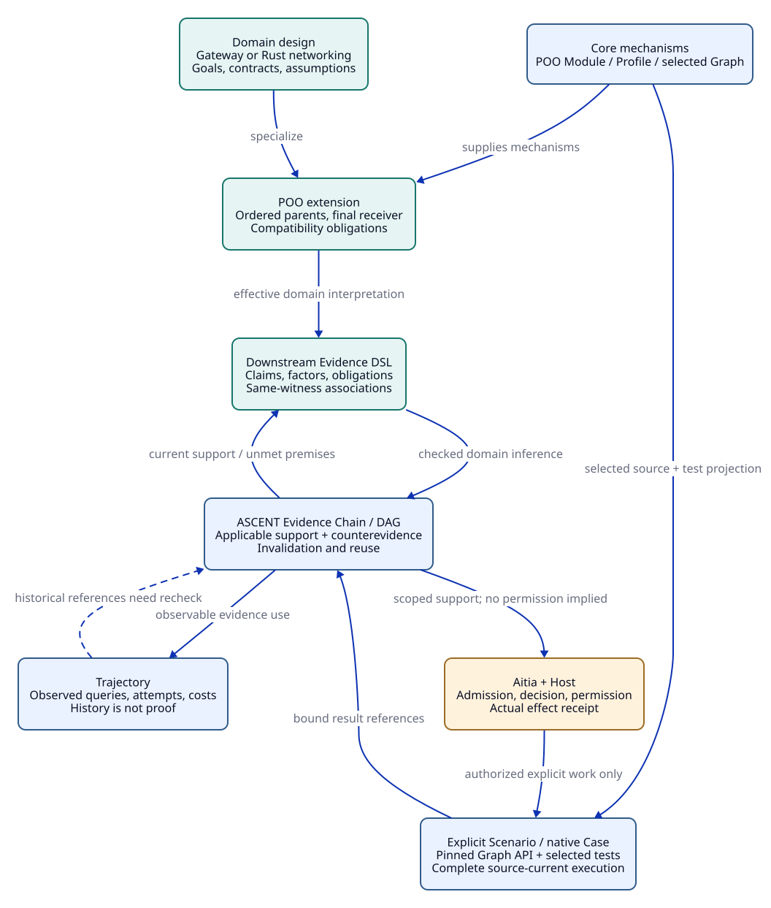

# SPDX-FileCopyrightText: 2026 tao3k team and Contributors
#
# SPDX-License-Identifier: LGPL-2.1-only

#+TITLE: 10.02 Engineering Domain Objects, Relations, and Finite Rule Templates
#+LANGUAGE: en
#+PROPERTY: JD_ID 10.02
#+OPTIONS: toc:3 num:nil
#+STARTUP: overview
#+TODO: OPEN REVIEW | RESOLVED
#+FILETAGS: :design:domain:rules:
#+MACRO: boundary Proposed semantic contract. Names below are design notation, not published Scheme predicates or an implemented schema.

{{{boundary}}}

[[file:10.01-core-model.org][Core model]] | [[file:10.03-upstream-capabilities.org][Inspected foundations]] | [[file:../../20-29-cases/20-gateway/20.02-gateway-obligation-ledger.org][Gateway derivations]] | [[file:../../30-39-evaluation/30-benchmarks/30.01-benchmark-design.org][Evaluation contract]]

* Domain objects and identity
:PROPERTIES:
:CUSTOM_ID: domain-objects
:STATUS: proposed
:END:

The Library maintains reusable design definitions. Applications compose a resolved
project design with Core mechanisms and Aitia lifecycle policy. This document
specifies domain meaning; it introduces no parallel object kernel, module resolver,
assurance service or execution runner.

The [[file:10.04-evidence-driven-workflow.org][ASCENT evidence-driven contract]] owns Evidence Chain/DAG and Trajectory.
R01-R15 specialize engineering inference within that foundation. Gateway source,
method and assumption associations belong in the downstream Scheme Evidence DSL;
do not introduce a second relevance engine, navigator or evidence truth store.

Each object has a kind, stable lineage ID, immutable revision, owner, provenance,
interpretation version and scope. Names alone do not establish object identity.
An unresolved reference blocks completion of the snapshot that requires it.

An immutable draft may retain explicit unknowns and yield a provisional work
inventory. It must carry an incomplete-design status and cannot be presented as a
completed design/coverage receipt. Complete relational closure over that draft's
known facts does not resolve its missing engineering inputs. Acceptance of a
verification stage requires the inputs that stage actually consumes to be fixed.

#+NAME: domain-object-catalog
| Object family | Additional required content | Identity-sensitive changes |
|---------------+-----------------------------+----------------------------|
| Requirement | Measurable target or reviewed qualitative criterion; consumers | Goal, threshold, applicability |
| Hazard / Threat | Undesired outcome, adversary or fault model, affected interface | Attack/fault scope, mitigations |
| Component / Interface | State owner, inputs, outputs, boundary, consumed/provided contracts | Protocol, parser, state owner, routing |
| DesignEntry / DesignInstance | Parents, extension points, effective observations, selected closure | Parent order, final receiver, selected entries |
| Contract / Claim | Proposition, observations, assumptions, guarantee scope | Premise, interpretation, promised behavior |
| Assumption | Origin, check/monitor, validity and failure response | Clock, fairness, trust, validity window |
| Profile | Contextual policy and parameters over admitted extension points | Budget, environment, security/test policy |
| RuleTemplate | Typed premises, finite bindings, conclusion, stratum, authority | Logic, applicable domain, required methods |
| ObligationTemplate | Target/property family, context, method slots, acceptance policy | Criterion, method, property interpretation |
| ObligationInstance | Bound template, target and context, origins, required method set | Any effective input to its proposition or policy |
| Argument | AND/OR structure, child claims, objections, allowed alternatives | Support structure, unresolved objection |
| Artifact / Projection | Content identity, input snapshot, producer, interpretation | Source content or transformation |
| Evidence / Observation | Result, method, complete scope, production bindings | Target, tool, configuration, producer |
| Admission / Decision | Accepted target context, policy, authority, reasons, validity | Any required dependency or authorization |
| Change / Impact | Before/after snapshots, footprint, typed dependency closure | Added/removed facts, unknown effects |
| WorkPackage / Attempt | Stage, exact obligations, authority, limits, expected artifacts | Selection, retry, source epoch, tool budget |
| OrganizationRole / Assignment | Responsibility, scope, validity, separation requirements | Principal, role policy, ownership conflict |
| StandardClause / Tailoring | Standard/version/clause, applicability, reviewed mapping | Standard revision, exception, scope |
| EvaluationCase / Oracle / Run | Task identity, hidden reference, budgets, scoring policy | Corpus split, checker, intervention, environment |

Evidence does not acquire authority by being placed in a Library. Claims and
counterexamples retain their modality: observed, proved-with-premises,
model-explored, hypothesized and counterfactual are not interchangeable.

* Organizational composition through Core
:PROPERTIES:
:CUSTOM_ID: organizational-composition
:STATUS: proposed-mapping
:END:

Use the [[file:10.03-upstream-capabilities.org::#core-module-system][inspected Module mechanisms]] to organize domain responsibilities, reusable
Profiles to specialize them, and Scenarios/Cases to project explicit work. Domain
names in the table are proposed roles, not existing Core exports.

#+NAME: organization-mapping
| Engineering concern | Proposed Module responsibility | Profile / Scenario specialization |
|---------------------+--------------------------------+-----------------------------------|
| Requirements and architecture | Publish goals, interfaces, assumptions, arguments | Service kind and environment Profile; design-review Scenario |
| Verification | Publish obligations, method and artifact contracts | Bounded model, proof, replay and resource Profiles |
| Organization | Publish scoped responsibilities and review requirements | Project/team assignment Profile; conflict review Scenario |
| Standards | Import applicable Aitia standard facts and mappings | Version/tailoring Profile; clause coverage Scenario |
| Evaluation | Publish task and metric definitions, not hidden answers | Frozen cohort and budget Profile; evaluation Scenario |
| Gateway | Supply gateway domain objects and extension obligations | Tenant/security/deployment Profiles; gateway lifecycle Cases |

Module source roles retain their native meanings: types own kinds/Contracts,
objects own extensible values, funs own pure algorithms, config owns composition,
and interface publishes the admitted surface. A domain Module's tests belong to
its selected source closure; cross-Module Cases belong to explicit integration
selection. A selected Graph is shared by build/test projections rather than
reconstructed by a new engineering resolver.

A Role assignment provides accountability, not runtime authority. Evidence
production, admission, and effect authorization may require separate roles under
a project policy. The same principal may serve multiple roles only when the
policy permits it. Missing required assignments and review conflicts are explicit
obligations; no new universal organizational hierarchy is assumed.

Selection must not execute effects. POO overrides cannot silently remove mandatory
verification or standard clauses. Intentional tailoring changes the applicable
contract, records justification and reviewer authority, and reopens consumers.
Aitia owns SDLC/assurance/standards semantics; this Library supplies domain facts
and reusable designs under that ownership boundary.

* Typed relation planes
:PROPERTIES:
:CUSTOM_ID: typed-relations
:STATUS: proposed
:END:

Relation direction is explicit. ~depends-on(consumer, prerequisite)~ propagates
impact from a changed prerequisite to its consumers. All assertions bind their
source revision and scope. A cross-plane inference requires an admitted bridge
rule and its premises; no generic transitive edge relation carries all meanings.

#+NAME: relation-signatures
| Plane | Proposed relation signature | Required semantics / forbidden inference |
|-------+-----------------------------+-----------------------------------------|
| Provenance | generated-by(Artifact, Attempt); derived-from(Artifact, Artifact) | Origin and transformation; does not establish correctness or causation |
| Structural | parent-at(Design, Position, Design); resolves(Design, Observation, Provider) | Ordered ancestry and effective provider; does not preserve contracts automatically |
| Structural | consumes(Component, Contract); provides(Component, Contract) | Declared interface use; needs correspondence and compatibility checks |
| Dependency | depends-on(Node, Node); reads-scope(Node, Scope) | Complete impact prerequisites, including absence and aggregate scope |
| Requirement | addresses(Claim, Requirement); mitigates(Claim, Hazard) | Coverage candidate, reviewed independently |
| Derivation | instantiates(Obligation, Template, Binding); origin(Obligation, Rule, SupportSet) | Why a requirement exists; does not discharge it |
| Assurance | supports(Evidence, Claim); defeats(Evidence, Claim); discharges(Admission, Obligation, Method) | Typed, current support; explicit contradictions remain visible |
| Change | touches(Change, Node); impacts(Change, Node); invalidates(Change, Admission) | New target eligibility, not deletion of historical observations |
| Argument | requires-all(Argument, Child); permits-alternative(Argument, Group, Child) | Named AND/OR structure; no implicit majority vote |
| Temporal | precedes(Event, Event); observed-at(Observation, Cut) | Ordering under a declared clock/cut; not a causal explanation |
| Causal | enables(Event, Event); causal-parent(Event, Event) | Requires an admitted causal interpretation beyond temporal proximity |
| Organization | responsible-for(Role, Target); assigned(Principal, Role, Scope) | Accountability; cannot produce action authorization |
| Authority | authorizes(Decision, Principal, Action, Resource, Context) | Exact policy and current scope; cannot be inferred from supported claims |
| Lifecycle | implements(Artifact, Design); verifies(Attempt, Obligation); returns(Attempt, Artifact) | Source/target mapping and execution trace; not automatic acceptance |
| Evaluation | selected-in(Case, Cohort); scored-by(Run, Policy); checked-by(Artifact, Oracle) | Frozen selection and grading boundary; grader facts are not Agent input |

~supports~ and ~defeats~ may coexist. Admission must resolve the conflict or retain
it as unresolved. Removing one witness does not prove a claim false; surviving
alternative grounded support may justify rederivation and new admission.

* Finite rule contract
:PROPERTIES:
:CUSTOM_ID: finite-rule-contract
:STATUS: proposed
:END:

** A bounded universe before evaluation

A snapshot supplies finite sets of subjects S, templates T, bindings B, methods M,
roles P, dependency nodes D and scopes K. Enumerate obligation keys from the
allowed subset of S x T x B; method requirements come from those keys x M. Keys
are predeclared identifiers, never freshly nested terms constructed during
recursion. Each actual binding includes snapshot and interpretation identity.

Budgets bound these sets, input rows, derived rows, rule work, proof work and
storage. Finite domains bound the possible closure but do not make it affordable;
admission checks the configured caps, and exhaustion yields incomplete output.
Numeric parameters such as C are frozen data used by checked comparisons or
external methods, not an unbounded recursive successor generator.

Only the checked relational subset justified by the ASCENT capability map is a
candidate lowering target. This design does not assume arbitrary set construction,
callbacks, theorem execution or effectful object observation inside a rule.

** Strata and acceptance separation

#+NAME: rule-strata
| Stage | Inputs / outputs | Constraint |
|-------+------------------+------------|
| F0 | Frozen definitions, observations, explicit applicability and scope declarations | Completed source/POO interpretation; no unresolved required reads |
| F1 | Positive domain matches, dependency and conflict closure, required obligations/methods | Range-restricted finite positive rules; grounded recursive support |
| F2 | Domain/coverage gaps over declared complete F1 inventories | Lower-stratum negation; scope completeness is explicit |
| F3 | Candidate result binding and admission work | External verifiers and Aitia policy supply checked facts; derivation cannot assert their success |
| F4 | Missing method support and argument/decision eligibility over frozen current admissions | New result epoch; complete method inventory required; actual decisions retain authority |

F0 may import immutable prior-epoch admissions and externally verified certificate
references, with current applicability checked for the new snapshot. R12 and R15
use those frozen prior inputs; R13 uses already checked certificate premises.
They cannot consume new F3 success facts and feed them back into the same F1
closure. New F3 admissions, revocations or verification outcomes start a new
epoch before rederivation. F4 observes a frozen completed admission inventory;
absence there means an unmet method slot, not global absence of evidence.

No rule both creates its own premise and declares the resulting evidence valid.
Admission changes start a new result epoch. Cross-epoch references require binding
checks. F4 eligibility is not a grant of authority or a completed external effect.

** Template register

Each template has the following fixed fields: ID/revision, typed finite binding
universe, positive premises, scoped negative premises if any, conclusion family,
origin support, dependencies, required methods, invalidation triggers, and oracle
controls. The shorthand below is prose-level logic.

#+NAME: finite-template-register
| ID | Positive trigger / reviewed scope | Conclusion | Sensitive inputs |
|----+-----------------------------------+------------+------------------|
| R01 | Component consumes another component contract | Compatibility + source/interface correspondence obligation | Both contracts, transport, environment |
| R02 | Tenant-aware dispatch | Identity/authorization and tenant-isolation obligation | Trust, parser, route and policy semantics |
| R03 | Resource ownership or bound configured | Conservation, acquire/release and byte accounting obligations | Every lifecycle path, cap, buffer ownership |
| R04 | Retry enabled | Attempt-count, deadline, replay and resource obligations | Backend contract, retry policy, cancellation |
| R05 | Replicas + local limit | Scope/aggregate obligation; global claim additionally requires a coordination design | Incarnation set, partition/restart assumptions |
| R06 | Distributed policy or revocation requirement | Version, freshness, expiry and in-flight policy obligations | Clock, validity window, distribution |
| R07 | Cache enabled + authorization-sensitive response | Key context, hit authorization, invalidation and memory obligations | Tenant/principal/role scope, content, policy |
| R08 | Performance claim | Workload-bound measurement and resource evidence obligations | Targets, hardware, artifact, methodology |
| R09 | Selected requirement/hazard/interface inventory | Independent coverage review obligation | Inventory, rules, assumptions, reviewer policy |
| R10 | Applicable standard clause / mandatory role policy | Clause mapping, tailoring or assignment/review obligation | Standard version, policy and authority |
| R11 | Changed prerequisite + registered dependency | Transitive impact candidate | Positive/negative/aggregate dependencies and interpretation |
| R12 | Impacted admission input | Withdraw current eligibility; require recheck or checked transfer | Binding, authority, policy, verifier and scope |
| R13 | Old certificate + certified unaffected footprint | Proof-transport candidate | Stable/frame proofs and unchanged interpretation |
| R14 | Expected obligation/method slot in complete inventory, no current admission | Explicit missing-support gap | Inventory closure, current result epoch |
| R15 | Observed assumption violation or accepted defeating evidence | Reassessment obligation and affected-decision withdrawal work | Observation modality, source/cut and admission policy |

R05's stronger global-limit branch is triggered by an explicit global claim, not
inferred from replication. R04 does not infer idempotency from a method name.
R07 does not infer isolation from a tenant-prefixed key without an admitted
context mapping. R10 cannot infer compliance from a complete task list. R13 never
creates a runtime permission or transports an unverified artifact by equality of
its displayed result.

R11 is positive recursive reachability over a registered finite graph. R14 is
negative and permitted only after its obligation/method domain and admission view
are frozen. If completeness is unknown, publish an unresolved scope issue instead
of a false missing/safe judgment. Insertion, removal or replacement in a negative/aggregate scope invalidates
the associated result even when the new member had no pre-existing point edge.
Dependency completeness includes that scope identity. Recursive supports require
a surviving base justification; after base removal a cycle cannot support itself.
The [[file:../../20-29-cases/20-gateway/20.03-gateway-design-audit.org::#audit-subcontrols][S11/S12 controls]] make these requirements explicit.

#+NAME: finite-binding-methods
| Template | Finite binding source | Stage / output kind | Required review or method slots |
|----------+-----------------------+---------------------+---------------------------------|
| R01 | Selected component/interface-contract pairs | F1 obligation | Compatibility review and source/interface mapping |
| R02 | Selected gateway/route/security-context scopes | F1 obligation | Authorization model, threat review, negative interfaces, source mapping |
| R03 | Declared resource/lifecycle/cap scopes | F1 obligation | Conservation argument/proof, interleavings, accounting and resource experiments |
| R04 | Selected retry/operation/backend-contract tuples | F1 obligation | Replay applicability, attempt/deadline model, fault reproduction |
| R05 | Replica scope/local-limit/global-claim tuples | F1 obligation | Scope argument; coordination design/methods when global claim selected |
| R06 | Selected policy/distributor/revocation scopes | F1 obligation | Version/time interpretation, model, security and implementation checks |
| R07 | Selected cache/response/authorization scopes | F1 obligation | Key/context and invalidation review, adversarial replay, memory evidence |
| R08 | Predeclared performance-claim/workload scopes | F1 obligation | Measurement protocol, exact artifact/environment and statistical sufficiency |
| R09 | Reviewed requirement/hazard/interface inventory scopes | F1 obligation; F2 scoped coverage gaps | Independent coverage review; unresolved scope is not complete |
| R10 | Applicable clause/role-policy/target tuples | F1 obligation | Version/tailoring or assignment/reviewer checks |
| R11 | Changed nodes and registered dependency-node pairs | F1 impact view | Grounded reverse closure, complete registration or conservative fallback |
| R12 | Admissions and their impacted prerequisite tuples | F1 withdrawal/recheck requirement | Currentness and target checks at ingestion/decision boundaries |
| R13 | Prior proof/patch/dependency tuples and checked witness references | F1 transfer candidate | External stable/frame, unchanged interpretation and current method policy |
| R14 | Frozen required obligation/method slots and current admission epoch | F4 missing-support view | Complete domain and external F3 admissions; no unknown-to-false conversion |
| R15 | Reviewed observation/assumption/claim scopes | F1 reassessment requirement | Modality and cut binding, defeat/assumption-violation admission |

Methods are versioned sets attached to a template/profile, not literal code in
these tables. Their finite candidate slots are allocated before closure. A role
policy may require independent review in addition to the listed technical methods.
Templates R11-R15 produce derived views and required actions; they do not themselves
mutate Aitia state, run a theorem prover or authorize an external effect.

** Deduplication and rule changes

An obligation key is target revision + template/property revision + binding +
context interpretation. Rule-origin supports are alternatives for why that same
key is required. Distinct required methods accumulate; incompatible acceptance
criteria become a conflict. Display labels such as GW-02 name a family rather
than one atomic obligation.

New rules cannot erase previously mandatory obligations by omission. Removing or
retiring an obligation needs an explicit applicability/contract change and review.
Retain its historical key, evidence, reason and consumer impact. Recompute the
inventory and coverage review after any rule-set change. A finite rule closure
proves only what that rule set derives; no rule proves its own real-world coverage.

* Projections: Org, D2, QNT, Lean and JSON
:PROPERTIES:
:CUSTOM_ID: projection-contract
:STATUS: proposed
:END:

#+CAPTION: Typed ownership and evidence associations shared by the prose and graph projections.

[[file:../../90-99-views/90-architecture-views/90.03-domain-evidence-graph.d2][D2 source]]; [[file:../../90-99-views/90-architecture-views/90.01-index.org][paired Org/D2 maintenance contract]].

The admitted Scheme design snapshot is the proposed semantic owner. Org is the
authored design/argument workspace; reviewed clauses become typed input through
an explicit interpretation step. No arbitrary prose or diagram label becomes a
fact automatically. Each projection records producer/version, exact source
snapshot, stable target IDs and scope. Changes are reconciled as new snapshots.

#+NAME: projection-obligations
| Surface | Role | Required correspondence / negative control |
|---------+------+--------------------------------------------|
| Org | Requirements, arguments, obligation registers, source-bound review | Stable IDs, links and reviewed interpretation; syntax-valid contradictory prose is not accepted |
| D2 | Structure, relation-plane and trust-boundary views | IDs/edges match selected snapshot; a hidden authority edge cannot be rendered as generic dependency |
| Quint / QNT | Bounded state and fault exploration | Transition/parameter/fairness mapping; counterexample and bounded nonfinding retain distinct verdicts |
| Lean / lean-poo | Properties, typed composition and proof transport | Premise/proposition identity, checker/axiom policy and source mapping; no assumed domain bridge |
| JSON | Versioned task, evidence and scoring interchange | Lossless typed identities, enum/number semantics, canonicalization and authority separation |

JSON is a transport projection, not a second user-facing configuration language.
Its future contract must reject duplicate keys, ambiguous numbers, unknown required
versions, wrong relation kinds, unknown status enums, detached references and
identity substitution. Encode identifiers and arbitrary exact quantities with
explicit types and units; define missing/null and ordering/set semantics. A
schema-valid payload still needs semantic, provenance and freshness admission.
Pretty-printed JSON equality is not proof of semantic identity.

Evaluate round trips for the representable data subset. Proof certificates,
private artifacts and other nonserializable values use typed content references;
a round trip cannot reconstruct their authority or prove the referenced object.
Do not require textual equality across Org, D2, QNT and Lean: require declared
observation correspondence and reject stale or unsupported projections.

The [[file:10.07-claim-witness-reference-contracts.org::#finite-claim-witness-rules][CW01-CW16 finite templates]] specialize this contract for claim/witness/T/V/A
binding. They preserve R01-R15 ownership and epoch boundaries; canonicalization,
external verification and actual admission are not rule-generated truths.

* OPEN Domain closure obligations :review:
:PROPERTIES:
:CUSTOM_ID: domain-open-work
:STATUS: open
:END:

- [ ] Review object kinds, units, plane signatures and modality constraints with Aitia.
- [ ] Freeze finite bindings, caps, template criteria and applicability inventories.
- [ ] Define final-receiver observation and external dependency completeness policy.
- [ ] Define projection parsing/canonicalization and semantic correspondence.
- [ ] Review mandatory-method accumulation, retirement and negative-scope rules.
- [ ] Validate each template against independent positive, negative and unknown controls.

The [[file:../../20-29-cases/20-gateway/20.02-gateway-obligation-ledger.org][gateway ledger]] instantiates these requirements on paper. The
[[file:../../30-39-evaluation/30-benchmarks/30.01-benchmark-design.org][evaluation plan]] specifies future checks; neither supplies an implementation.
