# SPDX-FileCopyrightText: 2026 tao3k team and Contributors
#
# SPDX-License-Identifier: LGPL-2.1-only

#+TITLE: 10.04 Evidence-Driven Engineering on ASCENT, POO, and QNT
#+LANGUAGE: en
#+PROPERTY: JD_ID 10.04
#+OPTIONS: toc:3 num:nil
#+STARTUP: overview
#+TODO: OPEN REVIEW | RESOLVED
#+FILETAGS: :architecture:evidence:reasoning:
#+LINK: smp https://github.com/tao3k/gambit-SMP/blob/2125416e8809b0fab86fd8341876cb984e937589/%s

[[file:../../../README.org][Overview]] | [[file:10.02-domain-and-rules.org][Domain rules]] | [[file:../../40-49-research/40-reference-studies/40.02-selected-system-and-proof-case.org][Selected references]] | [[file:../../30-39-evaluation/30-benchmarks/30.02-gateway-minimal-benchmark.org][Minimal benchmark]]

Engineering Agent means an [[file:10.05-agent-reasoning-and-design-convergence.org::#llm-agent-terminology][LLM-based AI agent]]. Its model-backed reasoning and
ASCENT's explicit relation derivation have separate responsibilities.

* Primary architecture
:PROPERTIES:
:CUSTOM_ID: evidence-primary-architecture
:ASCENT_PR: https://github.com/tao3k/gerbil-ascent/pull/1
:ASCENT_REVISION: fdabdc37731fa85088f96cb9e0b0901c799986ae
:SMP_REVISION: 2125416e8809b0fab86fd8341876cb984e937589
:INSPECTED_ON: 2026-10-18
:STATUS: source-grounded-design
:END:

#+CAPTION: Evidence informs open Agent reasoning and returns execution feedback.

[[file:../../90-99-views/90-architecture-views/90.02-agent-evidence-loop.d2][D2 source]]; [[file:../../90-99-views/90-architecture-views/90.01-index.org][paired Org/D2 maintenance contract]].

ASCENT is the evidence-chain-driven reasoning foundation. Relational closure,
obligation derivation and impact are capabilities within that architecture, not
its entire role. The engineering Library supplies reusable POO domain designs,
registered evidence facts and associations, claim/obligation interpretations and
reviewed evaluation cases. Core supplies compositional mechanisms; Aitia owns
lifecycle assurance policy and execution integration.

The earlier PR 1 inspection matched local ASCENT HEAD at the recorded revision.
A subsequent inspection of ~144ed6e55110c4ccd1fa2a825f79007d1a3317d6~
is recorded in the [[file:10.05-agent-reasoning-and-design-convergence.org::#agent-design-purpose][Agent/design rationale]]. Its progressive evidence windows constrain
truthful presentation and current support while leaving hypotheses and next
investigations to the Agent. The earlier pinned readings below retain their identity.
Package-linked [[file:../../../.gerbil/pkg/github.com/tao3k/gerbil-ascent/docs/scheme-design-framework.org][design-framework rules]], [[file:../../../.gerbil/pkg/github.com/tao3k/gerbil-ascent/docs/features/evidence-responsibilities.org][responsibilities]],
[[file:../../../.gerbil/pkg/github.com/tao3k/gerbil-ascent/docs/features/trajectory-exploration.org][trajectory contract]], [[file:../../../.gerbil/pkg/github.com/tao3k/gerbil-ascent/evidence/interface.ss][Evidence DSL entry]],
[[file:../../../.gerbil/pkg/github.com/tao3k/gerbil-ascent/python/src/ascent/clue_query_rules.ss][native clue rules]], and [[file:../../../.gerbil/pkg/github.com/tao3k/gerbil-ascent/packages/proofs/quint/TrajectoryClueScope.qnt][QNT scope model]] ground this interpretation.
Sources and model bodies were inspected; no fresh upstream test or model gate was
run. The earlier capability map retains its older source observations separately.

Specula and TLAPS-Bench supply reference cases, abstraction lessons and evaluation
controls. They do not set the Library's architecture, introduce a mandatory TLA+
authoring layer, or replace the existing ASCENT/SMP modeling foundations.

* Evidence, dependencies and observation history
:PROPERTIES:
:CUSTOM_ID: evidence-roles
:STATUS: grounded-with-domain-mapping-open
:END:

#+NAME: evidence-architecture-roles
| Owner | Existing architectural responsibility | Gateway/domain integration work |
|-------+---------------------------------------+---------------------------------|
| Evidence Chain | Sources, applicability, completed support and current reusable references | Bind gateway claims, proof/test artifacts and authority-separated admission references |
| Evidence DAG | Shared dependencies and derivation components; recursive SCC handling | Register actual design/source/assumption/method dependencies without inventing a second DAG owner |
| Trajectory | Ordered attempts, observations, feedback, revisions and costs | Record design alternatives and repair observations; do not turn transcript prose into support |
| Downstream Evidence DSL | Domain facts, anchors, association and prerequisites | Define gateway contract/attempt/assumption associations in Scheme |
| Host transport | Inputs, source identities, bytes, references and read hints | Preserve existing interface semantics; no Python relevance engine or fixed navigator |
| Aitia assurance/authority | Lifecycle claim interpretation, decisions and effect boundary | Admit evidence for exact engineering scope and keep runtime authorization distinct |

An Evidence Chain can branch and share support; the name does not require a
linear sequence. Historical attempts remain visible after invalidation, but their
result references cannot support a current claim merely by being cited again.
Source/source-epoch, claim interpretation, contract and witness bindings matter.

* Native evidence query correspondence
:PROPERTIES:
:CUSTOM_ID: evidence-query-mapping
:STATUS: proposed-domain-binding
:END:

The inspected clue rules separate ~clue~, ~attested~, ~factor~ and ~link~ inputs.
The joins on observation ID and digest bind support and counterevidence to the
same recorded witness. Hypotheses remain conditional. Conflict and unknown are
explicit; the relation ~unknown~ means no admitted support/counter row in that
query view, not a global claim of absent evidence or a completed disproof.

#+NAME: gateway-evidence-binding
| Existing role | Proposed gateway fact | Admission or interpretation condition |
|---------------+-----------------------+---------------------------------------|
| clue claim/polarity/role/source | GW-02 permit-conservation claim with positive observation, countertrace or hypothesis | Keep property revision, scope and modality separate |
| attested ID/digest/receipt | Host-checked source content binding | Native Clue attestation does not establish independent method verification or target engineering admission |
| factor on ID/digest | Cap, epoch, model, source, tool, fairness or workload binding | All conjunctive factors must match one observation, not different runs |
| question | Caller-selected claim/obligation or new hypothesis | No mandatory initial hypothesis or closed menu |
| support/counterevidence/conditional | Applicable local result or unresolved proposal | Neither support alone nor all declared factors prove complete engineering coverage |
| item/added/removed/retained | Logical evidence-view changes under the selected questions | Derive in Scheme; scope change is not global evidence withdrawal |
| shown/acknowledged relation or family | Complete evidence unit actually displayed | No acknowledgement of hidden details; read progress is not acceptance |

The [[file:10.06-poo-ascent-integration.org::#gateway-query-contract][concrete integration contract]] distinguishes claim discovery from per-witness
applicability: the shared support rules join question by claim, not every selector
factor. Domain projection/admission must preserve exact target interpretation and
check applicable witnesses and opposing evidence separately. No raw selected read
is claimed to implement that whole applicability bridge.

New gateway records and predicates belong in the downstream DSL/registry. The
engineering design must not add hardcoded domain branches to ASCENT, clone its
query engine, or create an alternate JSON query language. JSON can carry external
artifact/benchmark metadata where appropriate; the existing inert Scheme request
and declared native Evidence interface retain their own semantics.

** Open exploration and currentness

The current trajectory contract describes available brief/context/explore/focus
and exact-prefix reads, with source/prefix identities. The implemented brief is a
thin event index; arbitrary Evidence-DAG relation-level delta and ordinary Agent
handoff integration have their separately stated qualification work. This Library
must consume the actually admitted surface and test its domain association rather
than infer that a design paragraph implements a richer API.

Evidence queries precede projection of possible actions. They return applicable
support, opposing observations, unknown premises and expandable references, without
ranking hypotheses or prescribing work. An Agent may widen scope, investigate a
new hypothesis, repeat intentionally or challenge a comparison. A missing cue or
low immediate information gain cannot close the exploration space.

A read checkpoint records what was displayed, not permissions, native progress,
new observations or evidence validity. Missing read hints allow safe replay;
changed source/rules/prefix or unavailable receipts cannot be collapsed into
no change. Re-check support and applicability when a result is used, not merely
when the query packet was produced.

* Reuse the SMP evidence discipline
:PROPERTIES:
:CUSTOM_ID: smp-pattern
:STATUS: inspected-application-pattern
:END:

The pinned [[smp:docs/smp-trajectory-application.md][Gambit SMP application contract]] already places domain associations in
Scheme/View declarations, uses ASCENT's existing Session/Clue semantics, retains
source-locked failures and unknowns, and keeps Python transport separate from
inference. Its model/interface/Agent checks and native bootstrap/stress acceptance
have distinct roles. This is an existing design/usage foundation to reuse, not a
missing framework to rebuild for gateway work.

Transfer the discipline: bind observations to the same source lock; preserve
counterevidence and changed premises; record intentional repetition; test actual
observable use of returned evidence; and require a real domain acceptance result
before advancing a domain milestone. A model or well-cited hypothesis alone does
not establish a native repair or gateway operational guarantee. We do not rerun
or reassess SMP's native status in this documentation task.

* QNT authoring and the TLC backend
:PROPERTIES:
:CUSTOM_ID: qnt-primary-authoring
:STATUS: grounded-authoring-boundary
:END:

The inspected [[file:../../../.gerbil/pkg/github.com/tao3k/gerbil-ascent/docs/features/qualification/quint.org][Quint qualification contract]] makes typed Quint the maintained
protocol authoring language, Lean the semantic/algebraic proof layer, and native
checks the observable correspondence layer. Its checker path compiles QNT and
uses TLC for complete finite exploration, including explicit bounds and fairness.
Backend TLA/configuration is generated; this repository will not maintain a
parallel handwritten TLA/CFG model or require TLAPS as its primary proof system.

#+NAME: qnt-verification-chain
| Layer | Required identity/evidence | Independent scope |
|-------+----------------------------+-------------------|
| Authored QNT | Source, property, constants, fairness, scope and model interpretation | Engineering transition specification |
| Compilation/lowering | Compiler/backend versions, transformation and generated artifact digests | Validity of actual checker input; raw compile success is insufficient |
| TLC exploration | Selected properties, complete exploration or exact counterexample, real progress and limits | Finite configured state space, not universal theorem or source behavior |
| Lean / lean-poo | Exact propositions, assumptions, checked proof and transfer policy | General laws over its typed interpretation |
| Native/source checks | Exact artifact, event mapping, trace/resource behavior and natural completion | Real code and environment |
| ASCENT/Aitia consumption | Source/contract/witness binding, current support, scoped admission and decision | Reusable reasoning and lifecycle acceptance |

The upstream contract records compiler compatibility handling and healthy/defect
controls. Their existence informs the new plan; their past pass does not qualify a
new gateway translation. TLC used through two frontends is a shared backend,
not two independent oracles. Random QNT simulation is exploratory evidence and
cannot stand in for a declared exhaustive gate.

* OPEN Domain integration work :integration:
:PROPERTIES:
:CUSTOM_ID: evidence-workflow-open
:STATUS: open
:END:

- [ ] Specify gateway Evidence declarations/associations using existing ASCENT interfaces.
- [ ] Freeze claim/factor/observation identity and external admission prerequisites.
- [ ] Validate same-witness matching, dual polarity, unknowns, withdrawal and read acknowledgement.
- [ ] Specify QNT state/property/fairness and independently reviewed semantics.
- [ ] Connect exact task artifacts, method checks and Aitia decisions without duplicating owners.
- [ ] Execute the minimal benchmark's independent controls before claiming integration or Agent benefit.

* SPECIFIED Shared domain rules and Agent trajectories
:PROPERTIES:
:CUSTOM_ID: evidence-workflow-shared-library
:END:

[[file:10.08-engineering-library-and-rust-trajectories.org][10.08]] specifies community-maintained Catalog entries, rules, factors,
patterns and trajectories as assets of this existing Library. Project-bound
Agent hypotheses enter ASCENT relation reasoning; derived obligations and
actual counter/support evidence guide alternative investigation. Rust
performance, resource, security and concurrency cases illustrate concrete
evidence paths. [[file:../../20-29-cases/20-gateway/20.18-policy-required-checks-and-evidence-admission.org][20.18]] checks policy requirement and admission boundaries.
These are design assets, not new native rule lowering or a parallel framework.
