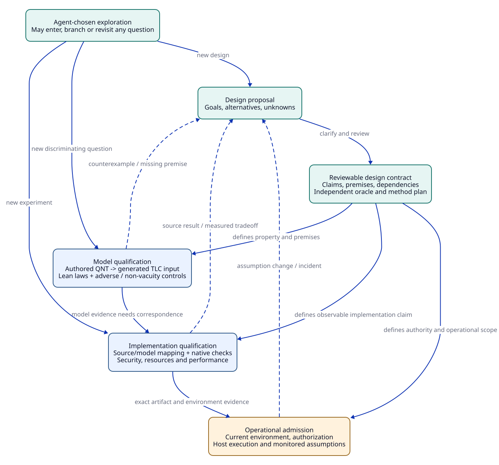
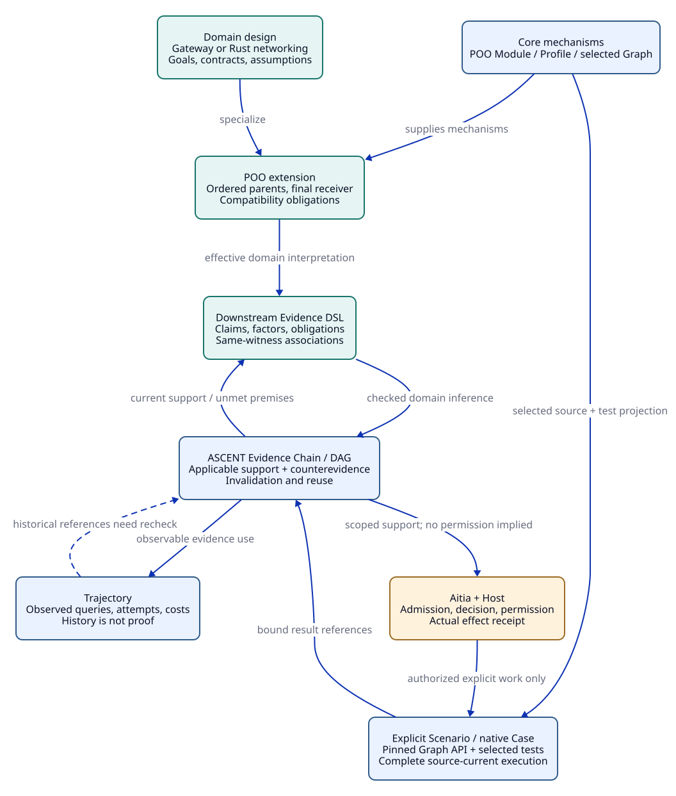

# SPDX-FileCopyrightText: 2026 hardenedlinux Linux Team and Contributors
#
# SPDX-License-Identifier: LGPL-2.1-or-later

#+TITLE: 10.05 Agent Reasoning, Evidence Constraints, and Design Convergence
#+LANGUAGE: en
#+PROPERTY: JD_ID 10.05
#+OPTIONS: toc:3 num:nil
#+STARTUP: overview
#+TODO: OPEN REVIEW | REVIEWED
#+FILETAGS: :design:agent:principles:

[[file:../../../README.org][Overview]] | [[file:10.04-evidence-driven-workflow.org][Evidence architecture]] | [[file:../../30-39-evaluation/30-benchmarks/30.03-gateway-variant-contracts.org][24 variant contracts]] | [[file:../../90-99-views/90-architecture-views/90.01-index.org][Org and D2 map]]

* Terminology: LLM-based AI agent
:PROPERTIES:
:CUSTOM_ID: llm-agent-terminology
:END:

An LLM-based AI agent is an engineering system built around a large language
model (LLM), with task context, tool access and an execution environment. It can
propose designs, inspect code, invoke verification tools and revise its approach
in response to observations. In this repository, Agent or agent abbreviates
LLM-based AI agent when discussing engineering work. Use the full term at public
entry points and in architecture diagram actor labels.

#+NAME: llm-agent-evidence-vocabulary
| Term | Meaning in this architecture |
|------+------------------------------|
| LLM | The model supplying language understanding, generation and reasoning capabilities |
| LLM-based AI agent | The model-backed engineering system that maintains task context, selects actions and uses tools |
| ASCENT reasoning | Explicit relation/rule evaluation over supplied facts and evidence references |
| Engineering evidence trajectory | Recorded hypotheses, actions, observations, checked artifacts, dependencies and revisions |
| Protocol actor or worker | A participant in a modeled or running concurrent system; its behavior is specified by that system |

The evidence trajectory records externally inspectable engineering work. It
does not require disclosure of a model's private internal reasoning. A model's
explanation is a proposal or interpretation; supporting evidence comes from the
applicable observations, checks and proofs. ASCENT feedback helps the LLM-based
AI agent choose its next investigation while preserving that choice.

* Why ASCENT drives the design
:PROPERTIES:
:CUSTOM_ID: agent-design-purpose
:STATUS: proposed-principle
:END:

The Library exists to amplify an Agent's engineering reasoning. The Agent can
interpret a goal, propose an architecture, invent a data structure, inspect code,
identify a discriminating experiment, revise assumptions and discover another
approach. ASCENT makes the applicable evidence available during that reasoning:
current support, counterevidence, source and premise identity, reusable derivations,
unknowns and expandable references. POO makes domain knowledge and design contracts
extensible rather than freezing every problem into one program.

An engineering trajectory is a graph of evolving questions, alternatives,
observations and justified conclusions. It is not a prewritten linear recipe.
The graph can share evidence, branch, revisit a question under changed premises,
and retain failed attempts. The Agent owns its next hypothesis and investigation;
ASCENT owns the meaning and currentness of the evidence it returns.

The inspected ASCENT PR 1 head is ~144ed6e55110c4ccd1fa2a825f79007d1a3317d6~.
Its [[file:../../../.gerbil/pkg/github.com/tao3k/gerbil-ascent/docs/scheme-design-framework.org][progressive-discovery contract]] and
[[file:../../../.gerbil/pkg/github.com/tao3k/gerbil-ascent/docs/features/trajectory-exploration.org][trajectory contract]] explicitly separate evidence windows from hypothesis/action
limits. This document maps that principle to engineering design. It does not
claim a new implementation, a fresh upstream gate or measured Agent improvement.

#+CAPTION: Open Agent exploration, reusable domain knowledge, and truthful evidence feedback.
#+NAME: agent-reasoning-graph

[[file:../../90-99-views/90-architecture-views/90.02-agent-evidence-loop.d2][D2 source]]; node/edge correspondence is maintained in the [[file:../../90-99-views/90-architecture-views/90.01-index.org][diagram index]].

* Constraints on justification, freedom in exploration
:PROPERTIES:
:CUSTOM_ID: exploration-contract
:STATUS: proposed
:END:

#+NAME: reasoning-versus-execution-boundaries
| Concern | Required constraint | Agent freedom retained |
|---------+---------------------+------------------------|
| Claim support | A checked conclusion names its proposition, premises, source and applicable evidence | Propose a new claim or challenge the interpretation |
| Evidence association | Conjunctive factors join one compatible observation ID/digest | Author another predicate, change scope or inspect exact evidence |
| Currentness | Changed dependencies withdraw current support, preserving history | Revisit a direction under changed premises or intentionally replicate |
| Counterevidence | Contrary observations and unresolved conflict stay visible | Seek a discriminator, propose a repair or revise the design |
| Unknown | Missing/partial evidence cannot become proof or contradiction | Continue exploring without an already supported hypothesis |
| Progressive display | Bound windows retain honest references and acknowledge only shown units | Expand any relevant graph region, including directions absent from a brief |
| Engineering acceptance | Required scoped methods and unresolved objections are evaluated | Offer an alternative implementation or equivalent argument |
| External effects | Current authorization and actual execution controls apply where required | Reason and propose without treating each thought as an effect request |

A new idea does not require a receipt before it may be considered. It remains a
hypothesis until checked. A historical failure constrains its recorded conditions,
not every future version of that idea. Read-window capacity, finite checker bounds
and pilot budgets are local mechanisms; none defines the Agent's hypothesis space.
No mandatory query order, ranked action menu, required number of discovery calls,
or generic ban on repetition is introduced here.

Evidence constraints apply to asserted support and accepted effects. They do not
substitute a deterministic script for reasoning. Free-form claims still need an
explicit interpretation before mechanical checks can establish anything about
them; graph reachability alone does not understand arbitrary prose.

* What design-layer convergence means
:PROPERTIES:
:CUSTOM_ID: design-convergence-definition
:STATUS: specified-not-independently-reviewed
:END:

Design convergence means that a bounded engineering question is sufficiently
clear to investigate and implement responsibly: intended outcomes, observations,
assumptions, alternative contracts, dependencies, risks, evidence methods and
change consequences are explicit. It does not mean every algorithm is chosen,
every hypothesis is enumerated, implementation exists, or all claims are true.
A reviewed design remains revisable when new evidence challenges its premises.

#+NAME: convergence-levels
| Level | Question resolved | Required artifact | Does not establish |
|-------+-------------------+-------------------+--------------------|
| Proposal | What are the goal, alternatives and unanswered questions? | Linked Org/D2 domain design with explicit unknowns | Independent agreement or correctness |
| Reviewable design | What observable claim, assumptions and acceptance scope are intended? | Scoped contracts, relation semantics, oracle specification and review record | A completed model or proof |
| Model-qualified | Do authored QNT transitions and Lean statements satisfy their declared checks? | Complete checker/proof results with negative and non-vacuity controls | Source correspondence, throughput or actual authorization |
| Implementation-qualified | Does the exact code/artifact implement the model and meet workload/security/resource goals? | Source mapping, native checks and matched measurements | Continuing deployment validity |
| Operationally admitted | Are environment, evidence, authority and actual effects current? | Aitia/Host/operations receipts and monitored assumptions | Future applicability after change |

The current repository supplies proposal and reviewable-contract specifications,
not an independent design review or model/source/operational qualification receipt.
Reviewability is achieved by making every essential dependency checkable and every
unresolved premise visible, not by declaring unknown facts true.

#+CAPTION: Different evidence requirements for design review, model checks, source qualification, and operation.
#+NAME: design-qualification-map

[[file:../../90-99-views/90-architecture-views/90.05-design-qualification.d2][D2 source]]. These are acceptance dependencies, not a mandated investigation order.

* Rust high-performance networking as an open domain trajectory
:PROPERTIES:
:CUSTOM_ID: rust-domain-trajectory
:STATUS: illustrative-design
:END:

Start with workload, throughput/latency goals, overload behavior, memory budget,
protocol/security boundaries and environment. The Agent may propose ownership,
queueing, batching, sharding, synchronization, buffer or scheduling strategies,
and may find a better strategy outside the Library's current examples. The
Library describes conditional knowledge and admissible evidence, not one preferred
crate or architecture. No performance result is claimed here.

#+NAME: rust-engineering-questions
| Candidate design change | Newly relevant question | Evidence to seek |
|-------------------------+-------------------------+------------------|
| Borrow or share buffers across asynchronous work | Who owns the bytes through cancellation and completion? | Lifetime/ownership contract, source trace and retained-byte measurements |
| Batch operations | Does the changed waiting time fit the latency and overload contract? | Queue/progress model and matched end-to-end latency distribution |
| Shard work or quotas | Which ordering, isolation and global-limit claims survive? | Composition/coordination argument and concurrency/fault controls |
| Replace a queue or use atomics | Which memory-order and target-architecture assumptions support correctness? | Explicit concurrent semantics, proofs/controls and exact-source execution evidence |
| Cache parsed/authenticated responses | Which principal, policy, content and revocation context makes a hit valid? | Threat/context model, adversarial replay and resource accounting |

An example trajectory can move from a queue-contention hypothesis to a new buffer
strategy, then return to queueing after measurements expose retention. The same
ownership lemma might support both approaches; a benchmark tied to a different
workload might support neither. Counterevidence can motivate another design
without forcing the Agent to abandon every related direction.

Progressive discovery supplies a concise current view and deeper reads on demand.
The Agent can discover that a retained result already answers a subquestion,
request the relevant evidence rather than its entire history, or investigate a
new condition. A conclusion records exactly which evidence supports it. Reuse is
conditional and measurable; fewer tool calls alone do not prove better reasoning.

* Reuse existing SMP and POO mechanisms
:PROPERTIES:
:CUSTOM_ID: existing-mechanisms
:STATUS: proposed-domain-composition
:END:

SMP already supplies domain associations and source-bound observations to the
ASCENT evidence interface. Transfer that discipline to Rust networking and gateway
work rather than rebuilding its transport, evidence engine or trajectory storage.
The [[file:10.03-upstream-capabilities.org::#core-module-system][inspected Core Module system]] supplies selected scope, extensible Profiles,
source-current test projection and explicit Scenario/Case execution. Domain
contracts publish responsibilities and tests through those mechanisms.

A Module is not an organizational permission, a Profile is not an evidence
verdict, and a Scenario is not the Agent's complete reasoning algorithm. A selected
Module can expose an experiment or checker; the Agent may choose another applicable
experiment. Pure discovery remains inert. Execution permission and artifact
acceptance retain their existing owners.

#+CAPTION: Domain composition, evidence support, and the separately owned execution boundary.
#+NAME: domain-evidence-owner-map

[[file:../../90-99-views/90-architecture-views/90.03-domain-evidence-graph.d2][D2 source]].

* Fixed benchmark, open engineering product
:PROPERTIES:
:CUSTOM_ID: benchmark-product-boundary
:STATUS: proposed
:END:

The 24 variants pin inputs, expected semantic outcomes and oracle controls so the
reasoning substrate can be falsified. Those fixed fixtures are not a finite menu
of production designs. The test driver controls experiment reproducibility, not
the Agent's thought sequence. Execution budgets bound a benchmark run, not the
validity of a new engineering idea.

For a fixed proof target, changing the proposition cannot earn credit as proving
that target. For an open design task, an alternative implementation, equivalent
property formulation or explicitly reviewed contract revision may be valuable.
The evaluator checks requirements and evidence correspondence, accepts valid
alternative paths, or records a reviewable unknown. It must not reject a sound
solution merely because it differs from one reference implementation.

Measure justified progress, correct use of support, retained alternatives, useful
discriminating observations, post-change correctness and total effort. Do not
reward ungrounded novelty, artificial hypothesis counts, forced tool discovery,
quietly deleted failures or output compression that hides counterevidence.

* Which gateway gaps can converge at design level?
:PROPERTIES:
:CUSTOM_ID: design-gap-classification
:STATUS: semantic-specification-only
:END:

#+NAME: design-versus-implementation-gaps
| Gap | Design contract that can be specified now | Required later evidence |
|-----+----------------------------------------+-------------------------|
| GAP01 coverage | Intended requirements/threat/method inventory, review scope and omission response | Independent coverage review and real new-hazard feedback |
| GAP02 dependencies | Edge meanings, footprint/negative/aggregate policy and conservative fallback | Complete actual observation/registration and checked transport |
| GAP03 model/source | Observations, abstraction and correspondence obligations | QNT/Lean checks and exact-source/native mapping |
| GAP04 local/remote | Separate local release and remote-stop guarantees | Backend cooperation and execution evidence for stronger claims |
| GAP05 selection | Module/test scope and natural-completion contract | Real selected-source/currentness and process-exit checks |
| GAP06 currentness | Atomic publication and ingest/use/effect recheck semantics | Concurrent integration, stale-task and actual Host tests |
| GAP07 authority | Evidence, role, decision and effect-policy ownership | Real principal/policy/revocation enforcement |
| GAP08 progress/timing | Action-level fairness, clock/lag/unknown contracts | Satisfiable model premises, real monitor/clock bounds and response behavior |
| GAP09 projection | Typed IDs, units, modality and target interpretation | Actual parsers/exporters, round trips and negative controls |
| GAP10 Library consumers | Refinement/compatibility rules and applicability scope | Consumer-specific proof, integration and changed-environment checks |
| GAP11 plan/effect | Plan, authorization, execution and completion are distinct | Fenced Host execution and source-bound effect receipts |
| GAP12 evaluation | Independent oracles, cohort/scoring and open-solution policy | Executed controls, blinded review and matched Agent/runtime studies |

All rows admit useful semantic convergence now. None permits a documentation-only
operational pass. The [[file:../../30-39-evaluation/30-benchmarks/30.03-gateway-variant-contracts.org][variant contracts]] make these boundaries explicit per input and property.
