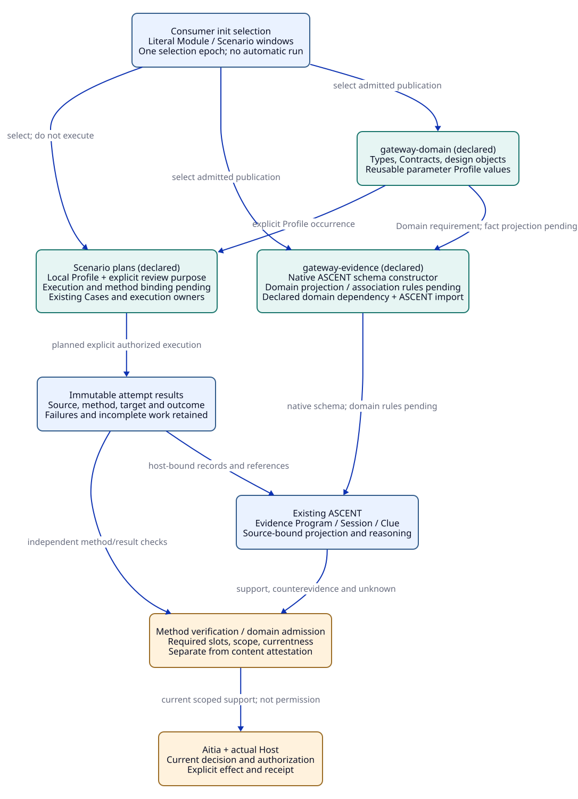
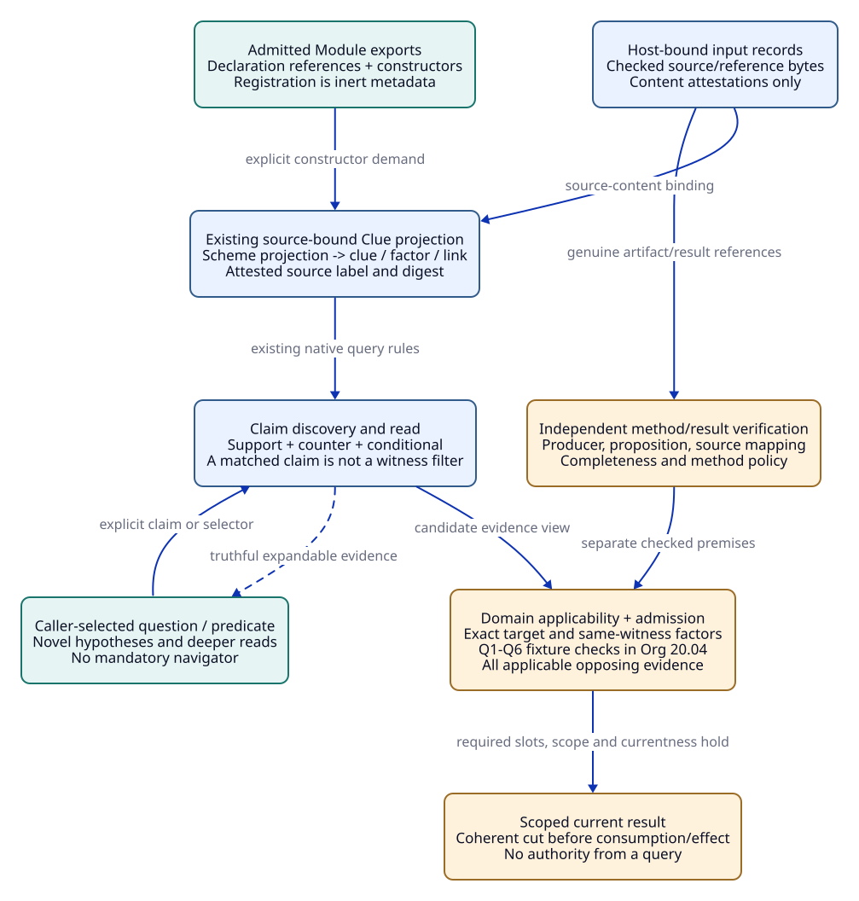
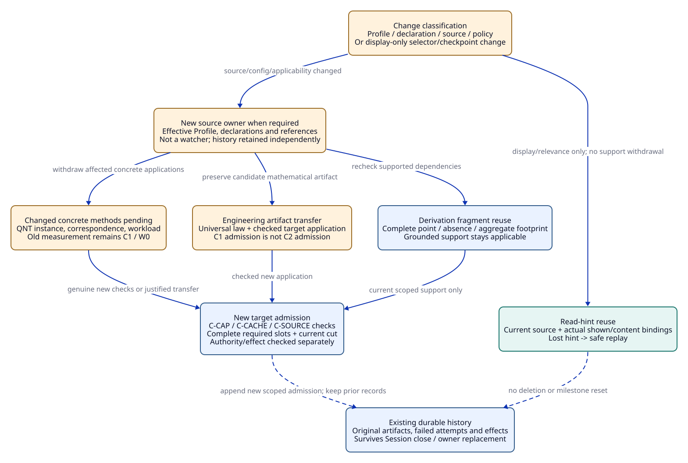

# SPDX-FileCopyrightText: 2026 tao3k team and Contributors
#
# SPDX-License-Identifier: LGPL-2.1-or-later

#+TITLE: 10.06 POO Module, Profile, and Scenario Integration with ASCENT Evidence
#+LANGUAGE: en
#+PROPERTY: JD_ID 10.06
#+OPTIONS: toc:3 num:nil
#+STARTUP: overview
#+TODO: OPEN SPECIFIED | QUALIFIED
#+FILETAGS: :design:integration:poo:ascent:
#+LINK: smp https://github.com/tao3k/gambit-SMP/blob/2125416e8809b0fab86fd8341876cb984e937589/%s

[[file:../../00-09-project/00-documentation/00.01-index.org][Index]] | [[file:10.04-evidence-driven-workflow.org][Architecture]] | [[file:../../20-29-cases/20-gateway/20.03-gateway-design-audit.org][Gateway audit]] | [[file:../../30-39-evaluation/30-benchmarks/30.03-gateway-variant-contracts.org][24 contracts]]

The current executable ownership and registration slice is maintained in
[[file:10.12-gateway-library-registration-and-runtime-dependencies.org][10.12]]. Profiles are independently importable values; one gateway Scenario
binds Library and Evidence Module scopes. Earlier examples below retain their
design context and are not claims that the old duplicated package shape remains.

Current shared source owners are rust-resources and resource-evidence. The direct
migration and minimal native mechanism path are maintained in
[[file:10.15-scheme-owned-rust-mechanisms-and-development-evidence.org][10.15]]. Earlier publication shapes and qualified receipts below retain their
historical scope; updated file links point to current source owners.

* Source boundary and integration decision
:PROPERTIES:
:CUSTOM_ID: integration-source-boundary
:INSPECTED_ON: 2026-10-18
:CORE_PR: https://github.com/tao3k/poo-flow-core/pull/19
:CORE_REVISION: 52130d2d338b09622a3f55e37987ddc0375b6187
:ASCENT_PR: https://github.com/tao3k/gerbil-ascent/pull/1
:ASCENT_REVISION: 144ed6e55110c4ccd1fa2a825f79007d1a3317d6
:STATUS: inspected-sources-proposed-domain-integration
:END:

At the original inspection, remote Core PR 19 and local HEAD matched
52130d2d; ASCENT PR 1 and local HEAD matched 144ed6e5. This document retains
those committed source contracts. The later linked-Core/current-local-ASCENT
[[file:../../20-29-cases/20-gateway/20.10-existing-owner-concurrency-and-delivery.org::#owner-source-observation][20.10 owner audit]] records ASCENT 46a46bbe and dirty Core observations,
with separate source-specific gold; no current remote PR status is inferred. Core's
root-selected/lazy-Graph test projection and qualification suite are now committed.
The earlier 80e2e740 audit remains a historical observation, not a current claim
that these capabilities are uncommitted. No upstream test, build or proof runs
are claimed. The existing MB09 fixture remains bound to its older Core contract;
qualifying the new binding requires explicit fixture/method revision.

The engineering Library adds gateway knowledge and association rules through
native POO publications and ASCENT's existing Evidence DSL. Core owns Module
selection, source roles, Profiles and shared composition. ASCENT owns its native
Program/Session/Clue execution and source-bound evidence protocols. Aitia and Host
retain method admission, lifecycle decisions and effect authority. No additional
resolver, workflow engine, navigator or truth store is introduced.

#+NAME: inspected-integration-sources
| Source | Observed capability | Boundary |
|--------+---------------------+----------|
| [[file:../../../.gerbil/pkg/github.com/tao3k/poo-flow-core/init.ss][Core init]] and [[file:../../../.gerbil/pkg/github.com/tao3k/poo-flow-core/module-system/source/init.ss][inert init reader]] | Literal Module/Scenario windows, explicit roots and mount names | No computed business execution in init |
| [[file:../../../.gerbil/pkg/github.com/tao3k/poo-flow-core/module-system/types.ss][Role Contracts]], [[file:../../../.gerbil/pkg/github.com/tao3k/poo-flow-core/module-system/source/declaration.ss][publication lowering]] | Native role-indexed authoring and generated core.link from declared dependencies | Do not hand-write another dependency linker |
| [[file:../../../.gerbil/pkg/github.com/tao3k/poo-flow-core/profile-composition/README.org][Profile selection]] | Bounded scope binding versus selected ProfileBundle | A scope alias is not contextual proof or a Bundle conversion |
| [[file:../../../.gerbil/pkg/github.com/tao3k/poo-flow-core/module-system/building/test-projection.ss][Current test projection]] | Init-selected roots/eligible explicit owners, normal/integration/qualification suites, lazy Graph | Test discovery is not the complete dependency Graph or execution |
| [[file:../../../.gerbil/pkg/github.com/tao3k/poo-flow-core/scenarios/README.org][Scenario boundary]] and [[file:../../../.gerbil/pkg/github.com/tao3k/poo-flow-core/docs/10-19-design/12-contracts-types/12.22-selected-packages-and-scenario-binding.org][package-binding audit]] | Existing Scenario/selected-package owners | Automatic package-to-Scenario binding still has declared producer/integration gaps |
| [[file:../../../.gerbil/pkg/github.com/tao3k/gerbil-ascent/evidence/interface.ss][Evidence DSL]] and [[file:../../../.gerbil/pkg/github.com/tao3k/gerbil-ascent/evidence/declaration.ss][declaration construction]] | define-evidence, native relation handles, source/output bindings | Recorded explanation is not per-row proof or effect authority |
| [[file:../../../.gerbil/pkg/github.com/tao3k/gerbil-ascent/docs/features/clue-exchange.org][Clue contract]], [[file:../../../.gerbil/pkg/github.com/tao3k/gerbil-ascent/rust/ascent/src/clues/exchange.rs][native owner]], [[file:../../../.gerbil/pkg/github.com/tao3k/gerbil-ascent/rust/ascent/src/clues/projection.rs][projection validation]] | Immutable source-bound exchange and host-content attestation | Content attestation is not independent engineering result verification |
| [[smp:evidence/views.json][SMP View registry]], [[smp:evidence/scenarios/stack-header/components.json][component manifest]], [[smp:evidence/scenarios/stack-header/clues.ss][projection/selector]] | Existing source/constructor binding and same-witness associations | Transfer the pattern, not SMP domain facts or its native qualification |

* Gateway Module organization
:PROPERTIES:
:CUSTOM_ID: gateway-module-organization
:STATUS: proposed-publications-not-created
:END:

Use two cohesive domain publications. Resource, security and retry concerns start
as internal values/compilation units in gateway-domain; they do not each require
an independently published wrapper. Split a Module only when it has a real public
contract, consumers and separate source/admission responsibility.

#+NAME: gateway-publication-boundaries
| Proposed publication | Public responsibilities | Dependencies and purity boundary |
|----------------------+-------------------------+----------------------------------|
| gateway-domain | Gateway contracts, attempt/resource/policy types, reusable design objects, parameter Profiles, required-method interpretation | Native POO/Core Contracts; no Session creation, file scan, benchmark, authorization or effect in defaults |
| gateway-evidence | Domain projection/association constructors, typed source/output metadata, obligation/currentness interpretation and query contracts | Declared dependency on gateway-domain; direct native ASCENT imports in owned compilation units; no duplicated engine |
| gateway Scenario occurrences | Design-review, resource-check or workload-check configuration bound to chosen Profiles and methods | Existing Module dependencies and Scenario/Case execution owners; no automatic run from selection or field access |

#+NAME: proposed-gateway-source-tree
#+begin_example
init.ss                         consumer-owned literal selection
library/concurrency/resource-control/backpressure-memory/rust/
  interface.ss                  one public Module declaration
  types.ss                      gateway and Profile value Contracts
  objects.ss                    reusable designs and Profile prototypes
  func.ss                       pure contract/record transformations
  config.ss                     selected contextual defaults
modules/resource-evidence/
  interface.ss                  domain requirement and public constructors
  types.ss                      record/query/binding Contracts
  func.ss                       owned native Evidence DSL constructors
  config.ss                     inert declaration/registration configuration
  evidence/                     private compilation units when needed
scenarios/gateway-review/       selected review configuration and Contracts
scenarios/gateway-resource-check/ selected native/model work configuration
#+end_example

The [[file:../../20-29-cases/20-gateway/20.10-existing-owner-concurrency-and-delivery.org::#existing-owner-allocation][20.10 owner allocation]] maps these same roles to concurrent capture,
producer/query replies and external display confirmation; it introduces no third
publication or execution framework.

These are proposed ownership locations, not generated files or required empty
role stubs. Constructors may be split into private compilation units without
publishing another Module. Scenario publications use the same admitted role
mechanisms; neither folder existence nor an arbitrary JSON manifest creates a
trusted publication.

The native ASCENT evidence-module value is a Program/explanation/bindings wrapper.
It is not a Core semantic Module. gateway-evidence publishes constructors using
that API; it must not pretend that an arbitrary ASCENT package is already a
Core Module implementing the consumer's expected scope Contract. The actual
Core dependency declaration and direct Gerbil import have distinct identities.

#+CAPTION: POO publications and configuration feed domain associations; explicit Scenario work returns candidate results through existing owners.

[[file:../../90-99-views/90-architecture-views/90.10-poo-ascent-bridge.d2][Editable D2 source]].

** Read core/init.ss as the selection example
:PROPERTIES:
:CUSTOM_ID: gateway-init-correspondence
:STATUS: native-selection-declared
:END:

The following declaration now exists in the repository [[file:../../../init.ss][init.ss]]. The
[[file:../../00-09-project/00-documentation/00.03-scheme-package-bootstrap.org::#native-design-module-selection][native module package record]] identifies the actual declarations, build checks
and remaining semantic qualification. The selected Scenario publications are
inert design plans; this selection does not execute a gateway.

#+NAME: gateway-init-design
#+begin_example
(import :core/module-system/selection/init-syntax)
(poo-flow!
  :load-modules "./modules" mode: explicit rename: Modules
  (gateway-domain)
  (gateway-evidence)
  :load-modules "./scenarios" mode: explicit rename: Scenarios
  (gateway-review)
  (gateway-resource-check))
#+end_example

#+NAME: init-design-correspondence
| Core example | Gateway selection interpretation | Must not be inferred |
|--------------+----------------------------------+----------------------|
| ./modules window | Root of the two admitted domain publications | Arbitrary directory contents are trusted Modules |
| ./scenarios window | Explicit Scenario publications in the same selection epoch | A second resolver or independent Graph |
| rename: Modules / Scenarios | Namespace access paths, following the existing init.Modules/init.Scenarios bindings | Renaming creates new semantic publication identities |
| Literal rows | Selected publication roots with native dependency policy | Every dependency is an automatically selected test root |
| @ local directory override | Existing explicit source-root mechanism when actually needed | Source path alone proves trust or compatibility |
| Later demand | Resolve/admit the required exported scope or execution object | Importing the example runs scenarios, registers evidence or grants authority |

The created directories hold Core-required interface/types/objects/config role
sources, plus func where a constructor responsibility exists. interface owns the public declaration and
joins role owners; types owns Contracts, objects reusable prototypes/Profiles,
func pure transforms/constructors, config contextual defaults. A private evidence
compilation unit can be imported by its owner without a separate Module wrapper.
The role profile may constrain raw activation/query initializers; it must not
replace the ASCENT DSL grammar or reject ordinary caller-authored predicates.

Package links and chosen package revisions are prerequisites to importability,
not part of this init example's semantics. Reuse the [[file:../../20-29-cases/20-gateway/20.03-gateway-design-audit.org::#audit-module-integration][package-link audit]]; Core's
new committed package declaration pins gerbil-poo fdeadfa4, while the older
parent/Core observations retain their own pins. The [[file:../../00-09-project/00-documentation/00.03-scheme-package-bootstrap.org::#native-dependency-closure][native dependency closure record]] records native package builds and bounded compatibility checks, with
historical snapshots separated from the active direct linked-source cohort. It does not
certify the older original pins or automatic package-to-Scenario execution.

* Profile values, authoring policy and Scenario occurrences
:PROPERTIES:
:CUSTOM_ID: gateway-profiles-scenarios
:STATUS: proposed-typed-domain-values
:END:

#+NAME: profile-kinds
| Kind | Concrete responsibility | Required identity/check |
|------+-------------------------+-------------------------|
| Module authoring Profile | Core's types/objects/funs/config/interface role policy and executor | Role-policy revision and actual source admission |
| Domain parameter Profile | Gateway budget, policy/clock/fault/workload and required-method interpretation | Effective final receiver and contract/assumption revision |
| ProfileBundle selection | Existing indexed selection of named Profiles | Native Bundle semantics; not an arbitrary scope or attestation |
| Scenario occurrence | Named use of a Profile and an explicit work/method configuration | Occurrence ID plus selected Profile/config/source; repeated use is not identity equality |
| Native Case policy | Duration, memory and completeness criteria for explicit execution | Actual process/method outcome; a watchdog is not the definition of gateway correctness |

The local LocalProfile prototype uses C=1/Q=1/B=2 abstract units, scoped local claims and no
cache/global claim. Cap2Profile changes C to 2. CacheProfile enables the cache flag; the design requires reconsidering affected
security/resource obligations, which these declarations do not yet derive. ReplicatedGlobalProfile selects
two replicas and requests G=1, which creates pending coordination obligations.
WorkloadProfile carries W/environment/measurement criteria with unresolved numeric
production targets retained as unknowns. LocalProfile, Cap2Profile and CacheProfile are now local POO parameter
prototypes, as recorded in 00.03;
the resource WorkloadProfile and ReplicatedGlobalProfile remain design proposals.

Direct parameter assignment selects a value. Refinement extends an existing
composite value only where its actual Contract and native option policy allow it;
there is no universal deep merge, union or override rule. Required method slots
cannot disappear silently. A pure Profile can be instantiated in two Scenario
occurrences; each result still binds its occurrence, artifact, method and context.
A mathematical law independent of that occurrence may transfer through an explicit
new application; an occurrence-specific measurement may not.

* Registration and trust levels
:PROPERTIES:
:CUSTOM_ID: gateway-evidence-registration
:STATUS: proposed-adapter-contract
:END:

Registration binds a source/constructor and relation metadata through the existing
application registry/publication mechanisms. It does not run the constructor,
authorize arbitrary source evaluation or attest the domain claim. Explicit evidence
owner creation later evaluates admitted declarations in ASCENT's existing checked
Program/Session path. Standard Scheme definitions and supported native DSL
composition remain upstream semantics; inert transport data is never eval'ed as
Agent-provided initialization code.

#+NAME: registration-handoff
| Step / owner | Concrete input and output | Failure boundary |
|--------------+---------------------------+------------------|
| R0 Module publication / Core | gateway-evidence scope exposes admitted declaration source references, constructor names and expected relation Contracts | No ad-hoc directory scanner or second Module metadata registry |
| R1 application registration / domain host | Bind those exports using the existing source/constructor registry pattern; retain source identities and declared input/output bindings | Registration alone creates no observation or support |
| R2 result ingestion / genuine producers | Scenario/model/proof/native attempts return immutable candidate artifacts, target/context, completeness and provenance | Failed, partial, canceled and timed-out attempts retain their actual status |
| R3 host content verification | Check source/reference bytes and provide label-to-digest attestations to the existing Clue projection | A content match does not prove a result is valid, complete or applicable |
| R4 domain projection / Scheme | Derive clue/factor/link records from admitted record interpretation, preserving observation ID/digest and polarity | Caller strings cannot create independent verifier or authority facts |
| R5 method/application verification / existing admission owner | Check proposition, producer/method policy, source mapping, scope and currentness; issue a separate engineering admission/reference | Clue receipt is not this admission; unresolved verification stays pending |
| R6 question and use / ASCENT + consumer | Open/read the current exchange under recorded identities; consume only the justified scope and coherent cut | A successful read or acknowledgement does not grant an effect |

R0-R6 name ownership handoffs, not a mandatory Agent query sequence. An Agent may
read existing evidence before launching any new Scenario or may propose a novel
hypothesis without a prior observation. The dependency order is only required
where a claimed result actually relies on those inputs.

The pinned native Clue projection creates its attested relation from host-checked
source content. Its receipt binds source label and digest. Distinguish three
levels: content attestation, independent method/result verification, and target
engineering admission. They may cite one another but cannot be substituted.
A returned recorded-only explanation explicitly lacks per-row proof authority.

The SMP View pattern is reusable: registry -> component source/exports -> View
constructor/facts -> verified references. Its optional references binding can
transport checked (id,path,digest) metadata instead of duplicating it as hand-kept
facts. Gateway-specific associations remain Scheme rules. Use the existing host
journal/source authority for durable history; a proposed gateway registration
must not create an unrelated authoritative View store.

** Relations and identity-preserving lowering
:PROPERTIES:
:CUSTOM_ID: gateway-evidence-relations
:STATUS: proposed-domain-schema-mapping
:END:

#+NAME: gateway-evidence-lowering
| Domain record / fact | Existing relation shape or owner | Binding requirement |
|----------------------+----------------------------------+---------------------|
| Immutable observed outcome | clue(id,digest,claim,polarity,role,source) | Observation mode versus hypothesis; exact result/proposition interpretation |
| Host content identity | attested(id,digest,receipt), supplied by native owner validation | Source-label/digest match; not a caller-generated verifier-success flag |
| Context and method factors | factor(id,digest,name,value) | Same pair for target, C, method, source, fairness or workload conjunction |
| Recorded association | link(claim,target,label,id,digest) | Source-backed edge interpretation; temporal proximity is not causality |
| Consumer query | binding(name,value) plus caller Scheme selector, or explicit question(claim) | Candidate discovery and witness applicability remain separate |
| Scoped output | support/counterevidence/conditional/conflict/unknown | Polarity preserved; unknown is local to explicit question and current projected records |
| Independent verification/admission | Existing Evidence Chain and Aitia/domain references, optionally exposed as typed domain factors | Explicit producer/target/method mapping; no fabricated native receipt |
| Derivation requirement | Proposed GW obligation/origin/method relations in domain Evidence Program | Finite rule strata and reviewed O1 inventory; deriving a slot never discharges it |

Native define-evidence source/output labels map to declared relation handles and
input bindings. They do not restrict the Agent's hypothesis space. The proposed
gateway relation names above are a mapping contract, not new installed API names.

* Query design: discovery is not applicability
:PROPERTIES:
:CUSTOM_ID: gateway-query-contract
:STATUS: proposed-binding-needs-native-qualification
:END:

The inspected Clue API provides read, select, read_selected, inventory, submit and
close through existing owners. select derives question claims and additional
selector relations; read_selected reads those projected claims. The shared
support rules join question by claim and attestation by observation ID/digest.
They do not automatically join every selector binding into every returned witness.
A selector's matched(C,I,D) row must not be mistaken for a guarantee that all
records later read for C match the same factors.

The integration uses exact semantic claim revisions/target scopes, not one global
string such as permit-safe. A theorem with universal C and its C=1 application are
separate propositions linked by checked application, not two rows silently sharing
one concrete target. The domain verifies record-to-claim consistency at projection;
historical/different-target records retain explicit references and remain available
through the existing history/source owners, without becoming current target support.

A caller may still discover broad claims or read arbitrary raw records. Such a
read is a truthful evidence view, not a full applicability or admission verdict.
At admission, the domain must check each witness's required factors and all
applicable opposing evidence, including evidence outside a narrow discovery filter.
If this cannot be represented with the selected supported projection/association
surface, keep the bridge unresolved; do not add an invisible Python filter or
claim the native API already implements it.

#+NAME: gateway-query-examples
| Query purpose / concrete paper input | Expected semantic result | Separate checks / controls |
|-------------------------------------+--------------------------+----------------------------|
| Q1 exact claim P0=(GW-02.a, interpretation K0, X0, C1); observation o1/d1 supports P0 and o2/d2 counters P0 | Both applicable witnesses and conflict remain visible; no clean P0 admission | Method/result verification distinct from content attestation; MB07-H |
| Q2 discover target X0/C1 with o1={X1,C1}, o2={X0,C2} | matched witness set is empty; selector may emit no question; no fabricated conjunction | Explicit exact question has scoped unknown only after the relevant projected/admission view actually excludes ineligible support; raw read is not that proof; MB07-A |
| Q3 new Agent hypothesis H3 about queue contention | Conditional hypothesis with expandable references; no observation attestation | Independent source/results needed before engineering admission; open questions remain allowed |
| Q4 narrower selector or larger display window under unchanged owner | Re-evaluate relevance, preserve honest unseen units and opposite polarity; deliberate deeper read allowed | No global withdrawal from a display/scope change; read acknowledgement only for complete shown units |
| Q5 query P1 for X1 after source replacement while an old X0 task completes | Retain old task as historical X0 evidence; no automatic P1 support | New owner and current method/target admission, or justified transfer; MB08-A |
| Q6 request a related performance claim after a C override | Retain old measurement under C1/W0; expose target C2/W1 mismatch/pending PF | Universal conservation law cannot supply a latency measurement; MB06-H/A |

The [[file:../../20-29-cases/20-gateway/20.04-query-and-change-fixtures.org::#six-query-fixtures][20.04 exact query fixtures]] expand Q1-Q6 into record sets, tuple expectations,
content/verification/admission references and explicit error/unknown boundaries.
The [[file:../../20-29-cases/20-gateway/20.04-query-and-change-fixtures.org::#three-change-walkthroughs][three independent change traces]] reset from a declared clean paper baseline;
they do not carry Q1's unresolved conflict into a supposedly clean reuse example.

Q1-Q6 are paper inputs/expectations, not executed queries. An empty selection is
not an unknown row; a too-small display capacity is not evidence absence. Duplicate
clue IDs, malformed bindings and source mismatches must fail under the actual
owner contract, not be silently merged. Broad first reads and intentional repeats
remain legitimate Agent choices.

#+CAPTION: Content attestation and method admission are separate, as are claim discovery and per-witness applicability.

[[file:../../90-99-views/90-architecture-views/90.11-evidence-registration-query.d2][Editable D2 source]].

* Change, invalidation and three kinds of reuse
:PROPERTIES:
:CUSTOM_ID: gateway-integration-changes
:STATUS: proposed-transaction-and-transfer-contract
:END:

The registered observation projection is source-bound, not a filesystem watcher.
Native submit may append hypotheses and include may compose another checked
projection; neither permits rewriting an old observation as a new target result.
A sourceIdentity alone is not a no-content-change proof. Read hints also bind
actual display/content and selector/anchor context. See [[file:../../20-29-cases/20-gateway/20.04-query-and-change-fixtures.org::#q3-hypothesis][Q3]] and [[file:../../20-29-cases/20-gateway/20.04-query-and-change-fixtures.org::#q4-view-and-acknowledgement][Q4]].
A host rechecks current source binding before publishing/using results. Changed
source facts, declarations, checked reference metadata or effective configuration
require the appropriate new source/owner identity. Closing an old Session releases
resources; retained history/receipts live under the existing durable owner and
cannot depend on keeping the old Session alive.

#+NAME: gateway-integration-change-matrix
| Change | Affected dependency and current eligibility | Permitted reuse / explicit next gate |
|--------+---------------------------------------------+-------------------------------------|
| LocalProfile C1 -> C2 | New effective Profile/claim application; changed concrete QNT/measurement targets | Retain universal lemma artifact; check frame/application/source/method premises; new target admission |
| Enable cache | Negative selection changes, new GW-01.c and revised existing security/resource/method origins | Preserve independent laws only with complete footprints; new cache threat/replay/accounting work |
| Declaration or selector source changes | Declaration/association identity and dependent projections/read hints | New owner/projection as required; selection-only relevance change is not global evidence withdrawal |
| Callback/helper/compiler/private input changes | Selected source closure, correspondence and affected test/verification applications | Fresh admitted selection/test projection; keep unrelated artifacts only with observed dependency independence |
| New member in absent/aggregate scope | Scope identity changes even without an existing point edge | Conservative invalidation or registered scope dependency; never reuse absence by old row count |
| Remove last grounded base of recursive support | A derived support cycle loses its justification | Recompute under existing ASCENT semantics; cyclic edges alone provide no support |
| Trust/policy/reviewer/monitor changes | Required verification, permission or time/cut applicability | Retain immutable result; withdraw affected future eligibility; genuine past effects remain recorded |
| Add Scenario occurrence or stronger consumer | New occurrence and target-specific required contract/method inventory | Reuse a valid universal artifact through new application; never copy a prior occurrence's completion |
| Read window, selector arguments or lost checkpoint | Display/relevance progress changes; owner may remain current | Safe replay/deeper read; no new observation, attestation or native progress inferred |
| Change after validation before use/effect | Required coherent version cut no longer matches | Atomic check/commit or actual justified fence; local checks do not enforce remote effects |

Reuse has three separate meanings. A displayed-unit checkpoint may avoid replay;
a derivation fragment may avoid recomputation while its supported bindings stay
current; an engineering proof/result may be admitted to another target only through
its method-specific transfer policy. Neither a cache hit, a retained row nor a
read acknowledgement proves that a required method remains discharged.

For C1 -> C2, freeze a new Profile/context; publish the changed-source view without
copying C1 current admissions; derive revised requirements and impact; reapply the
universal law only with its actual premises; expose missing concrete model/PF slots;
and recheck a coherent current cut before consumption/effect. An Agent may choose
a different implementation or investigation at any point. These are dependencies
of a justified result, not a mandatory reasoning path.

#+CAPTION: Different reuse layers retain their own identities and rechecks; history survives owner replacement.

[[file:../../90-99-views/90-architecture-views/90.12-gateway-owner-reuse.d2][Editable D2 source]].

The [[file:10.07-claim-witness-reference-contracts.org][10.07 data and finite-rule contracts]] refine canonical claim identity,
immutable witness envelopes and T/V/A usage. Native T binds source bytes, not
all envelope metadata; method verification/application must check that mapping.
The same proposition can retain its ClaimId while a changed method/argument
policy creates a new ObligationId and invalidates old A eligibility.

* Oracle packet values in these same owners
:PROPERTIES:
:CUSTOM_ID: gateway-oracle-packet-integration
:STATUS: proposed-values-and-associations-not-new-framework
:END:

The [[file:../../20-29-cases/20-gateway/20.06-oracle-packet-integration.org::#packet-poo-allocation][20.06 record allocation]] places the nine 30.04 review records into the same
gateway-domain/gateway-evidence role owners and explicit gateway-review occurrences.
Its [[file:../../20-29-cases/20-gateway/20.06-oracle-packet-integration.org::#packet-evidence-binding][native Evidence mapping]] uses sources/outputs and existing Clue relations;
gold remains independently authored review data, not positive gateway evidence.
No third publication, registry, runner or verifier is introduced. Native binding
labels do not enforce gold access isolation or authentic result verification.

The [[file:../../20-29-cases/20-gateway/20.06-oracle-packet-integration.org::#three-packet-reviews][three packet reviews]] bind open and conditional-ready phases to different
retained cuts. They preserve final-receiver/Scenario identities and the distinction
between readable old bytes, current applicability and checked target transfer.
They do not qualify automatic package binding, missing method results or Host
fencing. The Agent may query and investigate in any order compatible with the
conclusion it actually claims.

* Qualification handoff
:PROPERTIES:
:CUSTOM_ID: gateway-integration-qualification
:STATUS: all-runtime-gates-open
:END:

#+NAME: integration-acceptance-obligations
| Integration discriminator | Required later evidence | Existing benchmark/gap binding |
|---------------------------+-------------------------+--------------------------------|
| Init selects without registration/run; unselected poison remains untouched | Actual selected roots/eligible owners, source closure and full process completion | Revised Core binding for MB09; GAP05 |
| Same-witness projection and source-content attestation remain separate from engineering admission | Bound native projection, independent verifier and target admission controls | MB07/08/10; GAP03/06/09 |
| A selector match cannot leak other-target support or hide an applicable counter witness | Native raw/selected/applicability comparison under Q1/Q2 with independent O5 | MB07-H/A; GAP01/09 |
| C/cache/helper/negative-scope changes withdraw only unsupported current applications | Actual owner replacement, dependency/grounding controls and checked Lean transfer | MB02/05/06/08/12; GAP02/10 |
| Scenario result is not authorized delivery or remote completion | Genuine method/source receipts, Aitia decision and actual Host enforcement | MB03/11/12; GAP04/07/08/11 |
| Agent discovers and uses an honest expandable view without a prescribed sequence | Public requests/results/citations and held-out matched task outcomes/costs | GAP12; no hidden reasoning inspection |

The two proposed Module publications, Profile values, init example and Q1-Q6
contracts are design artifacts only. No package was initialized or linked, no
Scheme Module/adapter was created, and no new upstream check or benchmark was run.
The next implementation must first freeze the actual package/ABI and consumer
Contracts; it must not reuse the historical MB09 receipt or a source-content
attestation as acceptance of this new integration.
