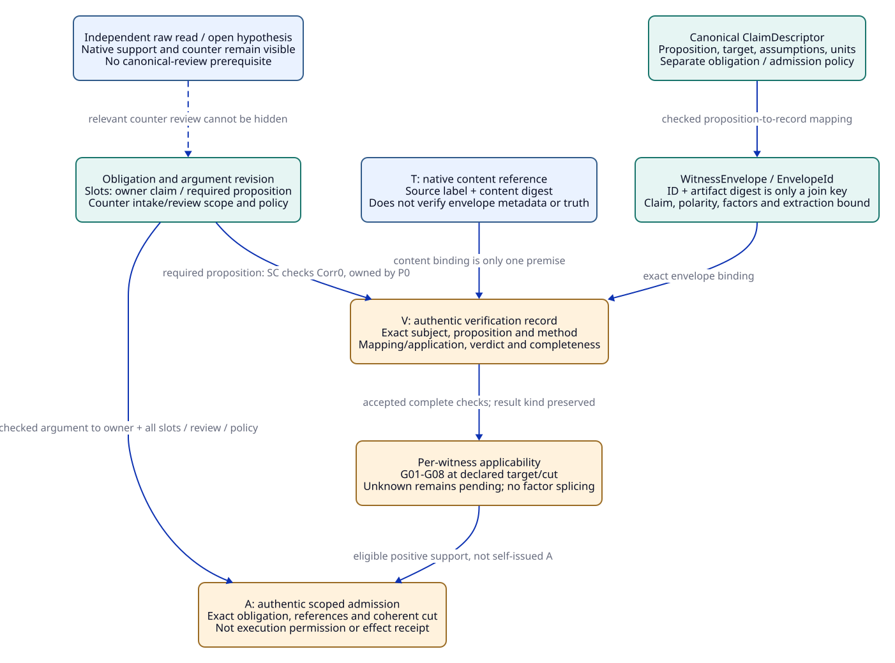
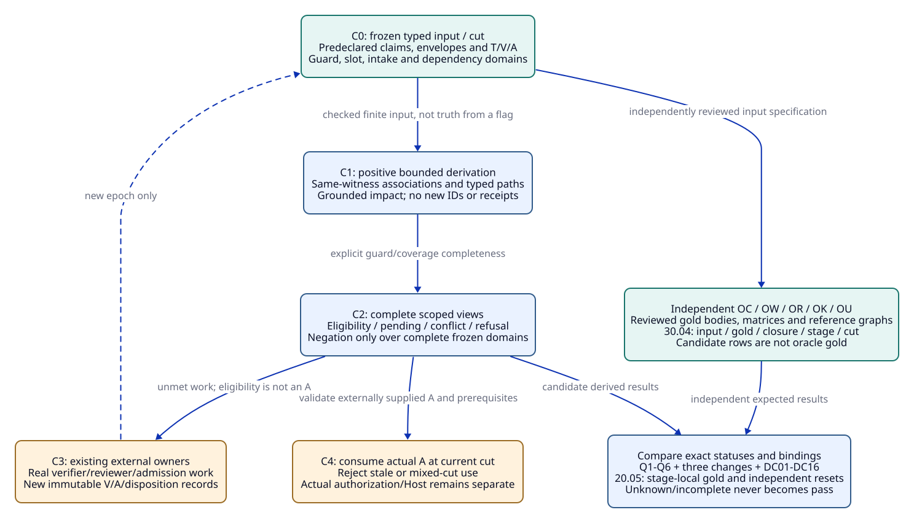

# SPDX-FileCopyrightText: 2026 tao3k team and Contributors
#
# SPDX-License-Identifier: LGPL-2.1-only

#+TITLE: 10.07 Claim Identity, Witness Applicability, and T/V/A Reference Contracts
#+LANGUAGE: en
#+PROPERTY: JD_ID 10.07
#+OPTIONS: toc:3 num:nil
#+STARTUP: overview
#+TODO: OPEN SPECIFIED | QUALIFIED
#+FILETAGS: :design:contracts:identity:evidence:

[[file:../../00-09-project/00-documentation/00.01-index.org][Index]] | [[file:10.06-poo-ascent-integration.org][Integration]] | [[file:../../20-29-cases/20-gateway/20.04-query-and-change-fixtures.org][Six queries and three changes]] | [[file:10.02-domain-and-rules.org][Domain rules]]

* Scope and source boundary
:PROPERTIES:
:CUSTOM_ID: contract-scope
:STATUS: proposed-data-and-rule-contracts-not-implemented
:END:

This document specifies domain data and finite rule meanings to lower through the
existing POO/ASCENT mechanisms. It creates no schema library, canonicalizer,
interpreter, verifier, query engine, admission service or execution adapter.
All case references remain the hypothetical symbols of 20.04. No real T/V/A,
proof, run, oracle result or passing benchmark is produced here.

The package-linked [[file:../../../.gerbil/pkg/github.com/tao3k/gerbil-ascent/rust/ascent/src/clues/projection.rs][native projection]] validates unique clue IDs and referenced ID/digest
pairs. Its native content receipt hashes source label and content digest; it does
not independently verify the projected claim, polarity, factors or engineering
meaning. The [[file:../../../.gerbil/pkg/github.com/tao3k/gerbil-ascent/python/src/ascent/clue_query_rules.ss][shared relations]] derive raw support/counter/unknown, while
[[file:../../../.gerbil/pkg/github.com/tao3k/gerbil-ascent/rust/ascent/src/clues/exchange.rs][read_selected]] reads the selector's claims rather than filtering every
witness by matched. This contract fills the proposed gateway mapping/admission
boundary; it does not relabel those native relations as complete applicability.

Agents may ask arbitrary questions and retain unreviewed hypotheses. A canonical
engineering claim identity is required before admitted support is consumed as that
claim, not before the Agent may explore an idea. These constraints govern what a
reference justifies, not a mandatory reasoning order or closed hypothesis menu.

* Typed identity domains and immutable records
:PROPERTIES:
:CUSTOM_ID: typed-contract-records
:STATUS: proposed-closed-record-schemas
:END:

Every stored record has schema kind/version, immutable content identity, origin
owner/namespace and input-reference provenance. IDs are typed; equal digest text
does not equate different kinds. Present-use validity is evaluated at a coherent
cut; immutable records are not edited to revoke their historical meaning.

#+NAME: claim-witness-record-schemas
| Record / identity | Required semantic fields | Excluded or separate concern |
|-------------------+--------------------------+------------------------------|
| ClaimDescriptor / ClaimId | domain; property-template/revision; typed proposition arguments; quantifier domain; observation/interpretation revision; target scope; explicit assumption scope | Display alias, witness, T/V/A, method-slot inventory, admission policy and execution permission |
| TargetScope / TargetId | subject/consumer kind; declared source/model/configuration identities relevant to the proposition; resource/replica/incarnation scope; units; time/fault/workload interpretation when part of the claim | An abstract law need not depend on an entire native checkout; dependency scope must be explicit |
| ObligationDescriptor / ObligationId | target ClaimId; template/binding revision; complete required method-slot set; argument structure; applicability/review policy | Same proposition can have new method/policy requirements without receiving the old admission |
| ArtifactRef / ArtifactId | artifact kind; algorithm/content digest; retrievable immutable reference; producer/attempt; production input/source/tool/environment bindings; outcome/completeness | A readable filename or an available blob is not a successful result |
| WitnessEnvelope / EnvelopeId | namespaced observation ID; native observation digest; artifact reference; claim ID or explicit exploratory label; polarity/role; complete typed factor set; projection/interpretation reference; origin context/cut; dependency footprint reference | Current materialization owner is a separate usage binding; no mutation of the original observation |
| WitnessKey | namespaced observation ID plus native observation digest, lowered injectively to native ID/digest | Join identity only; not a complete hash/authentication of the envelope metadata |
| ContentBinding / T-use | native T reference; artifact/source-label/digest; witness-envelope/owner usage association; trusted host content-check context | Added usage metadata is not inside the native source/digest receipt or a new native attestation API |
| VerificationRecord / VId | issuer/checker identity; subject artifact/envelope IDs; exact proposition; input and method-policy references; result kind/verdict; completeness; checked mappings/applications; dependency/validity scope | Not an accepted fact merely because an Agent or JSON field says verified=true |
| MethodSlot / SlotId | obligation and argument-group ID; owner ClaimId; required proposition ClaimId; method kind/revision; allowed positive result kind; accepted producer/checker policy; required mapping/application scope | A method code such as L/Q/SC alone cannot identify a discharged slot |
| ApplicationRecord / AppId | from/to ClaimIds; typed substitutions; source artifact/premise IDs; frame/assumption/observation-mapping references; producer/inputs; exact target context | Requires its own V; never an implicit rewrite of a source witness or theorem |
| ReviewDisposition / DispositionId | intake scope/cut; exact opposing envelope/reference; reason and accepted/rejected/inapplicable/pending assessment; authenticated reviewer/policy and supporting verification | A raw ignore flag cannot remove a required counter review |
| ScopeCertificate / ScopeId | scope kind/revision; frozen member/required-guard/slot set and digest; collector/source dependencies; cut; actual trusted completeness review | Certifies only that closed declared scope; cannot create its own trust or all-world hazard completeness |
| AdmissionRecord / AId | issuer/role and admission policy; ClaimId/ObligationId; exact slot-set and argument revisions; selected witness/envelope/T/V/application references; coherent scope/cut; validity/revocation policy | No runtime permission, complete-gateway acceptance or completed effect implied |
| ViewCut / CutId | bound source owner; actual relevant fact/content revision; rule/selector/anchor identity; required evidence/support/policy/context generations | Event count, sourceIdentity alone or a collection of unrelated successful timestamps |

The witness's native observation digest can be an artifact digest used by several
records. The complete envelope has its own content identity. Changing only a cap,
claim, polarity, factor, source mapping or projection creates a different envelope
and invalidates verifications of the old mapping, even if the artifact bytes and
T are unchanged. Native clue IDs must be unique within the owner; cross-owner
reuse of a namespaced observation ID is permitted only for the identical original
record. A conflicting reuse is rejected, not merged by a business label.

A whole-file T may serve several distinct observations in that file. Each needs
its own identity and checked record extraction. Shared bytes, a shared producer,
or repeated observations are not independent corroboration or majority votes.

** Claim identity and admission identity are separate
:PROPERTIES:
:CUSTOM_ID: canonical-claim-identity
:STATUS: normative-proposed-identity-contract
:END:

The admitted proposition vocabulary is a finite reviewed set of typed templates,
not an attempted normalizer for arbitrary Scheme, Lean or natural language.
Opaque external propositions bind exact source/statement and interpretation
references. Domain Modules/Profiles may extend the template registry in a new
reviewed snapshot; a finite cohort is not a permanently closed domain language. New exploratory labels remain allowed; they simply lack an admitted
canonical mapping until that mapping is supplied.

Canonical equality means equality of the complete normalized ClaimDescriptor.
Its hash is a lookup identity, not a proof of semantic equivalence. Mathematically
equivalent formulations keep distinct IDs unless they normalize under an explicit
reviewed syntactic rule; otherwise an external verified equivalence/application
relates the two IDs. A transfer never overwrites either descriptor.

#+NAME: canonicalization-policy
| Input feature | Required canonical treatment | Rejection / unresolved boundary |
|---------------+------------------------------+--------------------------------|
| Schema/record fields | Closed versioned schema; declared field order; reject duplicate/unknown fields before map conversion | Cannot silently discard a second JSON key or an unsupported field |
| Identifiers/text | Exact valid UTF-8; length counts bytes; no implicit case folding, Unicode normalization or path alias resolution | Display similarity does not equate identifiers; path-to-content binding is external |
| Integers and units | Signed base-10 integer, no leading plus/zeros or negative zero after typed normalization; explicit unit enum | Floats/NaN/infinity or implicit KiB/byte/abstract-unit substitution are not admitted literals |
| Optional/unknown values | Typed none, explicit unknown with reason, and an omitted required field are distinct | Unknown required identity input blocks canonical admission; it is not false or a default |
| Ordered arguments/parents/trace | Preserve order | Sorting an ordered input changes meaning or rejects a malformed representation |
| Declared sets | Unique elements, lexicographically sorted by their canonical bytes | Duplicate elements reject; no automatic set interpretation for a sequence |
| Assumptions/quantification | Exact assumption and quantified-domain descriptors | forall-C over {1,2} differs from C=1 and from an unbounded natural-number theorem |
| Claim scope | Exact local/remote, target/config/source and interpretation fields | Same property name cannot collapse P0/Pcap/Psrc/Pcache |
| Aliases | Namespaced alias -> one descriptor per frozen alias view; alias excluded from the descriptor | Ambiguous alias rejects resolution; arbitrary new hypothesis labels need no alias registration |
| Hash/reference kinds | Distinct record kinds and algorithm-qualified digests; retain normalized body | Equal hash with different body is an integrity error; no silent collision fallback |

Method-slot inventory and acceptance policy are excluded from proposition identity.
A method or measurement definition that is itself part of the proposition remains
in its observation/proposition fields; the exclusion is not permission to erase
semantically relevant instrumentation, metric or checker claims.

A proposed unambiguous metadata encoding is specified here so an independent oracle
can test byte identity. It is an artifact encoding contract, not another Agent
query language. Let len(x) be the ASCII decimal byte count followed by ':' and raw
bytes x. Text is t+len(UTF8); integer is i+len(canonical decimal); bool is b0 or b1;
none is n; unknown is u+len(reason-code). An enum is e+len(namespace)+len(code).
A digest is d+len(algorithm)+len(raw digest bytes). Sequence is q+count(n)+encoded
members; set is s+count(n)+sorted encoded members; count(n) is decimal n followed
by ':'. Record is r+len(schema-name)+count(field-count), then for each declared
field len(field-name)+encoded value. '+' denotes concatenation, not a literal
character. All container counts and lengths are checked against schema and caps.

For example text cap encodes as t3:cap, integer 1 as i1:1, bool false as b0,
and sequence [integer 1, integer 2] as q2:i1:1i1:2. The empty sequence is q0:;
it is distinct from none n. The ClaimDescriptor schema name includes claim-key/v1;
ClaimId is the typed pair (claim-key/v1, SHA-256(encoded descriptor)). Different
record schema names separate other identity domains. No encoded bytes/digests
were computed for the full 20.04 fixtures here. Real codec/parser/hash/trust
correctness remains an implementation obligation.

#+NAME: claim-identity-discriminators
| Comparison / mutation | Independent expected identity result |
|-----------------------+--------------------------------------|
| P1 versus Psrc alias in 20.04 | Same descriptor/ClaimId only because the frozen alias table explicitly binds both to Psrc |
| Input field order changed, same typed closed record | Same descriptor/bytes after schema-order encoding |
| P0 versus Pcap | Different TargetId/ClaimId: X0/C1 versus Xcap/C2 |
| P0 versus Psrc | Different source/target identity even though M0 text is retained |
| P0 versus Pcache | Different effective target/assumption/ownership interpretation |
| Method SC added/removed for the same exact proposition | ClaimId may remain; ObligationId/slot-set/admission policy binding changes, old A cannot satisfy it |
| Proof-checker or trust policy changes without proposition change | ClaimId remains; V/A present-use eligibility must be reconsidered |
| Equivalent formula not covered by syntactic normalization | Distinct ClaimIds; verified equivalence is an explicit relation, never hash equality |

* Witness applicability is an evaluated relation
:PROPERTIES:
:CUSTOM_ID: witness-applicability-contract
:STATUS: proposed-typed-guard-contract
:END:

Applicability is evaluated for (EnvelopeId, target ClaimId, intended method/role,
CutId). It is not a permanent property of a witness and is not the native raw
support relation. Every guard has one of known-match, known-mismatch, unknown,
or malformed. Required guard domains and factor completeness are declared before
using absence or universal all-guards reasoning.

#+NAME: witness-applicability-guards
| Guard | Exact required check | Unknown / mismatch consequence |
|-------+----------------------+--------------------------------|
| G01 identity | Immutable WitnessKey/EnvelopeId and artifact/extraction relation agree | Malformed/conflicting ID rejects this input/application |
| G02 proposition | Envelope claim/interpretation/target equals requested proposition, or a separately checked typed application connects them | Distinct target is inapplicable; unreviewed mapping is pending |
| G03 factors | All required typed factors refer to this one witness/envelope; scalar factors have one value; allowed multi-valued factors declare set semantics | Missing factor is unknown; conflicting scalar values are malformed; no join across unrelated witnesses |
| G04 source/config/footprint | Complete relevant point, absence/aggregate and interpretation dependencies are current, or conservative invalidation applies | Unknown footprint withholds current application; equal cap/count is insufficient |
| G05 content/provenance | Actual artifact bytes and T-use match; admitted projection/extraction binds the envelope metadata to those bytes | T alone does not validate arbitrary factors or a fabricated record |
| G06 method/result | Authentic V covers exact artifact/proposition/method and mapping/application obligations, with correct verdict/completeness | Timeout, parser error, unverified claim or wrong method never becomes successful evidence |
| G07 assumptions/scope | Source/model/clock/fairness/workload/consumer premises hold at the required cut | Unknown is pending; known scope mismatch refuses the attempted application |
| G08 support polarity | Positive slot support differs from a verified counterexample or hypothesis | A successfully checked countertrace is not a successful positive method slot |
| G09 opposing-evidence scope | Complete declared relevant intake scope, dispositions and pending counter reviews at the cut | Missing/unknown coverage blocks a clean admission within that scope, not all exploration |
| G10 coherent use cut | All required currentness/policy/target bindings coexist at consumption/commit | Mixed-cut or stale use refuses; actual Host/remote fencing remains external |

G01-G08 govern a witness or method application. G09 is a target admission
review guard and G10 a consumption guard; neither is used to make a pending
counter review disappear by declaring the counter itself ineligible. Trusted
intake candidates with unresolved verification remain explicit review work.

Record-level metadata can be content-bound by the admitted projection/extraction
contract and verified record mapping. If V only checks an artifact's internal
result, a separate checked mapping to the envelope and target is still required.
Changing the envelope cannot reuse a V that checked only its old interpretation.
No rule can discover genuine external dependencies from the absence of an edge.

Two operations remain distinct: a raw broad read may expose old or differently
scoped records truthfully, whereas a current application must satisfy these guards.
A new hypothesis is conditional, not a malformed engineering record merely because
it has no canonical identity/T/V/A. Multiple evidence methods may support a named
AND/OR argument; that explicit structure is not permission to splice factors into
one invented witness.

#+CAPTION: Canonical proposition identity, witness metadata and T/V/A binding are separate checks; raw query rows remain exploratory.

[[file:../../90-99-views/90-architecture-views/90.15-claim-witness-tva-contract.d2][Editable D2 source]].

* T, V and A reference validation
:PROPERTIES:
:CUSTOM_ID: tva-reference-contract
:STATUS: proposed-domain-validation-not-native-receipt-extension
:END:

#+NAME: tva-validation-matrix
| Layer | What is bound / validated | What it cannot establish |
|-------+---------------------------+--------------------------|
| T: content attestation | Native receipt of source label and digest, plus host check/usage/projection binding outside that native receipt | Claim truth, producer honesty, typed factor meaning, source refinement or authorization |
| V: verification | Authentic existing verifier-owner record over exact subject IDs/bytes, proposition, method, declared assumptions, result kind and completeness | All methods, whole-design coverage, continuing applicability or deployment permission |
| A: scoped admission | Authentic existing admission-owner record joining exact target/obligation/argument/slot-set and required T/V/application references at a coherent cut | An action authorization, remote termination guarantee or actual effect receipt |

Reference validation compares record kind, body identity, provenance and full
subject/target bindings, not just a digest-shaped string. The native T may be
reused as a content reference while its engineering application is stale. The V
for a mathematical artifact may remain usable for its original proposition while
V for its application or source correspondence does not. Later withdrawal affects
current A eligibility; it does not edit the A or erase a real completed effect.

V distinguishes verifier verdict (accepted/rejected/inconclusive/error) from the
subject result kind (positive theorem/model result, counterexample, source mapping,
application, measurement or review). An accepted verification of a counterexample
cannot fill a positive slot. Complete checker execution that found a counterexample
is different from incomplete execution and from property satisfaction.

A new typed application record binds source proposition/artifacts, target ClaimId,
substitution/parameters, frame/assumption/source mapping and its own checked V.
Applications can combine named premises but cannot be self-justifying. Cyclic
reference support without a grounded trusted input is rejected; recursive facts
inside an admitted ASCENT closure may have SCCs but still need grounded support.
Trust roots for existing producers/verifiers/admission owners remain explicit
external assumptions, not an infinite chain solved by self-verification.

V/application subjects need authentic exact-byte binding through the existing
producer/content verification path. They need not all be Clue observations: do
not invent a native T for App0 or a verifier record that was never projected as
a clue. Required T-use applies to the actual Clue witnesses; other artifact inputs
retain their own genuine content/provenance bindings under the method policy.

Counter review distinguishes verified defeat, reviewed inapplicability/rejection,
and unresolved review. A raw content-attested counter observation does not prove
the opposite theorem. Under the proposed conservative admission policy, pending
counter review from the declared relevant trusted intake scope blocks a clean A;
only an authenticated disposition with reasons can remove that blocker. An
untrusted Agent hypothesis or malformed query packet has no universal veto.
Disposition through a new claim revision does not make the old claim's conflict
vanish from history. The policy, intake scope and issuer authority are themselves
versioned dependencies; narrowing a discovery selector cannot narrow them.

** Complete 20.04's shorthand without inventing results
:PROPERTIES:
:CUSTOM_ID: tva-fixture-bindings
:STATUS: hypothetical-required-fields
:END:

#+NAME: tva-fixture-binding-supplement
| 20.04 reference | Required complete record/usage binding under this contract | Expected absent/pending boundary |
|-----------------+-----------------------------------------------------------+---------------------------------|
| T+ / R+ / o+ | Native T(s+,d+); envelope E+ binds P0, five o+ factors, polarity support, admitted extraction and artifact R+ | T+ alone cannot establish E+'s method/metadata mapping |
| T- / R- / o- | Native T(s-,d-); E- binds P0, its own factors and counter polarity | Q1 review unresolved; no clean admission even if a positive V exists |
| TL / RL / oL | Native T(sL,dL); EL binds L0/M0 and universal admissible-C={1,2}; VL0 subject is the exact mathematical artifact/proposition | No automatic native S1/C2/cache application |
| VQ0 | R+ and its checked proposition/method bindings plus E+ mapping, or an explicit additional mapping verification | Q1 does not supply a resolved successful VQ0; B0 declares success only as hypothetical input |
| VSC0 | RSC0/Corr0/X0/S0-to-M0 plus exact envelope/mapping scope | No Corr1/S1 mapping without new VSC1 |
| A0 / P0 | ObligationRev0 and exact L/Q/SC slots; RL requires App0/VApp0 for P0's C1/source assumptions, R+ requires VQ0, RSC0 requires VSC0; required envelope mappings, counter-scope review and coherent cut | Old shorthand lacking these fields is incomplete, not an accepted production A |
| AppCap / VAppCap / ACap | New Pcap/C2 application; exact law/model/config/frame/source conditions and new required slot applications; current counter/method policy | All are pending until genuinely supplied; checked L application alone is not ACap |
| RF0 / TF0 | EF0 binds Perf0, C1/W0/H0 and observed run meaning; T is content only | No verified C2/W1 measurement or production latency guarantee |
| RH3 / dH | Hypothesis envelope with exploratory H3 label, not an observation/T/V/A chain | No canonical review or receipt is needed to ask H3 |
| RLate | Original task/record envelope X0/S0/P0, production cut and original reference bodies retained | No mutation to Psrc; new current-target mapping requires new evidence/checked application |

App0 and VApp0 make the formerly implicit universal-law application in B0 explicit.
B0's hypothetical A0 now requires these and the complete binding/review fields
above. They are added assumption slots in a paper positive control, not newly
verified receipts or retroactive qualification. Raw Q1-Q6 relation expectations
remain those of the native schemas; richer application/admission fields belong
to the proposed domain contract, not to native Clue tuples.

* Finite rule templates and result epochs
:PROPERTIES:
:CUSTOM_ID: finite-claim-witness-rules
:STATUS: proposed-bounded-lowering-contract
:END:

For each independently reset evaluation instance in this paper cohort, preallocate at most 32 claims, 32 envelopes/witnesses,
16 T references, 48 V records including mapping/application checks, 8 A records,
64 method slots, 32 dependency/intake scopes, 32 candidate-usage IDs, 8 cuts,
16 application records and
128 guard instances. Initial proposed caps are 512 input facts, 4096 derived
facts, 100000 rule-work units, 4096 bytes per claim descriptor and 65536 bytes per
envelope. These are test-envelope proposals, not measured performance or language
limits. Complete producer/issuer identities, allowed methods and relation kinds
are also finite declared input domains. Guard instances are allocated for the
whole declared candidate/intake scope; if that scope exceeds the cap, retain
INCONCLUSIVE rather than shrinking it to omit an opposing record.

No recursive rule creates new IDs, claim descriptors, nested terms, applications,
prover results or authority facts. Codec/projection/checker/trust results are
explicit external input records with declared evidence boundaries. Bound exhaustion
is incomplete; it cannot be widened silently or converted to a completed absence
verdict. A larger experiment creates a new explicit instance and retains history.

#+NAME: claim-witness-rule-strata
| Stratum | Inputs and derived views | Completeness condition |
|---------+--------------------------+------------------------|
| C0 | Frozen typed records, externally checked encodings/mappings, prior V/A, dependency graph and cut | Identity/record checks and declared finite domains; unknown inputs remain explicit |
| C1 | Positive witness associations, per-guard matches/mismatches, typed reference paths, grounded impact candidates | No success assertion about an external verifier; no ungrounded recursive support |
| C2 | Scoped pending slots, complete-guard/coverage tests and conflict/eligibility views | Negation only over explicitly complete frozen guard/slot/intake domains |
| C3 | External verifier/reviewer/admission owners perform work and publish new immutable V/A/dispositions | Outputs begin a new C0 epoch; no feedback into the C1/C2 run that requested them |
| C4 | Consumption validates actual A and current coherent bindings; effect authority remains separate | New currentness cut/fence or refusal; this is not a native effect implementation |

These templates specialize the existing R01-R15 domain contract. Names below are
proposed notation; no published Scheme predicate is claimed.

#+NAME: claim-witness-finite-rules
| ID | Frozen premises / bounded operation | Derived conclusion / limit |
|----+-------------------------------------+----------------------------|
| CW01 | Checked ClaimDescriptor encoding and typed alias mapping | Canonical claim candidate; no logical equivalence or arbitrary prose understanding |
| CW02 | Complete same-typed descriptor body equality | Same-claim relation; different target/premise body remains distinct |
| CW03 | Declared witness/envelope/artifact and injective native lowering | Consistent witness binding; conflicting ID/envelope reuse is an integrity error |
| CW04 | External host-content check and matching native T/source/digest association | Content-bound candidate only, never V/A |
| CW05 | Requested claim plus one consistent envelope's required typed factor rows | Per-witness guard matches/mismatches; no factors from a second envelope |
| CW06 | Complete required-guard domain and recorded checks at one cut | Applicable candidate only when every required guard is known-match; unknown stays pending |
| CW07 | Authentic accepted complete V matching subject/slot-required proposition/method and checked envelope mapping | Verified positive slot candidate, or separately a verified counter candidate according to result kind |
| CW08 | Checked application V, from/to ClaimIds, substitutions and frame/source premises | Target-specific transfer candidate; mathematical artifact and old A remain unchanged |
| CW09 | Complete authoritative obligation slot set, explicit argument mapping to owner claim, and admitted positive candidates for each slot-required proposition in AND slots or an explicitly allowed OR group | Method-complete candidate; does not synthesize an A or accept unknown slot coverage |
| CW10 | Applicable counter / unresolved required review from complete declared intake scope | Conflict or pending-review blocker; narrower selector cannot remove it |
| CW11 | Complete guards/slots/intake, resolved required review, policy checks | Admission-eligible candidate only; no rule-authored verification or A issuer |
| CW12 | Authentic external A whose target/obligation/argument/slot-set/reference graph and policy match CW11 at the consumption cut | Current scoped A-use view; still no execution authorization |
| CW13 | Changed dependency plus complete point/absence/aggregate footprints and grounded reverse closure | Affected present-use eligibility withdrawn; unknown footprint invalidates conservatively |
| CW14 | Immutable prior record with changed applicability | Historical reference retained; no relabeling, deletion or retrospective effect reversal |
| CW15 | Supported body/display units, valid source/content/anchor hint bindings | Read-hint reuse/replay only; not proof, admission or native milestone progress |
| CW16 | Raw explicit question and native clue records | Raw support/counter/conditional/conflict/unknown as in 20.04; do not replace raw semantics with CW06 |

** Join keys and guarded absence
:PROPERTIES:
:CUSTOM_ID: finite-join-keys
:STATUS: mathematical-notation-not-installed-predicates
:END:

The captured cut is an immutable binding of declared input roots/generations,
not a self-containing hash of the Usage/T-use/verdict records that reference
that same CutId. Such judgments are separately identified; newly obtained
external results enter a later input epoch. See
[[file:../../20-29-cases/20-gateway/20.07-packet-query-and-history-fixtures.org::#query-cut-epoch-boundary][20.07's query/cut identity boundary]] and its
[[file:../../20-29-cases/20-gateway/20.07-packet-query-and-history-fixtures.org::#query-binding-ledger][fresh usage/T-use bindings]].

The [[file:../../20-29-cases/20-gateway/20.08-qr-identity-and-reuse-controls.org::#qr-cut-identity-dag][20.08 identity review]] explicitly separates native raw-owner identity from
domain materialization/use cuts, and earlier oracle-input closures from later
package-review closures. Same raw N_L/T bytes do not license substituting usage
or T-use fields across different targets/cuts. A content-identity cycle is a
setup defect; an ungrounded logical justification SCC is the separate QR10/RJ09
case, not a reason to attempt circular hashes.

A candidate usage ID u is allocated before evaluation and binds exactly
(witnessKey, EnvelopeId, target ClaimId, method/role, CutId). Reusing u with a
different tuple rejects. RequiredGuard(u,g) and GuardVerdict(u,g,status,reference)
join by that full usage, not merely by a displayed claim or observation ID.
Duplicate incompatible verdicts reject. No required verdict row may be silently
omitted; an unavailable check is recorded as unknown or an incomplete verdict
scope keeps the entire usage pending.

#+NAME: finite-guard-join-notation
#+begin_example
BadGuard(u)     iff a required guard has known-mismatch or malformed verdict.
UnknownGuard(u) iff a required guard has unknown, or required verdict coverage is incomplete.
AllMatch(u)     iff GuardDomainComplete(u), VerdictCoverageComplete(u),
                    no BadGuard(u), and no UnknownGuard(u).

PositiveSlotCandidate(slot,w,e,v,k) requires:
  Usage(u,w,e,requiredProposition,m,k),
  Slot(slot,obligation,ownerClaim,requiredProposition,m), AllMatch(u),
  externally authenticated VBinding(v,subject,requiredProposition,m,k,accepted,resultKind,complete),
  CheckedSupportBinding(v,subject,e,requiredProposition,k), AllowedPositiveKind(slot,resultKind).

ReviewBlock(c,k) iff a witness in RequiredIntake(c,k) has an unresolved
                     required review or an applicable verified defeat.
CleanScopeCandidate(c,k) requires complete frozen RequiredIntake/ReviewCoverage,
                         complete required positive slots, and no ReviewBlock(c,k).
#+end_example

ownerClaim is the target of the obligation/A, while requiredProposition is the
proposition checked for that slot. For Ob0, Q requires P0, L requires P0 through
App0/VApp0, and SC requires Corr0. VSC0 must not be mislabeled a direct proof of
P0 or rejected because Corr0 differs from P0. The reviewed Arg0 explicitly
composes these slots toward its owner claim; arbitrary slot inventories cannot
establish that implication. See [[file:../../20-29-cases/20-gateway/20.05-expanded-admission-controls.org::#dc-baseline][20.05's full baseline]].

These are finite logical definitions, not a new execution language or claimed
Scheme lowering. The absence tests are permitted only over the named complete
frozen domains. Missing intake coverage cannot remove ReviewBlock by pretending
its member set is empty. VBinding is an external checked premise with its
reference body/issuer/subject checks; the rule does not manufacture it.
CheckedSupportBinding requires exact checked extraction/mapping or the explicit
verified application graph, including all original theorem premises. It never
means approximate row equality. AllowedPositiveKind is the frozen method-policy
relation for that slot, retaining actual source-mapping/application/measurement
result kinds and excluding a counterexample or hypothesis. A
counterexample uses its own negative result-kind path and cannot satisfy the
positive clause above. Current A-use additionally requires the actual authentic
external A, matching obligation/argument/policy/reference graph and current cut;
CleanScopeCandidate is not an A constructor.

CW06/CW09/CW11 require explicit complete-domain certificates or reviewed closed
input specifications. Without them no negated missing/failure row can imply all
conditions hold. Scope completeness covers that declared scope, not all real
hazards or undiscovered evidence. Graph SCC analysis may identify impact cycles;
it cannot certify their own unsupported truth.

A field such as checked=true supplied by a finite model abbreviates an external
method premise; CW rules cannot authenticate it by repeating that flag. The same
holds for claimed source freshness, issuer authority, clock bounds and native
termination. Actual producer/currentness controls remain required.

#+CAPTION: Bounded inference can derive eligibility and pending/refusal views; external owners supply authentic V/A in new epochs.

[[file:../../90-99-views/90-architecture-views/90.16-finite-admission-oracles.d2][Editable D2 source]].

* Refusal, pending and conflict are different outcomes
:PROPERTIES:
:CUSTOM_ID: refusal-and-pending-contract
:STATUS: proposed-typed-diagnostics
:END:

Diagnostics bind code, affected input/application, observed versus expected
identity, cut and evidence reference. They are sets; independent failures are
retained rather than hidden behind an arbitrary first error. Malformed request
rejection affects that request. Withholding a dependent claim does not prohibit
new hypotheses or prove the claim false. Diagnostics are stage-local: a raw
parse rejection does not invent downstream missing-method results for stages
not evaluated. Preserve independent defects actually checked. Known mismatch is
refusal; unavailable provenance is pending. Withdrawal is a before/after change
in present-use qualification, not a rewrite or deletion of an immutable A.
An unknown changed dependency footprint conservatively withdraws affected use
and leaves impact pending; it does not establish the proposition's falsity.
A valid larger input exceeding an instance budget is INCONCLUSIVE; malformed
typed encoding is RJ01. These are different oracle outcomes.

#+NAME: typed-refusal-reasons
| Code | Exact refusal condition | Preserved scope |
|------+-------------------------+-----------------|
| RJ01 | Unsupported/ambiguous schema, duplicate/unknown key or invalid typed value | Original bytes/failed request; no silently normalized trusted record |
| RJ02 | Ambiguous alias, kind mismatch or hash/body integrity disagreement | Distinct original descriptors remain distinct |
| RJ03 | Claim/target/quantifier/unit/local-remote meaning mismatch without checked application | Original claim and artifact; requested stronger application refused |
| RJ04 | Reused witness ID with changed envelope, conflicting scalar factors or cross-witness factor splice | Original evidence remains immutable |
| RJ05 | Attempted observation projection has missing/mismatched required native T/source/digest, or known untrusted host binding | Candidate bytes may remain unverified; no content attestation invented |
| RJ06 | V subject/envelope/proposition/input/method differs, has known invalid/untrusted issuer binding, is rejected, or is incomplete but offered as success | Prior V's own target and actual outcome |
| RJ07 | Verified counterexample/hypothesis substituted for a positive method slot | Counter/hypothesis remains visible in its own role |
| RJ08 | Old A's obligation/slot-set/argument/policy differs from required current contract | Historical A and unaffected independent artifacts |
| RJ09 | Cyclic reference justification with no grounded external base | Raw graph/history; no self-issued success |
| RJ10 | Known stale dependency, changed policy/cut or mixed-cut validation used for present consumption | Old as-of result/real completed effects; stale commit refuses |
| RJ11 | Discovery filter or checkpoint suppresses required opposing review, or acknowledges unseen units | Unseen/contrary data remains expandable; no clean admission; checkpoint checksum alone does not authenticate prior display |
| RJ12 | T, V, A, role or plan substituted for actual effect authorization/completion | True content/verification/planning facts in their original scope |

#+NAME: typed-nonrefusal-statuses
| Status | Exact condition | Result |
|--------+-----------------+--------|
| PENDING_IDENTITY | Required semantic identity/interpretation is unknown | Raw exploration allowed; no canonical engineering admission |
| PENDING_BINDING | Envelope mapping, assumption, dependency footprint or coherent currentness not established | No eligible application; unknown is not mismatch/false |
| PENDING_METHOD | Required slot/application/V/A not supplied or still under review | Keep named missing work; do not generate success |
| PENDING_SCOPE | Required guard/slot/counter intake scope incomplete | No all-clear or globally complete absence verdict |
| CONFLICT | Applicable contrary evidence or unresolved required counter review | Withhold clean admission; preserve both provenance/polarity records |
| INCONCLUSIVE | Evaluation/proof/resource bounds exhausted or incomplete | No positive qualification or required semantic counterexample credit |

An observation lacking its required T cannot be installed in the native Clue
owner; that attempted projection rejects. A not-yet-projected candidate awaiting
a host check can instead be pending outside that owner. Similarly, unknown V
provenance is pending binding; a known wrong issuer/subject offered as success
is refusal. Do not silently turn missing observation T into an attested raw row.

These statuses may coexist on different scopes; a verified narrow law can remain
useful while a source application or operational decision is pending. The consumer
receives the exact applicable status/reason set, not one whole-task Boolean.

* Independent oracle specifications
:PROPERTIES:
:CUSTOM_ID: independent-contract-oracles
:STATUS: specified-not-authored-or-executed
:END:

The [[file:../../30-39-evaluation/30-benchmarks/30.04-oracle-review-data-contracts.org::#oracle-packet-contract][30.04 input/gold record contract]] and its
[[file:../../30-39-evaluation/30-benchmarks/30.04-oracle-review-data-contracts.org::#stage-closure-cut-contract][stage, reference-closure and cut register]] make the independent review inputs
explicit. The primary contracts derive from our POO/ASCENT/SMP/QNT/Lean/Aitia
system; external research does not supply their authority or implementation.

These are subdivisions of O1/O5/O6 and the source/trace oracle O3, not new runtime
services. The gold inputs are manually reviewed typed descriptors, factor matrices,
subject/reference tables and immutable cuts, frozen independently of the candidate
ASCENT output. A future simple reference checker may enumerate them, but no such
checker is delivered here. No oracle accepts the optimized evaluator's own rows
as gold or turns its self-reported verified flag into an external receipt.

#+NAME: identity-witness-reference-oracles
| Oracle / parent | Independent input and expected output | Required mutation / limitation |
|-----------------+---------------------------------------+--------------------------------|
| OC canonical identity / O5+O3 | Reviewed descriptor field/value table, raw byte records and the explicit encoding grammar; expected typed equality classes and small byte vectors | Reorder record fields, swap ordered parameters, duplicate a raw key, change units/quantifier/source or alias target; semantic equivalence beyond syntax still requires a proof |
| OW witness applicability / O5 | Handwritten per-witness factor/claim matrix and required guard-domain/cut; expected exact matching witness set and pending/mismatch reasons | Split factors, duplicate a scalar, change only metadata while retaining T, narrow a selector; does not certify omitted external assumptions |
| OR reference chain / O6 | Reviewed typed T/subject/V/application/A edge table, issuer/method policies, complete slot set and cut | Swap one subject/envelope, invert positive/counter result, drop mapping/App0 or a method slot, introduce a self-cycle; validates binding, not a theorem or a measurement itself |
| OK counter/coverage / O1+O5+O6 | Frozen relevant intake scope, provenance eligibility, all dispositions and expected unresolved blockers | Hide o- with method=Q, forge an ignore disposition, omit an intake group; scope completeness still needs independent review |
| OU change/use / O5+O6 | Explicit before/after immutable dependency tables and version cuts, including absence/aggregate scopes | Late result, change after validation, unknown dependency or policy change with unchanged ClaimId; actual concurrent/remote enforcement is not simulated proof |

OC's byte vectors are independently prepared from the grammar, not copied from
the proposed production canonicalizer. OW uses explicit enumeration/relational
set expectations rather than importing gateway matching rules. OR compares complete
record bodies/typed subjects and authenticated producer bindings rather than just
hash equality. OU uses a simple reference dependency traversal and coherent-cut
comparison independent of the candidate incremental invalidator. Seed mutations
in the oracle path as well as the candidate path; disagreement is adjudicated
under the frozen specification, not corrected by weakening expected results.

A shared hash/parser library or a shared omitted premise is a possible common
failure source. Record dependencies and use manual small vectors/raw-byte negative
controls as well as independently reviewed scope tables. Two TLC-based checks are
not independent O4 evidence. No agreement among these metadata oracles establishes
Lean kernel checking, native refinement, real source authenticity or production
performance without the separately required genuine method evidence.

** Golden discrimination inputs
:PROPERTIES:
:CUSTOM_ID: contract-golden-controls
:STATUS: proposed-control-matrix
:END:

Each DC is expanded into concrete reset inputs, expected relations, exact
T/V/A bindings, CW traces and independent judgments in
[[file:../../20-29-cases/20-gateway/20.05-expanded-admission-controls.org::#expanded-dc-controls][20.05]]. Its [[file:../../20-29-cases/20-gateway/20.05-expanded-admission-controls.org::#cw-dc-consistency][CW coverage matrix]] distinguishes rejected attempts, unknown
premises, opposing review and temporal withdrawal without conflating them.

#+NAME: contract-golden-discriminators
| Control | Isolated mutation from complete declared paper input | Exact expected semantic discriminator |
|---------+------------------------------------------------------+---------------------------------------|
| DC01 | Same ClaimDescriptor, only display alias changes; separately reorder input record fields | OC same ClaimId/body after canonical field order; alias ambiguity is a separate RJ02 case |
| DC02 | Change P0's cap to 2, source to S1, local scope to remote, or unit to KiB in independent resets | OC distinct key for each changed proposition; attempted old application RJ03 |
| DC03 | Same proposition, remove SC from required slots while retaining old A0 | ClaimId unchanged, obligation/slot-set differs; OR rejects old-A use with RJ08 |
| DC04 | Replace a digest kind, duplicate raw key, disagree with retained identity body, or mismatch native host content binding | OC/OR/OW reject the checked stage via RJ01/RJ02/RJ05; no partial trusted owner |
| DC05 | Preserve (o+,d+,T+) but change E+'s cap, claim, polarity or a factor independently | OW/OR sees new/malformed envelope; old metadata V cannot qualify it, RJ03/RJ04/RJ06 as applicable |
| DC06 | Combine context=X0 from ox2 and cap=1 from ox1 | OW matching set remains {}; no successful application from two partial witnesses |
| DC07 | Keep T+ valid but omit VQ0 or use VSC0 as VQ0 | Missing V is PENDING_METHOD; wrong subject/method offered as success is RJ06 |
| DC08 | Verify a countertrace successfully, then offer it as a positive Q slot | OR refuses RJ07; verified counter remains a blocker/defeat in its proper scope |
| DC09 | Remove App0/VApp0 or extraction mapping from the hypothetical B0 input | OR reports PENDING_METHOD/PENDING_BINDING; no complete A0 from the prior shorthand |
| DC10 | Reuse VL0 for AppCap, or RF0 for PerfCap | Mathematical VL0 remains scoped to L0; missing application is pending, wrong claimed application/measurement RJ03/RJ06 |
| DC11 | Keep method=Q selector while E- is in the complete relevant intake scope; separately forge a disposition | Raw conflict retained; OK blocks clean A or rejects hidden/unauthenticated review via RJ11/RJ06 |
| DC12 | Keep all successful checks but change the required source/policy generation between check and use | OU rejects stale/mixed-cut use RJ10; unchanged bytes/proposition may remain historical |
| DC13 | Insert a cache owner into a registered empty scope, remove the last grounded logical proof base, or change an unknown footprint | OU withdraws affected use and retains pending impact when unknown; unsupported logical cycle RJ09, not circular-hash evidence |
| DC14 | Append H3 with stable native sourceIdentity; separately forge a prior shown family with recomputed checksum | Content-bound comparison required; proposed host rejects unowned shown provenance RJ11, not a claimed native checksum rejection |
| DC15 | Supply a role, admitted A0 or pure plan in place of actual deployment authorization/effect receipt | OR rejects scope promotion RJ12; original review/admission/planning facts remain |
| DC16 | Exceed one declared input/guard/work/encoding cap, or make required completeness unknown | INCONCLUSIVE/PENDING_SCOPE; no completed all-clear and no semantic counterexample credit |

Each control changes only its named premise unless a reset explicitly lists a
compound input. The required diagnostic set depends on what was attempted: a
missing V is pending; a different V falsely offered as the matching successful
one is refusal. A valid distinct descriptor is not malformed merely because it
cannot support the original target.

* Reconcile every query and change path
:PROPERTIES:
:CUSTOM_ID: query-change-contract-map
:STATUS: paper-closure-of-semantics-not-runtime-qualification
:END:

#+NAME: nine-fixture-contract-map
| 20.04 fixture | Canonical target and required witness/reference checks | Independent expected result / refusal |
|---------------+--------------------------------------------------------+---------------------------------------|
| Q1 | P0; E+/E- distinct; T+/T- content-bound; V/mapping/counter review unresolved | OC/OW preserve exact target and both witnesses; raw conflict remains; OK/OR withhold clean A as CONFLICT/PENDING_METHOD, never T->A |
| Q2 | PX1C1/PX0C2 differ from P0; conjunction uses one WitnessKey/EnvelopeId | OW matched={}, selector question={}; raw selected unknown={} while explicit P0 unknown={(P0)} in the validated projected corpus; relabeling ox2 to P0 requires rejection of the malformed association, not an invented native unknown |
| Q3 | H3 exploratory label with conditional role and body digest, no T/V/A | Raw conditional and unknown coexist; no canonical/receipt gate to ask H3; offering it as positive slot is RJ07/PENDING_METHOD |
| Q4 | P0 selector matched o+; E- remains in complete intake; view cut binds actual content and shown units | OW/OK read both polarities; no selector-induced clean A; acknowledgements cover complete shown family only, RJ11 for hidden positive-only acknowledgement |
| Q5 | Psrc differs from P0; RLate stays original X0/S0; RL still targets L0/M0 | OC/OU require distinct target; raw Psrc unknown with missing Corr1/VSC1/application; attempted RLate promotion RJ03/RJ10; old bytes/T are not discarded |
| Q6 | L0, Perf0, Pcap and PerfCap are four propositions/method scopes | OR preserves L0/Perf0 raw rows; Pcap/PerfCap pending; RL is not PF and RF0 is not C2/W1, RJ03/RJ06 if offered as successful target evidence |
| C-CAP | P0 -> Pcap; shared S0/M0 does not equate configurations; AppCap checks universal law substitution plus frame/source prerequisites | OC distinct target, OU withdraws copied C1 application; OR keeps VL0 for L0, requires new slot/application/current ACap; PF remains separate |
| C-CACHE | Xcache/Kk/Pcache/CacheAuth, changed negative and retained-owner scopes plus revised obligation slots | OU invalidates affected prior application/review even if C/B remain equal; missing complete footprint pending; no A from a new registration or retained numeric field |
| C-SOURCE | Psrc/S1 and new correspondence/application; immutable old artifacts remain original | OU rejects late or mixed-cut current use; OR permits historical V over original proposition, not stale source application; real new methods/fence remain open |

This map refines the six query and three reset-change specifications, not their
native relation schemas or top-level benchmark score. New required reference
fields make previously implicit assumptions visible. They cannot be credited as
new observed evidence merely because the paper baseline is now more detailed.

* Hidden assumptions and implementation boundary
:PROPERTIES:
:CUSTOM_ID: hidden-contract-assumptions
:STATUS: explicit-open-qualification
:END:

#+NAME: contract-hidden-assumptions
| Premise | Declared response / negative control | Still requiring real evidence |
|---------+--------------------------------------+-------------------------------|
| HA01 Codec/parser/hash identity is faithful and collision handling retains bodies | DC01/DC02/DC04 plus raw-byte duplicate/length/type vectors | Actual parser/codec correctness, collision-resistant identity and storage integrity |
| HA02 Claim templates/assumptions represent the intended requirement | Exact typed target/quantifier/unit mapping; no automatic equivalence | Independent domain/requirement review and verified semantic bridges |
| HA03 Projection/extraction binds metadata to actual bytes | DC05/DC09; verify EnvelopeId mapping separately from native T | Actual native projection/source/record correspondence and authentic source transport |
| HA04 Producer/verifier/issuer trust roots are appropriate | Reject untrusted self-asserted T/V/A; explicit trust policy revisions | Real producer/checker/role provenance and enforcement; compromised roots are outside a metadata oracle's proof |
| HA05 Complete factor/guard/slot/counter domain is available | DC03/DC06/DC11/DC16; incomplete scope remains pending | Actual collection/registration and independent coverage; no proof of all undiscovered hazards |
| HA06 Dependencies include absence/aggregate/shared ownership and grounding | DC13; unknown footprint invalidates conservatively | Actual dependency observers, supported incremental semantics and checked transfer/frame |
| HA07 Verifier success is interpreted by method and result kind | DC07/DC08/DC10; distinguish counterexample from satisfaction | Genuine QNT/Lean/native/measurement checks and source refinement |
| HA08 View/use checks share one relevant coherent cut | DC12/DC14; sourceIdentity/event counts are insufficient | Actual journal/content identity, concurrent publication and consumption/Host fencing |
| HA09 Expiry, clocks and in-flight policy semantics are explicit | Unknown timing keeps dependent application pending | Actual clock/lag bounds, revocation races and remote enforcement |
| HA10 Independent oracles avoid common parser/policy/expected-data defects | Independently authored gold, simple reference enumeration and faults on both sides | Reviewed oracle implementation, held-out controls and executed full-result accounting |

All rows can be specified at design level. None is closed by these documents,
a renderer pass or a proposed finite rule table. Actual implementation must keep
T/V/A ownership, claim mapping, witness applicability, complete scopes and current
use checks connected through the existing Core/ASCENT/Aitia mechanisms, while
preserving open Agent exploration and historical failures.
