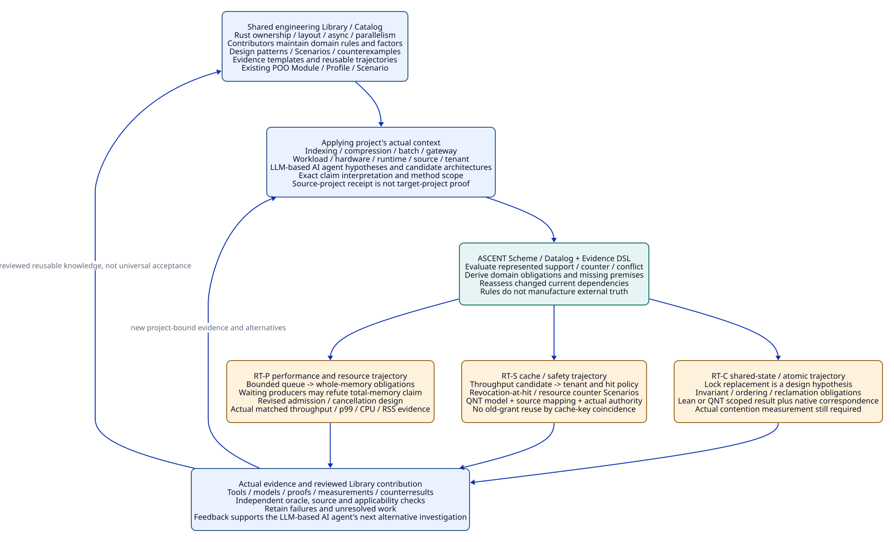

# SPDX-FileCopyrightText: 2026 tao3k team and Contributors
#
# SPDX-License-Identifier: LGPL-2.1-or-later

#+TITLE: 10.08 Shared Engineering Library and Rust Evidence Trajectories
#+LANGUAGE: en
#+PROPERTY: JD_ID 10.08
#+OPTIONS: toc:3 num:nil
#+STARTUP: overview
#+TODO: OPEN SPECIFIED | QUALIFIED
#+FILETAGS: :library:catalog:ascent:agent:rust:trajectory:

[[file:../../00-09-project/00-documentation/00.01-index.org][Index]] | [[file:10.04-evidence-driven-workflow.org][Evidence-driven architecture]] | [[file:10.06-poo-ascent-integration.org][Existing Module/Profile/Scenario integration]] | [[file:../../20-29-cases/20-gateway/20.18-policy-required-checks-and-evidence-admission.org][20.18 rule/policy controls]]

* SPECIFIED The Library is a shared engineering reasoning asset
:PROPERTIES:
:CUSTOM_ID: engineering-library-scope
:STATUS: design-not-implemented
:END:

The Library contains reusable engineering-domain rules, claim/factor definitions,
Catalog entries, design patterns, evidence contracts, counterexamples and
trajectories. Different projects and contributors maintain and apply those assets
through existing POO Module/Profile/Scenario composition and ASCENT Evidence DSL.
It is not a second framework, package manager, global acceptance registry or
mandatory Agent workflow. The Catalog makes existing assets discoverable and
explains their application boundaries; it does not turn listing into trust.

The central product is a reusable reasoning capability: given an engineering
intent and concrete project context, connect factors to competing designs,
derive the obligations and missing evidence, evaluate actual supplied evidence,
retain counterevidence and revise affected conclusions after change. A language
model contributes engineering hypotheses, decomposition, mappings, candidate
rules, implementation plans and explanations. Actual scoped rules make those
relationships explicit and repeatable. Genuine tools, measurements, proofs and
authorized reviewers provide the external premises that reasoning cannot invent.

#+NAME: engineering-library-asset-contract
| Shared asset in existing Library | Contribution / reusable content | Project application boundary |
|----------------------------------+---------------------------------+------------------------------|
| Catalog entry | Intent, domain, owning Module/publication, required factors, applicable Profiles/Scenarios, dependencies, examples and qualification state | Discoverable candidate, not a universally accepted solution; versions selected by package management |
| Claim/factor definition | Exact proposition, workload/environment/tenant/source/method dimensions and interpretation | Bind actual project context before comparing or composing claims |
| Rule / design pattern | Reviewed premise/conclusion meaning, assumptions, dependency and negative-domain requirements, counterexamples and expected results | Transfer rule intent under actual applicability; no automatic promotion of source-project evidence |
| Scenario / oracle example | Concrete input, independent expected relations, opposing cases, invalidation and reuse tests | Reuse fixture design; genuine target execution still required before claiming a local receipt |
| Evidence / witness template | Expected producer/method/subject/issuer/limits and complete support references | Actual artifact and current guard checks required; a template is not a completed witness |
| Evidence trajectory | Alternative hypotheses, observed transitions, evidence/refutation, rule applications, unresolved gaps and change impact | Reuse investigation knowledge, not a compulsory action sequence or blanket performance/security guarantee |

These rows describe responsibilities of existing assets, not a new serialized
schema or API. Model rules need review and counterexamples as well as examples;
a shared rule that encodes a false assumption can otherwise amplify the same
error across many projects.

The Rust domain is organized around language/resource semantics, data layout,
async execution, runtime behavior and CPU/shared-state parallelism. Gateway
examples below are application bindings. [[file:10.14-rust-performance-library-and-mechanism-cases.org][10.14]] makes that ownership boundary
explicit and selects a domain-neutral native lifecycle subject, without adding a
second framework or making gateway development the Library's purpose.

* SPECIFIED Native capabilities and engineering rule derivation
:PROPERTIES:
:CUSTOM_ID: engineering-library-inference
:END:

The actual [[file:../../../.gerbil/pkg/github.com/tao3k/gerbil-ascent/evidence/interface.ss][Evidence DSL]] binds Scheme constructors, source/output relation
handles and native programs. The [[file:../../../.gerbil/pkg/github.com/tao3k/gerbil-ascent/python/src/ascent/clue_query_rules.ss][existing clue rules]] derive support,
counterevidence, conditional hypotheses, relevant factors and conflict from
supplied relations. Agent proposals remain hypotheses until the actual method
and admission obligations are discharged. Native attestation of bytes is not
semantic correctness, engineering applicability or execution authority.

#+NAME: engineering-domain-rule-templates
| Finite rule template / existing contract specialization | Derivation | Required support / stopping boundary |
|--------------------------------------------------------+------------+--------------------------------------|
| Intent plus bound actual workload/platform/source and candidate design | Applicable design candidate and candidate obligation set | Missing context stays explicit; no universal high-performance recipe |
| Candidate relies on bounded memory, overload isolation or current authorization | Require the corresponding resource, schedule, tenant, permission and effect propositions | Existing obligations/guard domains; no requirement from mere extra-check preference |
| Actual accepted method result and exact subject/application mapping | May satisfy the matching required slot | Full issuer/assumption/source/current-use guards; outcome kind must support that proposition |
| Required counter or a counter-dependent assumption | Required review and relevant reason/method dependencies | Cannot drop a member because method is absent or selector hides it |
| Complete named domain plus supported absence | Scoped negative fact or aggregate candidate | Incomplete enumeration is pending; a known relevant member can refute absence without a complete scan |
| Changed dependency root or new relevant member | Reassess affected current claim/use/review/aggregate | Preserve immutable historical evidence and independent unchanged results |
| Complete required positive/review/coverage and current guards | Scoped argument candidate | Actual argument/operational authority still separate; no single test or LLM narrative proves the whole system |

This table is a design contract specialized from existing guard/claim rules,
not implemented rule source. Later domain lowering belongs inside existing
Module-owned Evidence DSL programs rather than a parallel rule engine. Public
source/output labels are not an execution restriction or evidence admission API.
The actual [[file:../../../.gerbil/pkg/github.com/tao3k/gerbil-ascent/evidence/declaration.ss][default explanation]] is recorded-only declaration dependency data;
per-conclusion support graphs must be explicitly established, not advertised as
existing automatic native proof lineage.

#+NAME: engineering-library-agent-limitations
| Engineering failure mode in Agent work | Existing reasoning/Library response | Evidence boundary still required |
|---------------------------------------+-------------------------------------+-----------------------------------|
| Plausible architecture narrative offered as verified performance | Represent it as a conditional hypothesis; derive exact workload/method/measurement obligations | Actual source-bound complete measurements and independent accounting |
| Counterexample or adverse Scenario omitted from a success narrative | Required intake, support/counter/conflict queries and independent negative fixtures retain it | Actual relevance/member coverage; rules cannot discover every unmodeled hazard |
| Valid evidence applied to another tenant/source/workload | Exact claim/factor/usage/method joins expose mismatch or unknown applicability | Real extraction/source/current-root bindings, not model-proposed equality |
| Old conclusion reused after assumption change | Dependency-sensitive current-use and negative-domain reassessment | Actual complete dependency scope and changed inputs; no automatic native repair claim |
| Genuine but unadmitted result treated as a finished argument | Separate actual method result, policy mapping, review/positive slots and A | Authentic producer/reviewer authority and complete premise closure |
| Repeated checks or failed runs without new support | Query the exact remaining obligation and recorded actual attempt inputs/outcomes | Agent chooses alternative investigation; no compulsory ranker or action scheduler inferred |

The combination addresses these failure modes by making unsupported transitions
visible and reviewable. It does not guarantee that the factor model, contributed
rule, external checker or source mapping is complete or sound. Independent
oracles, opposing examples and actual qualification remain part of the shared
Library's contribution discipline.

* SPECIFIED Rust performance factors with one gateway application
:PROPERTIES:
:CUSTOM_ID: rust-engineering-factor-case
:END:

Use a hypothetical gateway project as an authored design fixture. W-R fixes a
32-core host, 8 GiB process budget, maximum request body 64 KiB, three tenants
with an 80/15/5 traffic mix, target sustained 50,000 requests/s, p99 end-to-end
latency at most 20 ms, and a one-second burst at 100,000 requests/s. The workload
includes actual-to-be-defined TLS, parsing, routing and downstream waits; failure
Scenarios include a ten-second downstream stall and tenant revocation at cache
use. These numbers are requested targets, not observed or predicted capability.

The input is incomplete until protocol/message distributions, response sizes,
connection mix, hardware/OS/runtime/compiler/source identity, offered/admitted/
completed request definitions, timing boundary and accepted error/load-shed
budget are specified. Full target achievement remains pending. This fixture is
not a new scored variant in the existing 24-case Benchmark.

#+NAME: rust-engineering-factors
| Factor to bind as project context | Design candidates / interaction | Necessary evidence question |
|-----------------------------------+---------------------------------+-----------------------------|
| Workload / offered load / bursts | Queueing, admission, routing and service demand | Is completed throughput measured under the declared offered load, error and latency definition? |
| Allocation / copying / object lifetime | Owned buffers, sharing, pooling, parsing representation | Are allocation/copy/retention measurements and semantic/lifetime obligations supplied? No automatic zero-copy speed claim |
| Queues / backpressure / waiting producers | Bounded queues, admission limits, upstream flow control | Does total memory include blocked producers, in-flight requests, sockets, cache and allocator reserve, not only queued entries? |
| Scheduling / blocking / parallelism | Worker count, task granularity, blocking isolation, cancellation | Are starvation/tail latency/CPU and cancellation/resource outcomes measured under actual contention? |
| I/O / downstream latency / batching | Batching, multiplexing, timeouts, deadlines and retry policy | Are p99, throughput, timeout effect and duplicate-operation risks evaluated together? |
| Shared state / locks / atomics | Ownership transfer, sharding, mutexes or atomic algorithms | Are invariants, order/reclamation assumptions and actual contention costs checked independently? |
| Security / tenant / cache / authorization | Key partitioning, policy checks, resource bounds, secret handling | Are cross-tenant isolation, actual hit/use authority and resource-exhaustion cases covered? |
| Fault / recovery / observability | Cancellation, process crash, slow consumers, telemetry and recovery | Are completed effects, unknown effects, retry/compensation and observability cost scoped and retained? |

These are engineering investigation factors, not deterministic prescriptions.
For example, Rust's [[https://doc.rust-lang.org/std/sync/mpsc/fn.sync_channel.html][bounded synchronous channel]] blocks a sender when full;
that contract alone supplies no whole-process memory bound. Tokio's
[[https://tokio.rs/tokio/tutorial/channels][channel tutorial]] discusses bounded queues and backpressure and distinguishes
queued messages from concurrent tasks; choosing a queue capacity does not bound
all other work. These are API premises, not an adoption decision for this fixture.

Rust's [[https://doc.rust-lang.org/std/sync/atomic/enum.Ordering.html][atomic Ordering contract]] specifies synchronization semantics; it does
not establish that a proposed algorithm is correct or faster than a lock-based
candidate. Binding an actual memory model, synchronization/reclamation strategy
and source implementation remains a separate obligation.

* SPECIFIED Three reusable evidence trajectories
:PROPERTIES:
:CUSTOM_ID: rust-evidence-trajectories
:END:

#+NAME: rust-trajectories
| Trajectory step / candidate | Rule-driven obligations and independent evidence | Expected relation / remaining gap |
|-----------------------------+--------------------------------------------------+-----------------------------------|
| RT-P0 Agent proposes bounded ingress queue as a memory/performance solution | Bind W-R/source/queue/producer/active/socket/cache factors and actual overload policy. Library rule derives memory/admission/tail-latency/cancellation obligations | Candidate hypothesis, not verified high-performance design |
| RT-P1 queue occupancy is bounded but waiting producers are unbounded | Independent structural counterexample counts retained requests outside the queue; raw support for queue bound coexists with counter to total-memory claim | Review/conflict over the full claim; bounded queue alone cannot satisfy process-memory slot |
| RT-P2 candidate adds actual bounded admission and lifecycle design | Derive ownership/cancellation/resource/deadlock and behavior-preservation obligations. Candidate memory worksheet sums queue, waiting, active, socket/cache and allocator terms with explicit bounds | New candidate; changed producer/resource assumptions invalidate affected current memory result, not unrelated history |
| RT-P3 actual matched measurement and method inputs supplied later | Require fixed source/toolchain/workload/hardware, baseline/control, warm/cold conditions, run completeness, errors/drops and p99/CPU/RSS/allocation evidence; independent oracle checks accounting | May support exact measured performance scope; no result supplied here, no extrapolated universal speedup |
| RT-S0 Agent proposes cache for throughput | Derive Pcache/CacheAuth, tenant/key/context/source mapping, hit-time policy and retained-resource obligations | Cache performance hypothesis plus explicit security/resource requirements |
| RT-S1 counter Scenario changes tenant policy between check and hit | QNT finite transition model can seek unauthorized-hit/cancellation/retry counterexamples; actual correspondence and hit-bound authority still required | Reveals applicable design counter or bounded model result; no native authorization receipt from TLC execution alone |
| RT-S2 revised hit/admission design and actual evidence arrive | Recheck tenant/source/resource/intake/issuer roots; genuine complete security/method/operational evidence before scoped argument | Prior lawful bytes may reuse; stale cache-use grant cannot. Performance tradeoff still measured |
| RT-C0 Agent proposes replacing shared mutex with atomics | Derive exact invariant, memory-order, ownership/reclamation and operation semantics; lock-free/faster are separate hypotheses | Candidate trajectory with algorithmic and measurement obligations |
| RT-C1 actual proof/model/counterinputs supplied later | Lean may establish the exact modeled algorithm proposition; QNT explores declared finite schedules. Both require assumption/source mapping, and neither alone proves actual Rust weak-memory/reclamation behavior | Exact method slots only; unsupported source/atomic mapping stays pending |
| RT-C2 actual implementation controls and contention workload evaluated later | Compare equivalent operations and source-bound results, including negative/timeout/cancel/stale outcomes; reviewer checks full premise closure | Scoped reuse/argument candidate only; no code, proof or execution supplied here |

RT-P's candidate accounting may use the ordinary inequality:

#+begin_example
Mprocess <= Nqueued * Mqueued_max + Nwaiting * Mwaiting_max
            + Nactive * Mactive_max + Msockets_max + Mcache_max
            + Mruntime_allocator_reserve_max
#+end_example

Every bound, accounting overlap, framing/response allocation, steady versus peak
meaning and allocator/runtime assumption needs actual justification. If any term
is unbounded or unknown, this worksheet does not establish the process budget.
A Lean proof of this inequality under assumptions would not establish those
assumptions or the correspondence to native memory behavior.

The trajectory is a graph of hypotheses, methods, evidence and revisions. An
Agent may replace the queue design, investigate allocation first, or choose a
simpler concurrency pattern. The graph constrains what can be concluded; it does
not select the next action or impose a fixed investigation sequence.

* SPECIFIED Contribution, composition and cross-project application
:PROPERTIES:
:CUSTOM_ID: engineering-library-contribution
:END:

#+NAME: engineering-library-contribution-flow
| Existing owner / stage | Shared contribution | Review and reuse condition |
|------------------------+---------------------+----------------------------|
| Domain Module maintainer | Claim/factor definitions, candidate rule/pattern and Catalog entry with domain intent | Actual assumptions, dependencies, positive and opposing examples; no universal architecture slogan |
| Profile / Scenario contributor | Concrete workload/platform/fault/security specializations and independent gold | Bind effective receiver/publication and exact context; avoid silent inherited-default changes |
| Evidence contributor | Genuine source-bound method/measurement/proof/trace artifacts with producer, scope and limits | Verify real subject/issuer/completion; failed, negative and timeout evidence remains part of the asset history |
| Reviewer | Actual rule semantics, independent oracle, negative domains, current-use and source correspondence | A rule's explanation is not its soundness proof; a role string is not review authority |
| Applying project | Compose Module/Profile/Scenario, bind project factors and derive required obligations | Reuse generic rule/pattern/example knowledge; requalify actual witness applicability and project-specific evidence |
| Changed source / workload / policy | Preserve contribution history and regenerate affected current relations/uses | No automatic global invalidation, no source-project benchmark adopted as target-project performance |

A reusable Library entry should expose why a rule applies, what actual evidence
would support/refute it and which changes affect it. It should also distinguish
native supported capability, reviewed design, independently executed evidence
and unresolved work. The Catalog's contribution flow follows existing package
and project review mechanisms; no new service or contributor-role protocol is
specified here.

#+CAPTION: Shared rules and Catalog assets combine with project factors and Agent hypotheses; ASCENT derives obligations and exposes evidence gaps, and real results feed later investigation.

[[file:../../90-99-views/90-architecture-views/90.47-shared-engineering-library-and-rust-trajectories.d2][Editable D2 source]].

* OPEN Qualification and relation to the gateway controls
:PROPERTIES:
:CUSTOM_ID: engineering-library-handoff
:END:

20.18 checks actual policy-required timing, boundary records and accepted method
mappings. Those controls prevent domain rules from silently acquiring arbitrary
extra checks or admitting convenient but unsupported evidence. Conversely,
engineering-domain rules and trajectories explain why those concrete obligations
exist. Both belong to the same Library and existing ASCENT/POO model.

- [ ] Materialize project-bound factor/claim/rule assets through existing Module/Profile/Scenario and Evidence DSL ownership.
- [ ] Review each rule with independent positive, opposing, incomplete and change-impact examples before reuse.
- [ ] Establish per-conclusion support and exact method/source correspondence beyond recorded-only explanation.
- [ ] Execute real source-bound QNT/Lean/native and matched performance/security/fault qualification in later implementation work.

Only English Org and paired D2/SVG are authored. W-R, rule templates and RT-P/S/C
are design fixtures; no Rust runtime, library registry, rule lowering, benchmark,
proof or gateway implementation is added or executed.

* SPECIFIED Complete backpressure and memory entry
:PROPERTIES:
:CUSTOM_ID: engineering-library-backpressure-child
:END:

[[file:10.09-rust-backpressure-memory-library-entry.org][10.09]] expands RT-P into one complete Catalog entry, existing POO
application, ASCENT relation/rule contracts, obligations and evidence chains.
Large-body, burst, stall, retry and replica workloads test dependency-scoped
reuse without promoting authored arithmetic into native results.
