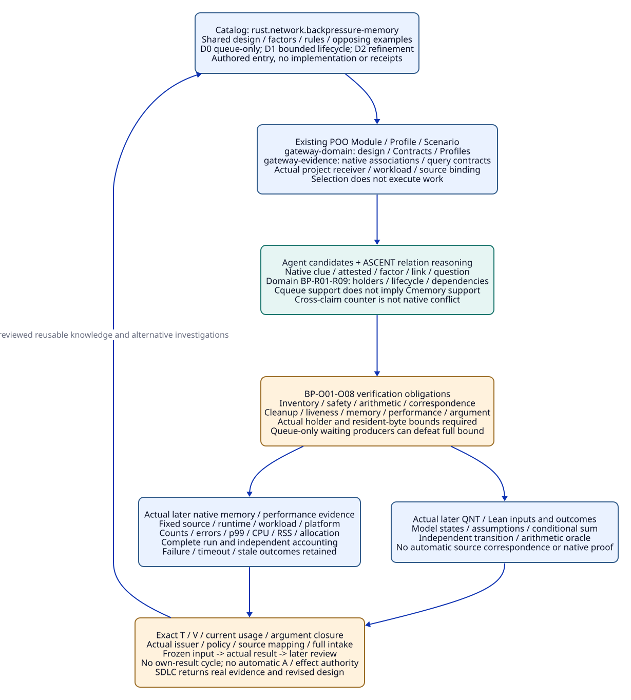
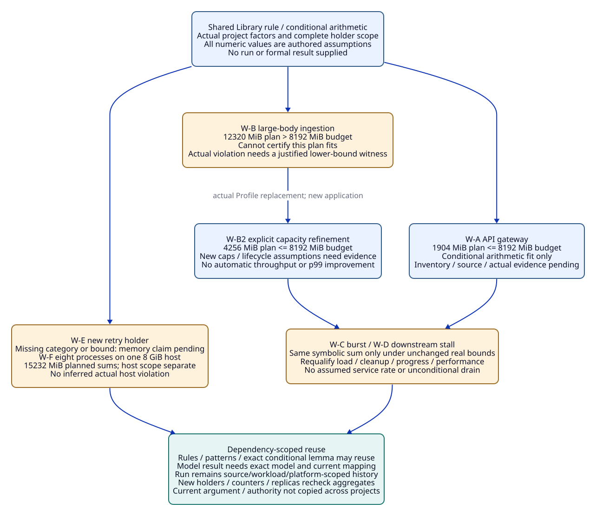

#+TITLE: 10.09 Rust Backpressure and Memory Budget Library Entry
#+LANGUAGE: en
#+PROPERTY: JD_ID 10.09
#+OPTIONS: toc:3 num:nil
#+STARTUP: overview
#+TODO: OPEN SPECIFIED | QUALIFIED
#+FILETAGS: :library:catalog:rust:backpressure:memory:reuse:

[[file:../../00-09-project/00-documentation/00.01-index.org][Index]] | [[file:10.08-engineering-library-and-rust-trajectories.org][10.08 shared Library]] | [[file:10.06-poo-ascent-integration.org][Existing POO/ASCENT integration]] | [[file:../../20-29-cases/20-gateway/20.18-policy-required-checks-and-evidence-admission.org][Policy and evidence admission controls]]

[[file:10.12-gateway-library-registration-and-runtime-dependencies.org][10.12]] qualifies a finite native ASCENT application of this entry, with independent
Profiles, Tokio/Rayon factors, actual queries and separate bounded QNT/Lean
controls. The complete design obligations below retain their broader scope.

* SPECIFIED Catalog entry and claim boundary
:PROPERTIES:
:CUSTOM_ID: backpressure-catalog-entry
:ENTRY_KEY: rust.network.backpressure-memory
:STATUS: author-specified-design-not-executed
:END:

This is one complete design entry in the existing engineering Library, expanding
10.08 RT-P. Catalog metadata, reusable design, contextual Profiles, Scenarios,
rule contracts, verification obligations and evidence trajectories are views of
that entry. No new framework, package manager, registry service, admission engine,
rule language, wrapper publication or scored Benchmark case is introduced.

#+NAME: backpressure-catalog-record
| Catalog position | Entry content |
|------------------+---------------|
| Intent | Bound memory retained by ingress, queued, waiting, active and recovery work under explicit load/fault assumptions while evaluating throughput, latency and overload behavior separately |
| Shared owner | Existing gateway-domain publishes the reusable design/factor/claim value; gateway-evidence owns its ASCENT association constructors and query interpretation, as in 10.06 |
| Applicability | Rust request-processing services with explicit admission, queues, request ownership, lifecycle and bounded surrounding memory. Other projects bind their actual processing and trust boundaries |
| Inputs | Topology, capacity units, resident-size bounds, workload, source/runtime/platform, resource accounting scope, cancellation/fault/tenant policy and required methods |
| Candidate patterns | D0 queue-only hypothesis; D1 admission-before-retention with bounded lifecycle; D2 workload-specific capacity refinement. These are design alternatives, not prescribed APIs |
| Claims | Cqueue: exact queue occupancy bound; Cmemory: scoped process-resident bound; Cprogress: declared completion/cancellation progress; Cperf: declared completed-throughput/p99/error goals; Cisolation: resource/tenant ownership scope |
| Contribution bundle | Factor/claim semantics, finite rules, positive/opposing/unknown Scenarios, independent gold/accounting, evidence templates, dependency/reuse matrix and unresolved work |
| Non-goals | A bounded queue is not a universal memory/performance theorem. Process memory is not automatically host/container/kernel memory; overload rejection is not completed throughput |
| Qualification | Authored design/gold only. No runtime, QNT/Lean proof, measurement or accepted project witness is supplied here |

ENTRY_KEY is a documentary Catalog key, not a native package ID or new lookup API.
Package management selects code versions; actual evidence records retain the
source/content identity and context required by their claims.

* SPECIFIED Existing POO ownership and composition
:PROPERTIES:
:CUSTOM_ID: backpressure-poo-composition
:END:

Use the existing [[file:../../../.gerbil/pkg/github.com/tao3k/poo-flow-core/init.ss][Core selection pattern]] and 10.06 publication boundaries.
Selection constructs the relevant graph/receiver context; it does not allocate a
queue, realize a provider, run a checker or authorize an effect.

#+NAME: backpressure-poo-ownership
| Existing owner / role | Entry responsibility | Composition boundary |
|-----------------------+----------------------+----------------------|
| gateway-domain types | Claim, resource-category, capacity-unit, workload and lifecycle Contracts | Distinguish wire bytes, decoded resident bytes, bytes per unique allocation, item counts, process/host scope and timing boundary |
| gateway-domain objects | Reusable BackpressureMemory design value and contextual Profiles | Public extensible values remain POO-native; no separate wrapper Module for every factor |
| gateway-domain func/config | Pure bound/obligation transformations and inert selected defaults | No process measurement, filesystem scan or execution during selection/default access |
| gateway-evidence | Existing Evidence DSL constructors, projection/mapping and rule/query metadata | Domain rule lowering proposed, not implemented; actual native relation semantics retained |
| Applying project's Profile | Bind actual topology/caps/size/workload/runtime/policy | Explicit scalar replacement changes that value; object extension/refinement preserves only declared unchanged factors, never old admission automatically |
| Selected Scenario/Case | Queue-only counter, bounded lifecycle, burst, large-body, stall, retry and replica cases | Explicit occurrence/exchange/producer owns execution inputs and results; no new scheduler |
| Existing Host/checker/reviewer/Aitia | Actual capture, external methods, issuer/policy, review/argument and SDLC decision | Catalog presence, Profile name and graph ownership do not provide evidence or authority |

An ingestion project can apply the same pattern by mapping its actual admission,
buffer and lifecycle semantics to these factors. It does not inherit gateway
claims merely by importing the entry. Actual publication/source-role dependencies
and consumer receiver bindings remain part of the application closure.

* SPECIFIED D0/D1/D2 topology and complete memory accounting
:PROPERTIES:
:CUSTOM_ID: backpressure-memory-model
:END:

D0 bounds queue entries but allows arbitrary producer tasks to retain request
bodies while waiting to enqueue. An independent model with k such producers,
each retaining b positive bytes, permits at least k*b retained bytes regardless
of queue capacity. This refutes the implication from queue bound alone to an
arbitrary fixed process bound in that model. Actual Rust reachability and object
sizes still require source/trace correspondence; no native violation is claimed.

D1 establishes actual global limits before the corresponding expensive retention,
tracks ownership across waiting -> queued -> active -> completion/cancellation,
and includes pre-admission reads, connections, retries and other holders in
explicit separate budgets. A queue permit alone is not a byte permit, and
releasing an admission permit before the request's retained state is gone can
break the claimed lifecycle bound. D2 explicitly revises capacities for another
workload; it is not an automatic optimization.

#+NAME: backpressure-bound-inputs
| Category / bound | W-A authored D1 value | Required semantic coverage |
|------------------+----------------------+----------------------------|
| Queued | Nq=2048; mq=128 KiB | Resident queued-request upper bound includes actual copies/decoded/framing state assigned to this category |
| Waiting | Nw=128; mw=128 KiB | Global retained producers, including waiting-to-admit state where applicable; unbounded spawned tasks cannot be hidden |
| Active | Na=256; ma=256 KiB | Actual request/response/codec/downstream state held during work and cancellation |
| Connections | Nc=1024; mc=128 KiB | Process-resident per-connection read/write/TLS buffers and pre-admission retention not assigned elsewhere |
| Cache | Mcache=512 MiB | Resident retained cache/index/metadata within actual bound, not entry count alone |
| Auxiliary | Maux=32 MiB | Retry/cancellation queues, telemetry, bookkeeping and every otherwise unclassified holder |
| Runtime / fixed | Mfixed=384 MiB | Actual resident runtime, stacks and code/other fixed allowance under declared execution environment |
| Allocator reserve | Mreserve=512 MiB | Actual allocator-retained/slack/resident reserve not already included; assumptions need validation |
| Requested budget | Bprocess=8192 MiB | Process-resident accounting scope; container/kernel/other-process memory is a separate claim |

#+NAME: backpressure-accounting-contract
#+begin_example
Mplan = Nq*mq + Nw*mw + Na*ma + Nc*mc
        + Mcache + Maux + Mfixed + Mreserve
W-A: Mplan = 256 + 16 + 64 + 128 + 512 + 32 + 384 + 512
           = 1904 MiB <= 8192 MiB
#+end_example

This is authored arithmetic over assumed bounds, not measured RSS or a proof of
actual retention. Account for every reachable allocation/holder; partition unique
allocations or use a justified conservative overcount. Do not subtract presumed
sharing to reduce the bound. Physical residency, live heap, allocator-reserved
virtual space, kernel sockets and container accounting are different metrics;
actual method/platform mapping is required. Wire-size limits do not by themselves
bound decompressed/parsed objects or response memory. If a category is unknown,
the whole requested process bound remains pending even when known terms fit.

* SPECIFIED ASCENT facts, queries and finite rules
:PROPERTIES:
:CUSTOM_ID: backpressure-ascent-rules
:END:

The actual [[file:../../../.gerbil/pkg/github.com/tao3k/gerbil-ascent/evidence/interface.ss][Evidence DSL]] and [[file:../../../.gerbil/pkg/github.com/tao3k/gerbil-ascent/python/src/ascent/clue_query_rules.ss][clue rules]] supply native source/output bindings,
clue/attested/factor/link and question/support/counterevidence/conditional/conflict
semantics. The rule table below specializes existing 10.02/10.07 domain
contracts; it does not add implemented native predicates or serialize a new DSL.

#+NAME: backpressure-relation-mapping
| Existing representation | Entry application | Evidence boundary |
|-------------------------+-------------------+-------------------|
| Library Design/Profile/Scenario/Claim/Obligation | D0/D1/D2, W-A through W-F, Cqueue/Cmemory/Cprogress/Cperf/Cisolation | Exact identity includes actual subject/context/source/method, not short aliases |
| Native clue(id,digest,claim,polarity,role,source) | Agent Hmem is a hypothesis for Cmemory; actual model/trace artifacts may be observations for their exact propositions | Hypothesis does not become observation merely by repetition |
| Native attested(id,digest,receipt) | Genuine Host-content association for actual artifact bytes | Not semantic validation, engineering admission or authority |
| Native factor(id,digest,name,value) / link | Actual bound workload, topology, unit and source/model mapping factors; links to scoped claims | Declared factor encoding and same-witness joins; labels do not provide missing correspondence |
| Native question/support/counterevidence/conditional/conflict | Query queue/process/progress/performance evidence and alternatives | Native conflict requires support and counter for the same claim, not support(Cqueue) plus counter(Cmemory) |
| Existing requires/supports/defeats/depends-on and usage/T-use/V/A | Derived obligations, exact method/application/current-use and argument | Domain semantics/admission remain explicit; native raw support is not a verified slot |

#+NAME: backpressure-rule-register
| Rule | Actual premises / declared domain | Derived obligation or bounded consequence |
|------+-----------------------------------+-------------------------------------------|
| BP-R01 | Cmemory asked, selected topology and resource inventory | Require holder-count and resident-size bounds for every relevant category plus accounting/source correspondence |
| BP-R02 | D0 queue bounded, actual model permits arbitrary retained waiting producers with positive size | Counter to queue-only implication; retain Cqueue support and missing/defeated Cmemory application separately |
| BP-R03 | All category bounds justified, complete holder coverage and justified conservative accounting | Conditional modeled process bound; unknown category prevents full bound qualification |
| BP-R04 | Each plan term nonnegative and fixed, all actual capacity refinements decrease only those terms | Reuse conditional monotonic arithmetic lemma; it does not prove source lifecycle, unchanged sizes or latency |
| BP-R05 | Fault/cancellation/slow consumer within requested Scenario | Require permit/ownership safety, bounded retained cleanup/retry state and declared progress assumptions |
| BP-R06 | Cperf asked under offered load/error/deadline/workload/environment | Require source-bound matched complete measurements and independent metric/accounting oracle; memory fit does not imply throughput/p99 |
| BP-R07 | Same claim has actual required opposing evidence or changed negative inventory | Preserve required review; re-evaluate affected current method/reason/aggregate under complete named domains |
| BP-R08 | Workload/source/runtime/policy/topology or size/count dependency changes | Requalify affected current usages; retain generic rules/lemmas and exact old artifacts/history |
| BP-R09 | Genuine result fits required method/issuer/subject/application and all current guards | May satisfy that exact slot; full coverage/review/argument/A and effect authority still separate |

#+NAME: backpressure-raw-query-fixture
| Authored input / query | Independent native relation gold | Domain interpretation |
|------------------------+----------------------------------+-----------------------|
| question={Cqueue,Cmemory,Cperf}; Hmem hypothesis support for Cmemory; genuine attested queue observation EQ supports Cqueue; genuine attested model-counter observation EC counters Cmemory; no other observations | support={Cqueue/EQ}; counterevidence={Cmemory/EC}; conditional={Cmemory/Hmem}; conflict={}; unknown={Cperf} | Exact native fixture is conditional on actual bytes/receipts. Method verification/admission and source mapping still required |
| Same input plus genuine attested supporting observation EM for Cmemory | Raw conflict={Cmemory}; raw support/counter retained | Bytes may attest incompatible scoped assertions; investigate method/source/assumption binding, do not assume two valid contradictory proofs |
| Same original input but EC is only an Agent hypothesis, not an attested observation | No raw counterevidence from EC; conditional includes its actual hypothesis stance; unknown={Cmemory,Cperf} | Required investigation/known external intake is not erased by lack of native attestation |

The native fixture table specifies the named support/counter/conditional/conflict/
unknown outputs; it does not claim complete engineering-factor admission. Its
native-only input has no factor/link rows; a real applying project must supply
its full context and separate factor/link gold before domain qualification.
Native rule names here are grounded in source, but the fixture has not been run.
An EC row labeled Cmemory is a raw claimed association, not a checked model-to-
process application. Its actual model proposition and required process proposition
need genuine correspondence before domain counter admission.
Each actual observation needs its own exact source/digest/receipt; short EQ/EC/EM
symbols are not fabricated attestation. The native default explanation records
declaration dependencies, not automatic per-row proof lineage. Complete per-slot
support and dependency references are therefore an explicit entry review contract.

* SPECIFIED Verification obligations and evidence chain
:PROPERTIES:
:CUSTOM_ID: backpressure-obligations-evidence
:END:

#+NAME: backpressure-obligation-register
| Obligation | Method/input and independent oracle | Acceptance limit |
|------------+-------------------------------------+------------------|
| BP-O01 holder inventory / resident coefficients | Source/ownership/lifetime review, actual allocation/retention traces and separate worksheet covering pre-admit, response, cleanup, retry and shared allocations | No complete inventory from empty selector result; missing category pending |
| BP-O02 model resource safety | QNT model transitions allocate/admit/wait/enqueue/start/finish/cancel/release/fail, explicit bounded actors and sizes; independent transition/accounting oracle | Check declared invariants: counts within bounds, exact retained ownership, no double release, no unaccounted modeled allocation. Finite schedules are not Rust runtime proof |
| BP-O03 arithmetic / refinement | Lean proposition over explicit nonnegative category bounds and fixed accounting coefficients; independent numeric gold | Conditional sum/monotonicity only; no actual runtime bounds or progress inferred |
| BP-O04 source/model correspondence | Exact Rust/runtime/topology/action and allocation-to-category mapping; genuine reviewer/method evidence | Compiler success or QNT pass alone does not establish mapping |
| BP-O05 cleanup / liveness / overload | QNT scenarios and native fault/cancel/slow-consumer checks with explicit downstream/scheduler/deadline assumptions; independently check drops/effects/retained permits | No unconditional drain under permanent stall; no automatic retry safety or exactly-once claim |
| BP-O06 native memory | Actual platform accounting, steady/peak/load windows, allocator behavior, complete source-bound run and independent measurement reconciliation | Measured maximum below budget is empirical support in that run, not a universal upper-bound proof |
| BP-O07 performance / isolation | Actual offered/admitted/completed/error/drop counts, end-to-end latency including rejected/timed-out work policy, CPU/RSS/allocation and per-tenant behavior against matched baseline | No p99 improvement by hiding dropped work; sustained target, burst and fault claims separate |
| BP-O08 composition / current use | All applicable evidence, complete opposing intake, method/issuer/current-root guards and reviewed argument | Individual bound/test not full-system assurance or operational authorization |

#+NAME: backpressure-formal-property-contracts
| Property / exact design question | Model or conditional proposition | Guard against misleading qualification |
|---------------------------------+----------------------------------+-----------------------------------------|
| BP-P01 global counts | Every reachable modeled waiting/queued/active/connection state respects selected actual limits | Include pre-admission tasks and all producer entry points; per-queue bounds not global admission |
| BP-P02 retained ownership | Every modeled retained allocation belongs to a covered holder/category until actual last retention ends | Cancellation/release cannot drop accounting while state remains; shared aliases not new unique allocation proof |
| BP-P03 lifecycle safety | Finish/cancel/retry transitions cannot duplicate permits, double release or lose retained ownership | Trace overlapping cancellation/completion and late downstream outcomes; no exactly-once effect claim |
| BP-P04 modeled memory | Complete category bounds and accounting imply modeled memory <= selected plan; plan <= budget required for conditional fit | Upper plan > budget gives no fit certificate; actual lower-bound reachable witness needed for a counterexample |
| BP-P05 progress | Under explicit eventual downstream/recovery and scheduler assumptions, admitted work eventually completes or reaches accounted cancellation | Permanent stall need not drain; fairness assumptions and all resource cycles reviewed |
| BP-P06 arithmetic refinement | Fixed nonnegative coefficients/complete categories and componentwise smaller capacities imply no larger modeled plan | Relocated backpressure, changed sizes, new holders or accounting scope break application of this lemma |
| BP-P07 nonvacuity | Model can actually admit/queue/start/cancel work and reach reviewed contention/fault states within declared finite scope | A model that never admits work can satisfy bounds vacuously; deadlock/resource-safe observations alone are not progress |

These are property contracts for later QNT/Lean work, not executable model or
proof source. The finite participant/size/capacity projection and its relation to
production capacities need an actual mapping; a small model is not automatically
a check of W-A's2048-entry queue or all native schedules.

#+NAME: backpressure-evidence-chain
| Existing artifact/association | Earlier references | Later consumer / closure |
|-------------------------------+--------------------+--------------------------|
| Catalog design and actual application | Owning publication, selected Profile/Scenario/receiver, exact source and factor definitions | Frozen model/measurement input; selection does not execute work |
| Model input kModel | Actual topology/count/size/lifecycle/domain/assumptions and fixed independent oracle | Genuine later QNT result VModel references kModel, not vice versa |
| Arithmetic input kSum | Exact coefficient/inventory assumptions and proof proposition/tool identity | Genuine later Lean result VSum; applying it requires actual BP-O01/O04 premises |
| Measurement input kRun | Exact source/toolchain/platform/workload/baseline/accounting/error/latency policy and requested run | Actual later complete/failure/timeout metrics/trace artifacts and independent reconciliation; no future metrics in kRun |
| Method/reviewer result | Actual artifact/result-kind/issuer/subject/assumptions/extraction and origin cut | Later current usage may discharge only matching O slots; T binds bytes, V method result, A actual argument |
| Argument/current review | Earlier verified slots, actual full opposing coverage, exact claim/application/current roots | Later A and SDLC decision when genuinely supplied; no own future verdict in its cut |
| Changed project/workload | Prior immutable results plus actual changed member/root manifest | New capture/use, not rewriting old input/gold or copying historical acceptance |

Agent investigation can begin with allocation, queueing or lifecycle alternatives.
Rules expose which actual premises the candidate needs and which evidence changes
its status; the trajectory does not rank hypotheses or force a predetermined
sequence. Failed, negative, canceled and stale outcomes remain part of history.

#+CAPTION: One Catalog design is composed through existing POO owners; ASCENT relates candidate factors, obligations and genuine method evidence.

[[file:../../90-99-views/90-architecture-views/90.48-backpressure-library-entry-and-evidence-chain.d2][Editable D2 source]].

* SPECIFIED Workload application and independent reuse gold
:PROPERTIES:
:CUSTOM_ID: backpressure-workload-reuse
:END:

All workloads below are authored design inputs. No actual run or method result
exists here. Each BWnn step has its own I/G/CL using the existing oracle/cut
contracts; materialize all inherited bodies and actual changed roots. Expected-
present missing evidence is setup defect; intentionally absent methods remain
pending. Reuse means eligible exact input/rule knowledge, not an emitted witness.

#+NAME: backpressure-workload-inputs
| Workload / applying project | Concrete change from W-A | Independent accounting / expected consequence |
|----------------------------+--------------------------+-----------------------------------------------|
| W-A API gateway baseline | 10.08 W-R: 32 cores, 8 GiB process budget, max wire body64 KiB, three tenants80/15/5, offered sustained50k requests/s with requested completed50k/s/p99<=20ms; D1 table above | Mplan1904 MiB fits numerically under assumed bounds. All actual inventory/correspondence/native/performance evidence pending; accepted error policy and full distributions still required |
| W-B ingestion / large bodies | Max wire body1 MiB; authored mq=mw=4 MiB, ma=8 MiB; all other D1 bounds unchanged | Mplan12320 MiB >8192: this conservative plan cannot certify fit. No actual over-budget occurrence inferred from an upper bound exceeding budget |
| W-B2 explicit D2 Profile | Same W-B coefficients; replace Nq=512, Nw=32, Na=64; other bounds unchanged | Mplan4256 MiB fits numerically; new occupancy/source/performance assumptions still need evidence. Smaller queues do not imply better tail latency or safe upstream buffering |
| W-C burst gateway | W-A caps/sizes; offered burst100k/s for1s, then baseline | Same conditional memory sum if actual limits/lifetimes hold. Target baseline service rate is not measured capacity; no inferred drain time, completed throughput or drop rate |
| W-D downstream stall | W-A caps/sizes; downstream stalls10s while requests/cancels arrive | Same memory sum only if active/wait/cleanup/retry/connection bounds remain. Progress needs explicit eventual recovery/cancellation/scheduler premises; timeout or permit release may add retained holders |
| W-E retrying integration | W-A inputs plus new retry producer/cache holding state with no known bound or category mapping | Inventory incomplete: Cmemory pending, even if old known terms sum1904. Actual unbounded reachable positive-size retention can refute a fixed bound, but unknown limit alone is not a proven violation |
| W-F multi-process deployment | Eight W-A processes share one8 GiB host; actual process caps unchanged | Eight planned sums total15232 MiB before other host memory. Per-process conditional lemma can remain; no host-fit certificate or actual host violation from this arithmetic alone |

For W-B, a separate independently justified reachable model state with queue
allocations actually at least4 MiB each and2048 entries plus positive fixed
resident memory would refute an8 GiB process claim in that model. Such a lower-
bound reachability witness is additional evidence; an upper-bound table alone
cannot supply it. A finite QNT counterexample remains bounded model evidence
until actual source/size correspondence is checked.

#+NAME: backpressure-workload-step-gold
| Event / input | Independent gold and reuse outcome | CL addition |
|---------------+------------------------------------+-------------|
| BW00 select Catalog entry with W-A | Discover reusable D0/D1 rules and O01-O08; no native execution/admission | Publication/receiver/actual factor/schema/policy and independent oracle definitions |
| BW01 evaluate D0 queue-only Scenario | Cqueue candidate can coexist with modeled Cmemory counter; require waiting/other holders, no whole-system proof | Actual source/model/factor and precise positive-size producer counter construction, if supplied |
| BW02 bind D1 W-A | Numeric plan1904; conditional mathematical fit only. O01/O02/O04/O06/O07/O08 genuine work absent | Complete category/units/ownership/current-root manifest and independent sum worksheet |
| BW03 apply W-B in another project | Reuse rule and arithmetic form; new coefficients yield12320, no fit certificate. W-A measurement or admission not transferable | Actual workload/body/decoder/lifetime/platform/source changes, new application and oracle input |
| BW04 refine W-B2 | Numeric4256; reusable monotonic lemma only if fixed coefficients/topology/holder closure and actual reduced caps. No automatic native/performance witness | Actual whole Profile binding/replacement and new count/lifecycle/dependency evidence; unchanged inputs retained |
| BW05 evaluate W-C/W-D independently | Same symbolic bound may apply under actual unchanged assumptions; burst/fault behavior and progress/performance requalified | Separate workload/fault/cleanup/deadline/counter member manifests; do not merge alternative histories |
| BW06 add W-E retry holder | New category or changed auxiliary/ownership term required; old aggregate application stale/incomplete, old bytes/history remain | Actual retry origin/retention/size/count scope, missing method and changed negative-domain coverage |
| BW07 apply W-F deployment | Old per-process lemma remains scoped; new host aggregate obligation covers all processes plus kernel/other resident memory | Actual replica/process/host scope and complete aggregate membership/accounting; no per-process-to-host claim promotion |

#+NAME: backpressure-reuse-boundary-matrix
| Asset or result | Can reuse across projects/workloads | Recheck / invalidation condition |
|-----------------+------------------------------------+---------------------------------|
| Catalog rule/pattern and counterexample structure | Yes as knowledge candidates with explicit factor mapping | Rule/domain interpretation or actual relevance changes; no copied target acceptance |
| Conditional Lean sum/refinement lemma | Exact proposition under actual matching nonnegative coefficients/bounds | Changed accounting basis, hidden holders, units, source premises or proof/method policy |
| QNT result | Only exact model/property/limits/assumptions and supported application scope | New actor/queue/retry/cancellation transition, bounds or property changes; model unchanged not sufficient if source correspondence changed |
| Native memory/throughput/latency run | Immutable actual run remains historical evidence | Workload distribution/body/runtime/allocator/source/platform/error policy changes require matching applicability or new run; no universal extrapolation |
| Queue bound alone | Only Cqueue in exact topology/units | New producer stage or backpressure relocation rechecks total retention; never substitutes Cmemory |
| Source/lifetime/ownership review | Only exact checked source/extraction and dependency scope | Producer allocation order, permit release, response/retry/cache/decoder or connection changes |
| Current argument / aggregate | Only exact complete intake/slots/claim/application/current-root scope | New counter/category/replica/policy rechecks affected uses/coverage; old review resolution not globally inherited |

#+NAME: backpressure-independent-oracle-forks
| Variation | Expected independent decision |
|-----------+-------------------------------|
| W-B plan upper bound exceeds budget but no lower/trace witness | Cannot certify this plan; no claim actual runtime exceeded budget |
| Smaller queue moves bodies into unbounded waiting producers | BP-R04 fixed-topology premise fails; no memory improvement conclusion |
| Wire body limit unchanged but decompression expands resident size | Resident coefficient unknown/changed; old bound not applicable until mapped |
| Benchmark counts only admitted successes and omits rejected/timed-out offered work | Cperf evidence incomplete for requested offered-load/error/latency policy; retain actual run without promoting target achievement |
| New retry holder outside selected query | Required inventory/domain still includes it; no complete absence from selector no-match |
| Whole process mapping unknown but model/Lean checks complete | Keep exact bounded model/proof evidence; native Cmemory remains pending correspondence/measurement |
| Genuine run fails or times out | Retain its actual scope/outcome; no pass and no automatic unrelated evidence purge |

#+CAPTION: Workload changes reuse pattern knowledge while requalifying coefficients, lifecycle, measurements and aggregate scope.

[[file:../../90-99-views/90-architecture-views/90.49-backpressure-workloads-and-reuse-boundaries.d2][Editable D2 source]].

* SPECIFIED Contribution review, DE01 and SDLC handoff
:PROPERTIES:
:CUSTOM_ID: backpressure-library-handoff
:END:

Contributors maintain the Catalog intent, actual factor definitions, rule
premises, positive/opposing examples, independent arithmetic/transition gold and
method templates through existing Module-owned review. Applying projects return
actual source-bound results, counters and assumption changes for reusable
knowledge. No global service or automatic trust-by-contribution is introduced.

DE01 asks which obligation a proposed check serves. Stable attested bytes and a
conditional arithmetic lemma need not be recreated solely because offered load
changes; actual burst/performance/lifecycle applicability still needs review.
A current use-time permission/race requirement is not discharged by an old memory
proof. A failed fixed-budget candidate invites alternative design/investigation,
not endless unchanged reruns or a compulsory Agent action order.

Aitia's existing SDLC consumes the composed design/obligations, captures real
implementation/checker/model/measurement work, and returns evidence or failures
for a later review cut. Acceptance requires actual current slots, full opposing
coverage and argument/operational authority as applicable. This document does
not claim that those integrations or rule lowering have been implemented.

- [ ] Complete workload/protocol/error/latency and process/platform accounting definitions for each applying project.
- [ ] Qualify actual holder inventory, QNT/Lean/source mapping and independent oracles, including queue-only, cleanup and workload counter Scenarios.
- [ ] Supply genuine source-bound native memory/performance/fault measurements and actual reviewer/issuer/current-use evidence.
- [ ] Review dependency-scoped reuse, new counter/category membership and argument closure before SDLC acceptance.

Only English Org and paired D2/SVG are authored. All numeric fixtures and
expected relations are design gold, not native execution or formal proof;
no Rust, Scheme rule implementation, benchmark runner or package is added.

* SPECIFIED Expanded capacity, fault and retry trajectories
:PROPERTIES:
:CUSTOM_ID: backpressure-capacity-stall-retry-child
:END:

[[file:10.10-backpressure-capacity-stall-and-retry-trajectories.org][10.10]] expands W-B -> W-B2, W-D and W-E with complete model inputs,
24 authored step gold rows, dependency-query slices, opposing lifecycle forks
and explicit auxiliary budget composition. Original Catalog, rule definitions,
workload gold and historical evidence boundaries remain unchanged.
