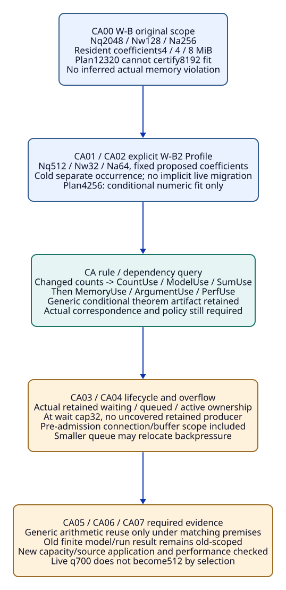
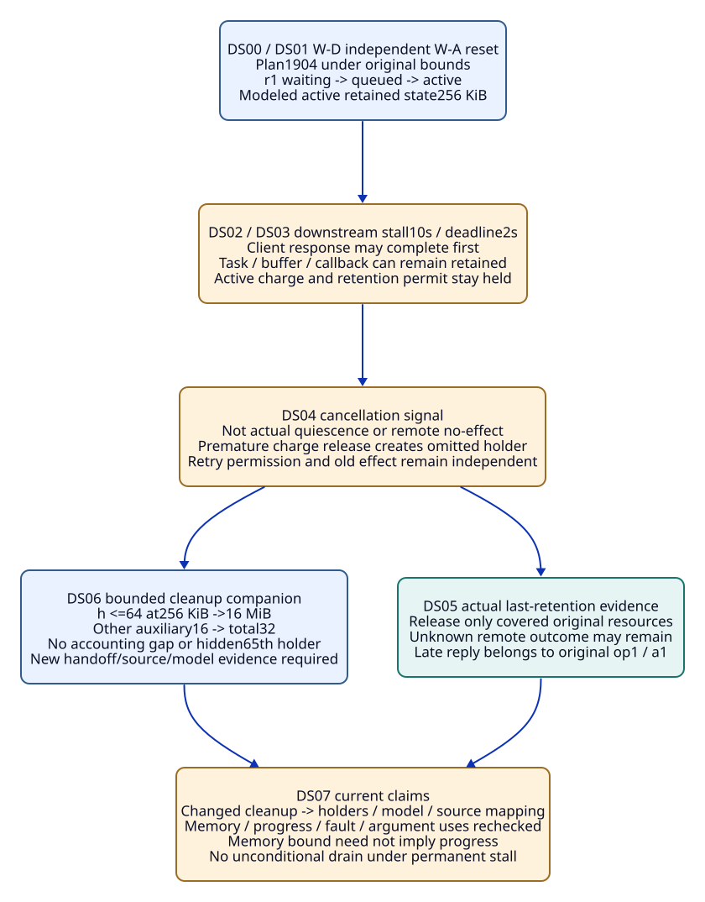
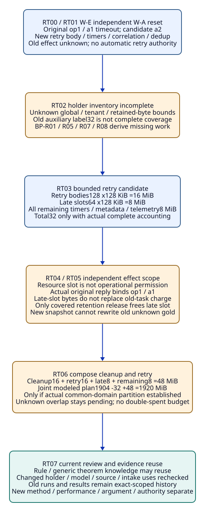

# SPDX-FileCopyrightText: 2026 tao3k team and Contributors
#
# SPDX-License-Identifier: LGPL-2.1-only

#+TITLE: 10.10 Backpressure Capacity, Stall and Retry Trajectories
#+LANGUAGE: en
#+PROPERTY: JD_ID 10.10
#+OPTIONS: toc:3 num:nil
#+STARTUP: overview
#+TODO: OPEN SPECIFIED | QUALIFIED
#+FILETAGS: :library:backpressure:lifecycle:memory:retry:

[[file:../../00-09-project/00-documentation/00.01-index.org][Index]] | [[file:10.09-rust-backpressure-memory-library-entry.org][10.09 complete Library entry]] | [[file:10.08-engineering-library-and-rust-trajectories.org][Shared Library]] | [[file:../../20-29-cases/20-gateway/20.18-policy-required-checks-and-evidence-admission.org][Policy/usage controls]]

* SPECIFIED Existing entry, independent packets and ownership
:PROPERTIES:
:CUSTOM_ID: capacity-stall-retry-scope
:STATUS: author-specified-design-not-executed
:ENTRY_KEY: rust.network.backpressure-memory
:END:

This document expands W-B -> W-B2, W-D and W-E of 10.09. CA, DS and RT label
finite OracleInputSpec/OracleGoldSpec/InputClosure/CutSpec views of the same
Library entry. They add no framework, package, registry, scheduler, receipt kind,
rule-engine implementation or scored Benchmark variant.

Existing gateway-domain owns Design/Profile/Scenario/Claim/Obligation meanings;
gateway-evidence owns native ASCENT associations and domain rule constructors.
Core selection binds the actual publication/receiver, not running queues or
checkers. Existing occurrence/exchange, Host/consumer/method/reviewer and Aitia
owners retain capture, effects, verification, admission and SDLC responsibilities.
The Agent may propose alternate capacities, ownership designs and investigations;
ASCENT's represented rule dependencies explain affected obligations and gaps.

#+NAME: capacity-stall-retry-common-input
| Existing packet field | Required complete input |
|-----------------------+--------------------------|
| Parent closure | Actual Catalog/Design/Profile/Scenario/publication/receiver, source/runtime/platform, count/size units, topology/holder definitions, method/policy and existing BP-R01-R09/O01-O08/P01-P07 definitions |
| Stage input/gold | Each CAnn/DSnn/RTnn has its own I/G/CL and fixed independent arithmetic/ownership/transition worksheet. Event states below are authored model fixtures, not observed Rust traces |
| Separate families | CA uses W-B/W-B2; DS and RT independently reset to W-A/W-D or W-A/W-E. Their proposed auxiliary budgets cannot be composed without a separate complete union accounting |
| Genuine result state | No native/model/proof/measurement witness exists here. Later genuine-result companions require actual subject/issuer/method/extraction/source binding; aliases do not supply them |
| Four states | Missing expected-present body is setup defect; deliberately absent work pending method; unknown size/owner/effect/admission pending scope; actual contradiction or forbidden offered use refused under existing contracts |
| Capture/reference order | Source input precedes result; review input contains prior actual support and precedes its disposition/use verdict. No future result in own cut, no later reply backfills earlier I/G |

* SPECIFIED CA: W-B to W-B2 capacity application
:PROPERTIES:
:CUSTOM_ID: capacity-adjustment-packet
:END:

#+NAME: capacity-adjustment-complete-input
| Input position | Concrete value / scope |
|----------------+------------------------|
| Original W-B application | Max wire body1 MiB; resident mq=mw=4 MiB, ma=8 MiB; Nq=2048,Nw=128,Na=256. Nc=1024,mc=128 KiB; cache512/aux32/fixed384/reserve512 MiB; requested process budget8192 MiB |
| Target W-B2 Profile | Replace entire Nq/Nw/Na values with512/32/64. Same proposed holder topology, coefficients and surrounding categories; effective receiver and exact factor/dependency identities are new application inputs |
| Independent arithmetic | W-B:8192+512+2048+128+512+32+384+512=12320 MiB. W-B2:2048+128+512+128+512+32+384+512=4256 MiB |
| Main initial state | Separate cold model occurrence for W-B2 with waiting/queued/active counts zero. No claim that selecting the Profile drains, resizes or migrates a running W-B process |
| Lifecycle assumptions | Global bounds cover all producer paths before relevant retention; queue/wait/active ownership transitions preserve the covered holder accounting. No new upstream body-holding stage assumed away |
| Asked claims | Conditional modeled Cmemory fit and capacity refinement. Native process bound/Cprogress/Cperf require actual correspondence, model/proof/current-use and source-bound measurement |
| Required evidence inputs | Exact capacity-consumer/source mapping, count/size inventory, fixed nonnegative arithmetic proposition and independent gold. Old results, if supplied later, retain their exact original input/source/method scope |

#+NAME: capacity-adjustment-step-gold
| Event | Independent gold / ASCENT dependency consequence | Closure addition |
|-------+-------------------------------------------------+------------------|
| CA00 freeze W-B | Plan12320 cannot certify8192 fit. No actual over-budget occurrence inferred from an oversized upper bound | CL-CA00 exact old factors/topology/holder coverage and independent arithmetic worksheet |
| CA01 bind actual W-B2 selected Profile | Changed Nq/Nw/Na application roots. BP-R08 identifies dependent count/lifecycle/model/current Cmemory/argument uses, not unrelated historical artifacts | CL-CA01 actual replacement/receiver/capacity-consumer mapping and changed-root manifest |
| CA02 evaluate target sum | Plan4256 fits numerically. BP-R04 may reuse a genuine generic conditional monotonic lemma only with fixed nonnegative coefficients and complete unchanged holder/topology premises | CL-CA02 exact old/new coefficient/coverage comparison and proof proposition/issuer/policy if genuinely supplied; otherwise proof work absent |
| CA03 cold model admit/queue/start request r1 | Sample states (w,q,a): (0,0,0)->(1,0,0)->(0,1,0)->(0,0,1). Charge one covered holder as it moves; category upper allowances4/4/8 MiB, not fixed actual allocated amounts | CL-CA03 authored transition/ownership worksheet and actual later model/source evidence position; sample alone not universal limits proof |
| CA04 waiting capacity reached in model | At w=32, another retained waiter cannot be admitted under this Profile without a covered alternative. BP-R01/R05 require pre-admission/connection/overflow handling; no unbounded blocked producers outside accounting | CL-CA04 complete producer/connection/overflow member roots and expected transition guard; actual behavior still unqualified |
| CA05 actual correspondence/model companion | Genuine model/current source evidence may qualify exact count/lifetime application. Old bounded-model result for other limits cannot be relabeled; universal arithmetic remains separately reusable | CL-CA05 genuine complete result/subject/source/extraction and current method guards, no fabricated receipt |
| CA06 request target performance | BP-R06 leaves throughput/p99/drop/latency policy pending actual W-B2 workload measurements; smaller queue not performance evidence | CL-CA06 actual workload/platform/source/baseline/run policy and independent metric oracle; old measured run history retained |
| CA07 review candidate / alternate investigation | Conditional fit retained, remaining O01-O08 slots/intake/argument explicit. Agent may change design rather than repeat unchanged incomplete checks | CL-CA07 complete scoped review with actual supplied/absent/unknown positions; no automatic A or effect authority |

#+NAME: capacity-adjustment-forks
| Fork | Changed input | Independent oracle decision |
|------+---------------+-----------------------------|
| CA01-live | Running old occurrence has q=700 while new configured limit512 selected | Old occupancy is not magically512. New-limit invariant not established during transition; actual drain/migration/retained-old-generation budget required, no cold-start gold copied |
| CA02-relocated | Smaller queue causes a new unbounded body-holding upstream producer stage | BP-R04 unchanged-holder premise fails; derive new count/size/ownership obligations, aggregate pending. Old generic lemma not erased |
| CA02-size | Same max wire body but new decoder/copy behavior changes resident mq/mw/ma | Old coefficient application fails or remains unknown; no memory conclusion from wire-size equality |
| CA05-old-replay | Genuine old W-B model/run replay completes under old exact input | Historical reproduction only; no current W-B2 verification/performance admission |

#+CAPTION: Capacity replacement affects dependent current applications; cold-start arithmetic is not live migration or throughput evidence.

[[file:../../90-99-views/90-architecture-views/90.50-capacity-adjustment-and-dependency-impact.d2][Editable D2 source]].

* SPECIFIED DS: downstream stall, timeout and retained cleanup
:PROPERTIES:
:CUSTOM_ID: downstream-stall-packet
:END:

#+NAME: downstream-stall-complete-input
| Input position | Concrete value / scope |
|----------------+------------------------|
| Independent reset | W-A D1: Nq2048/mq128 KiB,Nw128/mw128 KiB,Na256/ma256 KiB,Nc1024/mc128 KiB; cache512/aux32/fixed384/reserve512 MiB; plan1904, budget8192 MiB |
| Fault/workload | Downstream unavailable for10 logical seconds; modeled request deadline2 seconds after dispatch, with requests/cancels still arriving. Eventual recovery and scheduler/cancellation progress are assumptions to check, not measured guarantees |
| Exact sample ownership | r1 moves waiting -> queued -> active; modeled active retained request/work state256 KiB. Request operation op1/attempt a1 distinct from client response, task cancellation and actual downstream effect |
| Main retained charge | Client timeout/cancel signal alone leaves active charge and its retention permit held until actual retained state ends or a verified covered handoff occurs |
| Proposed cleanup refinement | At most64 cleanup holders at256 KiB =16 MiB plus other covered auxiliary categories16 MiB within aux32. Actual holder/counter/permit transfer and overflow handling must justify this decomposition |
| Effect unknown | A local timeout or dropped future establishes no remote nonexecution, idempotence, safe retry or exactly-once completion. Main actual downstream outcome remains unknown |
| Method state | Model/trace/correspondence/measurement/reviewer evidence deliberately absent. Numeric plan unchanged only if actual bound premises survive fault/cleanup behavior |

#+NAME: downstream-stall-step-gold
| Event | Independent gold / rule consequence | Closure addition |
|-------+------------------------------------+------------------|
| DS00 freeze W-D input | BP-R05 derives cleanup/permit/progress/fault obligations in addition to memory accounting. Plan1904 is conditional, no fault qualification | CL-DS00 full inherited factors, fault/deadline/policy and independent ownership/effect worksheets |
| DS01 enqueue/start r1 | (w,q,a) moves (1,0,0)->(0,1,0)->(0,0,1). Modeled active charge retained; all holders allocated to actual categories | CL-DS01 exact modeled request/task/buffer aliases and transition meanings |
| DS02 downstream stalls | Retained active state remains a=1; no completion/drain inference from bounded counts | CL-DS02 downstream/scheduler assumptions and actual effect/response position unknown |
| DS03 deadline expires/client sees timeout | Client response may finish while task/downstream callback/buffer lives. Main a=1 and original retention charge remain; BP-R01/R05 require last-retention evidence | CL-DS03 separate response/task/retention/effect events and exact owner/resource scope |
| DS04 cancellation requested | Signal alone not quiescence or remote no-effect. Pending actual retention/effect evidence; no premature release or safe retry | CL-DS04 cancellation scope/contract and unknown join/late callback/effect positions |
| DS05 actual quiescence companion | Genuine last-retention evidence permits modeled charge release for covered resources only; unknown remote outcome can remain after memory release | CL-DS05 actual task/buffer/drop/join/late callback coverage and exact original attempt mapping, no blanket completion claim |
| DS06 explicit bounded cleanup handoff companion | New holding class h<=64 may replace active charge only through a covered accounting transition with no gap. aux16+16=32 permits unchanged symbolic sum if every other assumption holds | CL-DS06 actual handoff/cleanup category/sub-budget/overflow/source mapping and new model transitions; old cancellation model not copied |
| DS07 re-evaluate memory/progress/performance | BP-R08 rechecks changed lifecycle/source/model uses and full holder coverage. Memory safety can hold while progress remains pending under a stall; no unconditional drain/p99 | CL-DS07 actual complete intake, progress assumptions, native memory/fault/run outcomes if supplied, remaining independent guards |

#+NAME: downstream-stall-forks
| Fork | Changed input | Independent oracle decision |
|------+---------------+-----------------------------|
| DS03-early-release | a becomes0 and admission permit reused while old256 KiB remains retained outside every category | Model accounting counter / omitted holder; derive new ownership/count/size obligation. Does not alone prove actual process exceeded8192 MiB |
| DS05-late | Old a1 reply arrives after later review/new attempt input | Bind original op1/a1/body/effect and enter later capture only; old frozen unknown gold unchanged; no automatic attribution to new attempt |
| DS06-full | Cleanup holders already64 but another cancellation arrives | Cannot hide a65th holder or free its active charge before a covered disposition; actual bounded overflow/retained-active behavior required |
| DS07-permanent | No recovery/fair scheduling assumption is supported | Do not establish progress; memory bound may remain conditional under actual retained-count limits. No requirement for impossible unconditional drain |

#+CAPTION: Client completion, cancellation request, retention release and remote effect are distinct; cleanup handoffs need complete bounded accounting.

[[file:../../90-99-views/90-architecture-views/90.51-downstream-stall-and-retained-lifecycle.d2][Editable D2 source]].

* SPECIFIED RT: retries, late results and new memory holders
:PROPERTIES:
:CUSTOM_ID: retry-holder-packet
:END:

#+NAME: retry-holder-complete-input
| Input position | Concrete value / scope |
|----------------+------------------------|
| Independent reset | W-A input/plan1904 as above, plus W-E retry-producing component; not automatically composed with DS cleanup refinement |
| Actual model subjects | Logical operation op1, old attempt a1 and proposed retry a2, with separate request/body/tenant/source/effect scope. Old a1 local timeout leaves remote effect unknown |
| New holders | Retry body/cache, retry waiters, timers/backoff closures, late-response correlation, dedup/idempotency state and retained original tasks. Aliased buffers versus copies require actual mapping |
| Main missing bounds | Global/per-tenant retry concurrency, retained byte coefficients, metadata cardinality/eviction and release/overflow contracts unknown. Old aux32 not automatically coverage for these holders |
| Proposed bounded retry refinement | At most128 queued retry bodies at128 KiB=16 MiB; at most64 late-outcome slots at128 KiB=8 MiB; all remaining timers/metadata/telemetry/bookkeeping bounded by8 MiB. Total32 MiB if actual complete inventory/ownership justifies it |
| Independent effect policy | Main mutating operation's idempotence/dedup/compensation permission unknown. Resource capacity to retain or execute a retry is not operational authority to do so |
| Joint composition question | DS cleanup16 + retry bodies16 + late slots8 + shared remaining categories8 =48 MiB only when actual common-domain partition verified. Combined plan1904-32+48=1920; no automatic shared-category subtraction |

A late-outcome slot covers only its declared correlation-owned state; its128 KiB
allowance does not replace a retained256 KiB old active task. Old task/request/
callback state stays charged to active or verified cleanup categories until
covered last-retention evidence. Every retry attempt also consumes the same
actual global admission/active budgets; retry-queue limits do not authorize a
second unaccounted worker pool. If a real response/copy exceeds a declared slot
coefficient, that coefficient/application needs reassessment.

#+NAME: retry-holder-step-gold
| Event | Independent gold / rule consequence | Closure addition |
|-------+------------------------------------+------------------|
| RT00 discover retry component | BP-R01/R05/BP-R08 add holder/lifecycle/effect obligations. Complete Cmemory application pending; old1904 sum still describes old assumptions | CL-RT00 actual retry publication/source/profile/context and changed holder/member/dependency manifest |
| RT01 old a1 times out, a2 proposed | Keep original effect unknown and old retained owners. Candidate a2 not automatically admitted/authorized; no duplicate-operation safety from timeout | CL-RT01 exact logical-operation/attempt/body/policy bindings, separate response/retention/effect evidence positions |
| RT02 retry state retains new body/timer/correlation | Unknown holder limits and source mapping prevent aggregate qualification. Queue-only bound and old auxiliary label insufficient | CL-RT02 actual new holder/alias/copy/category/size/count domains and deliberate unknown coefficients/limits |
| RT03 explicit bounded retry Profile companion | Proposed16+8+8=32 MiB may preserve symbolic1904 total only after actual complete category/count/lifecycle proof. Retry bounds alone do not prove method/effect permission | CL-RT03 actual replacement/receiver/global and per-tenant/metadata/overflow/release contracts, new model/oracle input |
| RT04 independently check retry effect policy | Main unknown idempotence/authority => operational retry remains pending. Genuine applicable policy/effect evidence can qualify only its exact later use; no exactly-once inference | CL-RT04 actual method/issuer/action/resource/tenant/current authority/effect contract where supplied; resource slot not substituted |
| RT05 old reply arrives | Associate actual outcome/retention evidence with op1/a1. Only actual covered correlation/release may free its late slot; a2 and any conflicting outcomes retain separate scope | CL-RT05 original attempt/event/record and actual late-body/release coverage in new capture, no old-snapshot mutation |
| RT06 compose with DS cleanup | With verified disjoint/overlap coverage, auxiliary48 and plan1920 fit numerically. If overlap/common metadata definitions unknown, aggregate remains pending rather than guessing48 or32 | CL-RT06 explicit joint category union/alias partition, all holder/source/policy roots and fixed independent sum worksheet |
| RT07 review current candidate | BP-R09 permits only genuinely verified matching slots; new source/lifecycle/QNT/current argument and actual performance remain outstanding as supplied. Rule/conditional theorem reuse not blanket acceptance | CL-RT07 complete opposing intake/dependency/current-method/usage/argument worksheet and actual result records if later supplied |

#+NAME: retry-holder-forks
| Fork | Changed input | Independent oracle decision |
|------+---------------+-----------------------------|
| RT02-copy | Each retry attempt allocates a fresh body while original Arc-backed request is retained | Count actual unique allocations/copies; shared-pointer label alone cannot reduce accounting |
| RT03-ttl | Only retry count/TTL/backoff duration bounded, metadata cardinality/retention under arrivals unknown | No metadata memory certificate; derive size/cardinality/eviction and actual holder release obligations |
| RT03-tenants | Per-tenant limit128 but global tenant cardinality/concurrency unbounded | No global128 bound; require actual aggregate tenant domain or independent global cap |
| RT06-double-spend | Cleanup proof and retry proof each independently assume entire aux32 budget | Cannot compose two uses as one32 allowance; explicit joint inventory/refinement required. Both original scoped results retained |

#+CAPTION: Retry resource bounds, original-attempt outcomes and operational permission are separate; auxiliary budgets require an explicit joint inventory.

[[file:../../90-99-views/90-architecture-views/90.52-retry-holders-and-budget-composition.d2][Editable D2 source]].

* SPECIFIED ASCENT dependency derivation and evidence reuse
:PROPERTIES:
:CUSTOM_ID: lifecycle-dependency-and-reuse
:END:

#+NAME: lifecycle-rule-impact-query
| Input relation / changed root in existing model | Rule path and derived work | Current use affected / stable knowledge |
|------------------------------------------------+----------------------------+----------------------------------------|
| Profile replaces count factors, same proposed categories/coefficients | BP-R08 -> BP-R04/BP-R01 -> O02/O03/O04/O06/O07/O08 as dependent | Count/model/source/application/argument uses requalify; generic rule/arithmetic proposition remains |
| Cancel/cleanup adds handoff/retained-holder transition | BP-R05 -> BP-R01/BP-R03/BP-R08 -> ownership, bounded cleanup, progress and correspondence | Lifetime/model/current total-memory proof application affected; immutable prior traces and independent algebra remain |
| New retry/tenant/metadata member | BP-R01/BP-R05/BP-R07/BP-R08 -> complete holder/negative coverage and effect-policy work | Aggregate/intake/applicability rechecked; existing queue bound not promoted to whole memory |
| Genuine method result with exact source/subject/issuer/current mapping | BP-R09 plus existing guard/slot contracts | May support matching modeled/numeric/native slot only; full argument and operational authority separate |

These are paper rule applications within existing gateway-domain/gateway-evidence
and ASCENT Evidence DSL ownership, not newly implemented native relations.
Native raw support/counter/conflict is claim-specific: support for Cqueue and a
counter to Cmemory do not alone yield native conflict(Cmemory). Method/source
correspondence and reviewed required intake remain independent of raw attestation.
Recorded-only explanation is not claimed automatic per-conclusion proof lineage.

#+NAME: lifecycle-concrete-dependency-gold
| Query fixture / complete named dependency slice | Concrete input edges / known state | Expected relations / independent gold |
|------------------------------------------------+------------------------------------+----------------------------------------|
| Q-CA current capacity application | CountUse depends-on Nq/Nw/Na; ModelUse and SumUse depend-on CountUse; MemoryUse depends-on SumUse/ModelUse/HolderCoverage/SourceMap; ArgumentUse depends-on MemoryUse; PerfUse depends-on CountUse/Workload. Changed={Nq,Nw,Na}; other dependencies in this slice explicitly unchanged | queried consumer impacts={CountUse,ModelUse,SumUse,MemoryUse,ArgumentUse,PerfUse}. GenericSumProof artifact has no dependency on those concrete counts, so not invalidated in this slice. Actual SourceMap and current method guards still required; no accepted result produced |
| Q-DS cleanup-source refinement | HolderCoverage and ModelUse depend-on CleanupTopology; SourceMap depends-on CleanupTopology; MemoryUse depends-on HolderCoverage/ModelUse/SourceMap; ProgressUse depends-on ModelUse/RecoveryAssumptions; FaultRunUse depends-on CleanupTopology; ArgumentUse depends-on MemoryUse/ProgressUse. Changed={CleanupTopology} | queried consumer impacts={HolderCoverage,ModelUse,SourceMap,MemoryUse,ProgressUse,FaultRunUse,ArgumentUse}. Old generic arithmetic artifact retained; current memory/progress/fault applications reassessed. Unknown recovery prevents progress admission even if modeled counts fit |
| Q-RT new required retry holder | HolderCoverage depends-on RequiredHolderMembers; ModelUse depends-on HolderCoverage/RetryLifecycle; MemoryUse depends-on HolderCoverage/ModelUse; ArgumentUse depends-on MemoryUse; RetryEffectUse depends-on ActualEffectPolicy. Changed={RequiredHolderMembers}; RetryLifecycle and ActualEffectPolicy support unknown | queried consumer impacts={HolderCoverage,ModelUse,MemoryUse,ArgumentUse}; derive O01/O02/O04/O05 current sub-obligations for retry bounds/lifecycle/coverage. RetryEffectUse separately pending O05/O08 authority/effect support, not permission inferred from resource budget |

These are finite relation gold over the existing depends-on/impacts/obligation
meanings, not executed native queries. Edges are consumer -> prerequisite;
impact follows changed prerequisites to their consumers to a fixed point in the
named slice. The query returns the named consumer usages/coverage nodes, not
the changed input roots; complete slice membership is an explicit oracle premise.
A complete slice permits only the stated bounded impact answer.
This bounded answer is not a system-wide unaffected-footprint certificate.
Unknown external dependencies cannot be treated as absent, and graph reachability
alone is not a completed check. A new holder requires an actual expanded inventory,
not just another row in the old supposedly complete domain.

GenericSumProof, SumUse and MemoryUse deliberately have distinct identities:
a changed instantiation can invalidate a current proof application without
invalidating the original conditional theorem. Conversely, an actual theorem/
checker/issuer dependency change requires its own current trust/scope checks.
Dependency data and rule explanations do not automatically supply per-row proof
lineage or source correspondence.

#+NAME: lifecycle-proof-measurement-reuse
| Asset / method evidence | May reuse when genuine and applicable | Must recheck / cannot inherit |
|-------------------------+----------------------------------------+-------------------------------|
| BP rule/pattern/Catalog knowledge | Same interpretation with actual applying-project factors | Actual input relevance and dependency coverage; no copied project acceptance |
| Generic conditional sum / monotonic Lean lemma | Exact proposition, nonnegative fixed terms and actual assumption mapping | New holder/size/topology/accounting terms need correct instantiation; theorem does not establish native bounds |
| QNT safety/progress result | Exact model/property/finite scope/fairness and supported application | New limits, cancellation/handoff/retry transitions, tenant aggregate or source mapping; old finite result not universal |
| Native source/retention review | Exact actual implementation/method/extraction dependency scope | Allocation/permit release/cleanup/correlation/copy or metadata changes |
| Memory/performance/fault run | Historical actual run/source/workload/platform/error policy retained | W-B2 limits, stall, retries or new composition require supported current applicability/new evidence; smaller arithmetic not p99 evidence |
| Old closed review / A | Exact prior claim/slots/intake/current-root scope only | New holder/counter/domain/policy and usage require later review; missing operational permission never supplied by memory qualification |

#+NAME: lifecycle-holder-audit
| Holder / lifecycle boundary | Concrete omission test | Expected bounded result |
|-----------------------------+------------------------+-------------------------|
| Pre-admission parser/socket buffers | Work exists before queue/retention permit | Connection/pre-admit inventory required, not free because no queue entry |
| Waiting/queued/active request | Capacity shrinks or charge moves | Preserve actual retained ownership; Profile selection not migration |
| Response/decode/compressed/copy state | Wire limit same but resident shape differs | Size coefficient/source correspondence recheck |
| Canceled task/child/late callback | Client response or cancel signal completes first | Retention stays charged until covered last reference or bounded handoff |
| Retry payload/timer/waiter | New attempt exists while old attempt pending | Count all actual unique allocations and owners, global/per-tenant scope explicit |
| Correlation/dedup/outcome history | TTL/key exists but cardinality/retention not bounded | Extra holder/negative coverage pending; no retry permission from table presence |
| Shared auxiliary budgets | Independent feature proofs each use same allowance | Joint actual partition/union before aggregate closure; no double-spent budget |
| Allocator/native platform | Logical request freed but pages remain resident | Actual reserve/platform mapping needed; logical lifetime proof not measured RSS |

* OPEN Independent oracle and SDLC handoff
:PROPERTIES:
:CUSTOM_ID: lifecycle-trajectory-handoff
:END:

Each independent oracle consumes fixed factor/transition/member/alias/accounting
worksheets and actual method/source/authority records when supplied. It checks
24 authored stage gold rows and named opposing forks without taking candidate
output as gold. Expected-present missing input is setup defect; genuinely absent
method/effect evidence stays pending. Actual incompatible records require scoped
resolution, not last-writer choice. Old frozen I/G remains unchanged by later work.

- [ ] Materialize exact applied Profile/source and cold versus live-transition inputs with independent count/size arithmetic.
- [ ] Qualify all last-retention/handoff/cleanup/retry/metadata/alias boundaries and finite-model nonvacuity, then actual source correspondence.
- [ ] Supply genuine model/proof/native fault/memory/performance results and actual retry-effect authority where requested.
- [ ] Complete joint holder/negative/opposing coverage and current argument before Aitia SDLC acceptance; preserve old failed/pending outcomes.

DE01 retains necessary changed-dependency/current-use checks while avoiding
unrelated reruns or evidence deletion. Agent alternative investigation remains
open. Only English Org and D2/SVG are authored: no Rust/Scheme/QNT/Lean/oracle
implementation, execution receipt, safe-retry mechanism or performance claim.

* SPECIFIED Live, full and joint-budget refinements
:PROPERTIES:
:CUSTOM_ID: capacity-stall-retry-live-child
:END:

[[file:10.11-live-capacity-full-cleanup-and-joint-budgets.org][10.11]] expands CA01-live, DS06-full and RT06-double-spend with complete
input and step gold, generation-aware envelopes, full cleanup races/progress
and conservative versus tighter joint-budget evidence paths. Original parent
inputs/gold and isolated evidence scopes remain frozen.
