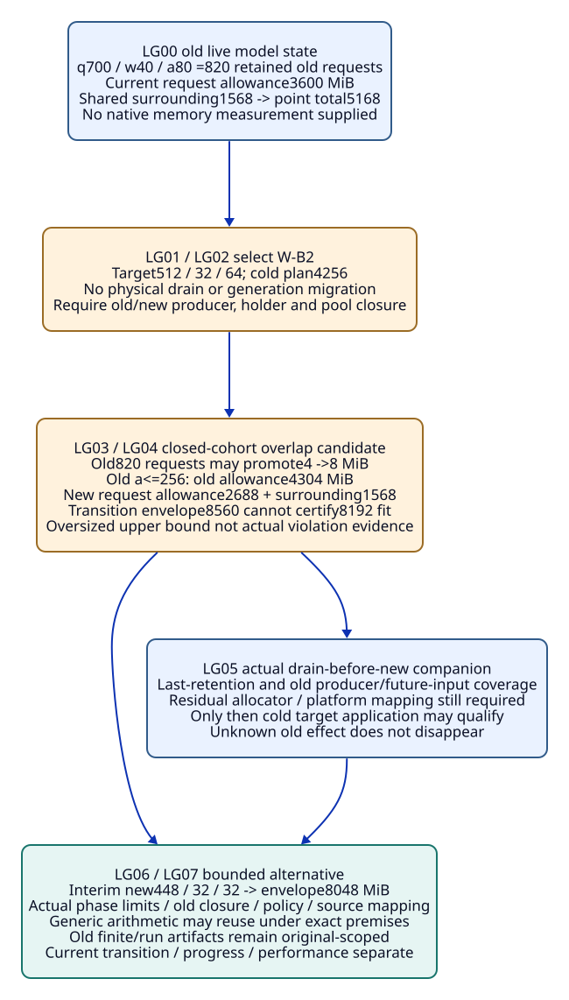
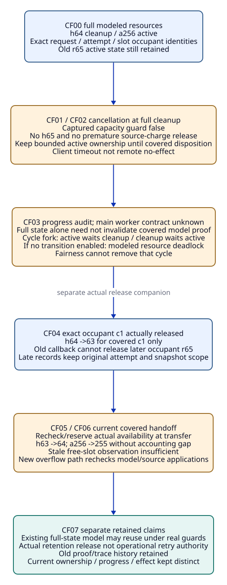
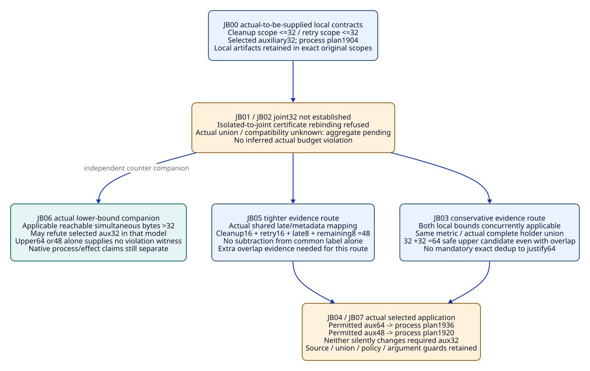

# SPDX-FileCopyrightText: 2026 tao3k team and Contributors
#
# SPDX-License-Identifier: LGPL-2.1-only

#+TITLE: 10.11 Live Capacity, Full Cleanup and Joint Budgets
#+LANGUAGE: en
#+PROPERTY: JD_ID 10.11
#+OPTIONS: toc:3 num:nil
#+STARTUP: overview
#+TODO: OPEN SPECIFIED | QUALIFIED
#+FILETAGS: :library:backpressure:live-change:cleanup:joint-budget:

[[file:../../00-09-project/00-documentation/00.01-index.org][Index]] | [[file:10.10-backpressure-capacity-stall-and-retry-trajectories.org][10.10 parent trajectories]] | [[file:10.09-rust-backpressure-memory-library-entry.org][Catalog entry]] | [[file:../../20-29-cases/20-gateway/20.18-policy-required-checks-and-evidence-admission.org][DE01/policy boundary]]

* SPECIFIED Existing entry and input contract
:PROPERTIES:
:CUSTOM_ID: live-full-joint-scope
:ENTRY_KEY: rust.network.backpressure-memory
:STATUS: author-specified-design-not-executed
:END:

LG, CF and JB expand CA01-live, DS06-full and RT06-double-spend using the existing
Library/POO/ASCENT/OracleInputSpec/OracleGoldSpec/InputClosure/CutSpec/usage and
method/review contracts. No new runtime, framework, package, scheduler, budget
service, receipt class or scored Benchmark variant is proposed.

Existing gateway-domain owns Design/Profile/Scenario/Claim/Obligation meaning;
gateway-evidence owns association/query/rule constructors. Core selection binds
the application graph, not live state migration. Occurrence/exchange,
Host/consumer, checker/reviewer and Aitia retain their original responsibilities.
The Agent can investigate alternative transition/overflow/budget designs; rule
closure constrains conclusions, not its action sequence.

#+NAME: live-full-joint-common-input
| Existing position | Complete input and boundary |
|-------------------+-----------------------------|
| Parent materialization | Actual publications/receiver, Profile, source/runtime/platform, holder/count/size/topology, method/policy and BP-R01-R09/O01-O08/P01-P07 semantics; aliases/document links do not supply missing bodies |
| Event/gold | Every LGnn/CFnn/JBnn has independent I/G/CL and fixed count/ownership/transition/accounting worksheet. All numeric states here are authored model fixtures, not observed Rust state |
| Separate families | LG uses large-body W-B/W-B2. CF and JB reset to W-A/cleanup/retry scopes. Joint arithmetic never silently combines different workload coefficients |
| Four states | Expected-present missing body is setup defect; deliberately absent method work pending; unknown ownership/effect/coverage pending scope; actual mismatched/forbidden offered usage refused |
| Results | No actual model/proof/run certificate is supplied. Genuine-result companions require actual source, issuer, method, assumptions and checked application; hypothetical certificate names are not receipts |
| Cut order | Source input precedes result; later review input precedes its disposition/use verdict. No future result in its own cut; late records enter a later capture, never rewrite frozen I/G |

* SPECIFIED LG: live W-B to W-B2 generations and transition envelope
:PROPERTIES:
:CUSTOM_ID: live-capacity-generation-packet
:PARENT_EVENT: CA01-live
:END:

#+NAME: live-capacity-complete-input
| Input position | Concrete value / scope |
|----------------+------------------------|
| Original selected application gOld | W-B old limits Nq2048,Nw128,Na256; queued/waiting resident allowances4 MiB, active8 MiB. Shared surrounding categories total1568 MiB: connections128, cache512, aux32, fixed384, reserve512 |
| Captured old live state | qOld=700,wOld=40,aOld=80; 820 modeled retained old requests. Current request allowance3600 MiB plus surrounding1568 gives5168 MiB; this is a point-state upper worksheet, not an envelope for all later states |
| New selected application gNew | W-B2 Nq512,Nw32,Na64, same proposed coefficients and surrounding scope; new request allowance2688 MiB, cold total4256 MiB. Selecting gNew does not alter any old count |
| Main missing transition facts | Which old producer paths stop, which old requests may still allocate/promote, whether generations share limits/pools, and old/new holder/metadata membership are initially unknown |
| Closed-cohort companion | Actual model contract stops all new old-cohort admission/retry/callback-produced work; existing820 old requests may move categories, with old active cap256. No claim that request bytes decrease merely because cohort count does |
| Overlap companion | gNew may reach its own new limits while old cohort remains, with surrounding1568 shared only if actual aggregate bounds cover both generations. No duplicated connection/runtime/cache allowance assumed away |
| Interim-phase companion | While the old closed cohort remains, proposed new limits Nq448,Nw32,Na32 give new allowance2176 MiB and combined4304+2176+1568=8048 MiB. Final512/32/64 applies only after separately covered old-retention/phase transition; actual enforcement/policy/source mapping still required |
| Asked claim | Transition Cmemory for budget8192 MiB and later target application. Effect/progress/performance and actual source/capacity-consumer mapping remain independent |

#+NAME: live-capacity-step-gold
| Event | Independent gold / rule consequence | Closure addition |
|-------+------------------------------------+------------------|
| LG00 capture old live state | Counts700/40/80 persist; point-state plan5168. No new512/32/64 invariant or whole-transition guarantee | CL-LG00 full old source/Profile/holder/state/count/size/current method roots and independent sum worksheet |
| LG01 select gNew | BP-R08 identifies a new application/transition scope, not a physical drain. gOld and gNew identities/provenance retained | CL-LG01 actual selection/effective receiver/new Profile and old/new generation membership |
| LG02 query transition support | BP-R01/R05/R08 derive old-producer closure, coexistence inventory, category movement, shared-pool and source/model correspondence obligations; unknown facts keep current transition claim pending | CL-LG02 exact producer/retry/callback/global-limit/alias/retention domains; no old-generation omission from selection no-match |
| LG03 closed-cohort companion supplied | Old retained request count can stay<=820 while q/w -> active raises per-request allowance. Current old3600 is not a monotonic memory envelope | CL-LG03 actual cohort-closure/lifecycle/old-active-cap assumptions and all remaining old work sources |
| LG04 evaluate explicit overlap envelope | Old bound at total820,a<=256 is4304 MiB. Combined4304+2688+1568=8560 MiB cannot certify8192 fit. Point-overlap3600+2688+1568=7856 alone misses later promotion | CL-LG04 independent constrained count/size arithmetic and actual complete common surrounding/pool coverage; no actual violation inferred from oversized upper bound |
| LG05 actual drain-before-new companion | Only genuine last-retention/old-producing-path closure plus residual allocator/platform mapping permits later cold gNew4256 application. Remote old effects may still be unknown | CL-LG05 actual covered old tasks/buffers/callbacks/future-input treatment and current reserve/metadata/source mapping, no assumed RSS release |
| LG06 alternate bounded overlap companion | Interim new448/32/32 gives8048 MiB conditional envelope. Actual phase enforcement/old-cohort/shared-category premises required; final512/32/64 not activated early. Generic sum knowledge reusable, old finite results not relabeled | CL-LG06 actual chosen phase/global-cap/migration assumptions and genuine method evidence if supplied; policy remains explicit |
| LG07 review target use | Full transition/current holder coverage and exact method/source/intake guards needed; Cprogress/Cperf/A/effect authority remain separate | CL-LG07 actual current usage and complete opposing/argument/run state; old frozen records retained |

For LG04 the independently reviewed old-cohort state q=564,w=0,a=256 has820
requests:256*8+564*4=4304 MiB. The count transition is feasible in the authored
model by moving176 queued requests to active and40 waiters to queued, assuming
those modeled transitions are enabled. This establishes the worksheet's envelope
candidate, not actual allocation sizes or native reachability. A real/model
violation needs an applicable reachable lower-bound witness, not just upper sums.

#+NAME: live-capacity-forks
| Fork | Changed input | Independent decision |
|------+---------------+----------------------|
| LG03-open | An old retry/callback/producer path can still add retained work |820 closed-cohort bound unestablished; derive missing generation/producer coverage, no assumed monotonic drain |
| LG04-shared-cap | Real contract applies one global active limit rather than independent old/new caps | Recompute actual coexistence states; do not add independent maxima or apply cold64 to80 existing active holders |
| LG04-duplicated | Actual new generation has additional connection/cache/runtime/reserve state | Shared1568 assumption fails; include actual extra categories before aggregate fit |
| LG05-late-object | Old-origin late reply creates a new retained object after earlier old objects released | Account for new late/connection holder under its actual generation/domain. Does not retroactively negate earlier last-reference release; may refute a stronger no-future-old-work assumption |

#+CAPTION: Live generations need a transition envelope; old request count can decrease while memory allowance rises through category promotion.

[[file:../../90-99-views/90-architecture-views/90.53-live-capacity-generations-and-transition-envelope.d2][Editable D2 source]].

* SPECIFIED CF: cleanup full, covered retention and progress
:PROPERTIES:
:CUSTOM_ID: full-cleanup-ownership-packet
:PARENT_EVENT: DS06-full
:END:

#+NAME: full-cleanup-complete-input
| Input position | Concrete value / scope |
|----------------+------------------------|
| Independent reset | W-A process plan1904 MiB with aux32; cleanup model h<=64, each<=256 KiB giving16 MiB plus other covered auxiliary16. Active cap256 with256 KiB retained allowance |
| Full state | h=64 and a=256, including active old attempt a65/r65 to be canceled; q/w/connection state separately bounded by W-A. Each cleanup holder has actual request/attempt/occupant identity, not only slot index |
| Cancellation | Client timeout/cancel signal for r65; original task/buffer still retained. Actual effect of operation op65 remains unknown |
| Required handoff contract | Existing owner remains responsible until a covered destination/last-retention event is established. Temporary conservative double charging may be safe; no accounting gap or unbounded transfer-waiter list |
| Main progress facts | Cleanup worker resource requirements, actual quiescence and cancellation progress unknown. Fair scheduling alone does not establish that resource-dependent transitions are enabled |
| Hypothetical existing proof reuse | A genuine universal model result covering full h=64, concurrent handoffs and exact source semantics can remain applicable to that covered state; no result is supplied here |

#+NAME: full-cleanup-step-gold
| Event | Independent gold / rule consequence | Closure addition |
|-------+------------------------------------+------------------|
| CF00 capture full state | h64/a256 within respective bounds; no spare cleanup slot. Memory candidate may hold while progress unknown | CL-CF00 actual active/cleanup occupant/size/holder domains, source/policy and fixed transition worksheet |
| CF01 r65 client timeout/cancel request | Keep r65 active charge, a256/h64. BP-R05 requires last-retention or valid handoff; client completion not remote/no-retention evidence | CL-CF01 exact response/task/attempt/buffer/effect association and unknown downstream outcome |
| CF02 attempt unavailable handoff | Cannot claim h65 under h<=64 or release active charge first. Captured capacity guard false: proposed handoff not eligible in this state. Future availability pending; retain existing ownership and bounded admission behavior | CL-CF02 current destination state/occupant and actual handoff/overflow contract; no new uncharged waiter |
| CF03 query progress/resource dependencies | BP-R05/O05 requires actual wait-for/resource-progress evidence, not only count safety. Ordinary full-state input updates eligibility; no automatic invalidation of a proof already covering that state | CL-CF03 existing model scope and actual resource dependency/overflow/source roots; absent method remains pending |
| CF04 genuine release of cleanup occupant c1 | Only actual last-retention evidence for c1 changes h64->63. No permission to release other old or newly occupying objects by the same slot name | CL-CF04 exact original occupant/attempt/generation/body/release coverage and later state capture |
| CF05 covered handoff r65 | Recheck actual target availability at transfer. After successful modeled accounting handoff h63->64 and a256->255, r65 retains exactly covered ownership; stale earlier availability alone insufficient | CL-CF05 actual reservation/transfer/source contract and complete no-gap intermediate-state evidence; no new atomic API specified |
| CF06 target and source obligations reviewed | If topology unchanged and genuine existing model covers these cases, reuse that result under current guards. New overflow/worker path triggers changed model/holder/source/progress applications | CL-CF06 actual model/property/limits/issuer/current source mapping and changed-root manifest, no blanket rerun |
| CF07 actual quiescence/effect companion | Covered retention release may free its category; remote effect still separately unknown or actually established. No safe retry solely from memory release | CL-CF07 genuine covered release/outcome and original identity, no old-snapshot rewrite or automatic A |

#+NAME: full-cleanup-forks
| Fork | Changed input | Independent decision |
|------+---------------+----------------------|
| CF02-gap | Active charge released before target accounting while retained object remains | Modeled ownership counter; derive O01/O02/O04 reassessment, not an inferred native process-budget violation |
| CF03-cycle | All active holders await cleanup slot; cleanup workers require a free active permit; no other progress transition enabled | Actual authored wait-for cycle is a modeled deadlock even with scheduler fairness. Count safety can hold; progress claim not established. Agent may investigate another bounded design |
| CF04-old-slot | Old c1 callback arrives after slot now holds r65 | Original identity does not release r65. Known wrong-occupant offered association refused; unknown binding pending; actual old record retained |
| CF05-race | Other cancellation consumes freed slot after check but before handoff | Previous h63 observation not transfer authority/availability guarantee; retain source charge until actual covered transfer, re-evaluate current destination |

#+CAPTION: Full cleanup retains source ownership; state changes affect eligibility, while new overflow behavior affects model/source proofs.

[[file:../../90-99-views/90-architecture-views/90.54-full-cleanup-ownership-and-progress.d2][Editable D2 source]].

* SPECIFIED JB: joint budget without double spending or mandatory exact dedup
:PROPERTIES:
:CUSTOM_ID: joint-budget-reuse-packet
:PARENT_EVENT: RT06-double-spend
:END:

#+NAME: joint-budget-complete-input
| Input position | Concrete value / scope |
|----------------+------------------------|
| Independent reset | W-A process worksheet1904 includes selected aux32; all other fixed/counted categories and8192 process budget as 10.09. Selected aux32 is not silently enlarged |
| Isolated cleanup contract C | Hcleanup<=16 MiB and other-C<=16 MiB, total<=32 for its exact source/lifecycle/scope; actual result, if supplied, binds those premises |
| Isolated retry contract R | RetryBodies<=16 MiB,LateCorrelation<=8 MiB,Remaining-R<=8 MiB, total<=32 for its exact source/lifecycle/scope |
| Main unknown composition | Actual common allocation/holder domain, overlapping metadata/late state, source/policy interference and union completeness unknown. Two standalone32 contracts do not establish joint32 |
| Conservative companion | Actual evidence establishes both local bounds remain applicable concurrently, their union covers every joint auxiliary holder on the same accounting basis with compatible assumptions/cuts, and a changed Profile/policy allows aux64. Exact overlap not required for safe upper bound32+32=64 |
| Tighter companion | Actual common-domain mapping establishes C's other16 is the same covered LateCorrelation8 plus Remaining8 from R; cleanup/retry/late/remaining categories covered by16/16/8/8. New aux48 allowance and actual current mapping/policy supplied |
| Arithmetic | Candidate plan for aux64:1904-32+64=1936 MiB; for aux48:1920 MiB. Both conditional fits under8192, neither proof of actual current usage or automatic policy permission |
| Method/effect boundary | The local conditional theorem artifacts may remain usable; actual local source applicability under joint composition, full coverage and current argument still required. Retry authority/old effect not supplied by budget fit |

#+NAME: joint-budget-step-gold
| Event | Independent gold / rule consequence | Closure addition |
|-------+------------------------------------+------------------|
| JB00 retain isolated inputs/contracts | Both original local32 statements remain scoped facts/premises, not a joint certificate | CL-JB00 exact local domains/count/size/source/lifecycle/method/issuer/policy inputs and independent arithmetic |
| JB01 offer same selected aux32 for both | Direct rebinding of an isolated-scope certificate as a joint certificate is a known scope mismatch and refused. Actual joint32 claim remains pending; no actual over-budget occurrence inferred | CL-JB01 exact proposed aggregate use and two local scopes plus unknown union/interference/overlap positions |
| JB02 derive missing composition support | BP-R01/R03/R07/R08 require complete joint holder coverage and local-premise compatibility; exact sharing only if needed to justify tighter allowance | CL-JB02 actual source/holder/producer/negative/aggregate policy dependencies, no selected-query exclusion |
| JB03 conservative64 companion | If both bounds concurrently valid and union complete, additive64 is a sound conservative upper candidate even with overlap. No extra precise dedup obligation solely to obtain that bound | CL-JB03 actual applicability/noninterference/union coverage and sum proposition; prior theorem artifacts plus checked applications |
| JB04 bind supported larger Profile | Actual permitted aux64 replacement gives plan1936; current selected aux32 not proven. No silent configuration/policy waiver or native qualification | CL-JB04 actual receiver/Profile/policy/effective scope and current source/reserve/category mapping |
| JB05 tighter48 companion | Actual overlap/common-domain mapping plus unchanged bound premises permits48 candidate and plan1920 under explicit aux48 application. Prefer neither route by default; Agent may choose sufficient evidence path | CL-JB05 actual category/alias/extraction proof and current policy/source roots; no guessed subtraction |
| JB06 actual lower-bound counter companion | Separate witness companion declares actual modeled unique lower amounts cleanup16,retry16,late8,remaining8 and a checked reachable trace:48>32 refutes selected aux32 in that model. Upper64/48 alone cannot; native/process violation needs own evidence | CL-JB06 exact reachable state/actual model bytes/producer/holder coverage and independent lower-bound worksheet |
| JB07 review joint use / changed source | Local artifacts/history retained; joint applicability/intake/argument rechecked on source/producer/policy changes. Actual memory/performance/effect evidence still separately needed | CL-JB07 complete current closure and genuine method/run/reviewer results if supplied, no automatic A/authority |

#+NAME: joint-budget-forks
| Fork | Changed input | Independent decision |
|------+---------------+----------------------|
| JB03-interference | Composition adds new transfer buffers or changes local per-holder retention | Old bounds not automatically concurrently applicable; additive64 not established until changed premises/coverage checked |
| JB03-policy32 | Actual hard auxiliary policy allows only32 and no supported tighter proof supplied |64/48 candidates do not satisfy selected32. Pending compatible evidence/design or genuine policy change; no waiver based on8192 process headroom |
| JB05-alias-label | Same logical operation/key or Arc label offered as actual unique-allocation equality | No exact sharing/subtraction proof. Conservative route can remain available if its actual conditions hold |
| JB07-false-negative | New metadata holder omitted because absent from selected projection | Required union/negative coverage incomplete; current aggregate re-evaluated, old isolated theorem artifacts not deleted |

#+CAPTION: Local32 plus local32 does not prove joint32; conservative64 and justified tighter48 are alternative scoped evidence paths under actual policy.

[[file:../../90-99-views/90-architecture-views/90.55-joint-budget-sufficiency-and-reuse.d2][Editable D2 source]].

* SPECIFIED ASCENT obligation and dependency closure
:PROPERTIES:
:CUSTOM_ID: live-full-joint-dependencies
:END:

#+NAME: live-full-joint-rule-queries
| Complete named input slice / question | Explicit consumer -> prerequisite edges | Independent returned consumer gold |
|--------------------------------------+------------------------------------------+------------------------------------|
| Q-LG Changed={GenerationTopology} | CoexistenceInventory and SourceMap depend-on GenerationTopology; TransitionModel depends-on CoexistenceInventory/SourceMap; EnvelopeUse depends-on TransitionModel/Coefficients; MemoryUse depends-on EnvelopeUse; PerfUse depends-on SourceMap; ArgumentUse depends-on MemoryUse | impacts={CoexistenceInventory,SourceMap,TransitionModel,EnvelopeUse,MemoryUse,PerfUse,ArgumentUse}. BP-R01/R05/R08 derive old/new producer/lifetime/source/coverage obligations. Generic arithmetic artifact not invalidated by these application roots |
| Q-CF state-only Changed={CleanupOccupancy} | HandoffEligibility depends-on CleanupOccupancy; TransferUse depends-on HandoffEligibility/CurrentOwner/TransferContract | impacts={HandoffEligibility,TransferUse}. Already-covered safety model artifact need not change; progress still requires actual resource-dependency support |
| Q-CF new-path Changed={OverflowTopology} | HolderCoverage depends-on OverflowTopology; SourceMap and ModelUse depend-on OverflowTopology/WaitForContract/TransferContract; MemoryUse depends-on HolderCoverage/ModelUse/SourceMap; ProgressUse depends-on ModelUse/WaitForContract; ArgumentUse depends-on MemoryUse/ProgressUse | impacts={HolderCoverage,SourceMap,ModelUse,MemoryUse,ProgressUse,ArgumentUse}. Recheck BP-O01/O02/O04/O05/O08, not all unrelated old results |
| Q-JB Changed={JointHolderMembers} | UnionCoverage depends-on JointHolderMembers; LocalApplicability depends-on UnionCoverage/CompositionSource; JointSumUse depends-on UnionCoverage/LocalApplicability/SelectedAuxPolicy; MemoryUse depends-on JointSumUse; ArgumentUse depends-on MemoryUse | impacts={UnionCoverage,LocalApplicability,JointSumUse,MemoryUse,ArgumentUse}. Local theorem artifacts remain original-scoped; new policy/source changes have their own dependency edges |

A local bound is not an isolated run maximum substituted for an invariant.
Conservative addition still needs genuine applicable local method premises,
complete union coverage and consistent resident-byte/phase interpretation.

These are finite paper query contracts using existing depends-on/impacts and
BP rules, not executed native query results or a new schema. Query outputs are
consumer nodes, excluding changed input roots. Explicit complete slice coverage
is an oracle premise; unknown external dependencies are not absent and this is
not a system-wide unaffected-footprint certificate. Native support(Cqueue) plus
counter(Cmemory) is not same-claim native conflict; actual domain counter/review
and source mapping still needed. Recorded-only explanation is not automatic
per-conclusion proof lineage.

#+NAME: live-full-joint-evidence-reuse
| Evidence / existing record | Retain/reuse boundary | Required reassessment |
|----------------------------+-----------------------+-----------------------|
| Generic sum/monotonicity theorem | Actual exact proposition/method/issuer may remain valid | New application: generation envelope, complete categories, actual bounds and selected policy |
| Local cleanup/retry conditional proof | Exact original source/domain/premises and history retained | Concurrent applicability/interference and complete joint union; no joint32 by label |
| Existing full-state model result | May reuse if genuinely covers h64, transfer races, overflow semantics, limits and actual source | New path/resource cycle/model/input limits/source mapping; ordinary covered state change alone not a mandatory rerun |
| Original native memory/performance/fault run | Actual old source/workload/platform/outcome remains history | Live transition, new cleanup/retry composition or source changes need supported current use/new results as required |
| Old holder/release/late response | Exact original attempt/occupant/generation and actual covered resource/effect | No freeing reused slot by old index, no retroactive snapshot edit, no current retry grant |
| Current argument/A/aggregate | Only actual complete matching slots/coverage/policy/current-root scope | New generation/holder/counter/policy invalidates affected current use; immutable bytes not globally erased |

#+NAME: live-full-joint-reference-closure
| Family | Earlier required roots and external method scope | Later cut / admission boundary |
|--------+-------------------------------------------------+--------------------------------|
| LG | Exact old/new application/producer generations, actual holder/state/phase/global-limit/allocator/source mapping, independent point/transition/lower-bound worksheets | Later model/proof/run references earlier input; selecting target never inserts a cold result into transition input |
| CF | Exact owner/occupant/slot/attempt/holder/current state, actual transfer/worker/cancel/quiescence/late event coverage and source/model contract | Current transfer verdict later than its check cut; real transfer coverage needed across check-to-use race; source charge retained until covered disposition |
| JB | Exact isolated method inputs/results if supplied, actual joint source/member/union/compatibility/policy and sum/alias evidence | Review includes prior actual support, not its own future result.64 proof needs no alias deduction;48 deduction requires actual sharing support |
| Package review | Earlier I/G/CL, independent fixed oracle and actual result/usage/disposition records | No candidate-generated gold, future result in own cut or old input rewriting; T/V/A never substitutes effect authority |

* OPEN Holder audit and SDLC handoff
:PROPERTIES:
:CUSTOM_ID: live-full-joint-handoff
:END:

The audit explicitly covers old admitted requests that can grow, old/new producer
paths, retry/callback-created late objects, allocator-retained pages, full cleanup
transfer waiters, worker resource cycles, reused slot occupants and overlapping
auxiliary proof domains. Any other holder remains a required inventory question;
absence from a selected projection cannot certify absence from the process.

DE01 preserves authentic policy/current-use/coverage checks while avoiding an
extra mandatory exact-dedup step when a supported conservative bound suffices.
Fair scheduling is not a cure for a resource deadlock; budget arithmetic is not
permission to change selected policy or retry a mutating operation.

- [ ] Materialize live generation/producer closure, transition envelopes and actual source/accounting correspondence.
- [ ] Qualify full cleanup ownership, concurrent transfer, resource-progress and late-occupant cases with independent oracles.
- [ ] Supply genuine local proof applicability/union coverage and actual selected policy for conservative or tighter joint budgets.
- [ ] Complete native/QNT/Lean/run/current argument and operational qualification later through existing Aitia SDLC; preserve failed/pending history.

Only English Org and D2/SVG are authored.24 stage gold rows and named forks are
design fixtures, not actual traces, model runs, proof certificates, memory
measurements or implemented live migration/cleanup/budget mechanisms.
