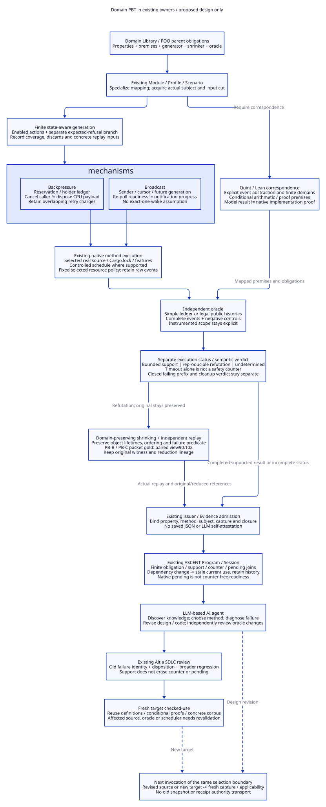
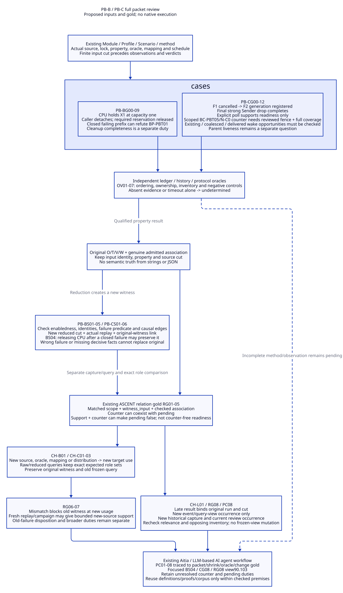
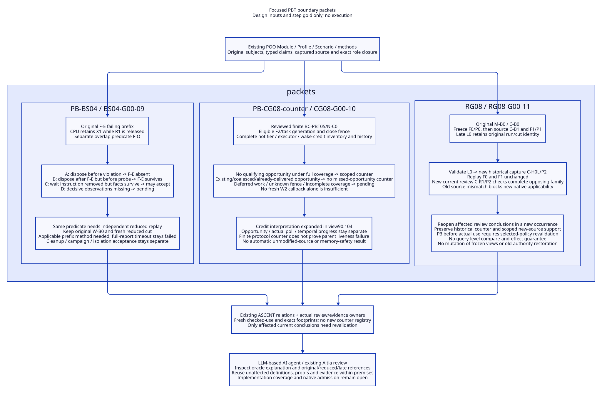
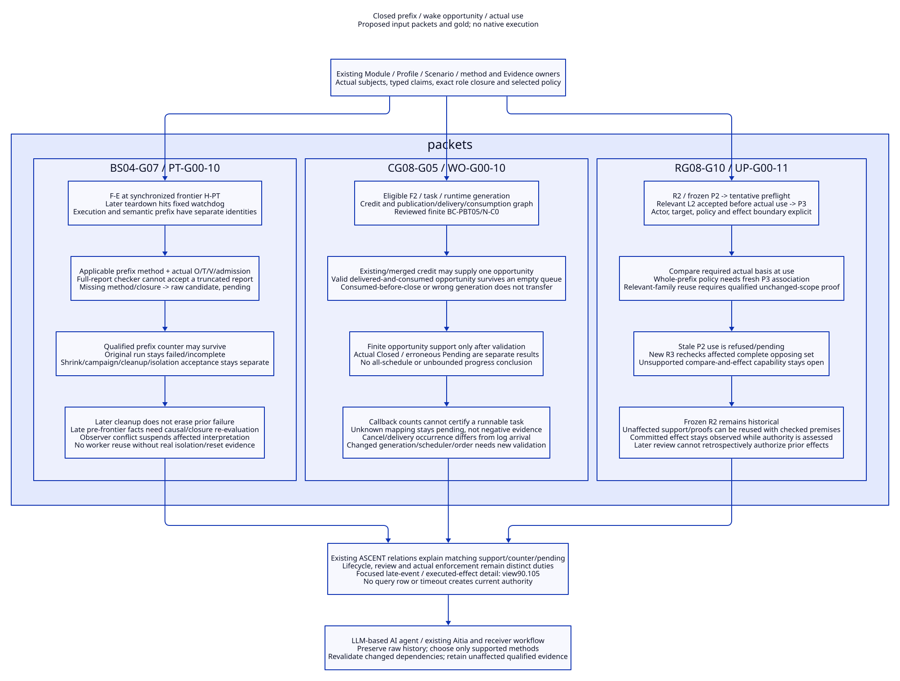
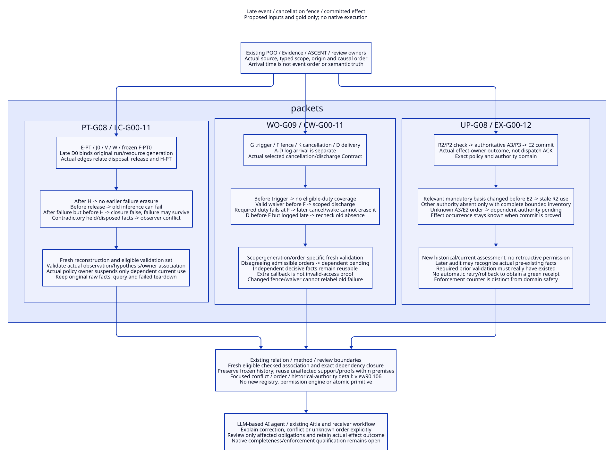
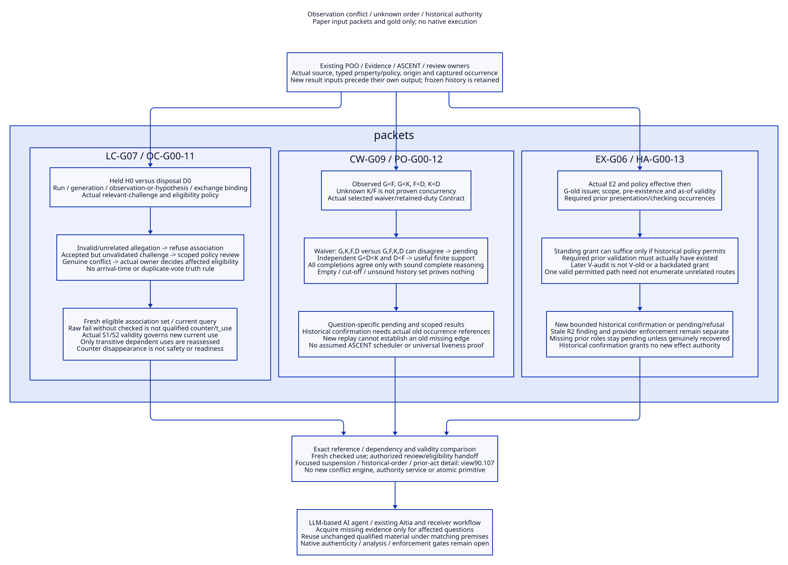
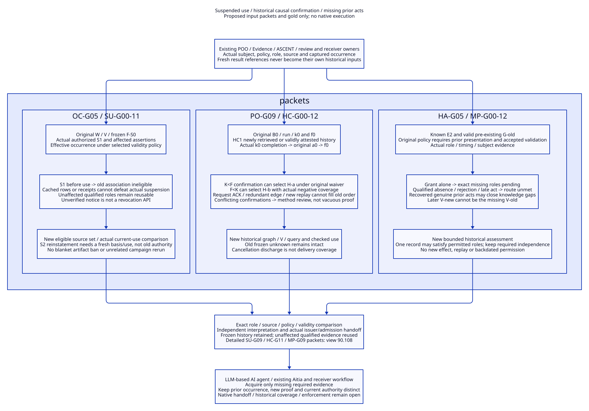
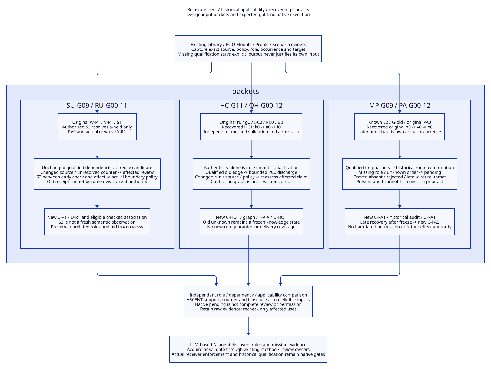

# SPDX-FileCopyrightText: 2026 hardenedlinux Linux Team and Contributors
#
# SPDX-License-Identifier: LGPL-2.1-or-later

#+TITLE: 10.118 Domain Property Testing and Evidence Trajectories
#+LANGUAGE: en
#+PROPERTY: JD_ID 10.118
#+OPTIONS: toc:3 num:nil
#+STARTUP: overview
#+FILETAGS: :design:library:pbt:poo:ascent:quint:lean:
#+PROPERTY: header-args :eval never :tangle no :exports code
#+TODO: PROPOSED REVIEW | ACCEPTED

[[file:../../00-09-project/00-documentation/00.01-index.org][Index]] | [[file:10.17-domain-libraries-and-atomic-specialization.org][Semantic parents]] | [[file:10.39-method-execution-evidence-issuance-and-ascent-projection.org][Method/evidence boundary]] | [[file:10.119-project-component-feature-and-example-boundaries.org][Project and component scope]]

* Decision and evidence boundary
:PROPERTIES:
:CUSTOM_ID: pbt118-scope
:STATUS: proposed-design-only
:END:

Property-based testing (PBT) is a method supplied by domain Libraries and selected
through existing POO Module/Profile/Scenario composition. It connects domain
contracts to real implementation observations. It introduces no parallel Project,
loader, test dispatcher, evidence issuer, or ASCENT engine. All records, rules and
query names below are semantic design contracts, not newly available APIs.

Rust/Lean/Quint types and Scheme runtime Contracts have different guarantees.
A well-typed action is not necessarily enabled in the current domain state.
An enabled abstract action does not prove a native implementation refinement.
A finite test pass does not prove an unbounded property or a temporal theorem.

The existing backpressure QNT/Lean/source artifacts are concrete starting points.
Broadcast remains the design entry in [[file:10.16-tokio-broadcast-close-and-wake-library.org][10.16]]; this document does not claim that
a broadcast Module, generator, QNT model or Lean proof has been implemented.
Current dependency resolution belongs to =gerbil.pkg= and its upstream package
closure. A later runner must use the actually selected native APIs and refuse
unsupported method bindings; historical adapters are not compatibility promises.

#+CAPTION: Existing owners select, execute and interpret a bounded domain campaign.

[[file:../../90-99-views/90-architecture-views/90.100-domain-pbt-evidence-loop.d2][Editable D2 source]].

* Library ownership and POO specialization
:PROPERTIES:
:CUSTOM_ID: pbt118-poo
:END:

#+NAME: pbt118-owners
| Existing owner | PBT design responsibility | Boundary |
|----------------+---------------------------+----------|
| Domain Library | State/action vocabulary, premises, properties, generation and shrinking contracts, independent oracle requirements, replay corpus | Own reusable knowledge rather than every generated case |
| Parent Module / published Contract | Declare inherited model and obligations, applicable method inputs and required observation roles | Directory ancestry or matching words do not establish inheritance |
| Rust/Tokio/Rayon specialization | Supply action-to-API mapping, allocation/handle ownership, cancellation, panic and scheduler assumptions | Cannot silently weaken the parent property |
| Profile | Select declared finite bounds, features, workload class, scheduler/clock mode, supported method and resource policy | Selected values must satisfy the effective Contract |
| Scenario | Acquire real source, lock/features/toolchain and concrete subject inputs once; bind run/capture and observation origin | A fixture or saved JSON is not an issued observation |
| Existing method execution and native testing owners | Execute selected generator/driver/oracle under the captured policy; preserve raw outputs and failures | Scheme orchestration tests remain in t/*-test.ss; no Module per test |
| Existing ASCENT Program/Session and Evidence admission | Derive obligations, join admitted observations to exact applications, retain counters and compute reuse candidates | Inference does not create execution evidence or approval |
| Aitia | Apply selected review and SDLC requirements to actual results and dispositions | Test success is not deployment or review authorization |

The current [[file:../../../init.ss][init.ss]] selects abstract backpressure, Rust resource and evidence
Modules, and separately selects gateway-review/resource-lifecycle Scenarios.
[[file:../../../projects/library-formation/init.ss][The existing Project entry]] composes declared source owners; PBT must consume that
machinery rather than append a new Project for each property.

A backpressure parent contributes reservation conservation. Its Rust child must
provide an interpretation of queued/running/returned/cleanup holders and actual
release. A broadcast parent contributes predicate/registration/notification
obligations, with a separate waiter-generation interpretation. Shared cancellation
questions do not make their transition systems interchangeable.

A child may strengthen premises only with a visible restriction of applicability.
Its generator, oracle and mapping must all select that same restricted domain.
A stronger child result can satisfy a parent use only after the interpretation and
premise implication are checked. Lean may prove such an implication or a shrink
transformation lemma; no automatic POO-to-Lean proof generation is claimed.

Atomic selection loads the chosen family and required parents/methods. Discovering
a catalog descriptor does not execute all generators, read all native sources or
load every concurrency child. Definition reuse and run evidence reuse are distinct.

* Campaign inputs, observations and reproducible failure contract
:PROPERTIES:
:CUSTOM_ID: pbt118-contract
:END:

These fields bind an existing method application, not a new wire format.

#+NAME: pbt118-campaign-closure
| Binding | Required content |
|---------+------------------|
| Subject | Library/obligation/property identity, effective parent and specialization, selected Project component or mechanism subject, usage and capture identity |
| Contract | Premises, legal and expected-refusal action domains, initial state, observable invariants, progress assumptions and allowed nondeterminism |
| Inputs | Actual source closure, Cargo.lock/features/toolchain for Rust, Profile, dependency and instrumentation closure, external input digests |
| Method | Generator, distribution policy, shrinker, native driver, mapping, independent oracle and scheduler/clock implementations with actual source identities |
| Bounds | Cases attempted/completed, steps, entities, capacities, scheduling choices, rejection/discard counts, generation/execution/shrink/replay resource limits |
| Replay | Seed and RNG/tool version, concrete initial state/actions/arguments, handle generations, schedule decisions where controlled, original and reduced traces |
| Outputs | Actual process exits/errors/deadlines, raw events, oracle decisions and explanation, complete dependency/reference closure |
| Validation | Actual issuer/validator association, observation completeness, claimed strength, independent review where policy requires it |

A seed alone is insufficient across generator/tool changes. Store concrete actions
and inputs as well. A reduction retains its original failure and a separate replay
result; unsuccessful shrinking cannot erase a valid original counterexample.
Each trial starts from isolated state and teardown verifies retained owners before
the next trial. An unexplained leftover task leaves cleanup/campaign completion
incomplete. A separately closed failing prefix may still refute its applicable
safety property; it does not establish successful teardown or a full campaign pass.

An immutable input cut is identified before execution; output and verdict identities
are derived afterwards. The input identity must not depend on its own future result.
Late replies retain their original application/cut in a new observation/query-view
occurrence, without mutating a frozen earlier view. Rebinding them to a new capture
requires fresh applicability and use validation, never an in-place relabeling.

* Backpressure: domain generator and independent state machine
:PROPERTIES:
:CUSTOM_ID: pbt118-backpressure
:END:

The parent [[file:../../../library/concurrency/resource-control/backpressure-memory/model.qnt][BackpressureOwners model]] has five job identities and queued, running,
returned, cleanup and done sets. Its =safe= predicate requires admitted to equal
the holder union, disjoint stages, bounded admitted/queued counts, and no completed
holder. A Profile cannot enlarge that model domain merely by generating more jobs.

The independent test oracle uses a simple allocation/reservation ledger: resource
identity, charge, current holder, caller attachment and terminal disposal. It does
not copy the Rust control flow or use an implementation-produced live count as its
sole truth. Reconcile its ledger against independently observed acquire, transfer,
payload-drop and permit-release events. Instrumentation coverage is itself a
required mapping obligation, especially for cancellation, panic and cleanup.

#+NAME: pbt118-bp-generation
| Action family | Generated domain and precondition | Expected observation / oracle rule |
|---------------+-----------------------------------+-----------------------------------|
| Submit/acquire/start | Fresh job; capacity and queue boundaries; identify failed versus completed acquisition | A reservation enters only after actual acquisition; queue-to-CPU transfer preserves its identity |
| Cancel waiting caller | Separate pre-acquire, queued and CPU-owned cases; cancellation location is explicit | Pre-acquire cancellation creates no charge; started CPU work retains its charge until actual terminal disposal |
| Complete/deliver/drop | Work completion, receiver present/absent, failed delivery, result retention and cleanup | Finishing computation alone does not release a still-retained payload; terminal release occurs once |
| Capacity boundary | Fixed valid limits, full queue and admission states; separate expected-refusal inputs | Refusal does not create a phantom job; zero/full states must actually be reached |
| Panic/cleanup/retry | Only declared panic and retry semantics; every overlapping attempt has an identity | No orphan or double-spent reservation; a retry is not assumed to replace a still-live attempt |
| Resize/cache extension | Candidate only when a selected extension defines transitions and allocation units | No base-model result covers live resize, cache ownership or a joint retry budget by implication |

Use constructive state-aware generation for enabled sequences. Add a distinct
expected-refusal branch for validly encoded but disallowed operations. Preserve
Rust ownership rules: do not invoke methods on freed handles to manufacture a
safe-Rust scenario. Any unsafe/FFI fault domain needs its own explicit method.
Record bucket coverage and rejected cases; excessive filtering is not deep search.

#+NAME: pbt118-bp-properties
| Property | Requirement | Negative control that must be detected |
|----------+-------------+---------------------------------------|
| BP-PBT01 reservation conservation | Each live charged allocation/attempt has its declared reservation; no reuse while its charge survives | Release caller-owned permit while CPU still holds payload |
| BP-PBT02 terminal ownership | Terminal payload disposal and release follow the selected coupling contract, without duplicate release | Release twice or retain an orphan cleanup holder |
| BP-PBT03 cancellation | Caller detachment changes caller state, not physical disposal truth | Treat caller cancellation as CPU termination |
| BP-PBT04 rejection | Failed admission leaves reservation/holder inventory unchanged | Add a queued holder on rejected acquisition |
| BP-PBT05 retry overlap | Distinct live attempts fit the declared joint budget | Spend one returned permit for two overlapping allocations |
| BP-PBT06 conditional progress | Under explicit finite work/cleanup progress premises, quiescence reaches the expected terminal inventory | Suppress cleanup completion; classify a deadline alone as incomplete |

#+NAME: pbt118-bp-paper-trajectory
| Step | Concrete input at capacity one | Independent expected ledger / observation |
|------+--------------------------------+-------------------------------------------|
| B0 | Empty ledger; one permit; jobs J1 and J2 | No holder or charge |
| B1 | Acquire for J1; hand payload and permit to CPU worker; wait for acknowledged ownership | J1 has one CPU-held charge; available permits zero |
| B2 | Cancel the waiting caller, leaving CPU explicitly paused | Caller detached; J1 charge remains; abstract running-to-cleanup interpretation applies |
| B3 | Try immediate acquisition for J2 while J1 remains paused; on unexpected success, acknowledge its held payload | Expected refusal; J2 has no acquired reservation |
| B4 | Let CPU finish and allow terminal payload/permit disposal; observe completion | J1 charge ends exactly once; permit becomes available |
| B5 | Acquire for J2 | New reservation succeeds with its own identity |

This is proposed input/gold, not an executed result. In an early-release mutant,
B3 can acquire while J1 still holds the payload, and its conditional continuation
can expose two simultaneous charged payloads at capacity one. The independent ledger refutes
BP-PBT01 even if a same-bug internal counter reports zero live resources.

Shrink by removing unrelated jobs/actions, lowering supported capacities, reducing
payload sizes within the same allocation class, and reducing controlled schedule
choices. Preserve B1's acknowledged CPU ownership, B2's detachment and the paused
interval containing B3. Removing that interval changes the failure. Recompute
preconditions after each candidate reduction and replay it against the same
captured implementation. Keep the original failure if the reduced one is unstable.

* Broadcast: generator, histories and close/wake properties
:PROPERTIES:
:CUSTOM_ID: pbt118-broadcast
:END:

The semantic baseline is [[file:10.16-tokio-broadcast-close-and-wake-library.org::#broadcast-independent-tests][10.16's public-history and internal-mapping contracts]].
The oracle tracks strong Sender identities, Receiver subscription cursors, eligible
messages, operation invocation/return ordering, and receive-future generations.
Weak handles and unpolled/pending futures are separate dimensions. An internal
waiter list is not copied into the public oracle.

#+NAME: pbt118-bc-generation
| Action family | Generation contract | Oracle boundary |
|---------------+---------------------+-----------------|
| Clone/drop sender | Track each live strong handle; deliberately reach non-final and final drop | Only completed final strong-sender drop establishes the selected close boundary |
| Subscribe/send/receive | Positive supported capacity, distinct message identities, subscription-before-send and post-subscription cases | No-lag profile checks ordered delivery; lag profile separately checks selected lag semantics |
| Poll/cancel/re-register | Poll a pinned future with a counting waker; cancel by dropping it; make a fresh occurrence | Same Receiver may be reused after borrow ends; old and new future generations stay distinct |
| Close/poll schedule | Controlled barriers around completed close, registration and re-poll; never sleep as an ordering proof | Stable close predicate determines readiness; exact wake count is not a general API property |
| Reentrant callback | Separate selected safe reentry/lock boundary with borrow-safe handles | No automatic claim about arbitrary raw-waker, clone or panic callbacks |
| Expected refusal | Invalid capacity construction or other documented API rejection in a separate branch | Panic/error can be the expected contract result, not automatically a test failure |

#+NAME: pbt118-bc-properties
| Property | Required interpretation | Negative control |
|----------+-------------------------+------------------|
| BC-PBT01 drain then close | In no-lag scope, pre-close unread messages arrive in order before Closed | Drop a buffered eligible message on close |
| BC-PBT02 final ownership | Dropping a non-final strong sender does not establish terminal close | Close on any sender drop |
| BC-PBT03 waiter lifetime | Cancelled future cannot leave a dereferenced freed waiter; new occurrence has its own generation | Dereference a removed waiter or conflate old/new generations |
| BC-PBT04 close observation | After completed final close and eligible drain, re-poll observes Closed | Return Pending despite the established terminal predicate |
| BC-PBT05 notification protocol | Under reviewed registration/notification ordering and scheduler progress, eligible waiters can observe the predicate | Skip notification in an instrumented controlled protocol |
| BC-PBT06 subscription scope | Fresh subscription starts at the declared cursor and does not inherit earlier unread history | Deliver pre-subscription message as newly eligible data |

#+NAME: pbt118-bc-paper-trajectory
| Step | Concrete capacity-two, no-lag input | Independent expected result |
|------+------------------------------------+-----------------------------|
| C0 | One Sender S, Receiver R subscribed; empty channel | One strong sender, no unread message |
| C1 | Poll receive future F1 to Pending with waker W1 | Pending receive occurrence generation one |
| C2 | Drop F1; end its borrow; create F2 on R with W2 and poll Pending | Fresh generation two; W1 may still be invoked if legitimately extracted, but no freed-node access |
| C3 | Drop final Sender S and acknowledge its completed destructor | Terminal close predicate holds; schedule records notification and runnable/poll boundaries separately |
| C4 | Explicitly re-poll F2 | Closed, not indefinite Pending; no exact-one-wake requirement |
| C5 | Repeat a separate trial sending v1,v2 before final drop | Receive v1 then v2 then Closed; no lag in this trial |

A missing notification can be masked by the explicit C4 poll. Therefore C4 tests
predicate observation, not wake-driven progress. BC-PBT05 needs a separate driver
that records registration, final-close completion, wake/enqueue and execution
under a declared controlled scheduler. A wall-clock deadline or missing log line
alone does not prove a lost wake. Missing instrumentation or unresolved ordering
returns incomplete. Public histories and internal protocol checks remain separate.

Shrink unrelated receivers/messages, supported capacity and schedules while
preserving final-sender ownership, subscription cut, F1/F2 identity, required
happens-before edges and the original failure class. For BC-PBT01 retain the
unread message that distinguishes drain-before-close; for BC-PBT03 retain the
cancellation/re-registration pair. Never shrink a public safety failure into a
mere timeout and call it the same counterexample.

Concurrent histories require an independent search for a legal abstract ordering
consistent with happens-before. Search exhaustion refutes only if event closure,
search completeness and the selected API contract are established. A bounded
search that stops early is undetermined, not an illegal history.

* Quint, Lean and implementation correspondence
:PROPERTIES:
:CUSTOM_ID: pbt118-correspondence
:END:

#+NAME: pbt118-method-correspondence
| Layer | Explicit mapping / obligation | Result strength |
|-------+-------------------------------+-----------------|
| Quint backpressure | Acquisition to admit, acknowledged CPU transfer to start, result retention to returned/finish, terminal drain/clean; caller abort during running maps to cleanup while retained CPU details may stutter | Only declared paths and finite parameters; queued cancellation/retry/resize need explicit deltas |
| Quint broadcast | Proposed close predicate, strong-owner changes and registration/notification actions with observed generation/ordering interpretation | No executable broadcast model is claimed here; ambiguous edge/level contracts remain pending |
| Quint-driven generation | Model actions drive native API calls and compare mapped observable states; native trace validation supplies the opposite direction | Model correctness and observed implementation conformance remain separate |
| Lean arithmetic | Existing retained(q,a,item,fixed,cache) lemma in budget.lean requires units, allocation inventory and disjoint/shared accounting interpretation | Conditional accounting result; not measured peak RSS, runtime latency or all ownership behavior |
| Lean future obligations | Premise implication, abstraction relation or a shrink transform preserving enabledness and failure predicate, if actually authored and proved | Separate proof evidence with its own dependencies; never inferred from a PBT pass |
| Native PBT / scheduler exploration | Real selected artifacts and independent oracles, with actual API and instrumented-scheduler coverage | Finite observed behavior; neither whole Tokio/Rayon coverage nor memory-safety proof follows |

After caller cancellation, native CPU completion can stutter in the abstract
cleanup state until actual disposal maps to clean. It must not map to finish,
whose base-model precondition requires a running holder.

The actual [[file:../../../library/concurrency/resource-control/backpressure-memory/budget.lean][Lean budget artifact]] and [[file:../../../library/concurrency/resource-control/backpressure-memory/rust/correspondence.ss][current path correspondence method]] must be
inspected at selection time. This design does not overwrite their existing
claim strength or interpret an expected checker exit as an arbitrary error/pass.

Proptest state-machine support currently documents sequential strategies.[fn:state]
Use native PBT for action/data exploration, and a compatible controlled scheduler
for selected concurrency mechanisms. Loom requires participating synchronization
operations; hidden operations remain outside its exploration.[fn:loom] Keep the
instrumented and unmodified native runs as distinct evidence subjects. For FFI,
additional native instrumentation/sanitizer evidence may be required; PBT alone
cannot establish absence of undefined behavior.

* ASCENT admission, finite consequences and reuse
:PROPERTIES:
:CUSTOM_ID: pbt118-ascent
:END:

Use the existing method application, witness, checked-use and obligation projection
from [[file:10.39-method-execution-evidence-issuance-and-ascent-projection.org][10.39]]. The logical labels below describe views over those owners, not a new
Evidence DSL, JSON authority flag or alternative database. A finite campaign has
finite actions/events, properties and dependency edges; inference closes over
these captured inputs rather than generating unbounded new executions.

#+NAME: pbt118-finite-rules
| Rule | Required admitted inputs | Derived relation / remaining boundary |
|------+--------------------------+---------------------------------------|
| PBT-R01 demand | Effective parent/child Contract, checked Profile and Scenario binding | Required property, mapping, generator/oracle review and native-method obligations; selection is not execution |
| PBT-R02 counter | Complete source-bound trace, applicable property/premises, independent oracle refutation and genuine observation validation | Counter for that property/application/scope; keep original and reduced witnesses separately linked |
| PBT-R03 support | Completed campaign, exact bounds/distribution/coverage, valid driver/oracle and admitted result | Bounded sampled support only; no universal proof or automatic method completeness |
| PBT-R04 incomplete | Timeout, error, incomplete events, unstable replay, unsupported adapter or undecided history | Execution/inference remains undetermined for the affected question; no synthetic semantic counter |
| PBT-R05 changed dependency | Actual changed footprint intersects a witness/use's declared semantic or execution dependencies | Current applicability/use becomes stale or pending; historical trace is retained |
| PBT-R06 reuse candidate | Required property/premises and complete source roles match, or an independently established stability/frame argument transports them | Candidate reuse followed by fresh target checked-use; equal output rows or a new label are insufficient |
| PBT-R07 resolution | New revision bound to the old failure identity, actual disposition, replay and broader affected regression under selected policy | May close that reviewed blocking item; unrelated pending or new counters remain visible |
| PBT-R08 late output | Actual run/application/cut identity and closed input/output references | Bind original input cut in a new event/query-view occurrence; frozen earlier views remain immutable and fresh current-use admission is independent |

Support, counter and pending may coexist. A counter query returns every relevant
admitted counter, including historical unresolved failures; absence requires an
explicit complete discovery scope. Renaming Project, intake, Profile or property
must not remove an unresolved blocker. Legitimately narrowing applicability leaves
the original obligation and its responsible owner visible outside the new scope.

#+NAME: pbt118-reuse-matrix
| Change | What may be reused | What requires new evidence / checked use |
|--------+--------------------+-----------------------------------------|
| Same mechanism in another component/project | Parent definitions, generator/oracle code, explicit mathematical lemmas and known concrete regression inputs | New source/lock/features/environment mapping and target application; no automatic transfer of native pass |
| Capacity or workload distribution changes | Unchanged definitions and conditional lemma whose premises still hold | New campaign scope, boundary coverage, actual ownership/peak measurements as required; old sample pass covers only its old profile |
| Rust source or dependency changes | Unaffected properties with an established dependency/frame argument; old counter as history and replay input | Affected native paths, source mapping and new target checked-use; comments-only bytes also require source admission unless a reviewed semantic transport applies |
| Generator or shrinker changes | Independent concrete old input, if its replay driver/contract remains applicable | New distribution/coverage claim; revalidate reductions under changed shrink semantics |
| Oracle, instrumentation, scheduler or API interpretation changes | Raw historical observations with their original meaning and provenance | Reinterpretation/review, relevant replay and admission; instrumented results do not silently describe uninstrumented code |
| New counter after a pass | Existing raw pass evidence as bounded history | Reopen affected negative-dependency/ready conclusions and review the complete current opposing set |

Proposed queries ask: which inherited duties apply; which boundary buckets were
actually reached; which original/reduced counter and replay support a failure;
which dependency changed; which witnesses are reuse candidates; and which pending
items still prevent the selected Aitia review. Each answer names its capture,
application, property, exact evidence references and admitted use, not just a
boolean green status. T/V/A references retain the [[file:10.07-claim-witness-reference-contracts.org][existing contracts]]: T binds artifact content, V
binds method validation, and A binds claim/obligation admission under a scope and
policy. Target checked-use is separately established; A grants no runtime permission.

** Proposed concrete registration and change packets
:PROPERTIES:
:CUSTOM_ID: pbt118-packets
:END:

The following symbols are paper identities for reviewing the design. They are
not manufactured native receipts. An implemented Scenario/method must acquire
and issue each corresponding artifact through existing owners.

#+NAME: pbt118-evidence-packets
| Stage | Backpressure packet PB-B | Broadcast packet PB-C |
|-------+--------------------------+-----------------------|
| Input cut | C-B0 binds capacity-one Profile, exact early-release candidate source/lock, B0-B5 input, generator, driver, schedule and ledger oracle | C-C0 binds no-lag Profile, exact Tokio artifact/features, C0-C4 input, counting-waker driver and history oracle |
| Observation | O-B0 contains actual acquire, CPU-holder acknowledgment, caller detach, unexpected J2 acquisition/holding and disposal events if the mutant exhibits the failure | O-C0 contains F1/F2 generations, completed final drop and explicit F2 re-poll returning Closed |
| Validation and content | T-B0 binds exact artifact bytes; V-B0 validates complete observations, assumptions and independent ledger refutation; a reduced trace has its own O/T/V and replay link | T-C0 binds bytes; V-C0 validates the public-history result; absent scheduler/wake evidence is explicitly missing |
| Admission and query gold | Only genuine admission A-B0 can associate the qualified witness with BP-PBT01/application M-B0; query returns counter and references, not approval | A-C0 may associate bounded support with BC-PBT04/M-C0; BC-PBT05 remains pending even if the readiness test passes |
| Changed source | C-B1 fixes ownership; retain W-B0 and its original source identity. New M-B1 replays the original and reduced inputs and runs affected broader properties | C-C1 changes waiter registration; old public observations remain history, but changed protocol and mapping require new native/scheduler evidence |
| Reuse and disposition | Definitions and unchanged conditional proof may be reused with checked premises; old native pass/receipt cannot authorize C-B1. Bind reviewed disposition to W-B0, not just a new green label | Unchanged public-contract definitions can be reused; instrumented wake evidence cannot be invented from O-C0 or transported across a changed scheduler |

If replay fails to reproduce a previously admitted counter, preserve both records
and investigate schedule/input/environment differences. A single non-reproduction
does not resolve the old failure. A new relevant counter reopens dependent review
conclusions even when an earlier disposition remains historically valid.

** Expanded packet input and gold convention
:PROPERTIES:
:CUSTOM_ID: pbt118-packet-gold
:STATUS: paper-contract-not-executed
:END:

PB-B and PB-C below instantiate the earlier contracts. Every observation, mutant,
replay and verdict is proposed gold, not a recorded execution or manufactured
receipt. Their symbolic source/method references must resolve to real captured
bytes and supported bindings before execution. An unresolved required reference
blocks the method; a display name or handwritten digest cannot fill that role.

#+CAPTION: Original, reduced and changed-source observations retain separate identities and checked uses.

[[file:../../90-99-views/90-architecture-views/90.102-pbt-packet-gold-and-reuse.d2][Editable D2 source]].

All packets bind the existing parent declaration, effective Module Contract,
Profile, Scenario capture, method application and actual component/mechanism
subject. They are not new Projects, Scheme classes, JSON schemas or admission APIs.
Their closure is finite and includes direct and transitive required role references.
A required reference cannot be dropped merely because the test did not read it.

#+NAME: pbt118-packet-common-input
| Input role | Concrete design binding and required interpretation |
|------------+-----------------------------------------------------|
| Execution subject | PB-B uses the Rust/Tokio/Rayon resource mechanism; PB-C uses an instrumented broadcast candidate and a separately identified unmodified API-control subject |
| Source cut | C-B0 or C-C0: acquired source/dependency closure, Cargo.lock, enabled features, target/toolchain, parent/child declarations and environment/instrumentation identities |
| Method basis | Generator/distribution, concrete replay driver, shrinker, mapping and independent oracle identities; selected review/policy and validator association |
| Replay basis | Concrete initial state, every action/argument, object/attempt generations and acknowledged ordering edges; seed 17 and the selected RNG identity are supplemental provenance only |
| Work bounds | One original trial per packet branch, at most five job identities or two receiver identities, at most 24 driver actions per original trial; separately counted reduction/replay trials |
| Reduction bounds | At most 32 candidate reductions and one declared replay per accepted reduction; fixed per-process execution fence; timeout stops reduction and preserves the original witness |
| Coverage demand | PB-B reaches CPU ownership, detached caller, paused holder and failed/full or unexpected admission; PB-C names readiness, cancellation-generation and notification branches separately |
| Outcome roles | Actual execution status, raw observation closure, oracle semantic verdict, validation/admission status and review disposition remain separate |

The numerical counts describe a minimal paper review, not an adequacy recommendation
for a full campaign. Execution policy remains selected through existing owners;
where the repository's two-GiB/180-second Gerbil fence applies it is unchanged.
No claim is made that this fence measures Rust RSS or that one replay establishes
statistical reproducibility. Larger campaigns need their own declared case and
scheduler bounds without changing the meaning of these small review packets.

*** PB-B complete input: retained CPU payload after caller cancellation
:PROPERTIES:
:CUSTOM_ID: pbt118-pbb-input
:END:

#+NAME: pbt118-pbb-input
| Field | Value / reference role |
|-------+------------------------|
| Parent and target duty | Backpressure ownership parent, Rust specialization, BP-PBT01; BP-PBT02/03/04/06 remain separately evaluated duties |
| Profile P-B0 | Admission limit one, queue limit one, Tokio current_thread, one Rayon worker, unwind panic policy, no cache/resize/retry extension |
| Initial state | Jobs 0..4 unused, no payload, all reservations free; job 0 is optional completed noise, job 1 is the retained work, job 2 is the competing probe |
| Resource units | One charge per distinct retained payload allocation; initial payload length 64 bytes, shrink floor one nonzero byte within the reviewed allocation class; this is not an RSS or byte-budget theorem |
| Candidate I-B0 | Early-release candidate: caller may own the permit while detached CPU work owns its payload; actual source and binding are required before this candidate can execute |
| Control I-Bgood | Coupled payload/permit owner under the same declared profile; separate source identity and application, not an outcome flag on I-B0 |
| Schedule H-B0 | Acknowledge CPU-held payload, pause that worker, cancel caller, complete caller cleanup, try job 2, and only then allow job 1's terminal disposal |
| Observable inventory | Resource allocation identity/generation, acquire/release, caller attachment, transfer, CPU-holder acknowledgment and actual terminal disposal; independently observed probe success/refusal |
| Oracle L-B0 | Simple reservation/holder ledger reconstructed from the reviewed event roles, not the implementation's live/available counters or a copied permit algorithm |
| Mapping | Acquired reservation -> admit; acknowledged CPU ownership -> start; detached retained work -> cleanup; CPU completion may stutter there until terminal disposal -> clean |

The existing [[file:../../../library/concurrency/resource-control/backpressure-memory/rust/oracle.ss][oracle.ss]] contains a five-job model oracle, a two-state counter checker and
an M01-M06 native report checker with fixed scope/expected fields. None is already
a general PB-B action-sequence oracle. Its finite ledger idea is reusable;
accepting PB-B needs a reviewed method binding. The current native checker cannot
be reused by renaming PB-B into M06 or wrapping new events in its expected schema.
Likewise, a multi-job PB-B trace must not be fed to the existing single-job native
path mapper without a qualified interpretation extension.

#+NAME: pbt118-pbb-step-gold
| Gold step | Input/event and independent observation requirement | Correct-owner control | Early-release candidate / query consequence |
|-----------+----------------------------------------------------+-----------------------+---------------------------------------------|
| PB-BG00 | Resolve P-B0, all source/method references and initial empty ledger | Eligible input; unresolved role means method pending | Same eligibility check, no verdict selected from candidate name |
| PB-BG01 | Optional job 0 acquires, completes and disposes before job 1 exists | Charge returns to zero; reservation free | Same; this noise is removable only as a complete independent lifetime |
| PB-BG02 | Job 1 acquires R1 and creates payload X1; CPU acknowledges holding X1 | Charge X1=1, reserved R1=1, available=0 | Same measured state before cancellation |
| PB-BG03 | Pause CPU, detach caller and acknowledge completion of caller cleanup | X1 still live and charged; R1 remains reserved | If actual release of R1 is observed while X1 remains live, BP-PBT01 is refuted at this closed prefix |
| PB-BG04 | Under the same paused-holder barrier, try immediate acquisition for job 2 | Refusal; no R2 or phantom queued job is created | Unexpected acquisition corroborates reuse while X1 survives; success must be observed, not guessed from a counter |
| PB-BG05 | Only on unexpected success, create X2 in its admission/queue owner and acknowledge it held before allowing X1 disposal | Branch not taken, because probe refused | Two distinct charged payloads under limit one give a second concrete mismatch; no second Rayon worker or whole-RSS claim |
| PB-BG06 | Release the barriers; observe CPU completion, payload disposal and any resulting reservation releases | X1's charge ends at actual disposal; terminal inventory reconciles | Later cleanup cannot erase PB-BG03/05; missing teardown leaves its own duty pending |
| PB-BG07 | Fresh trial/state after teardown: acquire for job 2 and dispose normally | New allocation/attempt identity; eventual inventory zero | A post-cleanup success is not evidence that the earlier paused interval was safe |
| PB-BG08 | Validate event closure and independent ledger verdict | Bounded support for observed BP-PBT01/03/04 checks only | Qualifiable counter requires complete failing-prefix inputs, ordering and trusted observation roles; malformed or missing evidence remains unqualified |
| PB-BG09 | Bind raw observation O-B0 and V-B0/T-B0 to admitted witness W-B0 under M-B0/U-B0 | Support only for the separate good-control application | Counter for BP-PBT01 under C-B0; pending can coexist; no approval or automatic discharge of other duties |

PB-BG07 is a separately identified post-cleanup control trial with its own concrete
input and observation; it is not spliced into O-B0. The good-owner, candidate and
post-cleanup trials each consume the declared per-trial bounds. X2 in PB-BG05 is
held by admission/queue code while the single Rayon worker still holds X1; the
packet does not require that blocked worker to start a second CPU job.

The minimal counter predicate is: at an acknowledged observation cut, X1 is still
held by CPU or cleanup, caller cleanup has completed, and its required reservation
has been released. The charge and reservation facts need consistent ownership and
ordering coverage. When R1's release is not observable, an independently established
X1/X2 overlap under the same capacity can support the distinct capacity-violation
predicate. Do not assert the exact release cause solely from that overlap.
The original and reduced witnesses name which predicate they actually establish.

*** PB-C complete input: readiness versus notification and generation isolation
:PROPERTIES:
:CUSTOM_ID: pbt118-pbc-input
:END:

#+NAME: pbt118-pbc-input
| Field | Value / reference role |
|-------+------------------------|
| Parent and duties | Communication predicate/registration/notification contract; Tokio interpretation; BC-PBT03/04/05 are separate questions |
| Profile P-C0 | Capacity two, one strong Sender S and one subscribed Receiver R; empty channel, no lag, no weak/hidden strong sender, ordinary selected waker behavior |
| Future identities | F1=(R, generation one), F2=(R, generation two); F1 borrow ends before F2 is created; generation is semantic identity, not recycled address |
| Original schedule H-C0 | Poll F1 Pending, cancel F1, create/poll F2 Pending, complete final S drop, then select readiness or scheduler branch; record each acknowledged edge |
| C-read branch | Explicitly poll F2 after close; check only the selected observable close result and cancellation-generation facts supported by its observations |
| C-notify branch | No explicit repair poll, timer, IO wake or hidden sender; controlled executor records parked/runnable tasks and all notifier work covered by the selected instrumented protocol |
| Notification premise N-C0 | Reviewed protocol requires eligible F2 notification by the completed close/quiescence fence; no deferred notifier or alternate wake source remains unobserved |
| Oracle H-C0 | Independent public-history checker for readiness/drain; separate finite protocol checker for the reviewed notification postcondition and generation/ownership observations |
| Source interpretation | Instrumented candidate I-C0 and unmodified API control I-Capi have distinct closures; no executable broadcast model or native binding is presumed available |

The finite claim BC-PBT05/N-C0 has its own typed proposition/premise identity.
It is not identical to an unbounded parent liveness claim merely because both
use the display family BC-PBT05. Its counter refutes that selected protocol
postcondition only. A reviewed interpretation is required to relate it to parent
notification/progress duties; absent that interpretation, those duties stay pending.

N-C0 is an additional internal-protocol premise requiring source and instrumentation
review. If the selected implementation defers notification beyond that fence, the
premise must change and this notification gold is not applicable. A bounded quiet
interval cannot establish global quiescence, scheduler fairness or a public liveness
violation. No claim of general linearizability or memory safety follows here.

#+NAME: pbt118-pbc-step-gold
| Gold step | Concrete input/event | Independent expected relation / decision |
|-----------+----------------------+------------------------------------------|
| PB-CG00 | Resolve P-C0, source cut, driver, oracle and mapping; review notification premise separately | Readiness method may be available while notification/memory-safety methods remain pending |
| PB-CG01 | R subscribed; poll F1 with W1 to acknowledged Pending | One live receive occurrence, generation one; no message and S still live |
| PB-CG02 | Cancel/drop F1 and end its borrow | F1 is no longer a live receive future; an already extracted W1 invocation is not itself a defect |
| PB-CG03 | Create F2 with W2, poll Pending and acknowledge its eligible registration | Generation two is distinct; missing registration coverage prevents notification refutation |
| PB-CG04 | Complete final strong S drop | Closed predicate established; driver checks the full strong-handle inventory rather than a source-emitted closed flag alone |
| PB-CG05-read | In a separate readiness trial, explicitly re-poll F2 and observe Closed | Bounded BC-PBT04 support; BC-PBT05 still pending even if notification was missing |
| PB-CG06-notify | In the notification trial, close reaches the reviewed fence; all notifier/executor queues and generation bindings are observed | Applicable only if N-C0 and complete observation coverage are independently validated |
| PB-CG07-good | W2 wake/enqueue leads to scheduled F2 poll and Closed | Bounded notification-path support for this instrumented schedule; no all-schedule proof |
| PB-CG08-counter | At the same reviewed fence, eligible F2 remains parked, no qualifying notification/wake opportunity is present or was already delivered in the reviewed interval (including permitted coalescing or equivalent task-level credit), and no deferred notifier remains | Counter to the selected finite BC-PBT05/N-C0 protocol postcondition, if complete coverage establishes these negative facts; not an inference from elapsed time |
| PB-CG09-unknown | Watchdog only, missing queue coverage, unknown ordering, unresolved contract or a failed history search cutoff | Undetermined/pending; no qualified lost-wake counter, even if the intended mutant label says omit-notification |
| PB-CG10-generation | A later W1 invocation is observed without an independent invalid-access or ownership mismatch witness | Allowed by itself; BC-PBT03 memory-safety conclusion remains pending if instrumentation cannot establish it |
| PB-CG11-drain | Separate no-lag trial: send distinct v1 and v2 before final close, then receive | v1, then v2, then Closed supports the selected BC-PBT01 trace; it cannot supply missing notification evidence |
| PB-CG12-admit | Bind readiness and notification results to their own trial/cut, method/property and actual validation/admission | W-Cread may support BC-PBT04; W-Cnotify may counter BC-PBT05/N-C0; no cross-property or parent-liveness promotion |

C-read cannot be appended to C-notify as if it were the same run: explicitly polling
a parked task can hide the missing notification. Share immutable input definitions,
not observation identities. A supplementary diagnostic poll after a failure has
been captured must be labeled as a new diagnostic segment with the original
failure fence preserved. Shared prefixes require identical captured subjects and
an explicit branching/replay association, not copied event IDs in two native runs.

*** Shrink input, invariant and rejection gold
:PROPERTIES:
:CUSTOM_ID: pbt118-packet-shrink
:END:

For each reduction, retain the property/premises, selected subject/method semantics,
observable failure predicate and required causal edges. Object labels may be
renamed bijectively, with an explicit original-to-reduced identity map; an exact
job number or a raw address is not the failure semantics. Preserve the seed and
original concrete trace, but shrinking operates on concrete replay inputs.

#+NAME: pbt118-shrink-gold
| Reduction | Concrete candidate input | Expected gold and preserved failure meaning |
|-----------+--------------------------+--------------------------------------------|
| PB-BS01 | Remove job 0's complete independent acquire-to-dispose lifetime from PB-BG01 | Accept only after enabledness check and independent replay of the same retained-X1/reservation mismatch; omit no dependent handle |
| PB-BS02 | Reduce X1/X2 payload lengths from 64 to one nonzero byte in the same allocation/ownership class | Candidate valid; accept only if the same selected predicate recurs; no claim about byte-budget or zero-sized allocations |
| PB-BS03 | Delete job 1 acquisition/CPU acknowledgment but retain caller cancel/probe | Reject as malformed dependency or wrong scenario precondition; do not count as a completed semantic trial |
| PB-BS04 | Move CPU disposal relative to the decisive release cut/probe, or remove a caller-cleanup wait | Evaluate the actual retained failure predicate: disposal before the decisive release can remove F-E, while disposal after its closed prefix but before the probe can preserve it. See [[#pbt118-bs04-full-packet][the focused BS04 packet]]; missing required observation remains pending |
| PB-BS05 | Reduced replay times out or tears down incompletely without closing a failing prefix | Reduction inconclusive, not a safety refutation; keep W-B0 and mark reduction pending |
| PB-CS01 | Remove unrelated values/receivers and irrelevant already-extracted W1 callback events | Accept only if selected generation/notification failure is independently re-established with the same premises and required edges |
| PB-CS02 | Delete F1 cancellation while claiming a cancel/re-register-specific BC-PBT03 witness | Reject that replacement; a remaining generic notification failure may be registered separately under its applicable scope, not relabeled as the cancellation witness |
| PB-CS03 | Insert explicit F2 poll before checking the C-notify fence | Wrong driver branch; Closed proves readiness only and cannot replace notification refutation |
| PB-CS04 | Coalesce F1 and F2 because their allocator addresses match | Reject identity/mapping; generation isolation is a required input invariant |
| PB-CS05 | Shrink v1 and v2 to equal values in the drain-order subcase | Reject loss of the distinguishing observation; retain distinct message identities even if payload contents shrink |
| PB-CS06 | Drop a final-close completion edge or leave an unobserved notifier thread | Negative-notification conclusion becomes pending; no accepted reduction and no fabricated missing-wake counter |

An accepted candidate has its own input identity, observation, oracle decision and
actual replay references. A shrink-step assertion is not proof of native failure
preservation. Keep W-B0/W-Cnotify and link any W-Bsmall/W-Csmall through the exact
transformation and replay evidence. A smaller counter to another property is useful
but distinct; there is no claim of a globally minimal or unique counterexample.

*** Independent oracle review and malformed-input controls
:PROPERTIES:
:CUSTOM_ID: pbt118-packet-oracle
:END:

The oracle's input is the event/identity/ordering closure, declared API/protocol
premises and interpretation, never the implementation's expected outcome. Its
output includes the property, earliest decisive cut or compatible public history,
required facts, missing facts and bounded search status. Oracle and driver bugs
remain separate from a domain counter. A trusted content association attests bytes,
not semantic reliability or the independence of their producer.

#+NAME: pbt118-oracle-review-gold
| Check | Concrete input or alteration | Independent required result |
|-------+------------------------------+-----------------------------|
| OV01 reservation cross-check | Raw event contains live=0, but acknowledged CPU holder X1 has no observed disposal and probe succeeds in the closed paused interval | Do not trust live=0 as truth; reconstruct ledger and qualify only the actually established mismatch |
| OV02 observation closure | Missing acquire/dispose reference, duplicate event identity, unknown object generation or inconsistent partial order | Malformed/incomplete observation, not domain safety refutation; raw disagreement retained for diagnosis |
| OV03 negative-control adequacy | Coupled-owner and early-release candidates; final-close notifier and deliberate eligible-W2 omission, each against the applicable reviewed scope | Oracle must distinguish them for the stated reason. A result selected by mutant name or same copied implementation algorithm fails independence review |
| OV04 cancellation versus invalid access | W1 is called after cancellation, with no invalid access witness | Do not call it use-after-free. Extra callback allowance and memory-safety evidence remain separate |
| OV05 notification closure | No W2 event, but scheduler/notifier inventory is incomplete or deadline alone elapsed | Undetermined; absence of a record is not established absence of notification |
| OV06 public-history search | A compatible history exists, or complete search has none, or a bounded search cuts off | Respectively finite compatibility, potential counter only with complete trusted scope, or undetermined; no all-history theorem |
| OV07 common-mode model fault | Quint and test oracle agree because both omit a required cleanup holder or waiter generation | Agreement is insufficient. Independent contract review and seeded-defect controls remain required; unsupported conclusions stay unadmitted |

Even a validated negative control proves sensitivity only to that injected defect
under its selected scope. It is not proof that the oracle or instrumentation is
correct for all inputs. Instrumentation must preserve source ordering and read
protected state under the right owner/lock without reentering user callbacks.
Failure of this obligation blocks interpretation of the instrumented observation.

*** Exact references, existing relation gold and current-use limits
:PROPERTIES:
:CUSTOM_ID: pbt118-packet-relations
:END:

The [[file:../../../modules/resource-evidence/func.ss][current resource-evidence Program]] already declares =application=,
=catalog_rule=, =catalog_dependency=, =factor=, =scope=, =witness=, =witness_input=
and =checked=, deriving =applicable=, =support=, =counter=, =pending=, =t_use=
and closure mismatches. The following is a proposed binding of those existing
roles, not a claim that the current catalog supplies PBT methods. New domain/method
bindings still require the selected parent/child Contract and actual validation.

For U-B0 at C-B0, the required key set K-B0 covers the selected parent/child
contract and property, source/lock/features/toolchain, Profile/workload, concrete
initial/actions/schedule, generator, selected shrink policy,
driver/instrumentation, oracle/mapping and selected validation policy. Raw and
reduced runs retain distinct witness footprints. The corresponding K-C0 additionally
binds the API or instrumented protocol variant, sender/subscription/future generations,
notifier/executor observation scope and N-C0 when claiming notification failure.
Each reduced replay uses a fresh usage and input cut, such as U-Bsmall/C-Bsmall,
with its own concrete actions and already-existing original-witness reference.
Original cuts contain no future reduced witness. The current Program obtains
required keys by obligation, not by an arbitrary per-witness override: one query
uses one normalized expected key set. Distinct raw/reduced role selections require
separate captures/queries with explicit catalog/policy binding, or a reviewed common
role normalization; they cannot silently change K within one query. A review can
reference those separate results without merging their input identities.
There are no implicit wildcard keys. Missing, extra or conflicting keys produce
the existing mismatch/missing_input/extra_input conditions, not silent applicability.
Method-scoped key selection must be explicit; do not discard a key just to reuse
an otherwise mismatched witness.

#+NAME: pbt118-packet-reference-closure
| Reference | Exact direct dependencies / closure rule |
|-----------+------------------------------------------|
| C-B0 / C-C0 | Acquired finite input cut and original source/method/premise identities; no observation, validation or output digest in its own input identity |
| O-B0 / O-Cread / O-Cnotify | Actual run/application, cut, actions, ordered observation events and completion/failure-fence information; readiness and notification trials never share one observation identity |
| T-* | Actual artifact content association and producer/usage context for the exact bytes; an inferred t_use row does not itself issue native content attestation |
| V-* | Exact O/T, selected oracle/mapping/coverage and its result/review basis; independent semantic validation is not supplied by T alone |
| W-* / admitted association A-* | Property/method/application, O/T/V, footprint and genuine admission/validator association; A admits the qualified counter/support association, not a positive theorem or execution permission |
| Reduced O/W | Reduced input plus identity map, transformation and actual replay; link to original witness without rewriting its source or failure predicate |
| Current target use | Original witness, new usage/capture and its complete role comparison/stability evidence; new use cannot make old raw observations describe new source |
| Review disposition | Original failure identity, actual relevance and accepted handling/resolution evidence under current scope/policy; does not become a premise of its own original failure |

#+NAME: pbt118-packet-native-relation-gold
| Case | Existing relation inputs, conditionally after genuine method validation | Expected finite consequence / boundary |
|------+-----------------------------------------------------------------------+----------------------------------------|
| RG01 PB-B failure only | Matching application/factor/catalog demand for BP-PBT01, exact K-B0 scope and witness_input, witness(W-B0,BP-PBT01,M-B,V-B0,fail), checked(W-B0,V-B0,review-B0) | applicable, counter and t_use for U-B0/C-B0; pending also holds because there is no supported witness; no support |
| RG02 raw failure without checked association | Same raw witness but no genuine method validation/admission association | No qualified counter or t_use; duty remains pending; supplied strings/JSON are not a trusted checked row |
| RG03 PB-C readiness | Matching readiness duty/method and K-Cread, validated pass W-Cread | Bounded support/t_use for BC-PBT04 only; BC-PBT05 remains pending when demanded without a corresponding qualified witness |
| RG04 PB-C complete notification failure | Separate demanded finite notification obligation/method, K-Cnotify including the BC-PBT05/N-C0 proposition and complete observation scope; validated fail W-Cnotify | counter plus pending for the scoped BC-PBT05/N-C0 duty when unsupported; parent liveness and unmodified-source results remain separate |
| RG05 support and counter coexist | One duty has applicable admitted pass and fail witnesses | support and counter both remain; current pending is defined by absence of supported, so it can be false here. No inference of counter-free readiness follows |
| RG06 source changed | U-B1 scope contains new source digest; old W-B0 retains old witness_input for that key | mismatch blocks old applicability/current support/counter/t_use at U-B1; old U-B0 history and unresolved review obligation are preserved separately |
| RG07 new matching pass after fix | Fresh W-B1/M-B1 against C-B1 with independently qualified replay/campaign evidence | Bounded new-source support; historical failure disposition and any uncovered obligations remain separate |
| RG08 delayed old-cut counter | Result from M-B0/C-B0 arrives after U-B1 has been evaluated | Record it at its original run/cut in a new event/query-view occurrence; no mutation of either frozen earlier view; rerun affected review relevance/current demand |

The native Program's =pending= means absence of a supported witness, not absence
of a counter or completion of an Aitia review. Historical failure discovery,
disposition and current authority remain owned by their existing review/evidence
owners; this finite Program is not a new persistent failure registry. Original
and reduced witnesses can both be retained while their shared failure lineage is
shown once to reviewers without deleting evidence.

*** Source revision, reuse and PC01-PC08 cross-check
:PROPERTIES:
:CUSTOM_ID: pbt118-packet-changes
:END:

#+NAME: pbt118-packet-change-gold
| Change step | Concrete changed input | Expected gold / reusable boundary |
|-------------+------------------------+-----------------------------------|
| CH-B01 | C-B1 moves permit ownership to the retained CPU payload; source closure changes | Preserve W-B0 and any W-Bsmall under C-B0; old native use mismatches U-B1 as in RG06 |
| CH-B02 | Fresh M-B1 replays original and reduced inputs against C-B1 | Probe refuses before disposal, then succeeds after actual terminal release; fresh bounded BP-PBT01 support only after full validation, not by copying I-Bgood's outcome |
| CH-B03 | Broader affected regression, old-failure discovery and actual selected-policy disposition are still absent | Resolution remains pending despite CH-B02; unchanged conditional Lean lemma/code may be reused only within its premises, and it does not prove the native fix |
| CH-C01 | C-C1 changes waiter re-registration or notification implementation | New source/mapping/native-method evidence required; C-read readiness result cannot settle C-notify or memory safety |
| CH-C02 | Oracle source unchanged, but reviewed API/protocol premise or instrumentation changes | Revalidate interpretation and observation coverage; unchanged oracle bytes alone are insufficient for evidence transport |
| CH-C03 | Only generator/shrinker changes; saved concrete original inputs remain available | Concrete regressions can be replay inputs without regenerating the same random distribution; no transport of old campaign coverage or reduction certification |
| CH-L01 | Late W-Cnotify or W-B0 appears after new bounded support | Preserve original binding and frozen views; new review view rechecks relevance, failure inventory and disposition rather than erasing the old blocker |
| CH-X01 | Another component consumes the same domain Library | Reuse definitions, oracle/generator code and reviewed conditional lemmas as applicable; acquire its own source/profile/capture and fresh checked-use |

#+NAME: pbt118-pc-packet-cross-check
| Control | Concrete packet input | Expected gold / rejection or pending boundary |
|---------+-----------------------+-----------------------------------------------|
| PC01 | PB-BG02-05, PB-BS01/02 and OV01 | Preserve retained-holder/early-release predicate or explicitly name the independent overlap predicate; no inference that caller detachment frees work |
| PC02 | PB-CG05-read versus PB-CG06-09, PB-CS03 and OV05 | Readiness may be supported while notification is pending or countered; explicit poll cannot certify the wake path |
| PC03 | PB-BS03 or deleted F2 registration in PB-CS06 | Structural/domain invalidity rejects the reduction; observation incompleteness stays pending. Neither is a domain safety counter |
| PC04 | PB-BS05 or C-notify deadline-only branch PB-CG09 | Record inconclusive reduction/execution; do not replace the original safety/protocol failure with timeout |
| PC05 | CH-B01/CH-C01 and RG06 | Old native evidence is historical; complete changed-source role match or explicit stability proof and fresh use is required |
| PC06 | OV03/07, missing oracle-review reference or copied implementation checker | No qualified semantic conclusion from circular agreement; sensitivity controls and independent review remain required |
| PC07 | Trial contains no CPU-held cut/eligible F2, or every candidate is discarded | Record exact attempts, completed trials and missing demanded buckets; no claimed boundary coverage, even if initial-state checks pass |
| PC08 | CH-L01 and RG08 after RG07 or prior readiness support | New relevance/review occurrence, preserved original cut and opposing family; no backflow into frozen snapshots and no silent blocker removal |

Remaining hidden assumptions are explicit implementation gates: trusted observation
origin, real payload-drop/permit release mapping, cancellation acknowledgment,
complete strong-handle and notifier inventories, instrumentation noninterference,
legal borrow/generation tracking, finite oracle search completeness, and actual
native admission/receipt association. These cannot be closed by paper gold or
matching AST/types alone. Parent/child duty allocation, finite reference identities,
shrink rejection semantics and relation/status consistency can be reviewed now.

** Focused boundary packets: PB-BS04, PB-CG08-counter and RG08
:PROPERTIES:
:CUSTOM_ID: pbt118-focused-boundary-packets
:STATUS: proposed-inputs-and-gold-only
:END:

These packets refine the existing POO method applications and ASCENT projections.
They introduce no new runtime class, Project, rule engine or callable API. All
identities and observations below are paper bindings. Source, Contract, method,
policy and issuer references must resolve to actual admitted artifacts before any
execution or witness use. The tables define expected decisions, not passed tests.

#+CAPTION: Failure predicates, finite notification coverage and late-result review are checked at distinct boundaries.

[[file:../../90-99-views/90-architecture-views/90.103-pbt-shrink-notification-and-late-review.d2][Editable D2 source]].

*** PB-BS04: moving CPU release does not always remove the failure
:PROPERTIES:
:CUSTOM_ID: pbt118-bs04-full-packet
:END:

The earlier reduction row was too broad: releasing CPU before the probe does not
undo an already established earlier reservation violation. Evaluate the retained
observation prefix and selected predicate, not the mere presence of a probe or
wait instruction. Failure equivalence is constrained by the original proposition,
premises, interpretation and causal witness; it is not chosen after seeing which
reduced test happens to fail.

#+NAME: pbt118-bs04-input
| Input role | Complete paper binding |
|------------+------------------------|
| Existing selection | Backpressure parent and Rust specialization, P-B0, BP-PBT01, original I-B0 source/lock/features/toolchain and one-Rayon-worker schedule domain |
| Original witness | W-B0 with actual O-B0/T-B0/V-B0/admission references when implemented, plus closed evidence of acquisition, CPU-held X1, caller cleanup and release of R1 while X1 survives |
| Selected failure F-E | At an acknowledged cut, caller cleanup is complete, X1 remains charged to CPU/cleanup, and its required reservation R1 has been released. This is the selected early-release predicate |
| Distinct failure F-O | Two distinct retained charged allocations overlap at capacity one. It has a separate observation basis; overlap alone does not prove why a reservation was released |
| Original decisive edges | acquire/CPU-held acknowledgment precedes caller cleanup and observed R1 release; X1 remains held through the decisive release cut. The later J2 probe is not necessary for F-E |
| Reduction A | Move X1 disposal before caller cleanup and R1 release; probe occurs only after disposal |
| Reduction B | Preserve the closed F-E prefix, then dispose X1 before probing J2 |
| Reduction C | Delete the driver's explicit wait instruction but retain independently observed caller-cleanup completion, R1 release and retained-X1 ordering |
| Reduction D | Delete that wait and lose the observation/ordering facts needed to establish the selected F-E premise |
| Fresh identity | C-BS04-x/U-BS04-x for each candidate's concrete actions, original-witness reference, identity map and selected method roles; no mutation of C-B0 or W-B0 |
| Bounds and isolation | Existing finite job/payload domain, one candidate per branch within the declared 32-reduction bound; actual replay and teardown statuses recorded separately |

Names X1/R1/J1 can be bijectively renamed. Acquisition, holder generation and
release/disposal meaning cannot. A candidate changes concrete actions, not the
selected implementation or oracle to force a matching result. Changed oracle,
source or property requires a separately identified method/subject comparison.

#+NAME: pbt118-bs04-step-gold
| Step | Concrete input / observed prefix | Independent expected gold |
|------+-----------------------------------+---------------------------|
| BS04-G00 | Validate original W-B0, F-E and its complete input/ordering closure | Original counter is eligible as the reduction basis; unavailable source or missing V/admission leaves reduction review pending |
| BS04-G01 | Construct A-D with new concrete input cuts and legal handle lifetimes | Valid input is distinct from equivalent failure; malformed acquisition/generation dependencies reject before semantic interpretation |
| BS04-G02 | Replay A: CPU acknowledges X1, X1 disposes, caller cleans up and R1 releases, then J2 acquires | F-E is absent because X1 is no longer live when R1 releases; valid non-counterexample to this selected predicate, not an invalid program input |
| BS04-G03 | Replay B: caller cleanup/R1 release observed while X1 remains held, then X1 disposes, then J2 acquires | F-E survives at the earlier cut; accept same-failure reduction if independently validated, even though the later probe sees free capacity |
| BS04-G04 | In B, no X1/X2 overlap is observed | Do not retain F-O or claim its causal explanation. If the original witness selected F-O instead of F-E, B is not an equivalent replacement for that witness |
| BS04-G05 | Replay C lacks the wait instruction, but observed cleanup, release and retained-holder edges still establish the full F-E premise | Instruction deletion alone is not rejection; independently replayed equivalent F-E can be accepted |
| BS04-G06 | Replay D has no independently justified cleanup/release/held ordering | Failure equivalence is undetermined; preserve W-B0. Missing evidence is neither a passing reduction nor a new safety counter |
| BS04-G07 | Replay B or C establishes the closed F-E prefix but later teardown times out | A separately applicable finite-prefix method may admit the bounded counter; the original run stays failed/incomplete, and shrink/campaign/teardown/isolation acceptance remains separate. A full-report-only method cannot silently accept a partial report; see [[#pbt118-prefix-teardown-packet][the expanded packet]] |
| BS04-G08 | Reduced replay fails a different property, or only a deadline expires without the F-E prefix | Do not replace W-B0. Preserve a separately applicable new failure or an incomplete execution record with its own identity |
| BS04-G09 | Admit a successful reduced witness and query the new reduction usage | New O/T/V/W and exact required-role comparison; link transformation and original W-B0, never rewrite its body. No minimality or all-run claim |

The oracle reconstructs holder and reservation facts at the earliest decisive cut.
It must distinguish A from B despite the identical eventual terminal inventory.
A final live=0/available=1 report cannot decide whether F-E occurred earlier.
It must also distinguish proof of F-E from independent proof of F-O. A reviewed
abstract shrink lemma may justify enabledness/renaming; actual native replay is
still needed to establish the selected observed failure on the reduced input.

*** PB-CG08-counter: finite missed notification and legitimate wake credit
:PROPERTIES:
:CUSTOM_ID: pbt118-cg08-full-packet
:END:

BC-PBT05/N-C0 remains a finite protocol postcondition under the reviewed close
fence, not a generic missed-wake label or an unbounded public liveness claim.
The expected notification is a qualifying opportunity for the eligible receive
task to run under the selected protocol. It is not an exact callback count or a
requirement to invoke a waker whose display name is literally W2.

#+NAME: pbt118-cg08-input
| Input role | Complete paper binding |
|------------+------------------------|
| Existing selection | Broadcast interpretation, P-C0, instrumented subject I-C0 and separate unmodified API-control subject; source/lock/features/toolchain and exact method binding remain required |
| Claim identity | Typed BC-PBT05/N-C0 proposition, eligible-generation scope, reviewed notification fence and allowed wake-credit/coalescing semantics |
| Starting state | Capacity two, empty channel, only strong Sender S, subscribed R; F1 cancelled with its borrow ended; generation-two F2 polled Pending and acknowledged eligible |
| Pending work inventory | Exact task identity, parked/runnable state, any existing wake credit, delivered/consumed opportunities in the reviewed interval, in-flight/extracted notification, executor queues, deferred notifier ownership and declared timer/IO/external-wake exclusions |
| Fence basis | The selected contract requires the qualifying notification condition by the declared completed-close fence. Review justifies the boundary, not an assumption that notification actually succeeded |
| Candidate N-missing | F2 starts genuinely parked with no qualifying credit; final close completes; all relevant observer locations/history are covered; no qualifying opportunity is present or has already been delivered by the fence |
| Control N-credit | No fresh W2 callback is emitted, but a valid existing/coalesced credit, equivalent allowed wake, or delivery already recorded for the same eligible task satisfies the selected notification condition |
| Control N-deferred | A permitted deferred notifier, hidden queue, unknown generation binding or unresolved fence remains; absence cannot be established |
| Oracle split | Public-history oracle evaluates readiness/drain; protocol oracle independently checks the finite coverage certificate, eligibility and wake opportunity. Neither trusts a producer's no-wake boolean |
| Replay inputs | Concrete F1/F2/task identities and generations, registration/cancellation/close edges, controlled scheduling choices and observer coverage; no forced diagnostic poll before the notification decision |

The reviewed interval includes the eligible registration, close-predicate
publication/notification ordering and the decision fence. A valid opportunity
already delivered and consumed in that interval still counts as notification
delivery; an empty queue at the final fence cannot erase it. If that valid wake
leads to an erroneous Pending poll, investigate the separately scoped readiness
or registration defect. Do not rename it as absence of notification. A prior wake
consumed while the predicate was still open does not automatically discharge a
later close notification; the actual ordering/credit contract decides relevance.

N-C0's normative obligation must not be justified by assuming the result being
tested. Completeness of observation locations and a legitimate close fence are
method premises; whether a qualifying wake opportunity exists is the test result.
If the implementation legitimately defers this obligation, that method/premise
binding is inapplicable and requires revision, not a manufactured code defect.
A changed contract has a new proposition/premise basis and leaves the old failure's
relevance and responsible review obligation to be explicitly assessed.

#+NAME: pbt118-cg08-step-gold
| Step | Concrete event / input check | Independent expected gold |
|------+------------------------------+---------------------------|
| CG08-G00 | Validate source, claim N-C0, observer/mapping review, allowed coalescing and supported native method | Missing required premise/method blocks qualified interpretation; no result inferred from the candidate label |
| CG08-G01 | Observe F1 cancellation then F2 eligible registration, with task/generation mapping | Generation-two eligibility established; an address reuse or an unobserved registration cannot substitute |
| CG08-G02 | Check the task really is parked with no outstanding qualifying wake opportunity before final close | If it is already runnable or holds a valid wake credit, classify N-credit; the missing-opportunity starting premise does not hold |
| CG08-G03 | Complete final S drop and observe all relevant notifier/executor locations at the reviewed fence | Establish the finite decision cut, complete strong-handle inventory and relevant pending-work inventory; elapsed wall time is insufficient |
| CG08-G04 | For N-missing, no qualifying opportunity is present or has already been delivered in the reviewed interval, all relevant work/history is accounted for, and F2 remains eligible/parked | Refutation of the selected finite BC-PBT05/N-C0 postcondition after independent method validation; parent temporal and unmodified-source claims remain separate |
| CG08-G05 | For N-credit, a coalesced/existing credit, permitted equivalent wake or already-delivered valid opportunity is observed despite no fresh W2 callback | Validate eligible task/runtime generation and whether the opportunity spans the relevant close interval. Finite opportunity support, actual poll result and temporal progress remain separate; see [[#pbt118-wake-opportunity-packet][the expanded packet]] |
| CG08-G06 | A late W1 callback targets the same receive task now polling F2 | Evaluate its valid task-level credit and generation mapping; the W1 label alone proves neither successful protocol delivery nor invalid access |
| CG08-G07 | For N-deferred, a notifier is legitimately outstanding or observer coverage/ordering is incomplete | Undetermined or inapplicable-method binding as appropriate; do not assert the negative fact and do not call a quiet interval a counter |
| CG08-G08 | An explicit diagnostic F2 poll after the recorded fence returns Closed | Separate diagnostic/readiness segment; it cannot erase the captured finite violation or retrospectively certify the notification path |
| CG08-G09 | Shrink schedule removes an irrelevant callback, but also makes F2 already runnable or drops the registration/fence evidence | Recheck eligibility and selected failure: a credit-bearing non-counter schedule is not equivalent; missing required observation is pending, not equivalent failure |
| CG08-G10 | Register the qualified finite witness with O/T/V/admission and exact instrumented source/premise footprint | Counter only for its scoped duty/use. A reviewed parent interpretation is still needed; no implicit all-schedule, linearizability or memory-safety result |

Observer emission must not change lock ownership or add the wake opportunity that
it measures. The complete inventory includes extracted wakers, delivered/consumed opportunity
history and task-level wake coalescing, not just callbacks appended to a log. An independently checked absence
result needs a closed finite observation scope; a negative ASCENT join over an
incomplete log cannot manufacture that certificate. The same restriction applies
if an abstract model and native oracle happen to agree on an incomplete trace.

*** RG08: late counter, new historical view and current review occurrence
:PROPERTIES:
:CUSTOM_ID: pbt118-rg08-full-packet
:END:

Keep the original execution input cut, frozen query capture and current source
capture distinct. A late result's origin remains the original run/input cut. A
new query can include that result without altering the original frozen query.
The existing [[file:../../20-29-cases/20-gateway/20.09-exchange-replay-and-display-trajectories.org][frozen/late replay contract]] uses this same separation. The records below
name existing capture, query and review responsibilities, not a replacement
journal, persistent counter service or new inference implementation.

#+NAME: pbt118-rg08-input
| Input role | Complete paper binding |
|------------+------------------------|
| Original execution | M-B0 at original C-B0/K-B0 against I-B0; expected bounded result or failure is not part of its own input identity |
| Original frozen query | F0 at query capture C-Q0, target C-B0 and accepted observation/discovery prefix P0; original method result is not yet available |
| Changed current source | C-B1/I-B1 after the ownership fix; fresh M-B1 and qualified bounded W-B1 use the actual new footprint, not W-B0 relabeled |
| Frozen current-source query | F1 at C-Q1 and prefix P1, target C-B1; scoped support may be present, but no assertion of complete old-failure discovery follows merely from that support |
| Late envelope L0 | Original run/input identifiers, original source/claim/property, complete O-B0 bytes and actual origin/content validation; semantic method validation may arrive with it or later |
| Historical late query | New U-H0L/C-H0L at prefix P2 including L0 and its actual validation, target original C-B0; distinct from F0/C-Q0 despite using the same original source |
| Current review occurrence | New U-R1/C-R1 at P2, current target C-B1 plus the complete relevant opposing family, policies and disposition/discovery references; separate from F1/C-Q1 |
| Relevance inputs | Actual old-to-new source/obligation mapping, unresolved-failure identities, responsible review owner and any accepted disposition; canonical identities and byte comparisons, not equal display labels |
| Unavailable/conflicting branch | Original captured source/metadata unavailable, invalid producer binding, or same result identity with conflicting body; preserve observations and refuse/pause the affected interpretation |

P0/P1/P2 are identified accepted-input closures/occurrences, not presumed globally
ordered wall-clock timestamps. The event edges below establish their actual
relationship. C-H0L/C-R1 are new query/review captures and cannot be substituted
for original execution cut C-B0. The input identity of each new capture precedes
its own output/verdict; it can reference already existing evidence without a cycle.

#+NAME: pbt118-rg08-step-gold
| Step | Event / concrete input | Expected query, admission or review gold |
|------+------------------------+------------------------------------------|
| RG08-G00 | Launch M-B0 from C-B0; freeze F0 at P0 before its result exists | F0 records pending method support/discovery as actually captured; neither pass nor future counter is invented |
| RG08-G01 | Acquire C-B1, execute M-B1 and freeze F1 at P1 with qualified bounded support | W-B1 supports only its actual new-source duty/use. Any unresolved historical discovery remains separate from native support/pending |
| RG08-G02 | L0 arrives with original M-B0/C-B0 identifiers after F1 is frozen | Retain it as a late original-run observation; raw arrival is not a qualified counter, nor an append to F0 or F1 |
| RG08-G03 | Check origin/content, original input/reference closure, applicable oracle/mapping and actual method validation | If complete and refuted, qualify W-B0 at its original subject. Missing/revoked required validation remains pending; forged identity or conflicting same-identity body is refused, not last-write-wins |
| RG08-G04 | Capture U-H0L/C-H0L at the new complete P2 and query the old subject C-B0 with W-B0 | Matching scope/witness_input/checked association yields the old-subject counter and fresh t_use for U-H0L/C-H0L; it changes neither the old query capture nor the original execution identity |
| RG08-G05 | Replay F0/P0 and F1/P1 by retained output or faithful captured-input reconstruction | Exact original memberships and conclusions; no L0/W-B0 retroactively added. Missing replay inputs mean unqualified replay, never substitution of current live facts |
| RG08-G06 | Capture current review U-R1/C-R1 at P2, comparing W-B0's footprint to target C-B1 | Required changed source gives mismatch: no old native counter/support/t_use at the new-source usage. Review still receives the preserved historical failure and assesses its relevance/disposition |
| RG08-G07 | Independently enumerate the relevant opposing family, including L0, original/reduced lineage and previously reviewed failures | Reopen affected absence/discovery/ready conclusions for this new review occurrence; never erase old history or duplicate one failure lineage into artificial independent evidence |
| RG08-G08 | Old disposition omitted the newly arrived original counter or addressed a different input/failure predicate | No automatic closure. Re-evaluate disposition coverage, original replay, broader regression and current owner/policy; any missing required part stays pending |
| RG08-G09 | New review establishes accepted handling under current policy, or proves the old failure is outside a legitimately narrowed scope | Only the exact reviewed item can close or be marked inapplicable. The original obligation, responsible owner and any other counter/pending duty remain retained; a rename alone is insufficient |
| RG08-G10 | Another relevant event changes the expected opposing prefix before actual current use | Preserve the completed review as history and enforce the selected actual-use basis. An early comparison is not atomic compare-and-effect; missing receiver/effect capability stays open. See [[#pbt118-opposing-use-packet][the expanded packet]] |
| RG08-G11 | L0 is delivered again with identical verified identity/body, or same identity has conflicting bytes | Exact duplicate does not create a second independent failure/approval; conflicting body is refused or retained as a conflict for review. Neither branch mutates old views |

When a different target actually matches all required footprint roles, a fresh
checked use may derive a current counter from reusable evidence. RG08-G06's changed
source branch does not match: there is no permission to omit that key or rewrite
W-B0's witness_input. A qualified transport/stability result, if selected and
actually available, needs its own target association and references; it cannot
turn old raw observations into measurements of new code.

Historical refutation, new-source native applicability and current review blocking
are three questions. The resource-evidence Program answers its finite matched
relations; it does not autonomously reopen a persistent Aitia review. Existing
review/evidence owners must consume the actual change/discovery occurrence and
issue a fresh review outcome. If that integration is unavailable, the re-review
obligation remains pending, not implicitly completed by an ASCENT counter row.
A previous review outcome remains historical under its own prefix, even when it
is no longer sufficient for a current absence/ready decision.

*** Reference closure, PC consistency and remaining assumptions
:PROPERTIES:
:CUSTOM_ID: pbt118-focused-boundary-closure
:END:

#+NAME: pbt118-focused-reference-closure
| Boundary | Required direct references and non-circular ordering |
|----------+------------------------------------------------------|
| BS04 reduction input | Original W-B0 and its pre-existing O/T/V/admission, original subject/predicate, selected candidate actions and identity map -> fresh C-BS04-x before reduced observation |
| BS04 reduction result | New O/T/V/W, selected actual prefix predicate, transformation and independent replay -> exact reduction applicability; original witness never receives a future reduced ID as an identity input |
| CG08 finite counter | Actual I-C0/source/premise/method, eligible task/future generations, complete wake-credit/notifier inventory, fence and O/T/V/admission -> scoped BC-PBT05/N-C0 witness only |
| CG08 interpretation | Independent normative fence and observer-coverage review precedes qualified result; neither assumes that the tested notification succeeded or that the model and native implementation already agree |
| RG08 arrival | Original run/cut -> actual L0/content and semantic validation -> new historical query capture C-H0L/P2 -> historical query output; frozen C-Q0/F0 and C-Q1/F1 keep their original content |
| RG08 current review | Current C-B1 plus actual P2/complete opposing family, relevance/source mapping and dispositions -> C-R1 -> new review result; later use checks its relevant expected basis |

#+NAME: pbt118-focused-pc-audit
| Control | Focused packet comparison | Expected correction or boundary |
|---------+---------------------------+---------------------------------|
| PC01 | BS04-G02 versus BS04-G03/04 | Distinguish loss of F-E from removal of an unnecessary later overlap probe; preserve the selected actual failure, not every original instruction |
| PC02 | CG08-G02/04/05/08 | Existing wake credit can defeat a missed-opportunity counter; an explicit readiness poll cannot prove earlier notification |
| PC03 | BS04-G01/06 and CG08-G01 | Invalid dependency/generation input is rejected; valid input with incomplete observations is pending; those decisions must not be conflated |
| PC04 | BS04-G07/08 and CG08-G07 | A closed safety prefix can survive later teardown timeout; deadline alone never supplies the missing semantic counter |
| PC05 | RG08-G01/06 and exact required role comparisons | Changed source blocks old native applicability, while reusable definitions/conditional proofs and historical failure remain distinct |
| PC06 | BS04 earliest-prefix oracle and CG08 normative-fence/coverage review | Final-state equality, no-wake flags and model agreement do not independently establish the selected failure |
| PC07 | BS04-G02 non-failing schedule, or CG08-G02 already-runnable task | Record the actual achieved bucket; do not claim a retained-holder/parked-waiter failure bucket that the candidate never reached |
| PC08 | RG08-G02-11 and frozen replay | Re-review uses a new occurrence with complete opposing evidence; historical views stay frozen and do not become current authority |

Re-review is limited to conclusions whose actual scope/negative-discovery or
method dependencies changed. An unchanged W-B1 observation may still support its
new-source duty through a fresh checked use when every required role and validity
condition matches; late W-B0 does not erase that raw support. An earlier disposition
or conditional proof can likewise be reused where its actual scope covers the new
question. It does not silently supply missing failure discovery, and no unrelated
Library campaign or extra manual approval is introduced by this design.

If BS04-G06's available evidence proves a less specific reservation violation but
not the selected cancellation-specific predicate, preserve that separately scoped
counter after its own validation. Failure-equivalence rejection must not delete a
real different counter; equally, a missing premise cannot be filled by its label.

#+NAME: pbt118-focused-change-reuse
| Changed binding | Retained material | Fresh interpretation/use boundary |
|-----------------+-------------------+-----------------------------------|
| BS04 concrete schedule changes while source/property/method remain the same | Original counter, original captured source, unaffected definitions and conditional proofs | New candidate cut and independent reduced replay; accept only the actual selected predicate, not an assumed probe requirement |
| Notification oracle changes from literal callback counting to reviewed credit/opportunity semantics | Original raw events, old validation and its historical scope | New oracle/interpretation validation and target association; a paper label N-C0 or old fail flag cannot transport the old verdict across changed semantics |
| Source or legitimate notification fence/contract changes | Old scoped counter and outstanding relevance/disposition obligation | New source/proposition/mapping evidence; unchanged generator or readiness pass does not discharge the new notification duty |
| Only accepted opposing prefix changes for late review | Frozen F0/F1, original/new raw observations and still-applicable bounded support or proof | New historical/current review occurrences and exact completeness/relevance checks; no blanket rerun or mutation of old receipts |

Design review can now settle the failure predicates, typed premise scopes,
reference DAG and expected relation/status distinctions. Native implementation
still must establish trusted observation origin, exact event/queue completeness,
instrumentation noninterference, qualifying wake-credit semantics, supported
POO method bindings and actual historical/current review handoffs. No paper
predicate, negative join or documentation check closes those implementation gates.

** Outcome and actual-use packets: BS04-G07, CG08-G05 and RG08-G10
:PROPERTIES:
:CUSTOM_ID: pbt118-outcome-use-packets
:STATUS: design-gold-no-native-execution
:END:

These packets refine the existing parent/child Contract, Profile, Scenario,
method application, Evidence admission, ASCENT projection and Aitia/current-use
owners. New labels identify paper inputs and expected decisions, not new framework
objects, callable methods or an implemented atomic publication mechanism.
Unresolved required source/method/issuer references remain implementation gates.

#+CAPTION: Semantic evidence, lifecycle completion, notification delivery and current authority are separate results.

[[file:../../90-99-views/90-architecture-views/90.104-pbt-prefix-outcome-wake-credit-and-use.d2][Editable D2 source]].

*** BS04-G07 complete packet: closed failure prefix, failed teardown
:PROPERTIES:
:CUSTOM_ID: pbt118-prefix-teardown-packet
:END:

A failure predicate can become decidable before the process terminates. This does
not make a later watchdog exit successful or exempt a method from its own input,
completion and admission Contract. Distinguish the original execution outcome,
prefix interpretation, reduction equivalence, campaign completion and permission
to reuse the worker/test environment.

#+NAME: pbt118-prefix-teardown-input
| Input role | Concrete paper binding |
|------------+------------------------|
| Subject and reduction | I-B0/P-B0, selected F-E and reduction B or C from the BS04 packet; C-PT0/U-PT0 binds the new concrete actions and original W-B0 reference |
| Decisive prefix | E-PT contains acquired R1, acknowledged CPU-held X1, completed caller cleanup and independently observed released R1 while X1 remains held at the decisive cut |
| Closure basis | Per-actor sequence and acknowledgment edges, correct object generations, immutable captured source/method roles and complete observer coverage for F-E through frontier H-PT; a marker named closed is insufficient |
| Failure interpretation | F-E is the cancellation-specific reservation violation; no F-O overlap or whole-process memory statement is inferred |
| Prefix method selection | A proposed, explicitly applicable finite-prefix validator under existing method owners, distinct from a method requiring a complete successful process report; actual native binding/admission must exist before use |
| Teardown input | After H-PT, driver permits disposal/joins but does not obtain all required terminal acknowledgments before its fixed deadline |
| Process outcome | Actual watchdog/exit/error record and process/task ownership inventory; a watchdog kill is not an expected controlled interruption or a normal exit |
| Isolation boundary | Selected Profile declares in-process holders, any descendants/external work and shared artifacts; actual termination/reset evidence is required before another trial uses that environment |
| References | Original W-B0; C-PT0; E-PT and its T-content association; selected prefix oracle/mapping review, V-PT and genuine admission if available; separately bound raw tail and final process result |

H-PT closes only the facts needed for F-E, not future disposal or all runtime
behavior. Retention at that cut needs synchronized ownership evidence and the
reviewed observation map; absence of a later drop log alone is insufficient.
Log arrival order, a flushed line or a content digest alone establishes neither
causal ordering nor completeness. Partial or corrupted persistence stays pending.

The existing [[file:../../../library/concurrency/resource-control/backpressure-memory/rust/oracle.ss][M01-M06 native checker]] requires its fixed case/report closure and final
fields. It cannot admit E-PT by truncating that report, changing its exit metadata
or labeling it a prefix. Until the selected prefix-validation path is actually
supported, E-PT is a retained raw counter candidate, not an issued witness or an
ASCENT =checked= fact. This design does not implement that path.

#+NAME: pbt118-prefix-teardown-gold
| Step | Event / concrete evidence | Expected independent gold |
|------+----------------------------+---------------------------|
| PT-G00 | Resolve C-PT0, original failure identity, F-E, observer/mapping and the selected method's completion requirements | Explicitly decide whether finite-prefix interpretation is supported; a full-report-only method cannot silently become a prefix method |
| PT-G01 | Acquire/hold/caller-cleanup/R1-release events are captured with the required synchronized H-PT observation | Raw prefix can establish the selected F-E facts only if identities, ordering and observation coverage are complete |
| PT-G02 | Independent oracle evaluates E-PT through H-PT | F-E established, refuting the corresponding scoped BP-PBT01 claim; missing closure facts give undetermined. This is a semantic interpretation, not yet an issued result |
| PT-G03 | Teardown after H-PT reaches the fixed watchdog without required disposal/join acknowledgments | Original execution/campaign fails or is incomplete as its existing policy specifies; timeout itself proves neither cleanup impossibility nor a new safety violation |
| PT-G04 | Prefix method, content/origin association and required validation/admission are actually available | A separate bounded F-E counter can be admitted with its own O/T/V/W/use references; original run exit and teardown status stay unchanged |
| PT-G05 | Prefix method unavailable, or only a raw complete-looking log/producer flag exists | No qualified prefix counter/checked association. Retain E-PT for later validation and keep the method obligation pending |
| PT-G06 | Compare the reduced prefix to original W-B0 under the same selected failure and actual replay | Equivalence of the F-E observation may hold, but shrink/corpus acceptance still obeys its method's teardown/reset/completion Contract; do not substitute a timed-out executable regression as fully accepted |
| PT-G07 | A genuine later disposal acknowledgment is causally after H-PT | It may supply separately validated cleanup information, but cannot erase the earlier F-E counter or turn the original watchdog run into a pass |
| PT-G08 | A late event challenges a required pre-H-PT fact or reveals an omitted predecessor | Validate actual association/order and distinguish false closure, a corrected surviving failure and observer conflict. Preserve historical bodies; revalidate only affected current use. See [[#pbt118-prefix-conflict-packet][the expanded packet]] |
| PT-G09 | Next trial requests the same worker/environment after the timeout | Refuse reuse until the selected ownership/isolation/reset conditions are actually established; a new process name or dead main PID is insufficient if relevant external work may survive |
| PT-G10 | Query the prefix safety duty and teardown/campaign duties separately | Admitted F-E counter may coexist with pending support, pending cleanup and a failed run. None of these becomes full-suite acceptance or runtime authorization |

Teardown, campaign completion and isolation must remain separately identified
obligations or actual existing review requirements, not just extra methods under
one property. The current resource-evidence Program defines pending by absence
of supported(U,O), not completion of every method. One positive method must not
suppress a missing lifecycle requirement merely because another method shares O.
A counter to the safety duty can coexist with pending completion/isolation duties;
no aggregate native pending flag decides all of them. OS resource reclamation or
a dead process likewise does not establish that Rust destructors ran normally.

The independent check compares the actual H-PT facts with F-E and separately
checks the post-H-PT terminal inventory. An implementation-produced final counter
cannot replace either check. A reset/termination certificate, if supported, has
its own scope and observation basis; it does not prove the prior run completed
normally. Already qualified safety evidence can be reused only within its source,
method/premise and validity closure, including any later observer-conflict result.

*** CG08-G05 complete packet: delivered, merged and consumed wake opportunity
:PROPERTIES:
:CUSTOM_ID: pbt118-wake-opportunity-packet
:END:

A notification opportunity belongs to a task/protocol occurrence with a valid
generation and ordering interpretation. It is not identified by a callback label,
current queue length or a count of wake calls. The finite claim remains
BC-PBT05/N-C0; readiness and unbounded eventual progress remain separate duties.

#+NAME: pbt118-wake-opportunity-input
| Input role | Concrete paper binding |
|------------+------------------------|
| Subject and premise | Instrumented I-C0/P-C0, typed BC-PBT05/N-C0, actual source/lock/features and reviewed close fence, mapping and allowed credit semantics |
| Eligible occurrence | Receiver R, receive future F2 generation two, live task T generation t2 and runtime epoch e0; canceled F1/old task mappings remain explicit |
| Relevant order | Eligible registration, close-predicate publication/notification ordering and N-C0 fence; consumed pre-publication wake is distinguished from a qualifying post-publication opportunity |
| Credit Q | Actual executor permission/queued-or-runnable association for (T,t2,e0), its origin and whether it survives or is consumed across the relevant close interval |
| Delivery/coalescing records | Valid wake-to-task association, duplicate/merged enqueue relationships, delivery/consumption and actual poll outcome if observed; counting-waker callbacks alone do not establish scheduler opportunity |
| Branch W-present | A valid existing credit persists across close, with task/generation identity still applicable; a second callback may be coalesced rather than enqueue twice |
| Branch W-consumed | A valid opportunity was delivered in the reviewed interval and consumed by the eligible task before the fence; the final queue may be empty |
| Branch W-old | The only credit was consumed while the predicate was open, or targets a terminated/reused task generation with no valid F2 association |
| Branch W-unknown | Close-publication ordering, task generation, executor association or credit lifetime is unavailable; no supplied no-wake flag fills the gap |
| Reference closure | New concrete C-WO/U-WO and actual O/T/V/admission, selected oracle/credit semantics and complete required roles; instrumented/unmodified subjects remain distinct |

A delivered opportunity in the relevant interval can discharge the selected finite
notification postcondition even when a subsequent poll has a separate defect.
It cannot establish Ready/Closed or eventual progress without those observations.
Conversely, a credit consumed before the predicate became closed cannot be counted
as a later close opportunity merely because the queue was nonempty earlier.
The actual contract and causal order decide whether an existing credit spans the
close transition; wall-clock timestamps or matching raw task addresses do not.

#+NAME: pbt118-wake-opportunity-gold
| Step | Concrete event / branch | Expected independent gold |
|------+--------------------------+---------------------------|
| WO-G00 | Validate N-C0, source/method, eligible (F2,T,t2,e0), credit interpretation and required observer roles | Qualified interpretation requires the declared actual method; incomplete mapping remains pending |
| WO-G01 | W-present: Q is valid for the still-eligible task before close and remains runnable/queued through the reviewed close boundary | Existing opportunity can satisfy the selected condition without a new literal W2 callback; validate its continuing applicability, not a Boolean named awake |
| WO-G02 | A wake coalesces into Q instead of creating another queue item | One merged scheduling opportunity, not two independent delivery witnesses/trials; retain the actual constituent wake events. Missing extra callback/enqueue is not a counter |
| WO-G03 | W-consumed: valid delivery is recorded after relevant predicate publication and consumed by T before the fence; queue is now empty | Notification delivery remains established. Final queue emptiness cannot create a missed-opportunity counter |
| WO-G04 | That eligible poll actually returns Closed | Bounded readiness support may also be separately validated; no universal temporal or unmodified-source result follows |
| WO-G05 | That eligible poll instead returns Pending despite a separately established stable closed predicate and required API premises | Keep notification delivery evidence. Diagnose a separately scoped readiness/registration failure after independent validation; do not relabel it as absence of notification |
| WO-G06 | W-old: prior credit is consumed while open, or refers only to a terminated/incorrect task generation | It cannot discharge the selected F2 close duty. Missing alternative opportunity is a counter only after the independent complete negative-observation conditions from CG08 are met |
| WO-G07 | All required source/premise/method roles and actual delivery associations validate | Support only the finite opportunity proposition actually observed. Callback counts or producer metadata without those associations remain unqualified, not a finite pass |
| WO-G08 | W-unknown, counting callback only, or valid opportunity relation cannot be established | No qualified opportunity support and no inferred negative fact; preserve raw data and keep interpretation pending |
| WO-G09 | Cancellation and delivery cross the selected trigger/fence, or delivery is logged late | Use actual obligation/discharge clauses and event order, distinguishing delivery from log arrival. Post-fence events cannot erase an earlier scoped failure. See [[#pbt118-cancel-late-wake-packet][the expanded packet]] |
| WO-G10 | Reuse or shrink changes task generation, credit semantics, scheduler epoch or critical publication/delivery order | Fresh role comparison and actual replay/validation are required; preserve the original result and do not transport a credit by recycled address or display label |

Eligibility is checked at the trigger/fence specified by the selected Contract.
Cancellation before that trigger can remove the eligible antecedent. Cancellation
after a delivery obligation has arisen needs the Contract's actual discharge rule;
it cannot silently waive the obligation. Cancellation after a completed failing
fence never erases that earlier scoped counter. These are observation/premise
questions, not a generic assumption that dropping a future rewrites its history.

The oracle reconstructs credit lifetime and legitimate task association from its
reviewed event graph, separately from poll outcomes. It must distinguish a merge,
a consumed valid opportunity, a stale-generation callback and an unobserved
scheduler transition. This is a method-validation obligation, not a new ASCENT
credit simulator. A negative join over callback records cannot establish that no
qualifying opportunity exists. If the selected method requires more trace closure
than a positive delivery fragment provides, that fragment cannot bypass its Contract.

*** RG08-G10 complete packet: opposing prefix changes before actual use
:PROPERTIES:
:CUSTOM_ID: pbt118-opposing-use-packet
:END:

Completing a review and using its result are separate occurrences. This packet's
primary use is an existing receiver consuming a review as a current decision basis.
If that use requests an external effect, the actual effect owner additionally
must enforce the expected relevant basis at its own declared effect boundary.
A preflight check followed by an unguarded effect is not atomic enforcement.

#+NAME: pbt118-opposing-use-input
| Input role | Concrete paper binding |
|------------+------------------------|
| Completed review | R2 at frozen C-R2/F-R2, current target C-B1 and accepted opposing prefix P2; method/policy, exact selected opposing family and any admitted disposition are identified |
| Earlier history | F0/P0 and F1/P1 from RG08 remain frozen; late original W-B0 belongs to its original C-B0 and any fresh historical view, not to new-source native evidence by relabeling |
| Intended use | X2 names actor/receiver, target source/duty, selected decision or effect, required validity/revocation policy and expected review/discovery basis; no deployment permission is inferred |
| New occurrence | Accepted relevant intake L2 or changed validation/disposition arrives after R2 is produced but before X2's actual boundary, producing identifiable P3 |
| Prefix scope | Selected policy explicitly requires either the whole accepted prefix or a qualified relevant-family basis; global prefix changes cannot be ignored under a whole-prefix policy |
| Relevance inputs | Complete selected opposing/discovery family, actual source/predicate mapping and occurrence lineage; raw admitted intake with pending semantic validation can change discovery completeness without being a native counter |
| Enforcement support | Actual receiver/effect-owner capability for validating the expected basis at the defined use/effect boundary; any atomic compare-and-act/fence claim requires real owner support and later native qualification |
| Alternative order | L2 is causally after a successfully guarded use, strictly before it, or ordering is unknown; wall-clock order and identical displayed rows do not establish that relation |
| Reuse inputs | Original R2/W-B1/conditional proofs and unchanged required-role closures, plus qualified delta/relevance information if policy permits it; no rewritten receipt or witness input |

P2/P3 name accepted occurrence/closure identities, not mutable ready flags. An
exact duplicate result need not enlarge the semantic opposing set, but an actual
accepted new occurrence still follows the selected prefix-policy semantics.
A relevant change may be validation/revocation or a disposition change without a
new failure body. An unavailable source or unresolved expected-current comparison
is not equality. New review input/capture precedes its own outcome, preventing an
identity cycle through the decision it is meant to justify.

#+NAME: pbt118-opposing-use-gold
| Step | Concrete event / comparison | Expected current-use and review gold |
|------+------------------------------+--------------------------------------|
| UP-G00 | Produce R2/F-R2 with its actual P2 scope, current source/duty and policy | Historical review result bound to that input; native support/pending and review readiness remain distinct |
| UP-G01 | Begin X2 and make an early comparison that still sees P2 | At most preflight evidence; it does not reserve future currentness or issue an irrevocable authorization |
| UP-G02 | Accept L2 before the actual use boundary and form P3 with complete known occurrence lineage | Preserve F-R2/P2 unchanged; identify which current discovery, validation or disposition dependencies changed |
| UP-G03 | L2 is relevant admitted intake but its method validation/relevance remains incomplete | Reopen affected completeness/review requirements as pending; no semantic counter invented from the raw arrival |
| UP-G04 | L2 becomes a qualified counter or changed disposition under the applicable scope | Include it in the new review's complete opposing set. A native source mismatch can still block current counter/t_use while its historical relevance remains a review question |
| UP-G05 | X2 attempts current use of R2 expecting P2 while required actual basis is P3 | Reject that stale current-use association or wait for required revalidation under existing policy; R2 is retained history, not current permission |
| UP-G06 | Build C-R3/R3 at P3 with current target and all relevant opposing/disposition references | Reuse still-applicable support/proofs and unaffected dispositions through actual checked use; re-evaluate only affected requirements. Missing required handling stays pending |
| UP-G07 | Delta is independently proven irrelevant, or intake is an exact verified duplicate, under the selected policy | Relevant-family policy may reuse unchanged qualified basis; whole-prefix policy still needs a fresh P3-bound current association. Neither permits silent P2-to-P3 relabeling |
| UP-G08 | Authoritative P3 change crosses an early successful comparison and an unguarded effect | Keep actual committed effect status separate from the specific R2-based stale/unknown/valid authority verdict. Later review cannot mint missing pre-effect permission. See [[#pbt118-executed-effect-packet][the expanded packet]] |
| UP-G09 | Actual owner supports and verifies one guarded boundary that binds expected basis and the selected use/effect | Accept only that bounded occurrence with actual owner evidence; absence of this capability/qualification leaves the enforcement obligation open. No new atomic primitive is implemented here |
| UP-G10 | A proven L2 acceptance is causally after that successfully guarded occurrence | Earlier use retains its historical validity under its moment/scope; new events require later current-use/review checks, not retroactive mutation of that occurrence |
| UP-G11 | Displayed readiness returns to its earlier value after new counter/disposition, or event/use order cannot be established | Compare actual occurrence identity and required closure, not equal rows or an apparent ABA return. Unknown order stays pending; a new acknowledgment cannot restore an old receipt's authority |

A qualified whole-prefix or relevant-family comparison has to cover the actual
required roles, validity and change source. It is not a generic bypass flag. The
resource-evidence Program's =support=, =counter=, =pending= and =t_use= joins do
not supply current receiver permission or compare-and-effect atomicity. Those
responsibilities remain with the actual review/receiver/effect owners. Existing
POO/ASCENT bindings select and explain the requirements; they cannot claim that
an unsupported provider has already enforced them.

*** Separate references, PC audit and bounded reuse
:PROPERTIES:
:CUSTOM_ID: pbt118-outcome-use-closure
:END:

#+NAME: pbt118-outcome-use-references
| Subject | Direct reference order and required separation |
|---------+-----------------------------------------------|
| Prefix counter | C-PT0/actual source and method -> E-PT/T + H-PT facts -> actual finite-prefix V/admission -> W-PT/current checked use; failed process/teardown metadata remains separately referenced |
| Campaign/reduction acceptance | Original/reduced failure association plus actual completion/isolation policy and outcomes -> selected shrink/corpus acceptance; a semantic prefix verdict is not that acceptance record |
| Wake opportunity | Subject/task/runtime generations, N-C0 and actual source/credit interpretation -> delivery/merge/consumption graph -> finite opportunity V/admission; actual poll outcome supports a different proposition |
| Review-to-use | R2/P2 and X2's expected scope -> actual P3/ordering/relevance information -> new C-R3/revalidation/current-use association; no result or future effect is an input to its own capture identity |
| Effect outcome | Actual owner enforcement capability and expected basis -> guarded occurrence or unguarded/unknown result -> retained outcome/review evidence; a later successful review never rewrites earlier causality |

#+NAME: pbt118-outcome-use-pc-audit
| Control | Expanded packet boundary | Required consistency |
|---------+--------------------------+----------------------|
| PC01 | PT-G01/02/07/08 | Retain independently closed F-E; later cleanup does not erase it, while a genuine observer conflict requires revalidation rather than an irrevocable closed label |
| PC02 | WO-G01-09 | Positive opportunity, Ready/Closed and temporal progress are separate; merged/delivered credit is not inferred from callback count or final queue length |
| PC03 | PT-G00/05 and WO-G00/08 | Unsupported prefix method or incomplete task/credit mapping cannot produce a qualified checked association |
| PC04 | PT-G03/06/10 | Timed-out original run remains failed/incomplete; prefix counter does not turn shrink/campaign/teardown acceptance green |
| PC05 | WO-G10 and UP-G05-07 | Changed source/interpretation/current basis requires actual scope comparison; reuse unchanged artifacts only under the selected matching roles and policy |
| PC06 | PT synchronized prefix, WO delivery graph and UP owner boundary | Producer closure flags, no-wake logs and early currentness checks cannot independently certify the result they assert |
| PC07 | WO-G06 or absent complete PT prefix | Record the achieved observation bucket; a stale credit or incomplete prefix is not the intended failure/progress evidence |
| PC08 | UP-G02-11 | Revalidate affected current use after P3, retain frozen prior views and qualified unaffected support, and never infer atomic effect enforcement from a query row |

#+NAME: pbt118-outcome-use-reuse
| Material | Reusable boundary | Required fresh or pending evidence |
|----------+-------------------+------------------------------------|
| Original and reduced closed failure observations | Same source/property/premises with actual prefix method validation and no unresolved observer conflict | Current checked use, reduction/campaign completion policy and isolation remain separate |
| Teardown/reset observations | Only their actual process/task/external-work inventory and captured outcome | No general worker reset or future release claim from one dead main PID |
| Delivered/coalesced credit observations | Exact eligible task/runtime generation, interpretation and relevant ordering interval | No transport to another future/task epoch or to a readiness/temporal proposition |
| Review R2 and current-source W-B1 | Preserve their raw history and reuse unaffected scope-qualified evidence | Actual P3 relevance/completeness/current-use association and supported effect boundary; no automatic full rerun or old receipt restoration |

The packet identities, proposition separation and rejection/pending rules can be
reviewed at design time. Native acceptance must later establish real finite-prefix
admission, isolation/teardown coverage, wake-credit interpretation, complete change
observation and receiver/effect enforcement. This document introduces no new
runtime capability and performs no PBT execution.

** Late-event and executed-effect packets: PT-G08, WO-G09 and UP-G08
:PROPERTIES:
:CUSTOM_ID: pbt118-late-event-effect-packets
:STATUS: paper-inputs-and-gold-unexecuted
:END:

These packets reuse the existing POO declaration/Profile/Scenario/method roles,
Evidence validation/admission, native ASCENT projection and actual review/receiver
owners. Labels denote proposed bindings, not a new event store, permission engine,
atomic primitive or implemented adapter. Each required source, method, policy and
issuer reference must be acquired and validated before a real result can be used.

#+CAPTION: Arrival time, event order, current witness validity and an already executed effect remain separate questions.

[[file:../../90-99-views/90-architecture-views/90.105-pbt-late-event-fence-and-executed-effect.d2][Editable D2 source]].

A valid content/origin association establishes whose bytes were received, not the
truth of their event interpretation or an ordering against another actor. Use
actual per-actor order, acknowledged cross-actor edges and the selected authority
or protocol boundary. Neither timestamps nor ingestion order alone supplies those
edges. Any pending result below is scoped to the missing question; it does not
turn independently known execution or observation facts into unknown facts.

*** PT-G08 complete packet: a late event challenges an alleged closed prefix
:PROPERTIES:
:CUSTOM_ID: pbt118-prefix-conflict-packet
:END:

#+NAME: pbt118-prefix-conflict-input
| Input role | Complete paper binding |
|------------+------------------------|
| Original subject | I-B0/P-B0 and F-E under the existing prefix method selection, original execution C-PT0 and claimed frontier H-PT |
| Original records | Immutable E-PT/T-PT, closure basis J0, V-PT and admitted W-PT/use references if those actual bindings exist; original frozen query F-PT0 and actual failed teardown remain identified |
| Claimed F-E facts | CPU-held X1 generation x1, caller-cleanup completion and released R1 at the decisive cut; distinguish synchronized held evidence from retention inferred through an allegedly complete log |
| Late envelope D0 | Exact original run/cut, actor, event/resource generation, raw body and actual content/origin association; it reports disposal or another omitted predecessor |
| Order basis | Independent edges relating D0 to R1 release and H-PT; a CPU sequence number cannot be compared numerically with a caller's independent sequence number |
| Closure policy | Actual property-scoped required-event frontier, or explicitly stronger whole-stream completeness requirement; an event cannot be declared irrelevant by silently weakening that policy |
| Alternatives | D-after is causally after H-PT; D-before precedes R1 release; D-between follows the decisive failure cut but precedes H-PT; D-conflict contradicts an actual synchronized same-generation holder observation |
| Re-evaluation capture | New C-PC1/U-PC1 references the original input/source, E-PT/J0 and validated D0, selected interpretation and actual review policy before its own new output exists |
| Dependency closure | J0 -> prefix validation/admission/use and any reduction or review relying on that exact closure; unaffected source/proof artifacts remain separately identified |

If original retention was inferred from no disposal record, D-before can invalidate
that inference. If original synchronization positively establishes X1 held at the
same cut, a contradictory same-generation disposal is instead an observer/origin/
mapping conflict to resolve; it is not automatically newer truth. A late pre-frontier
event can invalidate a completeness assertion while a corrected event graph still
contains the earlier real failure. Completeness and predicate truth are distinct.

#+NAME: pbt118-prefix-conflict-gold
| Step | Concrete late event / reconstruction | Expected independent gold |
|------+---------------------------------------+---------------------------|
| LC-G00 | Capture the original run, J0/E-PT, selected F-E and exact validation/query references before re-evaluation | Preserve the old bodies and frozen result as historical artifacts, including their actual admission state |
| LC-G01 | D0 arrives; validate producer/run/cut/resource generation and event body | Arrival alone supplies no domain counter or trusted causal edge; wrong-run/generation association is refused, missing origin remains pending |
| LC-G02 | A duplicate D0 has identical verified identity/body, or the same identity has conflicting content | Duplicate does not create independent evidence; conflicting content is retained/refused for review, not a last-arrival overwrite |
| LC-G03 | D-after is independently shown to follow H-PT | Later cleanup does not refute the earlier F-E prefix or its scoped closure; it cannot change the old timeout into a normal exit |
| LC-G04 | D0 is pre-H-PT but outside the property's actual required closure | Under a qualified property-scoped policy it need not invalidate F-E; a stronger whole-stream policy still needs its own completeness re-evaluation. No implicit dependency removal |
| LC-G05 | D-before is causally before release; original held-until-release depended on an omitted-disposal inference, and corrected events are consistent | J0's required completeness and that F-E interpretation are invalidated. Do not retain the old checked-use as current, and do not infer that BP-PBT01 is universally true |
| LC-G06 | D-between is pre-H-PT but causally after a still-complete decisive F-E cut | Original completeness may be wrong while the real earlier violation survives. A corrected graph/frontier and fresh validation can yield a new bounded counter; do not silently repair V-PT in place |
| LC-G07 | D-conflict and original held fact appear incompatible at the same generation/cut | Validate run/observation/owner binding and selected conflict policy before changing current eligibility. Preserve raw/frozen records and suspend only actually affected uses when required by the actual owner. See [[#pbt118-observer-conflict-current-packet][the expanded packet]] |
| LC-G08 | D0's relation to release/frontier is unresolved, with no independently decisive retained prefix | The dependent closure/predicate question is pending. Known raw events and the failed teardown remain recorded; no global all-evidence invalidation |
| LC-G09 | Reconstruct the union of relevant original and late facts under C-PC1 with reviewed ordering/mapping | New observation/interpretation references, not edits to E-PT or F-PT0. Reuse of a finite checker requires matching source/method/claim roles and actual admission |
| LC-G10 | Actual validator/review owners determine which J0-dependent associations are no longer eligible | New projection withholds invalid current checked associations; original source-matching raw witness alone cannot derive a qualified counter/t_use. A corrected independently admitted witness may do so |
| LC-G11 | Query corrected evidence and downstream reduction/review requirements | Re-evaluate only transitive users of the affected closure/interpretation. Counter may persist, disappear from current qualified use, or remain pending; frozen history is unchanged and readiness is never inferred from mere counter disappearance |

In LC-G10 the existing resource-evidence Program does not authenticate D0, revoke
V-PT or decide the observer conflict. Actual Evidence/review owners supply a newly
captured eligible association set. If old =checked= is not eligible there, the
old raw fail row cannot by itself produce =counter= or =t_use=. Native =pending=
still depends on supported(U,O); a different qualified support can make it false
without closing the observer-conflict review requirement. Historical association
withdrawal from current use is not deletion of an earlier frozen source set.

*** WO-G09 complete packet: cancellation and wake cross the selected fence
:PROPERTIES:
:CUSTOM_ID: pbt118-cancel-late-wake-packet
:END:

#+NAME: pbt118-cancel-late-wake-input
| Input role | Complete paper binding |
|------------+------------------------|
| Existing subject | Instrumented I-C0/P-C0 and reviewed finite notification claim with actual source/lock/features, task/future/runtime generations and oracle/credit interpretation |
| Named occurrences | G is the declared delivery-obligation trigger, F the required finite fence, K the actual cancellation/discharge occurrence, D a qualifying delivery opportunity and A-D its possibly later log arrival |
| Scope and identities | F2 generation two, task T/t2/e0 and any later F3/task generation are distinct; eligibility is checked at the Contract's specified trigger/fence, not by raw address |
| Cancellation policy | One explicitly selected, reviewed Contract: either a triggered duty survives cancellation, or a stated cancellation/discharge clause can end it before F. These are alternative typed premise selections, not two implementations presumed available |
| Waiver basis | Actual clause, cancellation acknowledgment and required order/reference closure; no default rule that future drop erases a triggered notification duty |
| Event order | Acknowledged edges among G/F/K/D, complete eligible-task/notifier/credit inventory and actual publication/delivery/consumption interpretation |
| Branches | K before G; delivery before K and F; G then K before F; G then F before K/D; delivery before F but A-D after F; unknown K/F or D/F order |
| Validation and use | Fresh C-CW/U-CW captures the selected policy, original raw/frozen observations and actual new event references before independent oracle result and admission |

The two cancellation policies are paper alternatives requiring real Library/source
and policy review; neither is asserted to be Tokio's current API contract. If the
selected API simply makes eligibility conditional on remaining pending at F, apply
that actual antecedent rather than inventing an unconditional wake obligation.
A policy/claim change has new premise identity and cannot be adopted after seeing
a failure merely to erase the original failure's disposition requirement.

#+NAME: pbt118-cancel-late-wake-gold
| Step | Concrete event order or policy branch | Expected independent gold |
|------+---------------------------------------+---------------------------|
| CW-G00 | Resolve G/F definition, exact cancellation/discharge clause, source method and identity/credit interpretation | Unknown required policy or unsupported method leaves interpretation pending; no outcome is selected from a generic cancelled flag |
| CW-G01 | K is acknowledged before G, so F2 is not eligible at the trigger | No F2 triggered-duty counter under that scope; record non-coverage/inapplicability rather than positive notification or progress evidence |
| CW-G02 | G precedes valid D, and D precedes both K and F | Qualifying finite opportunity can be supported after actual validation; later cancellation cannot erase that delivery record, and actual poll outcome remains separate |
| CW-G03 | G then K before F; actual selected clause permits cancellation to discharge this outstanding duty | Validate clause, K and order. The scoped duty can end by cancellation; no requirement to invent a callback for a no-longer-required delivery |
| CW-G04 | Same G/K/F order, but actual selected clause retains a triggered requirement | K does not by itself discharge it. Evaluate the actual retained postcondition and complete observation scope at F; unavailable interpretation is pending, not an invented native guarantee |
| CW-G05 | G then F with eligible F2 and no qualifying opportunity under complete validated scope; K and D are causally after F | Preserve the qualified finite counter at F. Later cancellation/delivery does not retrospectively satisfy that deadline; this is not evidence of indefinite inability to progress |
| CW-G06 | D occurs before F but A-D arrives after F; the old negative result omitted D | Re-evaluate the alleged absence/closure using the late event's actual order. Fresh validation may establish finite delivery and withdraw old current counter applicability; frozen old interpretation is not rewritten |
| CW-G07 | D is truly after F, not merely received late | It cannot satisfy the earlier finite condition. It may establish a later bounded opportunity or readiness outcome if observed, with its own scope and references |
| CW-G08 | A wake for canceled F2 is extracted legitimately, or credits now target F3/a reused task address | Extra callback alone is not invalid access; prove actual ownership/generation. Do not transfer F3's credit to F2 or count a stale-generation callback as an eligible opportunity |
| CW-G09 | K/F or D/F order is unknown | Keep verdicts pending where admissible histories disagree or required analysis is incomplete; preserve independently decisive facts and scoped order-invariant results. No favorable guessed order or replay-as-old-history. See [[#pbt118-partial-order-pending-packet][the expanded packet]] |
| CW-G10 | New waiver, moved fence, driver diagnostic poll or revised credit semantics is proposed | New claim/method/input selection and applicability review required; no post-hoc relabeling of the old counter or implicit discharge of its responsible review obligation |
| CW-G11 | Consume the validated result in a new usage | Exact source/premise/generation and event-closure comparison; retain original/corrected/late witnesses and dispositions. Finite opportunity, cancellation handling and memory-safety/progress conclusions stay separate |

The oracle evaluates actual obligation lifetime and event order, not a universal
rule such as cancel-before-arrival implies no failure. A raw missing callback is
not absence of an opportunity; a raw callback after cancellation is not proof of
invalid memory access. If both purportedly complete observations disagree about
an event before F, the closure-conflict path from PT-G08 applies to their current
interpretation. No new late arrival is allowed to backflow into an old snapshot.

*** UP-G08 complete packet: an effect already executed after a stale check
:PROPERTIES:
:CUSTOM_ID: pbt118-executed-effect-packet
:END:

This packet starts from actual evidence that the effect committed, not merely
that a request was sent, an adapter returned or a message was acknowledged.
Effect occurrence, R2-based current authorization, any other authority path,
actual enforcement guarantee and domain safety are separate propositions.

#+NAME: pbt118-executed-effect-input
| Input role | Complete paper binding |
|------------+------------------------|
| Original basis | R2/F-R2 at P2, current subject C-B1, intended X2, actor/receiver/effect owner, source/duty and selected validity/revocation/opposing-prefix policy |
| Check event | Check2 records a successful early comparison against P2, before the relevant effect boundary; it grants no future currentness reservation |
| Change event | A3 is authoritative acceptance of relevant L2 forming P3 at the actual selected source/authority boundary; later local notification of that fact is separately identified |
| Committed effect | E2 is an actual effect-owner-bound operation/target/result identity with commit/outcome evidence. A request or transport ACK alone is an unknown-effect branch, not this committed premise |
| Required order | Main branch Check2 -> A3 -> E2 with no fresh required association/enforcement; alternatives place A3 after E2 or leave their relation unresolved |
| Policy basis | Whole-prefix or actual permitted relevant-family scope, required pre-effect validations and all actor/target/receipt conditions; a later proof cannot substitute for a check explicitly required before E2 |
| Authority inventory | Any alternative actual authorization and its timing/scope are independently referenced; stale R2 alone does not prove that every possible authority path was absent |
| Enforcement claim | Whether this actual provider claimed/implemented a guarded compare-and-effect boundary and its exact expected basis, capability scope and observation record |
| Re-evaluation capture | New C-EX/U-EX contains actual R2/P2, A3/P3, E2 and validated order/policy/reference closure; its later verdict cannot be part of E2's original authorization basis |
| Retention and follow-up | Frozen review/check records and E2 retained; future-use re-review, known/unknown outcome reconciliation and any proposed retry/compensation have their own current authority requirements |

Authority-inventory completeness is bounded to the selected actor/target/effect
and policy domain; it is not a claim about all possible organizational authority.
An unknown alternative route does not make the specifically stale R2 claim valid,
nor make an observed committed effect pending execution.

A3 means acceptance at the boundary actually required by the policy, not arbitrary
remote event creation or local receipt of a notification. If the original check
covered a different authority/replica domain, its completeness/enforcement premise
must itself be reviewed. A historical audit may later establish what authority
already existed at E2; that is recognition of historical facts, not retroactive
issuance of a missing pre-effect validation or permission.

#+NAME: pbt118-executed-effect-gold
| Step | Concrete observed event / branch | Expected independent outcome and authority gold |
|------+----------------------------------+------------------------------------------------|
| EX-G00 | Resolve E2's actual owner-bound commit/result evidence and operation/target identity | Record occurred only if established. Request dispatch/transport ACK alone leaves effect status unknown; no fabricated committed premise |
| EX-G01 | Preserve Check2/P2, frozen R2 and actual policy/actor/target conditions | Early comparison is historical evidence only; it does not imply compare-and-effect atomicity |
| EX-G02 | Independently establish Check2 -> A3 -> E2 and relevant required P3 change, with no fresh required association | Under that policy the R2-based current-use claim is stale/invalid at E2. Effect status is nevertheless occurred, not pending execution |
| EX-G03 | Actual complete authority inventory proves no other permitted path, or that inventory is incomplete | Conclude absence of valid authorization only in the complete branch. Otherwise the broader authority question stays pending while the specific R2-based claim remains invalid |
| EX-G04 | Source of A3, its authority domain or A3/E2 order cannot be established | Effect occurrence can remain known; the dependent current-basis/authorization verdict is pending, not silently valid or certainly stale |
| EX-G05 | A3 is proven after E2; E2 had actual valid scope/permission and a supported guarded boundary | Preserve E2's historical validity under its moment/scope. P3 changes later current-use/review requirements, not that completed occurrence |
| EX-G06 | A later audit reconstructs a historical basis at E2 despite an originally unguarded comparison | Confirm only actual pre-existing authority and required prior occurrences under the historical policy. A later audit is not an absent prior grant/validation or atomic-enforcement proof. See [[#pbt118-historical-authority-audit-packet][the expanded packet]] |
| EX-G07 | Delta is proved irrelevant under a policy allowing an unchanged relevant-family basis, or whole-prefix policy still required P3 | Evaluate actual policy and required validation timing. Do not universally treat every prefix change as stale, nor ignore it where a fresh pre-effect association was mandatory |
| EX-G08 | Provider claimed a guarded expected-basis boundary, yet complete validated evidence shows the forbidden stale effect occurred | Retain a separately scoped enforcement-contract counter if independently admitted; do not infer a backpressure, notification or general domain-safety defect from this authority failure alone |
| EX-G09 | New R3 at P3 now approves future use or accepts a disposition for E2 | This can handle the exact reviewed item and future actions; it never changes E2's causal order or issues a permission retroactively. Other pending/discovery duties remain separate |
| EX-G10 | Caller proposes retrying X2 solely to obtain a fresh green receipt after E2 is known committed | Do not repeat the effect as revalidation. Reconcile the actual result; any verified deduplication or genuinely new authorized operation has its own owner/identity and evidence |
| EX-G11 | Compensation or reversal is proposed | New separately authorized effect/disposition under actual policy and owner capability; no automatic rollback, no erasure of E2 and no assumption that compensation restores the original world state |
| EX-G12 | Query corrected review, execution and evidence reuse | Retain occurred E2, the specific stale/unknown/valid authority verdict and any enforcement counter as separate scoped results; reuse unaffected source support/proofs only with matching roles. Existing query rows do not authorize a new effect |

The independent assessment joins actual acceptance/commit causality and selected
policy requirements. It does not deduce authority from effect success, the absence
of a counter row, or a later favorable review. If an allegedly guarded provider
and trusted order evidence disagree, preserve the enforcement conflict and actual
outcome rather than rewriting E2 as refused or never executed. Safety of the
effect itself needs its own domain property/method, not an authorization label.

*** Reference closure, PC audit and conditional reuse
:PROPERTIES:
:CUSTOM_ID: pbt118-late-event-effect-closure
:END:

#+NAME: pbt118-late-event-effect-references
| Boundary | Required direct references and separation |
|----------+-------------------------------------------|
| Closure conflict | Original execution/source and immutable E-PT/J0/V/W/query -> actual D0/origin/order and selected scope -> new C-PC1 -> corrected interpretation/use; no edit to frozen old evidence or output-as-own-input cycle |
| Cancellation/fence | Actual claim/waiver definition and subject/generation -> G/F/K/D event graph plus delivery/credit coverage -> new C-CW/oracle/admission -> scoped use; A-D arrival is not D's occurrence |
| Executed effect | Existing R2/Check2/policy plus authoritative A3 and actual owner E2/order -> C-EX -> new authority/enforcement/review verdict; later R3 is never an original prerequisite of E2 |
| Current validation | Exact actual issuer/review decisions about eligible validation associations -> new native source set and query; the finite ASCENT Program does not invent revocation, authenticity or enforcement |
| Follow-up action | Actual outcome and fresh current policy/authority -> a separately identified permitted retry/reconciliation/compensation request, if any; history cannot be repaired by duplicating the effect |

#+NAME: pbt118-late-event-effect-pc-audit
| Control | Concrete expanded boundary | Required consistency |
|---------+-----------------------------+----------------------|
| PC01 | LC-G05/06/07 | Closure false does not automatically mean predicate false; distinguish a corrected surviving failure from contradictory observations and an invalid original inference |
| PC02 | CW-G01-09 | Cancellation, actual delivery and log arrival have separate causal positions; no callback-count, recycled-address or timeout shortcut |
| PC03 | LC-G01/10 and CW-G00 | Wrong association is refused; missing ordering/required validation is pending. No qualified checked fact from raw trusted-looking content alone |
| PC04 | LC-G03/11 | Late cleanup or new interpretation never turns the original timed-out run into a successful campaign or worker reset |
| PC05 | LC-G09/10, CW-G10 and EX-G07 | Match actual source/method/policy roles and validation timing; current association can change while immutable old observations remain retained |
| PC06 | LC corrected graph, CW obligation lifetime and EX commit/authority joins | No last-arrival truth rule, generic cancelled flag or successful-effect-as-authorization oracle |
| PC07 | CW-G01 or uncommitted EX-G00 branch | Record actual eligibility/effect status; no claimed notification-failure bucket or executed-effect premise that was not established |
| PC08 | LC new projection and EX-G02-12 | New review occurrences preserve frozen history; known execution is retained while stale/unknown authority and any enforcement conflict receive their own current assessment |

#+NAME: pbt118-late-event-effect-reuse
| Material | Reusable scope | Required fresh assessment |
|----------+----------------+---------------------------|
| E-PT and D0 raw artifacts | Their actual source/run/origin facts and immutable history | Closure, causal interpretation and all dependent current validation/use; a content digest alone does not rehabilitate an invalid witness |
| Unaffected proof/source support | Same actual required roles, validity and checked premise/frame conditions | Re-evaluate only users of changed closure, contract, validation or opposing requirements; no blanket campaign rerun |
| Delivery/cancellation observations | Exact original task/generation, selected claim/waiver and proven event order | New premise, fence, lifetime or ordering interpretation requires actual method validation; no late-arrival relabeling |
| E2 commit/outcome | Same actual operation/owner/target occurrence | Current authority/enforcement/history assessment and future decisions are separate; no replay or compensation can rewrite the original commit |

Observer completeness, actual cancellation clauses, authoritative accepted-prefix
causality, effect-owner commit evidence and current validation/receiver enforcement
remain native implementation/qualification gates. The design can settle identity,
reference and verdict distinctions now. These input/gold contracts are not an
execution, an admission or a permission to perform a remedial effect.

** Conflict, partial-order and historical-authority packets: LC-G07, CW-G09 and EX-G06
:PROPERTIES:
:CUSTOM_ID: pbt118-conflict-order-audit-packets
:STATUS: proposed-contracts-not-runtime-evidence
:END:

These packets specialize the existing POO Contract/Profile/Scenario and method
roles, Evidence association, ASCENT projection and actual review/receiver owners.
Paper names and gold do not establish native capability or create a new conflict
engine, event schema, authority service or approval path. Real methods must bind
actual source, observation, policy and issuer references before any result is used.

#+CAPTION: Current evidence eligibility, order-dependent verdicts and historical permission are separate review products.

[[file:../../90-99-views/90-architecture-views/90.106-pbt-conflict-order-and-historical-authority.d2][Editable D2 source]].

The common result axes are raw-record retention, interpretation/validation,
current checked-use eligibility, native support/counter/pending, review status
and actual execution outcome. A change in one axis does not silently rewrite the
others. All three packets use new captures/results whose inputs precede their own
outputs; original observations, prior results and frozen query bodies remain intact.

*** LC-G07 complete packet: conflicting observations and current eligibility
:PROPERTIES:
:CUSTOM_ID: pbt118-observer-conflict-current-packet
:END:

#+NAME: pbt118-observer-conflict-input
| Input role | Complete paper binding |
|------------+------------------------|
| Original use | I-B0/P-B0/F-E, C-PT0, E-PT/J0/V-PT and W-PT/use if actually admitted; F-PT0 is the immutable original query |
| Held observation H0 | Actual synchronized claim that X1 generation x1 is held at the decisive cut; retain its producer, source, actor, event and mapping references rather than only a live=1 field |
| Conflicting D0 | Purported disposal of the same X1/x1 before that cut, with actual body/origin and order evidence; late receipt alone is not a valid contradiction |
| Association scope | Original Scenario/application/run/attempt, observation versus hypothesis role, Session/exchange owner and captured occurrence. Equal native identity or source label is not enough to join observations from independent owners |
| Selected conflict policy | Actual admission/review rule defining which relevant challenge requires review, which method associations may be suspended and who can change their current eligibility; no LLM-supplied invalid flag |
| Affected closure | J0/H0 mapping -> V-PT and its admitted use, plus particular reductions/review conclusions depending on those references; source math lemmas and disjoint observations have separate footprints |
| Alternatives | Wrong run/generation or hypothesis; accepted relevant but unvalidated challenge; genuinely incompatible same-scope observations; resolution favoring a corrected held record or a corrected disposal record |
| New review capture | C-OC1/U-OC1 binds the actual retained inputs, validated association/order facts and selected policy before its own conflict outcome/current projection |

Raw preservation is not current acceptance. An invalid or unrelated allegation
must not automatically revoke every old association. Conversely, genuine origin
or matching bytes do not prove semantic truth. An accepted relevant challenge may
create a review requirement under the actual policy even before it supplies a
qualified domain witness. If policy requires suspension, the authorized owner
must issue that scoped eligibility decision; the finite Program does not invent it.

#+NAME: pbt118-observer-conflict-gold
| Step | Input / event / comparison | Expected independent gold |
|------+----------------------------+---------------------------|
| OC-G00 | Retain exact H0/D0 bodies, claimed scope, old V/use and frozen F-PT0 before resolution | No raw overwrite or silent historical retraction; distinguish actual old admission from a merely proposed witness |
| OC-G01 | Check original run/attempt, object generation, actual observation role and Session/exchange occurrence | Cross-run or hypothesis facts cannot become same-run observed contradiction just because native identity matches |
| OC-G02 | D0 fails origin/body/scope checks, or is only an unrelated allegation | Refuse that association and retain relevant diagnostics. It does not by itself revoke V-PT or block unrelated evidence; actual compromise evidence is a separate policy input |
| OC-G03 | D0 is admissible relevant intake but semantic/order validation remains incomplete | No new qualified domain counter from D0. Actual policy may require a pending challenge review or scoped current-use hold; do not synthesize a revocation/checked row |
| OC-G04 | H0 and D0 genuinely address the same generation/cut and remain incompatible after association/order checks | Observer/mapping/origin conflict is established as a method-review problem; neither earliest/latest arrival nor duplicate votes chooses the domain truth |
| OC-G05 | Actual authorized owner suspends named J0/H0-dependent associations under the selected validity policy | Current use must respect the effective decision and affected assertion scope; raw/frozen history and independently qualified roles remain separate. See [[#pbt118-suspended-current-use-packet][the expanded packet]] |
| OC-G06 | Project the new eligible set with old raw fail W-PT but without its qualifying current checked association | No qualified counter/t_use from that raw row alone. Native pending is still absence of supported(U,O), not the conflict-review status; other qualified support may coexist with an unresolved review |
| OC-G07 | Trace actual transitive users of the disputed observation/mapping/closure | Recheck those reductions, uses and review conclusions only; retain disjoint valid source support and conditional proofs with matching premises |
| OC-G08 | Independent resolution establishes that D0 had a wrong generation/interpretation and H0's required facts still validate | A fresh eligibility/use decision may reuse qualified unchanged material. Do not edit old D0/F-PT0 or claim that the old association was never challenged |
| OC-G09 | Independent resolution establishes that held-until-cut interpretation was wrong; corrected consistent events do not show F-E | Withdraw that current interpretation/use and retain its history. Counter disappearance is not universal safety support or automatic current readiness |
| OC-G10 | Source/order evidence stays unavailable or resolution itself has conflicting observations | Keep the dependent method/use/review question pending; do not invalidate unrelated facts or select a convenient favorable interpretation |
| OC-G11 | Consume a corrected or reinstated result in another usage | Match actual source/property/method, policy, resolution and eligibility basis with fresh checked use. Resolution grants no deployment or future-effect authority |

The independent assessor first checks association and actual causal contradiction,
then interpretation and scoped eligibility. Its explanation names the disputed
fact and exact transitive dependency set. It must not copy the Program's current
counter list as its own oracle, nor assume that a missing current counter settles
the underlying physical claim. A native =t_use= row is not conflict adjudication
or permission; real policy/admission/review owners remain required.

*** CW-G09 complete packet: unknown cancellation/fence order without blanket pending
:PROPERTIES:
:CUSTOM_ID: pbt118-partial-order-pending-packet
:END:

#+NAME: pbt118-partial-order-input
| Input role | Complete paper binding |
|------------+------------------------|
| Existing subject | I-C0/P-C0, exact reviewed finite notification proposition and task/future/runtime generations; real source/method/waiver/observer roles are required |
| Event meaning | G triggers the selected duty, F is the valid finite fence, K is the Contract's actual cancellation/discharge occurrence, D is a qualifying opportunity. A cancellation request is not K unless the Contract actually defines it that way |
| Concrete graph B0 | Four distinct occurrences with G before F, G before K, F before D and K before D; K/F order is unknown. Complete relevant inventory establishes no other qualifying opportunity before F |
| Candidate histories | H-a: G,K,F,D and H-b: G,F,K,D are the two order completions of B0 in this paper scope; they are possibilities, not two observed native executions |
| Selected waiver branch | Actual Contract permits K before F to discharge the outstanding duty; K after F cannot erase an already completed failing fence |
| Retained-duty alternative | Separately selected actual Contract retains the triggered requirement after K. It is not assumed to be Tokio's contract or an interchangeable label for the waiver branch |
| Positive independent branch | Another actual graph establishes G before qualifying D, and D before both K and F, while K/F remains unordered |
| Oracle obligation | Finite admissible-history interpretation must include the actual execution and respect source/generation/credit constraints; full enumeration or another sound argument is required for claims about every completion |
| Limits and new capture | Selected finite event/search budget and actual cutoff/completeness status; fresh C-PO1/U-PO1 binds B0/premises/order evidence before interpretation, validation/admission and use |

B0 describes observed ordering constraints, not a complete real happens-before
relation or proof that K and F were concurrent. The method must justify its
interpretation of effective before under the selected discharge Contract, including
any concurrency/tie rule. Unvalidated linearization assumptions cannot choose a
waiver or supply actual-inclusion evidence.

A missing causal edge is not a license to pick a favorable total order. Nor does
it require every other question to remain pending. Decide which proposition
actually depends on that edge. The candidate-history set must be sound for the
actual execution; agreement of an under-approximation or an empty set proves
nothing. Additional inference must use a supported existing method, not a new
ASCENT scheduler simulator presumed to exist.

#+NAME: pbt118-partial-order-gold
| Step | Concrete graph / selected premise | Expected independent gold |
|------+------------------------------------+---------------------------|
| PO-G00 | Validate G/F/K/D meaning, actual cancellation clause, generation/credit map and complete negative-observation inventory | Unsupported or missing required method/interpretation stays pending; method metadata is not a causal proof |
| PO-G01 | Construct B0 without a K/F edge using the actual verified references | Preserve both candidate histories; timestamps, arrival order and a cancel-request flag cannot fill the missing edge |
| PO-G02 | Under the waiver branch, evaluate H-a with G before K before F | Duty discharged by the actual clause; no finite missed-opportunity counter, but no positive notification-delivery coverage |
| PO-G03 | Under that same branch, evaluate H-b with G before F before K, no opportunity by F | Scoped finite violation if that history were established; later K/D do not erase it |
| PO-G04 | H-a and H-b remain admissible and produce different verdicts for the actual selected question | That cancellation/fence-dependent verdict is pending; neither hypothetical branch is registered as the observed actual history |
| PO-G05 | In the independent positive graph, G is before qualifying eligible D, and D is before both K and F, with K/F still unknown | Finite opportunity can be supported after actual validation; do not demand the irrelevant missing edge or infer actual Ready/eventual progress |
| PO-G06 | Under a separately valid retained-duty Contract, B0 has no opportunity by F and every sound admissible completion violates the same required finite postcondition | Bounded robust refutation is possible only with actual-inclusion and complete/sound history reasoning plus genuine method validation. It is not an observed total order or an unbounded liveness theorem |
| PO-G07 | Search cuts off, admissibility/actual inclusion is unvalidated, or only the explored histories agree | No all-completions verdict; retain partial analysis and the dependent pending obligation |
| PO-G08 | Apparent event graph has no admissible history, a cycle or an unresolved generation mismatch | Investigate input/model/mapping conflict; empty-set agreement is not domain counterevidence or proof of a waiver |
| PO-G09 | Genuine new historical confirmation proves the original effective K/F order | Validate original occurrence/owner/source and actual causal basis; a newly performed handshake or replay cannot become an old edge. See [[#pbt118-historical-order-confirmation-packet][the expanded packet]] |
| PO-G10 | A new replay deliberately schedules K before F | New input/observation demonstrates that replay only. It cannot manufacture the original execution's missing order or retroactively complete its trace |
| PO-G11 | Only bounded order-independent facts are established | Retain those facts/qualified results; do not turn an uncertain waiver into a global evidence hold or promote them to the dependent postcondition |
| PO-G12 | Register/consume the actual analysis through existing method/Evidence owners | Undetermined analysis is not a qualified pass/fail witness discharging the property. A native t_use alone does not mean property truth or completed review; new use binds exact premise/order scope |

The oracle compares verdicts over admissible completions and exposes the precise
missing edge or premise. For B0 under the waiver policy, H-a/H-b disagreement is
the reason for pending; for the positive branch, D's known position is decisive
without K/F. A retained-duty alternative needs its own actual Contract and source
applicability. An LLM-based AI agent may propose targeted acquisition or a new
replay, but cannot promote that proposal into historical ordering evidence.

*** EX-G06 complete packet: audit of pre-existing authority without backdating permission
:PROPERTIES:
:CUSTOM_ID: pbt118-historical-authority-audit-packet
:END:

#+NAME: pbt118-historical-authority-input
| Input role | Complete paper binding |
|------------+------------------------|
| Known occurrence | Actual effect-owner E2 and operation/actor/target binding; original R2/P2, Check2, relevant A3/P3 and current source/policy are retained with their actual known or unknown order |
| Historical question | Whether an authorization path permitted this exact E2 at its actual boundary under the policy effective then; this is separate from whether R2 was stale or the provider enforced atomic checking |
| Candidate prior grant | G-old: actual issuer, delegation/role, actor, action/target/scope, validity, creation/acceptance provenance and required use conditions; declared issued-at text alone is not proof of pre-existence |
| Pre-existence evidence | Authenticated original issuance/admission or trusted historical source/acknowledgment linking G-old before E2; archive preservation/content evidence is distinct from the issuer's power to grant permission |
| As-of-E2 validity | Required revocation, expiry, source/basis and common mandatory conditions under the historical policy, with sufficient actual coverage for this grant; current valid status is not historical validity |
| Route-selection rule | Historical policy states whether an already-effective standing grant suffices, or an explicit grant presentation/validation/use association had to be performed before E2 |
| Prior-check/enforcement rule | Which checks had to exist before E2 and whether guarded compare-and-effect was an authorization prerequisite or a separate assurance obligation; later proof cannot silently waive either rule |
| Counterfactual invalid inputs | G-new issued after E2 with a backdated field; unrelated actor/target grant; unavailable historical revocation coverage; later R3 approval offered in place of a missing required prior validation |
| Audit capture | New C-HA1/U-HA1 binds actual E2/history/policy/G-old/provenance and selected audit method before the new audit verdict/V/admission; that future audit result is never a prerequisite claimed to have existed at E2 |

The historical source may be recovered or interpreted after E2 while the actual
grant existed earlier. Record those different times/occurrences. Conversely, a
newly issued grant does not become pre-existing because its text names an earlier
valid-from value. A newly authored audit V-HA can establish a historical fact;
it cannot masquerade as V-old if the policy required an actual validation before
the effect. The selected historical policy itself needs source authority; an LLM
cannot choose a later, more convenient policy revision.

#+NAME: pbt118-historical-authority-gold
| Step | Actual historical input / policy branch | Expected independent gold |
|------+-----------------------------------------+---------------------------|
| HA-G00 | Validate actual E2 identity/outcome and define the exact actor/action/target/policy question | Preserve committed outcome. Missing authority evidence does not turn an observed effect into pending execution |
| HA-G01 | Acquire G-old and its actual issuer/delegation/source provenance | Content/archive availability alone proves neither grant authority nor pre-E2 issuance; unsupported provenance remains pending/refused as appropriate |
| HA-G02 | Independent historical edges establish issuance/admission of G-old before E2 | Pre-existence can be supported with references; copied timestamps or backdated text alone cannot establish that edge |
| HA-G03 | Check exact actor/target/action/purpose/scope, as-of-E2 validity/revocation and common mandatory conditions | A grant to another subject or an expired/revoked/inapplicable grant cannot authorize this E2; missing required historical coverage stays pending |
| HA-G04 | Historical policy allows an already-effective standing grant without a per-effect presentation, and all actual required conditions existed | A newly validated audit may confirm that bounded historical authorization. It does not mint the grant or require enumerating unrelated routes merely to prove one valid permitted path |
| HA-G05 | Historical route required actual presentation/prior validation, but only old grant existence is established | Missing evidence leaves the exact prerequisite pending; qualified proof of absence/late/rejected act makes that route unmet. A later audit cannot be the missing prior act. See [[#pbt118-missing-prior-evidence-packet][the expanded packet]] |
| HA-G06 | Genuine prior presentation/validation is separately shown with matching E2 binding and valid timing | Audit can recognize that actual earlier occurrence. Preserve its original identity/time and the new audit's later identity, not a rewritten pre-effect receipt |
| HA-G07 | G-new is created after E2, or R3 approves future use now | No pre-E2 authorization inferred. Any permitted later handling/ratification is a distinct disposition, not evidence that a prior permission existed |
| HA-G08 | Required historical revocation/source/order records are unavailable | Dependent authority verdict pending, not valid by current status and not absence of all authority. A complete negative claim needs the declared bounded inventory; positive proof of one route has its own closure |
| HA-G09 | Valid G-old alternative route is established while the specific R2-based association was stale | Broader historical authorization may be supported only if the original policy allowed that route and all shared prerequisites held. The stale R2 finding remains; no bypass of mandatory opposing-prefix handling |
| HA-G10 | A valid historical basis is reconstructed, but the unguarded provider's atomic-enforcement claim is unproved or violated | Historical authorization, an individual current-basis fact and provider assurance remain separate. If real guarded checking was mandatory permission input and absent, full authorization cannot be confirmed |
| HA-G11 | Later evidence concerns a revocation before E2, rather than a genuinely new revocation after E2 | Re-evaluate as-of-E2 validity using actual occurrence/order. Late knowledge can correct the historical assessment; a later event and a late report of an earlier event are not interchangeable |
| HA-G12 | Audit emits a qualified result and a new query references it | New historical witness/view with exact old grant/policy/E2 and new method/admission closure; prior frozen unknown/stale results are not overwritten and current/future action needs its own authorization |
| HA-G13 | Retry or compensation is proposed because the audit resolved part of the uncertainty | Historical confirmation grants no new effect. Preserve E2 and require the actual existing current-use/effect-owner path for any separately justified action; no replay to obtain a greener receipt |

The independent audit checks a permitted route's actual pre-existing ingredients,
not whether someone could have approved E2. It distinguishes authorization as a
historical policy fact from evidence available to a particular actor then; if the
policy required that actor's prior validation or presentation, those occurrences
are themselves necessary historical facts. A later explanation cannot replace
them. Proof of one valid path need not establish absence of every other path;
absence claims require completeness of the explicitly bounded authority domain.

*** Reference closure, PC consistency and scoped reuse
:PROPERTIES:
:CUSTOM_ID: pbt118-conflict-order-audit-closure
:END:

#+NAME: pbt118-conflict-order-audit-references
| Product | Required reference order and separation |
|---------+----------------------------------------|
| Conflict decision | Actual H0/D0 and observation/hypothesis/owner association -> verified contradiction/selected conflict policy -> C-OC1 -> actual eligibility/review outcome. A conflicting body is not its own revocation authority |
| Current projection | Actual owner-issued eligible associations and exact required role scope -> fresh native source set/query/use. Original raw/frozen records remain; support/counter/pending do not adjudicate conflict themselves |
| Partial-order verdict | Actual finite graph and typed waiver/premises plus admissibility/actual-inclusion/completeness evidence -> C-PO1 -> oracle result/admission. New replay is not a missing old causal edge |
| Historical audit | Actual old issuer/policy/grant/presentation/revocation/E2 facts -> later C-HA1 -> audit V/admission/new historical result. The later audit cannot appear inside the original pre-effect permission closure |
| Reuse | Unchanged qualified source/proof/observation roles plus actual resolution/order/historical-validity basis -> new target checked use; no label-based transport to another subject, contract or current permission |

#+NAME: pbt118-conflict-order-audit-pc
| Control | Expanded comparison | Required consistency |
|---------+---------------------+----------------------|
| PC01 | OC-G04-10 | Genuine interpretation conflict affects dependent current eligibility; neither late arrival nor current counter disappearance decides physical safety |
| PC02 | PO-G02-06 | Cancellation/fence uncertainty blocks only verdicts that differ over admissible histories; positive order-independent opportunity evidence stays scoped and useful |
| PC03 | OC-G01/02, PO-G00/08 and HA-G01/03 | Wrong run/generation, hypothesis-as-observation or inapplicable grant is rejected; unavailable required proof remains pending |
| PC04 | OC retained teardown and historical E2 | Conflict resolution or audit does not turn an old timeout into a pass, establish worker reset, or undo an actual effect |
| PC05 | OC-G11, PO-G09/10 and HA-G12 | New eligibility/order/audit bases need exact current role comparison; reused raw facts and conditional proofs keep their original source/scope |
| PC06 | Independent conflict, admissible-history and prior-authority checks | No vote counting, favorable order choice, policy substitution or could-have-approved oracle |
| PC07 | PO vacuity/empty-domain and HA irrelevant-grant branches | Record actual supported scope/coverage; hypothetical history or wrong-scope grant cannot supply a missing property or authorization premise |
| PC08 | New conflict/audit views and actual-use separation | Frozen historical results are preserved; new historical confirmation is not old receipt restoration or current-effect authority |

#+NAME: pbt118-conflict-order-audit-reuse
| Material | Reuse boundary | Fresh or pending requirement |
|----------+----------------+------------------------------|
| Original/conflicting observations | Actual immutable bodies and original observation/owner scope | Association, disputed interpretation and authorized current eligibility; no blanket invalidation from an unrelated allegation |
| Partial graph / independent positive facts | Same source/generation/contract with genuine actual evidence | Sound admissibility and question-specific missing edges; no whole-system pending simply because K/F is unknown |
| G-old and prior validation artifacts | Actual historical issuer/scope/time/validity references | New audit can check history but cannot instantiate an absent prior validation, policy clause or grant |
| Historical confirmation | Only the exact past E2/route/policy question and qualified new audit use | Provider enforcement, future action and any changed current validity remain separate duties |

Design review can close these scope, identity and expected-verdict distinctions.
Native qualification still must establish observation/owner authenticity, actual
conflict-eligibility handoff, sound finite-order analysis, authoritative historical
coverage and receiver/effect enforcement. No table here is execution evidence,
a conflict resolution, an admitted audit result or a new permission.

** Suspension, historical order and missing-prior-evidence packets: OC-G05, PO-G09 and HA-G05
:PROPERTIES:
:CUSTOM_ID: pbt118-suspension-history-packets
:STATUS: design-inputs-and-gold-only
:END:

These refinements retain existing POO Contract/Profile/Scenario/method selection,
Evidence validation/admission, ASCENT source projection and actual review/receiver
responsibilities. All symbolic decisions, confirmations and grants below are paper
bindings. No new suspension service, historical-order engine or permission issuer
is implemented or presumed available. Actual source, method, issuer and policy
references must be qualified before use.

#+CAPTION: A current eligibility change, proof of an old causal edge and proof of a prior required act have different owners and effects.

[[file:../../90-99-views/90-architecture-views/90.107-pbt-suspension-order-and-prior-evidence.d2][Editable D2 source]].

*** OC-G05 complete packet: suspension and the current-use boundary
:PROPERTIES:
:CUSTOM_ID: pbt118-suspended-current-use-packet
:END:

#+NAME: pbt118-suspended-current-use-input
| Input role | Complete paper binding |
|------------+------------------------|
| Existing subject/use | I-B0/P-B0/F-E, E-PT/J0/V-PT/W-PT and prior qualified use U-S0 if actual native bindings exist; prior frozen F-S0 names its exact source/association capture |
| Actual suspension | S1 from the authorized validator/review owner, referencing the genuine conflict and selected policy, exact affected assertions/associations, effective occurrence and required scope |
| Selected validity policy | This example makes affected current eligibility cease at authoritative acceptance of S1. Any different lease/grace behavior requires its own actual selected Contract; it is not silently overridden |
| Intended consumption | X-S1 names target subject/duty, consumer and decision purpose, expected eligibility basis and any current receiver/effect-owner checks required by the existing policy |
| Cached versus current | Cached F-S0 still contains old qualified rows; new C-S1/U-S1 must use actual eligible associations and validity state rather than label an old source set current |
| Alternative facts | Unaffected witness W-U, a use causally before S1, uncertain S1/use order, unverified or wrong-scope notice, and later authorized reinstatement S2 |
| Dependency scope | Only actual users of the suspended J0/H0 assertion/validation are affected. The same raw artifact can retain a separately proven, unaffected fact under a different role |
| Evidence closure | Actual owner/policy/decision provenance, acceptance/order basis, original raw/validation/query references, affected footprint and new current-use capture before its own result |

S1 is an actual policy decision at its declared authority boundary, not merely a
message arriving at the consumer. A field named suspended, an LLM recommendation
or an untrusted allegation does not itself change eligibility. Conversely, a
consumer cannot defeat actual suspension by replaying F-S0, keeping identical
source bytes, or copying an old checked row into a new query.

#+NAME: pbt118-suspended-current-use-gold
| Step | Concrete input/event | Expected independent gold |
|------+----------------------+---------------------------|
| SU-G00 | Validate S1 owner authority, policy, exact assertion/association and effective occurrence | Only a genuine applicable decision changes current eligibility; missing provenance remains pending, wrong-scope/forged association is refused |
| SU-G01 | Retain original E-PT/V/W, F-S0 and the actual decision S1 | Raw content and frozen history remain intact; preservation does not authorize present use |
| SU-G02 | Trace actual J0/H0-dependent uses/reductions/review conclusions | Select their affected current scope; do not suspend all bytes from the issuer or all Library knowledge by default |
| SU-G03 | S1 is accepted before X-S1 under the selected immediate-effect policy | Old affected association is ineligible for this current use, even if the consumer has not yet received its notice |
| SU-G04 | Consumer offers F-S0 or an old receipt after that effective suspension | Reject stale current association or keep required revalidation pending; historical inspection of F-S0 remains a separate permitted read |
| SU-G05 | New projection includes old raw fail W-PT but no actual eligible checked association for it | No qualified counter/t_use from that raw row alone. Another unaffected support may still make native pending false; conflict/current-use requirements remain separately assessed |
| SU-G06 | W-U has disjoint qualified assertion/validation dependencies and matching required roles | Reuse W-U through actual fresh checked use; do not add unrelated review or rerun all campaigns because S1 exists |
| SU-G07 | A past use is proven before S1, or S1/use order is unknown | Preserve the actually established historical basis; unknown dependent currentness stays pending. S1's later acceptance alone does not decide the physical truth of old observations or revise old query bodies |
| SU-G08 | S1 changes after an early use comparison but before actual consumption/effect | Apply the actual receiver/effect-boundary policy from UP; an early successful check is not a future eligibility reservation or atomic-effect guarantee |
| SU-G09 | Authorized resolution/reinstatement S2 permits an unchanged assertion again | New eligibility basis and target use are required. Unchanged raw/method evidence can be reused when qualified; old S0 authority is not restored by equal rows or a display flag. See [[#pbt118-restored-use-packet][RU-G00-11]] |
| SU-G10 | Required owner/decision/validity source is unavailable, or suspension concerns only an alleged fact not actually affected by S1 | Required unknown comparison stays pending; proven unaffected scope remains usable under its actual policy. Do not impose a global online check beyond that policy |
| SU-G11 | Emit/consume a new current result | Bind original witness, actual S1/S2 validity and resolution footprint, target and new capture/use. No current effect permission is inferred from ASCENT query rows alone |

The independent assessor enumerates actual affected associations and compares
expected/current validity at the selected use boundary. It does not define an
artifact-wide ban from one disputed role. The native Program computes matched
support/counter/t_use from the real eligible inputs supplied by actual owners;
it does not authenticate S1, implement its effective time or restore suspended
receipts. An unavailable handoff remains an implementation/current-use obligation.

*** PO-G09 complete packet: new evidence confirms an old causal edge
:PROPERTIES:
:CUSTOM_ID: pbt118-historical-order-confirmation-packet
:END:

#+NAME: pbt118-historical-order-confirmation-input
| Input role | Complete paper binding |
|------------+------------------------|
| Original run/question | I-C0/P-C0 and original G/F/K/D occurrences, actual cancellation/discharge clause and task/future/runtime generations; B0 permits H-a=G,K,F,D and H-b=G,F,K,D in the prior paper scope |
| Prior result | Original C-PO1/F-PO1 contains the actually qualified order-independent facts and the dependent unknown result; it is not rewritten by later knowledge |
| New historical confirmation | HC1 is a newly retrieved original acknowledgment/journal or a supported later historical attestation with an actual independently validated basis; it claims K before F for that original run |
| Concrete causal basis | Actual K completion event k0 -> pre-existing acknowledgment consumed by the fence owner a0 -> original fence f0, with producer/event/body references and actual order interpretation |
| Completion meaning | k0 is the actual Contract-defined cancellation/discharge point, not merely a queued request kr; a0/f0 are the original occurrences, not a new handshake performed now |
| Alternative bindings | Confirmation of F before K; evidence of only K before D, already known in B0; wrong run/generation/fence F-prime; conflicting opposite confirmations; partial or unavailable historical source |
| Historical method scope | Exact captured original source/premises and actual observation-to-event mapping; current code or replay cannot substitute for missing historical evidence without a separately qualified implication |
| New capture | C-HC1/U-HC1 includes original B0/source/result and actual HC1/order references before new graph interpretation, validation/admission and query output |

HC1's production/retrieval time is distinct from the event order it proves. A
supported authorized historical attestation can be produced later; its actual
historical basis and scope still need validation. A timestamped assertion or
LLM explanation is not that basis. Likewise, genuine original data recovered
later can supply an old edge without inserting HC1 into the old input identity.

#+NAME: pbt118-historical-order-confirmation-gold
| Step | Actual evidence / graph update | Expected independent gold |
|------+--------------------------------+---------------------------|
| HC-G00 | Preserve original B0, scope, prior F-PO1 and exact missing K/F question | Old pending result remains an accurate record of its captured knowledge, not a mutable placeholder to overwrite |
| HC-G01 | Validate HC1 origin, actual run/attempt, observation role, owner, generation and original k0/a0/f0 references | Equal source/native identity or fence name alone does not establish same historical occurrence |
| HC-G02 | HC1 is only an ungrounded assertion, invalid body, wrong scope or unsupported historical method | No old edge is established; refuse the invalid association or keep missing required basis pending, without inventing a counter |
| HC-G03 | Actual k0 -> a0 -> f0 chain proves K before F under the selected original Contract | Add that historical constraint in new C-HC1, retaining source/edge lineage. No current action is backdated into the original run |
| HC-G04 | k0 is only a cancellation request and the Contract requires later effective cancellation, or a0 acknowledges only request acceptance | Required K/F order remains unresolved unless additional actual evidence supplies the right occurrence; request order is not completion order |
| HC-G05 | Filter B0 with a sound K-before-F confirmation and recheck source/premise/admissibility/actual-inclusion conditions | Only H-a remains in this paper scope. Reuse unaffected graph facts; do not assume soundness merely because filtering produces one history |
| HC-G06 | Selected original waiver clause now applies to K before F | The exact duty can be discharged by cancellation under that clause. This is not positive notification-delivery coverage, Ready evidence or a universal protocol theorem |
| HC-G07 | A different genuine confirmation instead establishes F before K, with complete absence-of-opportunity evidence | Only H-b remains; a scoped finite counter may be qualified after actual method validation. Late cancellation still cannot erase the earlier fence result |
| HC-G08 | HC1 supplies only an already-known edge, such as K before D, or leaves the original k0/f0 relation unresolved | Dependent result remains pending; retain any independently decided facts. Do not count redundant confirmation as resolution |
| HC-G09 | Two apparently valid confirmations imply both K before F and F before K, or their union has no admissible history | Investigate association/observer/mapping conflict. Empty-set agreement or arrival order cannot select a historical truth or domain counter |
| HC-G10 | A new replay/new code deliberately enforces K before F | New execution/source may be useful regression evidence, but does not confirm the original historical order or repair its old input closure |
| HC-G11 | Produce a genuinely qualified new historical result and target use | New O/T/V/admission and query capture with explicit old-to-new evidence references; frozen original unknown and source identity remain unchanged. See [[#pbt118-qualified-history-packet][QH-G00-12]] |
| HC-G12 | Original source, relevant policy or observer basis is unavailable/changed | Match only actually qualified reused roles and reviewed implications. Missing required historical basis stays pending; current similar output cannot fill it |

The oracle validates an actual old edge and reevaluates the affected proposition;
it does not choose one of H-a/H-b because one is convenient. A static model or
source-order argument can contribute only with the actual supported method,
captured source/branch facts and observation-to-implementation correspondence.
A model action sequence alone does not establish the native run's old order.
ASCENT consumes actual validated facts/results; no new historical-search engine
or automatic confirmation API is introduced.

*** HA-G05 complete packet: old grant, missing prior presentation/validation
:PROPERTIES:
:CUSTOM_ID: pbt118-missing-prior-evidence-packet
:END:

#+NAME: pbt118-missing-prior-evidence-input
| Input role | Complete paper binding |
|------------+------------------------|
| Known effect/grant | Actual E2 operation/actor/target/outcome and qualified pre-existing G-old with its issuer/scope/as-of-E2 validity, subject to the original selected policy |
| Required historical route | This packet's original policy requires actual presentation P-old and accepted prior validation V-old or their actual equivalent bound use occurrences before E2; grant existence alone is insufficient |
| Current knowledge states | Grant only; P-old known but V-old unknown; V-old known but presentation unknown; both known with order unresolved; validated complete history showing a required act absent; or genuine recovery filling a missing slot |
| Exact presentation role | Actor/receiver/target/grant/effect binding and actual Contract-defined presentation/use point, not a copy of grant bytes in an unrelated archive |
| Exact validation role | Actual required issuer/method/subject/context, accepted outcome, validity and occurrence before E2; a failed check or a later audit is not that accepted prior event |
| Negative-coverage basis | Actual bounded historical source/owner coverage proving absence of a required occurrence, if claimed; not-found in one log or an ASCENT negative join is insufficient |
| New evidence | Newly retrieved P-old/V-old with actual historical origin/order, or V-new created after E2 to audit the grant; these have distinct identities and meanings |
| Role sharing | Original Contract may allow one actual owner-bound record to establish both presentation and validation, or require independent roles/participants. Do not invent duplicate artifacts or collapse required independence |
| New capture | C-MP1/U-MP1 binds actual E2/G-old/policy, known roles, missing roles and historical coverage/order references before its own audit/review result |

Missing evidence of an act is not proof that the act did not occur. Conversely,
proven grant existence is not proof that required presentation and validation
occurred. Use the actual original policy: if it genuinely allowed a standing-grant
route without these acts, HA-G04 rather than this packet may apply. A later,
more permissive policy cannot be selected merely to clear this older route.

#+NAME: pbt118-missing-prior-evidence-gold
| Step | Actual historical evidence state | Expected independent gold |
|------+----------------------------------+---------------------------|
| MP-G00 | Validate actual E2/G-old and the original route's required presentation/accepted-validation conditions | Preserve the established commit/grant facts; missing prerequisites do not make known execution or known grant existence pending |
| MP-G01 | Only G-old is known; historical P-old/V-old evidence is unavailable | This route's historical authorization is pending, not confirmed and not proved absent; identify the exact missing roles |
| MP-G02 | Genuine P-old before E2 is established, but accepted V-old is not | Presentation fact can be retained/reused; keep only the remaining required validation question pending rather than repeating every grant check |
| MP-G03 | Genuine accepted V-old before E2 is established, but required presentation/use association is not | Validation occurrence does not automatically prove presentation. Check the actual Contract's allowed role correspondence or retain that missing role |
| MP-G04 | One actual record proves both required roles with matching owner/subject/timing and permitted independence constraints | Reuse that record for the declared roles; no extra duplicate receipt/manual approval is demanded. A policy requiring distinct participants cannot be bypassed by role aliasing |
| MP-G05 | P-old and V-old bodies exist, but their required order relative to E2 is unknown | Preserve established content/occurrence facts and leave the timing-dependent route pending; copied timestamps or favorable replay cannot supply the old order |
| MP-G06 | A complete qualified historical basis proves V-old absent, rejected or too late for the original prerequisite | This route's condition is unmet, rather than merely unknown. Broader absence of every permitted authorization still requires its own bounded route inventory |
| MP-G07 | History shows no record in one incomplete source, or a required source/closure/observer association is suspended | No negative absence conclusion. Re-evaluate only the exact affected assertions/roles under actual eligibility policy; independently qualified occurrence facts remain separately useful |
| MP-G08 | A later V-new validates the old grant now or reconstructs that the grant was valid then | It does not establish that V-old occurred or was presented before E2. Record the genuine audit result separately; the original missing prior-act slot is not filled by backdating V-new |
| MP-G09 | Genuine P-old/V-old are recovered later with supported historical identity and actual pre-E2 order | New qualified audit can fill those knowledge gaps and confirm this bounded route only if every required condition actually held then. The later proof is not a newly performed prior act. See [[#pbt118-recovered-prior-acts-packet][PA-G00-12]] |
| MP-G10 | New grant, later R3 approval or relaxed policy is offered instead | No confirmation of the original prerequisites. Any allowed later handling is a separate disposition/future authority, not a rewritten pre-effect permission |
| MP-G11 | Another originally permitted route is independently established while this route remains missing | Assess that route and all common mandatory conditions separately. Do not force unrelated-route enumeration for a positive path, or pretend this route's P-old/V-old have been recovered |
| MP-G12 | Emit/consume the qualified new historical assessment | Preserve old unknown/stale views and actual E2; bind new role/order/coverage/eligibility references. No effect replay, automatic retry, provider atomicity or current future permission follows |

The independent audit reports a role-by-role basis: established, unavailable,
inapplicable, contradicted or proved unmet under the actual historical policy.
It checks occurrence, accepted outcome, timing and subject binding, not whether
a checker could return pass today. An archived accepted-check report may establish
that a check was reported then without proving its substantive correctness; the
selected policy decides which facts are required, and actual validation/admission
must qualify those exact assertions. Evidence suspension affects the named role,
not automatically every fact in the same raw bytes.

*** Reference closure, PC consistency and bounded reuse
:PROPERTIES:
:CUSTOM_ID: pbt118-suspension-history-closure
:END:

#+NAME: pbt118-suspension-history-references
| Product | Direct dependency order and separation |
|---------+----------------------------------------|
| Suspension/current use | Actual original association plus S1 authority/policy/affected scope -> new eligibility capture and actual use comparison -> new result; raw history/frozen F-S0 is not edited or promoted as current |
| Historical edge | Original run/source/graph plus actual HC1/k0/a0/f0 and method review -> C-HC1 -> new historical verdict/use. HC1's new production time is not substituted for the old event order |
| Missing-prior-role audit | Actual old grant/effect/policy plus genuine P-old/V-old or qualified coverage of absence -> C-MP1 -> new historical result. V-new cannot appear as an original pre-effect prerequisite |
| Cross-packet eligibility | Actual scoped eligibility/resolution decision plus independent role/footprint comparison -> new role use; a suspension label alone cannot decide every historical fact or authority proposition |
| Current/future action | Existing receiver/effect-owner policy and fresh applicable permission/use basis remain necessary; none of these historical products issues a new effect authorization |

#+NAME: pbt118-suspension-history-pc-audit
| Control | Expanded comparison | Required consistency |
|---------+---------------------+----------------------|
| PC01 | SU-G02/05/06 | Suspend actual dependent uses, not all raw content or Library knowledge; native pending is not the current-eligibility/review verdict |
| PC02 | HC-G03-08 | A valid old edge can resolve the affected cancellation/fence question; cancellation discharge remains distinct from notification-delivery coverage |
| PC03 | SU-G00, HC-G01/02/04 and MP-G03/05 | Invalid owner/run/occurrence binding is refused; missing valid timing or required role evidence is pending, not an assumed historical fact |
| PC04 | Retained E2 and failed teardown | New suspension/order/audit outcomes do not change an old process exit, establish reset or undo an actual committed effect |
| PC05 | SU-G09, HC-G11/12 and MP-G09 | Reuse unchanged qualified artifacts with actual new eligibility/order/role comparisons; equal display rows and current code do not restore old authority |
| PC06 | Actual S1 decision, historical k0/a0/f0 and P-old/V-old | No producer status flag, historical-looking timestamp or later successful check substitutes for the exact required occurrence |
| PC07 | HC-G08 and MP wrong-role branches | Redundant edge proof, request acceptance or unrelated grant storage does not fill the missing historical-order/presentation slot |
| PC08 | New current/historical capture and effect separation | Old frozen unknown/stale results remain; new knowledge can confirm actual past facts but cannot mint missing prior permission or authorize a future effect |

#+NAME: pbt118-suspension-history-reuse
| Material | Reusable scope | Fresh or pending boundary |
|----------+----------------+---------------------------|
| Original W-PT/raw body | Historical source/observation facts and unaffected qualified assertions | Actual S1/S2 policy, disputed role dependencies and new current-use association |
| B0 graph and old event records | Same original run/generation/source and independently established edges | Actual HC1 role/order proof and qualified new interpretation, not a replay pretending to be the old history |
| G-old/P-old/V-old | Only genuinely established applicable historical assertions | Each remaining required role, accepted status and timing; no blanket revalidation or artificial duplicate artifact |
| V-new audit | Its actual later historical statement and references | Cannot satisfy an absent prior validation/presentation obligation or create future permission |

Design review can settle these identity, role and expected-verdict distinctions.
Native qualification still must establish real eligibility/current-use handoff,
supported historical confirmation, authoritative prior-act coverage and actual
receiver/effect enforcement. The paper tables perform none of those operations.

** Reinstatement, qualified history and recovered prior acts: SU-G09, HC-G11 and MP-G09
:PROPERTIES:
:CUSTOM_ID: pbt118-reinstatement-history-packets
:END:

These packets refine the previous three parent rows. Every identifier below is
a paper binding to an existing owner's product, not a manufactured receipt or
a new registry. A complete input specifies which references are required and
which are unavailable; it need not pretend that unavailable evidence exists.
Concrete event names establish identity, while only the stated causal edges
establish order. No wall-clock comparison or equal display text adds an edge.

#+CAPTION: Reinstatement changes eligible uses; qualified history changes knowledge; neither creates missing prior permission.

[[file:../../90-99-views/90-architecture-views/90.108-pbt-reinstatement-and-qualified-history.d2][Editable D2 source]].

*** SU-G09 complete packet: restored assertion, fresh current use
:PROPERTIES:
:CUSTOM_ID: pbt118-restored-use-packet
:END:

#+NAME: pbt118-restored-use-input
| Role | Concrete paper input |
|------+----------------------|
| Subject and original evidence | I-B0/P-B0, exact source/lock/driver/oracle closure; W-PT with validation V-PT for assertion a-held; original U-S0/F-S0 and S1 targeting that assertion's eligible association |
| Restoration | S2 by the actual authorized owner, resolving S1 for a-held only; references S1, the admitted resolution basis D2, original policy PV0 and effective acceptance s2; unrelated a-disposed remains suspended if not resolved |
| New target | X-R1 is a new consumer use of a-held under PV0; it names target/duty, consumer, purpose and required current eligibility, not just W-PT's content digest |
| Concrete order | s1 -> resolution d2 -> s2 -> capture cR -> early check vR -> effect boundary xR. A branch adds a new effective S3 between vR and xR |
| Reused material | Original T-WPT content and method proof; unchanged qualified dependencies. V-PT is reusable only for its original validated assertions and assumptions; S2 is not a fresh observation of payload ownership |
| New capture | C-R1 fixes actual S1/S2, policy, source/role dependencies and eligible associations for new U-R1 before its query. Effect-boundary comparison has its own actual occurrence and does not mutate C-R1 |
| Negative inputs | Wrong owner or wrong assertion; S2 only proposed; same display rows with no accepted S2; new source I-B1; missing required validity source; unresolved counter W-C2; S3 effective before xR |
| Required closure | Actual owner and policy authority, d2/s2 records, W/V associations, exact dependency comparison and consumer/use binding. If PV0 requires provider enforcement, its original receiver protocol is also required |

#+NAME: pbt118-restored-use-gold
| Step | Input/event | Independent gold |
|------+-------------+------------------|
| RU-G00 | Inspect S2's owner, authority, exact S1/a-held reference and effective acceptance | Wrong binding is refused; unavailable required authority is pending; a proposed resolution cannot reinstate an association |
| RU-G01 | Preserve original W-PT, V-PT, F-S0 and suspended F-S1 | Frozen rows remain historical. Neither receipt regains current authority because a label changes back |
| RU-G02 | Accepted S2 resolves a-held but does not name a-disposed | Only the resolved assertion becomes a reuse candidate. Keep the independent unresolved role suspended |
| RU-G03 | Compare actual source, method, assumptions and role footprint against T-WPT/V-PT | Unchanged qualified assertions may be reused; intersecting changes need fresh evidence or an actually qualified stability implication |
| RU-G04 | I-B1 changes ownership semantics while S2 still names the I-B0 assertion | Historical I-B0 evidence remains; it is not support for the changed implementation by source similarity or policy restoration alone |
| RU-G05 | Bind new C-R1/U-R1 with accepted S2 and actual eligible checked association | A fresh use can match existing evidence when all required inputs agree. S2 is eligibility evidence, not itself a pass witness for resource ownership |
| RU-G06 | Offer old S0 receipt or F-S1 as permission for X-R1 | Refuse that current-use association. A fresh query/receipt must name the actual target and basis; no old identity is overwritten |
| RU-G07 | W-C2 is a new applicable checked counter for the same duty | Retain both support and counter and require the selected opposing-evidence review. Native pending can be false despite the counter; restored eligibility does not mean Ready |
| RU-G08 | S3 becomes effective after vR and before xR | Apply PV0 at the actual boundary. Under immediate suspension, do not authorize xR from the earlier check; a snapshot does not reserve future validity |
| RU-G09 | Required s2/xR order, validity status or receiver enforcement evidence is unavailable | Keep the dependent current-use question pending. Do not suspend unrelated qualified uses or invent a global online requirement beyond PV0 |
| RU-G10 | A valid fresh basis reaches xR with all actual policy conditions satisfied | Confirm only this use's eligibility/permission according to the receiver owner. A historical ASCENT t_use alone is not that confirmation |
| RU-G11 | Register the new query/review result and inspect old views | New result refers to C-R1 and actual S2/use evidence; original source, failures and frozen snapshots are preserved. No past suspended use is retroactively authorized |

The independent assessor compares the role-indexed S1/S2/S3 decisions and actual
dependency footprint without asking ASCENT whether its own input was authentic.
It evaluates current use against PV0 and the receiver's actual boundary, separately
from W-PT's semantic assertion. D2 resolves the named reason; an unresolved
different counter is not silently included in that disposition.

*** HC-G11 complete packet: applicability of a new historical confirmation
:PROPERTIES:
:CUSTOM_ID: pbt118-qualified-history-packet
:END:

#+NAME: pbt118-qualified-history-input
| Role | Concrete paper input |
|------+----------------------|
| Original question | I-C0/P-C0, B0, original run r0/task generation g0/fence f0; H-a=G,K,F,D and H-b=G,F,K,D; original Contract PC0 waives this notification duty only for effective K before F |
| New factual basis | HC1 references original effective completion k0, original acknowledgment a0 consumed by fence owner and f0: k0 -> a0 -> f0. It is acquired at h1 after the old run |
| Claim and method | Claim Q-old is K-before-F for r0/g0/f0 under PC0's cancellation meaning; M-H1 interprets the original record format and completion point, with actual independent validation V-H1 and admission A-H1 required |
| Qualification scope | Exact I-C0 branch/source, instrumentation and event mapping, original policy version, original producer/owner and historical record roles. Availability/authenticity and semantic correctness are separate requirements |
| New capture | C-HQ1 includes B0, HC1 bodies, Q-old, M-H1, qualification/eligibility references before new graph interpretation; U-HQ1 asks this historical question, not current broadcast safety |
| Alternative target | U-HQ2 asks about changed I-C1 or run r1, or a retained-duty policy PC1. Old r0 edges can remain facts while the target proposition is not established |
| Adversarial inputs | Equal task address with g1; request-only acknowledgment; unreadable original source; conflicting F-before-K; unsupported verifier; circular admission justified by the new query itself |
| Fixed bounded enumeration | B0 contains exactly the two declared histories for this question only after actual-inclusion, mapping and completeness qualification; an incomplete exploration is not a universal history set |

#+NAME: pbt118-qualified-history-gold
| Step | Input/event | Independent gold |
|------+-------------+------------------|
| QH-G00 | Validate original run/generation/source, PC0 and precise Q-old | Missing necessary bindings stay pending; wrong historical identity is refused, even if native/display identity matches |
| QH-G01 | Acquire genuine HC1 later, with original k0/a0/f0 references | Late acquisition does not disqualify an old fact. Establish origin and content separately from the asserted edge |
| QH-G02 | M-H1 establishes k0 is effective cancellation and a0 precedes original f0 | Qualify this edge only within the demonstrated source/mapping/observer scope. A request acceptance record cannot substitute |
| QH-G03 | HC1 is authentic but M-H1/V-H1 or required issuer admission is missing | Preserve authentic raw history; no qualified edge-dependent result yet. Authenticity alone is not semantic validation |
| QH-G04 | A-H1 cites the proposed query result as its own validating basis | Refuse circular qualification. Actual validation/admission inputs must precede and independently justify that result |
| QH-G05 | Qualified K-before-F narrows the sound complete B0 to H-a | New graph records HC1 lineage and its original event edges; preserve the prior frozen unknown and reuse unaffected established edges |
| QH-G06 | Apply original PC0 waiver to H-a | Confirm only bounded cancellation discharge. Do not infer delivered wake coverage, reset, universal liveness or full runtime acceptance |
| QH-G07 | Target changes to PC1, which retains the duty despite K-before-F | Reuse qualified old order as an input fact if relevant; recompute the actual changed duty. PC0 discharge is not the PC1 conclusion |
| QH-G08 | Target changes to I-C1/r1 or instrumentation with a changed completion interpretation | Old historical claim remains bounded to r0. No automatic new-run/source applicability; require the affected new observation/mapping or a supported implication |
| QH-G09 | Counter evidence supports incompatible original F-before-K | Keep both observations and request method/association review. An empty feasible graph cannot validate every proposition by vacuity |
| QH-G10 | Original source/observer basis is unavailable, but an already qualified archive contains the required exact closure | Reuse only if the existing archive's authority, coverage, validation and as-of applicability actually suffice. Otherwise retain the specific pending gap; no mandatory source fetch merely to repeat a sufficient check |
| QH-G11 | Register qualified new T/V/A, graph and U-HQ1/query references | New historical assessment has its own capture and use identity; no rewrite of old pending, no target substitution and no invented current authority |
| QH-G12 | Current evidence eligibility later changes while inspecting this result | Frozen historical inspection stays distinct from a new current reliance. Recheck affected validity/role dependencies for that reliance without deleting reusable raw facts |

The independent oracle checks event semantics and admissible histories from the
captured basis, rather than using the ASCENT support row as proof of that basis.
A verified model argument may contribute an implication only for its supported
native mapping and premises. Replaying I-C1 does not certify r0. This packet
does not add a generic historical oracle to the existing finite native Program.

*** MP-G09 complete packet: recovered prior acts versus newly performed checking
:PROPERTIES:
:CUSTOM_ID: pbt118-recovered-prior-acts-packet
:END:

#+NAME: pbt118-recovered-prior-acts-input
| Role | Concrete paper input |
|------+----------------------|
| Known historical subject | E2 is the actual committed effect e0 by actor actor0 on target target0; G-old is the already qualified scoped grant. Its original policy PA0 requires both presentation and accepted validation before e0 |
| Genuine recovery | Archive J-old acquired at j1 after e0 contains original presentation p0 and accepted validation v0, bound to G-old/actor0/target0/e0 and original receiver/method identities |
| Original causal basis | Original receiver records establish p0 -> v0 -> e0; record bodies, validation meaning, authority and accepted status have their own qualification. Archive insertion time j1 is not event time |
| Later audit | V-audit produced at j2 checks the recovered bodies/order and original PA0 prerequisites; j1 -> j2. Its claim is about p0/v0, not that V-audit itself preceded e0 |
| Missing alternatives | Grant copy only; p0 only; original v0 reported accepted but substantive validation unknown; both acts with unknown timing; actual new v-new after e0; complete qualified history proving a required act absent/rejected |
| Independence and coverage | PA0 selects actual required roles/participants and whether one original record may satisfy both. A positive route needs all its common prerequisites, not enumeration of every unrelated route |
| New capture | C-PA1 fixes E2/G-old/PA0, J-old, known/missing roles and the actual audit method/qualification basis before new result/query U-PA1; late input requires a different capture |
| Reuse target | Historical route-confirmation only; proposed future X-PA2 is a different action requiring its own actual policy/authority/use basis |

#+NAME: pbt118-recovered-prior-acts-gold
| Step | Input/event | Independent gold |
|------+-------------+------------------|
| PA-G00 | Preserve known E2/G-old and original missing-role assessment | Execution and grant existence stay established; old unknown remains a valid frozen knowledge state |
| PA-G01 | Acquire J-old after E2 and validate original actor/target/grant/receiver/method identities | Later discovery is allowed. A copied grant or unrelated accepted report is not the missing bound occurrence |
| PA-G02 | Genuine p0 is established but required v0 remains unavailable | Reuse p0 and grant facts; keep exactly the missing validation slot pending. Do not infer that a failed search proves absence |
| PA-G03 | Records establish that v0 was reported accepted, but PA0 also requires substantive method correctness | The report fact alone is insufficient for that extra prerequisite; retain the specific validation gap rather than promote every accepted report to correctness |
| PA-G04 | Qualified original p0/v0 and p0 -> v0 -> e0 satisfy all PA0 requirements | New historical assessment can confirm this bounded original route. Discovery/audit now confirms prior acts; it does not perform them retroactively |
| PA-G05 | p0/v0 exist but pre-e0 order is unresolved | Preserve the occurrence facts; route remains pending. A present successful replay or copied timestamp cannot close the ordering gap |
| PA-G06 | V-audit or actual v-new performed after e0 is offered as original v0 | Reject that role association, retain the genuine later audit fact. The missing prior-validation slot remains pending, or unmet if qualified complete history proves absence |
| PA-G07 | J-old establishes actual rejected/late v0, or qualified complete original coverage proves a required act absent | This route is unmet under PA0; a later pass or disposition cannot turn it into prior authorization. Broader no-authority still needs its own route coverage |
| PA-G08 | PA0 permits one record for both roles, or requires independent participants | Honor that exact constraint. No duplicate artifact/manual review when one suffices; no actor aliasing to evade required independence |
| PA-G09 | New policy PA1 relaxes validation, or current approval resolves handling of E2 | Neither is evidence that PA0 prerequisites held. Record the separate present disposition and retain the original route verdict |
| PA-G10 | A newly qualified archive/audit assertion is suspended or its required authority becomes unavailable | Reassess only dependent role uses under actual policy; retain independently established historical bodies/acts. New reliance can be pending without deleting old records |
| PA-G11 | Register C-PA1/V-audit result and attempt to use its receipt for X-PA2 | Allow only the qualified historical statement; refuse its use as new effect permission. A fresh future-use basis belongs to the existing receiver owner |
| PA-G12 | Genuine late p0/v0 recovery arrives after C-PA1 was frozen | Bind a new C-PA2/U-PA2 to the actual late inputs; leave C-PA1 and its query body unchanged. No receipt copying or replay of E2 is implied |

An independent audit first distinguishes observation of an accepted historical
check from its required substantive correctness, then applies the actual PA0
route and order constraints. It never treats today's audit as yesterday's
permission. Missing evidence is pending; qualified proof of an unmet condition
is failure of this route; a wrong identity or temporal-role association is
refused. Those three outcomes must not be collapsed into a boolean pass/fail.

*** Existing owners, reference closure and finite comparison rules
:PROPERTIES:
:CUSTOM_ID: pbt118-reinstatement-history-closure
:END:

#+NAME: pbt118-reinstatement-history-owners
| Existing owner | Packet responsibility and finite rule |
|----------------+---------------------------------------|
| Library/POO Module | Inherit backpressure ownership or broadcast notification duties and method dependencies. Restoration/audit does not change parent semantics; no Module per packet |
| Profile | Select PV0/PC0/PA0, bounds, evidence method and actual role/independence requirements. A new Profile cannot silently rewrite the historical policy |
| Scenario | Capture actual source/lock, run/generation, target and required owner products; distinguish unavailable inputs from invalid associations; no fixture is an issued native fact |
| Evidence/method/review owners | Authenticate eligibility decisions, qualify historical interpretation and apply the actual permission policy. Only these real operations may supply eligible checked associations |
| Existing ASCENT Program | Exact declared scope/witness inputs determine applicability; applicable pass+checked gives support, fail+checked gives counter, either checked outcome can give t_use. Native pending means no support for the obligation, not no counter, current permission or complete historical coverage |
| LLM-based AI agent | Discover reusable claims and the smallest actual missing dependency; choose acquisition/method/review work. It cannot issue authority, erase a counter or replace a missing original event with narrative |

These are finite design rules over existing owners. New historical packet
roles/methods still require their supported native bindings before projection;
they are not undeclared extra fields fed to the present exact-input Program.
Use its existing mismatch/missing/extra-input behavior rather than pretend all
proposed roles already have executable schemas.

#+NAME: pbt118-reinstatement-history-references
| Product | Input closure before its output | T/V/A and use boundary |
|---------+---------------------------------+------------------------|
| Restored current association | Original source/W/V, PV0, actual S1/S2+D2 and qualified footprint comparison -> C-R1 -> new query; xR evidence belongs to its actual later boundary | T preserves actual artifact content; V qualifies its exact assertion/method; A binds new target/capture/eligibility. An effect receipt cannot be a prerequisite of its own pre-effect check |
| Historical confirmation | Original I-C0/PC0/B0, HC1/k0/a0/f0 and independent M-H1 qualification -> C-HQ1 -> graph/result/U-HQ1 | T-HC1 is recovered content, V-H1 validates the old-order claim, A-H1 admits it for that historical role. The new query cannot validate its own admission |
| Recovered prior route | Actual E2/G-old/PA0 plus J-old and qualified p0/v0/order -> C-PA1 -> audit/result/U-PA1 | Original V-old occurrence and today's V-audit have different roles; T/V/A references to a later audit cannot fill the original pre-e0 slot |
| Late or changed dependency | Changed S3/source/policy/opposing prefix or newly recovered history -> actual new capture/review/use | Reuse only unchanged qualified roles; old snapshots and raw artifacts remain. Unknown required freshness/order is pending; no automatic full campaign rerun |

#+NAME: pbt118-reinstatement-history-pc-audit
| Control | Concrete cross-check | Boundary retained |
|---------+----------------------+-------------------|
| PC01 | RU-G03/05/07 | Eligible evidence, semantic support, opposing review and current authorization are distinct |
| PC02 | QH-G05-08 | Cancellation discharge is not delivered wake coverage or new-source correctness |
| PC03 | QH-G00/03/04 and PA-G01/05 | Invalid identity/circular basis is refused; unavailable valid qualification or order stays pending |
| PC04 | RU-G11 and PA-G00/12 | Restored eligibility or later knowledge does not alter E2, teardown status or old process outcomes |
| PC05 | RU-G03/04 and QH-G07/08/10 | Reuse follows actual role dependencies and qualified implications, never equal labels/digests alone |
| PC06 | RU-G00/08 and PA-G03/06 | Accepted S2, actual use boundary and actual prior validation cannot be substituted by status text or a present pass |
| PC07 | RU-G02/09 and PA-G02/08 | Acquire only required missing roles; retain independence without inventing duplicate checks |
| PC08 | QH-G11/12 and PA-G11/12 | New knowledge uses a new capture, preserves frozen results and grants no future effect permission |

The design fixes expected identity, scope, closure and verdict distinctions.
Native acceptance remains open for effective owner decisions, archive/method
qualification, actual use-boundary enforcement and independent historical
coverage. These packet tables and diagrams execute none of those operations.

* LLM-based AI agent development trajectory and bounded cost
:PROPERTIES:
:CUSTOM_ID: pbt118-agent
:END:

1. Discover a domain entry and inspect its premises, known failures and method
   requirements. Select the component/mechanism and Profile, not a new Project
   simply because a test exists.
2. Propose properties, action distributions and missing boundary cases. Surface
   unknown contracts as questions or obligations; do not invent a favorable oracle.
3. Have the Scenario capture the actual subject. Run the selected native methods
   using existing execution owners. The LLM may choose among admissible methods;
   graph obligations constrain evidence meaning rather than prescribe its reasoning.
4. On failure, preserve raw inputs and original trace, classify implementation,
   model, mapping, generator, oracle or environment disagreement, then shrink and
   independently replay. Repairing the oracle is its own reviewed change.
5. Register genuine observations through existing issuer/admission boundaries.
   ASCENT returns support/counter/pending and dependency explanations. The LLM uses
   that feedback to change the design or implementation with explicit rationale.
6. Capture the new revision, replay the old failure, run affected broader cases,
   and bind disposition to the original failure. A regression pass alone is not a
   complete resolution or proof of absence of related defects.
7. Aitia performs the selected content/context/review checks. Retain the minimized
   case, raw trace and domain lesson in the existing Library contribution workflow.

Use small deterministic regression/boundary lanes for development and larger
scheduled campaigns only when explicitly selected. Bound entity counts, trace
length, generation rejection, scheduler exploration and shrinking separately.
Generation success, completed execution and shrink completion have separate counts.
The existing fixed two-GiB Gerbil heap and 180-second acceptance fences remain
unchanged where applicable; no resource-policy change is proposed here. A shrink
budget exhaustion preserves the original failure and reports reduction incomplete.

Measure useful boundary coverage, seeded-defect detection, replay stability,
shrink cost and reviewer diagnosis effort. Case count alone is not adequacy, and
correctness PBT is not a throughput or latency benchmark. Do not run the full
Library on every edit or create a test whose only assertion mirrors its producer.

* Design review and future implementation gates
:PROPERTIES:
:CUSTOM_ID: pbt118-gates
:END:

#+NAME: pbt118-design-controls
| Control | Proposed input | Expected design/oracle decision |
|---------+----------------+---------------------------------|
| PC01 | BP caller cancellation before CPU disposal | Retained charge required; early-release mutant refutes BP-PBT01 |
| PC02 | BC explicit re-poll returns Closed, but no wake-driven execution observed | BC-PBT04 may be supported; BC-PBT05 remains pending |
| PC03 | Shrink deletes the create/acquire needed by a later action | Reject reduction as outside enabled domain; preserve original failure |
| PC04 | Shrink produces a timeout instead of the original safety mismatch | Different failure class; no replacement counter witness |
| PC05 | New source revision with same property label and old pass JSON | Old observation remains historical; fresh target use required |
| PC06 | Oracle and implementation copied from the same transition algorithm | Independent-oracle obligation remains open even if both agree |
| PC07 | Zero generated transitions or all cases discarded | Record vacuity/rejection; do not claim boundary coverage |
| PC08 | Late counter arrives for an older capture after a new pass | Preserve original binding; reassess relevance and unresolved blockers, never overwrite the new snapshot |

Before implementation, review parent/child premise maps, actual native method
availability, observation closure and shrink dependency rules. Implementation
acceptance subsequently needs real processes, negative controls, repeatable
counter replay, changed-source invalidation and fresh target reuse checks.
An abstract Lean shrink lemma does not certify that a native failure survives a
reduction; independent native replay is still required. No such PBT execution is
performed or claimed by this document.

* Primary references
:PROPERTIES:
:CUSTOM_ID: pbt118-references
:END:

[fn:state] [[https://proptest-rs.github.io/proptest/proptest/state-machine.html][Proptest state-machine documentation]]: state-dependent generation and shrinking; current sequential-strategy limitation. Consult the selected installed version before binding a method.
[fn:loom] [[https://docs.rs/loom/latest/loom/#limitations-and-caveats][Loom limitations and coverage]]: participating synchronization and bounded exploration must be explicit.

- [[https://quint.sh/docs/model-based-testing][Quint model-based testing and trace validation]] describes both model-to-implementation and implementation-to-model checks; neither is an implementation proof.
- [[https://proptest-rs.github.io/proptest/proptest/failure-persistence.html][Proptest failure persistence]] motivates retaining regressions; this design additionally requires concrete replay inputs and exact provenance.
