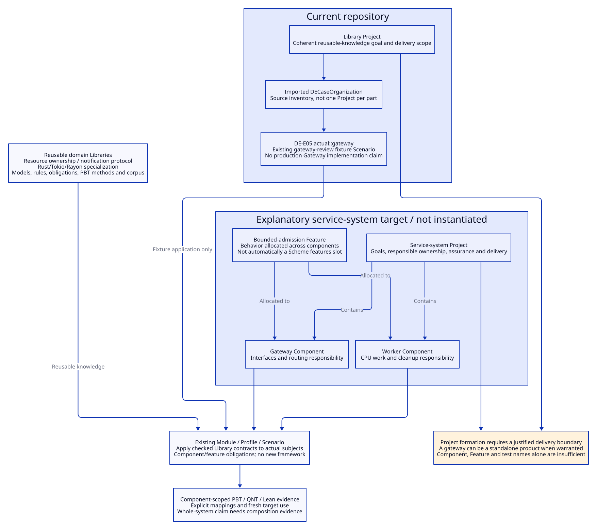

# SPDX-FileCopyrightText: 2026 tao3k team and Contributors
#
# SPDX-License-Identifier: LGPL-2.1-only

#+TITLE: 10.119 Project, Component, Feature and Example Boundaries
#+LANGUAGE: en
#+PROPERTY: JD_ID 10.119
#+OPTIONS: toc:2 num:nil
#+STARTUP: overview
#+FILETAGS: :design:organization:project:component:feature:sysml:
#+PROPERTY: header-args :eval never :tangle no :exports code

[[file:../../00-09-project/00-documentation/00.01-index.org][Index]] | [[file:10.118-domain-property-testing-and-evidence-trajectories.org][PBT Library design]] | [[file:10.78-agent-sysml-project-formation.org][SysML formation]] | [[file:10.17-domain-libraries-and-atomic-specialization.org][Domain Library hierarchy]]

* Decision: engineering scope determines Project granularity
:PROPERTIES:
:CUSTOM_ID: organization119-scope
:STATUS: design-clarification-no-runtime-migration
:END:

A Project identifies a coherent engineering goal, responsible ownership, delivery
and assurance scope. A gateway is normally a Component inside an engineered system;
rate limiting, retry or authentication are Features allocated to one or more
components. Neither a component name nor a directory justifies a new Project.
A gateway can be a standalone product Project only when its own goals, lifecycle,
responsibility and delivery boundary actually warrant it. Process count and
programming-language choice do not determine that boundary.

This repository's Project is the reusable engineering Library effort. Its gateway
walkthrough demonstrates applying domain knowledge. The walkthrough is not the
organizational parent of Rust concurrency, backpressure, broadcast or PBT.

#+CAPTION: Delivery scope, component structure, behavior and reusable knowledge are different relationships.

[[file:../../90-99-views/90-architecture-views/90.101-project-component-feature-boundaries.d2][Editable D2 source]].

* What the current model actually contains
:PROPERTIES:
:CUSTOM_ID: organization119-current
:END:

[[file:../../../project.sysml][project.sysml]] declares one =libraryProject= and imports the
[[file:10.78-case-organization.sysml][DECaseOrganization companion]]. It does not declare a separate Gateway Project.
The companion's =actual::gateway=, stable identity =DE-E05=, inventories
[[file:../../../scenarios/gateway-review/interface.ss][gateway-review]] as a fixture Scenario. The =actual= package is a source-inspected
inventory, not a hierarchy assigning every item independent delivery ownership.
The generic =part= representation and short name =gateway= made this distinction
hard to see. Its documentation now states the semantic classification explicitly.

Keep DE-E05 and its existing references stable. Clarify its fixture/application
meaning rather than rename it into a fictional implemented gateway component.
No production gateway implementation, independent lifecycle or new acceptance is
claimed. The generated root model is not hand-edited; changing a generated
structural relationship later must change its owning selection/projection and
qualify regeneration through the existing workflow.

* Classification and allocation rules
:PROPERTIES:
:CUSTOM_ID: organization119-classification
:END:

#+NAME: organization119-kinds
| Concept | Engineering meaning | Relation / concrete example |
|---------+---------------------+-----------------------------|
| Project | Goal, responsibility, assurance and delivery boundary | A service-system Project owns component requirements; this repository's Library Project owns reusable design knowledge |
| Component | Structural/runtime responsibility with provided/required interfaces | Gateway, worker pool or storage adapter within that service system |
| Feature | Required behavior, potentially crossing components | Retry, tenant isolation or bounded admission allocated to gateway and workers |
| Domain Library | Reusable models, rules, obligations, methods and reviewed counterexamples | Concurrency/resource ownership or communication/notification |
| Library specialization | Domain interpretation under explicit technology premises | Rust/Tokio/Rayon resource lifecycle; Tokio broadcast close/wake |
| POO Module | Existing publication/composition mechanism | Publishes selected domain declarations and Contracts; not equivalent to an engineering Component |
| Profile | Checked selection of parameters and applicability | Capacity, features, workloads and method policy for one use |
| Scenario | Existing acquisition/application boundary for a concrete use | Native resource lifecycle capture or gateway fixture walkthrough |
| Test/campaign | A selected method application against a subject/capture | PBT for a gateway component's backpressure obligation; not a new Project |

A business Feature is not automatically the existing Library's =features= field;
its concrete representation needs the selected model/Contract. Do not invent a
new Scheme Feature class or a second framework hierarchy from this vocabulary.
SysML part usages represent structural roles; Org names their engineering meaning.

#+NAME: organization119-rules
| Rule | Required condition | Consequence |
|------+--------------------+-------------|
| OR01 Project formation | Independently justified goal, responsible ownership and delivery/assurance scope | Project candidate; a component label alone is insufficient |
| OR02 component allocation | Structural responsibility and interfaces within an existing Project | Allocate component duties without duplicating the parent Project |
| OR03 feature allocation | Behavior and affected components/interfaces identified | Trace feature requirements to each relevant component obligation |
| OR04 knowledge use | Selected domain Contract with checked premises and explicit implementation mapping | Apply Library knowledge to a component/feature through Profile/Scenario |
| OR05 example classification | Fixture/walkthrough has no independent delivery boundary or production implementation | Retain as example Scenario, never manufacture implemented component evidence |
| OR06 evidence locality | Actual subject, capture, method and applicability match | Component-scoped evidence can support that component duty, not automatically whole-system readiness |

* Gateway example without a new framework
:PROPERTIES:
:CUSTOM_ID: organization119-gateway
:END:

A prospective service-system Project may contain a gateway and a compute worker
component. A bounded-admission Feature crosses both. The backpressure Library
contributes reservation conservation; its Rust specialization supplies actual
permit/payload ownership. A selected Profile fixes capacities and workload; a
Scenario acquires that component implementation, lockfile and environment. PBT,
QNT correspondence, Lean accounting and independent measurements discharge only
the explicitly selected obligations.

The current gateway fixture illustrates this application path using declared
premises. The native resource-lifecycle Scenario exercises a mechanism separately.
They do not become separate product Projects, and their observations cannot be
joined merely because both mention cancellation or throughput. Cross-component
system claims additionally require composition, interface and total-budget evidence.

Broadcast likewise belongs to a communication domain Library and can serve an
indexer, background worker or gateway component. A gateway example must not own
its generic close/wake definitions. Discovering the Library can precede selecting
any application component.

For an LLM-based AI agent, first identify the actual engineering subject and
scope, then discover the appropriate Library and compose its obligations. Do not
start by creating GatewayProject, BroadcastProject or one Project per PBT property.
The graph permits multiple design alternatives while keeping ownership and evidence
scope explicit.

* Scope of this correction and acceptance boundary
:PROPERTIES:
:CUSTOM_ID: organization119-change
:END:

This change clarifies Org, companion SysML documentation and paired D2 views.
It changes no Scheme declarations, package dependencies, runtime owners, generated
root model, tests or existing evidence receipts. The proposed service-system
composition is an explanatory target, not a newly created Project instance.
Future structural migration must use the existing Project formation pipeline and
preserve stable source identities, dependency mappings and actual-versus-target
labels. Formatting or source-byte changes can still require fresh source admission;
this documentation correction itself grants no receipt reuse.
