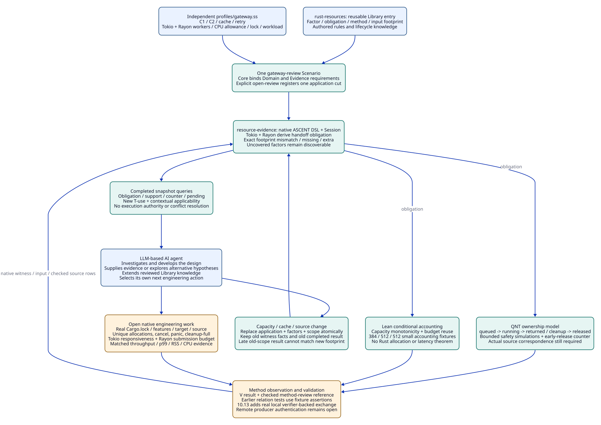

#+TITLE: 10.12 Gateway Library Registration and Runtime Dependencies
#+LANGUAGE: en
#+OPTIONS: toc:2 num:t
#+FILETAGS: :architecture:library:gateway:ascent:rust:
#+STARTUP: overview
#+PROPERTY: header-args :eval never :exports code

[[file:../../00-09-project/00-documentation/00.01-index.org][Index]] | [[file:10.09-rust-backpressure-memory-library-entry.org][Library entry]] | [[file:../../../init.ss][Native selection]]

[[file:10.14-rust-performance-library-and-mechanism-cases.org][10.14]] records the Rust mechanism-domain ownership boundary. Gateway-named
publications below are the current case slice and require a direct ownership
migration; these names do not define the shared Library's scope.

The fixture registration controls and earlier simulation receipts below retain their
original source-cut meaning. [[file:10.13-real-method-results-and-agent-evidence-loop.org][10.13]] adds the current five-job C1/C2 TLC model,
real Lean invocations and verifier-backed native evidence registration. Its real
method path does not use the fixture V/A assertions described here.

Current shared source owners are rust-resources and resource-evidence. The direct
migration and minimal native mechanism path are maintained in
[[file:10.15-scheme-owned-rust-mechanisms-and-development-evidence.org][10.15]]. Earlier publication shapes and qualified receipts below retain their
historical scope; updated file links point to current source owners.

* Current organization and the duplication correction
:PROPERTIES:
:CUSTOM_ID: gateway-library-organization
:STATUS: executable-finite-library-slice
:END:

This project maintains reusable engineering knowledge: candidate designs, factor
semantics, finite obligation rules and method applicability. A gateway is one
application of that knowledge. An LLM-based AI agent selects and develops a design, supplies
new observations, queries obligations and investigates counters. These rules do
not prescribe an Agent's sequence of implementation steps.

Agent follows the [[file:10.05-agent-reasoning-and-design-convergence.org::#llm-agent-terminology][LLM-based AI agent terminology contract]] throughout this case.
The gateway's Tokio tasks, Rayon jobs and QNT actors are concurrent-system
participants with their own specified behavior.

The former gateway-review and gateway-resource-check publications duplicated the
same requirements, Profile selection and inert plan structure. Neither executed
domain inference. The former gateway-evidence constructor declared relations but
no rules. Import success therefore did not demonstrate a Library application.
The duplicate resource Scenario is removed. The two existing Module identities
are retained with distinct responsibilities; no generic replacement framework
or external case-study implementation is introduced.

#+NAME: executable-owner-map
| Owner | Actual responsibility | Deliberate boundary |
|-------+-----------------------+---------------------|
| [[file:../../../library/concurrency/resource-control/backpressure-memory/rust/objects.ss][gateway-domain objects]] | One BackpressureMemory Library value: lifecycle, factor-to-obligation rules and required input keys | Owns reusable knowledge, no project Profile directory or accepted results |
| [[file:../../../library/concurrency/resource-control/backpressure-memory/rust/types.ss][gateway-domain types]] | Validate positive capacities, accounting terms and explicit runtime/workload bindings | Does not certify real sizes, pool configuration or performance |
| [[file:../../../profiles/gateway.ss][Independent gateway Profiles]] | C1, inherited C2, cache and retry bindings; explicit Tokio/Rayon worker counts, CPU allowance and lock reference | Ordinary independently importable POO values; Module scope does not own them |
| [[file:../../../modules/resource-evidence/func.ss][gateway-evidence]] | Native define-evidence relations, joins, negation and finite closure checks | Registers observations and derives scoped relations, not execution authority |
| [[file:../../../scenarios/gateway-review/interface.ss][One gateway-review Scenario]] | Bind the selected Domain and Evidence scopes to the gateway application | Uses Core's requirement bindings, rather than importing a copied private model |
| [[file:../../../scenarios/gateway-review/func.ss][Scenario operations]] | Validate a supplied Profile; atomically register its initial cut in an actual ASCENT session | No new registry, evaluator, scheduler, lockfile resolver or method runner |
| [[file:../../../init.ss][init.ss]] | Explicitly select two Modules and this one Scenario in Core's graph | Does not register evidence or start work merely by being imported |
| [[file:../../../t/gateway-library-test.ss][t/gateway-library-test.ss]] | Execute registration, query and change paths against independent literal gold | Fixture validation assertions are not real external checker receipts |

Current Core source admission requires types, objects, config and interface roles.
Those small role files are kept because the linked Core enforces this contract.
Config references maintained POO values; it does not duplicate their contents.
The optional func role holds actual operations. Role count is not the number of
engineering concepts. The direct source [[file:../../../.gerbil/pkg/github.com/tao3k/poo-flow-core/module-system/source/admission.ss][admission owner]] and
[[file:../../../.gerbil/pkg/github.com/tao3k/poo-flow-core/module-system/design/164-funflow-public-configuration/13-independent-profiles-and-scenario-composition.org][independent Profile/Scenario design]] explain these boundaries.

* Dependency semantics before engineering claims
:PROPERTIES:
:CUSTOM_ID: gateway-runtime-dependencies
:END:

The local [[file:../../../.data/specula-case-studies/catalog/systems.json][reference catalog]] records Tokio broadcast/watch and Crossbeam cases;
the available [[file:../../../.data/specula-case-studies/systems/concurrentqueue/overview.md][ConcurrentQueue case]] concerns a C++ lock-free MPMC implementation.
Those entries supply questions to investigate. They do not establish this
project's Tokio/Rayon handoff, scheduler fairness, memory accounting or Rust
source correspondence. No rules, module layout or accepted results are imported
from those cases. This repository authors the Library entry and its gold.

A Rust dependency binding must include actual resolved versions, enabled features,
target/platform, runtime and pool configuration, and relevant source/API semantics.
The current Profile lock/runtime references are explicitly fixture values: they
are not a Cargo.lock discovered from an implemented Rust gateway. Package names
alone cannot select an accepted design or an applicable witness.

According to the [[https://docs.rs/tokio/latest/tokio/task/fn.spawn_blocking.html][Tokio spawn_blocking API]], CPU work needs explicit concurrency
control, and an already running blocking task cannot be stopped through abort.
The [[https://docs.rs/rayon/latest/rayon/struct.ThreadPoolBuilder.html][Rayon pool builder]] configures worker count. A worker count does not by
itself define this application's retained-job allowance. These observations
motivate the following project obligations; they are not performance results.

#+NAME: runtime-design-consequences
| Input or design choice | Engineering question and owner | Obligation / method |
|------------------------+--------------------------------+---------------------|
| Tokio I/O and async ingress | Who admits retained bodies before a wait? How much CPU can each poll consume? | BP-O01 inventory and TR-O01 native responsiveness/load checks |
| Rayon CPU dispatch | Which pool, worker count and total CPU allowance apply? How many jobs may be submitted and retain payloads? | TR-O02 source/configuration review; bounded submission model |
| Both runtimes in one request path | How does ownership move from ingress through queued/running CPU work to returned result and cleanup? | Derived async-cpu-handoff factor; TR-O03 QNT handoff/cancellation model |
| CPU job outlives its awaiting future | Which owner retains payload and permit after receiver drop? Who drains results, panic paths and full cleanup? | BP-O02 / TR-O03; pending actual source correspondence BP-O04 |
| Capacity or worker configuration changes | Does model/accounting/load scope still match? Does Tokio+Rayon+blocking-pool parallelism exceed the budget? | Re-query dependencies; no automatic throughput improvement |
| Cache enabled | What bounds retained values/indices and miss amplification? | CA-O01 native workload evidence and refreshed arithmetic/model scope |
| Retry enabled | Does each attempt retain a second payload/permit? What bounds attempts and cleanup under stall? | BP-O05 QNT lifecycle obligation; actual implementation checks remain open |
| Different language/runtime | Which ownership, scheduling, cancellation and memory semantics actually correspond? | New explicit factor mapping and method obligations; no Rust witness inherited from a name match |

The Agent can propose a direct Rayon handoff, a bounded spawn_blocking route or
another design. It must disclose the chosen execution and ownership semantics.
The Library discovers resulting obligations; it does not force one API pattern.
A factor with no maintained rule remains visible as uncovered_factor for further
investigation instead of disappearing from the review.

* Registration, relations and evidence references
:PROPERTIES:
:CUSTOM_ID: gateway-native-registration
:END:

#+NAME: gateway-native-sources
| Native source relation | Tuple meaning and input owner |
|------------------------+-------------------------------|
| application | (usage, frozen snapshot reference, Library key); application owner |
| catalog_rule | (Library key, factor, obligation, method); reviewed Library contribution |
| catalog_dependency | (obligation, required input key); Library applicability contract |
| factor | (usage, selected factor); applying Profile, plus derived handoff factor |
| scope | (usage, input key, fingerprint); frozen application input |
| witness | (witness ID, obligation, method, validation reference, outcome); method producer |
| witness_input | (witness ID, input key, checked fingerprint); exact evidence footprint |
| checked | (witness ID, validation reference, method-review reference); trusted validation observer |

A checked tuple is an assertion supplied by an authorized method observer. The
rule engine cannot authenticate a log merely because someone writes pass. The
current tests deliberately use V/*-fixture and A/* references; they exercise
applicability and method-validation binding without pretending to have verified
external output. Production ingestion must bind actual producer/tool identity,
exit/completion, source/artifact hashes, property, assumptions and independent
oracle. No bridge claiming to do that is implemented here.

The native [[file:../../../.gerbil/pkg/github.com/tao3k/gerbil-ascent/evidence/interface.ss][Evidence DSL]] owns rule lowering. The native
[[file:../../../.gerbil/pkg/github.com/tao3k/gerbil-ascent/program/session.ss][ASCENT session]] owns accepted source replacements and completed results.
There is no second Scheme fact store or hand-written evaluator.

#+NAME: gateway-rule-semantics
| Derived relation | Finite rule meaning |
|------------------+---------------------|
| obligation | Join selected application, factor and Catalog rule; Tokio plus Rayon derives handoff first |
| requires | Join each obligation with all declared required input keys |
| mismatch / missing_input / extra_input | Compare a method-compatible witness's exact footprint with the current cut; missing scope is also pending |
| applicable | No required input mismatch, missing input or undeclared witness guard for this candidate |
| support / counter | Applicable pass/fail witness joined to its exact checked validation reference; both may coexist |
| pending | No validated applicable support for the obligation; counter is preserved independently |
| t_use | New (usage, snapshot, obligation, witness) reference for this application; an old witness is not an old usage |
| uncovered_factor | A selected factor has no maintained Catalog interpretation |

T is the t_use tuple. V is the witness validation reference bound by checked.
A is the derived applicable tuple for a use, with the method-review reference
retained in support/counter. These local relational references illustrate the
10.07 distinction. They are not the complete cryptographic identity or artifact
closure protocol specified by 20.04-20.18. In particular, a support row is not
an authorization, conflict resolution or a completed SDLC decision.

The scope strings in this executable slice serialize explicit fixture parameters.
They are inspectable keys, not cryptographic hashes or full production claim IDs.
Changed closure inputs invalidate applicability; stored witness observations are
retained. Native method/source admission and artifact identity remain mandatory
before a real deployment can use them.

#+NAME: direct-native-query-example
#+begin_src scheme
(import :deterministic-engineering/init
        :deterministic-engineering/profiles/gateway
        :clan/poo/object
        :gerbil-ascent/evidence/interface)
(def gateway (.get init.Scenarios gateway-review scope))
(def review ((.ref gateway 'open-review)
             LocalProfile 'use-1 "snapshot-1" "source-content-reference"))
(def result (gerbil-ascent-session-run review))
((.ref result 'rows-of) 'obligation)
;; Actual method observations are registered through the native source API:
;; gerbil-ascent-session-replace-sources! / gerbil-ascent-session-append-source!
;; Then run again and query support, counter, pending and t_use.
#+end_src

The native session owns source row spines; nested strings must remain immutable.
A cut here is an explicit single-owner, sequential input replacement. It is not
an atomic capture of a changing filesystem, a concurrent exchange protocol or a
complete canonical claim identity. The finite fixture assumes a single consistent
accounting unit and allocation basis. Production unit/type normalization, input
hashes, duplicate/conflicting identities and method-observer authority are still
required. These assumptions constrain interpretation, not the Agent's next action.

* Gateway inputs and stepwise gold
:PROPERTIES:
:CUSTOM_ID: gateway-query-gold
:END:

C1 uses capacity=2, queue=2, item=64, fixed=128, cache=0 and budget=512 in
abstract accounting units. Tokio/Rayon workers are 2/2 and the declared CPU
allowance is 4. These are small fixtures, not recommended production values.
C2 extends capacity to 4. CacheProfile extends retained cache to 128; RetryProfile
adds retry semantics. Inheritance leaves the C1 prototype unchanged.

#+NAME: gateway-query-steps
| Step and concrete input | Independent expected gold | Reference/retention consequence |
|-------------------------+---------------------------+--------------------------------|
| G01 open C1 with u1 / snap/C1 / rust/source-v1 | Exactly BP-O01/review, BP-O02/quint, BP-O03/lean, BP-O04/review, BP-O07/native, TR-O01/native, TR-O02/review, TR-O03/quint; eight pending | Library rules and selected factors actually join; no witness created |
| G02 register wsum / BP-O03 / lean / V/lean-fixture / pass, arithmetic=(sum-v1 2 2 64 128 0 512), no checked row | No support | Raw producer pass does not satisfy method validation |
| G03 register checked(wsum,V/lean-fixture,A/method-fixture) | Exactly support(u1,BP-O03,wsum,V/lean-fixture,A/method-fixture); seven pending | T-use=(u1,snap/C1,BP-O03,wsum); separate A applicability |
| G04 replace application/factor/scope atomically with C2 / u2 / snap/C2 | Old arithmetic key mismatches (sum-v1 4 2 64 128 0 512); old wsum supports no current obligation | Old observation retained; the earlier completed C1 result still answers C1 |
| G05 append late old-C1 witness/input/checked after G04 | Still no C2 support from old arithmetic; two historical observations remain | Arrival time does not rewrite witness footprint or frozen application |
| G06 enable cache | Nine obligations, including CA-O01/native; old arithmetic differs from (sum-v1 2 2 64 128 128 512) | Native cache obligation remains pending; no inferred native measurement |
| G07 change only Rust source reference | Same conditional arithmetic/model observations can support new uses; old BP-O04 source correspondence mismatches | New T-use for each retained witness; source mapping and native claims reopen |
| G08 enable retry and add unmodeled-plugin | BP-O05/quint appears; uncovered_factor reports plugin | Agent can investigate and extend the Library without a fabricated verdict |
| G09 missing required witness input, extra guard, wrong method, or non-string source fingerprint | No support; missing/extra relations identify reasons; malformed typed replacement is rejected | Rejected native replacement preserves the last accepted sources |
| G10 add checked matching counter beside support | Both supporting and opposing references remain queryable | No all-clear or authorization is derived from pending count |

#+NAME: small-accounting-gold
| Profile | Queue | Active | Item | Fixed | Cache | Retained | Budget |
|---------+-------+--------+------+-------+-------+----------+--------|
| C1 | 2 | 2 | 64 | 128 | 0 | 384 | 512 |
| C2 | 2 | 4 | 64 | 128 | 0 | 512 | 512 |
| Cache | 2 | 2 | 64 | 128 | 128 | 512 | 512 |
#+TBLFM: $7=($2+$3)*$4+$5+$6

The literal expected obligations and arithmetic strings in
[[file:../../../t/gateway-library-test.ss][the Scheme test]] are authored independently of the rule evaluator. The test
does not compute expected outputs by invoking the same Catalog lowering.
The initial eight obligations are a deliberately finite slice of 10.09, not
coverage of all 24 benchmark variants or the twelve historical closure gaps.

* QNT, Lean, D2 and ASCENT together
:PROPERTIES:
:CUSTOM_ID: gateway-method-chain
:END:

#+NAME: gateway-method-artifacts
| Asset | Checked content | Evidence boundary |
|-------+-----------------+-------------------|
| [[file:../../../library/concurrency/resource-control/backpressure-memory/model.qnt][BackpressureOwners.qnt]] | Three jobs, admission bound 2, queued/running/returned/cleanup owner partition; cancellation retains reservation until actual cleanup | Finite abstraction; no Rust scheduler, byte sizes, fairness or eventual drain theorem |
| QNT positive run | 100 seeded simulations, at most 20 steps, safe ownership invariant; cleanup/returned/all-done witnessed 85/86/67 times | Simulation coverage, not exhaustive model checking |
| QNT earlyRelease negative control | Start with job0 running and reserved; cancellation moves it to cleanup but removes reservation; safe is violated in one step | Expected counterexample, retained as exit1 rather than relabeled as a successful positive check |
| [[file:../../../library/concurrency/resource-control/backpressure-memory/budget.lean][BackpressureBudget.lean]] | Nat capacity monotonicity, downward budget reuse and 384/512/512 accounting examples; capacity+cache over-budget negative proposition | Conditional arithmetic; real allocation partition, coefficients and source mapping are premises |
| [[file:../../90-99-views/90-architecture-views/90.57-gateway-library-runtime-chain.d2][D2 workflow]] | Human review of ownership, handoff, method/result registration and change dependencies | Communication artifact, not proof execution |
| [[file:../../../modules/resource-evidence/func.ss][ASCENT rules]] | Derive contextual obligations, compare registered evidence footprints and preserve support/counters | Inference from supplied facts; does not execute QNT/Lean or authenticate their outputs |

The full chain is: Library hypothesis -> selected dependency/configuration factors
-> QNT ownership/property inputs and Lean accounting premises -> independent
method execution -> producer/result validation -> explicit native source
registration -> contextual applicability query -> Agent interpretation and
review. A QNT counterexample can revise the hypothesis or create a counter;
a Lean lemma can survive a source edit while its source-correspondence obligation
reopens. ASCENT does not replace either checker and does not infer Rust truth
from their tool names.

Existing lean-poo provides reusable formal POO/assembly foundations. This small
arithmetic lemma does not claim to verify POO resolution, Scenario composition
or the Rust implementation through lean-poo. Those correspondences need their
actual propositions and checked application premises. Likewise Core's native
Module graph supplies configuration/selection ownership, not resource proofs.

* Remaining review obligations and reproducibility
:PROPERTIES:
:CUSTOM_ID: gateway-library-qualification
:END:

- [X] Replace duplicated Scenario publications with one actual Library application.
- [X] Keep independently importable Profiles and native Core requirement bindings.
- [X] Execute native registration/query, method-validation binding and three change paths.
- [X] Keep old observations while rejecting stale applicability and late-old-scope reuse.
- [X] Run a bounded QNT safety control and its explicit early-release counterexample.
- [X] Check the conditional Lean arithmetic without sorry or additional axioms.
- [ ] Capture a real Rust Cargo.lock, features, API/source digests and CPU/runtime topology.
- [ ] Establish full holder/unique-allocation inventory, byte residency and source/model correspondence.
- [ ] Authenticate actual external method results and full claim/witness/T/V/A/cut identities.
- [ ] Resolve conflicting observations and snapshot identities before real evidence ingestion.
- [ ] Establish native cancellation, panic, result-drop, stalled-consumer and cleanup-full behavior.
- [ ] Measure fairness, tail latency, throughput, RSS and CPU under matched workload and overload.
- [ ] Qualify complete 24-variant/12-gap policy closure and lambda-aitia execution authority.

No production source or result authenticity follows from typed relation admission.
The public native source APIs are trusted inputs. Contradictory application or
witness identities need explicit rejection before real ingress; this slice must
not be treated as a production registration service. A capacity bound alone does
not bound bytes, executor work queues or abandoned futures. Liveness requires
stated downstream and scheduler assumptions. The Agent retains freedom to explore
solutions and must disclose missing premises rather than accumulate redundant
checks with no affected claim.

#+begin_src sh
gerbil build
gerbil pkg env gxtest t/
# For bounded review, select one native suite; repeat for each exported suite.
gerbil pkg env gxtest -v 5 -r gateway-capacity-test t/gateway-library-test.ss
quint typecheck library/concurrency/resource-control/backpressure-memory/model.qnt
quint run library/concurrency/resource-control/backpressure-memory/model.qnt --backend typescript --invariant safe --max-samples 100 --max-steps 20 --seed 42
# Expected exit1: retain the trace as a negative control.
quint run library/concurrency/resource-control/backpressure-memory/model.qnt --backend typescript --init initRunning --step earlyRelease --invariant safe --max-samples 1 --max-steps 1 --seed 42
lean library/concurrency/resource-control/backpressure-memory/budget.lean
#+end_src

The [[file:../../../.data/package-integration-20261019/receipts/library-qualified-summary.json][local qualification receipt]] binds command outcomes and source hashes.
Acceptance checks HARNESS-OK with no ERROR/FAIL, not process exit alone: this
host returned exit0 for an earlier native test harness error. Earlier parse,
exception-predicate and prototype-pointer fixture failures are retained. Profile
comparison now checks semantic fields across native source contexts rather than
requiring pointer equality. The bounded split-suite checks retain the same literal
gold and do not turn the earlier combined-command timeout into a pass.
The later complete-directory command also reached its 120-second bound and is
recorded as incomplete. All ten native suites have separate successful bounded
receipts; the aggregate command is not reported as successful. Historical
build/ABI checks in [[file:../../00-09-project/00-documentation/00.03-scheme-package-bootstrap.org][00.03]] remain historical; this document qualifies actual
inference for the finite gateway Library slice, not a Rust implementation.

#+CAPTION: Reusable Library knowledge, independent Profiles and one gateway Scenario drive scoped ASCENT inference and external verification methods.

