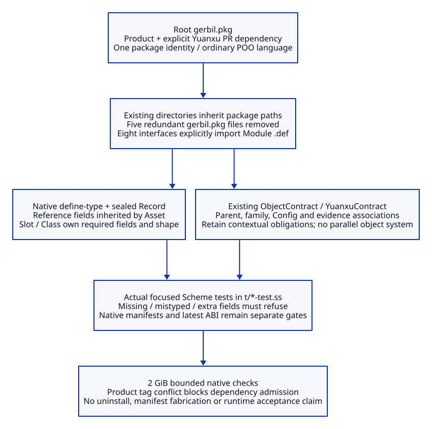

#+TITLE: 10.120 Yuanxu Package and Native Record Ownership
#+STARTUP: overview
#+OPTIONS: toc:2 num:nil

* Scope and source authority
:PROPERTIES:
:CUSTOM_ID: yuanxu120-scope
:END:

This is a bounded cleanup of existing package and type ownership, not a PBT
implementation. [[file:10.118-domain-property-testing-and-evidence-trajectories.org][10.118]] remains a design proposal. The root
[[file:../../../gerbil.pkg][gerbil.pkg]] owns consumer dependencies and the default language.
The selected Yuanxu integration source is [[https://github.com/tao3k/gebril-yuanxu/pull/19][Yuanxu PR #19]]; the executable
dependency revision belongs in package metadata rather than duplicated source
link macros. Yuanxu's own metadata selects its compatible gerbil-poo dependency.

The inspected API spells the type declaration =define-type=, not =def-type=.
=Record= is a gerbil-poo Class descriptor constructor. Yuanxu uses those native
objects and adds contextual classification, obligations and evidence; it does
not require consumers to implement another object system.

#+CAPTION: One package owns identity; Module declaration imports and native types retain separate responsibilities.

[[file:../../90-99-views/90-architecture-views/90.109-yuanxu-package-and-record-ownership.d2][Editable D2 source]].

* One consumer package, explicit Module declarations
:PROPERTIES:
:CUSTOM_ID: yuanxu120-package
:END:

#+NAME: yuanxu120-package-ownership
| Location | Change | Retained obligation |
|----------+--------+---------------------|
| Root gerbil.pkg | Direct Yuanxu PR pin alongside the existing product dependency; optional public Yuanxu prelude selected once | Native dependency/tag/manifest agreement, real compilation and installed ABI admission remain required |
| modules, library, profiles, scenarios | Remove four nested metadata files | Namespace still follows root package plus relative source path; these are not independent packages |
| scenarios/resource-lifecycle/review | Remove its redundant namespace-only metadata | Review code stays in its existing owner and source path |
| Eight Module interface.ss sources | Explicitly import .def from :yuanxu/module-system/source/declaration | Existing source reader permits external imports plus one Module declaration; no new parser or compatibility macro |
| Ordinary objects and Profiles | Use the root language and their actual imports | POO .def object composition stays distinct from the Module declaration macro |

The first attempted per-source prelude header was rejected by the existing
Module publication reader. Explicit external imports use its supported input
grammar. Removing directory metadata must preserve compiler identities, selection,
scope association and lazy demand; file deletion alone does not prove those facts.
Research checkouts, installed dependencies and frozen .data snapshots retain
their own metadata. They are not redundant subpackages of this repository.

* Native shape versus contextual obligations
:PROPERTIES:
:CUSTOM_ID: yuanxu120-records
:END:

#+NAME: yuanxu120-type-ownership
| Definition in shared types.ss | Native owner | Why the separation matters |
|-------------------------------+--------------+----------------------------|
| LibraryNonemptyString | define-type over Type. | One native membership predicate; no domain classification wrapper for a plain scalar |
| LibraryReferenceContract | Sealed Record of identity/revision/owner | Required fields and field types belong to Slot/Class validation |
| LibraryAssetContract | Record inheriting LibraryReferenceContract, adding kind/path | Reuse common field declarations through native prototype composition |
| LibraryPremiseContract / LibraryClaimContract | Sealed Records | Shape and enum/list validation no longer need separate responsibilities descriptors |
| Library declarations/models/method bindings | Existing ObjectContract/refine and YuanxuContract | Family, parent, expected descriptor, Config identity and cross-field associations remain contextual obligations |

=Record= defaults to an open class. These four shared types explicitly set
=sealed: #t= to preserve rejection of undeclared fields. Replacing a closed
ObjectContract with an unsealed Record would weaken this boundary. Public
definition names remain; descriptor class identity changes, so compiled artifacts
and source-dependent validation receipts require rebuilding/reassessment. Equal
field values do not prove compatibility with a held old descriptor.

Existing =refine= requires an ObjectContract descriptor. A blanket conversion
of every Scope/Model to Record would break that actual API and can lose semantic
association checks. This slice removes redundant plain-data wrappers, not the
domain obligations those other descriptors own. The stale shared import of
=:yuanxu/types= is replaced with the actual =:yuanxu/object-types/contracts= owner.

* Bounded validation and remaining admission gates
:PROPERTIES:
:CUSTOM_ID: yuanxu120-validation
:END:

#+NAME: yuanxu120-checks
| Check | Result boundary |
|-------+-----------------|
| t/library-record-types-test.ss | Two actual cases passed with MODULE-OK/HARNESS-OK/final OK. Actual Scheme tests of required fields, scalar/list/enum rejection, inherited Record fields and undeclared evidence-field rejection; source tests do not certify the new dependency's whole runtime |
| t/library-owner-test.ss | All four existing cases passed with MODULE-OK/HARNESS-OK/final OK, including parent obligations, unsupported scopes and native Scenario boundary refusal |
| t/library-selection-test.ss | Two existing cases passed: unrelated invalid owners stay cold and selected Rust Scope retains its required associations |
| t/dependency-compatibility-test.ss | Existing native ASCENT/POO ABI case passed for worker counts one and two, with independent finite literal results and invalid-input rejection; installed ABI evidence is not latest-revision admission |
| t/package-metadata-test.ss | Actually run and refused the declared product pin versus registered source mismatch; not a passed suite. Retains actual direct-pin, native manifest, compiled artifact and import checks; now checks direct product/Yuanxu ownership and absence of five nested overrides instead of imposing the product's obsolete Core gitlink ownership |
| Native package update | Requested Yuanxu source revision was fetched and checked out, but the installed update tool then reported bad package; missing gerbil.pkg for its tagged package argument. Source checkout alone is not native installation success |
| Native deps --install | Refused the existing product tag conflict: requested 4a1f70dd31b690084232eb29942e9bc5eb1943ad versus registered bc08d5877bc002bc5aa9da38f1357bdde30485bc |
| Consumer build | After freezing the changed sources, native gerbil build completed with exit zero. The earlier in-flight source edit was correctly refused as stale prepared build source; the successful build does not resolve the installed dependency/tag mismatch |
| Resource policy | Real Scheme processes keep max-heap=2G; build/package attempts keep the 180-second boundary and focused tests the existing 120-second boundary |

Do not uninstall a package, remove the product dependency, edit manifests by
hand or claim latest-source admission from installed older compiled objects.
The native dependency conflict and full build result must be reported separately
from passing focused Record tests. Scope selection/currentness, actual ASCENT
registration and the complete existing regression set remain independent gates.
