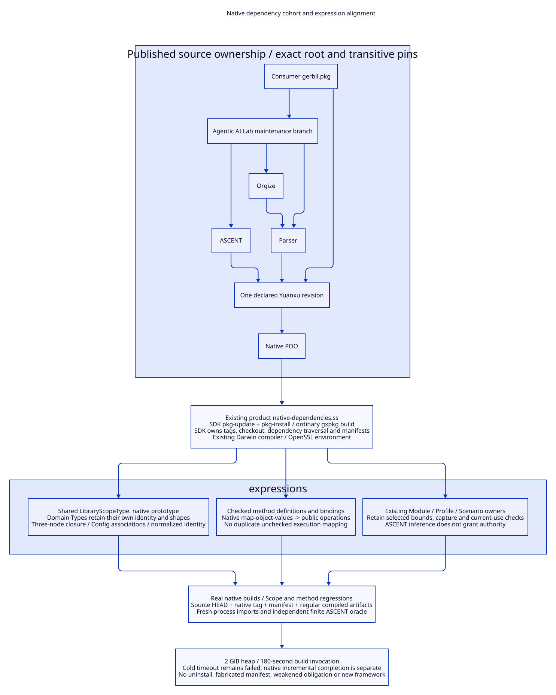

# SPDX-FileCopyrightText: 2026 tao3k team and Contributors
#
# SPDX-License-Identifier: LGPL-2.1-only

#+TITLE: 10.121 Native Dependency Cohort and Expression Alignment
#+STARTUP: overview
#+OPTIONS: toc:2 num:nil

* Scope and owning interfaces
:PROPERTIES:
:CUSTOM_ID: alignment121-scope
:END:

This slice completes the package work recorded in [[file:10.120-yuanxu-package-and-record-ownership.org][10.120]] and audits the
expression boundaries of the existing Library. It adds no PBT runtime and no
package manager, object system, registry or evidence issuer. The PBT packets in
[[file:10.118-domain-property-testing-and-evidence-trajectories.org][10.118]] remain proposed inputs and gold.

The executable root dependency selection is [[file:../../../gerbil.pkg][gerbil.pkg]]. Each dependency
owns its own transitive declarations. The current product maintenance branch is
=research/ascent-poo-flow=, not the older main branch with a different package
identity. Its selected published revision aligns Parser, Orgize and ASCENT with
the same Yuanxu revision. Yuanxu selects the native POO dependency. Product's
clean Core submodule is checked out at that same declared gitlink; the previous
local pointer was recorded before updating it.

#+CAPTION: Native package ownership and native POO expression ownership form one checked consumer closure.

[[file:../../90-99-views/90-architecture-views/90.110-native-cohort-and-expression-alignment.d2][Editable D2 source]].

* Tagged update failure and native recovery
:PROPERTIES:
:CUSTOM_ID: alignment121-native-update
:END:

The installed SDK's =update-pkgs= first calls =pkg-update= with the tagged
dependency. That operation correctly checks out the revision and writes the
native tag. The CLI then passes the unchanged =package@revision= string to
=pkg-install-deps= and =pkg-build=, whose directory lookup expects the untagged
package name. The reported missing =gerbil.pkg= is a wrong directory lookup,
not a missing source file in Yuanxu.

The selected product already supplies
=packages/automation/native-dependencies.ss=. It uses the SDK's public
=pkg-update= followed by =pkg-install= in one =with-pkg-build-env=. The latter
normalizes the package/tag pair before dependency traversal. Native Gerbil still
owns installation, recursion, tags, builds and manifest generation. This
repository calls that maintained entry rather than copying its implementation.

#+NAME: alignment121-native-entrypoints
| Existing owner / entry | Responsibility | Admission boundary |
|------------------------+----------------+--------------------|
| Root gerbil.pkg | Select compatible published product and Yuanxu revisions | Source HEAD, native tag and every declared transitive pin must agree |
| just deps | Initial native acquisition | Same 2 GiB heap and 180-second external deadline; native conflicts still refuse |
| just deps-update | Invoke the product-owned native-dependencies.ss after installation | No SDK patch, local updater, handwritten tag or manifest |
| just build-dependency PACKAGE | Ordinary untagged gxpkg build with the existing Darwin/OpenSSL compiler environment | One package invocation, unchanged 2 GiB / 180-second envelope |
| just build | Compile the consumer and generate its native manifest | Dependency builds and consumer admission remain separate evidence |

For an existing registry, each reviewed cohort member is intentionally moved
with the public =pkg-update= API before native installation checks. The product
adapter installs/builds that selected cohort; it is not a new transitive version
solver. Inconsistent declarations remain errors and require an owner-reviewed
cohort change.

Directly selecting a newer Yuanxu while leaving ASCENT pinned to an older
Yuanxu would preserve an inconsistent graph even if one tag file changed.
Updating the product's published dependency cohort removes that inconsistency
at its actual owner. All selected sources and metadata are real upstream Git
objects. No package is uninstalled and no manifest is manufactured.

* Expression audit beyond field types
:PROPERTIES:
:CUSTOM_ID: alignment121-expression-audit
:END:

#+NAME: alignment121-layer-audit
| Layer | Existing expression and decision | Kept obligation |
|-------+----------------------------------+-----------------|
| Library semantic parents | Keep authored models, rules and domain refinements in their existing owners | Parent obligations and family/descriptor associations are not generated by a new structural helper |
| Module shells | Eight explicit native declaration imports and one root package remain sufficient | Required Modules and selected Scope contracts stay explicit; no module per packet |
| Plain fields | Continue native define-type and sealed Record from 10.120 | Required fields, enums, types and extra-field rejection |
| Shared Scope normalization | Replace two copies with LibraryScopeType., a native Type prototype in shared types.ss | A fixed three-node close-validation graph, exact Config associations and idempotent closed-value validation |
| Domain Scope identity | BackpressureScopeType and OrganizationScopeType specialize the prototype with define-type | Distinct named Types, domain shapes and expected model/declaration descriptors |
| Rust operation binding | Derive operations by native map-object-values over checked bindings, then compose with utilities | Operation-name/signature/provider checks and exact identity between each binding and public callable remain |
| Profile | Keep independently importable POO values and prototype overrides | Actual selected bounds, workload and family applicability; no hidden global profile registry |
| Scenario | Keep capture, context validation, selected-entry identity and currentness at the existing action boundary | A convenience closure cannot remove a source/use or permission check |
| Evidence and review | Keep native ASCENT Program/Session and actual validation/admission owners | Support/counter/t_use are not permission; exact inputs and opposing evidence remain required |

Implementation owners are [[file:../../../types.ss][shared Library types]],
[[file:../../../library/concurrency/resource-control/backpressure-memory/abstract/types.ss][backpressure Scope]],
[[file:../../../library/project-organization/types.ss][organization Scope]] and
[[file:../../../library/concurrency/resource-control/backpressure-memory/rust/func.ss][Rust method binding]].
The common Scope algorithm normalizes exactly =entry=, =declaration= and
=config=. It preserves the original checks that raw Config points to the same
authored values, that closed views point to their graph's actual normalized
nodes, and that validating an already closed value returns that value.
The Rust specialization has additional policy/method/parent nodes and keeps
its own larger closure. It is not silently forced into a three-node recipe.

Method definitions and their checked bindings remain the semantic owners.
The operations view is a pure projection of those bindings, so it cannot drift
from a second hand-maintained native/quint/lean/integration mapping. The private utility
object no longer stores a second unchecked copy of those four implementations.
Public operations retain their existing validation checks. The existing wrong-operation and false-strength controls remain.

All changed source bytes and dependency revisions require new build/use
qualification. Shared source structure does not authorize reusing an old
validation receipt. Unchanged authored rules or raw observations retain only
their actually qualified, dependency-disjoint roles.

* Interrupted compiler locks are not live ownership evidence
:PROPERTIES:
:CUSTOM_ID: alignment121-lock-recovery
:END:

The SDK static-object compiler polls for absence of =OUTPUT.o.lock=. A forced
process interruption can leave that empty presence lock behind. Subsequent
calls then sleep even when no compiler child exists. Sampling found the build
parent near 1 GiB RSS, idle in select with no compiler descendants, rather than
an active C compilation exhausting the heap.

Exactly two locks, for =clan__poo__mop.o= and =clan__poo__number.o=, had no open
holders according to a permitted lsof check. Their inode/mtime bindings were
rechecked before quarantining them. Corresponding unconfirmed objects would
also be quarantined; neither object existed in this occurrence. Sources and
manifests were untouched. The unchanged native build then compiled the missing
objects, linked libascent and ascent-develop, and exited normally. Active locks
observed during that recovery were retained.

This is bounded recovery of identified abandoned outputs, not permission to
remove every lock or accept a partial object by timestamp. An unavailable
owner check stays unresolved. A lock's age alone proves neither abandonment
nor successful compilation. The existing SDK owns revalidation/recompilation;
no copied object, handwritten completion receipt or persistent reuse lease was
introduced. The SDK CLI lookup and presence-lock limitations remain upstream;
this consumer uses the maintained native update entry and explicit recovery.

* Registry inventory and the declared project closure
:PROPERTIES:
:CUSTOM_ID: alignment121-metadata-oracle
:END:

The SDK root manifest follows the dependency graph declared by the root and its
package owners. A private registry can also contain an unrelated development
tool. Treating every registry entry as a required production dependency would
contradict the native manifest's meaning and encourage adding unused dependencies
merely to make a test green.

The metadata gate therefore checks both inventories explicitly. Every registered
package still has its own manifest/source identity and declared pin checked;
all versioned declarations now also check the actual native tag. Every root
transitive dependency must be registered and appear exactly once at the correct
version in the root manifest. An unrelated registered tool must not appear in
that project closure. The product's published Core gitlink and actual Core
checkout are also compared with the selected Yuanxu HEAD.

Negative controls mutate the actual native-generated manifest view: removing a
required dependency, duplicating it, adding a conflicting version, or injecting
an unrelated registered tool must refuse. No smaller replacement manifest is
used for the real gate. Compiled artifact, phase-family and fresh import/Type
ABI checks remain; Services is imported from its current =agentic-ai-lab/services=
owner rather than the removed =modules/services/types= source.

* Real verification and limits
:PROPERTIES:
:CUSTOM_ID: alignment121-validation
:END:

#+NAME: alignment121-receipts
| Gate | Observed result |
|------+-----------------|
| POO native build | Completed for the declared revision |
| Yuanxu native build | Initial cold call hit 180 seconds; the unchanged native build completed remaining targets in the following bounded call. The measurement wrapper's optional resource query was denied after the native completion marker; this is not a cold-build pass |
| Parser native build | Initial cold call hit 180 seconds; the following bounded native incremental build completed |
| Orgize native build | Completed within its bounded invocation |
| ASCENT native build | Completed both native link targets after owner-checked orphan-lock recovery; the earlier OpenSSL configuration failure and 180-second interrupted/waiting calls remain separate failures |
| Product native build | First cold call logged 928 compile jobs and reached the deadline; the following unchanged native invocation completed with exit zero and no remaining compile jobs |
| Consumer build | Native consumer build completed with exit zero under the unchanged envelope |
| Final regression matrix | Ten existing/new relevant test files passed all 32 cases after the final native update; each file retains its original 120-second fence and all assertions |
| Package metadata | Passed the actual source/tag/Core-gitlink, native manifest, compiled-artifact/phase-family and fresh Type/import checks; registered=7, declared root closure=6; missing/duplicate/conflicting/unrelated-entry negative controls remain |
| Maintained native update entry | just deps-update completed with exit zero under the unchanged 180-second envelope, using the product-owned adapter and public SDK APIs |
| Shared Scope regression | Both cases passed with MODULE-OK, HARNESS-OK and final OK, including Config alias rejection, closed-value identity and cross-domain refusal |

Cold timeout receipts remain failures of those cold invocations. Native
incremental completion does not establish a single cold dependency closure
under 180 seconds. Every subsequent invocation retains the deadline; completed
targets are reused only under the native build's source/currentness checks.
No target inventory, negative control or acceptance assertion is removed to
turn incomplete work into admission.

Raw logs stay in local execution artifacts. Tracked documents record the
command owner, bounded outcome and limits. Full PBT implementations, generic
historical oracles and receiver-side effect enforcement remain the separate
design/implementation gates stated in 10.118.
