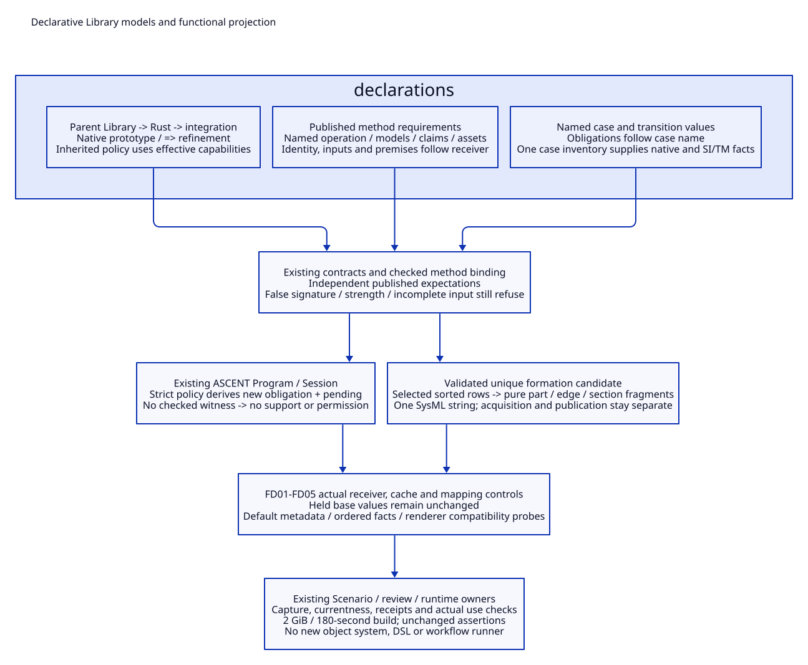

# SPDX-FileCopyrightText: 2026 hardenedlinux Linux Team and Contributors
#
# SPDX-License-Identifier: LGPL-2.1-or-later

#+TITLE: 10.122 Declarative Library Models and Functional Projection
#+STARTUP: overview
#+OPTIONS: toc:2 num:nil

* Problem and intended expression
:PROPERTIES:
:CUSTOM_ID: functional122-scope
:END:

[[file:10.121-native-dependency-cohort-and-expression-alignment.org][10.121]] qualified native package ownership and shared Scope normalization.
Those changes did not make the main Library declarations receiver-aware.
Positional object factories, captured parent lists and imperative rendering
still obscured the domain model. This slice changes those expressions through
the installed native POO slot algebra and ordinary pure functions.

The objective is a contributor-facing declaration whose names explain its
meaning and whose derived fields follow the effective object. It is not a
shorter spelling of the same frozen factory, a new configuration language or
a generic workflow runner. [[file:../../../gerbil.pkg][gerbil.pkg]] retains the qualified dependency
cohort. Existing runtime and evidence owners remain authoritative.

#+CAPTION: Effective POO declarations flow into checked metadata, native inference and pure output projection.

[[file:../../90-99-views/90-architecture-views/90.111-declarative-models-and-functional-projection.d2][Editable D2 source]].

* Declaration ownership and concrete changes
:PROPERTIES:
:CUSTOM_ID: functional122-declarations
:END:

#+NAME: functional122-owners
| Owner | Prior expression | Current expression and preserved boundary |
|-------+------------------+-------------------------------------------|
| Rust specialization | Parent rules/dependencies read into complete replacement lists | Native prototype inheritance with => append refinement; inherited formulas use the effective receiver |
| Method requirements | Three parallel case expressions for signature, kind/strength and inputs | One published POO requirements object; the Contract still checks submitted definitions against that independent owner |
| Method definitions | Eight positional constructor arguments and captured input lists | Named operation/model/claim/asset declarations over ResourceMethod.; identity, requirements, premises and limits follow effective slots |
| Method assets | Repeated revision/owner construction and duplicate observer values | Native asset prototype and one shared observer asset |
| Integration cases | Positional factory captures case name before later refinement | IntegrationCase. derives obligations and common labels from its effective name; each case declares factor and label extension |
| Lifecycle transitions | Five positional arguments per transition | Named event/from/to/cases/reservation values over the ordinary default transition value |
| Integration model | Captured parent fields and separate name/factor inventories | Native parent refinement; links, SI/TM rules and dependencies project from effective mapping cases and their obligations |
| SysML renderer | Interleaved display calls, traversal and a counter with no semantic use | Named row selection and pure part/edge/section renderers, composed into one string |
| Scenario render operation | Anonymous lambda only forwards the same argument | Publish the actual render callable; selection/acquisition/currentness closures remain at their owning boundaries |

Implementation owners are [[file:../../../library/concurrency/resource-control/backpressure-memory/rust/objects.ss][Library declarations]],
[[file:../../../library/concurrency/resource-control/backpressure-memory/rust/types.ss][published method requirements and admission]],
[[file:../../../modules/project-formation/func.ss][formation inference and projection]] and
[[file:../../../scenarios/project-formation/func.ss][Scenario operations]]. These are direct refactors in existing modules.
No adapter module, alternate manifest or new extension DSL is introduced.

* Effective values and deliberate overrides
:PROPERTIES:
:CUSTOM_ID: functional122-effective-values
:END:

#+NAME: functional122-input-refinement
#+begin_src scheme
(def ReviewedNative
  (.o (:: @ (.get RustMethodDefinitions native))
    input-demands: => (cut append <> '(review-context))))
#+end_src

The common method's premises and limits now read the effective input-demands
slot. Reading the base method first must not populate a descendant with that
base's cached inputs. The new requirement is a declaration, not evidence that
an executor can acquire review-context or that the method passed verification.
Actual execution and evidence admission still have to support the new demand.

Selecting a different declared operation recomputes its identity, signature,
kind, strength, modes and input requirements. Method-specific claims, model
identities and assets are explicit named values. A submitted wrong signature,
false strength, missing mandatory input or wrong operation binding still
refuses through the existing Contract/binder.

Direct replacement remains appropriate for a complete desired value. Refinement
is used where retaining inherited policy is part of the requirement. The
regression's frozen-parent control deliberately replaces a rule list; its
failure to inherit the later capability-dependent obligation demonstrates a
different policy, rather than a prohibition on ordinary replacement.

* Real query cases and independent checks
:PROPERTIES:
:CUSTOM_ID: functional122-cases
:END:

#+NAME: functional122-regression-cases
| Case | Concrete input | Expected independent result |
|------+----------------+-----------------------------|
| FD01 | Four published operation definitions | Literal native/quint/lean/integration kind, strength and mode tuples agree; actual definition Contract validates each |
| FD02 | Read native base premises, then refine input-demands with review-context | Descendant premises/limits use its new inputs; held base values remain unchanged |
| FD03 | Derive the native definition with operation=quint and the actual Quint model/claims/assets | Identity and signature/modes follow Quint; substituting the native signature refuses |
| FD04 | Parent rule depends on strict-retention in effective capabilities; read parent cache, then enable it in Rust and integration descendants | BP-O-STRICT and its inventory dependency propagate. A real native ASCENT session derives obligation/pending, with no support witness. The deliberately frozen rule list omits it |
| FD05 | Read base case obligations and integration links; replace M01 with a named variant through native mapping refinement | RL/SI/TM names and case-links/rules/dependencies follow the selected case. Base values remain stable; old SI-M01 is not retained as the replacement mapping's output |

These cases run in [[file:../../../t/library-declarative-model-test.ss][t/library-declarative-model-test.ss]]. FD04 evaluates the existing
ASCENT Program against the selected model and resource-lifecycle Profile; it
does not manufacture a checked witness. FD05 qualifies metadata relationships,
not execution of a new Rust case: a new case name still needs an actual driver,
mapping, oracle and source-bound evidence before runtime use.

Compatibility probes independently captured the previous default declarations
and renderer before editing. The method metadata, ordered specialization rules
and dependencies, and generated SysML string compare byte-for-byte; a separate
probe compares case/transition values. Signature identity is checked by the
actual Contracts and tests, not serialized as an opaque object address.
These local probes are additional compatibility evidence, not substitute
fixtures for the native query and rejection cases.

Order is preserved explicitly with append over mapped lists. The installed
SDK's list append-map reverses each mapped fragment; using it here would have
changed claim/dependency order. The renderer uses the installed format API's
%a syntax and its complete public import surface, retaining native name
validation, unique-candidate refusal and deterministic sorting.

* Effects, evidence and bounded acceptance
:PROPERTIES:
:CUSTOM_ID: functional122-boundaries
:END:

Pure selection and projection do not acquire files, authenticate observations,
register witnesses or grant effects. The existing review/history owners retain
their mutable exchanges, dependency checks and receipt lifetimes. Authorization
checks on both sides of acquisition protect different use boundaries; removing
one to make a function shorter would weaken its contract.

Source-byte changes invalidate uses that depend on these implementations even
when the default wire data is equal. Unchanged authored facts can be reused
only under the existing dependency/role/applicability rules. Neither the local
byte comparison nor a metadata refinement restores old current-use authority.
The [[file:10.118-domain-property-testing-and-evidence-trajectories.org][10.118]] PBT design remains a separate implementation obligation.

The consumer build and relevant regressions use the existing Just entrypoints,
with max-heap=2G, a 180-second build deadline and the stricter 120-second per-file
test deadline. The final changed source cohort completed the following checks;
no assertion or target was removed.

#+NAME: functional122-final-acceptance
| Check | Observed result | Scope |
|-------+-----------------+-------|
| Consumer build | Exit 0, 16.06 seconds | Existing native incremental build; 2 GiB / 180 seconds retained |
| Relevant native regressions | Nine files, 33 cases, 97.71 seconds total; each file below 15 seconds | Method binding, owners, selection, native context, Module design, formation, package metadata and FD01-FD05; MODULE-OK, HARNESS-OK and final OK checked |
| Default compatibility | Both captured payloads compare byte-for-byte | Method metadata, ordered rules/dependencies, SysML text and case/transition values; opaque signature identity checked separately |
| Native package metadata | Registered=7, declared=6; compiled load and native metadata gates pass | Existing root declared closure; unrelated registered development tool remains outside that closure |
| Documentation | Seven Org files lint/export; local file links, anchors, retained gold/PC controls and five paired D2/SVG views checked | English artifacts, XML and whitespace checks; 90.111 rendered and visually inspected |

These are focused refactor results. The earlier dependency cold-build limits
remain as recorded in 10.121. No fresh full Rust/Quint/Lean integration run,
PBT runtime, production performance result or remote CI pass is claimed here.
The new mapping-refinement control does not rename the native driver's cases
or manufacture evidence for its new RL identifier; runtime use must still
supply the appropriate native method binding and independent observation.
Raw logs and before/after probe payloads remain local investigation artifacts.
