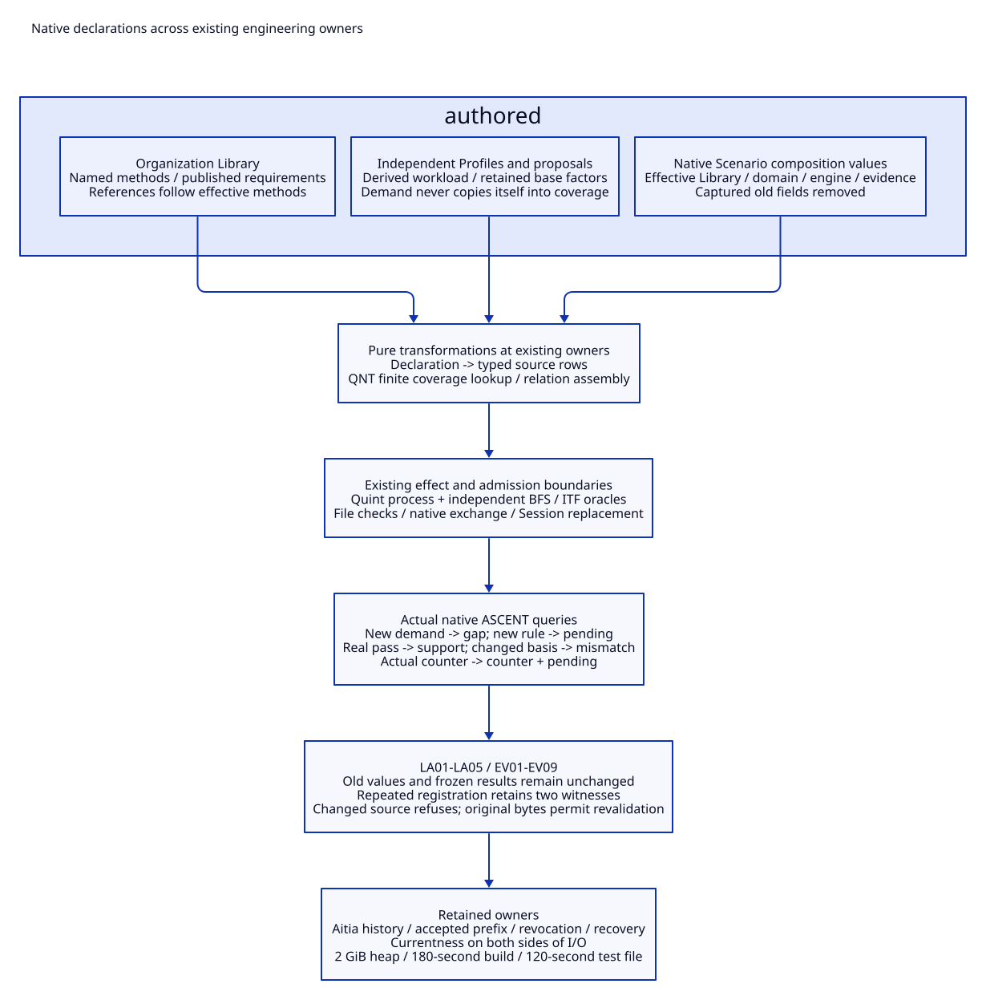

# SPDX-FileCopyrightText: 2026 hardenedlinux Linux Team and Contributors
#
# SPDX-License-Identifier: LGPL-2.1-or-later

#+TITLE: 10.123 Layer Declaration and Evidence Alignment
#+STARTUP: overview
#+OPTIONS: toc:2 num:nil

* Audit scope and decisions
:PROPERTIES:
:CUSTOM_ID: layers123-scope
:END:

[[file:10.122-declarative-library-models-and-functional-projection.org][10.122]] repaired effective values in the Rust Library and formation renderer.
This continuation examines the remaining Library, Module, Profile, Scenario
and evidence surfaces. A scoped Scheme inventory contains 54 source files:
17 Library, 10 Module, 3 Profile and 24 Scenario files. Pattern discovery and
owner review identify the changes below; this is not a proof of every function
or a claim that every remaining lambda or mutation is redundant.

Local BFS worklists and file-digest deduplication maps remain private details
of bounded algorithms; removing their mutation is not an acceptance goal.

Native POO prototypes and slot refinement express authored variation. Named
functions express pure transformations. Existing owners retain process calls,
source capture, native Session installation, history, revocation and use-time
checks. No new dispatch language, manifest, executor or authority type is added.
The dependency cohort remains the one qualified in [[file:10.121-native-dependency-cohort-and-expression-alignment.org][10.121]].

#+CAPTION: Effective declarations feed pure projections and existing effect owners; checked results reach native ASCENT with their original dependencies.

[[file:../../90-99-views/90-architecture-views/90.112-layer-declaration-and-evidence-alignment.d2][Editable D2 source]].

#+NAME: layers123-owner-audit
| Surface | Finding | Decision and boundary |
|---------+---------+-----------------------|
| Organization Library | Positional method factory and references to the original method collection | Named native method declarations; identity, kind and signature derive from operation; model references derive from effective methods |
| Method admission | Separate operation branches repeat kind/signature ownership | Published finite requirements object; submitted definitions still validate against the owning Contract; wrong signature still refuses |
| Native resource Profile | Parent and larger-payload child repeat the item-derived workload | Workload derives from effective item; child declares identity/item; explicit inconsistent workload still refuses at native Profile admission |
| Native context currentness | Structural normalization can produce an equivalent checked view when a Profile field is computed | Check shape and reconstructed source basis fully, then return the original captured context; a currentness check does not issue a replacement identity |
| Gateway example Profiles | Cache and retry copy the base factors | Native => append retains base policy and adds the selected factor; no runtime capture or measured-capacity claim |
| Formation Profile | Positional proposal factory hides names and repeats unchanged inventories | Native candidate prototype with named overrides; candidate project/basis and products remain independently authored proposals |
| QNT selection | Admission and execution contain overlapping capacity/mode tables | One finite authored initializer table and a pure lookup shared by both; unknown queue/mode and unsupported counter configuration refuse |
| Resource evidence Module | Row construction is embedded in Session creation | Named pure declaration-to-source projection; native Session replacement remains an explicit effect |
| Formation Scenario | Callable construction captures the old Library/engine | Native Scenario composition values; derived inputs/run/render use the effective dependencies; capture and authorization still use their existing owners |
| Lifecycle and example Scenarios | Selected entry/methods are extracted before descendant refinement | Derived values and callables follow effective domain/evidence; a manually substituted entry cannot disagree with the selected domain |
| Evidence registration | Three mutable accumulators assemble relation rows | Per-result registration projection plus map/append; actual review digest acquisition remains effectful and private |
| Private method result | Final issuer-owned record carries result identity and complete dependencies | Keep its private constructor and final record; saved JSON remains review material, not an admission path |
| Module declarations and checked bindings | Fixed dependency identities and explicit implementation owners | Keep native Module requirements and checked binding admission; imported dependencies are not replaced by a second resolver |
| Types and closed validation | Complete Contract shapes intentionally retain their expected fields | Keep finite validation graphs, exact owners and unknown-field rejection; no blanket conversion of every Contract construction |
| Review/history/recovery | Mutation tracks actual accepted prefixes, exchange generations, revocation or persistence | Keep these owners and their before/after I/O checks; a historical successful check cannot replace a current use check |

The eleven changed production files are the two organization Library files,
three Profile files, three Scenario composition files, the evidence Module
function file and the Rust method/type files. Their existing package and
Module publication paths are preserved.

* Extension semantics and independent demand
:PROPERTIES:
:CUSTOM_ID: layers123-effective
:END:

#+NAME: layers123-effective-library
#+begin_src scheme
(def ChangedOrganization
  (.o (:: @ ProjectOrganization)
    methods: =>.+ (.o reason: =>.+ (.o revision: "reviewed-rules"))))
#+end_src

The model's method references follow the effective methods after the original
references have already been read. Kind/signature requirements stay owned by
the published Contract; changing the revision does not weaken admission.
This metadata change is not evidence that the declared rules were independently
reviewed or that old evidence applies to the new implementation.

#+NAME: layers123-effective-profile
#+begin_src scheme
(def SelectedPayload
  (.o (:: @ LifecycleProfile) identity: 'resource-256 item: 256))
#+end_src

This declaration retains the controlled execution defaults and derives the
matching workload label. It does not grant an executor or produce a runtime
observation. Cache/retry factor extension retains base factors; direct complete
replacement is still appropriate when that is the intended policy.

Formation proposals deliberately do not derive their asserted project, basis,
products or duties from current independent demand. Changing the Profile's
project invalidates old proposals; adding a required product creates gaps.
Automatically copying demand into proposals would manufacture coverage and
increase the risk of a circular oracle. Named defaults remove positional
construction without erasing this distinction.

Native lexical slot names are receiver-aware. A local value used to initialize
a slot must have a distinct name when otherwise shadowed by that slot. The
Scenario factories use selected-library/domain/evidence names; they do not
initialize a domain slot by recursively reading that same domain slot.

* Projection, effects and evidence identity
:PROPERTIES:
:CUSTOM_ID: layers123-evidence
:END:

[[file:../../../modules/resource-evidence/func.ss][Resource evidence]] separates declaration-to-source row construction from
native Session creation and replacement. No source projection creates checked
rows or a witness. Existing typed ASCENT relations and rules are unchanged.
The evidence policy remains a descriptive publication, not a second issuer or
an override of the Program's exact required-input semantics.

[[file:../../../library/concurrency/resource-control/backpressure-memory/rust/methods.ss][Method registration]] still accepts only private issued result records.
It reads native exchange attestations before a domain source transaction,
checks the complete result file set before and after assembly, checks the rule
source before replacement, retains historical witness rows and replaces
current checked rows from freshly attested results. Native ASCENT remains the
fact store. The projection does not deserialize a saved JSON assertion into
an issued result or use a display record as authorization.

The per-result helper acquires the review file digest, then declares witness,
input and checked rows. It is not wholly pure: file hashing remains explicit.
Map/append replaces accumulator mutation while preserving review digest reads
in supplied result order, followed by the old reverse-result and within-footprint
wire ordering. The shared currentness pass still deduplicates
file checks at that boundary and refuses conflicting expected bytes.

A native-context regression exposed an identity boundary: structural validation
can rebind a computed workload into an equivalent checking view. Returning that
view from context-current! would replace the captured context even though the
operation only checks currentness. The check now returns its supplied context
after full structural validation and reconstruction of expected snapshot/scopes.
The original eq? assertion, mutation controls and malformed-context checks stay
in place; neither the validator nor source verification is bypassed.

No prior currentness result is cached as a substitute for a later check.
Frozen ASCENT query results keep their old snapshot. Subsequent source
replacement and late evidence affect a new query, not that prior result.

* Concrete checks and independent gold
:PROPERTIES:
:CUSTOM_ID: layers123-queries
:END:

#+NAME: layers123-declaration-gold
| Case | Input and action | Expected result |
|------+------------------+-----------------|
| LA01 | Read original organization references, then refine reason revision | New reference follows the revision; held original references are unchanged; wrong render signature for reason refuses |
| LA02 | Refine controlled item to 256; inspect cache/retry factors | Derived workload matches 256; base is unchanged; original workload on the new item refuses; base factors are retained |
| LA03 | Literal independent initializer expectations for (1,1), (2,2), (4,2), both modes | Exact maintained initializer names; unsupported early-release (4,2), queue mismatch and unknown mode have no selection |
| LA04 | Read original Scenario inputs; replace Library with an extra required product | Actual formation query reports the LIB-C01 product gap and no covered candidate; held baseline remains covered; changing project invalidates all three old proposals |
| LA05 | Read example Scenario entry, then select an extended domain rule | Actual evidence query derives EXTRA-CACHE obligation and pending, with no support; forced entry/domain disagreement refuses |

[[file:../../../t/layer-declarative-alignment-test.ss][The declaration tests]] call actual formation and evidence Programs. The
Gateway example is only a small consumer for dependency-selection checks;
Library ownership remains in the Rust mechanism and organization domains.
Existing native-context and Module/Project entry regressions exercise source
capture, closed scope admission and actual linked publication paths.

#+NAME: layers123-live-gold
| Step | Concrete action | Independent expectation and evidence reference |
|------+-----------------+-----------------------------------------------|
| EV01 | Run actual QNT/TLC normal mode at capacity=queue=1 | Structured verifying/ok result and explicit five-job BFS safe result; issued pass record, review, logs and model copy retained |
| EV02 | Run actual early-release mode | Structured violation plus actual two-state ITF trace checked by the independent job0 cancellation oracle; issued fail record and review retained |
| EV03 | Append the pass occurrence to a real trajectory; register through the native exchange | Current normal query has one support, one witness and no counter; result/reference/claim originate in the private issuer |
| EV04 | Select larger item/workload with the same finite ownership model basis | The same model-only result reference supports the new usage; no new result is issued |
| EV05 | Select capacity=4, queue=2 | Model basis differs; support is empty and BP-O02 remains pending; no relabeling of old evidence |
| EV06 | Switch to early-release interpretation; append and register the actual counter | One applicable counter, no support, BP-O02 pending and two historical witnesses; original frozen normal query retains one witness and no counter |
| EV07 | Register both issued results again | Two witnesses remain; no duplicate history rows |
| EV08 | Change captured declaration bytes in the isolated source copy; attempt registration | Currentness refuses before source replacement; stored history remains; held query is not rewritten |
| EV09 | Restore original bytes and revalidate/re-register | Original issued evidence is reusable under its original dependencies; applicable counter remains; no current-use authorization is issued |

[[file:../../../t/evidence-declarative-live-test.ss][The live test]] uses the installed real Quint executable and a fresh source
copy. The method verifies command exits, structured statuses and independent
BFS/trace oracles. Trajectory occurrences and native exchange attestations are
real; they are not fixture rows offered as method execution. The copy keeps
source bytes attributable while avoiding mutation of the active checkout.
These are bounded finite-model and local-host-trust observations, not complete
Rust refinement, performance results, institutional approval or permission.

* Bounded acceptance and remaining work
:PROPERTIES:
:CUSTOM_ID: layers123-acceptance
:END:

The same Just recipes retain max-heap=2G, a 180-second consumer build deadline
and 120 seconds per test file. No assertion, negative control or existing test
target is removed. The initial live attempt could not bind the verification
backend's local port inside the sandbox; rerunning with local process/network
permission uses the identical test and resource fences, not a simulated result.

#+NAME: layers123-final-acceptance
| Check | Observed result | Scope |
|-------+-----------------+-------|
| Final native consumer build | Exit 0, 21.71 seconds | Same 2 GiB heap and 180-second deadline; incremental build, not cold dependency qualification |
| Declaration/owner/currentness regressions | 16 files, 55 cases, 147.01 seconds total | Native receiver/Contract controls, Library model chain, Records/closure, lazy selection, actual native context, Module/Project entry, formation and package metadata |
| Real evidence path | One end-to-end case, 17.09 seconds | Actual normal/early-release QNT commands, independent BFS/ITF oracles, native trajectory/exchange registration, full support/counter references, reuse, changed source and frozen queries |
| Existing example query controls | Seven separately selected Gateway cases, 109.37 seconds total | Retained fixture query semantics; these are not additional real method executions |
| Independent finite oracle | 352 states, 480 transitions at capacity=queue=1; explicit cancellation violation | Actual local review artifacts retain both finite-model observations and their oracles |
| Native package metadata | Registered=7, declared=6; compiled-load and metadata gates pass | Existing declared dependency closure; no manifest or pin assertion weakened |
| Compatibility | Captured default payload compares byte-for-byte | Organization method metadata, Profile values, proposals and formation source rows; this probe is not a method-execution fixture |
| Documentation | Eight Org files lint/export; local links/anchors and retained gold controls checked; six paired D2/SVG views checked | New LA01-LA05 and EV01-EV09 sequences, English artifacts, XML/whitespace and visual inspection of 90.112 |

The original context identity failure and the prepared-source refusal for an
intermediate edited cohort were investigated rather than counted as passes.
After the final registration change, the consumer was rebuilt; the remaining
Module/Project/package gates and a fresh real evidence run completed with the
production source hashes unchanged. Logs and source/probe receipts stay local.
All passing test receipts retain MODULE-OK, HARNESS-OK and final OK checks.

This slice does not redesign the stateful Aitia recovery engine or claim
whole-repository formal/performance acceptance. Remote CI state is reported
separately. Further refactoring must start with an actual owner contract and
behavioral control, not a quota for removing lambdas or set!.
