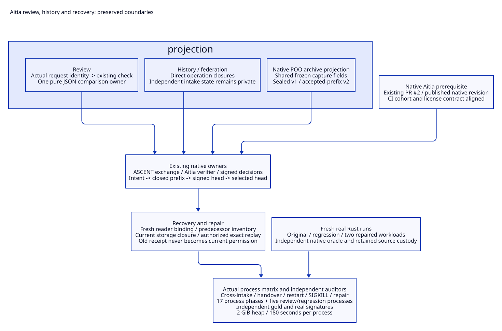

# SPDX-FileCopyrightText: 2026 hardenedlinux Linux Team and Contributors
#
# SPDX-License-Identifier: LGPL-2.1-or-later

#+TITLE: 10.124 Aitia Review, History and Recovery Projections
#+STARTUP: overview
#+OPTIONS: toc:2 num:nil

* Scope and ownership
:PROPERTIES:
:CUSTOM_ID: aitia124-scope
:END:

[[file:10.123-layer-declaration-and-evidence-alignment.org][10.123]] retained review/history/recovery as stateful owners. This slice audits
those owners directly. Native POO describes archive data; named pure functions
project content; actual native Aitia adapters and ASCENT exchanges retain
verification and inference. Persistence, reader ownership, revocation and
current-use checks remain explicit operations.

#+CAPTION: Projection refactoring preserves the existing native authority and persistence boundaries.

[[file:../../90-99-views/90-architecture-views/90.113-aitia-review-history-and-recovery-projections.d2][Editable D2 source]].

#+NAME: aitia124-owner-audit
| Owner | Refactoring | Preserved requirement |
|-------+-------------+-----------------------|
| Review | Request identity maps to the existing declaration/content check callable; deep JSON equality has one pure owner | An equal-looking request is not an issued native request; content still checks the complete accepted closure and outcome |
| History | Publish actual operation closures without a second inventory of forwarding aliases | Each intake retains its own exchange, dependency ownership, observation sequence and currentness checks |
| Cross-intake | Pure mechanical-basis comparison uses local normalized values; federation publishes its actual synchronization operations | Missing intake history cannot erase aggregate failures; conflicting identities still refuse |
| Archive projection | One native ReviewArchiveProjection. supplies shared fields; accepted-prefix data refines schema/sealed state and extends fields | JSON is data, never a constructor for a receipt, owner or reader capability |
| Recovery reader | Publish the actual capture and claim operations, retaining private archive state | One-shot reader binding, selected head, signatures and complete storage closure remain checked |
| Real source experiment | Establish existing producer custody before checking preserved dependencies | Old accepted evidence supplies historical input provenance; four new Rust executions supply fresh reassessment observations |
| Build/publication | Add existing review/archive/experiment roots to the native build closure | No hand-written manifest, compatibility namespace or parallel executor |

Implementation owners are [[file:../../../scenarios/resource-lifecycle/review/func.ss][review]],
[[file:../../../scenarios/resource-lifecycle/review/reassessment.ss][history/reassessment]], [[file:../../../scenarios/resource-lifecycle/review/cross-intake.ss][cross-intake/approval]]
and [[file:../../../scenarios/resource-lifecycle/review/archive.ss][archive recovery]]. Existing source identity and admission remain relevant
even when a projection produces equivalent data.

* Live operations and deliberately frozen data
:PROPERTIES:
:CUSTOM_ID: aitia124-snapshots
:END:

The history, federation and archive-reader export objects now name actual
private operations directly. Those
closures still share their particular owner's mutable exchange and counters.
Removing aliases does not merge owners or lift state into a global prototype.
The producer-private audited baseline cache remains distinct from per-intake
history, approval inventories, accepted prefixes and current receipts.

Historical entry references, statistics, handover captures and query results
must remain snapshots. Their selected strings/lists/counters are intentionally
copied or frozen before return. Converting them into lazy reads of a live owner
would let old results change after a new counter, handover or restart. These
snapshot constructors are retained rather than treated as stale-parent bugs.

The archive prototype is private projection data. Its shared fields read the
effective supplied capture; the sealed form retains the v1 schema. The v2 form
selects unsealed accepted-prefix semantics and extends fields with closure,
previousHead and acceptedCount. The existing JSON field meanings remain; this
is not a new archive protocol. A projection cannot publish its own selected
head or acknowledge durable acceptance.

* Effects and authorization
:PROPERTIES:
:CUSTOM_ID: aitia124-boundaries
:END:

#+NAME: aitia124-effect-boundaries
| Boundary | Why it remains |
|----------+----------------|
| Native exchange attestation | Historical observations enter current inference through their actual owner and source identity |
| Signed approval admission | Actual signer, delegation, policy, target, rejected predecessors and current document bytes remain checked |
| Owner handover | A new owner must receive complete known history; a label change cannot supply the predecessor capability |
| Intent/write/head/select sequence | Acceptance is acknowledged only after the complete prefix and selected signed head agree |
| Before/after I/O checks | Different use boundaries can race with source, selection, owner or signature changes |
| Reader activation | A sealed archive alone does not grant the successor a current activation or an old receipt |
| Repair | Authorized explicit repair preserves prior counters and checks exact replay identity; it does not restore old authorization |

The review request table uses assq over actual request identities. It has one
finite selector axis and retains the native verification adapter; no symbolic
provider dispatch or new generic protocol is introduced. Unknown identities
remain false rather than choosing a permissive default.

Shared JSON equality checks recursive content, missing keys and collection
shape. It does not infer signatures, completeness, authority or causality.
Independent Python auditors do not import this helper.

* Real evidence and process plan
:PROPERTIES:
:CUSTOM_ID: aitia124-processes
:END:

The first cross-intake attempt correctly rejected an old run whose experiment
source dependency had changed. Its hashes were not relabeled. The existing
[[file:../../../examples/backpressure-reassessment-evidence.ss][real source experiment]] now invokes the existing producer content/custody
audit before checking preserved dependencies through review-reference-path.
It records new source, Cargo.lock, commands, raw observations and independent
oracle results for all four maintained Rust variants.

#+NAME: aitia124-real-source-cases
| Variant | Actual source change | Expected independent failure cases |
|---------+----------------------+------------------------------------|
| A-original64 | Original controlled source, payload 64 | M06 |
| B-regression64 | Move M04 permit ownership back to the caller | M04 and M06 |
| C-repair64 | Worker owns both permits, payload 64 | None |
| C-repair128 | Same repair, payload 128 | None |

The prior accepted producer is historical evidence only. Source custody retains
its exact original bytes at a separate execution root. Current review and Aitia
code load from the current compiled owner closure. No saved receipt is admitted
as new native authorization.

#+NAME: aitia124-process-matrix
| Process family | Existing test | Required observations |
|----------------+---------------+-----------------------|
| Cross-intake | [[file:../../../t/backpressure-cross-intake-test.ss][backpressure-cross-intake-test.ss]] | All five groups; complete failure union, omitted discovery refusal, signed rejection, policy/reviewer changes and reuse |
| Owner handover | [[file:../../../t/backpressure-owner-handover-test.ss][backpressure-owner-handover-test.ss]] | Transfer and reuse groups; unavailable predecessor, incomplete inventory and new-owner review retain old blockers |
| Ordinary restart | [[file:../../../t/backpressure-owner-recovery-test.ss][backpressure-owner-recovery-test.ss]] | Producer plus three fresh process restarts; archive selection and new reader do not restore old receipts |
| Durable intake | Same recovery test | Three recorded SIGKILL boundaries and a pending read; acknowledged counters survive, partial writes do not become accepted prefixes |
| Explicit repair | Same recovery test | Repair checks/replay after the actual interrupted prefix; authorization and exact repeated input are checked |
| Pure projections | [[file:../../../t/aitia-projection-test.ss][aitia-projection-test.ss]] | Supplemental content/wire controls; these do not substitute for real process tests |

The existing independent auditors parse actual archived data, native snapshots,
process exits and OpenSSL signatures against the gold in [[file:10.23-native-aitia-backpressure-content-review.org][10.23]]. They do not
call the production gate to manufacture expected outcomes. Every process keeps
max-heap=2G and a 180-second deadline. Existing per-file helper tests retain the
stricter 120-second fence. No assertion, watchdog or negative control is removed.

* Native dependency and publication status
:PROPERTIES:
:CUSTOM_ID: aitia124-publication
:END:

The consumer's old poo-flow/lambda-aitia namespace no longer matches the native
agentic-ai-lab/lambda-aitia package. The selected upstream PR also retained Core
imports and helper names moved to Yuanxu, and omitted review-authority from
its public build roots. A direct upstream source fix updates actual owner
imports/names, declares native dependencies and publishes that existing module.
It adds no compatibility alias. Native package build and 17 NASA review/lifecycle
cases have completed locally.

The native prerequisite is published in the existing [[https://github.com/tao3k/lambda-aitia/pull/2][Aitia PR #2]]. Its CI
cohort now matches the native dependency declarations, explicitly builds the
existing product testing-support modules and retains the license contract.
The consumer selects the published revision through [[file:../../../gerbil.pkg][gerbil.pkg]]. The temporary
publication branch was deleted; no additional PR was created. This repository's
changes continue in the existing PR #1.

* Acceptance and remaining limits
:PROPERTIES:
:CUSTOM_ID: aitia124-acceptance
:END:

#+NAME: aitia124-final-results
| Check | Observed result | Boundary |
|-------+-----------------+----------|
| Fresh Rust source experiment | Four actual runs, 24 raw cases, 39.35 seconds | Original, regression and two repaired workloads; actual Cargo.lock/source/logs and independent event oracle |
| Cross-intake/owner/recovery matrix | 17 actual Scheme processes, all pass; longest 35.85 seconds | Five intake groups, two handover groups, four ordinary processes and six durable/repair processes; three deliberate SIGKILL exits |
| Basic review and source reassessment | Five further Scheme processes, all pass; longest 48.91 seconds | Real accepted producer, source corruption/refusal, native request/receipt binding and new real Rust runs |
| Independent cross-intake audit | 28 gold steps; 56 source wires; 17 signature checks | Selected intake completeness, policy/reviewer changes and rejection/reuse |
| Independent handover audit | 16 gold steps; 32 source wires; 18 signature checks | Actual signed transfer, unavailable owner and retained failure inventory |
| Independent restart/intake/repair audits | 21 restart, 13 durable-intake and 17 repair gold steps | Actual distinct PIDs, interrupted prefixes, signature/storage closure, replay and old-receipt refusal |
| Independent basic/reassessment audits | Four basic cases and 18 reassessment gold steps; all 24 new raw Rust cases checked | Auditors read actual selected records and event traces, not production gate output as their oracle |
| Native package metadata | Registered=8 and declared=8; compiled load and native metadata pass | Product, Yuanxu and Aitia are mandatory direct pins; actual closure, SDK runtime rows, native artifacts and negative controls remain checked |
| Supporting checks | Two pure projection cases; 17 Aitia NASA review/lifecycle cases; license contract and 16 Python script tests pass | Supplemental checks do not substitute for process/evidence execution |

Every actual Scheme process retains max-heap=2G and its existing deadline.
The full matrix is several separate bounded processes, not a claim that their
aggregate work completes inside a single 180-second window. The implementation
and loaded native owner closure retain 566 checked source/artifact references.
Raw receipts and source snapshots remain local qualification artifacts.

The two maintained interrupted-process recipes now call the official gxtest
entry directly in the existing Gerbil workspace environment. An outer gerbil
env wrapper turns a killed child into a ProcessError/70; that wrapper cannot
preserve the intended signal contract. The direct child records actual SIGKILL
and the persisted boundary. Python records -9; the shell transport reports 137.
Both represent the observed signal, not a successful normal exit. Normal test
processes still require all MODULE-OK/HARNESS-OK/CASE-OK/final OK markers.

Standalone review refused an incorrectly tagged qualification source list.
Its corrected input uses the existing consumer-sources schema and issues fresh
requests; it does not relabel or restore any old receipt. The independent
recovery/repair auditors also bind the newly selected run manifest and actual
current test entry, replacing historical absolute-path/hash constants while
retaining exact hash, signature, gold and process assertions.

The native experiment helper uses the standard single-replacement string
function. AOT compilation exposed the SDK's boolean string-contains signature;
its result is now used only as a presence check, never as a substring index.
The helper and existing review/archive roots are in the native build closure.

An initial all-dependency update reached the unchanged watchdog while rebuilding
ASP. The final selected native Aitia and consumer builds completed incrementally,
and the real source/tag/manifest/artifact gate passes. This does not claim a
whole cold dependency closure inside 180 seconds. Historical rejected inputs,
launcher failures and timeouts remain separate from passing evidence. Remote
CI is reported independently; these local results grant no production release
or institutional approval.
