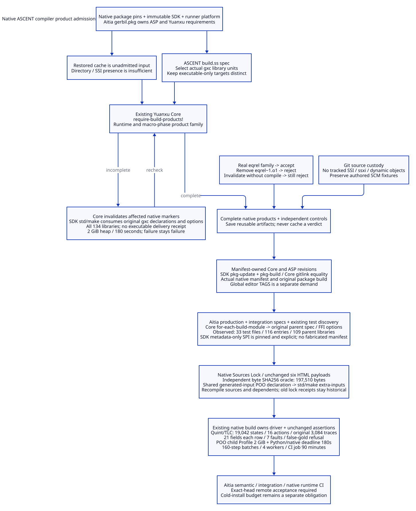

#+TITLE: 10.125 Native ASCENT Compiler Product Admission
#+STARTUP: overview
#+OPTIONS: toc:2 num:nil

* Source, compiler and admission ownership
:PROPERTIES:
:CUSTOM_ID: native125-scope
:END:

This extends [[file:10.124-aitia-review-history-and-recovery-projections.org][10.124]] through the existing
[[https://github.com/tao3k/lambda-aitia/pull/2][Aitia PR #2]] and [[https://github.com/hardenedlinux/deterministic-engineering/pull/1][engineering PR #1]].
Aitia remains a native Scheme package. Its =gerbil.pkg= owns its direct
requirements; native gxpkg owns source acquisition, tags and manifests.
ASCENT owns its build declaration and compiler options; Yuanxu Core owns
product completeness; the installed SDK owns compilation and loading.
No interface adapter, hand-written manifest or replacement rule engine is added.

#+CAPTION: A native build declaration, rather than directory existence, determines the evidence to admit.

[[file:../../90-99-views/90-architecture-views/90.114-native-ascent-compiler-product-admission.d2][Editable D2 source]].

* Observed failure and causal chain
:PROPERTIES:
:CUSTOM_ID: native125-failure
:END:

The failed [[https://github.com/tao3k/lambda-aitia/actions/runs/40569947850/job/122421179584][Linux Scheme job]] used Aitia revision =402f968=.
Its package cache was a miss. The native dependency installer reached its
600-second guard at 602.044 seconds, with a timeout receipt and exit code 71.
Its directory-existence fallback nevertheless returned success, and the
workflow saved the incomplete installation. The recorded peak process-tree
PSS was 5,066,422,272 bytes; that historical run is not evidence of the
requested 2 GiB / 180-second admission.

ASCENT compilation began close to that deadline. The consumer subsequently
loaded =gerbil-ascent/table/eqrel.ssi=, whose macro phase requested
=gerbil-ascent/table/eqrel~1=. The loader selected generated Gambit Scheme
instead of a compiled macro-phase object. Gerbil then rejected its
=(declare ...)= form. An SSI file or a package directory alone does not
establish a loadable module family. This observation does not establish an
incompatible authored ASCENT relation or require changing its semantics.

#+NAME: native125-toolchain-cohort
| Owner | Selected input | Admission consequence |
|-------+----------------+-----------------------|
| Agentic AI Lab | Native pin 177ac1c448aa846345cde7a1538ab6f788548692 | Parent source and Bazel module graph remain explicit |
| Gerbil source | 1cfb032c7a1612637da6205f5f8a15683eba3ba0 | A matching language revision does not make different compiler products interchangeable |
| Linux SDK | Portable release patch9599b09b82f8, archive SHA256 143c691fee5af4f9f631fd339f69a66f562e42e0bfc1d4ee2cda5fa8d35c35ee | Linux outputs stay with that pinned release and runner platform |
| Local SDK | Homebrew release patch618d76f9eb72 | Local product checks are separate from remote Linux admission |
| gerbil-bazel provider | 0378dd75dd49e8a87f2249553e844b0b8ce8b66b | Its directory-only timeout fallback cannot issue successful dependency completion |
| Yuanxu | e77698c35bc0e9a0a01458447fa61c720ee59290 | Use existing require-build-products! and repair-build-products! |
| ASCENT | 0d1f89ec991f90b265bb48c66875019844684fbc | Read its actual native build spec, including compiler options |
| Aitia ASP requirement | 9ae9bc377cbab4b84de52b512a2c03375a36d6c9 | Resolve from Aitia gerbil.pkg, independently of the parent's old development-only Bazel projection |

These are audit observations, not a second dependency manifest. Package
revisions continue to be managed by their native owners.

* Completion, repair and cache reuse
:PROPERTIES:
:CUSTOM_ID: native125-admission
:END:

#+NAME: native125-state-transitions
| Input | Native action | Required result | Refusal or pending condition |
|-------+---------------+-----------------+------------------------------|
| No matching cache | Native install with 180-second guard; read its actual resource receipt | completed with exitCode 0 | Timeout or missing receipt fails; directory existence cannot override it |
| Matching legacy cache | Treat it as unadmitted build input | Continue only after native completion checks | Restored files carry no successful test verdict |
| ASCENT source package | Request build.ss spec under the selected SDK | The actual gxc declarations define library identities | Empty or malformed spec fails |
| Incomplete selected module family | Core invalidates only that unit's owned static marker | Native std/make consumes every original gxc declaration and its options | Missing source, failed compilation or timeout remains failure |
| Completed repair | Core require-build-products! over every declared library unit | All 134 selected library units complete locally | Reappearance of SSI without its phase object still fails |
| Aitia build dependency | Read ASP's pin from Aitia gerbil.pkg; use SDK pkg-update and pkg-build | Original native build entry and real generated manifest | Parent-only installation is insufficient; editor indexing is a separate demand |
| Cache publication | Save after completion checks and real negative controls | Package artifacts may be reused with the same pinned SDK inputs | A cache hit is never release permission or a test result |

Executable-only declarations are excluded from the library-object contract.
Requiring =interface/entry.o1= for a static executable would be a false
rejection. The native declaration supplies that distinction; filesystem
inference and parsing generated SSI are unnecessary.

The first repair run at =567bb2f= correctly refused to proceed after its
180-second deadline. Its full native package invocation had advanced to
=libascent= static executable compilation/linking. The revised library repair
uses the same native spec's complete gxc subset through SDK std/make, rather
than constructing an executable that is outside Aitia's library demand.
It preserves all 134 library declarations and their compiler options.
It issues no complete ASCENT package or publication receipt. Ordinary ASCENT
source-change invalidation and tool delivery retain their upstream build
owner; this operation repairs interrupted products of the pinned library.

At =7a9b271=, the remote ASCENT library completion stage passed. The next
failure occurred after ASP compilation: =gxpkg install= invoked the global
editor =gxtags= index over all acquired repositories, and that index exhausted
the 2 GiB heap. Aitia CI does not consume editor TAGS. The revised entry uses
the SDK's already public =pkg-update= and =pkg-build= operations with the same
manifest-owned ASP pin. Native package build/metadata generation remains;
no package is removed and no manifest is written by CI glue. The local actual
API invocation reported =AITIA-NATIVE-ASP-BUILD-OK=.

Native ASCENT product checks and the real-product negative controls execute
before ASP. Their checked build inputs can be saved independently, so a later
ASP or consumer failure does not require repeating an unrelated ASCENT
compilation. Other restored products remain unadmitted until their own native
checks/builds succeed. A cache does not carry a successful test verdict.

The =d233672= run passed ASCENT and the native ASP build, then reached the
180-second parent library deadline. Its full product build was still compiling
sandbox and durable-memory libraries. The consumer entry now derives demand
from the existing Aitia production/integration spec functions and
=lambda-aitia-selected-test-files=, the execution discovery owner. Core's
=for-each-build-module= walks those actual imports. The parent's own
=agentic-ai-lab-build-spec= retains its original native/FFI options. All
existing Aitia CI test commands and assertions remain. Full parent product
qualification remains owned by the parent repository.

Local discovery yielded 116 entries, including all 33 selected test files,
and 109 parent library units; native compilation and Core product admission
passed. These counts are observations, not a fixed allowlist. New Aitia
imports and tests produce a fresh demand on the next invocation. Explicit
native testing support remains a separate existing CI step.

The SDK must still generate the parent's real version/dependency manifests.
The pinned v0.19 =:gerbil/tools/gxpkg= implementation has =pkg-manifest!= but
does not export a metadata-only public operation. The consumer entry binds
that actual SDK SPI through its native namespace; it does not implement the
manifest schema, copy an SSI or mark the parent package fully built. The
local capability probe found the real procedure, and its metadata plus the
109-unit build passed. This is an explicit pinned-SDK assumption: removal or
an incompatible change fails admission, with no fabricated fallback. A
stable public metadata-only SDK API remains an upstream interface improvement,
not a claimed capability of this installed SDK.

Importable build declarations now explicitly bind =this-source-file= and
export their existing spec functions. The source-collection test now calls
=make-yuanxu-contribution-module-source= and compares the exact five absolute
interface paths, all module keys and the original owner. The same assertions
passed under the native API; no basename-only or membership-only substitute
was introduced.

The native test tool returns its harness status. The CI invocation explicitly
exits with that result, so a printed ERROR cannot be lost by a dispatcher
that ignores the tool's returned integer. All assertions still execute.

The cache key binds the parent manifest, Bazel graph and immutable SDK
selection, platform, and Aitia's own manifest. Legacy restoration uses the
same parent/toolchain input digest. This is a migration input, not an
unconditional trust decision. Native package build receipts remain distinct
from the semantic evidence registered in ASCENT.

* Independent negative controls and generated source custody
:PROPERTIES:
:CUSTOM_ID: native125-controls
:END:

#+NAME: native125-controls
| Case | Concrete input | Gold | Evidence boundary |
|------+----------------+------+-------------------|
| NP01 | Real local eqrel compiler family copied into a temporary library | Native Core accepts | Copies retain actual compiler bytes; no synthetic interface or object |
| NP02 | Same family with only eqrel~1.o1 removed | Native Core rejects | SSI and generated Gambit source are insufficient |
| NP03 | Core repair invalidation after NP02, before recompilation | Still rejects; source and SSI remain | Invalidation does not fabricate completion |
| NP04 | Git's actual tracked source set | No SSI, ssxi.ss, numbered dynamic object or gxc-complete product | File presence in .gerbil/lib is separate from Git tracking |

The tests live in Aitia's =t/native-products-test.ss= and run through the
native Gerbil TestSuite runner. The local run emitted =MODULE-OK=,
=HARNESS-OK= and =OK=. The separate declaration-based check admitted 134
ASCENT library units. License checking and all 16 existing Python script
regressions also passed locally. ASCENT's existing native eqrel view suite
also completed all 3,840 injection checks and emitted =MODULE-OK=,
=HARNESS-OK= and =OK= inside the unchanged 2 GiB / 180-second envelope.

Neither Aitia nor the selected ASCENT source revision tracks SSI or dynamic
compiler objects. Aitia's =allocation-stack.scm= and
=sdk-allocation-counter.scm= are authored test fixtures and remain source.
Ignoring all Scheme =.scm= files would erase that distinction. The ignore
policy covers compiler interfaces and numbered objects without excluding
hand-written Scheme.

* Resource and acceptance limits
:PROPERTIES:
:CUSTOM_ID: native125-acceptance
:END:

All newly introduced Scheme checks and repair invocations use a 2 GiB Gambit
heap and a 180-second process deadline. Aitia's ordinary and atomic Scheme
recipes use the same explicit envelope; their Cases and assertions remain.
Parent Core and library builds have independent 180-second deadlines.
There is no automatic retry that relabels an interrupted build as complete.

A Gambit heap ceiling is not an aggregate operating-system RSS measurement;
compiler children and process-tree memory require separate recorded
observations. A legacy cached partial build is not a cold-install result.
If a cold source closure cannot complete inside its guard, it remains an
open performance/build-partitioning obligation rather than a reason to raise
the guard or admit incomplete products.

Remote acceptance is pending the exact-head Linux Scheme job. Local checks
above establish the negative controls and installed native API behavior;
they do not establish complete remote Scheme, integration or Python runtime
acceptance. At Aitia revision =7a9b271=, the native Aitia and consumer package builds
completed incrementally. Native gxpkg produced their manifests; the consumer
metadata gate reported eight declared/registered dependencies,
=COMPILED-PACKAGE-LOAD-OK= and =NATIVE-PACKAGE-METADATA-OK=, followed by the
TestSuite success markers. This is separate from a complete cold dependency
build and from the pending remote run.

No release authorization is created by repairing compiler output.
