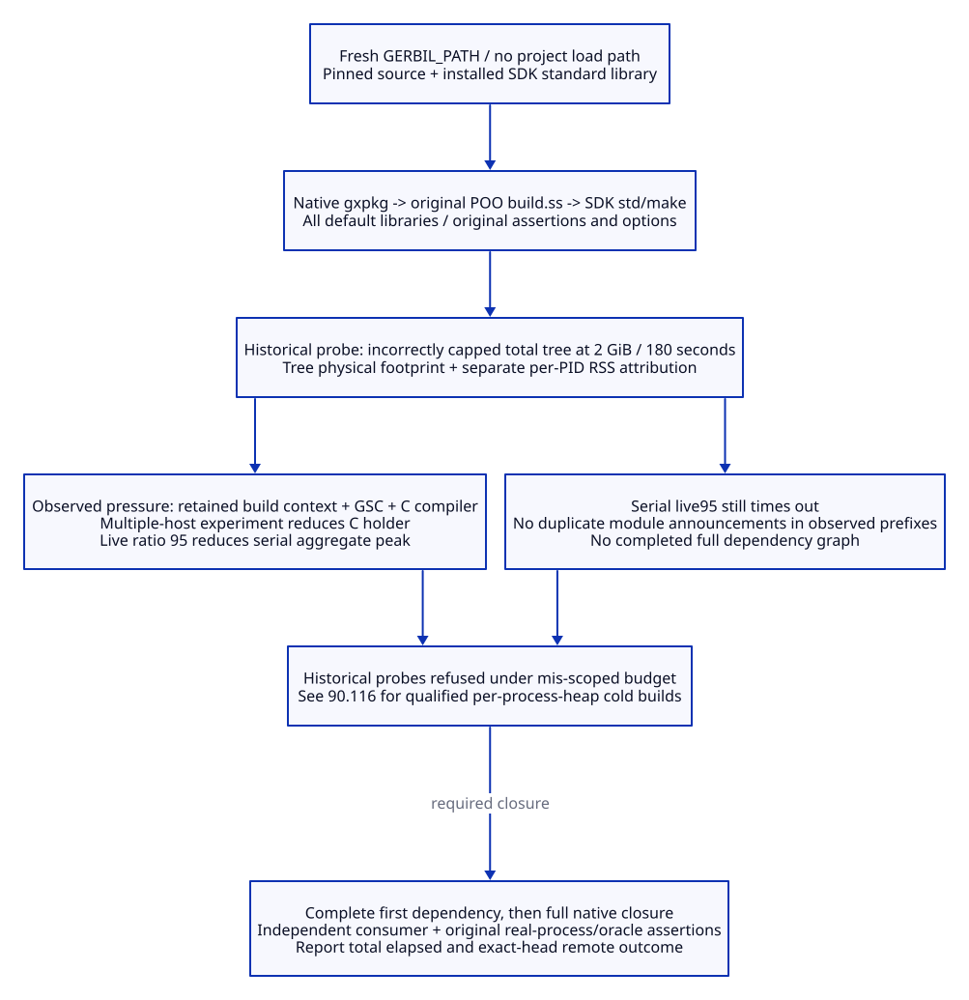

# SPDX-FileCopyrightText: 2026 tao3k team and Contributors
#
# SPDX-License-Identifier: LGPL-2.1-or-later

#+TITLE: 10.126 Cold Native Dependency Budget
#+STARTUP: overview
#+OPTIONS: toc:2 num:nil

* Admission boundary
:PROPERTIES:
:CUSTOM_ID: cold126-scope
:STATUS: superseded-resource-policy
:END:

This continues [[file:10.125-native-ascent-compiler-product-admission.org][10.125]] on the existing [[https://github.com/hardenedlinux/deterministic-engineering/pull/1][engineering PR #1]] and
[[https://github.com/tao3k/lambda-aitia/pull/2][Aitia PR #2]]. The historical probes below did not admit cold POO builds.
[[file:10.127-machine-derived-native-build-concurrency.org][10.127]] now records successful cold POO builds under the confirmed
per-process heap policy. The complete Aitia cold dependency closure remains open.
The successful restored-input Linux run is not a cold throughput receipt.
No production compiler policy is changed by the diagnostic experiments below.

#+CAPTION: Separate the observed first dependency failure from unexecuted downstream admission.

[[file:../../90-99-views/90-architecture-views/90.115-cold-native-dependency-budget.d2][Editable D2 source]].

These historical experiments incorrectly imposed 2,147,483,648 bytes on the
entire process tree, with 180 seconds per guarded invocation. The confirmed
limit is 2 GiB heap per Gerbil/Gambit process; see 10.127.
A complete workflow must also report end-to-end elapsed time. Splitting work
into invocations does not demonstrate an end-to-end 180-second result.
No dependency, assertion, optimization level or native manifest contract was
removed. No package was uninstalled.

* Cold input and measurement contract
:PROPERTIES:
:CUSTOM_ID: cold126-inputs
:END:

Each measured build uses a distinct initially empty =GERBIL_PATH= and unsets
=GERBIL_LOADPATH=. Source acquisition uses the SDK's native package operations
against the canonical repositories. The installed SDK standard library remains
a toolchain input; no existing project objects or project package manifests
are seeded. Repeated invocations have different cold roots and are not one
resumed successful installation.

| Input | Identity / consequence |
|-------+------------------------|
| Local platform | Darwin arm64; 12 logical CPUs; 32 GiB physical memory |
| Gerbil | 1cfb032; Homebrew patch618d76f9eb72 |
| Gambit | ea114fc; SDK-selected GCC 16 backend |
| POO | c0d47633c2aad7591944f874eaf730ee9c0e451e |
| Resource guard | Unmodified gerbil-bazel source at 0378dd75dd49e8a87f2249553e844b0b8ce8b66b |
| Aggregate memory | Guard's Darwin physical-footprint process-tree metric |
| Holder attribution | Separately sampled per-process RSS; not additive peak proof |
| Host activity | Guard reports runnable saturation; unrelated host processes were not stopped |

The guard owns admission, termination and the tree-wide limit. A diagnostic
sampler observes descendant PID/parent PID, RSS, CPU time and command every
0.5 seconds. Its own successful exit only means it wrote diagnostics; the
child's exit and guard receipt determine acceptance. The guard process itself
is excluded by the upstream workload metric. Independent per-PID maxima do
not necessarily occur at the same instant.

* Executed cold probes
:PROPERTIES:
:CUSTOM_ID: cold126-results
:END:

The companion [[file:10.126-cold-native-dependency-observations.json][machine-readable observations]] retain terminal guard outcomes,
source identities, command scope, compile announcements and normalized holder
attribution. Compile announcements are *started frontend work*, not completed
loadable products. Guard elapsed time excludes some outer sampling/cleanup
cost. Failed and partial probes cannot issue a successful cache receipt.

#+NAME: cold126-observations
| Probe | Workers | Guard seconds | Peak bytes | Terminal result |
|-------+---------+---------------+------------+-----------------|
| baseline | 2 | 67.408 | 2256656744 | rss-limit-exceeded / 70 |
| live80 | 2 | 97.223 | 2196609288 | rss-limit-exceeded / 70 |
| serial80 | 1 | 180.290 | 2122399744 | timeout / 71 |
| poo-multihost | 2 | 36.552 | 2223659320 | rss-limit-exceeded / 70 |
| poo-serial-multi | 1 | 168.127 | 2319340152 | rss-limit-exceeded / 70 |
| poo-serial-multi95 | 1 | 180.212 | 1460895744 | timeout / 71 |
| poo-parallel-multi95 | 2 | 93.753 | 2293274936 | rss-limit-exceeded / 70 |

The first three probes invoke Aitia's declared dependencies through native
=gxpkg deps --install=. They stop in POO before reaching Core. The remaining
POO probes isolate that same first dependency through native =pkg-fetch= and
=pkg-build=, preserving its own build script and complete default library spec.
They do not establish the complete eight-repository dependency closure.

The separate source-acquisition experiment fetched all eight repositories in
95.732 seconds, with 403,374,080 bytes peak footprint, but exited 70 while
serializing its result. Although the guard says =completed=, its nonzero child
exit makes the experiment *failed*. Fixing serialization in a local diagnostic
prototype is not a fresh successful acquisition receipt. That prototype is
not adopted as another dependency resolver.

* Holder attribution and repeated-work audit
:PROPERTIES:
:CUSTOM_ID: cold126-holders
:END:

The baseline POO build process reached roughly 1.43 GB RSS. With one worker
and live ratio 80, the =table~0= C compiler reached roughly 1.23 GB RSS. The
build process and Gambit compiler remained resident while C compilation ran.
The SDK already passes =-ftrack-macro-expansion=0=; adding it again is not a fix.

The SDK-supported multiple-host C generation option reduced the observed
largest C compiler holder to about 0.45 GB in the serial comparison, but the
aggregate run still exceeded 2 GiB. Raising Gambit's live ratio to 95 reduced
the serial aggregate peak below 2 GiB; that run still timed out at 180 seconds.
Neither setting has earned a production default or a performance claim.
The diagnostic C option preserved the observed SDK prefix and =-O1=. A future
production change must query SDK-owned compiler configuration rather than
hard-code this platform's prefix or replace the compiler flags wholesale.

No identical =... compile MODULE= announcement repeats within the measured
prefixes. Native =pkg-deps-manage= uses one =with-pkg-build-env= around the
recursive install; repeated dependency references do not by themselves prove
repeated builds. Conversely, separate CLI invocations and separate native/Bazel
product owners can repeat work: that remains to be measured after POO passes.
There is no evidence yet to claim that global duplicate compilation has been
eliminated. No global build-dependency cache or replacement scheduler is added.

* Remaining closure and promotion gates
:PROPERTIES:
:CUSTOM_ID: cold126-gates
:END:

| Gate | Current evidence | Required before closing |
|------+------------------+-------------------------|
| First dependency | Real POO cold failures and holder attribution | Complete native default library within both hard limits |
| Complete source closure | Eight repositories fetched in a failed serialization probe | Fresh successful acquisition with exact native tags |
| Complete dependency closure | Downstream cold compilation not reached | All manifest-owned dependencies, native manifests and original options |
| Repeated work | No duplicate announcements in observed prefixes | Completed graph compile counts, source identities and owner attribution |
| Product admission | Prior restored-input acceptance remains historical | Complete macro/runtime families and independent import consumer from cold root |
| Tests | Existing assertions unchanged | Existing real process and independent-oracle assertions from admitted cold products |
| Cache publication | No cold successful receipt | Successful guard exit, product closure and negative controls before save |
| Remote result | No new successful cold Linux receipt | Exact-head PR #2 run; report SDK/platform separately from Darwin |

The next optimization belongs to the first failing package/compiler boundary,
with a bounded critical-path and retained-context comparison. Keep original
=std/make= scheduling, per-project build dependencies, source guards and package
manifests. Do not divide a failed package into arbitrary unchecked fragments,
copy generated products from warm roots, or treat selected frontend output as
whole-package completion. Atomic Library loading and build-product admission
remain separate engineering obligations.
