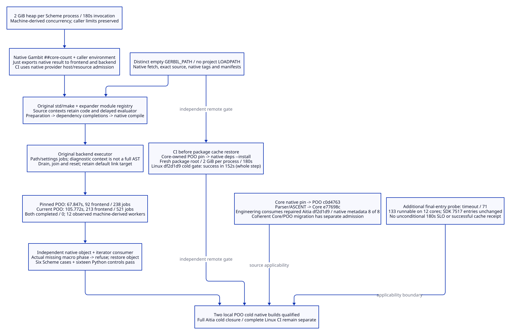

# SPDX-FileCopyrightText: 2026 tao3k team and Contributors
#
# SPDX-License-Identifier: LGPL-2.1-only

#+TITLE: 10.127 Machine-Derived Native Build Concurrency
#+STARTUP: overview
#+OPTIONS: toc:2 num:nil

* Correct resource contract and observed admission
:PROPERTIES:
:CUSTOM_ID: native127-scope
:STATUS: qualified-poo-builds
:END:

The confirmed contract is *2 GiB heap per Gerbil/Gambit process*, with a
180-second deadline per guarded invocation and concurrency derived from the
current machine. It is not a 2 GiB aggregate RSS allowance for the compiler tree.
This corrects the interpretation in [[file:10.126-cold-native-dependency-budget.org][10.126]]. Its seven failed measurements
remain historical observations under a different, overly restrictive policy.

#+CAPTION: Native ownership, machine-derived concurrency and independently checked cold products.

[[file:../../90-99-views/90-architecture-views/90.116-machine-derived-native-build-concurrency.d2][Editable D2 source]].

Both builds below started with distinct empty =GERBIL_PATH= directories,
without =GERBIL_LOADPATH= or any seeded project compiler products. Native
SDK =pkg-fetch= acquired the exact source and =pkg-build= wrote its actual tag
and manifest and executed the unchanged package build entry. The installed
SDK standard library is a toolchain input, not a reused project cache.

| POO revision | Original default package scope | Frontend announcements | Backend jobs | Guard seconds | Peak tree footprint | Result |
|--------------+--------------------------------+------------------------+--------------+---------------+---------------------+--------|
| c0d47633c2aad7591944f874eaf730ee9c0e451e | Complete default library | 92 | 238 | 67.847 | 5027971072 bytes | completed / 0 |
| 780e66928c2f73aee6ab356dcb7a625c37123973 | Complete current default, including its property libraries and representation executable | 213 | 521 | 105.772 | 7954661376 bytes | completed / 0 |

Both runs admitted 12 workers from the observed 12-core / 32 GiB Darwin host.
Neither command supplied a fixed worker count, aggregate 2 GiB override or
memory-per-worker override. The original resource guard derived its separate
whole-tree safety allowance from observed available memory and headroom.
Per-process heap caps remained configured at 2 GiB. RSS includes native
allocations and is not the Gambit heap-size metric.

The [[file:10.127-native-poo-machine-admission.json][machine-readable receipt]] retains both actual guard outcomes, native
manifests, source identities, sampled holders and independent consumer source.
These different revisions have different build inventories. Their elapsed
times are not a speedup comparison. Neither receipt establishes the complete
eight-package Aitia cold closure or a new exact-head Linux result.

* Root cause in the actual build entrypoints
:PROPERTIES:
:CUSTOM_ID: native127-entrypoints
:END:

The engineering =Justfile= unconditionally exported =GERBIL_BUILD_CORES=2=.
Aitia's =justfile= defaulted to 12, and Aitia CI also exported 12. These values
encoded particular machines into the product's build entrypoints. The earlier
local diagnostic additionally imposed 2 GiB on the whole compiler tree,
causing the resource guard to admit only one or two workers.

The repair uses Gambit's native =##core-count= from each Just entrypoint and
the existing Just =env_var_or_default= declaration to preserve caller limits. Aitia CI leaves selection to
the existing native provider's host/resource admission rather than supplying
12. Caller-supplied limits remain available through the existing variable.

Merely deleting the variable would be incorrect for this SDK cohort:
=std/make.gerbil-build-cores= defaults an unset variable to zero, which produces
one frontend worker. The compiler backend separately knows how to discover
cores. The explicit native query aligns both existing mechanisms without
adding another scheduler, parser or configuration layer.

The original =max-heap=2G= fences, 180-second deadlines, native build specs,
dependency declarations and assertions remain in place.

The first published helper-based entry passed locally but failed the Linux
Scheme job in [[https://github.com/tao3k/lambda-aitia/actions/runs/40815816373][CI run 40815816373]]: the fixed Linux SDK does not provide the
Darwin helper =available-build-cores=. This is a distinct SDK-product boundary,
not a successful remote receipt. The final declaration uses =##core-count=
directly, which is also exercised in the released 2591dcd SDK. Regression
children inspect the real compiler's =__available-cores= after importing its
base module, independently of the environment string. No fallback API layer
is introduced. The fixed Linux archive SHA256 is
=143c691fee5af4f9f631fd339f69a66f562e42e0bfc1d4ee2cda5fa8d35c35ee=;
both its authored =base.ss= and compiled =base~0.scm= omit the helper and
provide =__available-cores=.

* Source trace: holders, queue and release boundary
:PROPERTIES:
:CUSTOM_ID: native127-lifetime
:END:

The trace below describes the installed Darwin SDK used by these local
measurements. The checksum-verified Linux archive uses an older native
job-list/semaphore implementation; its queue internals must not be inferred
from the shared Gerbil revision label.

| Native owner | Actual retained value / behavior | Safe conclusion |
|--------------+----------------------------------+-----------------|
| std/make.make-build | Preparing module identities imports source before workers start; coordinators retain module contexts while resolving dependency completions | This is a real serial preparation region; its existence alone does not prove a leak |
| expander/module.core-import-module | The module registry indexes a context by path and identity; the context stores expanded code and a delayed evaluator closing over the expanded body | Context lifetime follows the source/expansion session; clearing it arbitrarily can invalidate macros, imports and later compilation |
| compiler/driver.compile-scm-file | Backend work closes over paths, phase/static selections and compiler settings | A queued file compile does not directly capture the emitted code argument |
| compiler/base.make-compile-job | Captures compiler parameterization; current-compile-context is a small diagnostic list of operation and source path | The diagnostic context is not a complete AST; it must not be described as the dominant syntax-tree holder |
| compiler/base.open-compile-executor | Queues jobs and tracks active work; close joins workers; execute-pending-compile-jobs! resets the executor | Completion requires the real drain/join, not just frontend announcements or an SSI file |
| POO current build entry | Runs the existing property, root and representation build declarations; its failure path drains compiler jobs | The complete default package, including its link stage, remains the admission boundary |

In the accepted pinned run, the largest sampled driver RSS was about 1.45 GB;
a C compiler reached about 1.38 GB, and a Gambit compiler about 0.98 GB.
In the current-revision run, the driver reached about 2.22 GB RSS and a C
compiler about 1.93 GB. These per-PID maxima are not simultaneous aggregate
measurements. The guard's tree footprint supplies the independent aggregate
observation. CPU samples were taken at a PID's peak observed RSS and are not
complete task durations or a reconstructed critical-path timing trace.

Source ordering explains the dependency: module preparation and frontend
emission feed the backend queue, followed by the actual executor drain and,
for the current default, representation linking. Restricting both mechanisms
to one or two workers unnecessarily extended this path. Restoring the intended
machine-derived policy completes both original native packages within 180
seconds. No evidence from these runs justifies clearing source contexts,
dropping queue jobs or replacing the executor.

No frontend module announcement repeated within either completed build.
The original native package manager already uses a shared build environment
within recursive installation. A repeated dependency reference is not proof
of duplicate compilation. Cross-invocation and full-closure reuse still need
their own receipts; the POO measurements do not claim to eliminate that work.

* Host dependencies and revision applicability
:PROPERTIES:
:CUSTOM_ID: native127-revisions
:END:

The first current-revision attempt stopped before compilation because the
host's pkg-config did not search the installed Homebrew OpenSSL directory.
A second attempt reached final linking in 148.543 seconds but lacked POO's
established Darwin compiler environment. The successful fresh run used the
existing official =COMPILER_PATH=/usr/bin= policy and the real installed
OpenSSL pkg-config/library paths. It retained the default executable and all
original compiler options. Those two failures remain failures, not partial
successful package receipts.

| Source authority | Checked revision / relationship | Update boundary |
|------------------+---------------------------------+-----------------|
| Active POO branch | 780e66928c2f73aee6ab356dcb7a625c37123973; now cold-qualified locally | Current POO can build without an existing project cache |
| Active Core branch | 3527b55631c72c7665a8e0f00ee9bc6b2241d178 | Its native gerbil.pkg still requires POO c0d4763 |
| Accepted Parser and ASCENT | Both native manifests require Core e77698c35bc0e9a0a01458447fa61c720ee59290 | A direct Aitia-only Core bump would conflict with those owners |
| Accepted Aitia / parent | Aitia declares Core e77698c; parent gitlink equality is checked | Update the coherent native source cohort, not just a label in Aitia |
| New released SDK | 2591dcd / patch e35312b4a951 inspected independently | These successful cold builds use the accepted 1cfb032 SDK; no SDK migration verdict is issued |

Default branch HEADs are older than the active POO/Core branches in this
cohort. Upstream green CI is useful evidence, but has its own source, cache,
platform, build inventory and deadline. It cannot replace this consumer's
cold receipt. The accepted Core/POO pins remain unchanged by the concurrency repair;
changing one direct pin while transitive owners retain incompatible pins
would introduce a new reproducibility defect.

* Cache-independent remote gate

Aitia CI now performs the Core-declared POO dependency installation in a fresh
=mktemp= package root before restoring any project cache. It unsets project
LOADPATH and invokes native =gxpkg deps --install= from Core's directory.
Core's own =gerbil.pkg= selects the revision; no second dependency parser or
hard-coded POO revision is introduced. The native provider supplies the runner
worker count. The original 2 GiB process heaps and 180-second deadline remain.
The success marker is emitted only after the real native install succeeds.
The new cold gate passed in [[https://github.com/tao3k/lambda-aitia/actions/runs/40818637078/job/123265684172][Linux run 40818637078 / job 123265684172]] at source
=df2d1d98a6ee37685d20de5543aeabd3e4f9f4b8=. The step started at
=2026-10-29T04:36:27Z= and completed at =04:38:59Z=: 152 seconds at the
GitHub step timestamp resolution, including environment launch. The native
install's 180-second timeout remained unchanged. Project package cache
restoration began only after this successful step. This qualifies the actual
Core-selected POO dependency on the fixed Linux SDK without project caches.
It is not a result for all eight Aitia dependencies or the remaining CI stages.

* Shared-host counter and actual-entry recheck
:PROPERTIES:
:CUSTOM_ID: native127-contention
:END:

A subsequent fresh-root run through the final portable engineering Just entry
returned timeout / exit 71. Its 180000 ms guard recorded 182520 ms including
termination observation, with 133 runnable processes at admission on the
12-core host. The guard's runnable limit was advisory and was not applied;
12 workers remained selected. Peak tree footprint was 5482381312 bytes,
below its machine-derived allowance. An immediate host observation still
showed 95 runnable processes and load average 165.10.

An inventory of all 7517 SDK bin/lib/include/src entries was byte-identical
before and after that run. Its aggregate fingerprint is retained in the JSON
receipt. This excludes an in-run SDK file change for this failed probe; it is
not a retrospective frozen-input assertion for the earlier two runs.

This is a failed actual-entry observation under recorded contention, not a
third successful package or cache receipt. The earlier two completed cold
builds remain qualified for their observed envelopes. They do not establish
an unconditional 180-second SLO in the presence of uncontrolled competing
work. The current guard's ready state is not a CPU reservation. No worker cap,
longer deadline, removed target or deleted assertion converts this probe into
a pass. Repeating it while the host remains saturated is not new validation.

* Independent controls and reproduction
:PROPERTIES:
:CUSTOM_ID: native127-controls
:END:

| Control | Executed result | Evidence boundary |
|---------+-----------------+-------------------|
| Engineering native concurrency suite | 2 cases pass: actual host count and caller limit 3 | Real Just-to-GXI subprocess propagation |
| Aitia native resource suite | 4 cases pass: host count, caller limit 3, lifecycle 2048M and unchanged retirement 512M | Existing two resource assertions retained |
| Cold independent consumer | Separately compiled object macro/slot access returns 41; table iterator returns (2 3 4) | Executes actual native products from each cold root |
| Missing phase negative control | Temporarily removing actual object~1.o1 causes compiler exit 70; original product restored | SSI or generated Scheme alone cannot masquerade as a compiled macro phase |
| Current native executable | main and joint-main emit their original SERVICE-WORKFLOW-OK receipts at width 64 / symbolic access | Executes the actual newly linked binary |
| Aitia source update | Native SDK update/build to df2d1d98a6ee37685d20de5543aeabd3e4f9f4b8 succeeds; 8 registered / 8 declared metadata and compiled-package checks pass | Engineering gerbil.pkg consumes the repaired source; transitive Core/POO pins stay coherent |
| Existing Python controls | 16 tests pass | Source/build helper contracts; not full lifecycle replay |
| License contract | Pass | Original project license validation |
| Linux CI 40816646358 / source 4eae30c | Scheme semantic closure, Lean, Quint and license steps pass; remaining runtime stages were still running when inspected | A restored-input remote stage, not a cold full-closure verdict |

The independent consumer's exact source is retained in the JSON receipt.
It declares the standard Gerbil prelude explicitly, so a surrounding project's
Yuanxu prelude cannot silently introduce another compiled dependency. Its
native compile and runtime invocations were separately bounded at 180 seconds.

#+NAME: native127-native-machine-query
#+begin_src sh :eval never
# Just uses this SDK-owned query and exports the returned value to make/GSC.
gxi -:max-heap=2G -e '(display (##core-count))'
#+end_src

For a fresh package run, begin with an empty native package root, unset
=GERBIL_LOADPATH= and worker/tree-budget overrides, retain =GAMBOPT=max-heap=2G,debug=q=,
and use the unmodified resource guard with a 180-second deadline around native
=pkg-fetch= followed by =with-pkg-build-env/pkg-build=. Use the declared source
revision and the package's established platform environment. The guard
records actual selected cores and machine-derived memory admission.

The source/heap/concurrency controls above close the local POO cold-build
question. Full Aitia dependency closure, revision-cohort migration and the
new exact-head remote CI remain separately scoped obligations.
