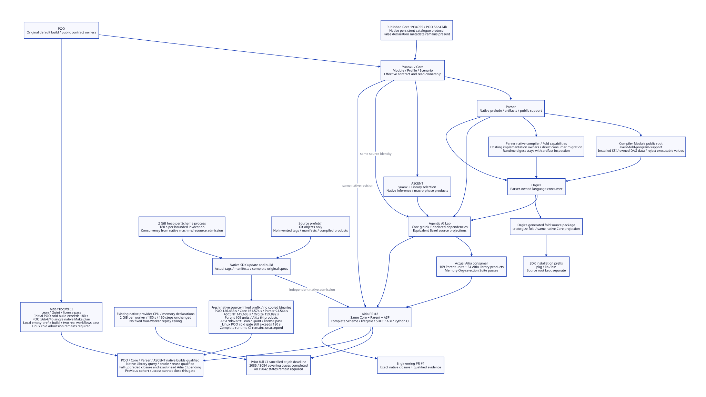

#+TITLE: 10.128 Native Dependency Cohort Upgrade
#+STARTUP: overview
#+OPTIONS: toc:2 num:nil

* Admission scope
:PROPERTIES:
:CUSTOM_ID: native128-scope
:STATUS: in-progress
:END:

The unit of upgrade is the native dependency closure, rather than one successful
POO build. Package metadata owns revisions; native package APIs own tags and
manifests; Yuanxu owns Module/Profile/Scenario source projection; each package
retains its original build specification. No parallel dependency resolver,
compatibility module or replacement evidence framework is introduced.

The resource contract from [[file:10.127-machine-derived-native-build-concurrency.org][10.127]] remains 2 GiB heap per Gerbil/Gambit process,
a 180-second deadline per bounded invocation and machine-derived concurrency.
Sequential, independently bounded invocations do not share a 180-second aggregate
deadline. Tree RSS and native allocations are distinct from Scheme heap size.

#+CAPTION: Native dependency ownership and the admission boundary.

[[file:../../90-99-views/90-architecture-views/90.117-native-dependency-cohort-upgrade.d2][Editable D2 source]].

* One native ownership graph
:PROPERTIES:
:CUSTOM_ID: native128-graph
:END:

| Owner | Declared dependency | Admission responsibility |
|-------+---------------------+--------------------------|
| Yuanxu/Core | POO | Effective contracts, read ownership, native source and build projection |
| Parser | Same Yuanxu/Core | Native language entry, compiler artifacts and public support interfaces |
| ASCENT | Same Yuanxu/Core | Native inference/compiler products, including macro-phase objects |
| Orgize | Same Parser | Native language consumer and generated grammar products |
| Agentic AI Lab | Parser, ASCENT, Orgize; Core gitlink | Library demand and equivalent Bazel source projections |
| Aitia | Parent Library, same Core, ASP | Review/history/recovery and complete CI |
| Deterministic Engineering | Aitia, same Parent, same Core | Exact consumable closure and documented evidence applicability |

A Core gitlink change requires its POO source projection to change as well. A
Parser change requires the Orgize dependency to agree. Parent, Aitia and the
engineering package must agree on Core; independently green upstream branches
do not establish that agreement. The existing projection tool calculates archive
checksums from actual published source archives and updates the Bazel projection.

* Native interface migration
:PROPERTIES:
:CUSTOM_ID: native128-interfaces
:END:

| Retired or internal owner | Existing native owner | Preserved boundary |
|---------------------------+-----------------------+--------------------|
| POO object-contract-flow and object-diagnostics | object-contract | checked-action, checked-issues and diagnostic composition |
| POO object-contract-validation helper | ObjectContract .validation-fields | Effective receiver-local responsibilities and checked receiver enrollment |
| POO inheritance-hooks | mop | Original inheritance protocol and tests |
| Observation in generalized-prototype | fun | Original observation object |
| Parser src/runtime/artifact import | artifact-support | Public native artifact facade |
| Parser src/compiler/rust-syntax import | rust-syntax-support | Public native Rust syntax facade |

The Rust pure-AOT macro remains imported from its existing precise owner where
no public facade exports that capability. A guessed facade or copied macro would
change ownership rather than align it. Role validation still enrolls the checked
receiver before running each original validator; normalizers, obligations and
rejection semantics remain intact.

* Source prefetch is not installation
:PROPERTIES:
:CUSTOM_ID: native128-metadata
:END:

Source prefetch may acquire immutable Git objects and complete a new checkout.
It must preserve an existing checkout, local edits and SDK metadata. It must not
write a tag, manifest or compiled product. The subsequent native SDK update owns
the real tag transition and the native build owns its actual manifest.

The additional local Git regression checks a new source checkout and the absence
of invented tag/manifest/library products. The existing preservation regression
continues to check an installed checkout with local edits. These Python checks
qualify source preparation only; native package acceptance requires actual SDK
registration, complete products and independent consumers.

* Bounded execution and current evidence
:PROPERTIES:
:CUSTOM_ID: native128-evidence
:END:

| Observation | Result | Applicability |
|-------------+--------+---------------|
| POO ec54d51 complete default native build | completed, 178.286 s, 12 workers | Fresh candidate package root; original property libraries and executable retained |
| Core compatibility migration build | completed, 162.371 s | Candidate source before upstream merge |
| Core merged with upstream 7c38aaa | completed, 35.808 s | Incremental native build; not a cold-build timing claim |
| Contract composition, semantic Module, evidence read ownership, MOP thunk construction | MODULE-OK, HARNESS-OK, OK | Original assertions; contract and semantic suites repeated after upstream merge |
| First Parser attempt | not admitted | Build-entry edit during execution invalidated source observations; guard also reached its deadline |
| Frozen Parser, ASCENT and downstream closure | pending | Require separate bounded native receipts and current source identity |
| Complete Aitia CI on upgraded closure | pending | Local tests and previous-cohort jobs cannot substitute for this gate |

Parser and Orgize no longer impose a package-local two-worker ceiling. Core's
Just entry no longer limits its machine-derived default to four. Explicit caller
limits remain supported by the existing native framework. Each test invocation
keeps 2 GiB and 180 seconds; native fixture preparation is separately bounded.
An aggregate shell timeout must not terminate unrelated later phases simply
because earlier, independently bounded preparations consumed time.

The first Core publication was rejected because its existing upstream branch had
advanced. The repair merged that upstream commit, retained its assertions and
revalidated the affected native source. A non-fast-forward rejection never
justifies overwriting the existing PR branch.

* Completion gate
:PROPERTIES:
:CUSTOM_ID: native128-completion
:END:

- Register and check the published coherent native revisions through the SDK.
- Check native products and independent Parser/ASCENT consumers, not imports alone.
- Preserve the cold POO gate and the resource-receipt assertions in Aitia CI.
- Run the complete Scheme, lifecycle, SDLC/GitOps, native ABI and Python jobs,
  together with the existing Quint, Lean and license jobs.
- Bind each remote result to its actual head and dependency metadata. A queued,
  running, failed or previous-cohort result leaves the complete gate open.
- Publish through the existing engineering PR #1 and Aitia PR #2 only.
