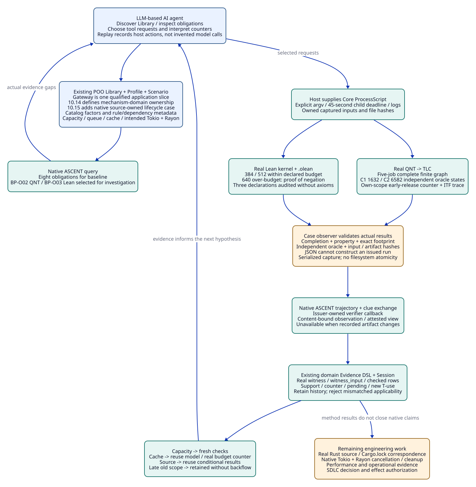

# SPDX-FileCopyrightText: 2026 hardenedlinux Linux Team and Contributors
#
# SPDX-License-Identifier: LGPL-2.1-or-later

#+TITLE: 10.13 Real Method Results and the LLM-Based AI Agent Evidence Loop
#+LANGUAGE: en
#+PROPERTY: JD_ID 10.13
#+OPTIONS: toc:2 num:t
#+STARTUP: overview
#+FILETAGS: :library:agent:ascent:qnt:lean:evidence:
#+PROPERTY: header-args :eval never :exports code

[[file:../../00-09-project/00-documentation/00.01-index.org][Index]] | [[file:10.12-gateway-library-registration-and-runtime-dependencies.org][10.12 finite rule slice]] | [[file:10.05-agent-reasoning-and-design-convergence.org::#llm-agent-terminology][Agent terminology]]

Current shared source owners are rust-resources and resource-evidence. The direct
migration and minimal native mechanism path are maintained in
[[file:10.15-scheme-owned-rust-mechanisms-and-development-evidence.org][10.15]]. Earlier publication shapes and qualified receipts below retain their
historical scope; updated file links point to current source owners.

* Scope and responsibilities
:PROPERTIES:
:CUSTOM_ID: real-agent-evidence-responsibilities
:END:

This investigation executes QNT/TLC and Lean and registers their actual local
results through ASCENT's native verifier-backed clue exchange. It closes the
method-result path left explicit in 10.12. The earlier V/*-fixture and checked
rows remain regression-test inputs; they are not used by this investigation.

[[file:10.14-rust-performance-library-and-mechanism-cases.org][10.14]] defines the mechanism-owned Library boundary. This document retains a
qualified application case; it is not the organizing model for all Rust performance
knowledge. The next native subject is an async/CPU resource lifecycle, rather than
a gateway implementation.

The subject is a proposed Tokio/Rayon gateway design, with bounded ownership and
conditional accounting claims. Its capacities and accounting coefficients are
declared design inputs. There is no implemented Rust gateway or measured workload
here. Cargo.lock and native source correspondence remain unresolved, so native
performance, cancellation behavior and whole-system acceptance remain pending.

#+NAME: real-loop-owners
| Layer | Concrete responsibility | Result owned by that layer |
|-------+-------------------------+----------------------------|
| LLM-based AI agent | Discover the published Library entry, inspect obligations, choose QNT/Lean investigations, interpret counters and choose subsequent work | Questions, hypotheses and explicit tool requests |
| [[file:../../../library/concurrency/resource-control/backpressure-memory/rust/objects.ss][Existing Library]] | Factor/obligation/method/dependency semantics for backpressure and memory | Reusable design knowledge; no fabricated method outcome |
| [[file:../../../profiles/gateway.ss][Independent POO Profile]] | Capacity, queue, accounting coefficients and intended Tokio/Rayon configuration | Declared application inputs; no native performance claim |
| [[file:../../../scenarios/gateway-review/func.ss][Gateway Scenario scope]] | Bind Library and Evidence scopes; publish method operations and create scoped native sessions | Application cut and issuer-owned method operation handles |
| Host with [[file:../../../.gerbil/pkg/github.com/tao3k/poo-flow-core/ops/process-script.ss][Core ProcessScript]] | Supply process capability, execute argv, enforce deadlines and retain actual logs/status | Real process observation; not the semantic verdict |
| QNT/TLC | Verify safe across the finite ownership transition system | Complete finite-model result for the exact initializer, step and source |
| Lean | Kernel-check the instantiated budget proposition or its negation, emit .olean and audit axioms | Conditional arithmetic proof; not Rust source refinement |
| [[file:../../../library/concurrency/resource-control/backpressure-memory/rust/oracle.ss][Independent case oracles]] | Explicit finite-state search, concrete counter-trace inspection and integer accounting | Separately computed expected property/outcome |
| [[file:../../../library/concurrency/resource-control/backpressure-memory/rust/methods.ss][Case result observer]] | Match process completion, exact input bytes, result schema, property and oracle; guard recorded files | Local method observation and method-review references |
| ASCENT native [[file:../../../.gerbil/pkg/github.com/tao3k/gerbil-ascent/program/clue-exchange.ss][clue exchange]] / [[file:../../../.gerbil/pkg/github.com/tao3k/gerbil-ascent/program/trajectory.ss][trajectory]] | Verify observation callbacks, bind source/prefix/rule identities and retain actual evidence events | Attested clue views, explicit scope, support/counters and history |
| [[file:../../../modules/resource-evidence/func.ss][Existing domain Evidence DSL]] | Compare current required footprints and derive applicability, pending items and new T-use references | Contextual reuse relations, not execution authorization |

The replay program is [[file:../../../examples/gateway-evidence.ss][examples/gateway-evidence.ss]]. The LLM-based AI agent
selected and developed this investigation in the current engineering session.
The program replays its explicit host/tool actions; it does not contain another
LLM provider, fabricate model calls/token usage, or prescribe every future Agent
step. The Agent can respond to a counter by changing capacity, cache allowance,
budget or topology, then request the evidence relevant to that new hypothesis.

* Discovery and real input capture
:PROPERTIES:
:CUSTOM_ID: real-library-discovery
:END:

The entry is obtained from init.Modules.gateway-domain.scope.entry. The Scenario
gets the same selected Domain/Evidence owners through Core's requirement bindings.
It registers their actual Catalog rows and Profile factors. The first completed
ASCENT query must return BP-O02/quint and BP-O03/lean among eight obligations;
only then does this example request the two corresponding method operations.
Catalog discovery and initial query results are saved separately for review.

The method operations are taken from the same Scenario scope for production,
inspection, validation and registration. A private issued result belongs to that
source/issuer context. Importing a helper independently can create a different
private type under Core's prepared source evaluation; it cannot recreate the
issuer by matching the printed type name. Saved JSON is review material, not an
issuer or a substitute for a retained native result.

The Host passes Core's ProcessScript prototype explicitly. The Library and
Scenario do not import Ops implementation sources across Core's Module boundary,
copy its executor or relax its isolation guard. Existing Core Ops owns spawning,
logging, exit decoding and the 45-second deadline for each child command.

Model/proof inputs are copied into fresh owned method directories. The copied
model or proof prefix must match the captured original hash. The exact property,
initializer, step or instantiated Nat arguments determine the claim footprint.
Before registration the observer rechecks original inputs, copied inputs,
producer executable, logs, machine results, proof artifacts and review records.
This prevents an unrelated successful output or changed artifact from acquiring
a checked row. These are local trusted-host checks, not a remote signature or a
claim that every transitive toolchain component has been independently attested.

* Actual methods and independent oracles
:PROPERTIES:
:CUSTOM_ID: real-method-contracts
:END:

#+NAME: real-method-input-contracts
| Method | Concrete input and real output | Independent acceptance condition |
|--------+--------------------------------+----------------------------------|
| QNT/TLC normal C1 | [[file:../../../library/concurrency/resource-control/backpressure-memory/model.qnt][Five-job ownership model]], init, step, invariant safe; queue=2/admission=2; JSON stage=verifying/status=ok, exit0 | Separate Scheme search of job-stage vectors and reservation masks; exactly 1,632 reachable states satisfy ownership/reservation/queue bounds |
| QNT/TLC normal C2 | Same source/property, initC2, step; queue=2/admission=4; genuine new result | Independent search covers 6,582 states; the old C1 result cannot satisfy the C2 model footprint |
| QNT early-release counter | Same source with initRunning and earlyRelease; TLC violation plus an actual two-state ITF trace from Quint's TypeScript execution | Verify job0 moves from running/reserved to cleanup/unreserved; an operational error or timeout is not a counterexample |
| Lean C1 budget | [[file:../../../library/concurrency/resource-control/backpressure-memory/budget.lean][Budget source]] plus selected retained(2,2,64,128,0)<=512; actual .olean and axiom output | Independent integer accounting gives 384; selected theorem and reusable lemmas each report no axioms |
| Lean C2 budget | retained(2,4,64,128,0)<=512; new kernel check | Independent total is 512; C1's instantiated proof has a different footprint |
| Lean C2+cache counter | Negation of retained(2,4,64,128,128)<=512; kernel exit0 with a proof of the negation | Independent total is 640>512; this is a checked counter-proposition, not a failed compile interpreted as a system bug |

The positive TLC result concerns the complete finite state graph of this model;
it is stronger than the earlier seeded simulation receipt. It does not prove
unbounded actors, fairness, eventual drain, actual allocations or Rust/Tokio/Rayon
correspondence. Five jobs can exercise the full admission allowance in both
configurations. The independent state counts also follow from choosing held jobs,
assigning queued/running/returned/cleanup stages subject to the queue bound, and
assigning remaining jobs to fresh/done stages.

The model's running stage denotes CPU-owned jobs, including submitted work
waiting for a Rayon worker. It does not model the number of jobs executing on
physical workers. Capacity bounds retained reservations across queued, CPU-owned,
returned and cleanup stages. The arithmetic queue-plus-capacity expression is a
conservative declared plan; overlap can overcount an already reserved job.
Actual holder sizes, pre-admission retention, runtime allocation and their mapping
to these terms remain unproved application premises.

The Lean counter refutes the plan-sufficiency proposition for the declared inputs.
A conservative upper bound exceeding the budget does not prove actual memory
usage exceeds that budget. It identifies an insufficient current argument, not
an observed Rust memory failure or an out-of-memory event.

The early-release counter uses its own initializer/step footprint. It must not
be presented as a counter to the normal step relation. Likewise the 640-unit
Lean counter belongs to the capacity-plus-cache input, not the C1 budget.

* Result registration through existing ASCENT owners
:PROPERTIES:
:CUSTOM_ID: real-result-registration
:END:

#+NAME: real-result-record-contract
| Record | Required contents / purpose |
|--------+-----------------------------|
| record.json | Method, obligation, outcome, exact footprint, actual command argv/exit/deadline/log hash, input hashes and produced artifact hashes |
| review.json | Record-content reference, independent oracle result, input-closure check and explicit local observer trust |
| Native issued result | Retains the observer's real run and file guards; plain JSON or a caller-written pass cannot construct it |
| Native clue | Immutable ID, exact proposition-plus-footprint claim, polarity, observation role, record source and footprint factors |
| Native verifier callback | Matches clue digest/source to the issued result and rechecks its files; returns the actual record reference or becomes unavailable |
| Native clue view | A matching attested support/counter row must be present before the adapter can produce domain checked rows |
| Domain witness / witness_input / checked | Generated from those verified observations and review references; never supplied as fixture rows in the replay |
| t_use / applicable | New application use and applicability under the current required inputs; historical validation alone does not establish reuse |

There is no circular identity: an application cut binds inputs and Library
revision before execution; a method record binds real command outcomes and
artifacts; its review references that completed record. Native trajectory prefix
and clue identities then bind submitted observations. Query results never enter
the identity of the input cut that produced them.

The ASCENT Session remains the only fact store. Registration retains historical
witness/input rows and refreshes checks from the currently attested result set.
An invalid refresh is rejected before the domain-source transaction. Old frozen
results remain replayable as historical observations. New application uses must
query a completed current cut and inspect its pending/counter relations.

The replay serializes capture, registration and query. Hash checks establish
currentness at the observed boundaries; they are not a filesystem transaction or
a lock against an external writer. A completed result remains evidence about its
captured inputs if a file changes later. A new current claim requires reattestation
and a new completed query. Concurrent mutation between the last check and actual
use still needs an immutable input store or an owner-controlled atomic handoff;
this replay does not qualify that implementation gate. It grants no runtime use
authority, and its saved query is not a live authorization token.

Native trajectory events record actual evidence references. This example records
no synthetic model-call, usage or whole-task verification event. A method result
can be useful while the gateway's SDLC decision and execution authority remain
open. Native clue views also keep executionAuthorized and actionSelected false.

* Capacity, cache, source and late-result gold
:PROPERTIES:
:CUSTOM_ID: real-change-query-gold
:END:

#+NAME: real-query-expected-counts
| Phase | Current support | Current counter | Retained witnesses | Interpretation |
|-------+-----------------+-----------------+--------------------+----------------|
| C1 real QNT + Lean | 2 | 0 | 2 | Six other obligations remain pending |
| C2 with old C1 results | 0 | 0 | 2 | Changed model/arithmetic footprints invalidate applicability, not the observations |
| C2 after genuine new runs | 2 | 0 | 4 | New inputs get new validated results; old ones remain available |
| C2 cache, before new arithmetic | 1 | 0 | 4 | Conditional request-ownership model is reusable; the instantiated budget is not |
| C2 cache, real Lean counter | 1 | 1 | 5 | 640 exceeds 512; native cache/source obligations remain pending |
| New application-source capture, C1 parameters | 2 | 0 | 5 | Conditional model/math results get new T-use; actual source correspondence stays pending |
| Early-release proposal, real QNT counter | 1 | 1 | 6 | Normal-model pass does not support this changed transition relation |
| Late genuine normal-C1 result | 1 | 1 | 7 | New arrival is retained, but its old model scope cannot flow into the early-release proposal |
| Rejected artifact/JSON admission | 1 | 1 | 7 | Existing domain observations and current relations are preserved |

Source change here is a real byte change to an owned application-design source
capture. It is not an invented Rust implementation revision. The input packet
records this distinction explicitly; BP-O04 and native checks stay pending.
Changing the actual QNT/proof source changes its method footprint and requires
fresh validation. A generic theorem may be reusable only with the corresponding
new instantiation and checked premises; a new printed result label is insufficient.

The proof counter gives the Agent a concrete design question: revise the cache,
admission allowance or budget, or investigate whether the accounting assumptions
are too conservative. ASCENT supplies support, counter and gaps without selecting
which alternative the LLM-based AI agent must pursue.

* Reproduction and qualification boundary
:PROPERTIES:
:CUSTOM_ID: real-loop-reproduction
:END:

Run from the project root with the linked packages already built. Use a new output
directory; existing method logs and failed attempts are preserved. Quint's TLC
path uses a local Apalache compilation service and the installed TLC distribution;
localhost access must be available. A service/startup error is retained as a
failure, not downgraded into a model pass.

#+begin_src sh
gerbil build
# Resolve actual producer files; the receipt checks ordinary file hashes.
gateway_quint=$(realpath "$(command -v quint)")
gateway_lean=$(elan which lean)
gerbil pkg env gxi examples/gateway-evidence.ss \
  .data/gateway-real-new "$gateway_quint" "$gateway_lean"
GATEWAY_REAL_REPORT="$PWD/.data/gateway-real-new/report.json" \
  gerbil pkg env gxtest -v 5 t/gateway-real-results-test.ss
#+end_src

[[file:../../../t/gateway-real-results-test.ss][The real-result integration audit]] checks generated records/artifacts, independent
state-count gold, actual method command outcomes and nine change-query snapshots.
It requires the explicit report path rather than choosing an unrelated old run.
The [[file:../../../.data/gateway-real-20261019-02/report.json][qualified local report]] records seven real method results and their native
exchange/query artifacts. The full replay exited zero in 298.121 seconds within
its original 300-second bound; it is not a performance benchmark. The separate
[[file:../../../.data/package-integration-20261019/receipts/real-results-audit.log][real-result integration audit]] exited zero with CASE-OK and HARNESS-OK in
11.801 seconds. Earlier failed attempts remain retained beside these receipts.
The [[file:../../../.data/package-integration-20261019/receipts/real-methods-frozen-parameters-build.json][native package build receipt]] separately records the successful build.
These artifacts are local and ignored by Git; reproduce them using a new output
directory rather than treating the links as portable published evidence.
The older fixture suites remain useful relation-level controls, with their
separate qualification recorded in 10.12.

#+CAPTION: The LLM-based AI agent chooses the investigation; Core executes tools, QNT/Lean produce real artifacts, the trusted observer validates them, and native ASCENT owns evidence exchange and reuse queries.

