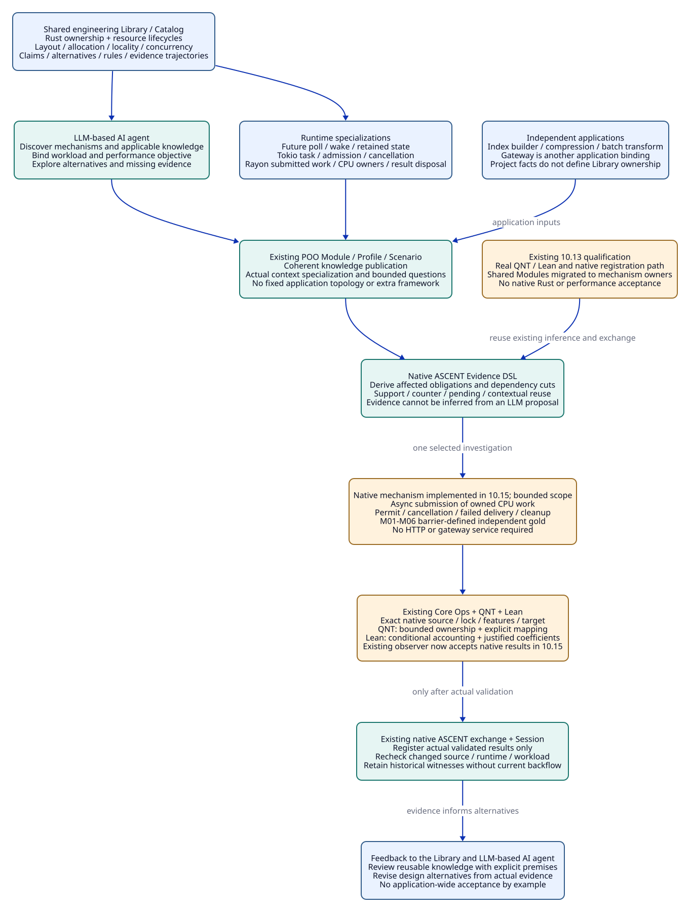

# SPDX-FileCopyrightText: 2026 tao3k team and Contributors
#
# SPDX-License-Identifier: LGPL-2.1-only

#+TITLE: 10.14 Rust Performance Library and Mechanism Cases
#+LANGUAGE: en
#+PROPERTY: JD_ID 10.14
#+OPTIONS: toc:3 num:t
#+STARTUP: overview
#+TODO: SPECIFIED | QUALIFIED
#+FILETAGS: :library:rust:tokio:rayon:performance:ownership:
#+PROPERTY: header-args :eval never :exports code

[[file:../../00-09-project/00-documentation/00.01-index.org][Index]] | [[file:10.08-engineering-library-and-rust-trajectories.org][Shared Library]] | [[file:10.13-real-method-results-and-agent-evidence-loop.org][Existing real method path]]

* SPECIFIED Engineering knowledge owns the Library boundary
:PROPERTIES:
:CUSTOM_ID: rust-library-boundary
:STATUS: design-scope-correction
:END:

The Library organizes reusable engineering knowledge around mechanisms, claims,
assumptions, design alternatives, rules and evidence trajectories. Rust performance
is a domain within it. Tokio and Rayon specialize runtime and parallel execution
semantics within that domain. A gateway, index builder, compression pipeline or
batch processor binds application context to those assets.

The gateway accumulated detailed examples because it exposed resource and
handoff questions. Its application topology must not become the Library's
organizing principle. The existing executable case proves a local QNT/Lean and
ASCENT registration path; it does not establish a general Rust performance theory
or a native Tokio/Rayon implementation. [[file:10.15-scheme-owned-rust-mechanisms-and-development-evidence.org][10.15]] implements the small resource-lifecycle mechanism and direct Module
migration, without an HTTP service or routing behavior.

The dependency direction is shared mechanism knowledge -> application bindings
-> actual evidence -> reviewed knowledge revision. Generalization requires
explicit premises and counterexamples; removing the word gateway from a name
does not establish applicability to other programs.

* SPECIFIED Performance domains and semantic foundations
:PROPERTIES:
:CUSTOM_ID: rust-performance-catalog
:END:

These are Catalog discovery dimensions for existing POO assets, not separate
frameworks, mandatory modules or implemented new relation names.

#+NAME: rust-performance-domain-catalog
| Domain | Mechanisms and candidate questions | Obligations / evidence needed |
|--------+------------------------------------+-------------------------------|
| Rust data and resource ownership | Moves, borrows, Drop, Arc sharing, unique allocations and retained capacity; which owner controls actual release? | Source/alias mapping, release traces, panic strategy, allocation and retention measurements |
| Data structures and locality | Layout, contiguous storage, indirection, clone/copy, allocation, cache locality, batching and vectorization | Semantic equivalence; representative size/skew distributions; matched allocations, CPU and cache measurements |
| Async execution | Future state, poll duration, wakeups, task retention, scheduling and bounded concurrency | Poll/wait accounting, progress assumptions, executor responsiveness and retained-state evidence |
| Tokio runtime | Runtime flavor/features, async task and handle lifecycle, channels, admission, cancellation and blocking work | Exact API/source semantics, queued versus executing work, shutdown and source/runtime correspondence |
| Rayon CPU parallelism | Pool configuration, submitted/running jobs, task granularity, work stealing, reduction, result delivery and panic propagation | Work ownership, deterministic-result requirements, overhead and saturation measurements, actual completion |
| Shared concurrency | Locks, atomics, publication order, contention, reclamation and cross-pool coordination | Invariants, ordering/linearization assumptions, model scope, targeted race tests and contention evidence |
| Resource and overload composition | Retained bytes, CPU admission, queue/result/cleanup holders, retries and cancellation | Holder coverage, conservation, service/workload assumptions, memory envelope and overload measurements |
| System performance | Throughput, tail latency, fairness, resource consumption and workload tradeoffs | Named objective, matched baseline, target/toolchain/hardware/load, warmup, observation limits and negative results |

Rust ownership constrains legal access and many lifetime errors. It does not by
itself bound retained bytes, progress, task count, CPU occupancy or execution
time. Safe code may intentionally retain allocations or forget resources.
Tokio's task count is not a CPU-thread count, and a bounded Rayon worker pool
does not alone establish a bound on submitted jobs or their retained data.
These distinctions determine the claim before the Agent chooses a design.

The [[https://doc.rust-lang.org/std/future/trait.Future.html][Rust Future contract]] distinguishes polling from work performed independently
by another task. Poll implementations should return promptly. That is a semantic
basis for an obligation to investigate blocking/long CPU work in an async poll;
it is not a measured latency guarantee.

The [[https://docs.rs/tokio/latest/tokio/runtime/index.html][Tokio runtime contract]] makes its scheduling/fairness assumptions explicit.
A project must bind the actual runtime flavor, configuration and version before
using those assumptions. Documentation discovery uses these official pages;
actual method receipts must capture the selected Cargo.lock, enabled features,
resolved dependency/source metadata, compiler, target and execution configuration.
A lockfile alone does not record the effective feature selection or hardware.

* SPECIFIED Library rules follow semantic premises
:PROPERTIES:
:CUSTOM_ID: mechanism-rule-obligations
:END:

#+NAME: mechanism-premise-obligation-table
| Observed premise in a selected design | Required reasoning / evidence | Invalid inference to reject |
|---------------------------------------+-------------------------------+-----------------------------|
| A CPU closure retains data after async submission | Identify its owner while queued, executing and returning; bind admission lifetime to the claimed resource | Async caller cancellation implies the closure and data are gone |
| An OwnedSemaphorePermit is moved to the work owner | Inspect actual field/local destruction and all move/return paths; prove the intended budget association | Any use of a semaphore bounds all memory |
| An async JoinHandle is dropped | Distinguish detached task from completed/cancelled task; preserve its holder obligations | Losing the handle proves task termination |
| abort is requested for an async task | Record request and observed termination separately; inspect all already-submitted external work | abort returning proves Rayon work or cleanup finished |
| Started spawn_blocking work is used as an alternative | Retain ownership through actual completion; bind shutdown and cooperative-stop policy | Its handle can forcibly abort started CPU work |
| A Rayon closure owns the result channel sender and data | Inspect delivery success, receiver drop, panic and actual destruction; define app-level stop protocol if needed | Dropping the receiver cancels Rayon submission |
| Cleanup delivery can fail or its queue is full | Identify who retains/releases resources on failed transfer; account for bounded fallback and progress | Enqueue attempted means cleanup ownership transferred |
| A cache or workload changes | Recheck changed holders, coefficients and objective; retain only independently applicable evidence | Previous throughput or memory admission transfers with a Profile name |

These rules require precise native interpretation. The official
[[https://docs.rs/tokio/latest/tokio/task/struct.JoinHandle.html][Tokio JoinHandle documentation]] distinguishes handle drop, cancellation requests
and completion, and documents the exception for already-started blocking work.
The [[https://docs.rs/tokio/latest/tokio/sync/struct.OwnedSemaphorePermit.html][owned permit API]] documents release on drop as well as operations that change
permit ownership/accounting. The selected design must declare whether it allows
forget, split, merge or dynamic capacity changes before claiming conservation.
The [[https://docs.rs/rayon/latest/rayon/struct.ThreadPool.html][Rayon pool API]] supplies submission/execution mechanisms; an application still
owns its protocol for cancellation, delivery and completion observation.

A source-derived candidate rule is reviewed Library knowledge. A tool run is an
observation about a particular subject. ASCENT derives obligations, applicability,
support and counters from supplied facts; it cannot turn a prose API summary
into proof that an arbitrary Rust implementation conforms to that summary.

* SPECIFIED Existing owners and current organization debt
:PROPERTIES:
:CUSTOM_ID: mechanism-existing-owners
:END:

#+NAME: existing-owner-boundary-correction
| Existing owner | Current responsibility | Boundary for the corrected direction |
|----------------+------------------------+--------------------------------------|
| [[file:../../../library/concurrency/resource-control/backpressure-memory/rust/objects.ss][rust-resources / BackpressureMemory]] | Authored resource rules, lifecycle and dependencies | Directly migrated resource-domain publication; old gateway path/identity are no longer selected |
| [[file:../../../modules/resource-evidence/func.ss][resource-evidence]] | Native finite resource obligation and footprint inference | Keep this inference path; separate general resource semantics from application-specific facts when directly migrating ownership |
| [[file:../../../profiles/gateway.ss][gateway Profiles]] | Particular declared capacity/cache/retry inputs | Case/application bindings; never defaults for the whole performance Library |
| [[file:../../../scenarios/gateway-review/func.ss][gateway-review Scenario]] | Existing evidence investigation and local method operations | Application adapter and historical qualified example; not the parent of every Rust design |
| Core Module/Profile/Scenario | Publication, composition, specialization and selected execution context | Continue using these mechanisms; do not add a parallel Catalog runtime or scheduler |
| ASCENT Evidence DSL / trajectory / exchange | Finite derivation, actual event/evidence binding, support/counter/pending and scoped reuse | Continue using native registration/query and the existing observer path |
| QNT / Lean / Core Ops | Model checking, conditional proofs and actual process receipts | Add subject-specific mappings and native observations; do not invent new tool execution machinery |
| LLM-based AI agent | Discover concepts, propose alternatives, select investigations and interpret results | Library reasoning enables alternatives; a fixed gateway implementation sequence is not the Agent's required workflow |

The original ownership assessment led to the direct migration recorded in 10.15.
The existing coherent publications, observer and oracle now have mechanism-owned
paths and Core bindings; no rule copy, forwarding alias or parallel framework was
introduced. The original six-case contract below remains the design basis. Historical
10.13 receipts retain their original source identities; they cannot be relabeled
as new module or native-source acceptance.

POO composition follows semantic capability: a Profile binds actual workload,
resource objective and selected runtime; an extension changes named assumptions;
a Scenario checks a bounded design question. One module per test case, one fixed
Tokio/Rayon topology for all projects and a forced sequence of engineering steps
would all misrepresent this Library's role.

* SPECIFIED Minimal native mechanism case and independent oracle
:PROPERTIES:
:CUSTOM_ID: minimal-native-mechanism
:STATUS: implemented-bounded-case-see-10-15
:END:

The first native subject is asynchronous submission of bounded CPU work, with an
owned payload and explicit permit lifetime. It can represent indexing, compression,
batch transforms or request processing without importing any of those domains.
A controlled barrier establishes ordering; a sleep is not evidence of ownership
or completion. This case checks resource semantics, not high throughput.

#+NAME: native-mechanism-review-cases
| Case | Controlled input / event order | Required observation and independent gold |
|------+--------------------------------+-------------------------------------------|
| M01 Normal handoff | One permit; payload ID; submit closure, hold at started barrier, then allow completion and consume result | Unique live payload and permit owner tracked until the actual release boundary; final live holders zero and permit availability restored |
| M02 Cancel waiting admission | Occupy capacity; start a second acquire; establish pending state; cancel that waiter | No second submission/owner acquisition; original worker still owns its permit; any pre-admission payload has an explicitly observed owner/release |
| M03 Drop async result receiver | Worker is running behind a barrier; drop receiver before releasing worker | Worker/data remain owned before worker exit; delivery failure releases returned data through an explicit observed path; no inferred CPU abort |
| M04 Request async caller abort | Prove the external CPU closure has started; abort and await caller termination | Caller completion and CPU completion are separate events; external owner persists until allowed to terminate; permit is not returned merely because caller ended |
| M05 Cleanup cannot accept | Fill cleanup capacity; produce a result requiring disposal; force failed transfer | Failed transfer has no fictitious new owner; sender or explicit fallback retains and releases the item; full cleanup never drops ownership accounting |
| M06 Incorrect permit lifetime | Matched alternative keeps permit in async waiter while CPU closure retains payload; drop waiter after CPU start | While CPU owner is still live, permit becomes available: concrete counter to the selected lifetime association, rather than a compiler/runtime failure |

The native oracle derives unique live ownership from independently collected
allocation/drop and synchronization observations. It compares permit availability
at barrier-defined cuts and rejects missing events, duplicate releases and
unexplained retained owners. If instrumentation cannot establish ordering, gold
is pending; it must not infer a release from a cancellation request. Test events
and an observer derived from the same desired output are not independent oracles.

Normal return, panic-unwind and process-abort are distinct domains. Panic-unwind
needs a separately controlled test and captured panic strategy; process-abort
cannot be claimed to run destructors or execute cleanup. Liveness additionally
requires that held barriers are released and work terminates. The six cases do
not qualify arbitrary panic handling, runtime shutdown or all interleavings.

* SPECIFIED QNT, Lean and native evidence correspondence
:PROPERTIES:
:CUSTOM_ID: mechanism-method-correspondence
:END:

The [[file:../../../library/concurrency/resource-control/backpressure-memory/model.qnt][current QNT model]] can supply a bounded conservation/lifetime hypothesis.
Its running state already means CPU-owned, including submitted work, not the
number of physical Rayon workers. A native witness must map acquisition, transfer,
queued/running ownership, returned data and actual disposal to that vocabulary.
Any unrepresented owner or delivery-failure branch keeps correspondence pending
and requires a model revision and fresh check; a similar-looking trace is not
an automatic refinement proof. M06 should be compared with the early-release
counter under its own initializer/step identity.

The [[file:../../../library/concurrency/resource-control/backpressure-memory/budget.lean][current Lean proof]] verifies conditional accounting, using abstract units.
Native payload/auxiliary sizes require explicit, independently justified
coefficients and complete holder coverage before instantiating a byte bound.
Allocation-drop observations establish lifecycle facts; they do not measure RSS,
allocator reserve, thread stacks or cache behavior. No throughput theorem follows
from a permit invariant or a satisfied accounting inequality.

For a new native result, the existing Scenario observer must validate actual
Core Ops command completion, exact source/lock/feature/toolchain/configuration
capture, structured result and independent oracle before admitting a native
witness. The existing native exchange and domain Session remain the registration
and query owners. The observer extension and native case implementation are now recorded in 10.15.
The earlier 10.13 replay issues QNT/Lean results only; its historical receipts
remain distinct from the new native observations.

#+NAME: mechanism-evidence-change-boundaries
| Changed dependency | Evidence that needs revalidation | Potentially reusable knowledge / evidence |
|--------------------+----------------------------------+------------------------------------------|
| Permit moves from caller to CPU owner | Native source mapping, cancellation cases, source-bound correspondence and affected argument | Unchanged abstract invariant and generic arithmetic theorem, conditional on the new mapping and coefficients |
| Rayon/Tokio lock, selected features or runtime configuration | Native runtime observations, API assumptions, scheduling/progress and correspondence obligations | Model theorem only when its stated transition assumptions remain justified; historical native measurements remain historical |
| Capacity or retained payload/cleanup budget | Changed QNT instance, arithmetic instantiation, native boundary tests and performance measurements | Rule definitions and unchanged generic lemmas; no automatic reuse of old instantiated acceptance |
| Workload size/skew, hardware or algorithm | Target objective, holder coefficients and matched measurements; model mapping if semantics change | Unaffected semantic facts with proven unchanged dependencies; old throughput is no target evidence |
| Result arrives for an older captured source | Current applicability and fresh T-use under its actual input footprint | Retain old witness and historical completed query; no backflow into a different source cut |

Dependency checks identify what to revisit; an import, shared Catalog identity or
unchanged theorem file does not discharge current application assumptions.
Performance investigation remains open to alternatives such as inline small work,
CPU pool work, batching or different data representations. Workload-specific
measurements decide those tradeoffs after semantic equivalence is established.

#+CAPTION: Mechanism-owned Rust performance knowledge is specialized through runtime semantics and applied by different projects; native mechanism cases investigate obligations without making the gateway the Library boundary.

