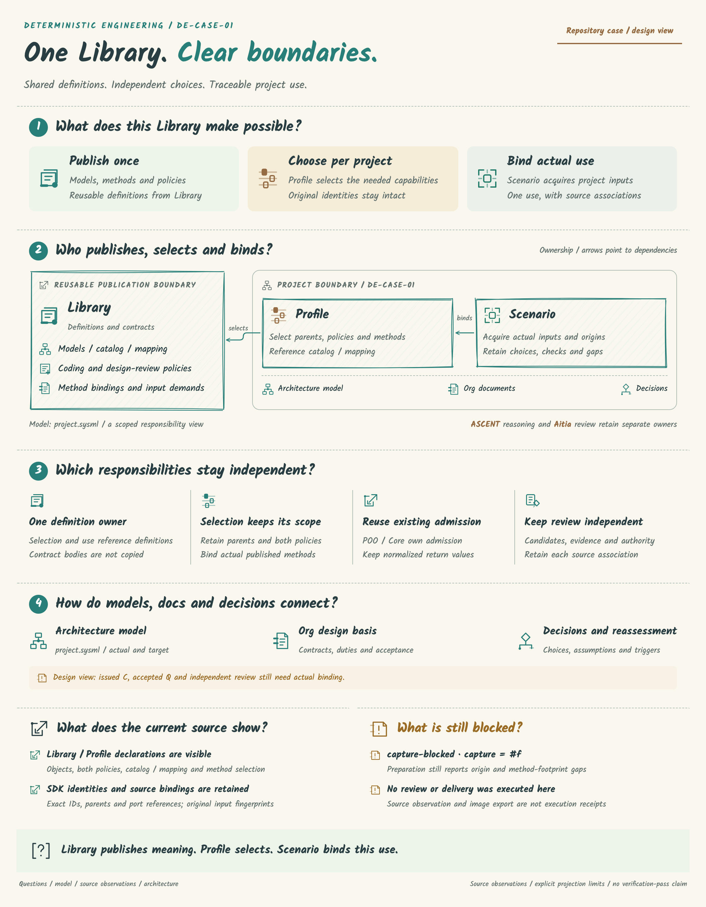

# SPDX-FileCopyrightText: 2026 tao3k team and Contributors
#
# SPDX-License-Identifier: LGPL-2.1-or-later

#+TITLE: 10.143 SDK Model Adaptation Audit and Closure
#+LANGUAGE: en
#+PROPERTY: JD_ID 10.143

* Provenance and scope
Base commit: =7868849=. The four originally reported dirty files came from the
active Gateway conversation =01a14f36-74bd-7151-8830-70b7e82ab7a8=. Its recorded
commands ran =weaver-upstream-model-support.ts= and
=weaver-upstream-sysml-bridge.ts= against this renderer worktree. The work expanded
to six modified files and the new =model-view.ts=. The user authorized notifying
that conversation to stop upstream writes and assigned closure to this conversation.
No independent authorship is inferred from file timestamps or Git's dirty status.

The inherited patch, seven file snapshots and SHA256 manifest are preserved locally
under =.cache/render/model-adaptation-audit/=. Temporary Gateway scripts are origin
records, not build entrypoints or published framework dependencies. Actual authority
for model syntax/semantics remains the pinned SDKs declared in package.json.

* Disposition and ownership
| File / inherited behavior | Disposition | Owner / boundary |
|---------------------------+-------------+------------------|
| =d2-figure.ts=: longest dotted prefix as parent/endpoint owner | Remove | D2 supplies exact IDs/endpoints. Generic automatic hierarchy needs explicit parent data; nested D2 views declare their ELK grouping |
| Generated lifeline name, ID suffix and stroke pattern filter | Remove | Preserve SDK observations. A complete automatic projection refuses missing exported endpoints; dedicated sequence notation is not reimplemented |
| Class/SQL members flattened into invented strings | Retain typed SDK member data instead | Render text uses the SDK's method name, visibility, constraints and references. Null member arrays are handled; D2 text geometry is discarded |
| =figure.ts=: boolean arrow flags / reconstructed source names | Replace with Arrowhead values and raw SDK names | Names are captions, not identities. Core model carries typed observations only |
| =diagram.ts= / =scene-export.ts=: arrows / compound endpoints | Retain with explicit capability boundary | Preserve none, arrow, triangle and unfilled-triangle at both ends; unsupported markers refuse instead of becoming generic arrows |
| =opensysml.ts=: recursive PascalCase JSON renaming | Remove | The official SDK decodes its own protojson. Go transport must export its actual protojson contract |
| SysML-to-D2 emission followed by another D2 compilation | Remove | Direct SDK RenderedView-to-FigureModel display projection; no second SysML parser, name resolver or model compiler |
| =index.ts=: view-name-only selection and fabricated capture paths | Replace | Bind declared model hash + requested view + an existing source reference and matching captured JSON; retain actual input sources |
| =model-view.ts=: reusable hierarchy/composer helper | Retain as optional pure functions | Use explicit parent IDs, exact node-ID presentation mappings and ELK options. Do not reinterpret D2 classes as semantic roles |

* Public declaration and source closure
=FigureResources.sysmlViews= supplies host-captured SDK results. D2's existing
figure metadata may select one using:

#+begin_src json
{"modelSource":{"ref":"sdk","modelHash":"<actual selected model hash>",
 "view":"<actual requested SDK view>","portProjection":"owner",
 "labels":{"<exact SDK node ID>":"Display caption"}},
 "references":{"sdk":"models/current-render-view.json"}}
#+end_src

The reference points to already captured bytes in =sources=. Those bytes encode
={modelHash, requestedView, rendering}= from the SDK capture. The adapter compares
the parsed object with the selected SDK snapshot using Node's structural equality,
retains the original bytes, and rejects mismatches. It does not create files or
invent source paths. SDK revision/request binding and the source fingerprint enter
=composeFigure='s input footprint and exported metadata through =modelSource=,
=modelTrace= and existing =sourceSHA256=.

Source acquisition, actual SDK calls, capability checks and explicit persistence
belong to the host/project. The renderer does not turn caller-supplied captures
into trusted execution receipts. Saved SDK fixtures prove adapter behavior, not a
live service, valid SysML model, issued C, accepted Q or independent review R.

* SysML projection contract
The SDK owns parsing, checking, ownership resolution, transport decoding and
renderView. Edge IDs created by the display projection are local ordinal keys
bound to this capture and trace, not new persistent semantic edge identities. The projection consumes exact node IDs, explicit parents, ordered
edge endpoints, port IDs and source spans. Display-caption overrides use exact
IDs, including when multiple nodes have the same name. It does not synthesize
qualified names from labels.

Default projection refuses ports. Explicit =portProjection: owner= retains
=fromPort=/=toPort= and the projection mode while showing owner-level connectors.
Each port must belong to the specified endpoint. Duplicate/absent port IDs, broken
parents, cycles and missing nodes refuse. This is not exact port geometry or a
proof of connection compatibility. SDK edge kind and ordered endpoints remain in
the observation; the current RenderedView contract has no arrowhead field, so this
projection does not invent arrowheads from kind strings.

Tables/notes, stand-ins, compartments and collapsed SDK nodes still require a
supported notation adapter. The former D2 roundtrip projection's =text=/=source=
result is replaced by =model= and its trace in this unpublished PR. No compatibility
fallback or alternate decoder is retained. The optional SDK peer is needed for
its integration and types; ordinary runtime D2/render imports do not initialize it.

* D2 and generic scene contract
D2 compiles syntax/imports and exports IDs, labels, level, classes, typed members
and Arrowhead values. The renderer neither unescapes labels again nor parses IDs
or method signatures. Class names and method parentheses are preserved exactly.
D2 classes remain ordered source annotations, not implicit framework role choices.

=graphFromModel= builds an ELK graph from explicit parent IDs. Nested D2 observations
without explicit parents require the project's declared graph; automatic grouping
will not guess from dots in IDs. Missing endpoints and unreachable ownership refuse.
=composeModelView= is optional and replaceable. ELK still owns spatial layout;
SVG primitives only materialize its result. This does not reproduce full SQL row
ports, UML or sequence notation. The supported generic node/member display is
explicitly distinct from those notations.

* Positive and negative acceptance
| Boundary | Positive control | Negative control |
|----------+------------------+------------------|
| Actual D2 SDK | Quoted IDs, nullable SQL constraints, method-only class, exact method name | Automatic nested grouping refuses; lifelines are not silently filtered |
| Direct SysML projection | SDK-decoded IDs/parents/origins; unchanged source object | Duplicate nodes, cycles, missing owners/endpoints, ambiguous name captions |
| Port projection | Explicit owner mode preserves real port references | Implicit collapse, wrong endpoint ownership, duplicate ports |
| Source binding | One model hash/view and actual captured JSON; no generated source files | Wrong revision/view, absent resource/reference, changed JSON |
| Display fidelity | None/triangle/bidirectional SVG marks, compound node endpoints, members | Unsupported diamond marker refuses; root identity collision, invented mapping or non-text ELK option refuses |
| Trust / lifecycle | SDK errors propagate; capture snapshot survives caller mutation | Decoder rejects invalid transport fields; no parser or review-authority fallback |

Local validation uses the package's typecheck, Bun tests and Playwright
entry (two workers). Downstream typecheck/domain tests, ten full explanatory Case
exports, comparisons and current view exports remain required. Linux/macOS CI
must pass on the resulting PR commit; previous green commits do not qualify it.

* Paired architecture and complete overview

The complete numbered README overview remains the primary illustration. Its D2
observations now capture the adapter/binding source files, and its source-status
caption explains SDK identity/port preservation and explicit projection limits.
It is regenerated through the same TS Library, not replaced by a section crop.

The component view is =90.136=; Workflow remains a separate purpose. No independent
review, model publication or delivery is performed by this refactor.

Primary references: [[https://d2lang.com/tour/sql-tables/][D2 SQL tables]],
[[https://d2lang.com/tour/classes/][D2 classes]], and the pinned installed
=@terrastruct/d2/index.d.ts= / =@openmbee/opensysml/dist/core/render-view.d.ts=.

* Local qualification
Package typecheck, 31 Bun unit/SDK tests and 23 Playwright browser controls passed
with two workers. The real consumer typecheck and two domain tests, full Case
exports/comparisons and six component/overview views are the standard downstream
entries. Final-head Linux/macOS checks must be read from PR #2; no new PR is used.

The independently packed consumer passed a core-only D2 export without the optional
SDK installed. With the declared SDK peer installed, the same archive passed direct
source-bound SDK projection/export and rejected a stale model hash. These are
local package-consumption checks, separate from remote Linux/macOS CI.

Re-entry through =composeFigure= rejects a model hash, view or port-projection
selection that differs from its captured SDK trace. A new selection requires a
fresh source-bound projection; changing its fingerprint alone cannot admit a
contradictory selection. This is a rendering-context consistency check, not SDK
semantic validation or an independent provenance credential.
