# SPDX-FileCopyrightText: 2026 hardenedlinux Linux Team and Contributors
#
# SPDX-License-Identifier: LGPL-2.1-or-later

#+TITLE: 10.144 Functional themes, measured composition and package-owned examples
#+LANGUAGE: en
#+PROPERTY: JD_ID 10.144

* Scope and actual corrections
This implements the functional render Library improvements on the existing PR #2,
from source baseline =1da8a8f=. Model truth, source acquisition, execution evidence,
review and publication ownership remain outside visual styles. Package version is
still read only from =packages/render/package.json=; no namespace version is added.

The audit found closed palette/spacing tokens, fixed typography/icon dimensions,
a prematurely assigned DOWN direction in =graphFromModel=, shallowly shared nested
surface/Rough options, and a blueprint layer that reset unrelated styling. These
are replaced by open semantic tokens, measured typography/spacing, explicit option
precedence, owned deeply frozen values and independent palette layers.

A new text-line overlap control caught Kalam's taller real font bounds. Its visual
style now declares its own leading instead of relying on Inter's metrics. A first
layout test incorrectly compared the left edges of unequal-width nodes; the final
control compares their centers and displacement along the chosen axis. Neither
failure is described as an upstream ELK defect or a retry-based repair.

* Public responsibilities
| Owner / files in packages/render | Publishes / consumes | Boundary |
|---------------------------------+----------------------+----------|
| =src/palettes.ts= | Complete color data: blueprint, graphite, field-notes, ocean, ember | Open semantic string tokens; browser CSS validates colors; a palette is one aspect of a theme |
| =src/presentation-theme.ts=, =src/styles/= | Ordered immutable layers for style, fonts, typography, spacing, markers, surfaces, Rough and ELK preferences | Downstream extends ordinary data; no mutable global registry or diagram kind-to-layout table |
| =src/layouts.ts= | Optional layered-down / layered-right data for the existing theme mechanism | Open ELK options remain available; these are preferences, not a new constraint schema or semantic taxonomy |
| =src/heading.ts= | =composeHeading(context, spec)= returns markup/CSS | Open roles, optional ordinal and independent domain glyph; no page template or invented Question |
| =src/figure.ts= | Immutable selected Questions and source/style footprint | All selected Questions remain visible; extra rendered Question IDs refuse |
| =src/diagram.ts=, =src/scene-export.ts= | Actual font/glyph/content bounds to ELK, then returned geometry | No local constraint solver, obstacle router, wrapping parser or retries |
| =src/export.ts= | Browser color/geometry checks, observed SVG text scale, explicit canvas and output receipt | Host owns persistence; observations are not validity, evidence strength or aesthetic approval |
| =examples/= inside this package | Real source-driven architecture and Workflow compositions, declarations, tests and image drivers | Root =examples/render= is removed as a maintained source location; no parallel copy |

Model adapters preserve the current D2 and OpenSysML responsibilities from 10.143.
Automatic graph construction uses explicit parents. Source-declared grouping and
layout options stay in D2/SysML/project adapters. The selected theme cannot
change a model relationship, turn architecture into Workflow or issue C/Q/R.

* Functional composition contract
=composePresentationTheme(names, layers?)= folds ordered overrides over one default.
The returned tree is an owned, deeply frozen copy, including SVG asset records and
Rough dash arrays. Caller inputs remain editable. Later palette selection changes
only colors (including field-notes, which formerly also replaced the font); applying blueprint after sketchbook preserves Rough, Kalam and leading.
Font assets remain explicit. Density changes padding/gaps, not font size.

Color and spacing tokens can add downstream semantic names. Typography tokens are
CSS strings and become =--type-<name>=; colors/spacing use their existing CSS names.
Token identifiers, nonempty values, finite nonnegative spacing and ambiguous CSS
names are checked. The browser validates color syntax, including modern CSS color
functions. This is not a second color parser or a contrast/beauty scoring system.

Precedence is: actual layout-effect defaults, then theme ELK preferences, then
explicit view/graph options. Automatic graph projection no longer inserts
a direction before that selection. Scene padding, glyph size/gap, label padding,
viewport padding and text style feed actual browser measurement before layout.
ELK owns placement/routing; unsupported adapter capabilities still refuse.

#+begin_src typescript
const theme = composePresentationTheme(
  ['sketchbook', 'ocean', 'compact', 'layered-right', 'project'],
  {...presentationThemeLayers, project: {
    colors: {domainBoundary: 'oklch(60% 0.15 240)'},
    typography: {titleSize: '21px'},
    spacing: {iconGap: 16},
    headingMarkers: {question: '?'},
    layoutOptions: {'elk.spacing.nodeNode': '36'},
  }},
);
#+end_src

The model declaration still chooses Questions, ordered themes, variants and icon
packs. Pure composers consume the resolved resources; core TS contains no Library /
Profile / Scenario identity, language translation or numbered overview template.

* Human-readable roles and whole-heading measurement
=composeHeading(context, {role, text, questionRef?, ordinal?, glyph?})= is an optional
part, independent of =composeModelView= and any full-page compositor. A supplied
Question reference must resolve to the selected source wording. Open roles can use
theme CSS. The default question role uses the theme's =?= marker; an ordinal
can replace it. Answer/content domain glyphs are selected separately and are not
inferred from a Question's subject or copied into its role marker. Downstream can
override =headingMarkers= by role without repeating the same marker per chapter.

At export, every ordinal/glyph/text part is measured with the actual font. Ordinal
text is centered in its measured marker, parts share a vertical center and selected
gap, and the complete group is placed in the annotation viewport. A long annotation
that does not fit refuses; no automatic font shrinking or silent truncation is added.
Legacy single-text annotations remain measured as such, without a duplicate API.

* Canvas and observed readability
Root figures have an explicit theme background. Whole-figure and standalone scene
SVGs include the measured root backdrop by default, avoiding transparent dark-text
assets on a dark GitHub page. =exportFigure(..., {transparent: true})= explicitly
requests a transparent outer PNG/SVG canvas; authored interior fills remain intact.
SVG serialization uses sorted computed custom-property names as before.

=receipt.readability= reports visible SVG text samples and their minimum effective
font size in logical CSS pixels after scene scaling. An optional
=minimumTextSize= rejects below the host's declared threshold. It does not inspect
all HTML text, prove screen readability at an arbitrary embed size, or claim beauty.
Increasing export DPR does not increase the logical text-size observation.

* Maintained source-driven examples and artifacts
Examples now live in =packages/render/examples= and consume the package's public
self exports, dependencies and typecheck. The old example manifest/lock/tsconfig
are removed. Keeping a nested =file:..= manifest initially caused an ENOENT copying
failure; inspection showed parent =examples= and =node_modules= copied into the
self-dependency. That failed installation tree is retained locally under
=/private/tmp/de-render-example-install-failure=. The corrected ownership removes
the self-dependency rather than cleaning/retrying it. Bun entry commands
and separate package/example test directory selection remain explicit in CI.
Repository source roots, source fingerprints and documentation move together.
Examples are excluded from the published =files= list. A separate tarball consumer
qualifies actual downstream installation without nesting it inside the package.

The README keeps the complete numbered Library/Profile/Scenario overview first.
Detailed component views stay separate. Architecture 90.135 declares editorial /
ocean, sketchbook / ember and node-editor / ocean variants, with an additional
comfortable-density variant. Workflow 90.130 independently declares node-editor /
ocean and sketchbook / ember. The same Questions and model relationships
survive each variant. 90.137 documents the actual component dependencies.

* Positive and negative acceptance
- Unit: layer order, new downstream tokens, collision/invalid numeric refusal,
  unchanged caller-owned nested assets and deep immutability.
- Browser: theme direction reaches automatic ELK graphs; explicit source options
  override it; larger type/padding/glyphs alter actual measured node dimensions.
- Question/Answer: selected wording, independent role marker and domain glyph,
  multiple selected Questions, whole-part bounds/centers across visual styles;
  invented wording and a shifted whole-heading group refuse.
- Readability: visible SVG metrics are reported; an explicit excessive threshold,
  invalid threshold and deliberately overlapping text lines refuse.
- Canvas: decode full and individual SVGs as actual images and sample alpha pixels;
  default backdrop is opaque and explicit transparent mode is transparent.
- export: original strict SVG/PNG repeatability, CSSOM order control, failed
  layout cleanup, model binding and unsupported notation controls remain active.
- Consumer: unified package/example typecheck and separate example tests and all declared exports; a packed
  independent consumer checks new subpath exports and public heading composition.
- Remote: Linux and macOS must qualify the final source commit with two Playwright
  workers and the existing CI limits. Local receipts do not stand in for remote CI.

No Gerbil/SDK/compiler changes, interactive editor, custom layout solver, automatic
orchestration, review submission, C issuance or model delivery belongs to this work.

* Local qualification record
The package unit lane passed 35 tests (including the seeded ordinal PBT),
the browser lane passed 29 controls with two workers, and the package-owned case
lane passed 2 tests. All ten full case variants, two comparison sheets and twelve
measured component views were regenerated; captured source and PNG/SVG hashes were
checked before refreshing documentation. These are local receipts, not remote CI.
An independent packed consumer installed the package outside the repository and
exported a source-declared hand-drawn model with a RIGHT layout, semantic
headings and an opaque canvas; its observed minimum SVG type was 12 CSS pixels.
The package archive excludes examples and tests. Remote final-head qualification
is recorded in the existing [[https://github.com/hardenedlinux/deterministic-engineering/pull/2/checks][PR #2 checks]].

* Downstream surface counterexample and correction
A downstream reported PNG pixel [231,241,245,255] versus SVG [240,245,247,255]
at the same panel coordinate: only SVG scenes/headings were collected, so an HTML
panel's tint was absent from the independent vector image. The report is retained
locally at =/private/tmp/weaver-library-surface-counterexample.json=; it is not a
new model or evidence authority. The package reproduces this class of defect with
its own declared panel and nested Question/Answer headings.

The existing =data-surface= boundary now materializes declared rectangle/ellipse/
diamond surfaces for precise SVG or Rough paths, using measured host dimensions.
Precise mode uses browser-computed solid background, uniform solid/dashed/dotted border and
uniform pixel corner radius; unsupported CSS forms request an explicit SVG asset
rather than being approximated. These surfaces are included in vector extraction
in document order, before their contained headings/nested surfaces. Scene-internal
Rough paths are already part of their scene and are not separately collected.

The browser control decodes PNG and SVG, compares corresponding outer/nested fill
pixels and checks surface / Question / nested surface / Answer order across precise
and sketchbook styles. A declared gradient background refuses. This does not claim
arbitrary HTML/CSS-to-SVG conversion or preserve effects outside this explicit
surface boundary. Architecture and Workflow compositions remain independent.

Dashed/dotted surface borders use SVG dash arrays and browser stroke rendering;
exact CSS-border raster parity and HTML shadows/pseudo-elements are outside this
primitive surface projection. Custom SVG assets can supply a different visual mark.
