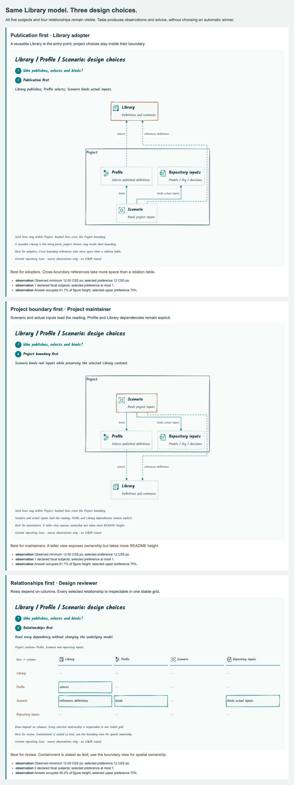

#+TITLE: 10.145 Design and Taste public contracts
#+LANGUAGE: en
#+PROPERTY: JD_ID 10.145

* Intent and ownership
The render Library publishes Design as a reader brief and Taste as composable pure
inspection rules. Existing FigureComposer, DiagramSpec, theme/icon resources,
browser measurement and ELK remain the composition and rendering interfaces.
The package version still comes only from =packages/render/package.json=.
No skill installation, separate framework, diagram taxonomy or evaluation service
is required to use these APIs.

| Owner / file | Responsibility | Boundary |
|--------------+----------------+----------|
| =src/design.ts= | DesignSchema, inferred Design type, defineDesign and binding | Valibot decodes structure; selected model/Question IDs establish reference closure |
| =src/d2-figure.ts= | Read Design and existing source-declared variants | Syntax/imports belong to D2 SDK; SysML selection still uses its existing adapter |
| =src/figure.ts= | Snapshot Design into context, metadata and input footprint | Check references after SDK projection; require selected subjects/relations in composition |
| =src/diagram.ts= | Consume DiagramSpec and explicit hierarchy | Preserve IDs/endpoints; record display owner and cross-boundary classification without name heuristics |
| =src/export.ts= | Observe actual geometry, visibility, text and Scope containment | ELK owns placement/routing; browser observations and source capture share output hashes |
| =src/taste.ts= | composeTaste, reviewTaste, criteria and structured findings | Pure inspection; no source acquisition, browser, graph rewrite, numeric beauty score or automatic winner |
| =examples/design-case.ts= | Case-specific ELK graph/matrix compositions and answer-space criterion | A downstream-owned example, not a core type registry or page template |
| =examples/design-choices.ts= | Source acquisition, export, explicit writes and comparison | Uses package entrypoints and the host-owned browser |

* Design declaration
=DesignSchema= is a strict schema; =Design= is inferred from it. =defineDesign=
decodes unknown data and returns an owned deeply frozen copy. Caller arrays and
objects remain editable. Empty text, duplicate references, unknown fields and
wrong primitive types refuse.

| Field | Meaning |
|-------+---------|
| =audience= | Reader and decision context, an open string |
| =medium= | Intended placement, e.g. README component view; existing width/language/purpose remain in FigureInput |
| =message= | Authored takeaway, not a derived or proven model assertion |
| =questionRefs= | Existing selected Questions that motivate the design |
| =requiredSubjects= | Exact model IDs that the selected view must retain |
| =requiredRelations= | Exact selected relation IDs; no endpoint-name ID reconstruction |
| =focalSubjects= | Exact model IDs chosen for emphasis; they must also be rendered |

Design is optional for existing consumers. When present it is part of the immutable
FigureContext, rendering input hash and existing provenance. References bind only
after the selected OpenSysML projection, so the D2 declaration's placeholder model
cannot accidentally become the binding model. Required subjects and relations must
have composition markers and visible output regions. This proves neither authored
wording nor model semantics: a visible marker is an explicit display association.

The existing =selectFigureVariant= also accepts a complete variant Design and an
optional replacement =presentation=. These replace whole values rather than merging
opaque project data. Variants retain captured sources, model and Questions. There
is no additional plan/candidate registry. The existing project-owned =layout= key
selects the Case's source-declared graph or matrix composition.

* Taste declarations and composition
A =TasteRule= contains =id=, =rationale=, optional scalar =parameters= and a pure
=inspect(context)= function. =Taste= is a readonly sequence of these rules.
=composeTaste(...rules)= copies/freezes declarations and parameter data, rejects
duplicate IDs and invalid parameters, and preserves their declared order. Downstream
functions extend this interface without editing a global rule registry.

=reviewTaste(figure, image, taste)= verifies the composed/input/output hashes and
compares original capture metadata with materialized metadata. Observations,
readability and region bounds must match the values baked into exported HTML.
It clones/freezes the inspection context, including the same model, selected
Questions and view, before invoking rules. Returned notes
are schema-checked and may reference only captured Questions/model subjects.

The result contains Design, input/HTML/PNG fingerprints, captured source hashes,
rule IDs, reasons, parameters and notes. Rule source acquisition stays with the
host: this Case captures its composition/criterion files and framework source in
the existing =sources=. Rule labels and local hashes are not code attestation,
trusted execution evidence or a substitute for checking the actual program.
Custom rules are expected to be pure; the Library cannot prove a callback has no
external state or network access. It supplies no execution runtime for them.

| Note kind | Interpretation |
|-----------+----------------|
| =observation= | A stated quantity/reference was observed under this rule; no aesthetic acceptance follows |
| =advice= | A selected preference suggests revising this candidate |
| =unobserved= | The necessary measurement is absent; an empty measurement is not a pass |

The built-in =minimumTextSize(n)= consumes existing measured SVG text sizes in CSS
pixels. =focalBudget(n)= counts declared focal subjects, not perceived salience.
The Case's =answerSpace= uses the existing answer-region/figure dimensions with a
source-selected limit. Its ratio is not a universal quality metric. An empty rule
list/report, or a list containing only observations, confers no beauty/pass score.
Hard model reference, visibility, clipping and containment failures remain rendering
errors. Taste advice does not silently drop content, shrink fonts or rerun layouts.

#+begin_src typescript
const design = defineDesign(sourceDeclaration.design);
const figure = composeFigure({...input, design}, projectComposer);
const image = await exportFigure(figure, browser);
const taste = composeTaste(minimumTextSize(12), focalBudget(1), projectRule);
const report = reviewTaste(figure, image, taste);
#+end_src

The decoder and compositor are synchronous pure functions; export remains an
explicit effect using the existing Promise/browser ownership contract. LLM-produced
proposals can enter the same source declarations and interfaces. Their wording,
preferences and recommendations remain authored candidates until reviewed.

* Actual Library / Profile / Scenario Case
Canonical declaration: [[file:../../90-99-views/90-architecture-views/90.138-library-design-taste-choices.d2][90.138]].
It retains the five subjects and four relations in the current 90.132 Case:
Library, Project, Profile, Scenario and repository inputs; selects, binds,
references definitions and binds actual inputs. The D2 SDK supplies their IDs.
The source captures project.sysml, Library objects, Profile selection and Scenario
code; source associations do not issue C, accepted Q, review R or validate SysML.
All three choices preserve the same required-reference sets and model observations.
Their Questions/content are English, following the current source models.

| Choice / reader | Design decision | Benefit | Tradeoff |
|-----------------+-----------------+---------+----------|
| Publication first / Library adopter | Library above the Project boundary, dependency arrows upward, one Library focal subject | Establish reusable ownership before project choices | Cross-boundary references consume more space than a table |
| Project boundary first / maintainer | Downward ELK arrangement with Scenario focal, explicit Project containment | Read actual input binding and retained Library dependencies | Greater vertical height in README |
| Relationships first / reviewer | Source-declared directed relation matrix, the same five subjects/four edges | Inspect every dependency without following routed lines | Containment is textual; use the boundary view for spatial ownership |

The matrix uses ordinary CSS grid, vector heading parts and the existing declared
surface adapter. Graph choices use DiagramSpec and ELK. Neither introduces another
layout solver. Explanations, tradeoffs, audience, focus and criteria preferences
are declared in D2; TS supplies the reusable functional composition.

* Scope feedback and correction
Human feedback on the first horizontal candidate identified a weak Project outline
and routed lines that appeared to live outside it. Automated counts/font checks
had not established visual clarity. The revised source selects UP for the Library-
first view and DOWN for the project-first view, gives Project a clear outline and
uses a stated solid/internal versus dashed/cross-boundary legend. These marks
classify the displayed hierarchy, not async/optional execution semantics.

The compositor records owners from explicit ELK children and classifies edges from
those owner IDs. It never infers ownership from dotted IDs. Export checks each
child frame against its owner frame and each internal relation, including labels,
against common ancestor scopes. Cross-boundary relations may leave a scope. ELK
still supplies all coordinates and routes; no corrective router is introduced.
Moving a child or internal edge outside its scope is a negative browser control;
a legitimate crossing edge is a positive control.

A preview also exposed overly broad CSS that recolored Rough's invisible fill
paths. The Case now styles only the visible outline paths. This example records
why human criticism and structured measurements have different roles: a geometry
check cannot certify the clarity of a Scope or the appeal of its drawing style.

* Functional-library choice and bounded measurements
Effect is a substantial functional ecosystem. This slice needs structural decoding
and type inference, so it uses Valibot 1.2.0 and ordinary TypeScript pure functions.
No local monad, schema parser, process framework or alternate browser lifecycle is
added. The existing package version remains 1.0.0.

A temporary Bun 1.3.11 browser-target probe decodes the same seven Design fields
through Effect 4.1.1 Schema and Valibot 1.2.0, with extra properties refused:

| Probe | Minified bytes | gzip bytes |
|-------+----------------+------------|
| Effect Schema | 76,766 | 25,714 |
| Valibot | 4,188 | 1,587 |

These are probe entrypoint sizes, not the production application bundle, loading
latency, heap or proof of general library performance. The install unpacked size
is a different quantity. Probe sources/output are retained locally under
=/private/tmp/de-design-schema-probe/=. Fonts and browser workers are unchanged.

* Controls and acceptance
- Strict structural schema, wrong/unknown/duplicate references, source-driven
  variants and post-projection model binding.
- Deep immutable inputs/results, unchanged caller data, seeded subject-set PBT,
  custom rules, preserved rule ordering and duplicate-rule refusal.
- Missing/hidden subjects and relations, including hidden paths whose geometric
  length is still nonzero; visible unlabelled horizontal edges remain valid.
- Original figure/output hashes and baked observations; stale/tampered PNG,
  observation or reference results refuse. No SVG text gives unobserved, not pass.
- Child/internal-edge containment, legal cross-boundary paths and owner IDs.
- Same five model subjects/four relations in all real choices; candidate IDs and
  reasons vary through the source without rewriting framework code.
- Package typecheck, Bun unit and example lanes, Playwright with two workers,
  existing export/SDK regressions, all declared generators and an independent
  packed consumer; final-head Linux/macOS CI in original PR #2.

Existing budgets remain unchanged. No Gerbil/SDK changes, skill execution, review
submission, automatic orchestration, model publication or merge belongs here.

* Research sources
The reference separates semantic patterns, style roles, output context and audience.
Those ideas inform contracts and examples; reference prose is not an execution or
policy input. Its particular palettes, fixed numeric caps and closed diagram list
are not imposed as framework-wide rules.

- [[https://github.com/cathrynlavery/diagram-design/blob/main/skills/diagram-design/references/semantic-patterns.md][Semantic patterns]]
- [[https://github.com/cathrynlavery/diagram-design/blob/main/skills/diagram-design/references/style-guide.md][Style roles]]
- [[https://github.com/cathrynlavery/diagram-design/blob/main/skills/diagram-design/references/output-spec.md][Output / audience specification]]
- [[https://effect.website/docs/v4/schema/introduction][Effect Schema documentation]]
- [[https://valibot.dev/guides/introduction/][Valibot documentation]]

* Local qualification record
Package/example typecheck passed. The unit lane passed 41 tests including SDK
post-projection binding and seeded subject-set PBT; Playwright passed 34 controls
with two workers; the Case lane passed 3 tests. The existing ten full explanatory
variants, two comparison sheets and twelve component views were regenerated, then
their source/output fingerprints checked. The new three Design candidates and
comparison image closure were checked independently before refreshing documents.

An independently installed tarball consumer typechecked with the declared SDK /
Playwright peers, rendered a source-declared model, and evaluated built-in plus
custom Taste rules through public subpaths. Stale output and unknown-focal negative
controls refused. Archive SHA256:
=30e024fa408732a1aeb747f45a8b3f3d7c7a326479309289804f9775edb815f2=.
Its local receipts are retained in =/private/tmp/de-design-taste-consumer/=.
These are local qualification records. Final-head Linux/macOS results belong to
[[https://github.com/hardenedlinux/deterministic-engineering/pull/2/checks][original PR #2 checks]].
