# SPDX-FileCopyrightText: 2026 hardenedlinux Linux Team and Contributors
# SPDX-License-Identifier: LGPL-2.1-or-later

#+TITLE: 10.147 Source-Bound C and C++ Contract Verification
#+LANGUAGE: en
#+STARTUP: overview
#+OPTIONS: toc:3 num:nil
#+PROPERTY: header-args :eval never

#+BEGIN_QUOTE
The later [[file:10.148-flat-declarative-library-boundary.org][10.148 Library boundary]] supersedes this proposal's placement of source
capture, process execution and evidence issuance. They are consumer/test duties,
not a Runtime implemented by this Library. The contract obligations below remain
design requirements, not executed proof claims.
#+END_QUOTE

* Goal and decision boundary
:PROPERTIES:
:JD_ID: 10.147
:CUSTOM_ID: source140-goal
:STATUS: design-proposed-not-implemented
:END:

Extend the existing Library, POO and ASCENT architecture so that a domain
obligation can be checked against actual C/C++ function bodies, their callers
and the native artifact that uses them. The subject is reusable C/C++ engineering
capability across projects, not an SMP integration project. SMP illustrates one
possible application of capacity and resource-lifecycle contracts. This document
defines the design and per-project implementation gates; it reports no executed
C/C++ verification. Acquiring SMP source is not a prerequisite for this work.

#+BEGIN_QUOTE
A checked model is not a checked implementation. A checked function under a
precondition is not evidence that every real caller establishes that condition.
A native executable is not identified by the verifier's input filename alone.
#+END_QUOTE

This extends [[file:10.137-domain-owned-catalogs-and-native-drivers.org][10.137 Domain-owned Catalogs and native drivers]], the method
boundary in [[file:10.133-native-evidence-method-contracts.org][10.133]], and the runtime testing responsibilities in
[[file:10.118-domain-property-testing-and-evidence-trajectories.org][10.118 PBT]]. The paired view is [[file:../../90-99-views/90-architecture-views/90.139-source-bound-c-and-cpp-contract-verification.d2][90.139 D2]] / .

The existing Scheme Type/Contract boundary validates framework values and
method protocols. The proposed source contracts validate C/C++ semantics within
an explicitly admitted environment. Neither boundary substitutes for the other.

* Domain organization and POO descent
:PROPERTIES:
:CUSTOM_ID: source140-owners
:END:

Directory classification alone supplies no reusable theorem. A parent Library
is justified by shared state, invariants, contracts and substitution obligations.
GC remains an application of resource and memory management; it does not become
the organizational parent of all C/C++ verification.

| Existing architectural role | Proposed responsibility | Specialization obligation |
|-----------------------------+-------------------------+---------------------------|
| Domain Library | Bounded capacity, unit-aware accounting, ownership, partial success and refusal consistency | Declare premises, allowed outcomes and dependency edges |
| POO Module | Publish selected model, Catalog rules, obligations and method references | Preserve inherited obligations and their identities |
| POO Profile | Select representation, ABI, macros, synchronization premises and verifier capabilities | Discharge added premises; do not silently strengthen parent assumptions |
| POO Scenario | Bind actual source, callers, fault choices and concrete claims | Establish applicability to this use and configuration |
| Scheme driver | Invoke existing tools, capture inputs/results and register issued evidence | Preserve source identity, diagnostics and outcome distinctions |
| ASCENT evidence owner | Derive obligations, applicability, pending work and opposing evidence | Keep queries scoped to their usage and frozen input closure |
| Aitia review owner | Apply selected review policy to admitted evidence and unresolved findings | Keep approval and current authorization separate from verification success |

POO refinement must remain lazy: selecting the abstract domain must not load a
C verifier, the SMP implementation or unrelated language specializations. A
child derives fields from the selected parent rather than copying its current
projection. Existing native Module selection and Yuanxu contracts remain owners;
this proposal adds no loader, object system or procedural rule interpreter.

Scheme declarations and orchestration belong to =library/= under existing
domain/driver owners. Future real subjects, source annotations, C/C++ harnesses
and native build inputs belong under =languages-engineering/c/= or
=languages-engineering/cpp/=, or stay in their authoritative upstream checkout
with captured identity. These are proposed placements, not directories created
by this design. Do not copy a production algorithm into a verification example.

** Reusable engineering families and language specializations
:PROPERTIES:
:CUSTOM_ID: source140-families
:END:

Organize Library meaning by engineering domain, with C and C++ semantic
specializations selected within that domain. Language-engineering assets contain
actual subjects and language-native verification inputs. Neither tool names nor
individual consuming projects become the parent taxonomy. The following are
candidate Library responsibilities, not newly implemented Modules.

| Engineering family | Reusable parent obligation | C specialization | Additional C++ specialization |
|--------------------+----------------------------+------------------+-------------------------------|
| Numeric representation and capacity | Dimension-consistent quantities and bounded conversions | Integer promotions, signedness, overflow, shifts and size calculations | Relevant conversions and arithmetic within selected instantiated types |
| Memory and resource lifetime | One accountable owner; valid transfer and cleanup on each outcome | Object extents, aliasing, allocation, realloc and free | Object construction/destruction, RAII, move state and exception safety |
| Data structures and algorithms | Representation invariant, functional result and stated complexity premises | Layout, pointer links, array extents and mutation frame | Iterator/reference invalidation, generic requirements and concrete instantiations |
| Concurrency and synchronization | Allowed interference, ownership handoff and ordering | Selected atomics, locks and memory model | Selected atomics and synchronization plus affected object lifetimes |
| I/O and external resources | Partial operation, cancellation, retry and durable ownership | Descriptors, buffers, callbacks and foreign interfaces | Wrappers, destructor effects and exception paths around the same resources |
| Input and protocol boundaries | Valid structure, bounded lengths and explicit rejection behavior | Parsing, serialization, ABI and untrusted buffer access | Container/string views, borrowed storage and generic parsing APIs |

Families compose: a network buffer pool selects capacity, lifetime and concurrency
obligations; a parser may select capacity and input-boundary obligations without
loading a concurrency model. Cross-family interaction is an explicit obligation,
such as retaining a buffer while asynchronous I/O borrows it. Domain owners
publish the interaction rule once; projects supply the actual mapping.

** Adoption contract for any consuming C/C++ project
:PROPERTIES:
:CUSTOM_ID: source140-adoption
:END:

Any project can select applicable Library entries. This does not mean that one
verifier supports every dialect, platform, intrinsic or runtime. Capability
admission is per selected claim and Profile; an unsupported claim stays pending
without preventing useful checks on other admitted boundaries.

1. Describe the component's operations, resource holders, failure outcomes and
   desired claims. Select engineering families rather than a project-sized Module.
2. Select the native POO Modules and refine their Profile with the language
   dialect, ABI, dependencies, compiler configuration, environment and tool support.
3. Bind a Scenario to the component's relevant entrypoints, state representation
   and caller relationships. Map abstract quantities/events to actual expressions
   when implementation verification is undertaken. No unrelated checkout is needed.
4. Let Catalog factors derive obligations, including family-interaction duties.
   Review that inherited obligations remain represented after specialization.
5. Select methods by obligation: mathematical proof, source contracts, temporal
   models, runtime tests or measurements. Not every project needs every tool.
6. At execution time, capture that project's real source and run admitted methods.
   Register results through the existing evidence owner and query remaining work.
7. On change, re-evaluate the dependency closure for this usage. Keep domain rules
   and applicable abstract proofs reusable; keep implementation results source-bound.

During design research, steps 1--5 can be specified without acquiring any example
implementation. Source capture is mandatory only when claiming a result about a
specific implementation. It is not a gate on the reusable Library design itself.

** Cross-project examples and reuse boundaries

| Consumer example | Selected families and local refinement | Reusable assets | Project-specific evidence |
|------------------+----------------------------------------+-----------------+---------------------------|
| C protocol parser | Length arithmetic, input validation and borrowed buffer lifetime | Checked-length obligation templates, integer lemmas and malformed-input generation rules | Actual parse entrypoints, buffer contract, caller validation and native parser tests |
| C network buffer pool | Capacity, partial allocation and concurrent ownership | Budget rules, partial-success model and handoff obligations | Pool layout, allocator failures, lock/atomic mapping and borrow completion |
| C++ container | Representation invariant, allocation and exception safety | Parent ownership and outcome contracts; applicable algorithm lemmas | Concrete template instantiations, invalidation semantics and throwing-operation paths |
| C++ asynchronous service | Cancellation, callbacks and resource cleanup | Handoff and cancellation rules; lifetime obligations | Executor/dependency semantics, callback capture lifetime and actual shutdown interleavings |
| SMP GC illustration | Capacity, unit conversion and partial section acquisition | The same capacity/lifetime rules used by the buffer pool | Only if later selected: actual section representation, copy policy and GC phase mapping |

A capacity lemma can serve both a parser and a buffer pool when their premises
match. A GC-specific packing argument cannot support either merely because all
three use C. Likewise, RAII syntax does not by itself discharge cleanup ordering,
asynchronous borrow completion or exception-safety obligations.

* Contract content and composition
:PROPERTIES:
:CUSTOM_ID: source140-contracts
:END:

| Clause | Required meaning | Common unsound shortcut |
|--------+------------------+-------------------------|
| Preconditions | Valid representation, object extent, aliasing and synchronization premises | Assume capacity or successful allocation that callers cannot guarantee |
| Postconditions | Outcome-specific results and preserved state | Describe success while leaving partial success undefined |
| Frame | Memory permitted to be written, allocated or freed | Treat equal final values as permission to write anywhere |
| Ownership | Owner before/after each outcome, transfer point and permitted borrowing | Infer ownership from a non-null pointer alone |
| Representation | Units, integer ranges, rounding, alignment and metadata accounting | Compare bytes, words and sections as interchangeable integers |
| Progress | Termination or bounded exploration only where explicitly justified | Turn bounded safety into unbounded progress |
| Interference | Lock/phase/atomic assumptions and permitted concurrent changes | Verify a sequential slice and claim whole-SMP correctness |

Parent ownership rules can descend to a section allocator, but the child must
identify real objects, alias relationships and actual failure paths. Partial
success may retain newly acquired resources; a blanket rollback postcondition
is inadmissible unless the implementation actually rolls back. Track every
resource holder through success, partial success, failure and subsequent cleanup.

Contract composition requires separate evidence for the callee body and caller
preconditions. A replaced call is an assumption until its matching callee proof
is admitted. Recursive or mutually dependent summaries need an explicit sound
proof rule; circular summaries alone do not discharge one another. Missing
callers limit the claim to the recorded entrypoints.

* Method selection and semantic mapping
:PROPERTIES:
:CUSTOM_ID: source140-methods
:END:

| Method | Evidence it can contribute | Boundary retained |
|--------+----------------------------+-------------------|
| Quint/QNT | Handoff, retry, shutdown and phase-order properties of the selected transition model | Implementation events and environment assumptions need an explicit mapping |
| Lean | Mathematical capacity bounds, unit conversions and composition lemmas | Machine overflow, layout and allocator correspondence require separate discharge |
| CBMC | Checks on actual C/C++ operations under recorded contracts, bounds and environment | Tool support, reachable states, loop completeness and replacements must be explicit |
| ACSL with Frama-C/WP | C function contracts, invariants and modular proof obligations | Introduce when a concrete modular-proof need warrants its maintenance cost |
| PBT and fault tests | Executed lifecycle histories, shrinking and allocation-failure observations | Sampling does not prove all states; scheduling observations have their own scope |
| Native build and regression | Patch inclusion, actual executable behavior and artifact lineage | A native pass does not establish all static obligations |

Start with CBMC for one small real C boundary. CBMC already provides function
contracts and separate checking/replacement operations; two annotation toolchains
are not a prerequisite. ACSL/WP is a later method choice, not a duplicate default
pipeline. An adapter never translates an unsupported property into a pass.

C++ admission additionally records the supported language subset, object
lifetimes, exception paths, destructors, templates, allocation operators and
atomic semantics relevant to the claim. C acceptance does not imply C++ coverage.
Neither functional correctness nor a capacity proof establishes throughput,
latency, timing noninterference or absence of data races without matching evidence.

** Mapping obligations

- Link Lean quantities to C representations with explicit units, ranges and
  rounding. Connect any section bound to the real packing and allocation policy.
- Link QNT transitions to source events, including stuttering and partial
  operations. Document interference omitted by a local sequential check.
- Build harnesses around production functions. Instrumentation and stubs are
  captured inputs; they may expose state but must not repair the subject.
- Allocation models retain failure and partial success. State admissibility must
  represent real reachable states or state explicitly that a stronger domain is
  checked. Reachability witnesses and satisfiability controls detect vacuity.
- Record enabled pointer, bounds and arithmetic properties explicitly. A solver
  success with disabled required checks cannot discharge the obligation.
- Distinguish complete finite exploration, justified contract/invariant proof,
  bounded evidence, counterexample, unsupported, timeout and execution error.
  Incomplete unwinding does not become an unqualified success.

* Evidence packet and reference closure
:PROPERTIES:
:CUSTOM_ID: source140-packet
:END:

The following is a data contract for existing native owners, not a new wire
format or storage service. Future structured external values use Yuanxu's
existing JSON Schema admission; native handles and methods retain native POO
Type/Contract checks. Structural admission alone grants no authority.

| Packet component | Required references and content |
|------------------+---------------------------------|
| Subject | Repository/revision, dirty-source digest if present, source/header/generated-input closure and selected real functions/callers |
| Claim | Domain obligation, canonical proposition, units, outcome coverage and exact entrypoint scope |
| Profile | Target ABI, widths/layout, macros, flags, synchronization/environment assumptions and unsupported features |
| Method | Tool/solver identities, invocation, enabled properties, loop/recursion/object bounds and completeness criteria |
| Verification inputs | Contract revision, actual production translation units, harness, stubs, allocation choices and assumption manifest |
| Results | Per-property status, original output, diagnostics, counterexample and replay references; never exit status alone |
| Independent oracle | Reviewed mathematical specification or externally enumerated cases, provenance, independence limits and expected outcomes |
| Native lineage | Real build inputs, compiler/linker configuration, artifact digest and executed regression result |
| Review/use | Existing usage/snapshot/cut references, opposing-evidence closure and separately issued authorization if required |

The verifier's translation configuration and native build configuration need a
reviewed correspondence. Common source bytes do not establish equal preprocessing,
integer representation or runtime assumptions. Compiler correctness and trusted
runtime/tool components remain explicit trust assumptions.

Closure includes every assumption used by a checked call replacement and every
mapping lemma used by a composite claim. A result may be stored before this
closure is complete, but it cannot support the composite claim yet. The existing
cut identifies frozen inputs independently of a result derived from them; its
identity must not depend on its own verdict or receipt.

** ASCENT integration and finite inference obligations

Use the actual Catalog-scoped =application=, =catalog_rule=,
=catalog_dependency=, =factor= and =requires= vocabulary described in 10.137.
The following are semantic rule requirements, not claims that new predicates or
APIs already exist. Implementation must map them to admitted native evidence
operations rather than introduce a parallel rule engine.

| ID | Admitted input facts | Expected derivation or refusal |
|----+----------------------+--------------------------------|
| SC-R01 | Selected Catalog, C machine-capacity factor and usage | Require arithmetic, unit mapping and caller-precondition witnesses for that Catalog/use |
| SC-R02 | Resource growth with partial/failure outcomes | Require owner continuity, actual-result recheck and cleanup coverage |
| SC-R03 | Call replaced by contract | Require matching callee proof and actual caller precondition evidence; no self-support cycle |
| SC-R04 | Valid method result with exact premise closure | Candidate support only for the matched claim/Profile/snapshot and declared bound |
| SC-R05 | Applicable counter for the same current claim | Block that claim under existing review policy; preserve passing and pending evidence separately |
| SC-R06 | Changed dependency in a new capture | Re-evaluate affected applicability; retain immutable historical witnesses and unaffected reuse candidates |
| SC-R07 | Missing closure, timeout, unknown or unsupported semantics | Pending obligation, with reason; malformed or mismatched packets are refused |
| SC-R08 | Verification success without current-use authorization | Verification support only; no derived approval or permission to execute |

Nonmonotone conclusions such as absence of opposing evidence require a declared
closed input prefix. Late evidence creates a new capture and re-review. A frozen
query remains reproducible; it cannot be retroactively rewritten into a current
authorization. Conflicting observations remain reviewable records.

* Optional SMP illustration: capacity and lifecycle walkthrough
:PROPERTIES:
:CUSTOM_ID: source140-smp
:STATUS: illustrative-design-only
:END:

The function names below come from the engineering problem statement. No current
body, signature, failure behavior or historical bug is asserted here. Source
acquisition is not scheduled by this illustration. If a future project selects
this example for implementation verification, its own G0 source gate applies.
The numeric inputs below are independently reviewable design vectors, not
observed SMP data. Another consumer may use the same parent rules without any
SMP dependency.

** Input package

For an optional future SMP application, select =___gc_copy_section_bound=, the capacity/budget
decision, =adjust_msections=, relevant callers and refusal propagation. Capture
their shared headers and build configuration. The Profile must establish word
size, usable section capacity, metadata/alignment costs, still-object accounting,
=max_heap= units and the synchronization phase that protects observations.

The Scenario must cover no growth, exact capacity, insufficient capacity,
arithmetic limit, complete allocation failure, partial acquisition and caller
recheck. If the actual source has a different outcome protocol, revise this
mapping and its oracle explicitly; do not modify the source to fit the document.

** Stepwise gold

| Step | Concrete design input or event | Expected relation/result | Required evidence/reference |
|------+--------------------------------+--------------------------+-----------------------------|
| SG01 | Proposed 64-bit unsigned count; roots = MAX-3, copies = 4 | Mathematical sum is MAX+1; reject capacity admission before machine wrap | Real expression and enabled overflow/range properties; Lean integer oracle |
| SG02 | Synthetic payload 100 words, word size 8 bytes, available 799 bytes | Need 800 payload bytes; insufficient before any metadata costs | Explicit unit conversion; independently reviewed expected 800 |
| SG03 | Same payload, available 800 bytes, metadata not supplied | Payload equality alone is insufficient; full-fit claim pending | Profile accounting closure; no invented zero-overhead assumption |
| SG04 | Nine sections required, eight live; growth obtains zero | Existing eight remain owned/valid; no sufficient-capacity support | Actual allocation-failure path and owner/frame checks |
| SG05 | Ten required, eight live; growth obtains one | Actual count nine; recheck denies ten-section admission; ninth section has an owner | Partial-success path, resource inventory and real caller check |
| SG06 | Ten required, eight live; growth obtains two | Capacity sub-obligation may pass; budget/still/synchronization duties remain independent | Actual count plus all other admitted premises |
| SG07 | Refusal at required nine versus available eight | Cause retains decision operands, units and branch identity through exception handling | Real branch capture and native propagation test |
| SG08 | Real copy policy differs from bound theorem premises | Formula proof retained historically; implementation-coverage claim pending or opposed if a counter exists | Packing/alignment mapping and source-specific check |

SG01--SG03 do not presume these representations match SMP. SG04--SG06 state
required lifecycle properties, subject to actual-source admission. Each row has
an independent expected outcome; a driver must not calculate its gold by invoking
the same implementation or reading its ASCENT-derived verdict.

** Historical failure, repair and source change

1. Capture old source S0, configuration P0 and the known failure report. If no
   reproducible historical counter is available, record historical reproduction
   as pending rather than manufacture a failing predecessor.
2. Invoke the actual S0 function through the admitted harness. Store the failing
   property, machine inputs and path. Check feasibility against the real caller
   and environment; a harness-only state may expose a contract issue without
   demonstrating a reachable production defect.
3. A later implementation change produces S1. The old counter remains immutable
   and is replayed against S1. A pass for that input closes only its reproduction
   duty; the full declared contract still needs independent verification.
4. Check S1 bodies, caller preconditions, mapping and failure outcomes. Capture
   any new counter and missing obligation. A changed label, owner or narrower
   scope does not dispose of an earlier applicable failure.
5. Build the real native target from S1 and verify artifact lineage and actual
   failure propagation. Keep this result distinct from the solver result.
6. Register the issued results through the existing evidence owner. Query pending
   obligations, applicable support, opposing evidence and reuse candidates. Aitia
   review can close a finding only with matching disposition and required approval.

* Change impact and evidence reuse
:PROPERTIES:
:CUSTOM_ID: source140-reuse
:END:

| Change | Retained asset | Required fresh work |
|--------+----------------+---------------------|
| Function body changes | Generic domain rules; math lemmas with unchanged premises; historical counters | New source capture, affected function/caller checks and native lineage |
| Comment-only byte change | Mathematical results; prior immutable machine result | Fresh identity; equivalence/dependency evidence before support is rebound to new source |
| Word width, macro, layout or allocation policy changes | Abstract property and separately applicable theorem | Representation, preprocessing, budget/packing mapping and affected solver/native checks |
| Contract precondition strengthened or scope reduced | Prior findings and original obligations | Caller feasibility, original-scope disposition and explicit review; no automatic blocking reset |
| Harness/stub removes allocation failure | Original counter and resource rule | Refuse claimed full outcome coverage until environment fidelity is restored |
| Tool, solver or flags change | Archived transcripts and independently valid mathematical assets | Method qualification and affected reruns; version ordering proves no equivalence |
| Late applicable counter arrives | Frozen old query and its history | New capture, opposing-evidence re-review and current-use validation |

Invalidation removes current applicability, not stored evidence. Reuse is a
relationship between a witness and a new usage with discharged premises, not
mutation of its old subject digest. Unchanged bytes alone are also insufficient
when environment or method premises changed. Closed reviews retain their own
historical scope; they cannot authorize a new revision automatically.

* LLM-based AI agent development trajectory
:PROPERTIES:
:CUSTOM_ID: source140-agent
:END:

The LLM-based AI agent discovers domain Catalog rules, selects a Profile, and
proposes a design with explicit assumptions. ASCENT exposes derived obligations
and evidence gaps. The agent chooses the next useful proof, static check or
runtime experiment, using existing drivers, and receives source-local diagnostic
paths rather than only a global failed build.

The agent can revise the algorithm, ownership protocol or contract. A contract
change itself requires review against parent obligations and real callers.
Independent oracles and negative controls are not generated from the result
being judged. Reviewers inspect the changed assumptions, source path and smallest
relevant counter rather than rereading an entire GC implementation every time.

No fixed edit sequence is imposed: the graph constrains justification, not the
agent's choice of engineering solution. Record the trajectory from claim through
attempt, counter, revision and validation so another project can reuse its
reasoning without inheriting unsupported implementation conclusions.

* Per-project acceptance plan and maintenance cost
:PROPERTIES:
:CUSTOM_ID: source140-gates
:END:

| Gate | Completion condition | Current state |
|------+----------------------+---------------|
| G0 Source | The selected consuming project's actual functions/callers and full configuration captured | Required when verifying that implementation; no project selected here |
| G1 Scope | Reviewed local contract, parent refinement, reachable-state assumptions and independent oracle | Designed; source-specific review pending |
| G2 Static | Real-body checks, caller premises, nonvacuity controls and explicit completeness classification | Not implemented |
| G3 Counter | Historical reproduction where available, fixed replay and negative controls for excluded failure/units | Not executed |
| G4 Native | Same-source real build, artifact lineage, regression and propagation behavior | Not executed |
| G5 Integration | Native POO selection, actual ASCENT registration/queries, invalidation and reuse controls | Not implemented |
| G6 Review | Scoped closure of findings and required authorization under existing Aitia policy | Not executed |

Implementation tests for Scheme integration belong in =t/*-test.ss=. Future
verifier harnesses remain C/C++ assets. Preserve the established per-process
2 GiB heap and 180-second acceptance budget for applicable Gerbil processes;
derive concurrency from machine resources. Before any solver run, record a
method-specific resource policy; a budget termination is pending, never proof.
This design does not change existing budgets or claim a solver run occurred.

The maintenance cost is contracts, environment models, tool qualification and
representation mappings. A consuming project can begin with a critical boundary
or an observed defect; historical failures are useful controls, not mandatory
inputs for every adoption. Add a check when it discharges a named obligation;
reuse existing evidence when its complete premises remain valid. Avoid duplicate
checks merely because another tool can express the same assertion. Measure both
defect detection and review effort before expanding a project's verified scope.

** Design review checklist

- [X] Separate body correctness, caller validity, mapping and native lineage.
- [X] Distinguish parent semantics from language and application specialization.
- [X] Preserve partial success, resource ownership and allocation failure.
- [X] Bound evidence claims and expose assumptions, trust and unsupported semantics.
- [X] Define historical counter retention, current applicability and reuse boundaries.
- [X] Use existing Module, Profile, Scenario, Catalog and evidence/review owners.
- [X] Separate generic C/C++ adoption from optional SMP illustration.
- [ ] For a later selected consumer, capture its source before claiming implementation evidence.
- [ ] Validate the proposed mapping with actual Yuanxu/ASCENT APIs and real results.

* Documentation verification
:PROPERTIES:
:CUSTOM_ID: source140-documentation-checks
:END:

The new Org document passes =org-lint= with no findings. Local file links,
English-only text, unique CUSTOM_ID values, eight SG gold rows and eight SC-R
rule rows were checked. D2 was formatted and rendered with =--layout elk
--theme 0 --pad 24=; the SVG was visually reviewed after simplifying long
feedback edges. README and both indexes link the new design and view.

These checks establish document structure and navigability only. All source,
tool execution and integration gates above retain their stated pending status.

* Primary references
:PROPERTIES:
:CUSTOM_ID: source140-references
:END:

- [[https://diffblue.github.io/cbmc/contracts-functions.html][CBMC function contracts]]: body checking, call replacement, pre/postconditions,
  frames and permitted frees. Exact supported operations need pinned-tool qualification.
- [[https://diffblue.github.io/cbmc/cprover-manual/md_cbmc-tutorial.html][CBMC tutorial]]: real translation units, safety checks, loop unwinding and
  completeness considerations.
- [[https://www.frama-c.com/html/acsl.html][ACSL and Frama-C]]: C behavioral contracts and WP-based proof; the referenced
  C++ companion does not establish support for this project's C++ subjects.

These references inform method selection. They do not supply SMP contracts,
domain rules, independent gold or executed evidence for this repository.

* Current real-source controls and limits
:PROPERTIES:
:CUSTOM_ID: source140-lifecycle-controls
:METHOD_STATUS: selected-real-source-and-ascent-integration-passed
:END:

The current development subjects compile the same C/C++ implementation in native
and CBMC checks. These source-level results are separate from the unfinished
native package and ASCENT registration gates; raw results alone are not issued
ASCENT observations.

| Control | Actual input | Required result |
|---------+--------------+-----------------|
| Capacity body | Real =capacity.c= with widened independent arithmetic in =proof.c= | Overflow refuses admission and preserves the output object |
| Capacity contract | Real function compiled and instrumented with =--enforce-contract= | Function postconditions and write-set checks hold within the selected contract |
| Capacity clients | Actual parser/pool callers with =--replace-call-with-contract= | Independent caller assertions hold; this uses the separately checked callee contract |
| C source mutation | Remove the actual overflow guard in a private source copy | Counter for result, output/frame and unsigned arithmetic; no relabelled pass |
| Occupied C++ destination | Both source and destination own resources, with separate live counters | Refusal preserves both ownership states and counters |
| Self transfer | Occupied source is also the destination | Refusal preserves its token and counter |
| Empty transfer | Both endpoints empty | Destination availability may return true without creating a token |
| Refusal mutation | Clear the actual source token before returning false | Counter for occupied preservation, self refusal and eventual counter destruction |

The initial lifecycle harness tested occupied refusal only after the source had
already become empty. That did not cover losing a live source token on refusal.
The new harness and literal native checks retain the original six lifecycle
properties and add four named properties. The Profile requires all ten labels;
a truncated solver report cannot satisfy the expected property closure.

A constructor assumes a non-null live external counter, increment headroom and
preserved outstanding-token accounting. The selected bounded harness starts its
counters at zero. It does not establish arbitrary caller admission, allocator
failure, exceptions, concurrency, C++ move-constructor semantics or whole-project
safety. A consumer changing these premises needs additional obligations and new
applicable evidence. Distinct source bytes invalidate an old source-bound usage;
old results and frozen query snapshots remain historical evidence.

The complete development test =t/source-contracts-test.ss= now passes eight actual
cases at the selected native cohort, including both source mutants, separate
consumer package owners, registration, cross-use support and source invalidation.
The acceptance remains scoped to the shared captured implementation and declared
bounds. See [[file:10.148-flat-declarative-library-boundary.org::#flat141-native-source-contract-acceptance][10.148]] for exact coverage and the separate incomplete package/Settings gates.

* Plan-derived tool dependency closure
:PROPERTIES:
:CUSTOM_ID: source-contract-tool-closure
:OWNER: source-contracts
:AUTHORITY: selected-verification-plan
:END:

A method's external executable inputs are derived from its actual steps, not a
host-maintained list of all installed tools. =SourceContractPlan.external-tools=
is a deterministic, duplicate-free projection of step tool names. The generated
=native-binary= is an output artifact, not an external tool. Its bytes remain in
the issued observation's artifact closure, together with logs and the report.

#+NAME: source-contract-external-tool-oracle
| Profile | Expected external tool roles | Generated executable/artifact |
|---------+------------------------------+-------------------------------|
| C capacity body | cbmc | None |
| C enforced contract | goto-cc, goto-instrument, cbmc | raw and checked goto modules |
| C actual callers | goto-cc, goto-instrument, cbmc | raw and checked goto modules |
| C native | cc | native-binary |
| C++ lifetime body | cbmc | None |
| C++ native | cxx | native-binary |

Both method identity and retained input-file checks use this same Library-owned
projection. An unused CBMC path need not exist for a native C run. Creating or
changing a file at that unused path does not invalidate the native witness. The
independent control compiles and executes the real native capacity subject, issues
an ASCENT witness, changes that unused file and checks continued support. Replacing
the actually invoked compiler entry file then rejects currentness and additional
registration, while the frozen supported answer remains historical.

The development input owns a native POO =verification-plan= derived field. Basis
projection and execution read that field instead of repeatedly rebuilding the
same pure plan. This uses the existing receiver/dependency mechanism; there is
no added memo table or second invalidation policy. Source, object and artifact
checks remain mandatory. A changed active compiler cannot be hidden by retaining
a previously derived plan.

The focused tool-closure case passes through the native test entry with natural
exit. An initial combined attempt printed all case/Module/Harness markers and OK
but hit the unchanged 120-second process deadline; that aggregate attempt remains
failed. A focused command must use =just test-source-contracts PATTERN= so the same
actual tool environment is supplied. Plain =test-file= without those environment
inputs is not an equivalent invocation. Full acceptance after the derived-plan
change must be checked separately, including natural process exit.

The bound compiler entry may itself be a Nix launcher. Hashing that entry is not
complete attestation of its backend compiler, system headers or linked libraries.
The stable toolchain/environment premises still apply. Likewise, unused-file
independence does not promise that arbitrary in-place mutation of the input POO
object will preserve its owner/source admission. These are different boundaries.

The subsequent complete =just test-source-contracts= invocation passes all eight
cases and exits naturally with MODULE-OK, HARNESS-OK and final OK within the
unchanged 120-second fence. This includes the new actual tool-closure control and
all previous source mutants, configuration checks and cross-project ASCENT uses.
The earlier timed-out attempt is not retroactively promoted to a pass. No isolated
check substitutes for this complete acceptance entry.
