# SPDX-FileCopyrightText: 2026 hardenedlinux Linux Team and Contributors
# SPDX-License-Identifier: LGPL-2.1-or-later

#+TITLE: 10.148 Flat Declarative Library Boundary
#+LANGUAGE: en
#+PROPERTY: JD_ID 10.148
#+STARTUP: overview
#+OPTIONS: toc:2 num:nil

* Current decision
:PROPERTIES:
:CUSTOM_ID: flat141-boundary
:STATUS: work-in-progress-not-accepted
:END:

Deterministic Engineering maintains reusable engineering knowledge and declarative
features. It does not implement an AI agent platform or an application Runtime.
The ownership decisions here supersede earlier proposals that placed transport,
source capture, authorization recovery and verification execution in the Library.
The C/C++ contract obligations in [[file:10.147-source-bound-c-and-cpp-contract-verification.org][10.147]] remain useful; execution belongs to
development tests or a consuming ecosystem.

#+BEGIN_QUOTE
Library declarations describe what must hold and what evidence is required.
They do not establish a platform account, execute an agent workflow, or issue
permission to act in an application Runtime.
#+END_QUOTE

The paired view is [[file:../../90-99-views/90-architecture-views/90.140-flat-declarative-library-boundary.d2][90.140 D2]] / . The organization is declared in
[[file:10.148-flat-declarative-library-boundary.sysml][the companion SysML model]]. These are architecture declarations, not SDK execution
or whole-project verification receipts.

* One flat native Module tree
:PROPERTIES:
:CUSTOM_ID: flat141-modules
:END:

Business Scheme Modules occupy =library/<module-name>/=. Category names do not
introduce extra directory levels. Literal =tags:= and native Yuanxu =profile:=
selection classify the same Module leaves; they do not construct a second registry.
Standard role files remain within their owning Module. Shared package vocabulary,
the root declaration and the build entry remain package infrastructure.

| Classification | Current Module leaves | Authored responsibility |
|----------------+-----------------------+-------------------------|
| Domain | =backpressure-memory=, =bounded-capacity=, =resource-lifetime= | Parent models, finite obligations and invariant statements |
| Language specialization | =backpressure-tokio-rayon= | Rust/Tokio/Rayon model correspondence and additional obligations |
| Method declarations | =source-contracts=, =rust-resources= | Typed verification plans, required inputs and expected evidence |
| Rule declarations | =evidence=, =project-formation= | ASCENT rule programs and organization reasoning declarations |
| Organization | =project-organization= | Roles, responsibility relationships and design demands |
| Profiles | =source-contract-profiles=, =gateway-profiles=, =resource-lifecycle-profiles=, =library-formation-profiles= | Selected constraints and reusable or explicitly example-bound parameter sets |

Profile implementations are consumed through their selected native Module leaf.
Application code must not import a second copy of a Profile's =objects.ss= and
assume it has the same prototype or nominal Contract identity.

#+NAME: flat141-root-declaration
#+BEGIN_SRC scheme :eval never
(yuanxu!
  :load-modules "./library"
  mode: auto
  profile: engineering
  rename: Library)
#+END_SRC

The root =init.ss= owns selection. =build.ss= consumes its native =std-make-spec=
projection. It contains no separately maintained public-root inventory and does
not add tests or examples to product construction. Native =gerbil test= owns test
execution. No nested =source-contract-review/init.ss= or replacement coordinator
is retained: that former module only aggregated a test sequence and had no
independent engineering meaning.

* C/C++ methods are plans
:PROPERTIES:
:CUSTOM_ID: flat141-plans
:END:

The =source-contracts= Module publishes sealed native value contracts, strategy
prototypes and =plan=. Yuanxu =.defgeneric= and =.defmethod= select the plan using
the actual selected prototype ancestry. Method-name and language-name switches
do not dispatch product behavior.

| Selected declaration | Plan content | Consumer duty |
|----------------------+--------------+---------------|
| Direct C/C++ check | Translation units, entrypoint, safety checks and expected properties | Resolve inputs and run the admitted checker |
| Enforced C function contract | Translation, contract instrumentation and solver steps | Preserve actual bodies, preconditions, frames and completeness scope |
| Caller contract use | Checked replacement and independent caller properties | Supply the separately admitted callee proof; do not use circular summaries |
| Native check | Compiler role, standard, build inputs and execution requirement | Bind actual artifact lineage and report the observed result |

Plan arguments use symbolic input/output references. The Library performs no
filesystem discovery, process launch, result issuance or durable storage. Unknown
prototypes must fail dispatch; a same-named tag is not a substitute for the
selected prototype. =ReplacedContract.= inherits its instrumentation method and
changes declared metadata. A real descendant uses =.o (:: @ parent)=; copying a
receiver with =.cc= does not itself add that parent to its ancestry.

The earlier =implementation-root= and =contract-capture= mechanism was removed.
Yuanxu owns Scheme source selection and currentness. Development consumers use
its existing source observation primitives for the C/C++ inputs they actually
check. They must not reconstruct the Scheme import graph from a hardcoded list.

* Runtime and platform boundary
:PROPERTIES:
:CUSTOM_ID: flat141-external
:END:

| Responsibility | Owner |
|----------------+-------|
| Domain types, models, finite rules, Feature contracts and verification obligations | This Library |
| App Server, model providers, agent sessions and scheduling | Consuming Runtime, including the appropriate Marlin/Aitia ecosystem owner |
| Codex account/message transport and Python RPC bridge | Platform integration, outside this Library |
| Durable intake/owner authorization recovery and operational receipts | Consuming platform's admitted implementation |
| Actual compiler/solver invocations used to test Library declarations | Development support under =t/= using the existing native tools |

The former =library-project-formation= name duplicated the containing Library's
meaning. Its input-preparation role was identified as =project-intake=, but its
platform workflow and Codex transport are outside the Library boundary. They are
not replaced with another optional platform driver here. Retired source and
platform-specific assertions were preserved locally in ignored research handoff
material; they are not product modules or new passing evidence.

The current change set is transitional. Some old test/example consumers still
refer to retired runtime APIs and require migration or explicit retirement review.
They must not be silently counted as passing because the product surface became
smaller. A previous passing integration run does not qualify this changed tree.

* Dependency ownership and exact revision
:PROPERTIES:
:CUSTOM_ID: flat141-dependency
:END:

The root package now declares only AI Agentic Lab, following the explicit owner
correction after the initial single-Yuanxu design. Its native package closure
provides Yuanxu/POO, ASCENT, Parser, Orgize and the declared Scheme/Rust bridge.
The exact selected revision belongs in =gerbil.pkg=. At this inspection, the
selected existing PR #63 is stacked on existing PR #34. No direct Yuanxu or
ASCENT pin remains in this consumer.

Package inheritance does not activate a Runtime or grant application authority.
The Library continues to publish declarative Modules and method plans. Development
verification uses explicitly selected native capabilities, not an invented
pairing installer. The older “Yuanxu pairing route” was not established by source
inspection; it is superseded by the actual Parent dependency closure.

An earlier observation selected Yuanxu PR #19 at =0fc1a866...= directly. That
selection is superseded. Current native dependency identities come from the
selected Parent's actual =gerbil.pkg= closure, not its independent =core= source
gitlink. At inspection, ASCENT and Parser both select native Yuanxu =fd215418...=;
that package selects POO =1f4b1720...=. Parent's =core= gitlink is =520aa69e...=.
These are separate owners, not a requirement to force all source identities equal.
The package metadata test checks every selected package pin against HEAD, native
tag and generated manifest, while rejecting undeclared manifest entries.

| Gate | Observed status |
|------+-----------------|
| Earlier native Core package build | Exit 0 before the latest revision update; not evidence for the new head |
| Native tagged update to PR #19 head | Checkout moved to the requested head; CLI later failed on the tagged directory spelling |
| Standalone ASCENT install attempt | Refused: installed Core tag =e77698c...= versus requested =fd215418...=; no uninstall or fabricated manifest |
| Earlier single-Yuanxu dependency proposal | Superseded: Yuanxu alone did not declare ASCENT; no pairing installer was found |
| Current AI Agentic Lab dependency closure | Selected from actual Parent metadata; complete native installation remains open |
| Current POO/Yuanxu/ASCENT native packages | Incremental build entries exit 0 at the Parent-selected revisions; earlier 180-second attempts remain failed evidence |
| User configuration values | Two actual Config assignment cases and all three internal native selection controls pass; real Example-to-native-owner execution is checked separately |
| Source-contract Scheme integration | Eight full real-tool cases pass with MODULE-OK, HARNESS-OK and final OK under the unchanged test fence |
| Retained real evidence | Six actual tool results register and return one unopposed support each, no pending/counter rows; local artifacts retained |
| Full Parent installation | Bridge system-library discovery is corrected; full installation reaches Orgize generated-parser compilation but exceeds the unchanged 180-second fence |
| REUSE | Full local lint passes after restoring moved headers, sidecars and the standard Apache license text; generated/failed artifact bytes are preserved |
| Parent native package entry | Exit 0 at the selected head; the package manager generated the real Parent manifest |
| Root native package build | Exit 0 after explicitly importing the Object Type used by rust-resources; actual root .ssi/.o1 artifacts generated |
| Native package metadata and ABI | Exact declared pins, HEAD/tag/manifests, native-generated closure controls, compiled products and compiled root/ASCENT/Type import pass with natural exit |
| Complete current test roster, cold dependency closure and remote CI | Not accepted |

The failed standalone attempt is historical diagnostic evidence, not the chosen
dependency architecture. The current instruction uses AI Agentic Lab as the single
Parent dependency, superseding the direct-Yuanxu proposal.

* Review and remaining acceptance
:PROPERTIES:
:CUSTOM_ID: flat141-acceptance
:END:

- [X] Root build inventory removed; native init projection is the build input.
- [X] Business Scheme Module directories flattened and literal classifications added.
- [X] Artificial source-contract review coordinator removed.
- [X] Source-contract product methods changed to declarative generic plans.
- [X] Platform transport and recovery implementations removed from the Library.
- [X] Sole root dependency selects the locally qualified Parent revision; direct Yuanxu pin removed.
- [ ] Finish all test/example consumers against the declarative surface.
- [X] Qualify native-generated package metadata, selected dependency identities and compiled root ABI.
- [ ] Complete the full Parent dependency installation and cold-build gates.
- [ ] Run the complete current product build and native test roster.
- [X] Retain the six-result source-contract packet at its recorded Config/tool-closure baseline.
- [X] Reissue the six-result packet after the current Config/Examples organization changes; all six real queries return one unopposed support, no pending and no counter.

Development validation retains real C capacity functions and callers, explicit
C++ ownership-transfer/destruction checks, independent expected properties,
negative controls and source-change tests. Process limits remain 2 GiB per Scheme
process and the established deadlines, with machine-derived build concurrency.
No assertion is removed to reinterpret an incomplete or failing check as success.

* Source-driven views and compression
:PROPERTIES:
:CUSTOM_ID: flat141-render-provenance
:RENDER_OWNER: packages/render
:DESIGN_STATUS: declaration-only
:END:

The refactor is rebased onto main =6f3113e=, including the existing TS renderer
and Sharp compression. Published main document and view identities remain stable;
this branch uses new items 10.147--10.148 and 90.139--90.140.

#+NAME: flat141-render-owners
| Stage | Existing owner | Check |
|-------+----------------+-------|
| Authored semantics | Org authority and paired D2 figure declaration | Source-focused Question and exact model subject identities |
| Compilation and composition | =compileFigureSource=, =composeFigure=, =composeModelView= | D2 labels/relations; no raw D2 SVG or invented geometry |
| Browser export | =exportFigure= with Playwright and ELK | Settled fonts, measured geometry and minimum text size 12 |
| Raster compression | Native =compressPNG= / =encodeWebP= inside export | Sharp lossless encoding; smaller raster selected by actual byte size |
| Audit | Source SHA-256, export receipt and decoded pixel comparison | PNG and WebP dimensions, channels and pixels must agree |

#+BEGIN_SRC sh :eval never
bun install --frozen-lockfile
bunx playwright install chromium
bun run example:library-boundary
#+END_SRC

The package-owned example composes both declarations through existing public
APIs. It writes SVG, PNG, lossless WebP, offline HTML and receipts to
=.cache/render/library-boundary/=. Reviewed SVG/PNG/WebP and receipts are published
alongside each D2 source. SVG remains vector output; the compressed raster does
not replace its semantics. The README uses the smaller lossless raster.

Source and composition changes require regeneration. Rendering receipts establish
captured presentation facts only: they do not establish Parent package admission, Scheme
build acceptance, a verifier result or permission to use application effects.

* User-facing Examples: Enable and Settings
:PROPERTIES:
:CUSTOM_ID: flat141-user-configuration
:CONFIGURATION_OWNER: Yuanxu
:SETTINGS_BINDING_STATUS: value-assignment-and-native-owner-checked
:END:

Examples are user configurations, inspired by the NixOS Modules interface. A user
selects a Module or Feature and supplies typed Settings. User-facing declarations
do not expose method-dispatch assembly, source collectors, process invocation,
evidence-session creation, row mutation or report serialization.

The previous root Examples contained 744 lines of operational Scheme consumers.
Those consumers now live under =t/support/=, with their existing assertions and
inspection recipes retained. Several still refer to retired Runtime interfaces;
relocation does not make those consumers accepted. Root Examples now import the
maintained public Config and demonstrate direct assignment or plain POO object
assignment. The former selection probes are maintained under =t/support/= and
remain internal native loading controls.

| Owner | Responsibility |
|-------+----------------|
| Example | Enable/disable choice and user Settings; no operational effects |
| Library Module | Defaults, typed option contract, dependencies, obligations and pure derived plans |
| Yuanxu | Selection, Settings merge/admission, source identity, lazy Module/Feature projection and build closure |
| Test/consuming host | Explicit execution, real results, evidence registration/query and independent controls |
| External policy owner | Application authorization and actual-use boundary |

Examples name public capabilities only. Internal dependencies such as the
capacity model, lifetime model and evidence declarations are resolved by native
Yuanxu; users do not duplicate that graph in every configuration.

Enabling a Module is selection, not tool execution or approval. A required Module
explicitly disabled by the user must reject, rather than being silently enabled.
Settings must be admitted against the final inherited receiver. Changing a value
must change the actual selected Profile/plan and its evidence applicability;
configuration cannot remove mandatory obligations or hide applicable counters.

The user's Config is an ordinary maintained declaration, not a new loader
keyword. The existing Profile Config imports the assigned value; native
requirement refinement and Type admission create the configured method scope.
The two real Examples exercise this path without a second settings interpreter,
an example-owned loader or user-authored scope inheritance.
See [[file:../../../examples/README.org][the user guide and concrete acceptance table]]. Full closure requires actual
partial-Settings normalization and native selection/compiler-demand properties
beyond the assigned method capability. The current value/Type, actual execution,
disabled refusal and historical evidence boundaries are qualified separately.

* Actual source-contract integration acceptance
:PROPERTIES:
:CUSTOM_ID: flat141-native-source-contract-acceptance
:ACCEPTANCE_SCOPE: selected-source-contract-profile
:WHOLE_PRODUCT_STATUS: not-accepted
:END:

The full =just test-source-contracts= entry now exits naturally with all eight
cases, MODULE-OK, HARNESS-OK and final OK. It runs the actual C/C++ subjects and
independent assertions; it does not substitute stored reports or relation fixtures.

#+NAME: flat141-native-case-coverage
| Case | Concrete behavior established |
|------+-------------------------------|
| Active tool closure | All six Profile tool sets match an independent table; an actual native result remains reusable when unused tool files change, while modified invoked compiler bytes refuse further use and retain the frozen answer |
| Config assignment | Ordinary Config import and plain POO assignment feed the actual native plan; invalid settings refuse; disable produces the exact refusal without creating an execution directory |
| Pure Scenario admission | Library-owned Record composes root, Catalog entry and Profile without filesystem access; wrong shape and six inconsistent Profile bindings refuse before source capture |
| Real methods | Enforced C callee contract, actual parser/pool contract-replacement callers, independent C body assertions, C++ lifecycle and native executables; inherited generic executor also runs |
| C opposing result | Removing the real overflow guard yields a counter; malformed Profile, unknown executor, missing property and tampered output refuse |
| C++ opposing result | Clearing a live source on occupied refusal yields an actual counter; the strengthened ten-property Profile is required |
| Change and replay | Comment-only source changes invalidate new registration; actual rerun supports the new capture; old witness rows and frozen answers remain |
| Independent consumers | Separate parser/pool package declarations load separate native owners over one shared implementation; one witness supports both; changing one consumer refuses that owner's currentness while its sibling remains current; changing the shared source refuses further registration |

The independent consumers share an identical physical implementation capture.
This is not a theorem equating unrelated repositories, alternate implementations,
different include environments or arbitrary toolchain revisions. Tool executable
bytes and declared inputs/plans are bound; complete SDK/header/shared-library
attestation is not established by this selected development gate. Consumers must
retain the stated stable-toolchain and no-concurrent-writer premises.

The retained development entry =just investigate-source-contracts OUTPUT= uses
the internal native Module selection and high-level Profile Module. The actual
user Config-to-execution lifecycle is qualified by the separate native owner case.
The retained entry's six real results
produce one =support= and one =unopposed_support= each, with no pending/counter
rows. Artifact paths, commands and issued observations are kept in the fresh local
output directory, not in a committed raw-log archive. Serialized JSON does not
acquire the private issuer's authority.

** Native integration corrections
The rebase had retained 26 obsolete tracked files under the old nested Library
and driver paths, alongside their flat replacements. These copies were removed;
no forwarding Modules remain. Native profile discovery had correctly refused the
untagged old declarations.

Four named Scope Types lacked the =identity= required by the unchanged native
publication Type contract. They now declare their family identities explicitly.
ASCENT's =rules/interface= owns its Module declaration; executable syntax is
imported from the native =rules/func= role. Consumers were migrated directly.

The source-contract Profile exports its actual selected =plan-library= capability.
Examples select the native =source-contract= or =rust= tag Profile in =auto= mode,
rather than listing hidden implementation dependencies in explicit mode. Explicit
disable decisions still reject a required dependency. The test executes this same
user declaration and keeps native source ownership and currentness guards.

The full Parent installation and package metadata suite remain separate gates.
The Darwin wrapper now preserves the caller's =PKG_CONFIG_PATH=, matching Parent's
policy, so the bridge can discover its declared system libraries. No dependency,
assertion or process budget was removed to qualify the source-contract result.

** Library-owned Scenario admission
:PROPERTIES:
:CUSTOM_ID: flat141-scenario-admission
:OWNER: source-contracts
:END:

A source-contract Scenario is a pure typed value: implementation root, Catalog
entry and selected Profile. It has no tool paths, output directory, process
handle or execution method. The native Record descriptor refines its inherited
membership predicate; structural checks remain mandatory. Method agreement,
instrumentation requirements, Catalog obligation membership, nonempty capture,
expected properties and translation-unit inclusion are checked before host I/O.
The host input wraps this Scenario and adds explicit tool locations. It does not
reimplement the Library's binding rules.

This is an internal composition boundary, not an extra object users must assemble
in Examples. Native Config admission controls the verification method policy;
Scenario source roots, Catalog selection and Profile binding remain explicit
inputs at the consuming engineering boundary. A nonexistent source root can be a
well-formed declaration; existence and capture remain explicit host obligations.
Pure admission establishes neither source validity nor a passing verification.

* User Config assignment contract
:PROPERTIES:
:CUSTOM_ID: flat141-config-assignment-proposal
:STATUS: implemented-two-assignment-forms
:USER_SURFACE: imports-and-assignments
:COMPOSITION_OWNER: Library
:END:

The example has two allowed forms: assigning an imported value directly, or
assigning a plain POO object containing user values. It must not require explicit
prototype ancestry, type declarations, generic methods, MOP operations, directory
selection or a user-maintained dependency graph. A basic object literal is data
assignment; it is not an invitation to define a second object framework.

A maintained =config.ss= owns the functional declaration and exports =Config=.
Library authors own inheritance, typed defaults and derived fields. A consumer
imports that maintained configuration or an appropriate public interface. Managed
Module =interface.ss= publications and admitted scopes remain distinct: importing
a declaration must not be represented as scope admission or authorization.

#+NAME: flat141-config-assignment-obligations
| Boundary | Required behavior | Evidence still required |
|----------+-------------------+-------------------------|
| Direct value | An imported maintained Config is assignable without an adapter | Native import and final consumer test |
| Plain object | Enable and Settings are ordinary assigned values | Actual object consumption, not only field lookup |
| Defaults | Library-owned composition supplies omitted fields | Partial settings preserve unrelated defaults |
| Final receiver | Derived Profile and plan read the final admitted Config | A changed setting changes the actual obligation/plan capture |
| Disabled declaration | An inactive capability does not demand business execution | No scope/tool demand; required-disabled conflict refuses |
| Contract | Unknown options, invalid types and inconsistent settings refuse before effects | Negative inputs through the same native owner |
| Evidence | Setting changes invalidate only applicable uses; old results remain historical | Real ASCENT queries across two configuration captures |

The declaration tree is the single configuration source. Neither Build nor tests
may maintain an independent enabled-capability registry. Tests may supply host
inputs and execution tools, but cannot fill in a missing product configuration
binding and call the example complete. The earlier Profile Config contained only =purpose=. It now assigns a maintained
verification Config through the existing native requirement refinement. The method
Config owns =enable= and =settings=. The actual Examples now supply the value
consumed by this dependency binding. Merely assigning an unconsumed object would
not establish that result.

The two maintained Example files now name the public Config import and use
exactly these assignment forms. Native owner tests consume the actual files,
compile and execute a real C subject, register the observation in ASCENT and then
switch to the disabled value. No Example owns the refinement or execution code.

** Implemented module Config ownership
:PROPERTIES:
:CUSTOM_ID: flat141-config-native-declaration
:VERIFICATION_SCOPE: source-contract-native-suite
:END:

The source-contract method's =config.ss= now owns an exported =(.def Config ...)=
with =enable= and typed =settings= containing the maintained timeout and safety
flags. The old =SourceContractPolicy=
object was removed rather than retained as a second configuration source.
Capacity, lifetime and source-contract Profile configuration values are named
native declarations as well. Evidence Config explicitly specializes its reusable
EvidencePolicy within the Library; Examples do not author that inheritance.

The plan capability reads =config= from its final scope and passes the admitted
policy to the existing native generic methods. It no longer reads a fixed policy
from =objects.ss=. The public plan operation retains its two arguments; policy
is supplied by the Module, not by an example or a second execution driver.
A regression derives a scope with invalid safety flags and verifies that plan
construction raises the unchanged Type error before tool execution. All eight
source-contract cases, actual C/C++ verification, opposing controls and ASCENT
reuse/invalidation checks pass through the standard entry with final OK.

The maintained policy is deliberately exact: this change does not make timeout
or safety checks user-removable. The Profile Config now assigns the verification Config to its native dependency.
The method Config assignment and refusal paths are checked, while complete
user-facing composition and native dependency-demand admission remain open gates.
Named =.def= syntax alone is not acceptance of the final user-facing interface.

** Concrete method Config and assignment evidence
:PROPERTIES:
:CUSTOM_ID: flat141-config-enable-settings
:PUBLIC_VALUE: source-contracts/config.ss::Config
:PROVEN_SCOPE: imported-value-and-final-scope-plan
:END:

The method Config now has this maintained declaration. This is Library code, not
an example that users must copy or an additional interpreter.

#+NAME: flat141-method-config-shape
#+BEGIN_SRC scheme :eval never
(.def Config
  enable: #t
  settings:
  (.o
    timeout: 45
    safety-flags:
    '("--bounds-check" "--pointer-check"
      "--signed-overflow-check" "--unsigned-overflow-check"
      "--unwinding-assertions" "--unwind" "8")))
#+END_SRC

An actual ordinary Gerbil import of =config.ss= is exercised in the Scheme test.
Both direct assignment of the imported Config and assignment of a plain object
with =enable= and =settings= pass the same named Config Type. Library-owned scope
composition consumes that value in the actual plan operation. A disabled value
raises the specific disabled-capability error before explicit source admission,
creation of the execution directory or execution of tool steps. This is not
inferred from an arbitrary exception; the test checks the exact Error message.

The same native suite still executes enabled configurations against real C/C++,
CBMC and ASCENT. No existing negative control or assertion is removed. Invalid
boolean and policy inputs fail Type admission; a derived scope with missing
safety checks cannot obtain a plan using a captured default policy.

This proves value assignment and the selected method capability's consumption.
The later closed-Config controls establish unknown-option refusal at the method,
settings and Profile value boundaries. This does not establish partial-settings normalization,
arbitrary consumer Config-to-native-owner admission, namespace absence for disabled Modules,
zero compiler demand or whole-package installation. The native observation
collector still surrounds the development entry; no claim is made that disabled
use performs no metadata observation. Selection probes have moved to test support. The final Examples contain only
imports, exports and direct/plain-object Config assignment.

** Native Profile dependency Config admission
:PROPERTIES:
:CUSTOM_ID: flat141-profile-native-config-edge
:OWNER: source-contract-profiles
:VERIFICATION_ENTRY: just test-file t/source-contract-owner-config-test.ss
:END:

The existing Profile Module now declares =Config.verification= as the assigned
method Config. Its named Config Type imports the method Config Type. The native
=requires.Driver.refine= operation composes that value into the existing upstream
scope; Core admits the refined provider against its unchanged scope Type. The
Profile exports that admitted capability as =plan-library=. This is an existing
Module dependency operation, not an additional wrapper Module or option parser.
Ordinary users do not author the refinement lambda or scope inheritance.

#+NAME: flat141-profile-native-config-gold
| Step | Actual input/event | Independent expected result |
|------+--------------------+-----------------------------|
| 1 | Copy maintained method/Profile roles and shared Types into an isolated real package | The standard native loader reads actual publications; no synthetic publication rows |
| 2 | Load the Profile with its default Config | Dependency Config enable and safety flags agree with the assigned Profile value; a real declarative CBMC plan is available |
| 3 | Freeze the plan and verify owner currentness | The admitted source snapshot is current before change |
| 4 | Change the Profile config.ss to a plain assigned disabled Config | The old owner rejects currentness; the old source receipt is not current permission |
| 5 | Load a new owner through the same native entry | The dependency is Type-admitted with enable false; this is not the original method default |
| 6 | Demand a plan from that new dependency | The exact disabled-capability Error is raised; no fallback to the upstream enabled default |
| 7 | Inspect the previously frozen plan value | Its method and steps remain historical data; no evidence or plan is erased |

The new isolated native-owner case passes with MODULE-OK, HARNESS-OK and final OK.
Separately, the complete actual C/C++/ASCENT entry passes after this
Profile dependency change. The native-owner test proves source-change refusal,
new-owner Config admission and historical plan retention; it does not itself run
CBMC or register a second witness. Those execution/evidence gates are provided by
the separate real source-contract suite, and no aggregate cold-build claim follows.

Native admission may normalize objects. The oracle therefore checks field meaning,
not pointer identity between the assigned Config and the admitted Config. The
first test attempt incorrectly required pointer identity and failed; that failed
result remains a diagnostic, not evidence against the configuration semantics.
The successful case retains stronger source-currentness and disabled-plan checks.

* Native package build and compiled consumer qualification
:PROPERTIES:
:CUSTOM_ID: flat141-native-package-qualification
:ACCEPTANCE_SCOPE: incremental-local-package-and-compiled-abi
:COLD_INSTALL_STATUS: not-qualified
:REMOTE_CI_STATUS: not-qualified
:END:

The first root build failed because the selected Parent had no native manifest.
The Parent's own =gxpkg build= entry then completed within the unchanged 180-second
fence and produced its real manifest. Its HEAD, registered tag and package version
remain those selected by the root declaration. No package was uninstalled and no
manifest was synthesized. The Parent's installation build intentionally has no
selected business Module roots; success is not proof of all Parent features.

The next root build found an unbound =Object= used by the Rust method scope Type.
Adding the explicit =:clan/poo/mop= import fixed that compilation error. The root's
standard =just build= now exits naturally and produces real =init.ssi= and
=init.o1= products through the existing =init.exports= build projection.

The existing metadata suite then checked the actual package-manager data and all
its original extra/missing/duplicate/conflicting closure controls. Its compiled
consumer initially requested the wrong namespace: =modules.Library= is the source
owner shape, whereas a renamed =init.exports= namespace exposes =Library=
directly. The consumer now uses the native public mount, without an adapter.
No ABI, Type or artifact assertion was removed.

#+NAME: flat141-native-package-qualification-gold
| Entry | Required observations | Result |
|-------+-----------------------+--------|
| Parent native package build | Natural exit 0, native manifest, selected HEAD/tag preserved | Pass |
| Root native build | Natural exit 0 under 180 seconds; real .ssi/.o1 | Pass |
| Package metadata test | Native closure, pin/tag/HEAD consistency and negative controls | Pass |
| Compiled consumer | Existing artifacts checked before imports; root namespace, ASCENT procedure, named Profile Type and exported Config load; Config satisfies the compiled method Type | Pass |
| Test process | NATIVE-COHORT-CLOSURE-OK, COMPILED-CONFIG-ASSIGNMENT-OK, COMPILED-PACKAGE-LOAD-OK, NATIVE-PACKAGE-METADATA-OK, MODULE-OK, HARNESS-OK, final OK and natural exit | Pass |
| Full dependency installation / cold build | All declared packages built from no existing artifacts | Not established |
| Whole test roster and remote exact-head CI | All required current consumer/renderer gates on the published head | Not established |

The current native closure has seven package identities. Its native Core revision
and optional Parent source gitlink remain independent, as declared upstream.
Existing cache and previously built SDK/dependency products were present; this is
incremental local qualification. The earlier Orgize 180-second install failure is
retained and has not become a cold-install pass. The separate real source-contract
suite and packet establish actual tool execution and evidence behavior; compiled
import acceptance alone cannot establish those results.

The compiled Config consumer imports
=:deterministic-engineering/library/source-contracts/config= directly. Its =.ssi=
and =.o1= files must exist as ordinary artifacts before import, preventing a source
fallback from hiding missing package products. The imported Config passes the
compiled method's named Config Type and retains its enabled default. This closes
the package-export availability gate for the proposed simple assignment surface;
the actual Examples now use that import. Partial-settings normalization remains
unimplemented.
These local results describe the current worktree, not a published exact-head CI.

* Closed configuration admission and candidate dependency audit
:PROPERTIES:
:CUSTOM_ID: flat141-closed-config-and-candidate-cohort
:DEPENDENCY_POLICY: qualify-before-promotion
:END:

The method Config and its settings already use native sealed Record descriptors.
Focused negative controls now check unknown =enabled=, omitted =settings= and an
extra =timeout-seconds= field, in addition to the existing wrong boolean and
invalid safety/budget inputs. No private field-name interpreter is required.

The Profile Config previously used an open Record. A control supplied both a valid
=verification= field and an extra misspelled =verfication= field; admission accepted
it, so the refusal assertion failed. The Profile's maintained Config Type now uses
native =sealed: #t=. The mandatory field remains unchanged; the added control
checks unknown-field refusal rather than merely omission of a required field.
The native rebuild and complete eight-case source-contract entry now pass with
this stricter descriptor and natural process exit, under the unchanged fences.
The native owner configuration regression and the compiled-package metadata/Config
ABI suite also pass in separate fresh bounded processes.

** Observed upstream revisions
The installed qualified Parent remains =558e9bd5...=. GitHub reports its PR #63
merged. The existing Parent PR #34 is still open and its observed candidate head
is =75b04e07...=. That candidate declares Parser =e5fdd53b...=, Orgize =7a54cc75...=
and the unchanged ASCENT =62299efe...=. Parser still selects native Yuanxu
=fd215418...=; the optional Parent source gitlink must be examined independently.
This is a candidate audit, not a root dependency update or a claim of green CI.

The candidate Parser is not a linear fast-forward of the qualified =21fdb586...=
checkout. GitHub's comparison reports diverged history, so no prior Parser build
or consumer result is transferred to it. The candidate Parent and Orgize package
metadata no longer directly declares Scheme/Rust bridge, while the inspected
Orgize build still imports =:gerbil-scheme-rust/scheme/runtime= during compiled
interface validation. The producer/admission path for that namespace in the
candidate closure must be established from actual build products. Declaration
inspection alone does not prove that it is missing or safely removable.

#+NAME: flat141-candidate-cohort-gates
| Gate | Evidence required before promotion |
|------+------------------------------------|
| Source identity | Candidate HEAD/tag and the exact declared transitive revisions |
| Namespace producer | A declared owner or native generated product supplies the compiled-interface observation dependency |
| Fresh installation | The public package manager installs without an unrelated cached bridge supplying a missing dependency |
| Native build | Each required package and root entry completes within its unchanged fence |
| Consumers | Compiled Config/Type ABI, actual C/C++/ASCENT cases and source-change refusal remain valid |
| Publication | Current worktree and eventual PR head identify the newly qualified cohort; old-cohort results remain historical |

The previous Orgize writer already compares generated text before rewriting files.
It is therefore incorrect to attribute the earlier timeout to unconditional file
rewrites. The older dynamic generator forces =--optimized= on its nested build. The
candidate instead separates source generation and invokes the generated package
through =gerbil build=, forwarding only the actual caller's selected mode flags.
This is a concrete changed compilation boundary, not evidence that concurrency
was absent or that its timing gate passes. The implementation change still
requires timing and acceptance.
No package pin, manifest, assertion or dependency is altered to claim success in
this audit.

* Actual Example configuration to issued native evidence
:PROPERTIES:
:CUSTOM_ID: flat141-example-native-evidence
:USER_FORMS: direct-assignment-and-plain-object
:LOADER_OWNER: Yuanxu
:EXECUTION_OWNER: development-consumer
:END:

=examples/source-contracts.ss= imports and directly assigns the maintained public
Config. =examples/source-contracts-disabled.ss= assigns a plain POO object with
=#f= enable and the maintained Settings. Neither file declares ancestry,
methods, Types, directories, native source owners or process steps. The Rust
selection probe is preserved under test support; no unsupported Rust configuration
value is invented to fill the user Examples directory.

The real consumer test copies these actual Example files and the maintained
Library roles into an isolated package. Its Profile config imports the chosen
Example and assigns =verification: user-Config=. The existing native dependency
refinement and the same named Types admit the configured method scope.

#+NAME: flat141-example-native-evidence-gold
| Step | Actual event | Expected relation or refusal |
|------+--------------+------------------------------|
| 1 | Import the direct-assignment Example through Profile Config | Native dependency receives enable true and the maintained safety policy |
| 2 | Select the maintained native capacity Profile and actual C sources | The declared native plan compiles and executes the real subject |
| 3 | Register the privately issued observation in ASCENT | One support row for the native obligation; no fabricated result row |
| 4 | Freeze the query and switch Profile import to the plain-object disabled Example | Old owner currentness and further registration of its old result reject |
| 5 | Admit a new owner through the same native Module entry | The dependency reads enable false; demanding a plan raises the exact disabled-capability Error |
| 6 | Read the prior frozen query and witness relation | Historical support and witness remain; no deletion or conversion into current authorization |

The two Example imports are also checked directly against the named Config Type.
All three prior selection-parser controls remain under the same test suite and
now read the relocated internal probes. The actual owner/evidence case preserves
its earlier source-currentness, policy agreement, disabled-plan and frozen-plan
assertions while adding real execution and evidence checks.

The test changes which maintained Example the Profile imports. It does not claim
in-place hot reload of an arbitrary already-loaded ordinary Gerbil helper module.
Nor does enabled assignment qualify all SDK/dependency/compiler environments. The
fixed verification policy and current cold-install/remote-CI limits remain intact.
