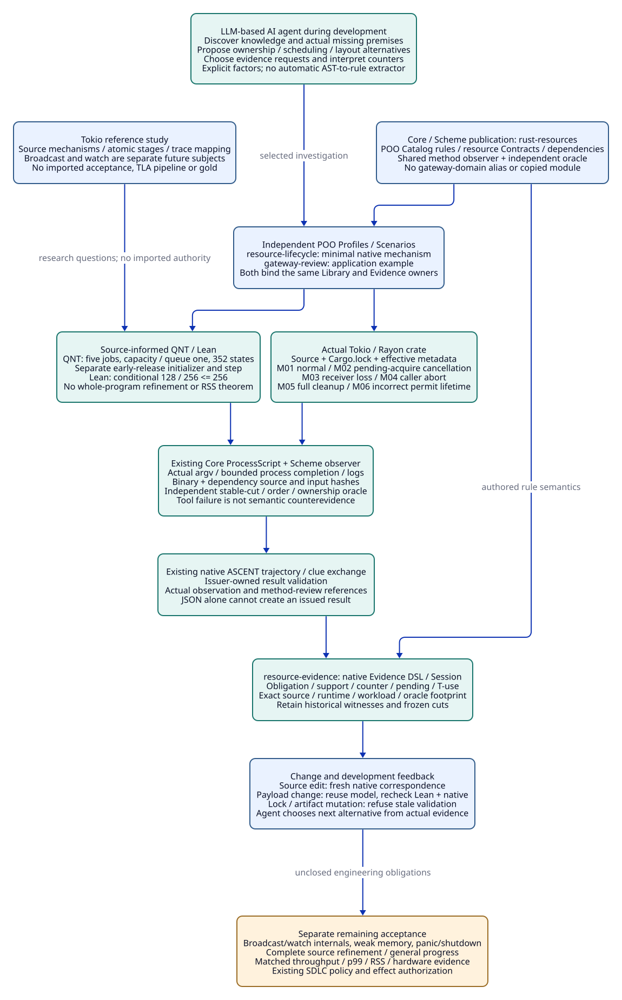

# SPDX-FileCopyrightText: 2026 tao3k team and Contributors
#
# SPDX-License-Identifier: LGPL-2.1-or-later

#+TITLE: 10.15 Scheme-Owned Rust Mechanisms and Development Evidence
#+LANGUAGE: en
#+PROPERTY: JD_ID 10.15
#+PROPERTY: LAYOUT elk
#+OPTIONS: toc:3 num:t
#+STARTUP: overview
#+FILETAGS: :library:scheme:poo:rust:tokio:rayon:ascent:agent:
#+PROPERTY: header-args :eval never :exports code

[[file:../../00-09-project/00-documentation/00.01-index.org][Index]] | [[file:10.14-rust-performance-library-and-mechanism-cases.org][Mechanism boundary]] | [[file:10.13-real-method-results-and-agent-evidence-loop.org][Earlier real method path]]

* Scheme organizes semantic ownership
:PROPERTIES:
:CUSTOM_ID: scheme-rust-mechanism-owners
:END:

Scheme publishes extensible domain knowledge, selected application assumptions,
method capabilities and evidence contracts through the existing Core/POO system.
Rust owns native execution and its payload/task lifetimes. QNT owns the selected
bounded transition question, Lean the selected conditional proposition, and
ASCENT the represented evidence relations and contextual applicability. An
LLM-based AI agent discovers those publications, proposes alternatives, chooses
investigations and interprets actual results. These responsibilities do not
require a gateway or a replacement framework.

#+NAME: actual-mechanism-publications
| Actual source owner | Publication / responsibility | Application boundary |
|---------------------+------------------------------+----------------------|
| [[file:../../../init.ss][init.ss]] | Select rust-resources, resource-evidence and the two application Scenarios through Core | No gateway-named shared Module, copied rules or compatibility alias |
| [[file:../../../library/concurrency/resource-control/backpressure-memory/rust/objects.ss][rust-resources / objects]] | BackpressureMemory under rust.resources.backpressure-memory; factors, obligations, lifecycle and dependencies | Resource mechanism knowledge, not all Rust performance knowledge |
| [[file:../../../library/concurrency/resource-control/backpressure-memory/rust/types.ss][rust-resources / types]] | Resource Profile and publication Contracts | Reject unsupported input shape before opening an investigation |
| [[file:../../../library/concurrency/resource-control/backpressure-memory/rust/func.ss][rust-resources / func]] | Public method capabilities owned by one prepared source context | QNT, Lean, native observation, oracle, digest and registration use the same issued-result identity |
| [[file:../../../library/concurrency/resource-control/backpressure-memory/rust/methods.ss][rust-resources / methods]] | Capture exact subjects; request Core Ops execution; validate outcomes and issue evidence observations | No subprocess scheduler, independent fact store or JSON-to-issuer constructor |
| [[file:../../../library/concurrency/resource-control/backpressure-memory/rust/oracle.ss][rust-resources / oracle]] | Independent finite enumeration, accounting and event/cut gold | Reads actual observations; does not trust a Rust-produced verdict or ASCENT-derived support |
| [[file:../../../modules/resource-evidence/func.ss][resource-evidence]] | Native Evidence DSL and shared session opening; obligation/applicability/support/counter derivation | Retains existing finite rule engine and exact required-footprint semantics |
| [[file:../../../profiles/resource-lifecycle.ss][resource lifecycle Profiles]] | Capacity one, actual 64/128-byte payload, controlled runtime and investigation factors | Explicit case parameters, not universal tuning advice |
| [[file:../../../scenarios/resource-lifecycle/interface.ss][resource-lifecycle Scenario]] | Core Domain/Evidence requirement bindings for the mechanism investigation | Selects existing publications; does not copy their observer or inference rules |
| [[file:../../../profiles/gateway.ss][gateway Profiles]] / [[file:../../../scenarios/gateway-review/interface.ss][gateway-review]] | Independent gateway application bindings to the same shared publications | Historical fixture/design example, not the parent of native mechanism cases |
| [[file:../../../library/concurrency/resource-control/backpressure-memory/rust/native/Cargo.toml][Rust crate]] / [[file:../../../examples/resource-lifecycle-evidence.ss][host investigation]] | Minimal native subject and replay of selected method requests | No HTTP, routing or gateway dependency |

The former gateway-domain and gateway-evidence directories are directly migrated;
the reusable method observer/oracle also moves out of gateway-review. The gateway
adapter retains only its application Profile mapping. No old source publication
is retained as a forwarding layer. Existing generated artifacts are not a public
compatibility API; the active Core selection and tests use the new identities.

#+NAME: scheme-capability-discovery-example
#+begin_src scheme
;; Actual public paths, all selected through the existing init.
(def domain (.get init.Modules rust-resources scope))
(def library (.ref domain 'entry))
(def scenario (.get init.Scenarios resource-lifecycle scope))
(def methods (.ref scenario 'methods))
;; Catalog rules/dependencies live in library; native/QNT/Lean capabilities in methods.
;; The actual host invocation is examples/resource-lifecycle-evidence.ss.
#+end_src

Profiles specialize named premises. Scenarios bind one selected design question.
They do not prescribe an Agent's whole development sequence. A future broadcast,
watch or data-layout investigation should contribute its own coherent domain
publication and mapping if needed; it must not reuse the resource-case acceptance
as proof of unrelated concurrency behavior or create one copied Module per test.

[[file:10.16-tokio-broadcast-close-and-wake-library.org][10.16]] develops the separate broadcast close/wake Library contract from the
actually selected Tokio source. It reuses these owner boundaries and specifies
new producer adaptation; its design must not inherit this resource case's results.

* Source mechanisms determine model granularity
:PROPERTIES:
:CUSTOM_ID: source-mechanism-modeling
:END:

The local Specula [[file:../../../.data/specula-case-studies/systems/tokio/overview.md][Tokio study]] concerns broadcast/watch mechanisms rather than an
application gateway. Its [[file:../../../.data/specula-case-studies/systems/tokio/modules/broadcast/runs/case-studies-tokio-broadcast/modeling-brief.md][broadcast modeling brief]] separates close lifecycle,
waiter notification, slot/reference ownership and position wraparound. Its
[[file:../../../.data/specula-case-studies/systems/tokio/modules/broadcast/runs/case-studies-tokio-broadcast/spec/instrumentation-spec.md][instrumentation specification]] maps actions to source/observations and uses
operation intervals for concurrent traces. This suggests useful engineering
questions: where are actual atomic boundaries, which owner disposes a value,
which observation establishes a handoff, and what event can falsify a hypothesis?

These are reference ideas. We do not import its TLA+ workflow, harness, gold or
reported bugs as local acceptance. The [[file:../../../.data/specula-case-studies/systems/tokio/modules/broadcast/runs/case-studies-tokio-broadcast/README.md][broadcast record]] identifies a provisional
run and unknown model information; the [[file:../../../.data/specula-case-studies/systems/tokio/modules/watch/runs/inv-repair7-20260715-174542-IR4/pipeline-summary.md][watch summary]] records skipped reviews.
A successful pipeline phase is not an independently reviewed engineering claim.
No reference harness was executed as part of this investigation.

#+NAME: independent-modeling-questions
| Source-derived question | Our representation / method | Remaining scope |
|-------------------------+-----------------------------+-----------------|
| Which allocations and admission tokens move together? | QNT owner/admitted conservation; native live-payload and available-permit cuts | Exact selected crate; not every Rust allocation or alias graph |
| Does cancelling a caller stop external CPU work? | Separate caller termination, worker barrier release and resource destruction events | Controlled Tokio/Rayon API use, not an executor-wide cancellation theorem |
| Does a failed delivery transfer ownership? | Rust send failure returns the actual owned value; native oracle checks failure before disposal | Selected oneshot and full cleanup channel branches |
| Could close/notify or reference-counter updates interleave? | A separate QNT model must split actual atomic stages and bind source mapping | Broadcast/watch internals are not modeled by the present lifecycle abstraction |
| Could counters wrap or atomic memory ordering fail? | Separate finite modular arithmetic/order model plus source and native controls | No wrapping-counter or weak-memory qualification from these six tests |

The [[file:../../../library/concurrency/resource-control/backpressure-memory/model.qnt][resource QNT model]] retains five jobs and distinguishes queued, CPU-owned,
returned and cleanup ownership. initResource has limit=1 and queueLimit=1.
Its independently enumerated safety domain has 352 states. Caller cancellation
while external work remains live maps to a stuttering ownership observation,
not instant resource disposal. The negative initializer/step describes retained
ownership after losing reservation, checked under its own model identity.

Native cuts project live owned payloads to owners and capacity minus available
permits to reserved. The independent oracle checks equality at each recorded
stable cut, and the event partial order establishes which caller/worker/disposal
boundaries were observed. This checks the selected observable invariant and
schedule; it is not a general trace-refinement proof or exploration of every
Rust interleaving. No timestamp sort manufactures a total concurrent execution.

The [[file:../../../library/concurrency/resource-control/backpressure-memory/budget.lean][Lean namespace RustResources]] retains conditional capacity monotonicity and
budget reuse. The selected instances compute 128 and 256 accounting units for
64/128-byte payload coefficients, queue=1, active=1, fixed=0 and budget=256.
The native case has one retained payload at its controlled cuts; the formula is
a conservative design allowance, not exact peak allocation. Channel metadata,
runtime stacks, allocator-retained pages, process RSS and throughput remain
outside this bound. The generic theorem does not establish source correspondence.

* Six native observations and independent test gold
:PROPERTIES:
:CUSTOM_ID: native-lifecycle-observations
:END:

The [[file:../../../library/concurrency/resource-control/backpressure-memory/rust/native/src/main.rs][native crate]] uses Tokio current-thread and a Rayon pool with one worker.
It captures payload Vec disposal before incrementing the drop observation and
before the enclosing OwnedWork returns its permit. Controlled channels establish
worker-start, caller-waiting, release and termination boundaries. No sleep is
used as ordering evidence. The selected dependencies are fixed by the actual
[[file:../../../library/concurrency/resource-control/backpressure-memory/rust/native/Cargo.lock][Cargo.lock]]; effective resolution/features are captured by cargo metadata.

#+NAME: native-case-gold
| Case / Catalog factor | Controlled path | Held cut: live / available | Final: live / available | Interpretation |
|-----------------------+-----------------+----------------------------+-------------------------+----------------|
| M01 / normal-handoff | Move permit and payload to worker, deliver OwnedWork, consume result | 1 / 0; returned result also 1 / 0 | 0 / 1 | Result ownership preserves the selected reservation |
| M02 / admission-cancellation | Existing payload/permit stays held by controller; explicitly poll second acquisition pending, abort and await waiter | 1 / 0; second acquisition count 0 | 0 / 1 | Cancelling a pending acquire does not acquire or submit another payload |
| M03 / abandoned-result | Drop receiver while worker is blocked at a barrier; release worker and observe returned failed-send value | 1 / 0 | 0 / 1 | Receiver loss does not stop already-owned CPU work |
| M04 / caller-abort | Establish async caller waiting and worker started; abort and await caller; worker remains blocked | 1 / 0 | 0 / 1 | Caller completion is distinct from external worker/resource completion |
| M05 / cleanup-full | Prefill bounded cleanup channel with an empty marker; failed try_send retains actual OwnedWork | 1 / 0 | 0 / 1 | No transfer on Full; worker-side fallback disposes the returned owner |
| M06 / caller-owned-permit | Matched incorrect alternative leaves permit in async caller, moves payload to worker, then aborts caller | 1 / 1 | 0 / 1 | Counterexample to the selected permit-lifetime association |

M02's original holder is the controller, not another CPU task. M05 covers a full
cleanup queue and synchronous fallback, not an implemented asynchronous cleanup
service. M06's native process exits successfully after observing the deliberately
incorrect alternative; its semantic witness is counterevidence. An execution
error, timeout, missing event or mismatched oracle never becomes that counter.

The Scheme oracle requires one complete case set, unique lifecycle observations,
partial-order constraints, holder/drop counts and reservation cuts. It supplies
gold independently of the Rust producer's control-flow success. The integration
test corrupts an observed held count and requires oracle rejection. This is
independence of the result checker, not a claim of independent instrumentation
or complete compiler/runtime verification. Panic unwind and process abort require
additional cases; no such acceptance is implied by compiling panic=unwind.

* Actual capture and ASCENT registration
:PROPERTIES:
:CUSTOM_ID: native-capture-registration
:END:

The host passes the existing Core ProcessScript capability. Each native attempt
captures Cargo.toml, Cargo.lock and src/main.rs into an owned input directory,
checks their original digests, records cargo/rustc identity and runs locked offline
cargo metadata/build. The observer captures resolved dependency Rust sources and
manifests, effective feature metadata, compiler target output, relevant Cargo configuration files and build environment
identity, resulting binary,
raw observations, exact argv, exit statuses and command logs. It rechecks the
captured input/artifact closure before issuing six method observations. During one registration boundary,
identical file-path/digest requirements are validated once at the initial boundary
and once before the domain update; conflicting expected digests are refused.
This is an ephemeral deduplication of the same obligation, not a cross-registration
trust cache. Native callbacks separately recheck record/review references, and
public record inspection still returns a defensive copy rather than mutable
issuer internals.

Native validation uses source/runtime/workload/inventory required inputs. Source
binds the crate manifest and main source bytes; runtime binds the lockfile,
manifest, compiler/executor identities, relevant build environment/configuration
and selected topology; workload binds
payload size and case protocol; inventory binds the independent oracle source.
Resolved dependency file hashes remain part of each method-validation closure.
This is local trusted-host provenance, not remote signing or complete transitive
toolchain attestation. Hash checks observe boundaries; they do not supply a
filesystem transaction against concurrent external writers.

The same rust-resources prepared scope owns issue/inspect/currentness/register
operations. Native ASCENT trajectory and clue exchange attest the issued results
before the existing domain Session receives witness, witness_input and checked
rows. Repeated validation within one cut reads the native trajectory snapshot
and appends only new evidence event identities; it never duplicates an event or
uses a separate local cache as the trajectory authority. Registration refreshes current checks while retaining historical witness
rows. A rejected refresh leaves the completed domain query intact. Serialized
replay and exact capture boundaries do not grant future execution authority.

* Development intervention and evidence-guided alternatives
:PROPERTIES:
:CUSTOM_ID: agent-development-intervention
:END:

#+NAME: development-intervention-contract
| Development situation | LLM-based AI agent / Scheme context | ASCENT and external evidence | Feedback / next design question |
|-----------------------+------------------------------------+------------------------------+--------------------------------|
| Intent before code | Discover resource, scheduling, layout or concurrency assets; bind workload, objective and candidate Profile | Derive missing assumptions/obligations; no invented performance result | Compare alternatives and choose the mechanism worth investigating |
| Candidate CPU handoff | Inspect permit and payload owner paths, caller cancellation and result retention | Require model, source mapping, accounting and selected native paths | Move ownership, change admission boundary or revise the claim |
| Native edit or dependency change | Capture actual source/lock/features and request affected methods through Core | Invalidate current applicability by explicit changed dependencies; retain old results | Rerun correspondence/native cases or justify an unaffected conditional theorem |
| Failed attempt or counter | Distinguish tool failure, incomplete ordering and genuine semantic counter | Keep pending/refused/counter outcomes with their actual references | Improve instrumentation, revise hypothesis or select another implementation |
| Performance tuning | Propose batching, layout, pool sizing or different scheduling under actual workload | Require semantic equivalence and matched throughput/tail/resource measurement | Choose based on measured tradeoffs; safety evidence supplies no speed claim |
| Review / SDLC handoff | Present current support, opposing evidence, unresolved premises and intended effect | Existing policy/authority owners decide acceptance separately | Library contributions preserve boundaries and counterexamples across projects |

Current discovery reads authored Catalog rows and explicit Profile factors. The
LLM-based AI agent in this engineering session selected the source questions and
case bindings; Cargo metadata supplies actual dependency context. This is not an
automatic Rust AST-to-rule extractor, an implemented LLM provider loop or automatic
acceptance of Agent-authored rules. New rule proposals require review and controls;
source mapping and the broader handoff obligations remain explicitly pending.
The host example replays selected requests rather than simulating LLM calls.

These are intervention opportunities, not a compulsory Agent pipeline or a new
lifecycle controller. An Agent may investigate a counter first or reject a whole
candidate. Runtime scheduling and the SDLC effect decision remain with their
existing owners. Scheme lets engineering knowledge be composed; ASCENT makes
represented dependencies and evidence inspectable; the LLM reasons about what
to explore and change.

* Change-query gold and reproduction
:PROPERTIES:
:CUSTOM_ID: native-change-query-gold
:END:

#+NAME: native-query-gold
| Completed query | Support / counter / historical witnesses | Dependency explanation |
|-----------------+------------------------------------------+------------------------|
| Discovery | 0 / 0 / 0 | Actual Library factors derive eight existing obligations plus six native case obligations |
| QNT + Lean baseline | 2 / 0 / 2 | Genuine model and conditional accounting results |
| Native 64-byte suite | 7 / 1 / 8 | Five native supports plus M06 counter; no blanket native admission |
| Source revision before rerun | 2 / 0 / 8 | Source-byte change invalidates all six native witnesses; model/math conditional results remain applicable |
| Revised-source suite | 7 / 1 / 14 | Six fresh native observations; previous six remain historical |
| 128-byte workload before checks | 1 / 0 / 14 | Ownership model is size-independent; arithmetic and native workload bindings change |
| New arithmetic and native suite | 7 / 1 / 21 | Fresh Lean instance and six genuine native results |
| Rejected mutation attempts | 7 / 1 / 21 | Changed original lock, owned source or plain JSON cannot create/erase accepted rows |
| Early-release model alternative | 6 / 2 / 22 | New genuine QNT counter under its own initializer/step; native M06 counter remains separately referenced |

The source revision is a captured source comment change, intentionally showing
conservative byte-identity invalidation; it is not a claimed semantic fix.
The 64-to-128 payload change actually executes a different allocation size.
The lock mutation is a refusal control with exact original bytes restored, not
a dependency-upgrade test. Actual version/feature/target changes still require
new runtime/correspondence and native evidence. Completed older query objects
retain their own cut and results; they are never promoted into a new usage.

#+begin_src sh
gerbil build
# Use actual installed compiler/executor files and a fresh output directory.
resource_cargo=$(rustup which cargo)
resource_rustc=$(rustup which rustc)
resource_quint=$(realpath "$(command -v quint)")
resource_lean=$(elan which lean)
gerbil pkg env gxi examples/resource-lifecycle-evidence.ss \
  .data/resource-real-new "$resource_cargo" "$resource_rustc" \
  "$resource_quint" "$resource_lean"
RESOURCE_REAL_REPORT="$PWD/.data/resource-real-new/report.json" \
  gerbil pkg env gxtest -v 5 t/resource-lifecycle-test.ss
#+end_src

QNT/TLC requires its local compilation service to bind localhost. Each Core Ops
child has a 45-second deadline. Failed builds/runs remain retained; a timeout or
successful import is not semantic acceptance. The [[file:../../../.data/resource-real-20261019-04/report.json][complete local investigation report]] contains 22 method observations: 18
native case observations from three executions, two QNT results and two Lean
instances. Its [[file:../../../.data/package-integration-20261019/receipts/resource-real-investigation-04.json][process receipt]] records natural exit zero in 292.636 seconds
within the original 300-second bound. The positive QNT oracle covers 352 states
and 480 transitions; the separate negative TLC/ITF result demonstrates retained
ownership without reservation. This elapsed time is not a performance benchmark.

The [[file:../../../.data/package-integration-20261019/receipts/resource-migration-build-14.json][native package build]] passed separately. The gateway's
[[file:../../../.data/package-integration-20261019/receipts/resource-migration-gateway-initial.log][focused initial-obligation regression]] passed with CASE-OK and HARNESS-OK.
The [[file:../../../.data/package-integration-20261019/receipts/resource-migration-gateway-method.log][method-registration regression]] and
[[file:../../../.data/package-integration-20261019/receipts/resource-migration-gateway-boundaries.log][missing/extra/wrong-method refusal regression]] also passed independently within
their original 60-second limits.
The aggregate gateway regression hit its 75-second bound after one case passed;
that receipt remains a timeout, not whole-suite acceptance. Earlier failed
investigations retain the unsupported oracle domain and duplicate-event errors;
the third progressing investigation was explicitly interrupted to remove
redundant validation. None is rewritten as a successful run.

These .data artifacts are local ignored research/validation outputs. A clean
checkout must reproduce them with installed dependencies and a fresh directory;
the document links are not portable published evidence. The independent current
[[file:../../../.data/package-integration-20261019/receipts/resource-real-results-audit.log][integration audit]] passed both cases with CASE-OK and HARNESS-OK; its
[[file:../../../.data/package-integration-20261019/receipts/resource-real-results-audit.json][process receipt]] records exit zero in 13.374 seconds. It checks source/artifact
closure, all nine query gold rows, native/QNT/Lean counts and the corrupted-input
oracle refusal.

The companion uses ELK orthogonal routing to keep the reference-study edge clear
of application labels. Re-render with the installed tool:

#+begin_src sh
d2 --layout elk --theme 0 --pad 24 --timeout 30 \
  docs/90-99-views/90-architecture-views/90.60-scheme-mechanism-model-test-agent-loop.d2 \
  docs/90-99-views/90-architecture-views/90.60-scheme-mechanism-model-test-agent-loop.svg
#+end_src

#+CAPTION: Scheme-owned mechanisms connect source-informed models and native tests to ASCENT evidence and LLM-based AI agent development decisions; the gateway remains one independent application.

