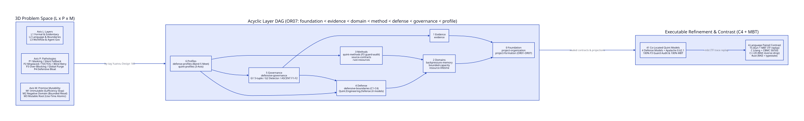

# SPDX-FileCopyrightText: 2026 hardenedlinux Linux Team and Contributors
# SPDX-License-Identifier: LGPL-2.1-or-later

#+TITLE: 10.153 Defensive Engineering Taxonomy and Fine-Grained Modular Organization
#+LANGUAGE: en
#+PROPERTY: JD_ID 10.153
#+STARTUP: overview
#+OPTIONS: toc:3 num:nil
#+FILETAGS: :architecture:defensive-engineering:taxonomy:yuanxu:governance:

[[file:../../00-09-project/00-documentation/00.01-index.org][Index]] | [[file:10.18-agent-authored-engineering-and-review-contracts.org][10.18 Agent review contracts]] | [[file:10.148-flat-declarative-library-boundary.org][10.148 Flat library boundary]] | [[file:10.150-repository-organization-and-package-taxonomy.org][10.150 Repository organization]] | [[file:10.151-quint-models-library-and-packages.org][10.151 Quint models library]] | [[file:../../20-29-cases/20-gateway/20.16-unknown-order-negative-dependencies-and-defensive-engineering.org][20.16 DE01]] | [[file:../../20-29-cases/20-gateway/20.17-sufficient-evidence-and-bounded-revalidation.org][20.17 Sufficiency & revalidation]] | [[file:../../20-29-cases/20-gateway/20.18-policy-required-checks-and-evidence-admission.org][20.18 Policy admission]]

* Scope and Architectural Premise
:PROPERTIES:
:CUSTOM_ID: de153-scope
:STATUS: landed-verified-d0-d4
:END:

Earlier gateway specifications ([[file:../../20-29-cases/20-gateway/20.16-unknown-order-negative-dependencies-and-defensive-engineering.org][20.16]], [[file:../../20-29-cases/20-gateway/20.17-sufficient-evidence-and-bounded-revalidation.org][20.17]], [[file:../../20-29-cases/20-gateway/20.18-policy-required-checks-and-evidence-admission.org][20.18]]) introduced =DE01=
as a cross-packet defensive-engineering case, and [[file:10.18-agent-authored-engineering-and-review-contracts.org][10.18]] documented how style
rules and LLM-authored code can grow into a second defensive framework. Those
documents exposed a recurring, cross-cutting failure mode that is *not* confined
to a single gateway scenario: both human engineers and LLM-based AI agents
routinely respond to uncertainty, partial knowledge, or concurrency risk with
undifferentiated defensive reactions—either silently swallowing defects into
fallback defaults, checking immutable facts repeatedly while missing use-time
races, or purging all history and blocking unrelated work whenever a local
premise changes.

Solving these problems systematically requires two coupled architectural steps:

1. *A cross-cutting research taxonomy* covering three inseparable layers—formal
   and evidentiary semantics (=F1=–=F4=), language and system boundary practices
   (=C1=–=C4=), and engineering workflow / AI agent governance (=G1=–=G4=).
2. *Fine-grained, tag-addressed Yuanxu modular organization* so that defenses
   are declared once as atomic leaves, classified orthogonally via per-leaf
   =tags:=, and enforced selectively via =by-tag= Profiles and Band-5 monotonic
   =governance-floor:= lattices—rather than accumulated inside a single broad
   =library/= bucket or a monolithic lint/guard framework.

#+BEGIN_QUOTE
Good defensive engineering is not adding more checks everywhere. It is proving
which boundary guards are necessary, placing each guard at its exact ownership
and mutability boundary, preserving distinct epistemic states instead of
collapsing unknowns, and refusing any defensive layer that discharges no real
obligation.
#+END_QUOTE

This document establishes the taxonomy, live baseline audit, Yuanxu modular
evolution plan, and phased landing roadmap. It does not claim executed proofs,
implemented runtime checkers, or migrated directory trees beyond the live facts
recorded in [[#de153-gap-audit][Live Repository Baseline Audit]].

* Three-Dimensional Orthogonal Problem Space (L × P × M)
:PROPERTIES:
:CUSTOM_ID: de153-taxonomy
:END:

Every defensive programming or defensive engineering problem is uniquely located
by three orthogonal axes. Treating these axes independently prevents conflating
code-level syntax idioms, epistemic uncertainty, and operational authority.

** Axis L: Engineering Layer
| Code | Layer | Primary question |
|------+-------+------------------|
| =L1= | Formal & Evidentiary Semantics | What epistemic states, dependency graphs, and guard-necessity proofs distinguish essential defenses from redundant or harmful ones? |
| =L2= | Language & System Boundaries | How do types, ownership, trust-boundary parsing, failure contracts, and MBT traces eliminate scattered defensive branches in concrete languages? |
| =L3= | Workflow & AI Agent Governance | What admission rules, monotonic floors, and review gates prevent human and LLM authors from introducing silent fallbacks, weakened checks, or defensive bloat? |

** Axis P: Defensive Pathology
| Code | Pathology | Concrete symptoms | Structural harm |
|------+-----------+-------------------+-----------------|
| =P1= | Masking / Silent Degradation | =try/catch= returning empty/default values; swallowing digest or subject mismatches; =last-writer-wins= erasing conflicting authority records; hiding invariant violations behind fallback branches | Converts real defects or unauthorized states into plausible-looking corrupt outputs; destroys auditability |
| =P2= | Misplaced / Stale Defense | Re-checking immutable content repeatedly while missing =use-time= TOCTOU races; treating =request-time allow= as =consumption-time authority=; using timeouts as safety proofs; automatic retry on unknown remote effects without idempotency contracts | Creates false confidence while leaving core safety/security invariants exposed or actively amplifying duplicate side effects |
| =P3= | Over-Defense / Global Blocking | Treating any =unknown= as an established violation; purging all cached/historical evidence and forcing full reruns when one negative dependency changes; demanding invented receipt formats when existing evidence is sufficient | Wastes engineering/compute budget, blocks unrelated valid investigation, and destroys immutable historical facts |
| =P4= | Defensive Bloat / Second Framework | Layering redundant wrappers, null checks, speculative abstractions, or rigid style/process gates that discharge no new obligation—heavily amplified by LLM defensive coding habits | Increases maintenance surface, obscures real invariants, and degrades human/automated review signal-to-noise |

** Axis M: Premise Mutability
| Code | Premise class | Validation & reuse semantics | Typical failure if misclassified |
|------+---------------+------------------------------+----------------------------------|
| =M1= | Immutable / Content-Addressed | Once authentic bytes, subject, issuer, and declared dependency scope match, the predicate is reusable; sufficiency stops redundant re-checking | Misclassified as =M3= → =P3=/=P4= (pointless re-runs and duplicate reads) |
| =M2= | Closed-Domain / Negative-Dependency | Depends on absence over a named finite domain (e.g., "no additional required counter"); a relevant domain addition invalidates only dependent current uses, never frozen historical cuts or independent method bytes | Misclassified as =M1= → stale reuse (=P1=/=P2=); misclassified as global reset → =P3= (all-evidence purge) |
| =M3= | Mutable-Root / Use-Time Boundary | Depends on live mutable state (revocation, epoch, lease, fencing token, consumption boundary, remote effect); cannot be discharged by an earlier check or cache hit | Misclassified as =M1= → classic TOCTOU / stale authority / zombie write (=P2=) |

** Defense Classification Axioms
For any proposed or existing guard =g= guarding emergent safety/contract
invariant =I= under threat/fault model =T=:

1. *Essential Defense*: Pruning =g= admits a reachable countermodel violating =I=
   under =T=, and =g= sits at the exact ownership/mutability boundary (=M1=/=M2=/=M3=)
   where the violated premise can change.
2. *Well-Formedness Precondition*: Pruning =g= violates domain/input framing
   (e.g., duplicate disjoint identifier creation) rather than an emergent
   protocol safety property; must be explicitly typed at the trust boundary
   rather than disguised as runtime defense.
3. *Redundant Defense*: Pruning =g= leaves =I= preserved under =T= *and* =T= is
   confirmed complete for the target threat class; =g= is a candidate for
   elimination (=P4=).
4. *Under-Modeled Boundary*: Pruning =g= leaves =I= preserved only because =T=
   or =I= omits the adversary/fault interleaving that motivated =g=; requires
   strengthening =T= or =I= rather than blindly keeping or deleting =g=.
5. *Harmful / Masking Defense*: =g= transforms a violated precondition,
   conflict, or unknown state into a success-shaped fallback or unauthorized
   retry (=P1=/=P2=); must be refused regardless of test-pass rate.

* Three Research Tracks (F1–F4, C1–C4, G1–G4)
:PROPERTIES:
:CUSTOM_ID: de153-tracks
:END:

All three layers are organized as numbered, independently verifiable research
units that share one vocabulary and cross-reference one another.

** Track 1 (L1): Formal Semantics & Evidence Algebra (=F1=–=F4=)
| Unit | Title | Core deliverable | Primary target |
|------+-------+------------------+----------------|
| =F1= | Six-State Epistemic & Contract Lattice | Formalize =Proven=, =Refuted=, =PendingMethod=, =PendingScope=, =Conflict=, and =SetupDefect= as a closed algebraic domain (no collapse to boolean =ok/err=), with monotone join/conflict preservation and zero =last-writer-wins= erasure | =P1=, =P3= |
| =F2= | Negative Dependencies & Bounded Revalidation | Generalize =20.16=–=20.18= (=DO/CO/ND=, =HA/AH/MV=, =OP/BR/AM=) into reusable Quint state-machine models and ASCENT incremental invalidation rules: track explicit dependency manifests, invalidate only affected current uses when a negative domain expands, preserve frozen cuts and independent results | =P3=, =M2= |
| =F3= | Automated Guard Necessity & Redundancy Audit | Extend [[file:../../../library/quint-methods/ast.ss][quint-methods/ast.ss]] and [[file:../../../packages/quint-modules-resolver/src/mbt.ts][quint-modules-resolver]] so every declared =(guard <id> ...)= across a model fleet is automatically enumerated, checked for countermodel witness coverage, and classified under the Defense Classification Axioms | =P2=, =P4= |
| =F4= | Check-Time vs. Use-Time Boundary Stratification | Formalize the separation between =M1= (reusable historical/content-addressed facts), =M2= (scoped negative domains), and =M3= (atomic consumption-time boundaries) across concurrency, identity, zero-trust, and effect-handoff models | =P2=, =M1=/=M3= |

** Track 2 (L2): Language Practices & System Boundaries (=C1=–=C4=)
| Unit | Title | Core deliverable | Primary target |
|------+-------+------------------+----------------|
| =C1= | Defensive Programming Anti-Pattern Catalog | Structured catalog indexed by =(P, M)= covering silent fallbacks, catch-all error swallowing, redundant internal null/range checks, timeout-as-safety, blind retry over unknown effects, stale cache-hit authorization, and coarse global invalidation | =P1=–=P4= |
| =C2= | Deterministic Boundary Replacement Patterns | Paired replacement catalog: =Parse, Don't Validate= single trust boundaries; Rust ownership / typestate / RAII drop-order; Scheme sealed nominal contracts; explicit multi-valued result types (=Ok / DomainErr / Pending / Conflict= + fail-fast defect panics/refusals); fencing tokens and idempotency-key contracts | =P1=, =P2= |
| =C3= | Source-Bound Mechanical vs. Semantic Check Split | Extend [[file:../../../library/source-contracts/interface.ss][source-contracts]] to classify which anti-patterns are mechanically enforceable (type system, CBMC/Kani, AST lints, MBT ITF trace replay) versus which require explicit semantic review—preventing mechanical tools from claiming semantic soundness | =P2=, =P4= |
| =C4= | Cross-Language Paired Contrast Corpus | Maintain concrete paired implementations (=bad-defensive= vs. =deterministic-boundary=) with executable counterexample tests under =languages-engineering/= across Rust, C, C++, and TypeScript for high-impact mechanisms: backpressure/drop-order, unknown remote effect retry, revocation/cache TOCTOU, and partial-delivery state | =P1=–=P3= |

** Track 3 (L3): Workflow & AI Agent Governance (=G1=–=G4=)
| Unit | Title | Core deliverable | Primary target |
|------+-------+------------------+----------------|
| =G1= | Five-Tuple Guard Admission Contract | Codify the [[file:../../20-29-cases/20-gateway/20.16-unknown-order-negative-dependencies-and-defensive-engineering.org][20.16]] guard review criterion as a sealed Scheme contract: every proposed guard, fallback, retry, or CI gate must declare =(obligation, owner, scoped_failure, witness_or_countermodel, affected_consumer)=; incomplete declarations are refused | =P2=, =P4= |
| =G2= | AI Agent Defensive-Hallucination Taxonomy & Controls | Classify and build negative controls for LLM-specific defensive pathologies: (a) silent fallback insertion to make tests pass, (b) assertion/floor weakening, (c) redundant defensive glue copied across internal layers, (d) fabricated prose/receipt confidence substituting for missing evidence | =P1=, =P4= |
| =G3= | Monotonic Governance Floor vs. Sufficiency Stopping | Couple Yuanxu Design 165 Band-5 =combiner: 'meet= monotonic floors (no peer profile or agent override may weaken required safety witnesses) with =M1= sufficiency stopping (preventing stylistic preferences from escalating into mandatory extra checks or receipt formats, per [[file:../../20-29-cases/20-gateway/20.18-policy-required-checks-and-evidence-admission.org][20.18]]) | =P3=, =P4= |
| =G4= | Tiered Review & CI Gating | Formalize proportional verification tiers (building on [[file:10.18-agent-authored-engineering-and-review-contracts.org][10.18]]): separate mechanical syntax/style checks, bounded formal/MBT contract checks, and targeted semantic review so the governance layer itself never mutates into a second defensive framework | =P3=, =P4= |

* Fine-Grained Top-Level Yuanxu Modular Organization
:PROPERTIES:
:CUSTOM_ID: de153-yuanxu-organization
:END:

** Why the Current Single =Library= Window Becomes Too Broad
In [[file:../../../init.ss][init.ss]], the 37 Quint models already use 10 symmetric Yuanxu windows
(=Quint.Engineering.{Storage,Consensus,Concurrency,Parallel,GC}= and
=Quint.Threat.{ZeroTrust,Identity,Protocol,SupplyChain,Execution}=) where every
leaf declares orthogonal dotted =tags:=, =slot-specs:=, =defaults:=, and
=governance-floor:= (see [[file:../../../packages/quint-models/engineering/concurrency/backpressure-memory/interface.ss][backpressure-memory/interface.ss]] and
[[file:../../../library/quint-profiles/objects.ss][quint-profiles/objects.ss]]).

By contrast, =./library/= is currently mounted as a single flat window
(=mount: Library=) holding 15 modules across five distinct architectural layers
with coarse, non-hierarchical tags (e.g., ='(engineering domain concurrency)=).
While manageable at 15 modules (per [[file:10.148-flat-declarative-library-boundary.org][10.148]]), adding defensive-engineering
formal contracts, language anti-pattern catalogs, and AI agent governance
leaves to one flat bucket would blur dependency direction and turn =Library=
into an undifferentiated grab-bag.

Because Yuanxu natively supports per-directory multi-window mounts plus
per-leaf =tags:= and =by-tag= global Profiles, finer top-level modularity does
*not* introduce a second registry or custom loader—it uses the exact mechanism
already proven across the 10 Quint subdomains.

** Target Seven-Window Top-Level Modular Architecture
Each top-level window carries one clear responsibility role, contains atomic
leaf units (={types,objects,interface}.ss= plus optional =config.ss= /
=func.ss= / =methods.ss=), and obeys a strict acyclic dependency DAG.

| Top-level window (mount) | Responsibility | Existing =library/= modules mapped | Planned defensive-engineering leaves |
|--------------------------+----------------+------------------------------------+--------------------------------------|
| =Foundation= | Shared vocabulary, repository organization, structural self-audit | =project-organization=, =project-formation= | =layer-dag-rules= (=OR07=) |
| =Evidence= | Epistemic state lattices, dependency manifests, ASCENT reasoning programs | =evidence= | =epistemic-state-lattice= (=F1=), =bounded-revalidation= (=F2=), =sufficiency-closure= (=F2=) |
| =Methods= | Pure verification/audit plan contracts, AST projection, check boundaries | =quint-methods=, =source-contracts=, =rust-resources= | =guard-necessity-audit= (=F3=), =defensive-source-audit= (=C3=) |
| =Domains= | Objective engineering mechanism models & language specializations | =backpressure-memory=, =backpressure-tokio-rayon=, =bounded-capacity=, =resource-lifetime= | =check-use-stratification= (=F4=) |
| =Defense= | Defensive anti-pattern ontologies & deterministic boundary replacement units | *(new domain)* | =silent-fallback-boundary= (=C1/C2=), =toctou-authority-boundary= (=C1/C2=), =unknown-effect-retry= (=C1/C2=), =redundant-guard-pruning= (=C1/C2=) |
| =Governance= | Non-negotiable admission rules, AI agent hallucination controls, review tiers | *(currently prose in 10.18 / 20.16)* | =guard-admission-contract= (=G1=), =agent-defensive-review= (=G2=), =monotone-floor-policy= (=G3/G4=) |
| =Profiles= | Pure =by-tag= orthogonal selection & parameter sets (never depended on by lower layers) | =quint-profiles=, =source-contract-profiles=, =gateway-profiles=, =resource-lifecycle-profiles=, =library-formation-profiles= | =defense-profiles= (=G3=) |

** Acyclic Layer Dependency Contract (Proposed =OR07=)
#+BEGIN_EXAMPLE
Profiles ──▶ { Domains, Defense, Methods, Governance } ──▶ { Evidence, Foundation }
Governance ──▶ { Evidence, Methods, Foundation }
Defense ──▶ { Domains, Evidence, Foundation }
#+END_EXAMPLE

Forbidden reverse edges (to be enforced by a future =OR07= ASCENT rule in
=project-formation=):
- No =Foundation=, =Evidence=, =Methods=, =Domains=, =Defense=, or =Governance=
  module may import from =Profiles=.
- No =Foundation= or =Evidence= module may import from =Domains=, =Defense=, or
  =Governance=.
- No =Domains= module may import from =Governance= (objective mechanism laws
  stay independent of organizational review policy).

** Standardized Orthogonal Leaf =tags:= Vocabulary
Every atomic leaf declares orthogonal dotted tags across four namespaces so
Yuanxu =by-tag= Profiles can target exact subsets without directory duplication:

| Tag namespace | Allowed values | Purpose |
|---------------+----------------+---------|
| =de.layer.*= | =de.layer.foundation=, =de.layer.evidence=, =de.layer.method=, =de.layer.domain=, =de.layer.defense=, =de.layer.governance=, =de.layer.profile= | Enforces =OR07= acyclic layer dependencies and top-level classification |
| =defense.pathology.*= | =defense.pathology.masking=, =defense.pathology.misplaced=, =defense.pathology.over-blocking=, =defense.pathology.bloat= | Maps each leaf to =P1=–=P4= for targeted anti-pattern auditing |
| =defense.mutability.*= | =defense.mutability.immutable=, =defense.mutability.negative-domain=, =defense.mutability.mutable-root= | Maps each leaf to =M1=–=M3= so reuse vs. atomic use-time checks apply strictly where needed |
| =defense.property.*= | =defense.property.guard-declared=, =defense.property.guard-pruned=, =defense.property.multi-valued=, =defense.property.bounded-revalidation=, =defense.property.mbt-paired= | Drives automated verification, sufficiency stopping, and Band-5 floors |

** Scoped =by-tag= Profile Bindings (Anti-Over-Blocking by Construction)
Using Yuanxu Design 165 (=make-slot-spec=, =by-tag=, Band-5 =combiner: 'meet=):

| Target selector | Slot / Floor applied | Effect on defensive engineering |
|-----------------+----------------------+---------------------------------|
| =(by-tag 'defense.mutability.mutable-root)= | =require-use-time-witness?: #t= (Band-5 =meet=) | Guarantees consumption-time / atomic authority checks on every mutable-root boundary; never imposes them on =M1= leaves |
| =(by-tag 'defense.mutability.negative-domain)= | =allow-global-purge?: #f=, =require-dependency-manifest?: #t= (Band-5 =meet=) | Enforces bounded incremental revalidation (=F2=) and blocks coarse all-evidence purges (=P3=) |
| =(by-tag 'defense.mutability.immutable)= | =allow-sufficiency-stop?: #t= (runtime-switchable) | Permits stopping redundant re-checks once authentic =M1= evidence satisfies the predicate |
| =(by-tag 'defense.property.guard-declared)= | =require-guard-necessity-countermodel?: #t=, =require-admission-five-tuple?: #t= (Band-5 =meet=) | Prevents human or AI agents from adding unverified defensive glue (=P4=) or weakening guard proofs (=G2=) |

** Two-Phase Migration Strategy (Zero Disruption to =OR01=–=OR06=)
- *Phase A (Logical Stratification — Immediate)*: Keep existing =library/<mod>/=
  paths untouched so =OR01=–=OR06= and current builds stay green; adopt the
  dotted =de.layer.*= and =defense.*= tag vocabulary on new and updated leaves
  and add =OR07= dependency-direction checks.
- *Phase B (Physical Multi-Window Split — When Leaf Count Warrants It)*: Split
  =library/= into dedicated Yuanxu windows in [[file:../../../init.ss][init.ss]] (and update
  [[file:../../../library/project-organization/objects.ss][project-organization]] + [[file:../../../project.sysml][project.sysml]] atomically in one commit) once
  =Defense=, =Governance=, and =Evidence= accumulate enough atomic leaves to
  justify top-level directory separation.

* Live Repository Baseline Audit & Gap Analysis
:PROPERTIES:
:CUSTOM_ID: de153-gap-audit
:STATUS: audited-on-live-tree
:END:

An automated inventory of the live repository tree (baseline =HEAD= =586d992=,
before any new defensive-engineering leaves are created) establishes exact
coverage and concrete gaps.

** Quint Fleet Audit (37 Models, 10 Subdomains)
- *Total models*: 37 co-located Scheme POO + pure =.qnt= units (13
  =engineering/*= across 5 subdomains, 24 =threat/*= across 5 subdomains; 35
  stateful + 2 stateless reference models: =capabilities=,
  =authority-currentness=).
- *Guard & countermodel coverage*:
  - 73 unique named guards declared via =(guard <id> ...)= across the stateful
    models (85 total guard call sites), plus =state-rollback='s custom
    =monotonic-storage= countermodel derivation.
  - 72 unique guard-pruned countermodels and 73 total =// @countermodel=
    assertions.
- *Immediate live =F3= finding (2 unwitnessed guards)*:
  1. =admit-disjoint-job= in
     [[file:../../../packages/quint-models/engineering/concurrency/backpressure-memory/objects.ss][engineering/concurrency/backpressure-memory/objects.ss]]
     (4 unique guards declared, 3 pruned).
  2. =valid-generation= in
     [[file:../../../packages/quint-models/threat/identity/workload-identity-rotation/objects.ss][threat/identity/workload-identity-rotation/objects.ss]]
     (2 unique guards declared, 1 pruned).
  - Neither guard is necessarily defective—=admit-disjoint-job= may be a
    well-formedness precondition while =valid-generation= may warrant an
    explicit countermodel—but the live fleet currently has no automated =F3=
    classifier distinguishing *Essential*, *Precondition*, *Redundant*, and
    *Under-Modeled* guards.

** Existing Coverage vs. Open Gaps Across All 12 Research Units
| Unit | Live repository assets already contributing | Concrete open gap |
|------+---------------------------------------------+-------------------|
| =F1= Six-State Lattice | Prose contract in =20.16=–=20.18=; =library/evidence/= | Zero executable Quint model or Scheme/ASCENT algebraic lattice enforcing 6-state non-collapse |
| =F2= Bounded Revalidation | Paper packets =DO/CO/ND=, =HA/AH/MV=, =OP/BR/AM= (=20.16=–=20.18=) | Zero executable Quint model or ASCENT negative-dependency invalidation rules |
| =F3= Guard Necessity Audit | Manual =dropped-guard:= pruning in =library/quint-methods/ast.ss= (72/73 unique guards pruned) | No automated fleet completeness/classification audit; 2 guards (=admit-disjoint-job=, =valid-generation=) unclassified |
| =F4= Check vs. Use Stratification | Strong =M3= coverage across =authority-currentness=, =zero-trust-pep-pdp=, =effect-containment=, =effect-handoff=, =state-rollback=, =lease-fencing-token=, =saga-compensation-idempotency=, =workload-identity-rotation=, =oauth-revocation-recovery= | No explicit =M1=/=M2=/=M3= tag classification or cross-model stratification matrix binding immutable reuse vs. atomic use-time enforcement |
| =C1= Anti-Pattern Catalog | Scattered examples in =10.18= and =20.16= | No structured, queryable Scheme/Org anti-pattern catalog indexed by =(P, M)= |
| =C2= Deterministic Replacements | C =bounded-capacity=, C++ =resource-lifetime=, Rust =backpressure-memory= / =rust-resources= | No unified replacement catalog covering silent fallback elimination, explicit multi-valued error/unknown types, or safe unknown-effect retry |
| =C3= Mechanical vs. Semantic Split | =library/source-contracts/= (C/C++ CBMC/native plans); =packages/quint-modules-resolver/= (=mbt-audit=) | No explicit mapping from =(P1–P4)= anti-patterns to mechanical checkers vs. semantic review duties |
| =C4= Paired Contrast Corpus | Positive C (=languages-engineering/c/numeric/bounded-capacity/=) and C++ (=languages-engineering/cpp/memory/resource-lifetime/=); =go/README.org= placeholder | Zero paired =bad-defensive= vs. =deterministic-boundary= contrast implementations with MBT counterexample suites across Rust, C, C++, and TypeScript |
| =G1= 5-Tuple Admission Contract | Prose rule in =20.16= (=DE01=) | Zero sealed Scheme POO contract or ASCENT check rejecting guards missing =(obligation, owner, scoped_failure, witness, affected_consumer)= |
| =G2= Agent Defensive Hallucinations | Problem statement in =10.18= | Zero taxonomy leaves, review checklists, or negative-control benchmarks targeting LLM silent fallbacks and assertion weakening |
| =G3= Monotonic Floor vs. Sufficiency | Band-5 =monotonic-require-meet= in =library/quint-profiles/objects.ss= | Not yet extended with =defense.*= slots (=require-use-time-witness?=, =allow-global-purge?=, =allow-sufficiency-stop?=, =require-admission-five-tuple?=) |
| =G4= Tiered Review & CI Gating | Prose design in =10.18=; =assurance.*= runtime profiles | No declarative review-tier profile preventing lint/check rules from growing into a second defensive framework |

* Phased Landing Roadmap and Acceptance Gates
:PROPERTIES:
:CUSTOM_ID: de153-roadmap
:END:

Execution proceeds in bounded stages so every stage produces verified,
mechanically checked artifacts rather than speculative prose.

| Stage | Scope | Primary artifacts | Passing gate | Refusal gate |
|-------+-------+-------------------+--------------+--------------|
| =D0= | Taxonomy & baseline audit | =10.153= (this document), =00.01-index.org= entry | Live counts match repository tree; =reuse lint= clean; =OR01=–=OR06= unaffected | Unverified execution/proof claim appears in design text |
| =D1= | =F3= Guard Necessity Audit | Automated guard-enumeration & classification audit in =library/quint-methods/= and =packages/quint-modules-resolver/=; disposition of =admit-disjoint-job= and =valid-generation= | 100% of declared =(guard <id> ...)= across all 37 models classified with explicit witness or typed precondition justification | Any declared guard silently left unwitnessed or classified as essential without an Apalache/ITF counterexample |
| =D2= | =F1= & =F2= Executable Formal Models | Co-located Quint models (=epistemic-state-lattice=, =bounded-negative-revalidation=, =unknown-effect-retry=) + ASCENT incremental invalidation prototype | All positive invariants pass Apalache bounded proof; guard-pruned countermodels demonstrate =P1= (silent collapse), =P2= (blind retry), and =P3= (global purge) failures | A model that collapses =PendingScope= into =Refuted= or purges frozen historical cuts passes |
| =D3= | =C1=–=C4= Language Contrast Corpus & Contracts | Declarative anti-pattern/replacement catalog + paired =bad-defensive= vs. =deterministic-boundary= subjects under =languages-engineering/= (Rust, C/C++, TypeScript) with MBT/native tests | Every =bad-defensive= sample fails its paired counterexample check; every =deterministic-boundary= sample passes with zero silent fallbacks | A fallback-masking implementation passes the contrast harness |
| =D4= | =G1=–=G4= Governance & Top-Level Modular Split | =Governance= & =Defense= Yuanxu leaves, =defense-profiles= (=by-tag= Band-5 floors), =OR07= layer-DAG rule, and (if leaf count warrants) Phase B multi-window split in =init.ss= + =project.sysml= | =OR01=–=OR07= zero findings; Band-5 monotonic floor tests refuse weakening; Agent negative-control benchmark catches all 4 defensive-hallucination classes | Any peer profile weakens a Band-5 floor, or a lower layer imports from =Profiles= |

* Observed Landing Results (D0–D4)
:PROPERTIES:
:CUSTOM_ID: de153-observed
:STATUS: executed-verified
:END:

| Stage | Landed artifacts | Observed verification results |
|-------+------------------+-------------------------------|
| =D0= | =10.153= taxonomy & baseline audit; =00.01-index.org= entry; paired view [[file:../../90-99-views/90-architecture-views/90.144-defensive-engineering-taxonomy-and-layers.d2][90.144 D2]] /  | All Org links verified; =90.144= rendered cleanly via =d2=; live 37-model audit surfaced 2 unwitnessed AST guards (=admit-disjoint-job=, =valid-generation=) |
| =D1= | =quint-expr-collect-guards= / =quint-decl-collect-guards= in [[file:../../../library/quint-methods/ast.ss][ast.ss]]; sealed =QuintGuardAuditReportType= and =quint-guard-audit= CLOS generic in [[file:../../../library/quint-methods/methods.ss][methods.ss]]; integrated into [[file:../../../t/support/quint-model-qualification.ss][quint-model-qualification.ss]]; added =BackpressureDuplicateAdmitCountermodel= and =ExpiredCredReuseCountermodel=; added explicit =precondition= classifications on =effect-containment= and =effect-handoff= (inherited by =state-rollback=) | =projection-contracts-test.ss= passed; fleet-wide F3 audit passed **41/41** models (=declared_guards=99, essential_witnessed=87, preconditions=12=, zero unwitnessed); Apalache 0.62.1 =run-plan --verify= passed =BackpressureOwners.qnt= (7/7) and =WorkloadIdentityRotation.qnt= (5/5) |
| =D2= | Symmetric Yuanxu subdomain =Quint.Engineering.Defense= mounted in [[file:../../../init.ss][init.ss]] with 4 co-located Scheme POO + pure =.qnt= models: [[file:../../../packages/quint-models/engineering/defense/epistemic-state-lattice/EpistemicStateLattice.qnt][EpistemicStateLattice.qnt]] (=F1=), [[file:../../../packages/quint-models/engineering/defense/bounded-negative-revalidation/BoundedNegativeRevalidation.qnt][BoundedNegativeRevalidation.qnt]] (=F2=/=DE01=), [[file:../../../packages/quint-models/engineering/defense/unknown-effect-retry/UnknownEffectRetry.qnt][UnknownEffectRetry.qnt]] (=F4=/=M3=), and [[file:../../../packages/quint-models/engineering/defense/policy-admission-sufficiency/PolicyAdmissionSufficiency.qnt][PolicyAdmissionSufficiency.qnt]] (=20.17/20.18= sufficiency vs. mandatory policy & method admission) | =fleet:quint= **41/41 PASS**; =mbt:quint= **39/39 stateful models 100.0% MBT action coverage**; =conformance.test.ts= 4/4 (106 assertions, zero JSON sidecars); Apalache =run-plan --verify= passed =EpistemicStateLattice.qnt= (6/6), =BoundedNegativeRevalidation.qnt= (7/7), =UnknownEffectRetry.qnt= (5/5), and =PolicyAdmissionSufficiency.qnt= (6/6); all 4 Gerbil Loader qualification suites passed |
| =D3= | Declarative =library/defensive-boundaries/= (=C1=–=C3=: 8 anti-patterns across =P1=–=P4= × =M1=–=M3=, 4 contrast subjects) + 4-language paired =bad-defensive= vs. =deterministic-boundary= corpora under =languages-engineering/{ts,c,cpp,rust}/defense/= + live =L1<->L2= MBT ITF trace replay & G2 TS scanner (=mbt-replay.test.ts=) + unified =Justfile= =check-defense= recipe | =catalog-contract-test.ss= passed; TypeScript =bun test= **8/8 (611 assertions)** covering contrast + live Quint ITF trace replay + G2 static audit; C =clang -Wall -Wextra -Werror= + CBMC 6.11.0 **50/50 properties =VERIFICATION SUCCESSFUL=**; C++20 =clang++ -std=c++20 -Wall -Wextra -Werror= (reverse-declaration RAII + =std::variant= epistemic boundary) passed; Rust =rustc --test= 2/2 passed |
| =D4= | Declarative =library/defensive-governance/= (=G1= 5-tuple guard admission, =G2= 4 AI agent hallucination controls + executable =audit-agent-defensive-submission=, live ASCENT =BoundedRevalidationProgram= including 20.17/20.18 sufficiency/direct-record/method-admission rules); =library/defense-profiles/= (=G3/G4= Yuanxu Design 165 =by-tag= M1/M2/M3 profiles + Band-5 monotonic meet floors); canonical =de.layer.*= tags across all =library/*= modules + =OR07= acyclic layer DAG in [[file:../../../library/project-formation/func.ss][project-formation/func.ss]] | =just check-defense= passed end-to-end (zero failures); =governance-ascent-test.ss= passed (all 6 epistemic states, bounded negative invalidation, 20.17/20.18 policy sufficiency & method refusal, G1 & all 4 G2 hallucination detections); =defense-profiles/convergence-test.ss= passed; =repository-organization-test.ss= passed with zero live =OR01=–=OR07= findings and all =OR01=–=OR07= negative controls rejected |
| =E2.1= | True action-driven MBT SUT state-machine refinement in [[file:../../../languages-engineering/ts/defense/boundary-contrast/mbt-replay.test.ts][mbt-replay.test.ts]] driving 5 stateful SUT classes (=EpistemicLatticeSUT=, =BoundedRevalidationSUT=, =UnknownEffectRetrySUT=, =PolicyAdmissionSUT=, =PartialOrderDeliverySUT=) via =mbt::actionTaken= plus negative controls =BadPurgeRevalidationSUT= and =BadOutOfOrderDeliverySUT= | 5/5 defense models verified step-by-step with exact field-for-field state isomorphism against live Quint ITF traces; both broken SUT negative controls rejected on divergence (part of 14/14 TS tests, 1,224 assertions in =just check-defense=) |
| =E2.2= | Automated =guard-probe= necessity & redundancy CLI in [[file:../../../packages/quint-modules-resolver/src/guard-probe.ts][guard-probe.ts]] (isolated in =tempDir= so Apalache leaves zero =_apalache-out= clutter in repo root, wired into [[file:../../../packages/quint-modules-resolver/src/cli.ts][cli.ts]]) + live Apalache test [[file:../../../packages/quint-modules-resolver/test/guard-probe.test.ts][guard-probe.test.ts]] | =bun run typecheck:quint= clean (0 errors); =guard-probe.test.ts= **3/3 PASS** (7 assertions): live Apalache classified =h.idempotentContract= as =essential=, classified injected =(h.dispatches >= 0)= as =redundant-or-under-modeled=, and failed closed on missing action/guard |
| =E3.1= / =E3.2= / =E3.3= | Real AST-level AI Agent defensive-hallucination auditors across 5 languages: TypeScript ([[file:../../../languages-engineering/ts/defense/agent-audit/ts-ast-auditor.ts][ts-ast-auditor.ts]]), Scheme (=extract-scheme-defensive-facts= / =audit-scheme-defensive-datums= in [[file:../../../library/defensive-governance/func.ss][defensive-governance/func.ss]]), and unified C/C++/Rust/TS/Scheme diff & PR CLI ([[file:../../../languages-engineering/ts/defense/agent-audit/multi-lang-auditor.ts][multi-lang-auditor.ts]], [[file:../../../languages-engineering/ts/defense/agent-audit/agent-defense-audit.ts][agent-defense-audit.ts]], =just audit-agent-patch=) + independent 24-case benchmark [[file:../../30-39-evaluation/30-benchmarks/30.05-agent-defensive-coding-benchmark.org][30.05]] | **24/24 exact gold match** (=tp=17, tn=7, fp=0, fn=0=, 100% recall, 0% false positives) across =agent-benchmark.test.ts=, =agent-benchmark-test.ss=, and =agent-defense-audit.test.ts=; unified diff hunk scoping ignores untouched legacy lines and catches added hallucinations; =--probe-quint= verified =PartialOrderDelivery.qnt= guard =h.expectedSeq == 2= as =essential= |
| =E1= | Full-fleet =defense.mutability.{immutable,negative-domain,mutable-root}= and =defense.property.guard-declared= tagging across all **42 canonical Quint models** (=M1=9, M2=13, M3=20=) + live fleet =by-tag= convergence test in [[file:../../../t/yanxu/Library/defense-profiles/convergence-test.ss][convergence-test.ss]] | Live 42-model Yuanxu Design 165 =by-tag= convergence passed with zero global over-blocking: every =M3= model converged to =require-use-time-witness?: #t=, every =M2= model to =allow-global-purge?: #f= & =require-dependency-manifest?: #t=, every =M1= model to =allow-sufficiency-stop?: #t= without unnecessary use-time overhead |
| =E4= | Fifth co-located =Quint.Engineering.Defense= formal model [[file:../../../packages/quint-models/engineering/defense/partial-order-delivery/PartialOrderDelivery.qnt][PartialOrderDelivery.qnt]] (=F4/P2/M2= causal sequence admission, explicit =OutOfOrderDeferred= & =DuplicateAbsorbed=, countermodels for blind out-of-order apply and duplicate double-apply) mounted in [[file:../../../init.ss][init.ss]] | Loader qualification test passed (100% F3 guard audit); Apalache 0.62.1 =run-plan --verify= passed (**5/5**); =fleet:quint= **46/46 PASS**; =mbt:quint= **44/44 stateful models 100.0% MBT coverage**; =PartialOrderDeliverySUT= passed step-by-step action-driven state isomorphism |
| =CI= | GitHub Actions PR & push defense gate [[file:../../../.github/workflows/defense-audit.yml][defense-audit.yml]] executing 5-language contrast/MBT/Agent-benchmark suites plus unified PR diff gating via =agent-defense-audit.ts --diff-file= | Local equivalent =just check-defense=, =just audit-agent-patch=, =OR01=–=OR07=, and SPDX/REUSE header audit all green (0 findings) |

* Limits
:PROPERTIES:
:CUSTOM_ID: de153-limits
:END:

Stages =D0=–=D4= implement Phase A logical stratification (=de.layer.*= tags +
=OR07= acyclic layer DAG) while keeping existing =library/*= physical paths
stable. Phase B physical splitting of =library/= into separate top-level Yuanxu
windows remains intentionally deferred until leaf count warrants moving paths
and regenerating =project.sysml= atomically. Bounded Quint/Apalache proofs,
CBMC checks, ASCENT derivations, and language contrast harnesses establish
verified bounded conformance over their declared finite models and subjects—not
unbounded liveness or whole-ecosystem runtime authorization.
