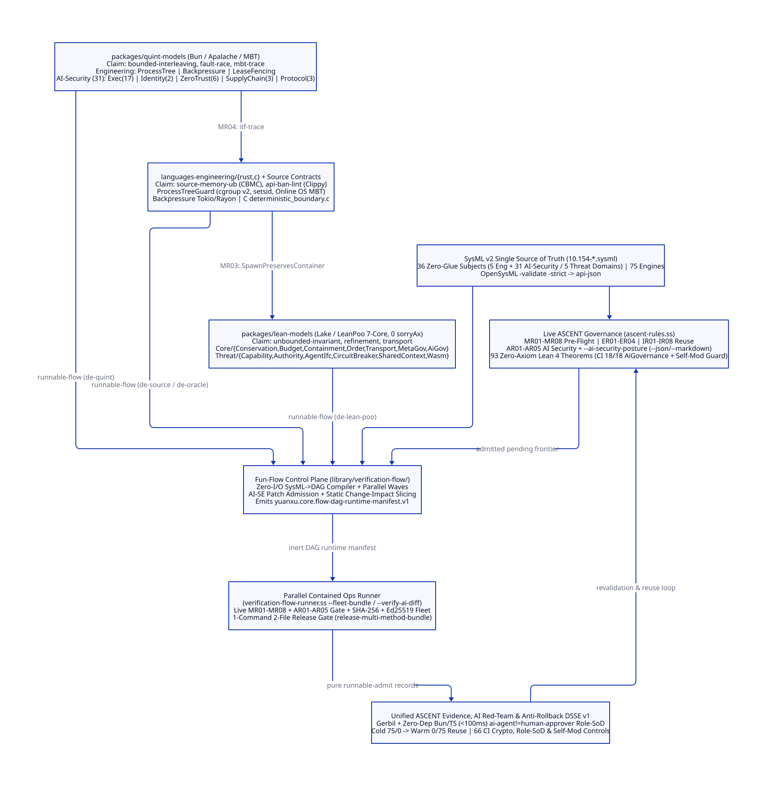

# SPDX-FileCopyrightText: 2026 hardenedlinux Linux Team and Contributors
#
# SPDX-License-Identifier: LGPL-2.1-or-later

#+TITLE: 10.154 Multi-Method Fun-Flow Runnable Interface, LeanPoo Package Family, and Anti-Leak Verification Architecture
#+LANGUAGE: en
#+PROPERTY: JD_ID 10.154
#+STARTUP: overview
#+OPTIONS: toc:3 num:nil
#+FILETAGS: :architecture:funflow:leanpoo:quint:ascent:sysml:lifecycle:

[[file:../../00-09-project/00-documentation/00.01-index.org][Index]] | [[file:10.03-upstream-capabilities.org][10.03 Upstream capabilities]] | [[file:10.17-domain-libraries-and-atomic-specialization.org][10.17 Domain libraries & Lean-Poo]] | [[file:10.25-rust-sysml-quint-lean-evidence-integration.org][10.25 Evidence integration]] | [[file:10.150-repository-organization-and-package-taxonomy.org][10.150 Organization]] | [[file:10.151-quint-models-library-and-packages.org][10.151 Quint models]] | [[file:10.153-defensive-engineering-taxonomy-and-modular-organization.org][10.153 Defensive engineering & Yuanxu windows]] | [[file:10.154-multi-method-funflow-runnable-and-leanpoo-architecture.sysml][10.154 Companion SysML v2]] | [[file:../../90-99-views/90-architecture-views/90.143-multi-method-funflow-and-leanpoo-architecture.d2][90.143 Paired D2]] · 

* Decision and motivation
:PROPERTIES:
:CUSTOM_ID: mm154-decision
:STATUS: implemented-verified
:END:

#+BEGIN_QUOTE
Status: *implemented and end-to-end verified (M0–M5 + Zero-Glue SysML v2 Compiler +
Parallel Conflict-Free Waves + Multi-Key Ed25519 Trust Store/Rotation/Revocation +
Offline JSON Trust-Store CLI + ASCENT MR01–MR08 / ER01–ER04 / IR01–IR08 +
42 Zero-Axiom Lean 4 Meta-Theorems + Linux cgroup v2 Backend +
6-Subject [5 Engineering + 1 Threat] / 15-Engine Fleet)*. The companion
[[file:10.154-multi-method-funflow-runnable-and-leanpoo-architecture.sysml][10.154 SysML v2 specification]]
is the live single source of truth compiled directly into Fun-Flow DAGs by
[[file:../../../library/verification-flow/sysml-compiler.ss][sysml-compiler.ss]] and
gated by =just check-multi-method=, =just fleet-multi-method=,
=just plan-multi-method-fleet=, =just impact-multi-method=,
=just verify-multi-method-report=, and =just verify-multi-method-fleet=.
#+END_QUOTE

This item defines the macro multi-method verification architecture that complements
[[file:10.153-defensive-engineering-taxonomy-and-modular-organization.org][10.153]]'s defensive-engineering taxonomy and fine-grained Yuanxu layering. It
specifies how heterogeneous formal and empirical verification methods — *Quint*,
*Lean 4 / LeanPoo*, *source-level verifiers (CBMC / Kani / Clippy)*, and *native
OS fault-injection oracles* — compose under a single declarative Scheme/Yuanxu
control plane with zero duplicated modeling work.

** Grounding engineering incident: =GatewayGuard::drop= orphan leak
:PROPERTIES:
:CUSTOM_ID: mm154-incident
:END:

During early =asp_http_e2e= runs, =GatewayGuard::drop= sent =POST /shutdown= to
=forwarding_gateway= and immediately issued =SIGKILL= to the gateway's single
PID. Because =SIGKILL= is uncatchable, =forwarding_gateway= was terminated
before its shutdown handler could drain and reap its own child processes,
leaving orphaned grandchildren holding OS resources.

In [[file:10.153-defensive-engineering-taxonomy-and-modular-organization.org][10.153]]'s =(L × P × M)= taxonomy, this defect is an archetype of a
*=P2= (misplaced/premature defense) on an =M3= (mutable-root / use-time
ownership) boundary*, exposing three structural root causes that recur across
process, FD, port, memory, permit, and distributed-lease leak classes:

1. *Collapsed termination protocol*: an asynchronous cooperative shutdown
   request (=POST /shutdown=) was followed immediately by non-cooperative force
   termination (=SIGKILL=) with no quiescence or grace-period barrier.
2. *Reclamation scope smaller than allocation tree*: the supervisor spawned a
   multi-level process tree (Harness -> Gateway -> Grandchildren), whereas the
   guard targeted only a single intermediate PID.
3. *Userspace-only cleanup fallacy*: any design relying exclusively on userspace
   =Drop= / signal handlers fails under =SIGKILL=, OOM-kill, panics, or CI
   hard-timeouts unless backed by kernel-enforced fate-sharing (=cgroup.kill=,
   PID namespace, process group + pipe-EOF watchdog / =kqueue= / subreaper).

No single verification tool covers all three root causes cleanly without
distorting its mathematical strengths. Preventing this class of engineering
defect systematically requires *coordinated, non-overlapping methods* united by
one declarative Scheme control plane.

** Three core architectural principles
:PROPERTIES:
:CUSTOM_ID: mm154-principles
:END:

1. *Ecosystem-native physical packaging; Yuanxu-owned semantic graph*:
   Physical packages follow their native toolchain and distribution physics
   (=packages/quint-models/= for Bun/Quint, =packages/lean-models/= for
   Lake/LeanPoo, =languages-engineering/<lang>/= for C/C++/Rust subjects).
   Yuanxu =library/= declarations (evolving into [[file:10.153-defensive-engineering-taxonomy-and-modular-organization.org][10.153]]'s seven-window layout:
   =Foundation=, =Evidence=, =Methods=, =Domains=, =Defense=, =Governance=,
   =Profiles=) and orthogonal =tags:= own semantic discovery and cross-method
   aggregation. Never force =.qnt=, =.lean=, and =.rs= into one physical
   =engineering/<topic>/= folder.
2. *Strict mathematical method orthogonality (zero model duplication)*:
   Each formal or empirical method owns a disjoint =claim-kind= partition.
   Quint explores finite concurrency/fault interleavings and emits MBT traces;
   LeanPoo proves unbounded parametric invariants, algebraic bounds, contract
   refinements, and proof-transport frames. Neither re-implements the other's
   model.
3. *Declarative Fun-Flow Runnable + ASCENT Governance*:
   Instead of ad-hoc per-case glue scripts (such as the current manual
   =quint=/=lean=/=native= calls in
   [[file:../../../t/support/resource-lifecycle-evidence.ss][resource-lifecycle-evidence.ss]]),
   heterogeneous verification targets compose through upstream *Fun-Flow*
   (=:tao3k/agentic-ai-lab/modules/funflow/control-plane/api=) extended with
   project-adapted hygienic Gerbil =defrules= macros and coupled to finite
   *ASCENT* (=define-program=) routing, anti-duplication, and evidence-admission
   rules.

* Orthogonal formal-method responsibility matrix
:PROPERTIES:
:CUSTOM_ID: mm154-method-matrix
:STATUS: design-draft
:END:

Every verification obligation in ASCENT carries an explicit =claim-kind=. Each
method family is authorized to discharge only its own =claim-kind= set:

#+NAME: method-responsibility-matrix
| Method family | Physical home | Yuanxu layer (10.153) | Authorized =claim-kind= set | Explicitly forbidden (anti-duplication red line) | Primary artifact |
|---------------+---------------+-----------------------+-----------------------------+--------------------------------------------------+------------------|
| *Scheme / Yuanxu + ASCENT* | =library/= | =Methods=, =Governance=, =Evidence= | Semantic ontology, obligation derivation, method routing (=MR01=–=MR06=), premise handoff, invalidation/reuse | Executing external tools, proving unbounded theorems, searching state spaces | Pure POO contracts, Fun-Flow DAGs, ASCENT programs |
| *Quint + Apalache + MBT* | =packages/quint-models/= | =Quint.*= windows | =bounded-interleaving=, =fault-race=, =guard-countermodel=, =mbt-trace= | Unbounded parametric proofs ($\forall N, d, C$), algebraic inequalities, contract refinement laws | Pure =.qnt= (Scheme POO AST projected), ITF traces |
| *Lean 4 + LeanPoo* | =packages/lean-models/= (proposed) | Bound via =Methods= / =Domains= | =unbounded-invariant=, =algebraic-bound=, =contract-refinement=, =proof-transport= | Re-writing Quint's finite interleaving transition system or brute-force trace enumeration | Native LeanPoo extensible objects, theorems, =Certificate= / =Patch.frame= |
| *Source Verifiers (CBMC / Kani / Clippy / Miri)* | =languages-engineering/<lang>/= | Bound via =Methods= / =Defense= | =source-memory-ub=, =drop-unwind-safety=, =api-ban-lint= | Distributed protocol safety, multi-process crash orchestration | Native C/C++/Rust harnesses & checked subjects |
| *Native OS Fault Oracles* | =t/= & consumer harnesses | =DevelopmentVerification= | =empirical-mbt-replay=, =os-sigkill-oracle=, =zero-leak-assertion= | Claiming exhaustive schedule coverage or universal liveness | Replayed ITF runs, =SIGKILL (137)= controls, leak receipts |

** Zero-duplication verification across six concrete subjects (live 6-subject [5 Engineering + 1 Threat] / 15-engine parallel Fleet)

#+NAME: zero-duplication-examples
| Engineering / Threat subject | Quint owns (finite races & MBT) | LeanPoo owns (unbounded laws & 6/6 cores) | Source / OS Oracle owns (physical grounding) | Premise handoff (=MR03=/=ER03=) |
|------------------------------+---------------------------------+-------------------------------------------+----------------------------------------------+---------------------------------|
| =process-tree-reclamation= (pilot vertical slice) | 3-tier finite transitions, 5 guard-pruning countermodels, 20 =--mbt= ITF traces | =Core.Containment= + =Engineering.ProcessTree= ($\forall d,k$ tree closure, =LinuxCgroupV2= / =DarwinPgidPipe= refinement, =Patch.frame= reuse) | Rust =ProcessTreeGuard= (Linux =cgroup v2= zero-TOCTOU =pre_exec= + =cgroup.kill=, Darwin =setpgid=+Pipe-EOF) + Clippy ban + 3 HTTP =/shutdown= E2E + 4 live Quint/online-OS MBT + 7 OS =SIGKILL=/=setsid()=/=cgroup v2= controls | =SpawnPreservesContainer= (Rust Oracle -> LeanPoo) |
| =backpressure-memory= (horizontal reuse) | Disjoint holder-set transitions, 4 countermodels, 10 =--mbt= ITF traces | =Core.Budget= + =Engineering.Backpressure= (monotonic additive memory bound, shrink safety, =Patch.frame= reuse) | Rust Clippy (=--offline=) + Tokio/Rayon 6-case lifecycle oracle (=RL-M01..RL-M06=, =live=0, available=1=) | =PayloadDropPrecedesPermitRelease= (Rust Oracle -> LeanPoo) |
| =lease-fencing-token= (zero-glue 3rd subject) | 2-client GC-pause lease race, =monotonic-fencing-token= countermodel, Apalache verify + 10 =--mbt= ITF traces | =Core.Order= + =Core.Transport= + =Engineering.LeaseFencing= (unbounded =Nat= zombie-write rejection, 2-step =ObjectContract.refine=, 1-line =Proof.reuse=) | (Pure formal 2-engine subject; no OS premise required) | None (closed) |
| =c-boundary-conservation= (zero-glue 4th subject) | (Pure C + LeanPoo 2-engine subject; zero Quint duplication) | =Core.Conservation= + =Core.Transport= + =Engineering.BoundaryConservation= (unbounded single-ownership cap & idempotent release, 2-step refinement, 1-line =Proof.reuse=) | *CBMC 6.11* (=source-memory-ub= on =deterministic_boundary.c= + =proof.c=: bounds, pointer, unsigned-overflow proof) | =NoCSourceOverflowOrPointerUB= (CBMC -> LeanPoo) |
| =meta-governance-soundness= (self-verifying 5th subject) | (Self-verifies ASCENT Datalog governance, parallel waves, Fleet Merkle attestation, & key revocation) | =Core.MetaGovernance= + =Core.Transport= + =Engineering.MetaGovernanceSoundness= (*42 constructive zero-axiom theorems*: =IR01=–=IR08= partition/transitivity/strict-premise/TTL, =MR01=–=MR08=/=ER01=–=ER04=, zero-race =ValidWaveSchedule=, Fleet Merkle tamper resistance, Multi-Key rotation, Mixed-Key Fleet child-revocation cascade, path-traversal containment, Trust Bundle export anti-leak/anti-lockout safety & single-file Fleet Evidence Bundle 1-to-1 bijection/anti-smuggling integrity) | Hashes live =library/verification-flow/ascent-rules.ss= so rule edits automatically trigger =IR02= meta-reverification | None (closed) |
| =delegated-agent-authz= (zero-glue 6th subject — Threat domain) | Depth-1 RFC 8693 OBO delegation + 4 countermodels (=obo-scope-attenuation=, =obo-actor-provenance=, =obo-revocation-currency=, =step-up-verified-floor=) + 10 =--mbt= ITF traces | =Threat.CapabilityContainment= + =Threat.AuthorityCurrentness= (cross-domain reuse of =Core.Containment= + =Core.Order= + =Core.Transport=: $\forall d,k$ multi-hop revocation closure, monotonic scope attenuation, unbounded epoch currentness, 14 Lean theorems) | (Pure formal Threat 2-engine subject; zero duplicated Core math) | None (closed) |

* LeanPoo distribution package family (=packages/lean-models/=)
:PROPERTIES:
:CUSTOM_ID: mm154-leanpoo-package
:STATUS: design-draft
:END:

** Why LeanPoo uses native POO objects rather than Scheme text projection

As established in [[file:10.151-quint-models-library-and-packages.org][10.151]], Quint required Scheme POO AST projection because
Quint supports only =const= instantiation and lacks prototype inheritance,
structural guard pruning, and refinement composition.

Lean 4 with [[file:10.03-upstream-capabilities.org::#lean-capabilities][LeanPoo]] already provides native, kernel-checked POO extensibility:

- =Object.defineIn= and =Memoized.defineFrom= construct typed extensible POO
  objects with C3/C4 linearization.
- =ObjectContract.refine= (=refine_accepts_iff=, =refine_preserves_rejection=)
  enforces monotonic strengthening so child specializations cannot silently drop
  inherited parent obligations.
- =Obligation= (=dependencies=, =stable=), =Patch= (=touched=, =frame=),
  =Certificate=, =reuse=, and =closePending= certify dependency-scoped proof
  transport across design edits.

Therefore, Lean models are authored directly as native LeanPoo objects in their
own Lake package rather than projected from Scheme AST strings. Scheme/Yuanxu
binds them by canonical identity, Lake module path, theorem/object symbol, and
pinned =lake-manifest.json= digest.

** SysML v2 as Single Source of Truth (replacing duplicated Scheme organization tables)

Rather than duplicating =lean-model-content= placements, package families, and
cross-method topology into legacy Scheme tables
([[file:../../../library/project-organization/objects.ss][project-organization/objects.ss]] /
[[file:../../../library/library-formation-profiles/objects.ss][library-formation-profiles/objects.ss]]),
the companion SysML v2 model
([[file:10.154-multi-method-funflow-runnable-and-leanpoo-architecture.sysml][10.154-*.sysml]])
is the single authoritative architectural declaration:

- OpenSysML (=sysml -validate -strict=) validates the SysML v2 model directly.
- OpenSysML (=sysml -convert api-json=) exports structured elements
  (=PartUsage=, =AttributeUsage= / =Redefinition= / =LiteralString=,
  =Dependency=, =SuccessionAsUsage=, =RequirementUsage=,
  =VerificationCaseUsage=).
- Pure Scheme projection (=sysml-api-json->governance-facts= in
  =library/verification-flow/rules.ss=) converts parsed JSON elements directly
  into ASCENT source relations for =MR01=–=MR06= (and future =OR01=–=OR07=
  cutover), eliminating hand-duplicated Scheme organization alists and brittle
  =string-contains= SysML scraping.

| Field | Declared in =10.154-*.sysml= (=system::leanModels=) |
|-------+-----------------------------------------------------|
| Package name | =deterministic-engineering-lean-models= (Lake package) |
| Physical path | =packages/lean-models/DeterministicEngineering/= |
| Package family | =lean-model-content= |
| Ecosystem | =lake,lean4,lean-poo= |
| Subtree mirror | =hardenedlinux/deterministic-engineering-lean-models= |
| Allowed content | =lakefile=, =lake-manifest=, =lean-toolchain=, =leanpoo-objects=, =proofs=, =readme= |
| Rejected content | =qnt-files=, =ts-js=, =scheme-files=, =sorry-proofs=, =json-sidecars= |

** Two-layer mathematical-first LeanPoo hierarchy

Unlike =packages/quint-models/= (which partitions primarily by behavioral domain
=engineering/*= vs =threat/*=), =packages/lean-models/= separates *reusable
mathematical POO foundations* from *thin domain refinements* so Engineering and
Threat domains share the exact same proved laws without duplication:

#+begin_example
packages/lean-models/
  lakefile.lean                    ; depends on pinned lean-poo revision
  lake-manifest.json
  lean-toolchain
  DeterministicEngineering/
    Core/                          ; Layer A: shared extensible LeanPoo base objects
      Conservation.lean            ; single-ownership permit/resource conservation & idempotent release
      Budget.lean                  ; additive/monotonic capacity & memory bounds (generalizes BackpressureBudget)
      Containment.lean             ; arbitrary-depth tree containment closure, fate-sharing, non-escape
      Order.lean                   ; fencing-token monotonicity, version partial orders, governance-floor lattice
      Transport.lean               ; ObjectContract.refine & Patch.frame / Proof.reuse templates
    Engineering/                   ; Layer B1: thin Engineering POO refinements of Core/
      Backpressure.lean            ; refines Core.Conservation + Core.Budget
      ProcessTree.lean             ; refines Core.Containment -> LinuxCgroupV2, DarwinPgidPipe
      Broadcast.lean               ; refines Core.Conservation + Core.Order
      ConsensusQuorum.lean         ; refines Core.Order + quorum intersection
    Threat/                        ; Layer B2: thin Threat POO refinements sharing the SAME Core/!
      CapabilityContainment.lean   ; refines Core.Containment (delegation revocation closure)
      AuthorityCurrentness.lean    ; refines Core.Order (monotonic authority validity)
    Bridge/                        ; Layer C: typed premise signatures (NO mirrored Quint state machines)
      PremiseContracts.lean        ; explicit assumption records linked to ASCENT premise_handoff
#+end_example

* Unified Fun-Flow Runnable control plane and =defrules= metaprogramming
:PROPERTIES:
:CUSTOM_ID: mm154-funflow-runnable
:STATUS: design-draft
:END:

** Unifying physically separate packages in Scheme without violating 10.148 purity

All heterogeneous verification artifacts — Quint models in
=packages/quint-models/=, LeanPoo modules in =packages/lean-models/=, and native
C/C++/Rust subjects in =languages-engineering/= — are unified at the *logical
and orchestration layer* inside Scheme using the existing upstream *Fun-Flow
control plane* (=:tao3k/agentic-ai-lab/modules/funflow/control-plane/api=,
documented in upstream =10.07-functional-flow-kernel.org=).

The boundary invariant matches upstream Fun-Flow, DE [[file:10.148-flat-declarative-library-boundary.org][10.148]], and [[file:10.153-defensive-engineering-taxonomy-and-modular-organization.org][10.153]]'s
=OR07= layer DAG:

- *Pure control plane (=library/verification-flow/=, =de.layer.method=)*: owns
  POO task-family descriptors, Category/Arrow flow composition (=flow-arr=,
  =flow-then=, =flow-fanout=, =try-flow=, =external-flow=), hygienic =defrules=
  authoring macros, typed =ObjectContract.= / =FlowOf= edge checks, and inert
  DAG/manifest projection (=flow->dag-receipt=, =flow->dag-runtime-manifest=,
  =make-runtime-command-descriptor=). *Zero I/O, zero subprocesses.*
- *Runtime execution boundary (Host / Core Ops / =t/support/= / Rust runner)*:
  consumes the inert =yuanxu.core.flow-dag-runtime-manifest.v1= and
  =RuntimeCommandDescriptor= manifests, executes external steps inside a
  bounded process-tree containment guard, captures raw receipts and input
  digests, and feeds raw outputs back into pure admission arrows.

** Method task families via Fun-Flow =TaskFamilyRegistry=

Fun-Flow's =task.ss= already provides data-driven, immutable
=TaskFamilyDescriptor= and =TaskFamilyRegistry= POO objects
(=make-task-family-descriptor=, =task-family-registry-extend=). Rather than
hardcoding runners per tool, DE extends =default-task-family-registry= with four
verification task families:

| Task family name | Capability | Route | Runtime owner | Authorized =claim-kind= |
|------------------+------------+-------+---------------+-------------------------|
| =de-quint= | =quint-apalache-mbt= | =adapter= | =quint-modules-resolver= | =bounded-interleaving=, =fault-race=, =guard-countermodel=, =mbt-trace= |
| =de-lean-poo= | =lean4-lake-kernel= | =adapter= | =lake-lean= | =unbounded-invariant=, =algebraic-bound=, =contract-refinement=, =proof-transport= |
| =de-source-contract= | =cbmc-kani-clippy= | =adapter= | =native-toolchain= | =source-memory-ub=, =drop-unwind-safety=, =api-ban-lint= |
| =de-native-oracle= | =mbt-fault-oracle= | =adapter= | =ops-contained-runner= | =empirical-mbt-replay=, =os-sigkill-oracle=, =zero-leak-assertion= |

** Unified pure CLOS Runnable protocol (adapting existing =quint-methods= and =source-contracts=)

Existing [[file:../../../library/quint-methods/methods.ss][quint-methods]] (=quint-plan=) and [[file:../../../library/source-contracts/interface.ss][source-contracts]] (=contract-plan=)
already produce pure sealed check plans. Wrapping them (plus new =lean-methods=
and =native-oracle-methods=) behind three shared pure CLOS generics aligns every
method into Fun-Flow's typed Category/Arrow model:

1. =(runnable-inputs target profile)= -> deterministic input-closure manifest
   (source files, lockfiles, =lake-manifest.json=, pinned tool versions) for
   content-addressed digesting and selective ASCENT invalidation.
2. =(runnable-flow target profile policy)= -> returns a typed Fun-Flow =Flow=
   value (an =external-flow= carrying a =RuntimeCommandDescriptor= +
   =OperationSignature= =Fun RawReceipt <- InputEnvelope=, followed by a pure
   =flow-arr= admission arrow).
3. =(runnable-admit target plan raw-receipt)= -> pure independent oracle check
   validating exit status, ITF predicates, zero-=sorry= / allowed-axiom report,
   or zero-leak assertions, returning a normalized =EvidenceRecord= for ASCENT.

** Hygienic Gerbil =defrules= metaprogramming layer (design sketch)

Following upstream Fun-Flow boundary rule #5 (=flow-syntax.ss=): authoring
macros MUST expand directly to public Fun-Flow combinators and POO values —
never to a parallel alist or ad-hoc workflow DSL.

#+NAME: funflow-defrules-sketch
#+begin_src scheme
;; Design sketch only (target: library/verification-flow/syntax.ss).
;; All macros expand strictly to Fun-Flow combinators, POO objects, and ASCENT fact tuples.

(defrules defde-method-family ()
  ((_ binding family-name capability runtime-owner adapter-op claim-kinds ...)
   (def binding
     (.o descriptor:
         (make-task-family-descriptor 'family-name 'capability 'adapter 'runtime-owner 'adapter-op)
         claim-kinds: '(claim-kinds ...)))))

(defrules defde-verification-step ()
  ((_ binding step-name family-obj claim-kind (Fun out-c <- in-c)
      request: req-expr
      produces: prod-list
      consumes: cons-list
      admit: admit-proc)
   (def binding
     (.o identity: 'step-name
         family: family-obj
         claim-kind: 'claim-kind
         produces: 'prod-list
         consumes: 'cons-list
         flow:
         (flow-then 'step-name
           (external-flow 'step-name (Fun RawReceiptContract <- in-c) req-expr)
           (flow-arr 'step-name-admit (Fun out-c <- RawReceiptContract) admit-proc))))))

(defrules defde-verification-dag ()
  ((_ binding dag-name
      parallel: (left-step right-step)
      converge: join-sig join-proc)
   (def binding
     (flow-then 'dag-name
       (flow-fanout 'dag-name-fanout (.get left-step flow) (.get right-step flow))
       (flow-arr 'dag-name-join join-sig join-proc)))))
#+end_src

With this metaprogramming layer, any engineering subject composes heterogeneous
methods into one typed, inspectable DAG whose report-only receipt and runtime
manifest are obtained directly via upstream =(flow->dag-receipt flow)= and
=(flow->dag-runtime-manifest flow request-id)=.

** Unified user configuration extension (=config.ss=)

[[file:../../../config.ss][config.ss]] extends naturally without changing its Yuanxu =config-defaults= shape:

#+begin_src scheme
;; Design sketch extending existing config.ss languages tree:
languages:
(.o
  c:     (.o enable: #f settings: (.o profile: 'capacity-body timeout: 45))
  cpp:   (.o enable: #f settings: (.o profile: 'lifetime-body timeout: 45))
  quint: (.o enable: #f settings: (.o profile: 'assurance.bounded-proof timeout: 120))
  lean:  (.o enable: #f settings: (.o profile: 'lean.kernel-and-reuse timeout: 180))
  rust:  (.o enable: #f settings: (.o profile: 'rust.contained-oracle timeout: 120)))
#+end_src

* ASCENT declarative governance and cross-method rules (=MR01=–=MR06=)
:PROPERTIES:
:CUSTOM_ID: mm154-ascent-rules
:STATUS: design-draft
:END:

Fun-Flow owns *typed compositional orchestration*; ASCENT (=:gerbil-ascent/rules/func=,
=define-program=, =de.layer.governance= / =de.layer.evidence=) owns *relational
governance, anti-duplication, incremental skipping, and evidence closure*. They
couple in a closed two-phase loop:

1. *Pre-execution planning gate*: ASCENT evaluates the subject's declared
   obligations, attached Fun-Flow steps, artifact edges, premise handoffs, and
   existing applicable witnesses. It rejects rule violations (=MR01=–=MR06=) and
   outputs the exact =pending= step frontier so unchanged =M1= Quint or LeanPoo
   proofs are not needlessly re-run when only Rust source changes (honoring
   [[file:10.153-defensive-engineering-taxonomy-and-modular-organization.org][10.153]]'s =F2= bounded revalidation and =M1= sufficiency stopping).
2. *Post-execution admission gate*: Fun-Flow admission arrows project verified
   =witness=, =witness_input=, =checked=, and =premise_support= rows back into
   the existing [[file:../../../library/evidence/func.ss][make-resource-evidence]] ASCENT session.

** Finite Multi-Method Rules (=MR01=–=MR08=), Admission (=ER01=–=ER04=), & Incremental Reuse (=IR01=–=IR08=)

#+NAME: multi-method-ascent-rules
| Rule | Rejection / Finding condition | Purpose |
|------+-------------------------------+---------|
| =MR01= Claim-kind routing | A step declares =(obligation O, method M, claim_kind K)= where =M= is not authorized for =K= | Prevents using Quint to claim unbounded proofs or Lean to simulate finite traces |
| =MR02= Anti-duplication | Two distinct methods =M1 != M2= target the same =(obligation O, claim_kind K)= without an explicit =correspondence_bridge(O, M1, M2)= | Mechanically eliminates redundant dual-authored models |
| =MR03= Premise-handoff closure | A step (typically LeanPoo) declares =requires_premise(S, P)= with no supporting step or accepted witness for =P= | Keeps ungrounded axioms/assumptions visibly =open_premise=; blocks silent discharge |
| =MR04= DAG artifact closure | A step declares =consumes_artifact(S, A)= with no upstream Fun-Flow edge =dag_edge(U, S)= producing =A= | Catches broken MBT/receipt pipelines (e.g., Rust oracle missing Quint ITF producer) |
| =MR05= Mandatory countermodel floor | A stateful Quint target (=quint.property.stateful=) has zero declared countermodels under Band-5 =governance.mandatory-countermodels= | Preserves non-negotiable countermodel discipline from [[file:10.151-quint-models-library-and-packages.org][10.151]] and =F3= in [[file:10.153-defensive-engineering-taxonomy-and-modular-organization.org][10.153]] |
| =MR06= Subprocess containment obligation | Any subject (or runtime runner itself) tagged =owns-subprocess-tree= lacks either a declared OS containment strategy or an =os-sigkill-oracle= negative control | Prevents recurrence of the =GatewayGuard::drop= orphan-process leak class |
| =MR07= Acyclic premise dependency | Transitive closure of =step_requires_premise= / =step_supports_premise= forms a cycle (=step_premise_dep(S, S)=) | Blocks circular self-justifying proof premises across engines |
| =MR08= Acyclic Fun-Flow DAG | Transitive closure of =flow_dag_edge= forms a cycle (=flow_dag_reach(S, S)=) | Guarantees finite topological wave scheduling (=ValidWaveSchedule=) |
| =IR01=–=IR04= Cache & DAG reuse | Missing/non-passing cache (=IR01=), input digest drift (=IR02=), transitive upstream DAG invalidation (=IR03=), or =M3-mutable-root= policy revalidation (=IR04=) | Sound selective proof reuse (unchanged =M1= Quint/Lean proofs skipped cleanly) |
| =IR05= Toolchain drift | Cached verifier version fingerprint differs from live host toolchain (=quint=, =lean=, =rustc=, =cbmc=, =openssl=) | Prevents silent reuse across compiler/solver upgrades |
| =IR06= Ed25519 attestation & key trust | Unsigned, tampered, unknown-key, or *revoked-key* cache witness rejected against the Multi-Key Ed25519 Trust Store | Supports zero-downtime key rotation (=K1 -> K2=) and instant compromise revocation |
| =IR07= Strict premise revalidation | Policy-gated (=strict-premise-recheck=): invalidates any step whose premise supporter is invalidated, cascading across mixed DAG + premise chains | Ensures downstream LeanPoo proofs re-verify whenever an upstream OS/CBMC premise re-runs |
| =IR08= Bounded =M3= witness TTL | Policy-gated (=m3-max-witness-age-secs=): expires stale =M3-mutable-root= OS witnesses using Ed25519-signed =issuedAtEpoch= while =M1-immutable-proof= remains timeless | Defeats replay of arbitrarily old empirical OS receipts and timestamp forgery |

** ASCENT =define-program= design sketch

#+NAME: ascent-mr-program-sketch
#+begin_src scheme
;; Design sketch only (target: library/verification-flow/rules.ss).
;; Pure finite ASCENT program evaluated before Fun-Flow manifest handoff.
(define-program
  (make-multi-method-governance-program)
  (sources
   subject_obligation          ; (subject obligation claim_kind)
   subject_factor              ; (subject factor)
   method_allows_claim         ; (method claim_kind)
   flow_step                   ; (step subject obligation method claim_kind)
   flow_dag_edge               ; (from_step to_step)
   step_produces               ; (step artifact)
   step_consumes               ; (step artifact)
   step_requires_premise       ; (step premise)
   step_supports_premise       ; (step premise)
   correspondence_bridge       ; (obligation method_a method_b)
   stateful_quint_step         ; (step)
   step_countermodel           ; (step guard_id)
   declared_os_containment)    ; (subject platform strategy)
  (outputs
   mr_finding
   open_premise
   runnable_admitted)
  ;; ... relation declarations ...

  ;; MR01: unauthorized claim-kind for method family
  ((mr_finding S (lit "MR01-unauthorized-claim-kind") Step)
   <-- (flow_step Step S O M K) (not (method_allows_claim M K)))

  ;; MR02: duplicate method coverage without explicit correspondence bridge
  ((mr_finding S (lit "MR02-duplicate-method-claim") O)
   <-- (flow_step St1 S O M1 K)
       (flow_step St2 S O M2 K)
       (if (M1 M2) (not (eq? M1 M2)))
       (not (correspondence_bridge O M1 M2))
       (not (correspondence_bridge O M2 M1)))

  ;; MR03: premise handoff visibility
  ((open_premise S Step P)
   <-- (flow_step Step S O M K)
       (step_requires_premise Step P)
       (not (step_supports_premise _ P)))

  ;; MR04: missing upstream artifact producer in Fun-Flow DAG
  ((mr_finding S (lit "MR04-missing-artifact-edge") Step)
   <-- (flow_step Step S _ _ _)
       (step_consumes Step A)
       (not (artifact_edge_satisfied Step A)))

  ;; MR05: stateful Quint target without countermodels
  ((mr_finding S (lit "MR05-missing-countermodel") Step)
   <-- (flow_step Step S _ _ _)
       (stateful_quint_step Step)
       (not (step_countermodel Step _)))

  ;; MR06: subprocess-tree ownership requires OS containment + SIGKILL oracle
  ((mr_finding S (lit "MR06-missing-os-containment") S)
   <-- (subject_factor S (lit 'owns-subprocess-tree))
       (not (declared_os_containment S _ _)))
  ((mr_finding S (lit "MR06-missing-sigkill-oracle") S)
   <-- (subject_factor S (lit 'owns-subprocess-tree))
       (not (flow_step _ S _ _ (lit 'os-sigkill-oracle))))

  ((runnable_admitted S)
   <-- (subject_obligation S _ _)
       (not (mr_finding S _ _)))
  (bounds 4096 4096 4096))
#+end_src

* Pilot vertical slice: =ProcessTreeReclamation= (anti-leak reference case)
:PROPERTIES:
:CUSTOM_ID: mm154-pilot-slice
:STATUS: design-draft
:END:

To validate the entire macro architecture end to end — and close the real
=GatewayGuard::drop= leak class — the first vertical slice binds four
non-overlapping artifacts into one Fun-Flow DAG:

** 1. Quint finite fault-race model (=packages/quint-models/engineering/concurrency/process-tree-reclamation/=)

- *State*: 3-tier hierarchy (=guardian=, =supervisor=, =c1=, =c2=) plus
  =graceTimer=, =container= (=None | Active | Frozen | TreeKilled=), and
  distinct observation bits (=shutdownSent=, =httpAcked=, =waitpidReaped=).
- *Emergent safety*:
  - =guardian == Reaped => (c1 == Exited and c2 == Exited)= (zero orphan after drop/reap)
  - =supervisor == KilledHard => (graceExpired or supervisorHung)= (no premature =SIGKILL=)
  - No post-reap signal to recycled PID; no spawn escaping =Frozen=/=TreeKilled= container.
- *Five auto-derived guard-pruning countermodels*:
  1. =premature-sigkill= (drops =grace-or-exit-barrier= — exact =asp_http_e2e= bug)
  2. =http-ack-not-quiescence= (treats async HTTP 200 as process quiescence)
  3. =single-pid-kill-no-containment= (kills only gateway PID after timeout)
  4. =pgid-spawn-toctou= (concurrent =fork=/=setsid= during kill scan)
  5. =pid-reuse-double-kill= (signals PID after =waitpid= reap)
- *Output artifact*: =itf-trace= via =quint-modules-resolver run ... --mbt=.

** 2. LeanPoo unbounded containment & refinement (=packages/lean-models/DeterministicEngineering/=)

- *=Core/Containment.lean=*: reusable LeanPoo base object =OwnershipTreeContract=
  proving $\forall$ tree depth $d$ and branching $k$, if =SpawnPreservesContainer=
  holds, atomic container termination leaves zero live descendants regardless of
  intermediate node crashes (=SIGKILL=).
- *=Engineering/ProcessTree.lean=*: refines =OwnershipTreeContract= via
  =ObjectContract.refine= into:
  - =LinuxCgroupV2Supervisor= (discharges =SpawnPreservesContainer= unconditionally
    under =cgroup.kill= / =CLONE_NEWPID=), and
  - =DarwinPgidPipeSupervisor= (explicitly exposes the added premise
    =NoSetsidEscape \/ PipeEofWatchdogActive=).
- *=Patch.frame= + =Proof.reuse=*: certifies that tuning grace-timeout constants
  transports the tree-closure theorem, while regressing container kill to
  single-PID kill invalidates =Patch.frame=.

** 3. Rust guard & OS containment (=languages-engineering/rust/lifecycle/process-tree-guard/=)

- Typestate =ProcessTreeGuard= (=Running -> Draining -> Reaped=) with explicit
  =async fn shutdown(mut self)= disarming =Drop=, and bounded synchronous
  escalation inside =Drop= (graceful -> bounded =try_wait= -> container kill ->
  =waitpid= reap).
- Clippy =disallowed-methods= lint forbidding bare =Command::spawn= and
  =tokio::process::Command::kill_on_drop(true)= (single-PID footgun).
- Cross-platform containment: Linux (=cgroup.kill= / PID-ns / =setpgid= +
  =PR_SET_CHILD_SUBREAPER= + =pidfd_send_signal=); macOS (=setpgid= + =killpg= +
  Pipe-EOF watchdog + =kqueue EVFILT_PROC NOTE_EXIT=).

** 4. Fun-Flow verification DAG & mandatory =SIGKILL= Leak Oracle

#+begin_example
                  ┌─► [de-quint: ProcessTreeReclamation] ──(itf-trace)──► [de-native-oracle: MBT + SIGKILL Leak Oracle] ─┐
InputEnvelope ────┤                                                                                                       ├─► [flow-arr: ASCENT Admission]
                  └─► [de-lean-poo: Core.Containment + ProcessTree] ──(requires: SpawnPreservesContainer)────────────────┘
#+end_example

Mandatory negative controls (mirroring [[file:../../../Justfile][Justfile]]'s real =SIGKILL= =137= boundary
testing):
1. Normal =shutdown().await= -> exit 0, clean child flush, 0 orphans/ports/FDs.
2. Panic inside test body -> =Drop= bounded grace escalation -> 0 orphans.
3. External =SIGKILL= injected directly into =forwarding_gateway= -> kernel
   fate-sharing terminates all grandchildren within bound -> 0 orphans.
4. Hung grandchild ignoring =SIGTERM= -> grace deadline triggers container
   =SIGKILL= -> 0 orphans.

* Implemented verification milestones and refusal gates (M0–M5 + Fleet)
:PROPERTIES:
:CUSTOM_ID: mm154-landing-plan
:STATUS: implemented-verified
:END:

#+NAME: staged-landing-plan
| Stage | Deliverables (landed) | Passing gate (verified) | Refusal gate |
|-------+-----------------------+-------------------------+--------------|
| M0 Architecture & SysML v2 | =10.154-*.org=, companion =10.154-*.sysml=, =90.143= D2/SVG | =sysml -validate -strict= exits 0 with 0 warnings | Claiming execution before landing; breaking existing =OR01=–=OR07= |
| M1 + M2 Pure Control Plane, Compiler & ASCENT =MR01=–=MR08= / =ER01=–=ER04= / =IR01=–=IR08= | =library/verification-flow/{attestation,types,objects,config,func,ascent-rules,sysml-projection,sysml-compiler,rules,methods,syntax,interface}.ss= | Zero-I/O pure library; zero-dependency =attestation.ss= canonical signing core; zero-glue SysML v2 -> Fun-Flow DAG compiler; all 8 MR + 4 ER + 8 IR (incl. cyclic DAG/premise, =IR05= toolchain drift, =IR06= Multi-Key Ed25519 trust/revocation, =IR07= strict premise cascade, =IR08= bounded =M3= TTL) + pure static =changed-files->affected-frontier= pass | Duplicating SysML v2 into Scheme glue; spawning subprocesses inside =library/= |
| M3 Complete 6-Core LeanPoo Package (Engineering + Threat) | =packages/lean-models/DeterministicEngineering/Core/{Conservation,Budget,Containment,Order,Transport,MetaGovernance}.lean= + =Engineering/{ProcessTree,Backpressure,LeaseFencing,BoundaryConservation,MetaGovernanceSoundness}.lean= + =Threat/{CapabilityContainment,AuthorityCurrentness}.lean= | Modular per-subject =lake build <target-mods>= passes with 0 =sorryAx=, *42 constructive zero-axiom meta-soundness theorems* + *14 Threat-domain theorems* sharing the exact same 6 Cores; gated in GitHub Actions =lean4-meta-and-domain-proofs= | Mirroring Quint finite state machine in Lean; ungrounded =axiom= without ASCENT =open_premise= |
| M4 Pilot & Multi-Domain Subjects | Quint =ProcessTreeReclamation= (5 countermodels) + Rust =ProcessTreeGuard= (Linux =cgroup v2= zero-TOCTOU =pre_exec= + =cgroup.kill=, Darwin =setpgid=+Pipe-EOF, Clippy ban, 3 HTTP =/shutdown= E2E, 4 live Quint/online-OS MBT, 7 OS =SIGKILL=/=setsid()=/=cgroup v2= controls) + =BackpressureMemory= + =LeaseFencingToken= + C =CBMC= (=c-boundary-conservation=) + =MetaGovernanceSoundness= + Threat =DelegatedAgentAuthz= | Apalache + 100% MBT + 18/18 Rust tests + Clippy =-D warnings= + CBMC 6.11 =VERIFICATION SUCCESSFUL= + 42 Lean meta-soundness + 14 Threat theorems | Skipping =SIGKILL=/=setsid()= negative controls; silent UB fallback |
| M5 Parallel Signed Cache, Air-Gapped Verifier & 6-Subject Fleet | [[file:../../../t/support/verification-flow-runner.ss][verification-flow-runner.ss]] (full in-process Inline-PEM Trust Bundle parity) + ultra-lightweight air-gapped [[file:../../../t/support/offline-attestation-verifier.ss][offline-attestation-verifier.ss]] & byte-for-byte isomorphic zero-dependency Bun/TS verifier [[file:../../../t/harness/offline-attestation-verifier.ts][offline-attestation-verifier.ts]] (=--json= audit mode + single-file inline-PEM Trust Bundle + =--export-trust-bundle= + =--pack-fleet-bundle= + =--verify-fleet-bundle= 2-file air-gapped audit + =--verify-trust-store= + native =lstat= symlink/path-traversal containment) + 11 Gerbil suites & 28-control Gerbil<->TS interop suite (=just check-offline-verifier=, gated in GitHub Actions =airgapped-offline-verifier-adversarial=) + =just check-multi-method= / =fleet-multi-method= / =plan-multi-method-fleet= / =impact-multi-method= / =verify-multi-method-{report,fleet,fleet-bundle,cache,trust-store,fast}= / =pack-multi-method-fleet-bundle= / =export-multi-method-trust-bundle= | Conflict-free parallel waves (=Quint \|\| LeanPoo \|\| Clippy=); Cold 15/0 -> Warm 0/15 Ed25519-verified cache reuse; native Gerbil SHA-256 + content-addressed SysML/cache memoization; Mixed-Key Fleet =K1->K2= zero-downtime rotation & sub-report revocation cascade; 2-file air-gapped Fleet audit (=7s= Gerbil / =<100ms= Bun/TS); =replayValid = true= | Silent admission with missing/failed evidence, unsigned/tampered/revoked cache or child report, private-key bundle leakage, smuggled/missing bundle children, path-traversal/symlink escape, zero-active trust-store lockout, toolchain drift, expired =M3= TTL, or replay drift |

* Limits
:PROPERTIES:
:CUSTOM_ID: mm154-limits
:STATUS: implemented-verified
:END:

- Bounded Quint verification, unbounded LeanPoo algebraic/containment proofs,
  CBMC bit-precise C UB proofs, and native =SIGKILL= / =setsid()= / =cgroup v2=
  oracles still depend on trusted kernel and verifier semantics (Linux cgroup v2
  / Darwin =killpg=+Pipe-EOF, Lean 4 kernel, Apalache/CBMC SMT solvers, OpenSSL
  Ed25519).
- As empirically witnessed by =control_6= and =control_7= in
  [[file:../../../languages-engineering/rust/lifecycle/process-tree-guard/tests/sigkill_leak_oracle.rs][sigkill_leak_oracle.rs]],
  Darwin userspace containment (=setpgid= + Pipe-EOF) closes =setsid()= escapes
  only for cooperating processes that retain =PTREE_WATCHDOG_FD=; untrusted
  adversarial binaries require kernel-enforced Linux =cgroup v2= (=cgroup.kill=
  with zero-TOCTOU =pre_exec= attachment in =src/cgroup_v2.rs=) or PID
  namespaces to uphold =SpawnPreservesContainer= unconditionally.
- Multi-Key Ed25519 Trust Store verification
  (=verify-report-with-trust-store=, =verify-fleet-report-with-trust-store=)
  enables zero-downtime key rotation and instant compromise revocation while
  assuming trust-store distribution and revocation list freshness are managed
  out of band.
