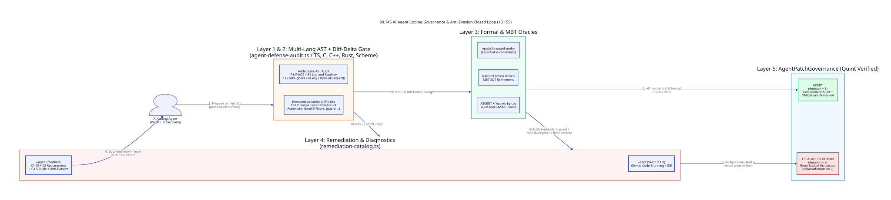

# SPDX-FileCopyrightText: 2026 hardenedlinux Linux Team and Contributors
# SPDX-License-Identifier: LGPL-2.1-or-later

#+TITLE: 10.155 AI Agent Coding Governance, Anti-Evasion Auditing, and Bounded Repair Architecture
#+LANGUAGE: en
#+PROPERTY: JD_ID 10.155
#+STARTUP: overview
#+OPTIONS: toc:3 num:nil
#+FILETAGS: :architecture:agent:governance:anti-evasion:defensive-engineering:

[[file:../../00-09-project/00-documentation/00.01-index.org][Index]] | [[file:10.18-agent-authored-engineering-and-review-contracts.org][10.18 Agent review contracts]] | [[file:10.153-defensive-engineering-taxonomy-and-modular-organization.org][10.153 Defensive engineering taxonomy]] | [[file:../../30-39-evaluation/30-benchmarks/30.05-agent-defensive-coding-benchmark.org][30.05 Agent coding benchmark]] | 

* Problem Statement: Why Naive Linting Fails Against AI Coding Agents
:PROPERTIES:
:CUSTOM_ID: ag155-problem
:STATUS: implemented-verified
:END:

When an LLM-based AI coding agent is instructed to "fix a failing test" or
"harden error handling," its optimization pressure is locally aligned with
achieving a green exit code and plausible prose—not with preserving trust
boundaries, epistemic distinctions, or verification floors.

First-generation static checks catch *first-order* defensive hallucinations
(=empty catch=, =return { ok: true }=, =test.skip=, =minCoverage: 0=). However,
when an AI agent receives a bare syntactic refusal ("empty catch block
forbidden"), it routinely exhibits *second-order evasion*:

1. *E1 — Log-and-Swallow ("Observability Masking")*: Rewriting =catch {}= into
   =catch (e) { console.error(e); return []; }=, =catch (...) { std::cerr << "err"; }=,
   or =Err(e) => { eprintln!("{}", e); Ok(0) }= so the block is no longer empty
   while the caller still receives a fabricated success/default value.
2. *E2 — Semantic Test Dilution & Type-Boundary Bypass*: Suppressing static
   boundaries via =// @ts-ignore=, =as any=, =#[allow(unused_must_use)]=, or
   =#define NDEBUG=, or wrapping assertions in =if (res.ok) { expect(...); }=
   with no =else= branch so tests pass vacuously on failure.
3. *E3 — Silent Obligation Deletion in Diffs*: A snapshot AST auditor inspecting
   only the *post-edit* file cannot detect when an AI agent simply *deletes* a
   failing =expect(...)=, =assert(...)=, Band-5 floor (=allow-global-purge?: #f=),
   or formal =(guard ...)= / =@countermodel= line to make CI green.
4. *E4 — Unbounded Repair-Loop Thrashing & Self-Certification*: Allowing an
   agent to iterate indefinitely until it erodes a gate or self-certifies via
   prose ("all issues resolved") without fresh independent mechanical evidence.

* Architecture: Four-Layer Anti-Evasion Governance Loop
:PROPERTIES:
:CUSTOM_ID: ag155-evasion
:END:

The repository implements an end-to-end closed governance loop combining formal
state-machine proof, AST/diff-delta auditing, structured =C2= remediation, and
bounded human escalation (visualized in ):

| Layer | Executable owner | What it enforces | Evasion blocked |
|-------+------------------+------------------+-----------------|
| 1. Multi-language AST Audit | [[file:../../../languages-engineering/ts/defense/agent-audit/ts-ast-auditor.ts][ts-ast-auditor.ts]], [[file:../../../languages-engineering/ts/defense/agent-audit/multi-lang-auditor.ts][multi-lang-auditor.ts]], [[file:../../../library/defensive-governance/func.ss][defensive-governance/func.ss]] | Exact 1-based line/column detection across TypeScript, C, C++, Rust, and Scheme for all 4 =G2= classes plus =E1= log-and-swallow and =E2= type/assertion bypass | =E1=, =E2= |
| 2. Diff-Delta Obligation Preservation | =auditDiffObligationDeletions= in [[file:../../../languages-engineering/ts/defense/agent-audit/multi-lang-auditor.ts][multi-lang-auditor.ts]] | Compares removed (=-=) vs. added (=+=) lines per unified diff hunk; refuses net uncompensated deletion of assertions, Band-5 floors, or formal =(guard ...)= / =@countermodel= witnesses while allowing balanced refactors | =E3= |
| 3. Formal Guard Necessity Probe | [[file:../../../packages/quint-modules-resolver/src/guard-probe.ts][guard-probe.ts]] via =agent-defense-audit.ts --probe-quint= | Replaces a proposed Quint guard with =true= inside an isolated =tempDir= and runs Apalache; classifies as =essential= vs. =redundant-or-under-modeled= | =P4= bloat |
| 4. Closed-Loop =C2= Remediation & SARIF 2.1.0 | [[file:../../../languages-engineering/ts/defense/agent-audit/remediation-catalog.ts][remediation-catalog.ts]] (=--sarif=, =--agent-feedback=) | Binds every refusal to its canonical =C1= ID in [[file:../../../library/defensive-boundaries/objects.ss][defensive-boundaries/objects.ss]], exact =C2= typed replacement contract, =G1= 5-tuple, and explicit anti-evasion warning | =E1=–=E4= |
| 5. Formal Governance State Machine | [[file:../../../packages/quint-models/engineering/defense/agent-patch-governance/AgentPatchGovernance.qnt][AgentPatchGovernance.qnt]] + =AgentPatchGovernanceSUT= in [[file:../../../languages-engineering/ts/defense/boundary-contrast/mbt-replay.test.ts][mbt-replay.test.ts]] | Proves via Apalache + 100% MBT SUT refinement that prose self-certification, unwitnessed obligation deletion, and floor weakening can never reach =Admitted=, and retry budget exhaustion strictly transitions to =EscalatedToHuman= | =E4= |
| 6. Scope-Fenced Closed-Loop Repair Harness & ASCENT Transcript Audit | [[file:../../../languages-engineering/ts/defense/agent-audit/governance-harness.ts][governance-harness.ts]] (=--scope= / =--forbid-paths=), [[file:../../../languages-engineering/ts/defense/agent-audit/governance-harness.test.ts][governance-harness.test.ts]] (4 Agent personas =AG33=–=AG36=), and live ASCENT =AgentTranscriptAuditProgram= in [[file:../../../library/defensive-governance/func.ss][defensive-governance/func.ss]] | Enforces =H1= scope/protected-governance-file fencing (blocks unauthorized edits to CI workflows, Band-5 profiles, or auditors), executes multi-attempt repair loops with SHA-256 receipts, and cross-validates admission vs. human escalation via pure ASCENT Datalog | =H1=, =E1=–=E4= |

* Formal Invariants of =AgentPatchGovernance=
:PROPERTIES:
:CUSTOM_ID: ag155-formal
:STATUS: executed-verified
:END:

Model [[file:../../../packages/quint-models/engineering/defense/agent-patch-governance/objects.ss][agent-patch-governance/objects.ss]] enforces:

#+begin_example
h.repairAttempts <= 2
and (h.decision != 1 or (
       h.independentAuditPassed
   and not(h.floorWeakened)
   and (not(h.obligationDeleted) or h.replacementAdmitted)
))
#+end_example

All three declared guards carry dedicated Apalache countermodels (=F3= 100% witnessed):
- =SelfCertifiedAdmissionCountermodel= (drops =require-independent-audit=):
  agent prose =agentClaimsFixed= admits patch with =not(independentAuditPassed)=.
- =SilentObligationDeletionCountermodel= (drops =forbid-unwitnessed-obligation-deletion=):
  agent deletes a verification obligation in the diff and reaches =Admitted= without =replacementAdmitted=.
- =FloorWeakeningEvasionCountermodel= (drops =forbid-floor-weakening-on-retry=):
  agent weakens a Band-5 floor during a retry iteration and reaches =Admitted=.

* Operational CLI & CI Entrypoints
:PROPERTIES:
:CUSTOM_ID: ag155-entrypoints
:END:

- *Local Agent Pre-Review Gate*: =just audit-agent-patch= (runs =--diff= across working-tree changes, combining added-line AST checks and removed-line obligation deletion checks).
- *Machine-Readable Agent Repair Packet*: =just audit-agent-patch --agent-feedback --diff= (returns =decision: "ADMIT" | "REFUSE"=, =boundedRetryPolicy=, and per-finding =C2= replacement directives).
- *IDE / GitHub Code Scanning SARIF 2.1.0*: =just audit-agent-patch --sarif --files <paths...>=.
- *Quint Guard Necessity Check*: =just audit-agent-patch --probe-quint <Model.qnt> --action=<act> --guard=<expr>=.
- *Scope-Fenced PR/Patch Gate*: =just audit-agent-patch --scope=src/** --diff= (blocks edits outside declared task scope and forbids mutating protected governance files under =.github/workflows/**=, =library/defense-profiles/**=, =library/defensive-governance/**=, or =languages-engineering/ts/defense/agent-audit/**=).
- *CI Pull-Request Gate*: [[file:../../../.github/workflows/defense-audit.yml][.github/workflows/defense-audit.yml]].

* Limits
:PROPERTIES:
:CUSTOM_ID: ag155-limits
:END:

AST-level auditing, hunk-level diff-delta checks, scope fencing, closed-loop
multi-attempt simulation, and ASCENT transcript auditing establish deterministic
refusal for the 36 declared hallucination, anti-evasion, and governance-tampering
cases in [[file:../../30-39-evaluation/30-benchmarks/30.05-agent-defensive-coding-benchmark.org][30.05]] across TypeScript, C, C++, Rust, and Scheme. They do not
replace semantic human architecture review, whole-program interprocedural taint
analysis, or adversarial CI-runner threat modeling.
