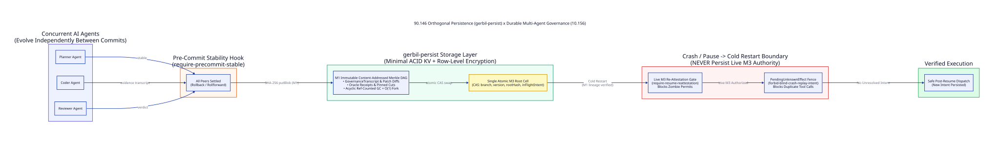

# SPDX-FileCopyrightText: 2026 hardenedlinux Linux Team and Contributors
# SPDX-License-Identifier: LGPL-2.1-or-later

#+TITLE: 10.156 Stratified Orthogonal Persistence (gerbil-persist) x Durable Execution for Concurrent Multi-Agent Governance
#+LANGUAGE: en
#+PROPERTY: JD_ID 10.156
#+STARTUP: overview
#+OPTIONS: toc:3 num:nil
#+FILETAGS: :architecture:orthogonal-persistence:durable-execution:multi-agent:governance:research:

[[file:../../00-09-project/00-documentation/00.01-index.org][Index]] | [[file:10.153-defensive-engineering-taxonomy-and-modular-organization.org][10.153 Defensive engineering taxonomy]] | [[file:10.155-ai-agent-coding-governance-and-anti-evasion-architecture.org][10.155 AI Agent anti-evasion governance]] | [[file:../../30-39-evaluation/30-benchmarks/30.05-agent-defensive-coding-benchmark.org][30.05 40-case Agent benchmark]] | 

* Critical Premise: Why Pure Orthogonal Persistence Historically Failed—and Why AI Agents Reopen the Design Space
:PROPERTIES:
:CUSTOM_ID: op156-premise
:STATUS: implemented-verified
:END:

Importing Orthogonal Persistence (OP) into AI Agent infrastructure without
examining *why classical OP failed in production* would repeat forty years of
painful systems lessons.

** Classical Orthogonal Persistence and Its Four Historical Failure Modes

Atkinson & Morrison (1995) defined Orthogonal Persistence around three laws:
(1) *persistence independence*, (2) *data-type orthogonality* (including code,
closures, and threads), and (3) *identification by reachability*. Pioneering
systems—*PS-algol*, *Napier88*, *PJama* (Atkinson & Jordan 1996–2000), and
capability-based single-level-store OSes *KeyKOS* (Bomberger et al. 1992),
*EROS* (Shapiro, Farber & Smith, SOSP 1999; MS-CIS-96-06), and *Coyotos*—proved
that transparent persistence could recover whole systems in seconds. Yet OP
never achieved mainstream enterprise adoption for four structural reasons:

1. *The Schema & Code-Data Co-Evolution Crisis* (Atkinson & Morrison 1995;
   PJama postmortems): When live call stacks, closures, and class definitions
   inhabit the same persistent heap as billion-node object graphs, evolving a
   type or fixing a function breaks already-suspended continuations.
2. *Accidental Reachability Leaks*: Persistence-by-reachability causes a single
   stray reference in a closure to silently persist megabytes of transient
   state, OS handles, or *stale security credentials*.
3. *External Side-Effect Impedance Mismatch (Output Commit Problem)* (Elnozahy
   et al., ACM CSUR 2002): Checkpointing memory cannot roll back an HTTP POST,
   a =git push=, a payment, or an external tool call already observed by the
   outside world.
4. *Closed-World Runtime Lock-In*: Classical OP required a modified single-image
   VM (PJama JVM, Smalltalk image, or custom microkernel), clashing with
   polyglot, distributed, decoupled systems.

** Why Modern Durable Execution Swung to the Opposite Extreme—and Where It Breaks Under AI Agents

Modern Durable Execution engines—*Temporal* (external event-sourced history
cluster), *Restate* (distributed inline journal), and *DBOS* (Stonebraker,
Zaharia, Li et al., CIDR 2022 / VLDB 2024: database-native transactional
workflows)—deliberately rejected transparent heap persistence in favor of
*explicit step journaling + deterministic code replay*.

That trade-off worked for linear microservice RPCs, but fractures under
*concurrent AI Agents*:

- *Deterministic Replay Fragility Under Policy/Prompt Evolution*: Fixing a
  prompt, review rule, or orchestration bug while an agent is paused awaiting
  human approval breaks Temporal-style line-1 replay unless operators maintain
  brittle version-branching shims (=patched("v2")=).
- *Loss of Structured Provenance*: Flat append-only replay logs are optimized
  for re-execution, not for cryptographic evidence graphs, structural sharing,
  or O(1) branching across alternative models and hypotheses.
- *Single-Workflow Isolation vs. Multi-Agent Collaboration*: Independent replay
  logs cannot easily form a consistent global cut (Chandy & Lamport, ACM TOCS
  1985) when Planner, Coder, Verifier, and Auditor agents concurrently evolve a
  shared codebase and evidence store.

** The Synthesis: =gerbil-persist= + Stratified (Non-Naive) Orthogonal Persistence

Mighty Gerbils' =gerbil-persist= (François-René Rideau) radically simplifies
classical OP by replacing bespoke VMs with four minimal primitives:
(1) a *Content-Addressed Merkle DAG*, (2) *least-common-denominator ACID KV*
anchoring a *single atomic mutable root cell*, (3) a *pre-commit stability hook*
settling concurrent activities before root swap, and (4) *acyclic
reference-counted GC + row-level encryption*.

Our core thesis is *Stratified Orthogonal Persistence*—we explicitly *reject*
"total transparency" and stratify persistence strictly by Deterministic
Engineering's =M1=/=M2=/=M3= mutability law ([[file:10.153-defensive-engineering-taxonomy-and-modular-organization.org][10.153]]):

| Mutability Class | Persistence Policy | Mechanism | Classical Failure Solved |
|------------------+--------------------+-----------+--------------------------|
| =M1= Immutable Artifacts & Evidence | *Orthogonally Persistent by Content Hash* | =gerbil-persist= SHA-256 Merkle DAG (patches, LLM outputs, tool receipts, proofs, rejected attempts) | Eliminates replay fragility & multi-agent amnesia; enables O(1) time-travel forks & safe ref-counted GC |
| =M2= Policies, Code Versions & Negative Domains | *Explicitly Version-Pinned + Bounded Revalidation* | Content-addressed policy/schema digests + =F2= ASCENT bounded negative-dependency invalidation | Solves PJama's 30-year schema/code co-evolution crisis without purging frozen =M1= history |
| =M3= Live Authority, Scopes & External Effects | *Explicitly Non-Orthogonal (Transient-by-Default)* | Resume-time live =M3= re-attestation gate + persisted =inFlightIntent= (=PendingUnknownEffect=) | Eliminates reachability credential leaks ("zombie permits") & crash-replay duplicate side effects |

* Foundational Literature Lineage
:PROPERTIES:
:CUSTOM_ID: op156-literature
:END:

| Paper / System | Core Contribution | Direct Transfer to Our Multi-Agent Governance Design |
|----------------+-------------------+------------------------------------------------------|
| Atkinson & Morrison, *"Orthogonally Persistent Object Systems"*, VLDB J. (1995); Atkinson & Jordan, *PJama* (1996–2000) | Defined persistence independence, type orthogonality, reachability, and documented the schema/code co-evolution bottleneck | Motivates *Stratified* OP: persist reified =M1= data + explicit =M2= schema/policy digests at delimited yield points rather than raw VM stacks |
| Bomberger, Frantz, Hardy & Shapiro, *"The KeyKOS Nanokernel Architecture"* (1992); Shapiro, Farber & Smith, *"EROS: A Capability System"*, SOSP (1999) & MS-CIS-96-06 (1996); Shapiro & Adams, USENIX ATC (2002) | Pure capability-based single-level store with asynchronous checkpointing and fast recovery | Motivates capability-partitioned persistent stores (row-level encryption + =H1= protected-path fencing) and reveals why externally revoked =M3= authority cannot rely solely on frozen checkpoints |
| Chandy & Lamport, *"Distributed Snapshots: Determining Global States of Distributed Systems"*, ACM TOCS (1985); Elnozahy et al., *"A Survey of Rollback-Recovery Protocols in Message-Passing Systems"*, ACM CSUR (2002) | Consistent global cuts under in-flight messages; formalized the Output Commit problem | Grounds our =partial-order-delivery= model, =gerbil-persist= pre-commit stability vs. async marker cuts (=R2=), and =PendingUnknownEffect= intent fencing |
| François-René Rideau, *Mighty Gerbils =gerbil-persist=* (=persist.md=) | Content-addressed Merkle DAG over minimal ACID KV, pre-commit hook settling concurrent activities to one atomic mutable root, acyclic ref-counted GC, row-level encryption | Direct storage and coordination blueprint implemented in [[file:../../../languages-engineering/ts/defense/agent-audit/durable-merkle-store.ts][durable-merkle-store.ts]] and formalized in [[file:../../../packages/quint-models/engineering/defense/durable-agent-persistence/DurableAgentPersistence.qnt][DurableAgentPersistence.qnt]] |
| Li, Suresh, Zaharia, Stonebraker et al., *DBOS: A DBMS-oriented Operating System*, CIDR (2022) / VLDB (2024); Temporal / Restate durable execution engines | Embedded transactional durable execution vs. external replay orchestrators; determinism contract | Contrasts linear step-replay against Merkleized multi-agent state graphs and highlights why stochastic LLM calls need memoized =M1= leaves + =M2= selective invalidation |

* Five Emergent Multi-Agent Governance Breakthroughs
:PROPERTIES:
:CUSTOM_ID: op156-breakthroughs
:END:

1. *Zero-Amnesia Evidence-Carrying Handoff*: Planner, Coder, and Reviewer pass
   cryptographic =M1= Merkle root hashes instead of lossy prose summaries.
   Acyclicity structurally forbids circular self-certification; every failed
   =E1=–=E3= evasion attempt remains permanently inspectable.
2. *Crash-Consistent Swarm Checkpointing Without Stochastic Re-Prompting*:
   Recording stochastic LLM responses and tool receipts as =M1= Merkle leaves
   allows crash recovery to resume from the last committed Merkle root without
   re-executing expensive, non-deterministic LLM calls.
3. *Anti-Purge Bounded Revalidation (=F2= × Ref-Counted GC)*: Unreferenced
   speculative scratch blobs are reclaimed safely by reachability GC, while
   pinned historical cuts survive negative-domain (=M2=) updates intact.
4. *O(1) Time-Travel Forensics & Multi-Model Branching*: Any historical Merkle
   root can be forked in O(1) to test a different model, prompt, or review
   profile with zero mutation of =main=.
5. *Cryptographic Scope Partitioning*: Combining =gerbil-persist= row-level
   encryption with =agent-ifc-capability= and =H1= scope fencing prevents a
   prompt-injected Coder Agent from reading or tampering with Reviewer gold
   oracles stored in the same KV backend.

* Three Formalized Failure Traps (Verified by Apalache & MBT)
:PROPERTIES:
:CUSTOM_ID: op156-traps
:STATUS: executed-verified
:END:

Model [[file:../../../packages/quint-models/engineering/defense/durable-agent-persistence/DurableAgentPersistence.qnt][DurableAgentPersistence.qnt]]
([[file:../../../packages/quint-models/engineering/defense/durable-agent-persistence/objects.ss][objects.ss]],
[[file:../../../t/yanxu/Quint.Engineering.Defense/durable-agent-persistence/qualification-test.ss][qualification-test.ss]])
formally proves three guards, each witnessed by a dedicated Apalache countermodel:

1. *Unstable Multi-Agent Root Commit* (=require-precommit-stable= →
   =UnstableRootCommitCountermodel=): prohibits swapping the shared =M3= root
   while any concurrent peer has not settled its pre-commit hook.
2. *Zombie Authority Resurrection on Cold Restart* (=require-resume-reattestation=
   → =ZombieAuthorityResumeCountermodel=): prohibits dispatching side effects
   from persisted pre-crash permissions without live post-resume =M3=
   re-attestation (also rejected by =BadZombieResumeSUT= in
   [[file:../../../languages-engineering/ts/defense/boundary-contrast/mbt-replay.test.ts][mbt-replay.test.ts]]).
3. *Crash-Replay Duplicate Side Effects* (=forbid-blind-crash-replay-intent= →
   =CrashReplayDuplicateEffectCountermodel=): forces recovery with an open
   =inFlightIntent= into explicit =PendingUnknownEffect= until explicit
   reconciliation completes.

* Frontier Research Problems (=R1=–=R5=): Landed Breakthroughs (=R1=–=R3=) and Open Work (=R4=–=R5=)
:PROPERTIES:
:CUSTOM_ID: op156-frontier
:END:

- *R1 — Hot Code/Policy Evolution Across Suspended Agents* (*implemented & verified*):
  Persisting *reified algebraic state + content-addressed =M2= policy manifests*
  at delimited yield boundaries (never raw VM call stacks) lets
  =HotPolicyCoEvolutionProgram= in [[file:../../../library/defensive-governance/func.ss][defensive-governance/func.ss]]
  and =hotUpgradePolicyAndRevalidate= in [[file:../../../languages-engineering/ts/defense/agent-audit/durable-merkle-store.ts][durable-merkle-store.ts]]
  selectively mark only affected-domain verdicts =PendingRevalidation= while
  keeping unaffected verdicts =Valid= and reusing 100% of =M1= Merkle evidence
  (formally proved by =StalePolicyHotUpgradeCountermodel= in
  [[file:../../../packages/quint-models/engineering/defense/async-merkle-cut/AsyncMerkleCut.qnt][AsyncMerkleCut.qnt]]).
- *R2 — Avoiding the Coordinated Pre-Commit Straggler Bottleneck* (*implemented & verified*):
  Global pre-commit settlement stalls fast agents when one peer blocks on a slow
  formal proof or human review. =PerAgentAsyncCutCoordinator= in
  [[file:../../../languages-engineering/ts/defense/agent-audit/durable-merkle-store.ts][durable-merkle-store.ts]]
  and [[file:../../../packages/quint-models/engineering/defense/async-merkle-cut/AsyncMerkleCut.qnt][AsyncMerkleCut.qnt]]
  decouple fast agents via *per-agent Merkle branch roots*, capture in-flight
  cross-agent messages via *Chandy-Lamport asynchronous marker cuts*
  (=DroppedInFlightCutCountermodel=), and preserve divergent concurrent edits as
  explicit =Conflict= (=SilentLwwConflictMergeCountermodel=).
- *R3 — Type/Contract-Level Prevention of Accidental Reachability Leaks* (*implemented & verified*):
  Sealed =M3TransientCapabilityType= + recursive =assert-m1-persistable!= in
  [[file:../../../library/defensive-governance/func.ss][defensive-governance/func.ss]]
  and branded =LiveM3Capability= + =assertM1Persistable= inside
  =ContentAddressedKvStore.putBlob= mechanically refuse any object graph
  reaching a live =M3= credential, capability, or I/O port before hashing.
- *R4 — Semantic Drift vs. Stochastic LLM Memoization* (*open research*):
  Cached LLM outputs are immutable =M1= bytes, *not* timeless truths. Defining
  principled =M2= dependency manifests linking each memoized LLM reasoning node
  to exact upstream commit hashes, policy digests, and prompt templates enables
  surgical selective re-prompting instead of stale blind replay or full re-runs.
- *R5 — Byzantine / Prompt-Injected Peers on a Shared Persistent Store* (*open research*):
  Formalizing *capability-isolated Merkle partitions* (EROS capabilities +
  =gerbil-persist= per-role AEAD keys + independent oracle attestation) protects
  the Reviewer's gold state even when a Coder Agent is actively compromised by
  indirect prompt injection.

* Executable Artifacts & Limits
:PROPERTIES:
:CUSTOM_ID: op156-artifacts
:STATUS: executed-verified
:END:

- Formal models: [[file:../../../packages/quint-models/engineering/defense/durable-agent-persistence/DurableAgentPersistence.qnt][DurableAgentPersistence.qnt]] and [[file:../../../packages/quint-models/engineering/defense/async-merkle-cut/AsyncMerkleCut.qnt][AsyncMerkleCut.qnt]] (Apalache 0.62.1 =run-plan --verify= + 100% MBT + =DurableAgentPersistenceSUT= / =AsyncMerkleCutSUT=).
- Scheme POO & ASCENT implementation: =M3TransientCapabilityType=, =assert-m1-persistable!=, and =HotPolicyCoEvolutionProgram= in [[file:../../../library/defensive-governance/func.ss][defensive-governance/func.ss]].
- TypeScript reference store & async-cut engine: [[file:../../../languages-engineering/ts/defense/agent-audit/durable-merkle-store.ts][durable-merkle-store.ts]] & [[file:../../../languages-engineering/ts/defense/agent-audit/durable-merkle-store.test.ts][durable-merkle-store.test.ts]] (=AG37=–=AG45= in [[file:../../30-39-evaluation/30-benchmarks/30.05-agent-defensive-coding-benchmark.org][30.05]]).
- *Limits*: =durable-merkle-store.ts= is an in-process reference implementation
  verifying the logical Merkle/CAS/re-attestation/intent-fence invariants; real
  production backing over SQLite/LMDB/PostgreSQL additionally requires durable
  fsync ordering, authenticated AEAD key rotation, and multi-host consensus for
  cross-node failure domains.
