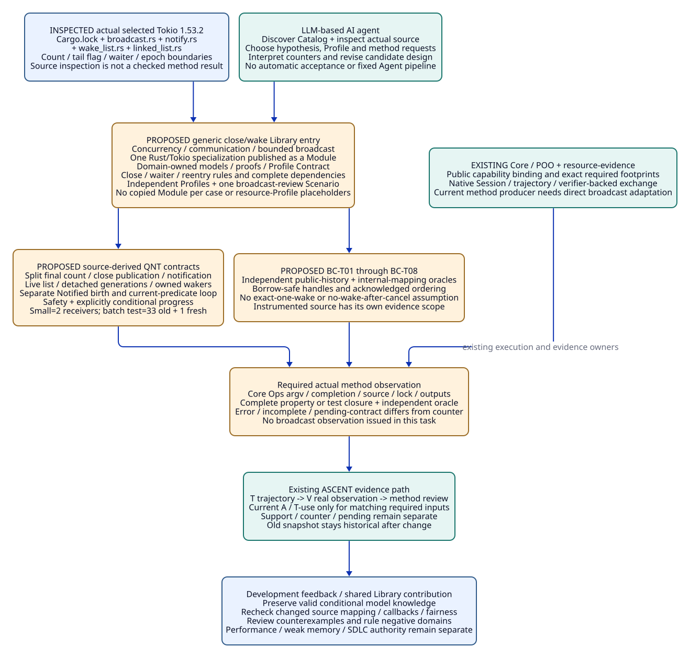
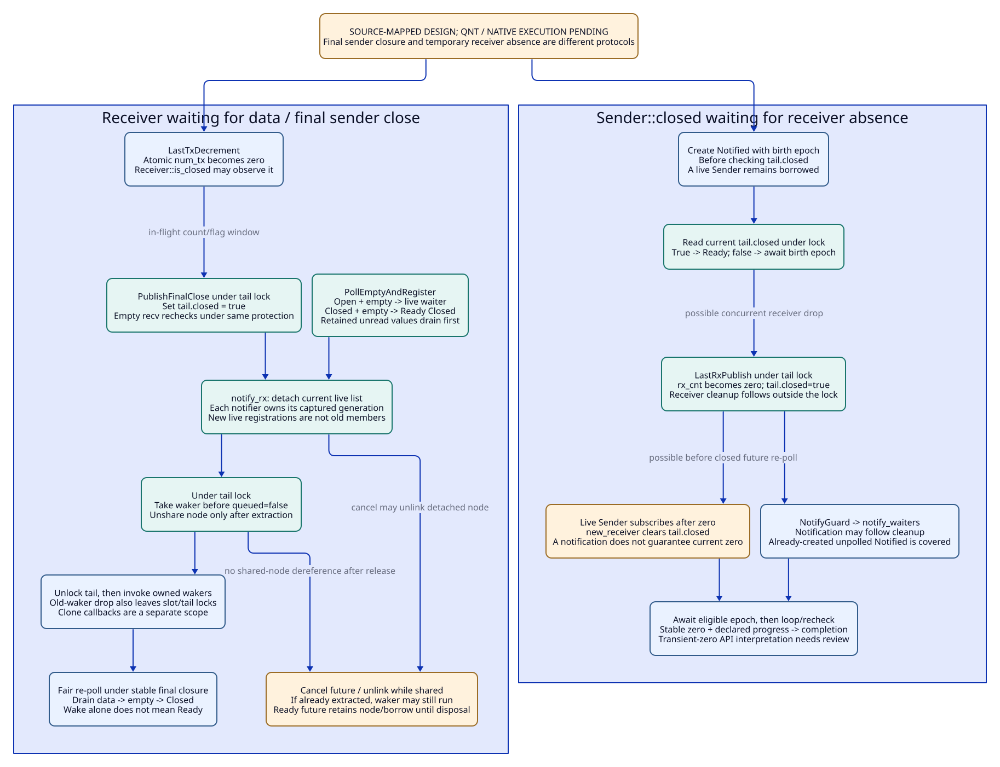

# SPDX-FileCopyrightText: 2026 tao3k team and Contributors
#
# SPDX-License-Identifier: LGPL-2.1-only

#+TITLE: 10.16 Tokio Broadcast Close and Wake Library Entry
#+LANGUAGE: en
#+PROPERTY: JD_ID 10.16
#+PROPERTY: LAYOUT elk
#+OPTIONS: toc:3 num:t
#+STARTUP: overview
#+TODO: PROPOSED INSPECTED | QUALIFIED
#+FILETAGS: :library:scheme:poo:tokio:broadcast:qnt:ascent:agent:
#+PROPERTY: header-args :eval never :exports code :tangle no

[[file:../../00-09-project/00-documentation/00.01-index.org][Index]] | [[file:10.15-scheme-owned-rust-mechanisms-and-development-evidence.org][Existing owners and native path]] | [[file:10.14-rust-performance-library-and-mechanism-cases.org][Mechanism boundary]]

* INSPECTED Entry identity, objective and qualification
:PROPERTIES:
:CUSTOM_ID: broadcast-library-entry
:LIBRARY_KEY: rust.tokio.broadcast.close-wake
:CONTRACT_REVISION: proposed-close-wake-v1
:STATUS: source-inspected-design-contract
:SOURCE_VERSION: tokio-1.53.2
:END:

This entry describes reusable reasoning about broadcast closure, pending receive
registration, notification ownership, cancellation and reentrant wake behavior.
Applications include event distribution, invalidation and fan-out processing;
no gateway topology defines the entry. The objective is to preserve observable
close/wake semantics and discover invalid concurrency assumptions before making
latency or throughput claims.

The actual source selected by the existing [[file:../../../library/concurrency/resource-control/backpressure-memory/rust/native/Cargo.lock][Cargo.lock]] is Tokio 1.53.2. The
[[file:../../../.data/tokio-broadcast-source-20261019/inspection.json][inspection receipt]] records exact original paths, bytes and digests for
[[file:../../../.data/tokio-broadcast-source-20261019/broadcast.rs][broadcast.rs]], [[file:../../../.data/tokio-broadcast-source-20261019/notify.rs][notify.rs]], [[file:../../../.data/tokio-broadcast-source-20261019/wake_list.rs][wake_list.rs]], [[file:../../../.data/tokio-broadcast-source-20261019/linked_list.rs][linked_list.rs]], the crate manifest and the selecting lockfile.
These local snapshots are ignored research material, not a vendored dependency
or a claim about the newest Tokio release. Line ranges below refer to that
inspected snapshot; future executions must capture their actual source closure.

This is a complete Library design contract, not an installed broadcast Module,
an executed QNT model or a completed native test suite. The 10.15 native results
cover a different resource mechanism and cannot satisfy these obligations.
No broadcast method result, checked row, benchmark or newly discovered Tokio bug
is claimed. Scheme and QNT blocks below specify the proposed publication and
transition contracts; they are not executable receipts or additional runtime APIs.

* Organization correction before implementation
:PROPERTIES:
:CUSTOM_ID: broadcast-domain-ownership-correction
:END:

[[file:10.17-domain-libraries-and-atomic-specialization.org][10.17]] supersedes the flat proposed source layout below. The canonical owner is
Concurrency / Communication / Bounded broadcast / Close and wake, with a
Rust/Tokio specialization. The broad Library is not a synonym for one Module.
The generic entry owns reusable semantics; its specialization adds actual-source
mapping and Rust/runtime obligations. Models and proofs descend from those
owners. They are not independent top-level engineering categories.

The original contract below remains the mechanism specification. Its proposed
Module paths and declarations must be interpreted through the corrected ownership
and explicit-root selection, rather than installed as flat sibling Modules.
The interrupted implementation draft was withdrawn from active selection; it
has no successful broadcast verification or registered observation. The 10.17
migration and atomicity review precedes another implementation attempt.

* Scheme publication and POO composition
:PROPERTIES:
:CUSTOM_ID: broadcast-scheme-organization
:END:

Broadcast has its own public semantic contract, so one cohesive proposed
=tokio-broadcast= domain publication is appropriate. Individual close, waiter or
reentry tests are internal cases, not copied Modules. Keep the existing
=resource-evidence= relation program and Core Module/Profile/Scenario binding.

#+NAME: broadcast-owner-organization
| Owner / proposed source location | Responsibility | Reuse or extension boundary |
|----------------------------------+----------------+-----------------------------|
| library/concurrency/communication/bounded-broadcast/close-wake/rust/tokio/types.ss | Broadcast Profile, callback domain, source/mapping and method-request Contracts | Do not pass a broadcast Profile through the current resource Profile Contract or invent queue/item/Rayon fields |
| library/concurrency/communication/bounded-broadcast/close-wake/rust/tokio/objects.ss | BroadcastCloseWake entry, claim/factor definitions, source map, case catalog and declared assumptions | One mechanism-owned Library value, not a gateway child |
| library/concurrency/communication/bounded-broadcast/close-wake/rust/tokio/func.ss | Pure Profile specialization, mapping/request construction and case selection | No tool invocation during selection or field access |
| The same specialization root: config.ss and interface.ss | Inert publication defaults and Core exports of entry/profile-contract | Same Core roles as 10.15; no alternative registry/linker |
| profiles/broadcast.ss | Independent SmallClose, Drain, StableZero, ReentrantWake and BatchBoundary values | Explicit replacement/refinement of premises; no inherited method acceptance |
| scenarios/broadcast-review | Bind Domain, existing Evidence and the selected method capabilities through Core | One bounded investigation; no new Agent scheduler or runtime |
| Existing rust-resources method owner | Directly extend/generalize producer operations and preserve its private issued-result/closure validation path | Current quint/lean/native operations are backpressure-case-specific; do not invoke them with relabeled broadcast inputs or copy the observer into the new domain |
| Existing resource-evidence | application/catalog_rule/catalog_dependency/factor/scope sources and obligation/applicability/support/counter/pending/T-use outputs | Existing symbol-keyed relation algebra accepts another entry; no second evidence engine |
| Existing Core Ops / native ASCENT | Actual process receipts / trajectory and verifier-backed clue exchange | Source/module capabilities cross public bindings, not relative imports of another Module's implementation |

The producer adaptation is an explicit implementation obligation. The current
[[file:../../../library/concurrency/resource-control/backpressure-memory/rust/methods.ss][method source]] fixes the backpressure model, property, obligation identities and
native crate. A broadcast request needs selected source/model/property/case
contracts and its own independent oracle while retaining that owner's validation
and registration machinery. No generic broadcast runner is claimed to exist.
The proposed Domain can publish its knowledge before execution adaptation is
complete; corresponding obligations remain pending rather than fixture-supported.

#+NAME: broadcast-proposed-poo-values
#+begin_src scheme
;; Proposed inert Library value; not loaded by current init.ss.
(.def BroadcastCloseWake
  identity: 'rust.tokio.broadcast.close-wake
  revision: "proposed-close-wake-v1"
  rules:
  '((last-sender-close BC-O01 review)
    (last-sender-close BC-O02 quint)
    (recv-waiter-lifecycle BC-O03 quint)
    (last-receiver-close BC-O03 quint)
    (last-sender-close BC-O04 native)
    (last-receiver-close BC-O05 native)
    (callback-reentry BC-O06 native)
    (recv-waiter-lifecycle BC-O07 review)
    (performance-objective BC-O08 benchmark)
    (atomic-ordering-change BC-O09 review-and-loom)
    (raw-waker-or-panic-extension BC-O10 review-and-native))
  dependencies:
  '((BC-O01 source) (BC-O01 model) (BC-O01 mapping) (BC-O01 policy)
    (BC-O02 model) (BC-O02 model-scope) (BC-O02 checker)
    (BC-O03 model) (BC-O03 model-scope) (BC-O03 checker) (BC-O03 fairness)
    (BC-O04 source) (BC-O04 runtime) (BC-O04 scenario) (BC-O04 oracle) (BC-O04 mapping)
    (BC-O05 source) (BC-O05 runtime) (BC-O05 scenario) (BC-O05 oracle) (BC-O05 mapping)
    (BC-O06 source) (BC-O06 runtime) (BC-O06 scenario) (BC-O06 oracle) (BC-O06 mapping)
    (BC-O06 callbacks) (BC-O06 panic-policy)
    (BC-O07 oracle) (BC-O07 scenario) (BC-O07 schema) (BC-O07 mapping) (BC-O07 policy)
    (BC-O08 source) (BC-O08 runtime) (BC-O08 workload) (BC-O08 hardware)
    (BC-O08 baseline) (BC-O08 instrumentation) (BC-O08 oracle)
    (BC-O09 source) (BC-O09 memory-model) (BC-O09 mapping) (BC-O09 checker)
    (BC-O10 source) (BC-O10 callbacks) (BC-O10 panic-policy)
    (BC-O10 scenario) (BC-O10 oracle) (BC-O10 mapping))
  design: "10.16"
  qualification: 'source-inspected-design-contract)

;; These fields form a Broadcast Profile, not a ResourceProfileContract value.
(.def SmallClose
  identity: 'broadcast-small-close
  capacity: 2 max-senders: 2 max-receivers: 2 max-active-notifiers: 2
  max-sends: 2 max-zero-epochs: 2
  source-selection: 'captured-cargo-resolution
  callback-domain: 'arc-wake-nonpanicking
  payload-domain: 'u64
  fairness: 'declared-weak-progress
  case-set: '(BC-T01 BC-T02 BC-T03 BC-T04 BC-T05 BC-T07)
  factors: '(last-sender-close recv-waiter-lifecycle last-receiver-close))

(.def (ReentrantWake @ SmallClose)
  identity: 'broadcast-reentrant-wake
  callback-domain: 'nonpanicking-wake-and-old-waker-drop-reentry
  case-set: '(BC-T01 BC-T02 BC-T03 BC-T04 BC-T05 BC-T06 BC-T07)
  factors: '(last-sender-close recv-waiter-lifecycle last-receiver-close
             callback-reentry))
#+end_src

The proposed literal Core bindings make the public ownership graph concrete:
#+NAME: broadcast-proposed-core-binding
#+begin_src scheme
;; Proposed interface declarations; neither Module/Scenario is currently selected.
(.def TokioBroadcast
  identity: 'tokio-broadcast
  core: (.o requires: (.o) scope-contract: BroadcastScopeContract
            exports: (.o entry: (.ref Config 'entry)
                         profile-contract: BroadcastProfileContract))
  features: (.o))

(.def BroadcastReview
  identity: 'broadcast-review
  core:
  (.o requires: (.o Domain: (.o module-id: 'tokio-broadcast
                                contract: BroadcastScopeContract)
                    Evidence: (.o module-id: 'resource-evidence
                                  contract: ResourceEvidenceScopeContract)
                    Methods: (.o module-id: 'rust-resources
                                 contract: RustResourcesScopeContract))
      scope-contract: BroadcastScenarioScopeContract
      exports: (broadcast-review-scope Domain Evidence Methods))
  features: (.o))
#+end_src

BroadcastScopeContract and BroadcastProfileContract are proposed domain Contracts;
the Evidence/Methods scope Contracts already have actual owners in 10.15. A
future Scenario must additionally check that the required broadcast producer
operation exists, rather than assuming the current Methods scope already supplies
it. Core Ops is still explicitly passed by the actual Host at execution time.
No tool runs during Domain/Scenario selection.

#+NAME: broadcast-producer-request-contract
| Required request field | Meaning / validation before producing an observation |
|------------------------+------------------------------------------------------|
| entry / obligation / method | Exact claim semantics and selected producer; never silently substitute BP-O02 or another backpressure obligation |
| selected-property-list / case-set | Complete required safety/temporal properties or native subcases; omitted members cannot become a full pass |
| model / model-scope / fairness | Actual QNT bytes, finite domains, permitted transitions and temporal environment assumptions |
| source / runtime / mapping | Actual source/lock/feature/target/configuration closure and source-action mapping; unmodified and instrumented subjects differ |
| callbacks / panic-policy / scenario | Supported callback effects, lifecycle assumptions and acknowledged schedule; reject mismatched declared invocation |
| oracle / schema / policy | Independently reviewed checker/input grammar, expected-outcome basis and authorized review boundary |
| actual command / output closure | Core Ops argv/deadline and actual completion/log/artifact checks, constructed and validated by the selected method operation |
| captured usage / snapshot | Immutable application cut established before execution; later results must retain that association |

These are case data and method Contracts to specialize the existing owner, not a
new scheduling API or parallel execution framework. The implementation should
directly update the owning producer and affected callers, preserving old receipts
as historical rather than introducing a forwarding compatibility layer.

A BatchBoundary specialization must bind 33 initially pending native receivers
and room for one fresh receiver: maximum 34 live receivers for the inspected
32-waker batch implementation. Raising that bound changes the
model search and native scenario footprint; it is not acceptance inherited from
the two-receiver Profile. An experimental raw-waker-clone or panic Profile may
be explored, but needs extra rules/methods and cannot inherit normal-callback
progress claims. Unknown factors remain visible through uncovered_factor.

* INSPECTED Actual source boundaries and QNT state mapping
:PROPERTIES:
:CUSTOM_ID: broadcast-source-qnt-mapping
:END:

#+NAME: broadcast-inspected-source-map
| Source anchor in inspected snapshot | Observable/source fact | Required QNT separation |
|-------------------------------------+------------------------+-------------------------|
| broadcast.rs:558-603, Sender::new / new_with_receiver_count | No-receiver construction initializes tail.closed=true with one strong sender | receiver absence is different from terminal sender absence |
| broadcast.rs:919-932, Sender::closed | Create Notified before reading tail.closed; loop after notification | NotifiedBirth, CheckNoReceiver and AwaitEpoch are separate stages |
| broadcast.rs:935-940 and 1097-1101, close_channel / Sender::drop | Atomic final num_tx decrement precedes tail-locked close publication and notification | LastTxDecrement, PublishFinalClose and notification progress |
| broadcast.rs:954-971, new_receiver | Clear tail.closed only when rx_cnt was zero, then increment under tail lock | Subscribe requires a live Sender; resubscribe requires a live Receiver; no sender resurrection |
| broadcast.rs:1023-1083, notify_rx | Detach current waiter list, extract waker, then queued=false; release tail before waking | live list, per-notifier detached list and owned pending wakers are distinct |
| broadcast.rs:1257-1329, recv_ref empty path | Drop slot before acquiring tail; recheck slot; decide closed or register under tail lock | EmptyRecheckAndRegister is protected; stale slot observation cannot bypass recheck |
| broadcast.rs:1310-1326, waker replacement | Old waker dropped after slot and tail locks are released | OldWakerDrop is a separate external callback action |
| broadcast.rs:1395-1398, Receiver::is_closed | Acquire read of num_tx==0 | Observation can precede tail.closed publication during an in-flight last drop |
| broadcast.rs:1586-1628, Receiver::drop | Decrement rx count / set closed under tail, then drain; guard notifies last-rx drop later | LastRxPublish, Cleanup and NotifyRxZero are not one atomic source action |
| broadcast.rs:1676-1734, Recv poll/drop | Pending returns after registration; cancellation uses Acquire queued read and locked recheck/unlink | Future cancel is different from dropping Receiver; cancellation and extraction can race |
| notify.rs:525-531, 562-570, notified contract / birth | notify_waiters covers already-created Notified even if not polled | Notification epoch captured at birth, not merely at waiter enrollment |
| linked_list.rs:202-236, 341-410 | Intrusive removal and pinned guarded-list representation support detached-node cancellation | Set membership abstracts this helper contract; QNT does not prove raw-pointer validity |
| wake_list.rs:5, 39-79 | Batch capacity 32; wake panic drops remaining captured wakers | Actual batch threshold and panic exception belong to the claim footprint |

The intrusive-list helper is an explicit source dependency; cancellation from a
detached list must not be explained as removal from the live set alone. Pointer
validity, pinning and atomic-ordering premises need source/native review beyond
the abstract membership invariant.

Line numbers are navigation, not identity or proof. Capture source and target
features, the mapping revision, instrumentation and each claimed atomic boundary.
Modeling a line range as atomic requires a lock/atomic-operation argument, not
its appearance in one Rust function.

#+NAME: broadcast-finite-model-state
| State component | Finite representation / meaning | Constraint |
|-----------------+---------------------------------+------------|
| strongHandles, txCount, finalClosePending | Up to two strong sender handles; final destructor baton after count reaches zero | Clone requires a live handle; no new strong handle after zero; weak upgrades excluded in baseline |
| receivers and unread | Up to two live receiver identities with per-receiver unread values; at most two sends; capacity two | Native lag/wrap arithmetic excluded from this small non-lagging slice |
| tailClosed, tailOwner, slotOwner | Close publication and actual critical-section ownership | is_closed reads txCount, not tailClosed; no slot-to-tail lock acquisition without release/recheck |
| recvFuture[r], waiterPlace[r] | One pinned receive occurrence per live Receiver; place is none/live/detached(notifier) | Every live Recv value retains its mutable borrow, including after Ready until disposed; no Receiver drop/resubscribe through that borrowed handle |
| currentWaker[r], queued[r] | Selected task/waker identity and shared waiter membership | Waker extraction precedes queued=false; detached nodes remain shared until extraction or cancel |
| detached[n], wakeOwned[n] | Snapshot list and extracted wakers owned by each active notification | Ordinary sends may own distinct notifications while another wakes outside the lock; final sender drop respects all active Sender borrows |
| birthEpoch[c], rxZeroEpoch, closedFuture[c] | Notified creation epoch and Sender::closed loop state | closed future keeps a Sender borrowed/alive; stable rx zero required for its progress claim |
| history / callback / mapping tags | Unique channel/receiver/future occurrence, poll round, notifier and callback identities | Pointer reuse or recycled value labels cannot establish identity |

The bounded QNT artifact must choose and record these finite domains and all
stuttering/terminal actions. It is not the 10.15 ownership model with renamed
states. Multiple notifier identities matter because an ordinary send can begin another
notification during an earlier send's unlocked wake phase. A final Sender drop
cannot race a send through the same borrowed handle or ignore another live
sender handle. Do not invent final-close/send overlap by dropping that constraint.

#+NAME: broadcast-qnt-action-contract
| Proposed QNT action | Guard and state update | Atomicity / abstraction boundary |
|---------------------+------------------------+----------------------------------|
| CloneTx / DropNonLastTx | Own a live sender; adjust handle/count without resurrection | Atomic count updates, not arbitrary concurrent access to one dropped Rust handle |
| LastTxDecrement | Remove last strong handle, txCount:=0, create final-close baton | Tail flag may still be false |
| PublishFinalClose | Baton owner acquires tail, tailClosed:=true | Following notify detaches waiters under the same lock ownership; retain baton until normal completion |
| PollEmptyAndRegister | Receiver/future live, no unread value; release/reacquire/recheck as source requires; if tailClosed return Closed, else register/update waker | Final predicate decision and enrollment share tail protection |
| PublishValueAndDetach | Live sender and receiver; publish value/cursor then take live waiter list | Retain slot-release-before-notify order; no lag/overflow in baseline |
| DetachWaiters / ExtractWaker | Under tail lock, move current list to detached[n]; pop and take waker before clearing queued | A newly registered live waiter is not captured by this old detached snapshot |
| WakeOwned / DropOldWaker | Tail/slot lock released; invoke captured callback; permit declared reentry | Wake is a scheduling signal, not receive completion; clone callbacks are not covered by this out-of-lock callback claim |
| DropRecv / CancelRecv | Dispose a completed future or cancel a pending one; if still live/detached unlink under tail synchronization; if extracted, no node access remains | Already-owned waker may still be invoked after cancellation; no false no-extra-wake invariant |
| Consume / CompleteClosed | Re-poll a live future; unread data yields value before stable closed-and-empty yields Closed | Ready does not free a still-live future/node; explicit DropRecv releases its borrow and any membership |
| LastRxPublish / Cleanup / NotifyRxZero | No outstanding mutable-borrow future on dropped receiver; remove receiver and publish zero; later notify epoch | Cleanup and notification delay are explicit; panic/abort paths are outside normal progress |
| NotifiedBirth / CheckNoReceiver / AwaitEpoch | Capture current rxZeroEpoch before predicate check; notification after birth makes await eligible | Wake/epoch change causes loop recheck, not unconditional closed completion |
| Subscribe / Resubscribe | Live Sender or live unborrowed Receiver; initialize cursor at current tail | Zero-rx reopening needs Sender capability; a Receiver surviving final sender close may resubscribe without reopening |

* Claim set, fairness and negative controls
:PROPERTIES:
:CUSTOM_ID: broadcast-qnt-properties
:END:

#+NAME: broadcast-property-contract
| Property | Exact scope | Rejected stronger statement |
|----------+-------------+-----------------------------|
| BC-P01 handle consistency | Counts equal valid live handles outside declared in-flight destructor stages; no strong resurrection | Every source function is atomic |
| BC-P02 waiter ownership | A queued waiter occupies exactly one live/detached list; freed future has no shared node; extracted callback owns its waker independently | Cancelled future can never be woken |
| BC-P03 registration coverage | Under normal close publication, pending eligible recv is either captured by a notification/cancel path or rechecks the closed predicate | Empty observation before acquiring tail is final |
| BC-P04 stable final closure | After last sender drop/notification completes, each live receiver drains retained values then returns Closed when empty | is_closed implies tailClosed at every instruction, or first recv after drop must discard data |
| BC-P05 callback boundary | wake and old-waker disposal occur outside tail/slot locks at the mapped sites | No user callback ever runs under any lock: waker.clone remains in the locked registration path |
| BC-P06 finite captured generation | A normal notifier removes only its detached generation; repoll enrollment belongs to the live list / later notification | Two-receiver testing covers the actual 33-waiter batch boundary |
| BC-L01 recv close progress | Stable final sender closure, finite unread data, no cancellation of the subject, terminating callbacks/cleanup and weak fairness for lock acquisition, notification and re-poll | Runtime/OS has an unconditional latency bound or a wake implies immediate polling |
| BC-L02 sender zero-rx progress | A live Sender::closed future with Notified birth before predicate check, receivers eventually remain absent, notification/cleanup terminates and future is fairly polled | Any transient zero-rx event must irreversibly complete every closed future |

An internal count/flag window is neither an API bug by itself nor permission to
accept a forbidden public history. Review the stronger hypothesis that a completed
is_closed=true call followed by try_recv=Empty during another thread's in-flight
last drop violates the independent API contract. If unresolved, classify that
history as pending-contract; do not derive its gold from the implementation.
BC-P04 is the weaker stable post-drop guarantee, not blanket linearizability.
The normal model may expose a counter to the stronger hypothesis without any
mutant; contract review and native correspondence decide its engineering meaning.

Liveness requires separate checked temporal properties and declared environment
fairness; a safety run or a finite test ending successfully does not prove it.
Weak fairness means a continuously enabled modeled step eventually executes,
not that Rust mutexes/OS scheduling have been proven fair. The future producer
must verify that the selected checker actually received every requested temporal
property and fairness assumption. Missing backend capability or an invariant-only
run leaves the temporal obligation pending; it cannot be relabeled a liveness pass. Count domains, maximum
notifications, stuttering and saturation/terminal behavior must be in model-scope.

For each normal notifier, the proposed rank =2*|detached[n]| + |wakeOwned[n]|=
decreases on extraction, cancellation or callback completion and excludes newly
registered live waiters. This is a candidate argument under terminating callbacks
and eventual reacquisition, not an implemented Lean proof or a wall-clock bound.
The current backpressure Lean arithmetic theorem does not establish this rank.

#+NAME: broadcast-model-mutants
| Mutant | Controlled source-level hypothesis / schedule | Required model counter and native interpretation |
|--------+------------------------------------------------+--------------------------------------------------|
| BC-N01 lost enrollment | Check empty/open without protected recheck, publish final close and detach, then enroll | Pending live waiter with no future wake/predicate retry; mutant counter, not a claim of a Tokio bug |
| BC-N02 late Notified birth | Check receiver presence, publish zero and notify, only then create Notified | Stable zero but closed future misses the epoch; requires split-stage model, not a timeout relabeled as counter |
| BC-N03 shared-node release order | Clear queued before taking the stored waker, allow cancel/free, then dereference node | Violated node-ownership/safe-access condition; QNT is not a Rust weak-memory proof |
| BC-N04 recapture live waiters | After unlocked callbacks, consume newly requeued live waiters as if old detached members | Captured-generation/rank violation; native concretization must respect batch=32 and use at least 33 old waiters |

Small safety Profile: at most two senders, two receivers, two sends, two active
notifications and two zero-rx epochs, batch capacity 32. BatchBoundary Profile
needs 33 old waiters plus one fresh receiver (maximum 34), or a separately
reviewed symbolic batching abstraction. Replacing 32
with one while keeping two receivers changes the model; its counter is not direct
native reachability evidence. Epoch/counter wrapping is outside this bounded episode. A finite cutoff must not
disable mandatory pending notification/cleanup and then manufacture progress or
deadlock; record terminal/stuttering behavior and temporal non-vacuity controls.
No state counts or checker outcomes are invented.

* Independent tests, oracle and event contract
:PROPERTIES:
:CUSTOM_ID: broadcast-independent-tests
:END:

The native suite must use the actual selected Tokio artifact and independently
specified observable histories. It must not copy Tokio's linked-list algorithm
as the oracle. The public API oracle tracks strong sender ownership, receiver
subscription history, retained unread values within the no-lag domain and stable
completion predicates. An internal trace checker separately validates source
mapping and waiter generation/ownership; agreement between two copies of the
same transition code is not independence.

#+NAME: broadcast-native-test-contracts
| Case | Concrete setup and controlled schedule | Independent gold / refusal boundary |
|------+----------------------------------------+-------------------------------------|
| BC-T01 pending recv / final sender | Capacity two; one Sender; poll recv to Pending with counting waker; verify no hidden strong Sender in callbacks; drop final Sender fully; re-poll | Eligible recv completes Closed; wake is a signal, with no exact-one-wake assertion; missing ordering is pending |
| BC-T02 buffered drain then close | Send distinct values v1,v2 before final Sender drop; no lag; receiver subscribed beforehand | After drop completes: v1, v2, then Closed; a new resubscription starts at tail and does not inherit unread values |
| BC-T03 cancel and re-register | Poll one pinned recv Pending, drop that future, create a fresh recv occurrence on the same live Receiver, then close | Old shared node is unlinked or already extracted; fresh recv can observe Closed; extra old waker invocation is allowed and cannot dereference freed node |
| BC-T04 non-final versus final drop | Two strong Sender handles; drop one; observe empty receiver; then drop last and complete notification | First state is Empty / recv Pending; final completed drop permits Closed; no test concurrently borrows and drops the same Rust handle |
| BC-T05 Sender::closed and Notify birth | Poll closed future Pending with a live Sender; drop last Receiver; re-poll. Separately create unpolled Notify::notified, call notify_waiters, then poll | Under stable zero, closed becomes Ready. Primitive Notified remembers post-birth notify_waiters even before first poll; combined source-gap instrumentation is a separate mapping obligation |
| BC-T06 reentrant wake / old waker drop | Two subcases: ordinary send invokes wake reentry; a distinct-waker replacement on an empty pending recv invokes final old-waker drop reentry. Eliminate extra old-waker references and use separate borrow-safe handles | Mapped wake/drop reentry is outside tail/slot lock; no raw-waker-clone or payload-clone reentry claim; a watchdog timeout is incomplete, not semantic counterevidence |
| BC-T07 zero-rx reopening | Complete last Receiver drop while a Sender lives; first closed poll may observe zero; subscribe a new receiver before another closed-future poll; then perform a later stable-zero cycle | Record Ready/Pending against the source-level loop; do not decide edge-versus-level API acceptance before contract review. The later stable-zero cycle must complete under declared progress premises |
| BC-T08 33-waiter batch / fresh generation | Distinct receive futures on 33 live Receivers; during first unlocked wake batch, acknowledge registration of a fresh receiver/future at tail; finish send, then close | Old notifier returns without consuming unbounded fresh registrations; fresh receiver does not receive past value; later final close completes it. Internal generation claim needs mapped hooks; public history alone does not prove list membership |

BC-T07 separates an observed source behavior from an independent public-policy
judgment. The source loops on a current predicate; the API wording must be reviewed
before deciding whether a transient unobserved zero establishes an edge obligation.
If that interpretation is unresolved, the oracle returns pending-contract, not a
fabricated pass or Tokio bug. BC-L02 deliberately covers eventual stable zero.

Batch/reentry registration uses ordinary send while a strong Sender remains live.
A new empty receive after final close publication cannot enroll as though the
channel were open. The model must not manufacture that impossible schedule.

A completed recv future is disposed before reusing its Receiver; the model keeps
its node/borrow alive between Ready and DropRecv. The old-waker replacement
subcase requires distinct logical wakers and proof that the final old reference
is released at the intended site; otherwise a destructor that never ran could
make the test vacuous.

BC-T06 must not retain a Sender inside a supposedly final-sender-close callback:
that extra strong handle prevents final closure. Use ordinary send to test
Sender-based reentry, and use callbacks without strong Sender ownership for
BC-T01. A pending Recv borrows its Receiver mutably; reentry must not illegally
operate through that same receiver. Manual polling is single-owner and pinned;
synchronization uses explicit acknowledgments, not sleeps or unsafe aliasing.

Event envelope: channel identity, actor/handle identity, receiver identity,
recv occurrence, poll round, waker/task identity, notifier identity, generation,
action, observed outcome, event ID, per-actor order and acknowledged happens-before
edges. Instrumented events additionally bind mapping revision, source region,
lock ownership at capture and immutable captured values. NotifiedBirth records
the relevant epoch. Addresses, recycled value labels and wall-clock order are
not substitutes for semantic identity or causality.

The public oracle enumerates histories compatible with happens-before and the
API contract, accepting only an observed allowed outcome. A bounded search with
no consistent history may produce counterevidence only when the event closure,
search completeness and oracle validation hold. Missing records, ambiguous
completion, unknown search cutoffs or insufficient mapping are pending/refused,
not a proven lost wakeup. A single compatible history is finite trace evidence,
not universal linearizability or all-schedule correctness.

Internal hooks must read lock-protected state under the actual lock, store values
locally and emit after leaving critical sections. A hook must not call user code
under the lock, reacquire it, change source ordering or hide cancellation/cleanup
steps. Instrumented source has its own digest/Profile. Its traces cannot be
registered as unmodified-Tokio evidence by sharing a version string; lifting a
schedule needs a reviewed instrumentation-to-source bridge and unmodified API
controls. Forced barriers may establish one reachable sequence, not all schedules.

* ASCENT obligations, evidence closure and reuse
:PROPERTIES:
:CUSTOM_ID: broadcast-ascent-evidence
:END:

The proposed Catalog uses the actual 10.15 source/output relation shapes. It
adds authored domain rows, not another rule language, fact store or acceptance
service. The table is the dependency field of the proposed POO value; lowering it produces
ordinary catalog_dependency rows with one obligation/key pair per cell member.
Composite method labels in the optional extensions are proposed complete review
bundles, not currently implemented tool operations. They require explicit producer
contracts before use; absent capability leaves the obligation pending.

Factor selection states what the Agent is investigating; it does not
prove that a source mapping or runtime property is true.

#+NAME: broadcast-catalog-obligation-dependencies
| Factor | Obligation / method | Exact required scope keys |
|--------+---------------------+---------------------------|
| last-sender-close | BC-O01 / review | source, model, mapping, policy |
| last-sender-close | BC-O02 / quint | model, model-scope, checker |
| recv-waiter-lifecycle or last-receiver-close (two Catalog rows) | BC-O03 / quint | model, model-scope, checker, fairness |
| last-sender-close | BC-O04 / native | source, runtime, scenario, oracle, mapping |
| last-receiver-close | BC-O05 / native | source, runtime, scenario, oracle, mapping |
| callback-reentry | BC-O06 / native | source, runtime, scenario, oracle, mapping, callbacks, panic-policy |
| recv-waiter-lifecycle | BC-O07 / review | oracle, scenario, schema, mapping, policy |
| performance-objective | BC-O08 / benchmark | source, runtime, workload, hardware, baseline, instrumentation, oracle |
| atomic-ordering-change | BC-O09 / review-and-loom | source, memory-model, mapping, checker |
| raw-waker-or-panic-extension | BC-O10 / review-and-native | source, callbacks, panic-policy, scenario, oracle, mapping |

BC-O03 includes both BC-L01 and BC-L02 when that Profile selects both progress
questions; a result missing either requested property cannot close the combined
obligation. BC-O04 requires its declared BC-T01-T04 closure. BC-O05 requires
BC-T05/T07 closure and the Notify primitive/mapping premise. BC-O06 includes
BC-T06 plus BC-T08 when batch/reentry behavior is claimed. A partial suite is a
useful observation, but cannot become a pass for the larger declared closure.

Example representation of existing rule/source rows, as a design declaration:
#+begin_src scheme
;; Future selected entry E and usage U; these are authoring rows, not evidence.
(catalog_rule E last-sender-close BC-O02 quint)
(catalog_dependency BC-O02 model)
(catalog_dependency BC-O02 model-scope)
(catalog_dependency BC-O02 checker)
;; Native witness/checked rows are created only after actual method validation.
#+end_src

The existing [[file:../../../modules/resource-evidence/func.ss][Evidence DSL]] derives obligation/requires from Catalog and factor
rows; mismatch, missing_input and extra_input block applicability; actual matching
witness plus checked reference yields support or counter and a new T-use under
the current snapshot. Counter remains visible and the unsupported obligation
remains pending; discovery alone never creates a checked row.

#+NAME: broadcast-evidence-reference-closure
| Layer | Required record / references | Current boundary |
|-------+------------------------------+------------------|
| Input cut | Entry semantics/revision, complete selected Catalog rows, actual Profile bindings and source/model/mapping/method scope identities | Identify before results; never hash a future result into the cut that produced it |
| T: native trajectory | Actual investigation context, hypothesis/branch, selected input cut and actual evidence events | No invented LLM call/token/verification events; avoid duplicate event IDs within a prefix |
| V: method observation | Exact command/property/case closure, captured inputs, source/lock/features/target, tool identity, logs, outputs and completion status | A template, review narrative or old 10.15 observation is not a broadcast V |
| Method-review reference | Independent oracle, complete trace/property closure, source/instrumentation scope, admitted issuer and artifact rechecks | JSON cannot construct an issued result; execution error is not property refutation |
| A: contextual applicability / T-use | Existing required-key comparison and current method checks under the new usage/snapshot | Historical V can survive while its current A is invalid; no effect authorization follows |

Keep notifier-generation identity distinct from ASCENT trajectory generation and
native exchange identity. Reusing one word does not make their scopes equivalent.
A frozen query is a completed historical observation, not current authorization.
The source inspection record currently supplies inputs for review only; no
broadcast V or A has been issued in this task.

#+NAME: broadcast-change-query-contract
| Prospective review / change | Expected ASCENT result | Retained versus revalidated evidence |
|-----------------------------+------------------------+-------------------------------------|
| BC-Q01 baseline discovery, no method run | BC-O01..O05/O07 required; support empty; explicit pending | Source inspection is review input, not a checked pass |
| BC-Q02 genuine complete BC-O02 safety result, exact model scope | Support only BC-O02 and create fresh T-use | Native, mapping, oracle review and temporal questions remain pending |
| BC-Q03 changed source close/notify body, unchanged model | BC-O01/O04/O05 affected; BC-O06 if selected; old native/source mapping cannot support new cut | Conditional model theorem may remain reusable; source correspondence needs fresh evidence |
| BC-Q04 two receivers to actual 33-waiter batch case | Changed model-scope/scenario blocks old bounded model/native acceptance for that question | Generic detached-generation design argument is candidate knowledge; no relabeling old two-receiver results |
| BC-Q05 changed oracle / instrumentation / callbacks or panic domain | Affected native/method-review requirements stay pending or counter; incompatible instrumented/unmodified source is mismatched | Preserve old observations, rerun exact affected validation; safety results survive only unchanged premises |
| BC-Q06 late method result for old source/fairness cut | Retain old V and historical query; no support for new mismatching usage | A new use gets its own cut and T-use; no backflow or deletion of reusable unrelated evidence |

Changed Cargo resolution/features/target invalidates corresponding runtime/source
and mapping guards. Changed fairness invalidates temporal reuse without silently
invalidating a purely conditional safety theorem. Changed callback domain may
invalidate model premises even if source bytes and Cargo.lock are unchanged;
include those assumptions in model-scope/fairness/mapping, not only native flags.
Evidence invalidation is not physical deletion. Revalidation can select affected
current claims without repeatedly checking irrelevant historical observations;
within a validation boundary, identical file/digest checks may be shared, with
no persistent trust cache or weakened method/closure obligations.

* LLM-based AI agent intervention and design alternatives
:PROPERTIES:
:CUSTOM_ID: broadcast-agent-development
:END:

#+NAME: broadcast-agent-decision-trajectory
| Development observation / hypothesis | Agent investigation using Library | Evidence-led revision / stopping boundary |
|--------------------------------------+-----------------------------------+-------------------------------------------|
| Suspected close hang | Discover this entry, inspect actual last-drop and pending-recv paths; bind concrete handles/callback ownership | If callback captured a strong Sender, correct the harness/design premise before proposing a Tokio fix |
| is_closed observed before try_recv Empty during concurrent drop | Compare actual API intervals and split count/publication stages | Separate internal equality from public-history obligations; review any externally forbidden history and test stable completed-drop behavior separately |
| Suspected missed Sender::closed notification | Inspect Notified birth, predicate check and last-rx cleanup/notification epochs | Request BC-N02 model control, BC-T05 API/Notify evidence and any needed internal bridge; do not replace loop with one-shot await |
| Callback reenters send/subscribe or future cancellation races | Select callback Profile, inspect borrow/list/waker ownership and relevant source map | Preserve extract-before-unshare and lock-free wake/old-drop boundaries; new raw clone/panic behavior requires additional obligations |
| Sender::closed appears to stay pending after reopen | Determine whether zero was observed or only a notification occurred; inspect receiver-generation history | Preserve current-predicate semantics; treat edge-versus-level API interpretation as an explicit contract review, not a predeclared bug |
| Wake optimization merges live and detached lists or changes batch threshold | Compare generation/rank argument, BC-N04, actual 32/33 boundary and native mapped trace | Keep separate lists, revise batching or choose a different design, then recheck affected safety/progress/source and workload evidence |
| Proposed publication or ordering change | Candidate rule/mapping plus controls; actual source/lock/feature capture and QNT/native requests via existing methods | Agent proposals remain hypotheses; atomics/unsafe changes additionally need ordering/lifetime evidence, not just a sequential QNT pass |

The Agent chooses what to investigate next and can reject a candidate, broaden a
Profile or revise the intended contract. ASCENT exposes dependencies, missing
premises and competing evidence; it does not force a fixed test order or turn
LLM reasoning into truth. Review a proposed rule with its negative domain and
counterexamples before contributing it to the shared Catalog. Existing SDLC and
effect-policy owners decide release/operation authority separately.

* Reference lessons and bounded completion audit
:PROPERTIES:
:CUSTOM_ID: broadcast-design-completion
:END:

The local Specula [[file:../../../.data/specula-case-studies/systems/tokio/modules/broadcast/runs/case-studies-tokio-broadcast/modeling-brief.md][modeling brief]] is useful for bug-family decomposition and
source-to-action questions. The [[file:../../../.data/specula-case-studies/systems/tokio/modules/broadcast/runs/case-studies-tokio-broadcast/harness/INSTRUMENTATION.md][instrumentation guide]] also records limitations:
cancellation coverage is absent in its synchronous tests, overlap is low, and
some value identities cycle. Its [[file:../../../.data/specula-case-studies/systems/tokio/modules/broadcast/runs/case-studies-tokio-broadcast/README.md][run record]] has provisional identity and unknown
model information. We do not copy the harness/TLA+ pipeline, accept reported bugs
as our findings, suppress meaningful cleanup events or use those reports as gold.

Our artifact contracts derive from Scheme publications, actual inspected Tokio
boundaries, independent public/history and internal/mapping checks, QNT and the
existing ASCENT evidence path. Explicitly distinguish a borrowed investigation
idea, a source observation, a candidate rule and a completed method result.

#+NAME: broadcast-hidden-assumption-audit
| Hidden assumption | Resolution in this entry | Implementation evidence still required |
|-------------------+--------------------------+-----------------------------------------|
| One closed flag means one irreversible event | Two directions; final sender closure versus temporary zero receivers | Distinct handles, epochs and stable-predicate cases |
| Every function is atomic / reads are one coherent snapshot | Split count/publication, last-rx cleanup/notify and locked recv recheck | Instrumentation and atomic-boundary mapping review |
| Receiver drop can race its own borrowed Recv freely | Model safe ownership and distinct future cancellation | Native borrow-safe harness review |
| Cancellation forbids any later wake | Shared-node and owned-waker states are separate | Extraction/cancel race evidence, including safe extra wakes |
| All external callbacks occur outside locks | Scope only wake and old-waker disposal; waker.clone still occurs under tail | Extra raw clone / payload clone / panic investigations if requested |
| Wake means ready, or one wake equals one task step | Re-poll and predicate outcomes modeled independently | Controlled task/waker identity and scheduler assumptions |
| Notification implies Sender::closed must complete | Notified birth epoch plus loop recheck and stable-zero premise | Primitive Notify and source-gap correspondence |
| Two waiters exercise production batching | Inspected batch=32; 33-waiter native domain is distinct | Expanded/symbolic model and batch-concretization review |
| One notifier can own every concurrent waiter | Per-notifier detached snapshots; new live registrations and concurrent notifiers | Generation-mapped multi-notifier traces |
| Instrumented source equals unmodified dependency | Distinct digests/Profile and explicit bridge | Paired unmodified API controls and perturbation review |
| A timeout or unknown trace proves a lost wake | Incomplete/error differs from complete counterhistory | Complete event closure and independent oracle validation |
| Safety proves liveness/performance, or old resource proof transfers | Separate temporal fairness, callback and workload obligations | New model/methods, ordering and matched measurement evidence |

The design layer closes identities, owner responsibilities, finite action/property
contracts, test gold, independent-oracle boundaries and reuse/refusal rules.
Publishing the new Module/Profile/Scenario, adapting the existing method producer,
implementing/running QNT and native controls, validating instrumentation and
registering real broadcast results remain implementation work. No code or active
init selection is changed by this document. Matching documentation, source-snapshot
and diagram checks qualify the design artifact only.

#+CAPTION: A mechanism-owned broadcast Library publication composes through existing Core/POO and ASCENT; source observations, model results, native tests and Agent hypotheses keep distinct evidence roles.

#+CAPTION: Split close publication, protected enrollment, detached notification generations and lock-free wake actions preserve the actual source boundaries; Sender::closed uses a separate epoch/predicate loop.

