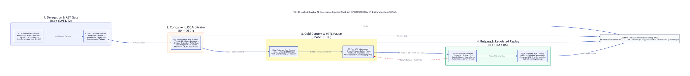

# SPDX-FileCopyrightText: 2026 hardenedlinux Linux Team and Contributors
# SPDX-License-Identifier: LGPL-2.1-or-later

#+TITLE: 10.162 Unified Durable AI Governance Pipeline & Cross-Layer Architecture Synthesis
#+LANGUAGE: en
#+PROPERTY: JD_ID 10.162
#+STARTUP: overview
#+OPTIONS: toc:3 num:nil
#+FILETAGS: :architecture:synthesis:durable-ai:governance-pipeline:end-to-end:

[[file:../../00-09-project/00-documentation/00.01-index.org][Index]] | [[file:10.153-defensive-engineering-taxonomy-and-modular-organization.org][10.153 Taxonomy]] | [[file:10.155-ai-agent-coding-governance-and-anti-evasion-architecture.org][10.155 Anti-evasion]] | [[file:10.156-orthogonal-persistence-durable-multi-agent-governance.org][10.156 Stratified OP]] | [[file:10.157-durable-ai-context-projection-and-multi-agent-ssi-concurrency.org][10.157 Durable AI Context]] | [[file:10.158-durable-ai-business-extensions-sod-release-and-regulated-replay.org][10.158 B1/B2]] | [[file:10.159-human-in-the-loop-durable-pause-resume-and-policy-drift-reapproval.org][10.159 B5 HITL]] | [[file:10.160-cross-trust-boundary-capability-attenuation-and-cascading-revocation.org][10.160 B3 Delegation]] | [[file:10.161-ast-symbol-ssi-arbitration-for-concurrent-multi-agent-editing.org][10.161 B4 Symbol SSI]] |  | [[file:../../30-39-evaluation/30-benchmarks/30.05-agent-defensive-coding-benchmark.org][30.05 80-Case Benchmark]]

* Architecture Synthesis: Closing Cross-Layer Emergent Governance Gaps
:PROPERTIES:
:CUSTOM_ID: syn162-purpose
:STATUS: implemented-verified
:END:

Individual governance primitives ([[file:10.153-defensive-engineering-taxonomy-and-modular-organization.org][10.153]]–[[file:10.161-ast-symbol-ssi-arbitration-for-concurrent-multi-agent-editing.org][10.161]]) each prove crisp
single-layer invariants, yet production multi-agent deployments routinely fail
at the *composition seams* between layers. The unified pipeline
([[file:../../../languages-engineering/ts/defense/agent-audit/durable-governance-pipeline.ts][durable-governance-pipeline.ts]],
visualized in )
composes all seven subsystems over a single Stratified Orthogonal Persistence
(=M1=/=M2=/=M3=) core and closes four emergent cross-layer hazards:

1. *Supply-Chain Revocation During HITL Sleep (=B3 × B5=)*: If an intermediate
   contractor is revoked while a human approver is reviewing a staged patch,
   =resumePromoteAndRecordRegulated= re-attests every admitted agent's full =B3=
   Macaroon delegation chain at wake-up and blocks promotion
   (=delegation-chain-revoked-after-suspend=) even after human approval.
2. *Pre-Human Filtering of Evasive & Write-Skewed Patches (=G2 × B4 × B5=)*:
   AST anti-evasion (=G2/E1/E2=) and automated symbol-level SSI (=B4=) run
   *before* constructing a =HumanDecisionBrief=, ensuring broken or evasive
   patches never induce human approval fatigue while independent peers still
   advance via bounded =DE01= partial admission.
3. *Canary Rollback Coupled to Anti-Nagging Veto (=B1 × B5=)*:
   A post-promotion canary SLO breach deterministically restores the pinned =M1=
   pre-release cut, increments the monotonic =M3= fencing epoch, pins incident
   forensics across GC, *and* records a =B5= =HumanVetoConstraint= on the exact
   broken semantic target so autonomous retry loops cannot nag on-call engineers.
4. *End-to-End Confidentiality & =R3= Secret Non-Leakage (=B2 × B3 × R3=)*:
   =AeadPartitionKey=, =DelegationRootKey=, and =LiveM3Capability= all carry the
   unforgeable =M3_NON_SERIALIZABLE_CAPABILITY= brand, guaranteeing zero key
   leakage into =M1= while preserving per-tenant AES-256-GCM regulatory replay
   across GC and chat compaction.

* Full-Stack Verification Summary (80 Cases, 13 Defense Models, 50 Canonical Models)
:PROPERTIES:
:CUSTOM_ID: syn162-summary
:STATUS: executed-verified
:END:

| Layer | Formal & Executable Foundation | Benchmark Slice |
|-------+--------------------------------+-----------------|
| Epistemic & Language Boundaries ([[file:10.153-defensive-engineering-taxonomy-and-modular-organization.org][10.153]]) | 5 core =Quint.Engineering.Defense= models + TS/C(CBMC)/C++20/Rust contrasts + =OR07= | =AG01=–=AG24= |
| Anti-Evasion & Closed-Loop Harness ([[file:10.155-ai-agent-coding-governance-and-anti-evasion-architecture.org][10.155]]) | 6th model =agent-patch-governance= + =E1/E2/E3= + =H1= scope fence + ASCENT transcript audit | =AG25=–=AG36= |
| Stratified Orthogonal Persistence & =R1=–=R5= ([[file:10.156-orthogonal-persistence-durable-multi-agent-governance.org][10.156]]) | 7th–9th models (=durable-agent-persistence=, =async-merkle-cut=, =byzantine-encrypted-store=) + Merkle/AEAD/Memo store | =AG37=–=AG50= |
| Durable AI Context & Pairwise SSI ([[file:10.157-durable-ai-context-projection-and-multi-agent-ssi-concurrency.org][10.157]]) | 10th model =durable-ai-context-ssi= + =projectRoleContext= + lease fencing | =AG51=–=AG55= |
| Business Extensions =B1=–=B5= ([[file:10.158-durable-ai-business-extensions-sod-release-and-regulated-replay.org][10.158]]–[[file:10.161-ast-symbol-ssi-arbitration-for-concurrent-multi-agent-editing.org][10.161]]) | 11th–13th models (=release-sod-rollback=, =hitl-durable-approval=, =capability-attenuation=) + TS/Scheme AST SSI arbitrator | =AG56=–=AG75= |
| Unified Cross-Layer Pipeline ([[file:10.162-unified-durable-ai-governance-pipeline-and-architecture-synthesis.org][10.162]]) | [[file:../../../languages-engineering/ts/defense/agent-audit/durable-governance-pipeline.ts][durable-governance-pipeline.ts]] / [[file:../../../languages-engineering/ts/defense/agent-audit/durable-governance-pipeline.test.ts][durable-governance-pipeline.test.ts]] | =AG76=–=AG80= |

* Limits
:PROPERTIES:
:CUSTOM_ID: syn162-limits
:STATUS: implemented-verified
:END:

The unified pipeline proves deterministic logical composition across all seven
governance layers in-process. Production deployment adds external HSM/KMS key
custody, distributed consensus/durable-WAL storage backends (e.g. Postgres/LMDB),
asymmetric WebAuthn/OIDC approver signatures, and out-of-band observability hooks.
