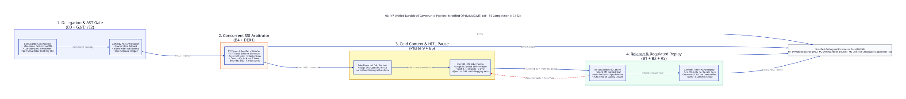

# SPDX-FileCopyrightText: 2026 hardenedlinux Linux Team and Contributors
# SPDX-License-Identifier: LGPL-2.1-or-later

#+TITLE: 10.167 Durable AI Governance Research Synthesis & Declarative ASCENT Datalog Meta-Audit (B1-B9)
#+LANGUAGE: en
#+PROPERTY: JD_ID 10.167
#+STARTUP: overview
#+OPTIONS: toc:3 num:nil
#+FILETAGS: :architecture:research-synthesis:datalog:ascent:durable-ai:meta-governance:

[[file:../../00-09-project/00-documentation/00.01-index.org][Index]] | [[file:10.153-defensive-engineering-taxonomy-and-modular-organization.org][10.153 Taxonomy]] | [[file:10.155-ai-agent-coding-governance-and-anti-evasion-architecture.org][10.155 Anti-Evasion]] | [[file:10.156-orthogonal-persistence-durable-multi-agent-governance.org][10.156 Stratified OP]] | [[file:10.157-durable-ai-context-projection-and-multi-agent-ssi-concurrency.org][10.157 Context & SSI]] | [[file:10.162-unified-durable-ai-governance-pipeline-and-architecture-synthesis.org][10.162 Unified Pipeline]] | [[file:10.166-verifiable-transparency-log-and-split-view-equivocation-defense.org][10.166 B9 Transparency Log]] | [[file:../../30-39-evaluation/30-benchmarks/30.05-agent-defensive-coding-benchmark.org][30.05 105-Case Benchmark]]

* Research Thesis: Stratified Orthogonal Persistence as the Substrate for Durable AI Governance
:PROPERTIES:
:CUSTOM_ID: syn167-thesis
:STATUS: implemented-verified
:END:

Across documents [[file:10.153-defensive-engineering-taxonomy-and-modular-organization.org][10.153]]–[[file:10.166-verifiable-transparency-log-and-split-view-equivocation-defense.org][10.166]], we systematically bridged four historically
disconnected fields—*Orthogonal Persistence* (Atkinson & Morrison 1995; Faré
Rideau =gerbil-persist=), *Capability Security & DIFC* (Hardy 1988; Shapiro
KeyKOS/EROS; Myers & Liskov 1997; Birgisson NDSS 2014; DeepMind CaMeL 2025),
*Distributed Transactions & Consistency* (Chandy-Lamport 1985; Garcia-Molina &
Salem 1987; Cahill SIGMOD 2008; RFC 6962), and *Truth Maintenance* (Doyle 1979;
de Kleer 1986)—into a single verifiable engineering architecture for autonomous
multi-agent AI systems.

The central structural insight is *Mutability Stratification (=M1=/=M2=/=M3=)*:

1. *=M1= Immutable Content-Addressed Evidence DAG* (Truth): Patches, verification
   receipts, delegation custody chains, ATMS justifications, retraction
   tombstones, and pinned regulatory cuts. Content-addressed, acyclic, GC-safe,
   and reusable across crashes, compactions, and years-long audits.
2. *=M2= Disposable Views & Drift Manifests* (Context & Policy): LLM chat windows
   are *disposable role-projected materialized views* reconstructed from =M1=
   (eliminating compaction amnesia and overthinking), while policy/model/prompt
   digests drive *bounded negative-dependency revalidation* (=DE01= / =R1= / =R4=).
3. *=M3= Live Non-Serializable Capabilities & Single Atomic Root* (Authority):
   Active leases, AEAD tenant keys, Macaroon root keys, linear resource budgets,
   declassification capabilities, and Ed25519 log signing keys are branded
   non-serializable (=R3=), preventing PJama-style reachability leaks and zombie
   authority replay across crashes or multi-day HITL hibernation.

* Heterogeneous Dual-Implementation Meta-Audit (Gerbil Scheme ASCENT Datalog)
:PROPERTIES:
:CUSTOM_ID: syn167-datalog
:STATUS: executed-verified
:END:

To avoid trusting only imperative TypeScript runtimes for multi-hop transitive
governance invariants, [[file:../../../library/defensive-governance/func.ss][library/defensive-governance/func.ss]] implements a live,
stratified *Gerbil Scheme ASCENT Datalog* verifier
(=DurableGovernanceMetaAuditProgram= / =reason-durable-governance-meta-audit=,
tested in [[file:../../../t/yanxu/Library/defensive-governance/governance-ascent-test.ss][governance-ascent-test.ss]]):

- *4-Hop =B3= Transitive Revocation Closure*: =effectively_revoked= propagates
  recursively across arbitrary =delegation_edge= depth while keeping sibling
  principals untouched.
- *Cross-Pillar =B3 -> B8= Causal Poisoning Closure*: =belief_poisoned= combines
  explicit =retracted_belief=, revoked proposers lacking a cold deterministic
  oracle (=not (belief_has_oracle B)=), and transitive =belief_sole_dep= chains.
- *Multi-Hop =B7= DIFC Taint Closure*: =tainted_value= propagates secrecy tags
  across arbitrary =derived_from= chains unless explicitly cleared by
  =declassified_tag=, flagging exact =exfiltration_violation= tuples.
- *=B9= Relational Split-View Equivocation*: Pure relational inequality across
  =witness_sth= observations catches divergent roots at identical log sizes.
- *Cross-Pillar Release Admission*: Disqualifies any release violating SoD,
  revoked delegation, poisoned belief, coordinator equivocation, or post-pivot
  rollback—admitting only provably clean releases (=release_admitted=).

* Complete Nine-Pillar Architectural Panorama (=B1=–=B9=)
:PROPERTIES:
:CUSTOM_ID: syn167-panorama
:STATUS: executed-verified
:END:

| Pillar | Primary Literature Lineage | Formal Model (Apalache + 100% MBT) | Benchmark & Doc |
|--------+----------------------------+------------------------------------+-----------------|
| Foundation (=D0=–=D4=, =G1=–=G5=) | Epistemic Lattice, CBMC, Band-5 Floors, SARIF | 6 models (=epistemic-state-lattice= .. =agent-patch-governance=) | =AG01=–=AG36=, [[file:10.153-defensive-engineering-taxonomy-and-modular-organization.org][10.153]], [[file:10.155-ai-agent-coding-governance-and-anti-evasion-architecture.org][10.155]] |
| Stratified OP (=R1=–=R5=) & Context | Atkinson/Morrison 1995, Chandy-Lamport 1985, =gerbil-persist=, Cahill SSI 2008 | 4 models (=durable-agent-persistence= .. =durable-ai-context-ssi=) | =AG37=–=AG55=, [[file:10.156-orthogonal-persistence-durable-multi-agent-governance.org][10.156]], [[file:10.157-durable-ai-context-projection-and-multi-agent-ssi-concurrency.org][10.157]] |
| =B1= / =B2= SoD Release & Regulated Replay | Clark & Wilson 1987, AES-256-GCM AEAD | =release-sod-rollback= (11th) | =AG56=–=AG60=, [[file:10.158-durable-ai-business-extensions-sod-release-and-regulated-replay.org][10.158]] |
| =B5= Long-Horizon HITL Pause/Resume | Cold Hibernation, Drift Revalidation, Anti-Nagging | =hitl-durable-approval= (12th) | =AG61=–=AG65=, [[file:10.159-human-in-the-loop-durable-pause-resume-and-policy-drift-reapproval.org][10.159]] |
| =B3= Cross-Boundary Capability Attenuation | Hardy 1988, KeyKOS/EROS, Macaroons NDSS 2014 | =capability-attenuation= (13th) | =AG66=–=AG70=, [[file:10.160-cross-trust-boundary-capability-attenuation-and-cascading-revocation.org][10.160]] |
| =B4= AST Symbol-Level SSI Arbitrator | Cahill SIGMOD 2008 lifted to TS + Scheme ASTs | Backed by =durable-ai-context-ssi= | =AG71=–=AG75=, [[file:10.161-ast-symbol-ssi-arbitration-for-concurrent-multi-agent-editing.org][10.161]] |
| Unified Cross-Layer Pipeline | =B1=–=B5= × =G2= × =R1=–=R5= composition seams |  | =AG76=–=AG80=, [[file:10.162-unified-durable-ai-governance-pipeline-and-architecture-synthesis.org][10.162]] |
| =B6= Compensable Sagas & Linear Budget | Garcia-Molina/Salem 1987, Helland 2007, Linear Types | =durable-saga-budget= (14th) | =AG81=–=AG85=, [[file:10.163-durable-compensable-agent-sagas-and-linear-budget-conservation.org][10.163]] |
| =B7= DIFC & CaMeL Exfiltration Fence | Bell-LaPadula, Biba, Myers/Liskov 1997, HiStar, CaMeL 2025 | =difc-exfiltration-fence= (15th) | =AG86=–=AG90=, [[file:10.164-difc-taint-confinement-and-camel-control-flow-integrity.org][10.164]] |
| =B8= Memory-Poisoning & ATMS Retraction | Doyle 1979 TMS, de Kleer 1986 ATMS, Byzantine Quorums | =durable-memory-tms= (16th) | =AG91=–=AG100=, [[file:10.165-durable-memory-poisoning-defense-and-atms-causal-retraction.org][10.165]] |
| =B9= Transparency Log & Equivocation | RFC 6962 Certificate Transparency, Syta S&P 2016, Ed25519 | =transparency-log-equivocation= (17th) | =AG101=–=AG105=, [[file:10.166-verifiable-transparency-log-and-split-view-equivocation-defense.org][10.166]] |
| Declarative Meta-Audit | Stratified Gerbil Scheme ASCENT Datalog fixed-point | =DurableGovernanceMetaAuditProgram= | [[file:../../../t/yanxu/Library/defensive-governance/governance-ascent-test.ss][governance-ascent-test.ss]], =10.167= |

* Explicit Boundaries & Open Production Engineering Work
:PROPERTIES:
:CUSTOM_ID: syn167-limits
:STATUS: implemented-verified
:END:

Every formal model (17/17 Apalache + 100% MBT + 17/17 SUT refinement),
54-model =by-tag= convergence check, 105-case benchmark (=AG01=–=AG105=), and
declarative Scheme ASCENT meta-audit verifies logical, cryptographic, and
concurrency safety in-process. Transitioning to multi-region distributed
deployment additionally requires: (1) durable disk/replicated KV custody (e.g.
LMDB/Postgres WAL/Raft), (2) HSM/KMS-backed Ed25519 and AEAD key rotation,
(3) threshold witness cosigning against eclipse attacks, and (4) OS-level
sandboxing (seccomp/containers/microVMs) beneath the DIFC tool runtime.
