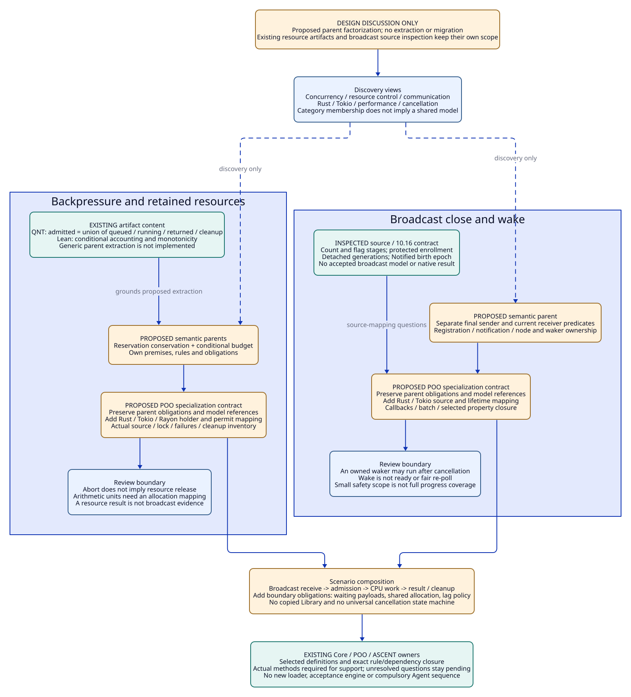
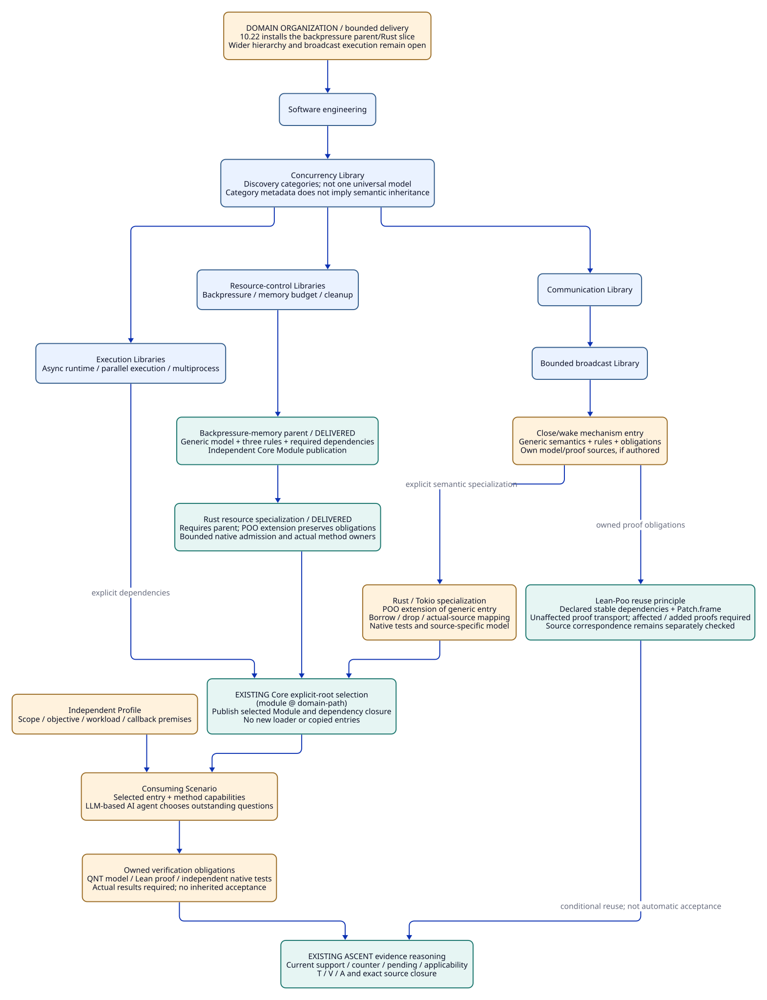

#+TITLE: 10.17 Engineering Domain Libraries and Atomic Specialization
#+LANGUAGE: en
#+PROPERTY: JD_ID 10.17
#+OPTIONS: toc:3 num:t
#+STARTUP: overview
#+TODO: DESIGN | REVIEWED IMPLEMENTED
#+FILETAGS: :architecture:library:poo:concurrency:organization:
#+PROPERTY: header-args :eval never :tangle no :exports code

[[file:../../00-09-project/00-documentation/00.01-index.org][Index]] | [[file:10.16-tokio-broadcast-close-and-wake-library.org][Broadcast mechanism contract]] | [[file:10.03-upstream-capabilities.org][Inspected framework capabilities]] | [[file:10.18-agent-authored-engineering-and-review-contracts.org][Agent-authored engineering and review]]

* DESIGN The organizing unit is engineering knowledge
:PROPERTIES:
:CUSTOM_ID: domain-library-organization
:STATUS: design-correction-before-broadcast-implementation
:END:

The repository organizes reusable software-engineering knowledge into domain
Libraries. A Library owns concepts, assumptions, rules, models, proof obligations,
validation methods and evidence applicability. QNT and Lean are representations
and methods owned by that knowledge. Top-level =models/= and =proofs/= divide
assets by tool before explaining their engineering owner; they are a legacy
layout from the earlier baseline. [[file:10.22-domain-library-delivery-and-native-admission.org][10.22]] delivers the backpressure slice under its
domain owner; broadcast and the wider hierarchy remain separately qualified work.

A broad Library can contain narrower Libraries. A mechanism entry is a sufficiently
small owned unit of knowledge to select, specialize and validate independently.
A Core Module publishes the selected entry's capabilities. It is not a synonym
for the entire engineering domain, one tool, one test or one application.

High performance, robustness and security are objectives that select obligations
across Libraries. Rust is a language specialization. Tokio is an implementation
and runtime specialization. A gateway is a consuming application Scenario.
None of those dimensions alone supplies the engineering taxonomy.

Tokio primarily provides in-process asynchronous and multithreaded concurrency.
Multiprocess execution is a sibling engineering concern requiring process,
address-space and IPC semantics. A Tokio application may use multiple processes;
that does not make every Tokio broadcast operation an interprocess primitive.

#+NAME: domain-classification
| Dimension | Broadcast close/wake example | Effect on composition |
|-----------+------------------------------+-----------------------|
| Engineering domain | Software engineering / concurrency | Establish the semantic vocabulary and parent Library |
| Subdomain | Communication / bounded broadcast | Establish delivery, lag, receiver and sender concepts |
| Mechanism entry | Close and wake | Own the predicate, waiter lifecycle and notification obligations |
| Language | Rust | Add borrowing, lifetime, drop and memory-model premises |
| Concrete implementation | Tokio broadcast | Map the contract to the selected source and runtime behavior |
| Neighboring Libraries | Async runtime, scheduling, cancellation, resource control | Compose explicit dependencies; do not duplicate their catalogs |
| Objective / Profile | Close correctness, bounded retained memory, wake cost | Select questions and bounds; do not imply an accepted result |
| Application / Scenario | Event distribution, invalidation, gateway | Bind use-specific assumptions and execution choices |

* DESIGN Rationale, costs and decisions still under discussion
:PROPERTIES:
:CUSTOM_ID: library-rationale-and-tradeoffs
:STATUS: architecture-under-discussion-before-migration
:END:

The wider target tree and factorization remain design proposals. The original
request first required explaining these choices before migration. The subsequent
10.22 delivery implements only the bounded backpressure parent/Rust slice through
existing Core. That does not qualify every proposed generic Library. A category's name does not establish a reusable
behavioral model or justify inheriting every obligation in that category.

** What the organization is intended to improve
#+NAME: library-design-benefits-and-qualification
| Engineering need | Intended advantage | Mechanism required | Limit / evidence needed |
|------------------+--------------------+--------------------+-------------------------|
| Find relevant engineering knowledge | Discover broadcast closure through communication, Tokio or cancellation views | One canonical entry; indexed facets and references | The physical tree alone does not implement discovery |
| Reuse across projects | Preserve an entry's generic model, rules and negative cases | Explicit generic contract and project-bound assumptions | Measurements and source correspondence need target applicability checks |
| Extend to another implementation | Preserve generic obligations while adding implementation premises | POO specialization with explicit obligation composition | Ordinary override alone is not verified refinement |
| Maintain many entries | Select an entry and its declared dependency closure | Existing Core explicit-root selection and POO demand behavior | Thousand-entry loading/build/search costs remain unmeasured |
| Reason with an LLM-based AI agent | Supply actionable hypotheses, missing obligations and counterexamples | Catalog discovery plus ASCENT relations over actual context | The Agent still chooses methods and may challenge the design |
| Respond to changes | Recheck affected claims without deleting reusable history | Complete dependency keys, stable premises and scoped applicability | Missing dependencies can make reuse unsound |
| Collaborate on shared knowledge | Review rules, assumptions, test gold and source maps together | Owned entry contracts and independent negative controls | Conflicting rule identities require resolution, not silent merging |
| Avoid repetitive defensive checks | Reuse sufficient current evidence and select unresolved obligations | Rule provenance and exact evidence applicability | Removal of a check itself needs a coverage argument |
| Integrate with development | Return actionable evidence to design and implementation work | Scenario bindings and the existing SDLC owner | A Library query does not authorize a release or production effect |

These are expected engineering benefits, not completed scalability or productivity
measurements. Atomic selection, semantic composition and evidence reuse require
different acceptance checks; success at one boundary cannot establish the others.

** Costs and failure modes
#+NAME: library-architecture-costs
| Risk | Concrete failure | Design response |
|------+------------------+-----------------|
| Premature abstraction | A universal concurrency model obscures different close semantics | Generalize only a shared behavioral contract with explicit assumptions |
| Excessively deep taxonomy | A contributor must traverse many categories to find one entry | Keep one canonical owner; provide shallow indexed discovery views |
| Inheritance coupling | A parent edit affects many specializations | Declare dependency keys and obligation impact; retain exact historical inputs |
| Hidden obligation removal | A child replaces rules or obligations with a smaller list | Explicit preserving composition and same-identity conflict checks |
| Combinatorial Profiles | Every runtime/workload combination becomes another copied Module | Values specialize supported premises; unsupported combinations remain explicit |
| Incomplete source mapping | A valid abstract result is presented as a Rust implementation guarantee | Separate generic proof, correspondence obligation and native observation |
| Metadata maintenance | Contracts, source paths and diagrams drift apart | Keep owned data canonical and verify projections; no duplicated acceptance truth |
| Loader overclaims | Lazy objects are treated as proof that imports/builds touch nothing else | Observe declaration, discovery, compilation and scope realization separately |

The cost of this architecture is maintaining the semantic interfaces and evidence
boundaries. If a reusable parent contract cannot be stated clearly, start with
one honestly scoped concrete entry and refine its abstraction later. A deep tree
with speculative parent models would increase maintenance without providing
verified reuse.

** Consumer scenarios and what should actually be reused
#+NAME: library-consumer-scenarios
| Scenario | Reusable assets | Required new work |
|----------+-----------------+-------------------|
| Another Rust project uses the same Tokio broadcast closure behavior | Generic contract, rules, model source, test design and source-map knowledge | Bind actual source/lock/features/callbacks; check whether prior evidence applies |
| A different runtime implements bounded broadcast | Generic close/waiter obligations whose assumptions match | New implementation specialization, source map and native validation |
| A service combines Tokio receive with Rayon CPU processing | Selected communication, resource-control and execution knowledge | Boundary obligations for admission, retained ownership, cancellation and cleanup |
| A workload changes receiver count or callback behavior | Unaffected definitions and dependency-stable results | Re-evaluate bounds, batch coverage, reentry assumptions and measurement scope |
| A developer changes final-sender-drop code | Generic semantic reasoning may survive | Source correspondence and affected native results become pending until rechecked |
| An Agent explores another high-performance design | Alternative entries, known counterexamples and conditional tradeoffs | Select evidence that distinguishes alternatives; no fixed all-tools sequence |

** What makes an entry a Library asset

A reusable entry needs an engineering question and public semantic contract,
explicit assumptions and variation points, owned rules and obligations, authored
model/proof references where available, validation methods with independent gold,
and evidence applicability/invalidation conditions. It also needs a maintainer
and a way to review a semantic revision. A source file or a collection of old
passing logs alone does not provide this contract.

Authored, reviewed and implementation-qualified knowledge are distinct states.
An authored Library can guide investigation while its obligations remain pending.
Qualifying one Profile does not qualify every specialization or consuming project.
Contributors should retain useful negative cases and report unsupported domains
rather than broadening the accepted scope through documentation wording.

** Decisions that must precede physical migration

1. Separate discovery categories from semantic parent definitions. A broad
   Concurrency Library organizes entries; it does not imply one universal QNT
   model or one obligation set inherited by every child.
2. Name a generic parent only where its predicates, assumptions and refinement
   relation are meaningful. For broadcast, final sender absence and temporary
   receiver absence must not collapse into one irreversible closed predicate.
3. Keep the generic model's dependencies separate from concrete source mapping.
   A minimal empty-channel model is not the full bounded-broadcast specification.
4. Define preserving composition and conflicting-identity rejection before
   transporting parent rules and obligations to a child.
5. Verify actual Core selection/build/demand behavior with selected and unselected
   controls before claiming atomic loading. Keep compilation costs visible.
6. Perform one direct ownership migration after these interfaces are clear;
   update actual consumers together and preserve original historical receipts.

* DESIGN Domain hierarchy and dependency graph have different jobs
:PROPERTIES:
:CUSTOM_ID: library-hierarchy-and-composition
:END:

The hierarchy provides a canonical owner and a discovery route. Dependencies
form a graph between entries. An entry has one canonical publication even when
several discovery routes reference it. Searching for Tokio, cancellation or high
performance may return the same close/wake entry without creating three copies.

#+NAME: concurrency-library-hierarchy
#+begin_example
Software engineering
  Concurrency Library
    Execution
      Asynchronous runtime
        Scheduling and wake delivery
        Rust / Tokio specialization
      Parallel execution
        Work stealing / Rust Rayon specialization
      Multiprocess execution
        Process lifecycle / IPC
    Communication
      Bounded broadcast
        Close and wake
          Generic contract and obligations
          Rust / Tokio specialization
        Retention and lag
    Resource control
      Admission and backpressure
      Memory ownership and budgets
      Cleanup and cancellation
#+end_example

The list identifies owners, not a promise that all these Libraries already
exist. Broadcast depends on runtime polling and Rust lifetime behavior; those
edges do not make it a child copy of the scheduler or the memory-budget entry.
A combined Tokio/Rayon design selects communication, runtime, parallel-execution
and resource-control entries, then adds explicit boundary obligations for the
async/CPU handoff. It does not become a monolithic Tokio/Rayon Library containing
copies of each domain.

#+begin_quote
A classification edge answers where knowledge belongs. An inheritance edge
answers which definition is extended. A dependency edge answers which other
knowledge a claim relies on. An evidence edge answers what supports a particular
scoped claim. These edges must remain distinguishable.
#+end_quote

* DESIGN Backpressure and broadcast: classification versus semantic reuse
:PROPERTIES:
:CUSTOM_ID: backpressure-broadcast-parent-models
:STATUS: proposed-factorization-grounded-in-current-assets
:END:

The following factorization is a design discussion. The generic parents have not
been extracted into Scheme Modules. The existing resource entry and verification
artifacts remain at their recorded paths; broadcast retains the 10.16 contract
and source inspection, not an accepted executable specialization.

#+NAME: two-case-semantic-parent-matrix
| Candidate parent / view | Classification or reusable semantics? | Backpressure use | Broadcast use | Required boundary |
|-------------------------+---------------------------------------+------------------+---------------+-------------------|
| Concurrency, communication, resource control | Discovery categories | Locate resource/ownership questions | Locate communication/notification questions | No inherited invariant follows from category membership |
| Rust, Tokio, high performance | Language/runtime facets and objective views | Find async/CPU handoff and resource controls | Find wake, retention and fan-out questions | A shared facet does not establish one shared behavioral model |
| Reservation conservation | Reusable resource-control contract | Count admitted work while queued/running/returned/cleanup | Compose only if the application separately budgets retained values or receivers | No automatic conversion of waiter count or Arc count into resource charges |
| Conditional additive budget | Reusable arithmetic lemma with explicit units | Bound declared queue/active/item/fixed/cache accounting | Applicable only to a separately justified broadcast allocation inventory | Physical allocation sharing and double counting need a mapping argument |
| Predicate / registration / notification | Reusable communication contract, parameterized by predicate and protocol | Relevant to an admission waiter if separately modeled | Parent of close/wake reasoning | Its correctness protocol may differ by implementation; a mutex is not universal |
| Cancellation and disposal | Shared question and rule template; not one common transition system | A caller can stop awaiting while CPU work retains resources | A receive future can be cancelled while an extracted waker remains owned | Each mechanism must define the actual object, owner and terminal event |

A semantic parent is useful when its state vocabulary, premises and obligations
can be interpreted in more than one implementation, with an explicit mapping.
A shared word such as =cancel= or =closed= is insufficient. Two independent
parents may be composed without forcing one mechanism to inherit the other.

** Backpressure parent: what the current artifacts actually express

The existing [[file:../../../library/concurrency/resource-control/backpressure-memory/model.qnt][QNT ownership model]] has admitted, queued, running, returned, cleanup
and done sets. Its safety predicate requires:

- admitted equals the union of queued/running/returned/cleanup;
- those holder stages are pairwise disjoint and respect the selected limits;
- completed jobs have no remaining modeled ownership.

Its cancellation action transfers running work to cleanup rather than removing
its charge. The =earlyRelease= negative alternative removes admission while a
cleanup holder remains. These are reusable reservation/lifecycle ideas under the
model's finite job and ownership assumptions. They do not model Rust scheduling,
allocation layout, detached task termination or every admission implementation.

The existing [[file:../../../library/concurrency/resource-control/backpressure-memory/budget.lean][Lean arithmetic artifact]] defines
=retained(q, a, item, fixed, cache) = (q + a) * item + fixed + cache= and proves
monotonicity and a conditional budget-reuse inequality. Its parameters are
abstract accounting units. A specialization must explain whether queue and
active bounds count distinct allocations, which returned/cleanup holders remain
charged, and whether the expression is exact or a conservative upper bound.
The ownership QNT model's single admitted-work limit does not automatically
establish independent queue/active inventories for that formula.

The candidate parent therefore owns the reservation invariant and conditional
accounting lemma; a Rust/Tokio/Rayon specialization adds:

1. The allocation and holder inventory, including shared values and results.
2. The mapping from owned permit and work transfer to abstract reservation.
3. Cancellation, caller abort, failed delivery and cleanup ownership semantics.
4. Actual dependency source/lock/features, runtime configuration and workload.
5. Independent native schedules and an oracle that observes actual release.

The current [[file:../../../library/concurrency/resource-control/backpressure-memory/rust/native/src/main.rs][native resource case]] explicitly couples payload disposal and owned
permit release, and includes caller-owned-permit negative behavior. That is a
concrete specialization subject, not a universal property of Tokio or Rayon.

** Broadcast parent: predicate identity and waiter ownership

The candidate close/wake parent needs separate predicates and contracts for:

- final strong-sender absence, followed by draining retained values;
- current receiver absence, which may be reversed by a live sender subscribing;
- registration eligibility, notification ownership and eventual re-poll.

An abstract pending operation must either participate in a correct notification
protocol or observe the changed predicate. A captured callback has an owner
separate from a shared waiter node. Cancellation/disposal must leave no invalid
shared-node access, while an already-owned callback may still execute.
A wake signal does not establish readiness or fair scheduling.

The [[file:10.16-tokio-broadcast-close-and-wake-library.org::#broadcast-source-qnt-mapping][inspected Tokio mapping]] adds concrete count/publication stages, tail/slot
synchronization, live and detached waiter generations, waker extraction, queued
flags, intrusive-list lifetime and the Notified birth epoch. The specialization
must justify these mappings and callback assumptions. Generic closed-predicate
reasoning cannot erase those implementation obligations.

A two-receiver empty-channel safety slice would support only its named bounded
claim. Buffering/lag, receiver-zero reopening, reentry, fairness and the actual
32-waker batch boundary need their own declared coverage. None is supplied by
renaming the resource ownership model or inheriting its previous results.

** Composing the two entries in a real engineering design

Consider an event consumer that receives broadcast notifications, obtains a
resource reservation, and submits CPU work to Rayon. The Scenario composes both
entries and must answer what happens before admission. If it materializes a
large payload before acquiring a permit, the reservation invariant can hold
while uncharged retained memory grows. If a lagging consumer misses a broadcast
value, an application policy must define whether lag is acceptable or recovery
is needed. A resource budget says nothing about that delivery policy.

#+NAME: combined-case-boundary-obligations
| Boundary | New question | Required specialization / evidence |
|----------+--------------+------------------------------------|
| Receive to admission | What is retained while waiting for a permit? | Include waiting allocations or defer materialization |
| Admission to CPU work | Does the reservation travel with every live holder? | Concrete ownership transfer and cancellation schedules |
| CPU result to delivery | Who retains a failed or abandoned result? | Result/cleanup holder mapping and actual disposal observations |
| Broadcast value to payload | Is the payload shared, cloned or reconstructed per consumer? | Physical allocation inventory; avoid reference-count double charging |
| Receiver close / lag | Does the consumer stop, drain, recover or retry? | Explicit application policy and finite correctness questions |
| Performance objective | Which cost matters: throughput, tail latency, allocation or wake work? | Workload and hardware-bound measurement obligation |

* DESIGN POO transports definitions and obligations, not accepted results
:PROPERTIES:
:CUSTOM_ID: two-case-poo-obligation-flow
:END:

The following steps define the proposed composition contract, not new runtime
APIs. Existing POO values, Core publication and ASCENT relation owners remain the
mechanisms to use when implementation resumes.

#+NAME: parent-to-specialization-data-flow
| Step | Parent contribution | Specialization contribution | Result / refusal condition |
|------+---------------------+-----------------------------+----------------------------|
| Semantic identity | Contract, assumptions, rule/obligation identities | Concrete interpretation and parent reference | A different meaning needs an explicit revision or separate contract |
| Model reference | One canonical artifact and its finite premises | Parameters or source-specific extension plus correspondence obligation | No copied model merely for a new directory or runtime label |
| Rule composition | Trigger, conclusion, method requirement and provenance | Additional implementation or boundary rules | Same identity with incompatible meaning/method is a conflict |
| Obligation preservation | Parent predicates and complete dependency keys | Added source/runtime/mapping obligations | Ordinary slot replacement cannot silently remove inherited requirements |
| Profile binding | Permitted variation and supported domains | Selected bounds, callbacks, workload and policy | Unsupported combinations are refused or remain pending |
| ASCENT projection | Authored catalog_rule / catalog_dependency data | application, factor and exact scope inputs | Derived obligation is a question, not evidence that it holds |
| Validation and use | Method contract and reusable conditional reasoning | Actual outputs, method review and current applicability | Only matching checked evidence can support the new usage |

In the current resource entry, selecting =bounded-retention= derives BP-O01
through BP-O04 and BP-O07 by its actual authored Catalog rows. Selecting =tokio=
and =rayon= also derives the existing async-CPU-handoff factor and TR-O03.
Those rules ask for review, QNT, Lean or native methods; selecting a language or
factor does not close them. This existing behavior is the mechanism to extend,
not a reason to invent a second Library rule engine.

The 10.16 broadcast Catalog separately asks for BC-O01 through BC-O07 when their
factors are selected. BC-O02 is not interchangeable with BP-O02. A partial
broadcast model needs a separately scoped claim; it cannot inherit the full
property closure of BC-O02 or BC-O03 merely by sharing the =quint= method label.

#+NAME: finite-library-composition-rules
| Rule | Input condition | Required conclusion | Negative / boundary case |
|------+-----------------+---------------------+--------------------------|
| LR01 classify | A Catalog tag or category references an entry | Discover that canonical entry | Do not infer behavioral inheritance or support |
| LR02 preserve | A child declares a compatible semantic parent | Preserve parent's obligations and provenance; add child obligations | Reject silent removal or incompatible same-ID replacement |
| LR03 bind | A Profile chooses a supported domain | Instantiate obligation premises without changing meaning | A smaller search bound cannot silently weaken a full-domain claim |
| LR04 derive | Selected factors and Catalog rules match | Derive method-specific obligations and dependency closure | Unknown factor stays visible; no default pass |
| LR05 specialize | A concrete runtime implements the parent contract | Add interpretation, source-map and lifecycle obligations | A version label or equal object shape is insufficient |
| LR06 apply | A checked witness matches all required current inputs | Allow support/counter and a usage reference in that cut | Old-source or incomplete-property witness is inapplicable |
| LR07 change | A declared dependency or its negative condition changes | Reconsider affected applicability; retain historical observations | Do not delete unrelated evidence or backfill an old snapshot |
| LR08 transport | Typed stability and Patch.frame premises hold | Transport the unaffected Lean proof | Hash equality and an ASCENT support row are not those Lean premises |

These are finite design rules to project through existing owners. They have not
been added as executable Catalog or validation logic in this documentation turn.
They require no new Agent scheduler, universal model interpreter or replacement
for Core's selection and build mechanisms.

** Specific change and reuse decisions
#+NAME: two-case-reuse-discussion
| Change | Reusable knowledge | Affected obligation / cost |
|--------+--------------------+----------------------------|
| Backpressure capacity or payload size increases | Reservation semantics and the general monotonicity lemma | Selected finite model domain, budget instance, inventory and native applicability |
| Cancellation changes from retained cleanup to early release | Vocabulary and the earlier counterexample | Ownership invariant and concrete source mapping; no inherited pass |
| Tokio broadcast final-drop code changes | Generic predicate/notification contract | Source correspondence and affected native evidence |
| Receiver count crosses the actual batching boundary | Generic waiter ownership reasoning | Model/symbolic coverage and batch-specific native scenario |
| A backpressure result is offered as broadcast evidence | Potential discovery of cancellation questions | Reject claim substitution; create the correct broadcast obligation |
| An unrelated consumer changes UI formatting | Unchanged mechanism definitions and scoped evidence | Revalidate only dependencies actually changed, plus any affected presentation contract |

* DESIGN Use scenarios, maintenance cost and demand boundaries
:PROPERTIES:
:CUSTOM_ID: two-case-benefits-costs-and-loading
:END:

#+NAME: two-case-scenario-tradeoffs
| Usage | Concrete benefit | Maintenance cost | Demand / qualification boundary |
|-------+------------------+------------------+---------------------------------|
| Reuse backpressure in another Rust project | Reservation rules and existing negative cases are discoverable together | Bind that project's allocations, task ownership and runtime | Selecting the entry does not run Cargo, QNT or Lean |
| Review broadcast close/wake | Parent predicates explain which source questions matter | Maintain source mapping, callback assumptions and independent oracle | Looking up the entry does not load every communication child |
| Combine Tokio receive and Rayon work | Compose existing knowledge and expose cross-boundary gaps | Own the receive/admission/CPU/result boundary obligations | Only declared selected dependencies belong in the closure |
| Contribute another implementation | Reuse generic model/obligations without Tokio-only premises | Prove a new interpretation and qualify its methods | Do not import sibling implementations merely to enumerate the category |
| Review an Agent optimization | Reuse known invariants and focused counterexamples | Review changed cost assumptions, comments and evidence | Correctness tests and source prose cannot establish speedup |
| Maintain thousands of entries | Canonical ownership and shallow discovery can reduce duplicated work | Catalog/version maintenance, conflict review and build/index costs | Scalability remains a hypothesis until measured |

#+NAME: loading-stage-observation-design
| Stage | Expected bounded work | Observation needed before claiming success | Failure example |
|-------+-----------------------+-------------------------------------------+-----------------|
| Discover metadata | Read identifiers/facets needed by a query | Metadata reads and any demanded descriptor sources | Importing all child implementations to list titles |
| Declare Core selection | Lower the explicit roots to selection data | No domain scope realization or verification process | Cargo starts when a selection declaration is read |
| Build selected sources | Compile selected modules and actual transitive imports | Report complete compiler/source closure separately | Calling compilation of a shared parent zero-cost loading |
| Demand a public scope | Realize requested POO fields and declared dependencies | Selected/unselected scope observations in fresh processes | A hidden field demand realizes a sibling entry |
| Request validation | Run the chosen method with captured inputs | Actual argv, deadline, output and oracle review | A field getter initiates every available checker |
| Query evidence | Evaluate the selected session/cut and applicability | Rule/input closure and source currentness | A late result silently changes a frozen query |

The existing Core syntax and sources justify using its explicit-root selection;
they do not constitute a new measured isolation result for the proposed Library
layout. A future selected/unselected control must distinguish source discovery,
compiler imports, runtime initialization, POO field demand and process execution.
No loading experiment or implementation change is performed here. Scheme
controls, when authored, belong in =t/*-test.ss=.

#+CAPTION: The two mechanisms share selected questions and composition laws, while keeping different semantic parents, source mappings and evidence claims.

* DESIGN Canonical source ownership
:PROPERTIES:
:CUSTOM_ID: library-source-layout
:END:

The following is the target layout, not a statement that these files have been
created. Only the existing framework and the 10.16 source inspection have been
qualified. Do not create empty proofs or placeholder models to fill the tree.

#+NAME: target-library-layout
#+begin_example
library/
  concurrency/
    catalog.ss                     ; inert category/entry discovery metadata
    communication/
      bounded-broadcast/
        close-wake/
          definition.ss            ; generic Library value and obligations
          contract.org             ; English semantic contract
          model.qnt                ; generic model only if actually authored
          refinement.lean          ; generic theorem only if actually proved
          rust/
            tokio/
              interface.ss         ; one selected Core Module publication
              types.ss             ; specialization and request Contracts
              objects.ss           ; POO extension of the generic entry
              config.ss            ; inert defaults
              func.ss              ; pure specialization, if needed
              mapping.org          ; actual source/action correspondence
              close.qnt            ; source-specific model, if necessary
              refinement.lean      ; source-specific proof, if any
              profiles/
                minimal.ss         ; independently selected mechanism Profile
              native/
                Cargo.toml
                Cargo.lock
                tests/broadcast.rs ; independent Rust API tests
    resource-control/
      backpressure-memory/
        ...                        ; current resource Library's canonical owner
        model.qnt
        budget.lean
modules/
  resource-evidence/               ; current shared ASCENT integration
scenarios/
  broadcast-review/                ; consumer of selected Library capabilities
  resource-lifecycle/
  gateway-review/
profiles/                         ; application-owned Profile bindings
examples/                         ; commands demonstrating consumer workflows
t/
  broadcast-library-test.ss        ; Scheme tests remain t/*-test.ss
  broadcast-evidence-test.ss
.data/                            ; ignored source captures and actual run receipts
#+end_example

Only the entry that owns a model or proof stores its canonical source. A Tokio
specialization may import the generic model/theorem or extend its assumptions;
it must not copy a generic model solely to obtain a Tokio pathname. Distinct
source-specific transitions justify a separate artifact with an explicit mapping
obligation. A =refinement.lean= file is optional: no authored theorem means an
open obligation, not an empty file presented as coverage.

A Profile is a value, not a registry owner. Library-owned Profiles describe
reusable mechanism scopes. Project-owned Profiles bind project configuration.
A Scenario consumes selected entries and method capabilities. Scenario code does
not own a second copy of the Library's rules or model.

The shared method producer currently resides with =rust-resources= and is
case-specific. Its observation/registration machinery must retain one owner;
relocating or generalizing that owner is an explicit migration step. The target
layout does not silently assert that it already accepts arbitrary Library entries.

** Baseline migration responsibilities and subsequent delivery
#+NAME: existing-asset-migration
| Baseline asset | Canonical engineering owner / target | Required accompanying change |
|---------------+--------------------------------------+------------------------------|
| modules/rust-resources/objects.ss | library/concurrency/resource-control/backpressure-memory | One generic parent and one POO specialization; retain the semantic entry identity |
| models/BackpressureOwners.qnt | Same entry, model.qnt | Update producer, model basis, tests and active documentation links |
| proofs/BackpressureBudget.lean | Same entry, budget.lean | Update producer, theorem invocation and dependency capture |
| profiles/resource-lifecycle.ss | Split reusable scope from consuming project binding when necessary | Explicit ownership; avoid duplicate Profile values with diverging premises |
| examples/rust-resource-lifecycle | Resource-control entry's native validation subject, or a clearly declared consuming example | Decide by responsibility; update Cargo/source closure and commands together |
| Proposed flat modules/tokio-broadcast | library/concurrency/communication/bounded-broadcast/close-wake/rust/tokio | Publish one specialization through the existing Core root selection |
| Proposed top-level BroadcastClose.qnt | The close/wake owner above | Keep the minimal model's actual scope separate from the full contract |

This document establishes the migration model. The resource assets have now
moved directly in 10.22; its acceptance record governs the delivered slice. Historical receipts preserve their recorded
paths and bytes. Changed producers and imports need fresh integration checks;
old receipts cannot be rewritten to make the migration appear current.
No forwarding modules, duplicated models or compatibility directory tree are
part of the migration.

* DESIGN POO downward specialization and Lean-Poo obligations
:PROPERTIES:
:CUSTOM_ID: library-specialization-and-proof-transport
:END:

There are three levels of values with different responsibilities:

1. A category Library holds discovery metadata and semantic child references.
   Reading it does not import every child implementation or run verification.
2. A mechanism Library holds the generic definition and owned obligations.
   Shared definitions can be inherited and composed without copying the model.
3. A language/runtime specialization supplies implementation premises and a
   source mapping. A Profile chooses a supported finite scope. A consuming
   Scenario selects validation and registers its actual results.

#+NAME: poo-library-specialization-sketch
#+begin_src scheme
;; Design sketch of inert values, not a newly installed Library API.
(.def BoundedBroadcastCloseWake
  identity: 'concurrency.communication.bounded-broadcast.close-wake
  semantics: 'close-predicate-waiter-notification
  obligations: '(registration-coverage waiter-ownership drain-before-closed))

(.def (TokioBroadcastCloseWake @ BoundedBroadcastCloseWake)
  identity: 'rust.tokio.broadcast.close-wake
  implementation: 'tokio-broadcast
  generic-entry: BoundedBroadcastCloseWake
  ;; The specialization explicitly preserves the parent's obligations.
  obligations: (append (.ref BoundedBroadcastCloseWake 'obligations)
                       '(source-mapping rust-borrow-lifetime callback-boundary)))
#+end_src

Ordinary inheritance/slot override is not automatically a proof of refinement.
A child cannot silently replace its parent's obligation list with a smaller one.
The owning contract must explicitly compose inherited and added obligations,
retain their identities, and reject conflicting same-identity definitions.
Overriding a premise requires an impact calculation; it is not evidence reuse.
A restriction to an empty-channel scope must be named as that restriction rather
than advertised as a verified full bounded-broadcast specialization.

Actual inspected Lean-Poo capabilities constrain what can be claimed here:

- [[file:../../../../lean-poo/LeanPoo/Functional/ObjectContractRefinement.lean][ObjectContract.refine]] explicitly retains the parent contract and adds a gated
  phase; =refine_accepts_iff= requires both parent and added checks to succeed.
  Ordinary descriptor inheritance still has override semantics.
- [[file:../../../../lean-poo/LeanPoo/Proof/Types.lean][Obligation]] includes declared dependencies and a =stable= proof. A list of
  dependency labels alone is insufficient for formal proof transport.
- [[file:../../../../lean-poo/LeanPoo/Proof/Reuse.lean][reuse / close]] uses an actual =Patch.frame= proof and unchanged dependency keys
  to transport unaffected proofs. Affected and newly added obligations need fresh
  proofs before the new Certificate is closed.

These are formal composition/reuse capabilities. They do not automatically turn
Scheme Catalog rows, QNT output or Rust test logs into Lean theorems, and they do
not implement the Gerbil loader. The engineering mapping from those artifacts
to typed Lean state/keys is an owned verification obligation.

For example, changing Tokio's final-drop implementation touches source/mapping
keys. A generic predicate theorem may remain reusable if its dependencies and
stable premise are genuinely unchanged. Its applicability to the changed Tokio
source remains pending until correspondence is re-established. The same
separation applies to a model-only safety result and a native test result.

* DESIGN Atomic selection through existing Core
:PROPERTIES:
:CUSTOM_ID: library-atomic-core-selection
:END:

The inspected Core selection syntax already supports explicit custom roots:
[[file:../../../.gerbil/pkg/github.com/tao3k/poo-flow-core/module-system/selection/syntax.ss][selection syntax]] lowers =(module @ root)= to declaration data without loading the
Module sources. [[file:../../../.gerbil/pkg/github.com/tao3k/poo-flow-core/module-system/selection/init-syntax.ss][init syntax]] creates the existing build/test/source projections.
The actual [[file:../../../.gerbil/pkg/github.com/tao3k/poo-flow-core/init.ss][Core init]] also uses an explicit root for its Ops publication.
A new loader, recursive global module discovery or generated per-entry getter
catalogue is unnecessary.

#+NAME: proposed-domain-root-selection
#+begin_src scheme
;; Target declaration after the canonical source migration, not active init.ss.
(poo-flow!
  :load-modules "./modules" mode: explicit rename: Modules
  (tokio-broadcast @
    "./library/concurrency/communication/bounded-broadcast/close-wake/rust/tokio")
  (resource-evidence)
  :load-modules "./scenarios" mode: explicit rename: Scenarios
  (broadcast-review))
#+end_src

The publication's original identity remains the dependency identity. Its path
and mount name are not substitute claim identities. Custom library roots need
appropriate =gerbil.pkg= namespace/prelude ownership and package build-root
registration, verified with the actual Core build pipeline after migration.
Do not assume that changing a directory string is a completed package migration.

#+NAME: atomicity-boundaries
| Boundary | Required behavior | Qualification still required |
|----------+-------------------+------------------------------|
| Discovery | Return metadata for an entry or facet; no execution of child verification | Catalog lookup cost and no unintended source realization |
| Selection | Select the explicit publication and dependency closure | Core build/source receipts for the selected roots |
| Composition | Realize only demanded POO definitions and declared dependencies | Observe actual demand behavior; no zero-cost claim |
| Verification | Request named model/proof/test obligations and their complete inputs | Real executor results and independent validation |
| Evidence query | Evaluate applicability to the selected usage/cut | Exact identity, currentness and negative dependencies |
| Change | Recheck affected obligations and preserve unrelated historical evidence | Scoped source mutation and reuse controls |

Thousands of Library entries motivate this design; no thousand-entry scalability
benchmark has been run. Gerbil imports and Lean imports have their own compilation
closure and granularity. POO laziness does not imply that arbitrary fields of a
Lean module are loaded independently, nor that all Catalog searches are constant
time. Measure discovery, selection, compilation and verification separately.

* DESIGN Testing the organization before new mechanism execution
:PROPERTIES:
:CUSTOM_ID: library-organization-review-gold
:END:

#+NAME: organization-review-gold
| Review input | Expected owner / relation | Refusal or remaining gate |
|--------------+---------------------------+---------------------------|
| Search for Tokio broadcast closure | One generic close/wake entry and its Tokio specialization | No second entry copied under an async-runtime tree |
| Search for high-performance fan-out | Same entry plus runtime/resource/measurement dependencies | A correctness result alone cannot satisfy a performance objective |
| Select the Tokio close/wake root | Its public Module and declared dependency closure | No loading of every concurrency child or native process during selection |
| Add another broadcast implementation | New specialization referencing the generic entry | Re-prove implementation mapping; do not inherit Tokio source evidence |
| Override a parent obligation list | Explicit preservation and addition, or a declared incompatible revision | Silent removal or same-ID semantic conflict is rejected |
| Modify only Tokio source | Source-specific results no longer applicable to the new cut | Generic proof reuse does not automatically restore source correspondence |
| Modify generic semantics or model | All dependent specializations enter impact review | No reuse based solely on unchanged concrete source bytes |
| Add a test | Library ownership for the semantic case; Scheme file t/*-test.ss | No standalone Module per test; missing oracle leaves the method incomplete |
| Move a source file | One canonical copy and changed build/producer paths | Old run receipts remain historical; do not edit their recorded hashes |
| Late old-source result | Historical witness bound to its captured inputs | It cannot support a new source cut without exact applicability |

These are architecture review gold, not passing executable test results. The
next implementation should first perform the direct ownership migration and
verify selection/build/import behavior, then run the small QNT model and actual
Rust controls through the one existing method/evidence path.

The interrupted broadcast implementation draft is retained as ignored research
material at [[file:../../../.data/broadcast-draft-before-domain-review-20261019/status.json][the draft status receipt]]. It has been removed from active init/build
selection. Its QNT typecheck was unsuccessful; native tests and ASCENT result
registration were not run. It supplies no accepted evidence and is not the
source of the new taxonomy.

* DESIGN Development and evidence flow after the correction
:PROPERTIES:
:CUSTOM_ID: library-agent-development-flow
:END:

The LLM-based AI agent starts from the engineering question: which communication,
lifecycle, scheduling or resource property is needed? It discovers applicable
Library entries and their assumptions, chooses or proposes a specialization and
Profile, then selects verification that can resolve the outstanding obligation.
It can change the design or explore an alternative when a counterexample
invalidates a premise. No fixed sequence forces it to run every tool.

The selected Library supplies finite rules and dependency identities to the
existing ASCENT Evidence DSL. The method owner captures the actual inputs and
results; the existing verifier-backed exchange admits those observations.
ASCENT derives obligations, pending work, support, counterevidence and reuse
applicability. These facts guide reasoning without giving a successful lookup
or an LLM-generated explanation the authority of checked evidence.

[[file:10.18-agent-authored-engineering-and-review-contracts.org][10.18]] applies this Library organization to Agent-authored optimization,
architecture, Style and algorithm explanations. Type/lifecycle meaning, invariants
and complexity claims become reviewable engineering content with selected
obligations and change dependencies. Their benefit and maintenance cost need
independent evaluation; additional prose alone is not improved assurance.

Org owns the reviewable semantic contract; D2 shows the same hierarchy and
composition boundaries; Scheme owns publication/composition values; QNT and Lean
own their respective authored verification artifacts; native tests exercise the
concrete implementation. Each representation belongs to its engineering entry.
No artifact is accepted merely because it appears in the correct directory.

#+CAPTION: Engineering ownership descends through Libraries, while specialization, framework execution and evidence applicability remain explicit graph edges.

