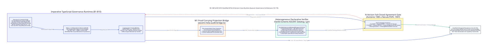

#+TITLE: 10.170 Full B1-B10 Declarative ASCENT Quorum Closure and N-Version Proof-Carrying Governance Audit
#+AUTHOR: hardenedlinux Linux Team and Contributors
#+DATE: 2026-11-26
#+STARTUP: overview
# SPDX-FileCopyrightText: 2026 hardenedlinux Linux Team and Contributors
# SPDX-License-Identifier: LGPL-2.1-or-later

* Overview
:PROPERTIES:
:CUSTOM_ID: arch10170-overview
:END:

Phase 21 ([[file:10.169-proactive-threshold-witness-cosigning-and-quorum-finality.org][10.169]]) closed the reactive-gossip network-eclipse gap by adding
proactive Ed25519 threshold witness cosigning (=2f+1= of =3f+1=) and Byzantine
quorum intersection finality (=B10=). However, until this phase, =B10= existed
only inside the imperative TypeScript runtime and the Quint model, outside our
heterogeneous declarative Gerbil Scheme ASCENT Datalog meta-audit engine
([[file:10.167-durable-ai-governance-research-synthesis-and-declarative-datalog-meta-audit.org][10.167]]) and cross-runtime =gxi= N-Version bridge
([[file:10.168-cross-runtime-proof-carrying-datalog-meta-audit-bridge.org][10.168]]).

This document defines the complete **=B1=–=B10= Declarative Quorum Closure**:
1. Extends =DurableGovernanceMetaAuditProgram= in
   [[file:../../../library/defensive-governance/func.ss][library/defensive-governance/func.ss]]
   from 16 to **20 canonical source relations** and from 7 to **12 stratified
   Datalog output relations**, expressing =B10= quorum finality, Byzantine
   witness double-sign exposure, unregistered/unverified cosign rejection,
   split-world finality breach detection, and **cross-log checkpoint replay
   refusal** in 100% pure stratified Datalog (zero arithmetic aggregation).
2. Extends [[file:../../../languages-engineering/ts/defense/agent-audit/ascent-meta-audit-bridge.ts][ascent-meta-audit-bridge.ts]]
   to project live TypeScript =ThresholdCosignedCheckpoint= and witness roster
   objects directly into cold =M1= Scheme alists for independent verification by
   compiled Gerbil =gxi=.
3. Closes the **120-case benchmark milestone (=AG01=–=AG120=)** in
   [[file:../../../languages-engineering/ts/defense/agent-audit/b10-ascent-quorum-closure.test.ts][b10-ascent-quorum-closure.test.ts]],
   verifying all 10 business governance pillars (=B1=–=B10=), all 7 =R3=
   non-serializable =M3= capability classes, and live cross-runtime N-Version
   dual-oracle consensus over one shared =M1= Merkle store.

#+CAPTION: Panoramic view of full B1-B10 Stratified OP & N-Version Cross-Runtime Quorum Governance.

* Pure Relational Stratified Datalog Encoding of B10 Finality
:PROPERTIES:
:CUSTOM_ID: arch10170-datalog-b10
:END:

A key technical contribution of Phase 22 is expressing Byzantine witness quorum
finality and equational inequalities in **pure stratified Datalog** without
relying on non-standard arithmetic aggregation or imperative host callbacks:

| Output relation | Stratification & security guarantee |
|-----------------+-------------------------------------|
| =byzantine_witness_equivocation(W, L, Sz, R1, R2)= | Detects any witness =W= that cosigned two distinct roots =R1 != R2= (via stratified =not(same_root R1 R2)=) at the same =(L, Sz)= for immediate operator slashing/eviction — **without sacrificing liveness** on the clean =2f+1= quorum under =f=1= fault. |
| =invalid_witness_cosign(W, L, Sz, R, Reason)= | Flags any cosignature from a principal absent from =witness_roster(L, W)= (=unregistered-witness=) or lacking RFC 6962 consistency verification (=missing-consistency-proof=). |
| =quorum_3_verified(Ckpt, L, Sz, R)= | Derives finality iff =claimed_finalized(Ckpt, L, Sz, R)= is backed by **3 pairwise-distinct** (=not(same_witness ...)=), authorized, consistency-verified roster witnesses (=2f+1= for =f >= 1=). |
| =sub_quorum_finality_violation(Ckpt, L, Sz, R)= | Catches any claimed finalized checkpoint lacking =quorum_3_verified= (e.g., 2-of-4 eclipsed backdoor, duplicate-signer spoofing, or rogue-witness padding). |
| =split_world_finality_breach(L, Sz, R1, R2)= | Catches catastrophic => f= witness collusion or corrupted finality verifiers claiming two distinct roots finalized at the same =(L, Sz)=. |
| =release_disqualified(Rel, "unfinalized-quorum-checkpoint")= | Blocks any high-stakes release requiring checkpoint =Ckpt= unless =quorum_3_verified(Ckpt, Log, _, _)= holds on the **exact same** =Log= as =release_proposal(Rel, _, _, Log)= — closing **cross-log checkpoint replay** attacks. |

* Full 7-Class R3 Non-Leakage Coverage (AG120 Milestone)
:PROPERTIES:
:CUSTOM_ID: arch10170-r3-matrix
:END:

Case =AG120= in [[file:../../../languages-engineering/ts/defense/agent-audit/b10-ascent-quorum-closure.test.ts][b10-ascent-quorum-closure.test.ts]]
enforces =R3= non-serializable reachability refusal across all seven live =M3=
authority/key classes spanning =B1=–=B10=:

1. =AeadPartitionKey= (=R5= / =B2= per-tenant AES-256-GCM key)
2. =DelegationRootKey= (=B3= Macaroon HMAC-SHA256 root key)
3. =LiveM3Capability= (=M3= monotonic execution lease)
4. =LinearBudgetTree= (=B6= non-duplicable linear budget handle)
5. =DeclassificationCapability= (=B7= audited DIFC declassification token)
6. =CoordinatorSigningKey= (=B9= Ed25519 transparency-log coordinator key)
7. =WitnessCosigningKey= (=B10= Ed25519 external witness cosigning key)

* Verification Receipts
:PROPERTIES:
:CUSTOM_ID: arch10170-receipts
:END:

- Gerbil Scheme ASCENT qualification suite:
  [[file:../../../t/yanxu/Library/defensive-governance/governance-ascent-test.ss][governance-ascent-test.ss]]
  verifies all 20 sources and 12 outputs across =B1=–=B10= including
  =rel-subq=, =rel-crosslog=, and =rel-breached=.
- Cross-runtime TypeScript <-> live Gerbil =gxi= benchmark (=AG116=–=AG120=):
  [[file:../../../languages-engineering/ts/defense/agent-audit/b10-ascent-quorum-closure.test.ts][b10-ascent-quorum-closure.test.ts]]
  (registered in [[file:../../30-39-evaluation/30-benchmarks/30.05-agent-defensive-coding-benchmark.org][30.05]] as the 120-case milestone).
- Editable panoramic diagram source:
  [[file:../../90-99-views/90-architecture-views/90.148-b1-b10-n-version-quorum-governance.d2][90.148-b1-b10-n-version-quorum-governance.d2]].

* Residual Frontier
:PROPERTIES:
:CUSTOM_ID: arch10170-limits
:END:

The current =B10= committee model assumes a static witness roster per log.
Long-lived orthogonally persistent AI systems spanning months or years require
**Dynamic Witness Roster Reconfiguration & Forward-Secure Epoch Handover
(=B10b=)** using Joint-Consensus dual-quorum intersection (=Q_old ∩ Q_new=) and
retired-key zeroization to prevent long-range historical rewrite attacks after
committee members depart.
