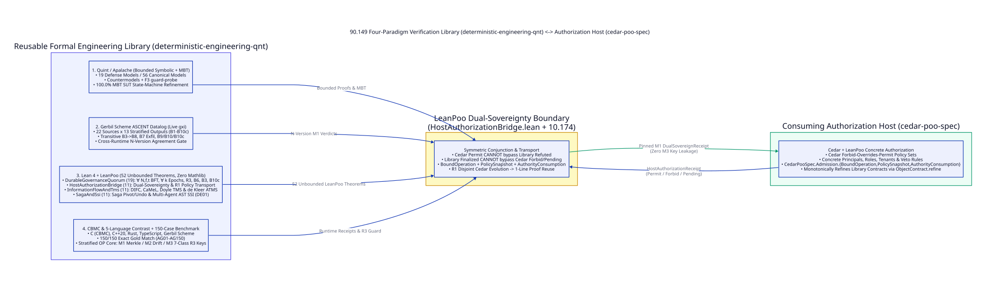

#+TITLE: 10.176 LeanPoo Unbounded Saga/SSI Meta-Theorems and 150-Case Four-Paradigm Synthesis (Library <-> cedar-poo-spec)
#+AUTHOR: hardenedlinux Linux Team and Contributors
#+DATE: 2026-11-26
#+STARTUP: overview
# SPDX-FileCopyrightText: 2026 hardenedlinux Linux Team and Contributors
# SPDX-License-Identifier: LGPL-2.1-or-later

* Overview: 150-Case Milestone & 52-Theorem LeanPoo Library
:PROPERTIES:
:CUSTOM_ID: arch10176-overview
:END:

Phase 28 completes the **150-case defensive benchmark milestone (=AG01=–=AG150=)**
and lifts the final two business governance pillars — =B6= Compensable Sagas
([[file:10.163-durable-compensable-agent-sagas-and-linear-budget-conservation.org][10.163]])
and =B4= Multi-Agent AST Symbol-Level SSI
([[file:10.161-ast-symbol-ssi-arbitration-for-concurrent-multi-agent-editing.org][10.161]]) — into pure
**Lean 4 + =LeanPoo=** unbounded machine-checked theorems (zero Mathlib, zero
Cedar dependency).

#+CAPTION: Panoramic four-paradigm verification library (deterministic-engineering-qnt) <-> authorization host (cedar-poo-spec).

* Complete 52-Theorem LeanPoo Formal Inventory (Zero Mathlib, Zero Sorry)
:PROPERTIES:
:CUSTOM_ID: arch10176-leanpoo-inventory
:END:

| LeanPoo Module | Theorems | Core Unbounded & Refinement Coverage |
|----------------+----------+--------------------------------------|
| [[file:../../../packages/lean-models/DeterministicEngineering/Engineering/DurableGovernanceQuorum.lean][DurableGovernanceQuorum.lean]] | 19 | =∀ N,f,t= BFT Quorum Intersection (=B10=), =∀ k= Multi-Epoch Handover (=B10b=), =R3= Arbitrary-Depth Non-Leakage, =B6= Linear Budget Conservation, =B3= Multi-Hop Attenuation, =B10c= Slashing & Anti-Reentry, 3-step =LeanPoo= refinement + =Core.Transport= |
| [[file:../../../packages/lean-models/DeterministicEngineering/Engineering/HostAuthorizationBridge.lean][HostAuthorizationBridge.lean]] | 11 | Cedar =Forbid=-overrides-=Permit=, Dual-Sovereignty symmetric refusal, =BoundOperation= anti-replay, =PolicySnapshot= drift, =AuthorityConsumption= TOCTOU, =R1= disjoint Cedar policy =Core.Transport= |
| [[file:../../../packages/lean-models/DeterministicEngineering/Engineering/InformationFlowAndTms.lean][InformationFlowAndTms.lean]] | 11 | Arbitrary-depth =B7= DIFC secrecy & CaMeL control-flow collapse, =B8= Doyle sole-support cascade & de Kleer ATMS multi-justification survival, immunization tombstones, =LeanPoo= refinement + =Core.Transport= |
| [[file:../../../packages/lean-models/DeterministicEngineering/Engineering/SagaAndSsi.lean][SagaAndSsi.lean]] | 11 | Zero-axiom post-pivot rollback refusal, =PendingUnknownEffect= bidirectional fence, exact =∀ k= reverse compensation, at-most-one pivot, cyclic =rw= write-skew & =ww= refusal, =DE01= independent-peer admission, =LeanPoo= refinement + =Core.Transport= |
| **Total** | **52** | **52/52 verified live via =#print axioms= (zero =sorryAx=, zero custom axioms)** |

* Verification Receipts (AG146-AG150)
:PROPERTIES:
:CUSTOM_ID: arch10176-receipts
:END:

- Lean 4 / =LeanPoo= build & live 52-theorem axiom sweep:
  =(cd packages/lean-models && lake build DeterministicEngineering.Engineering.SagaAndSsi)=
- Benchmark suite (=AG146=–=AG150=, expanding
  [[file:../../30-39-evaluation/30-benchmarks/30.05-agent-defensive-coding-benchmark.org][30.05]]
  to **150 cases**):
  [[file:../../../languages-engineering/ts/defense/agent-audit/saga-ssi-leanpoo.test.ts][saga-ssi-leanpoo.test.ts]]
- Editable panoramic diagram source:
  [[file:../../90-99-views/90-architecture-views/90.149-four-paradigm-library-and-cedar-poo-spec-architecture.d2][90.149-four-paradigm-library-and-cedar-poo-spec-architecture.d2]]
