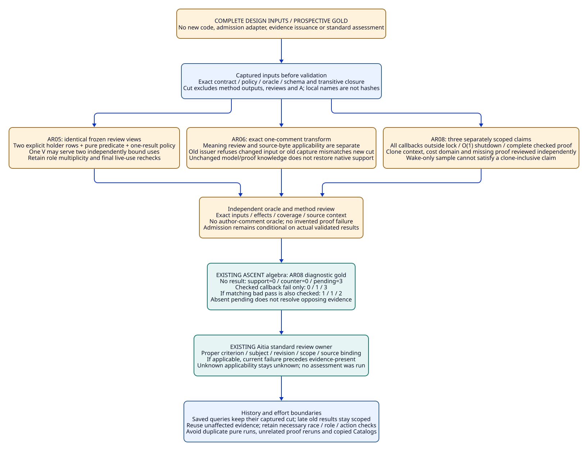
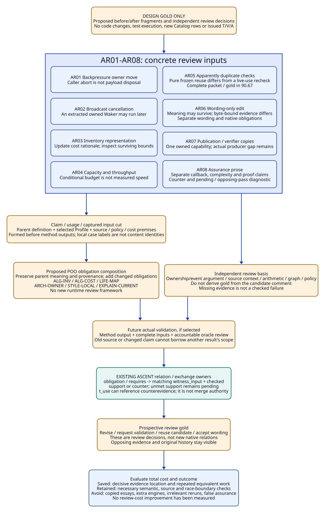
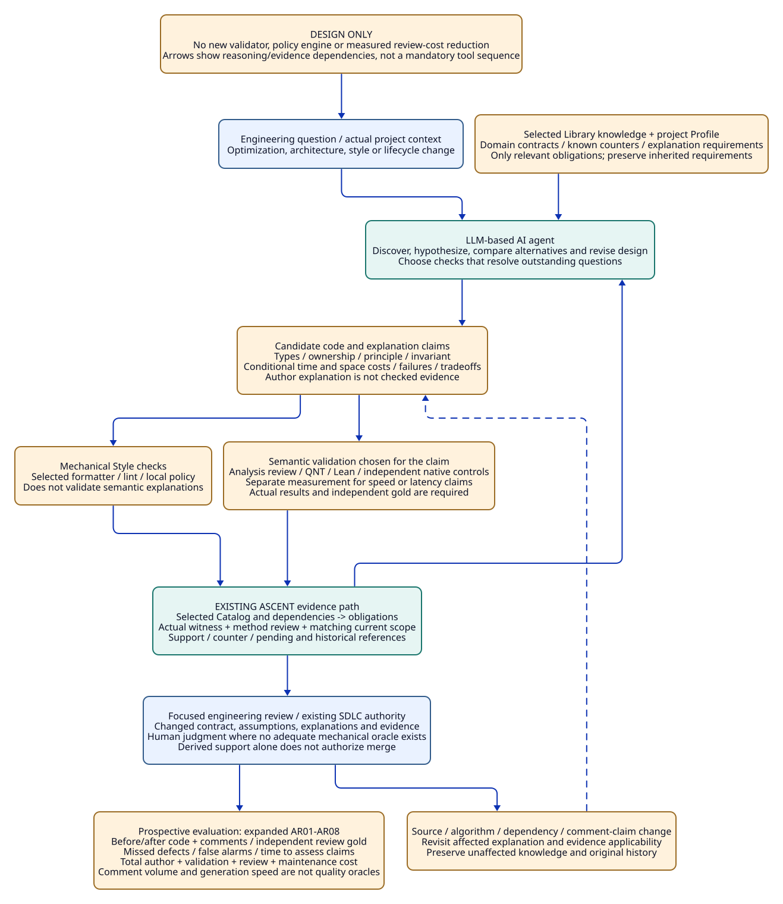

# SPDX-FileCopyrightText: 2026 tao3k team and Contributors
#
# SPDX-License-Identifier: LGPL-2.1-only

#+TITLE: 10.18 Agent-Authored Engineering, Explanation and Review Contracts
#+LANGUAGE: en
#+PROPERTY: JD_ID 10.18
#+OPTIONS: toc:3 num:t
#+STARTUP: overview
#+TODO: DESIGN | REVIEWED QUALIFIED
#+FILETAGS: :library:llm:agent:review:style:algorithms:evidence:
#+PROPERTY: header-args :eval never :tangle no :exports code

[[file:../../00-09-project/00-documentation/00.01-index.org][Index]] | [[file:10.17-domain-libraries-and-atomic-specialization.org][Domain Libraries and composition]] | [[file:10.05-agent-reasoning-and-design-convergence.org][Agent reasoning boundaries]] | [[file:10.19-standard-identities-and-aitia-review-traceability.org][Standard requirement identities and Aitia traceability]]

* DESIGN Why this Library matters when the author is an LLM-based AI agent
:PROPERTIES:
:CUSTOM_ID: agent-engineering-review-purpose
:STATUS: design-discussion-no-implementation-or-productivity-result
:END:

The design addresses a concrete engineering risk: producing code and plausible
explanations can outpace the ability to inspect assumptions, ownership, algorithm
cost, architectural fit and evidence applicability. This is a problem statement
and evaluation hypothesis, not a measured claim that LLMs cannot solve these
problems or that this repository has already reduced human review time.

The LLM-based AI agent can propose algorithms, architectures, comments, models,
proof candidates and alternatives. The Library supplies reusable engineering
knowledge, explicit premises, known failures and validation questions. ASCENT
connects those questions to evidence and change impact. An author's confident
explanation, including one generated by an Agent, remains an assertion until its
required validation has been completed.

The intended engineering product is code accompanied by maintainable reasoning:
types and lifecycle meaning, design rationale, invariant boundaries, conditional
cost analysis, independent checks and a focused account of the change. More
comments or longer reports are not themselves evidence of higher quality.

#+NAME: agent-engineering-problem-response
| Engineering risk | Library / Agent response | Required evidence boundary |
|------------------+--------------------------+----------------------------|
| A locally plausible optimization breaks ownership or closure | Discover the relevant mechanism entries and counterexamples | Check the affected invariants and implementation mapping |
| New abstractions duplicate existing capabilities | Find existing domain entries and public interfaces | Explain the needed variation and reject copied owners |
| Complexity is asserted without defining input size | State variables, operation costs and analysis premises | Review the derivation; asymptotic analysis is not measurement |
| Comments describe an earlier algorithm or lifecycle | Bind explanations to symbols, semantic inputs and changed assumptions | Re-review affected claims after source or dependency changes |
| Passing tests are summarized as general correctness | State finite cases and excluded domains | Preserve pending proof, schedule and correspondence obligations |
| Reviewers receive large, repetitive generated explanations | Present the changed contract, rationale, risks and current evidence first | Evaluate review effort and missed defects, not word count |
| Style rules grow into a second defensive framework | Select only relevant project and domain rules | Reuse sufficient current checks; preserve necessary semantic review |

* DESIGN Library responsibilities for engineering conventions
:PROPERTIES:
:CUSTOM_ID: engineering-style-library-ownership
:END:

The ownership proposal extends the 10.17 hierarchy without installing a new
framework. Engineering communication, algorithm analysis and architecture review
are reusable knowledge domains. Rust conventions specialize relevant language
contracts; a project Profile selects its actual local policy. Discovery tags may
show the same entry under performance or maintainability without copying it.

#+NAME: review-library-ownership
| Owner | Reusable content | Project / specialization content |
|-------+------------------+----------------------------------|
| Algorithm reasoning entry | Input vocabulary, invariant/rationale/cost-analysis questions | The particular algorithm, data representation and operation-cost premises |
| Engineering explanation entry | Which claims need an explanation and how it stays current | Required public documentation, language and accepted local format |
| Architecture review entry | Capability ownership, boundary dependencies, rejected alternatives | Actual Core Modules, allowed dependencies and application constraints |
| Rust specialization | Ownership, borrowing, cancellation/drop and applicable unsafe/safety obligations | Concrete types, features, callbacks and dependency sources |
| Style Profile | Named formatter/lint/local convention requirements | Actual tool configuration and narrowly justified exceptions |
| SDLC consumer | Review authority and acceptance policy | Human review, CI requirements, release and operational decisions |

Mechanical conventions and semantic obligations have different validators.
Formatting or linting can establish compliance with their selected checks;
they cannot establish that a lifetime rationale, algorithm explanation or memory
bound is correct. Human judgment is still needed for abstraction quality and
clarity where no adequate executable or formal oracle exists.

The Library should not require verbose comments on every getter or restate every
type annotation. It should require an explanation where a non-obvious invariant,
cost, lifecycle boundary, unsafe assumption or design choice matters to review.
Existing project instructions take precedence when selecting the concrete Style
Profile. This document defines a design contract, not a new repository-wide lint
policy or a new AGENTS.md instruction.

Explanations should be proportional to the change. A routine wrapper may need
only its existing public contract. A non-obvious algorithm needs its key invariant
and cost premises. A lifecycle or unsafe boundary needs the assumptions relevant
to that boundary. The Profile selects the required tier; it should not require
an essay, a proof and a benchmark for every helper. Removing irrelevant rules
from a selected scope is different from silently deleting inherited obligations.

* DESIGN Algorithm and comment contract
:PROPERTIES:
:CUSTOM_ID: algorithm-explanation-contract
:END:

#+NAME: algorithm-explanation-fields
| Field | What the author must make inspectable | Review / refusal condition |
|-------+--------------------------------------+----------------------------|
| Purpose and scope | The engineering question and supported domain | Reject a broader claim than the implementation or selected Profile |
| Types and representation | Relevant type parameters, units, ownership and valid states | Do not confuse a Rust type check with a semantic units/lifetime argument |
| Preconditions | What callers, snapshots, callbacks and dependencies must guarantee | Missing or contradictory premises leave the claim pending |
| Result and failures | Postconditions, error/cancellation behavior and retained resources | Explain failure paths, not only successful return |
| Principle and invariant | Why the algorithm preserves the required property | Code narration without the key argument is insufficient |
| Time cost | Input variables, per-operation assumptions, worst/amortized/expected distinction | An unsupported O(1) label is refused as a validated claim |
| Space cost | Workspace, outputs, retained/shared memory and owner boundaries | A fixed local buffer is not a global constant-memory proof |
| Concurrent behavior | Blocking, contention, retries, wake/re-poll and progress assumptions | Complexity alone does not bound latency or prove fairness |
| Alternatives and tradeoff | Why the selected representation or abstraction fits this use | Record material alternatives; avoid speculative abstraction inventories |
| Evidence and currentness | Applicable analysis, proof/test/measurement references and source scope | A stale comment or result cannot support the current usage |

Types should be explained at the semantic boundary: what an identifier names,
what a count counts, what unit a budget uses, and which object owns a resource.
The compiler already checks many syntactic types. The author should not inflate
review text by repeating that information without explaining its engineering role.

** A concrete backpressure review example

The existing [[file:../../../library/concurrency/resource-control/backpressure-memory/rust/native/src/main.rs][resource case]] has an OwnedWork containing a payload and an optional
owned permit. Its current comment explains that field order disposes the payload
before returning the permit. The engineering review must connect that explanation
to the allocation, holder and release events and to failure/cleanup ownership.
Moving a field, adding a custom destructor or moving the permit to the caller
requires reconsidering the explanation and the corresponding source claim.
This paragraph requests that review; it does not report a newly detected defect.

For an illustrative allocation-inventory audit, suppose the algorithm scans h
holder records and uses a table keyed by a distinct allocation identity; a is the
number of distinct allocations. The analysis must state the table-operation
premises and sharing policy. It must not sum the same shared allocation once per
reference merely because each holder has a record.

#+NAME: inventory-audit-comment-design
#+begin_example
Purpose: audit the captured allocation inventory, not live-process memory.
Inputs: h holder records with valid allocation identities and byte units.
Invariant: each physical allocation contributes at most one retained-byte charge;
           all current holders are associated with that allocation.
Method: scan holders and accumulate by allocation identity.
Time: O(h) expected amortized under the stated expected O(1) table-operation
      premise; if each table operation costs O(h), the bound becomes O(h^2).
Space: O(a) table entries; account separately for materialized output.
Concurrency: snapshot capture and synchronization are outside this pure scan;
             consistency of that snapshot is a separate obligation.
Evidence: conditional design analysis; no native memory or speed measurement.
#+end_example

This example is a proposed explanation, not an implemented audit algorithm or a
claim about the current resource oracle's data structures. Different structures
need their own cost derivation and test/proof obligations.

** A concrete broadcast review example

For the inspected =notify_rx= source, let w be the number of captured waiters in
one detached generation. A proposed analysis can count extraction and callback
invocations for that generation, with separate cost/termination assumptions for
callbacks, lock reacquisition and cancellation. A local batch of 32 wakers bounds
one buffer, not the channel's waiter-node storage or all concurrent notifiers.

An O(w) operation-count argument for a terminating generation is conditional;
it is not a latency measurement, a proof of callback termination, or coverage
of requeued live waiters and panic paths. The comment must retain those limits.
The [[file:10.16-tokio-broadcast-close-and-wake-library.org::#broadcast-qnt-properties][candidate decreasing rank in 10.16]] is also an unimplemented proof argument.
Replacing it with the phrase "constant-time wakeup" would require a different,
supported claim and cannot be accepted as a harmless comment edit.

* DESIGN POO rule selection and existing ASCENT evidence path
:PROPERTIES:
:CUSTOM_ID: review-rules-and-evidence
:END:

A project Profile selects applicable explanation, architecture and Style rules.
A mechanism entry contributes non-obvious domain obligations. Rust specialization
adds concrete lifetime and source requirements. POO composition must preserve the
selected parent requirements and their provenance, using the same conflict and
dependency discipline described in 10.17. It must not install a parallel review
workflow, duplicate policy engine or compulsory tool sequence.

#+NAME: proposed-review-obligation-selection
| Selected trigger | Proposed obligation | Suitable validation / limit |
|------------------+---------------------+-----------------------------|
| Non-obvious algorithm or optimization | ALG-INV: state and justify the invariant | Analysis review, independent property tests or a scoped theorem |
| Complexity claim in code/docs/change report | ALG-COST: define variables and derive the bound | Operation-cost argument; separate measurement for speed claims |
| Resource or cancellation boundary changes | LIFE-MAP: update types, owners, failure paths and explanation | Affected model/source mapping and independent lifecycle controls |
| Architecture or dependency change | ARCH-OWNER: justify public boundaries and reuse | Actual dependency/publication review and selected build checks |
| Project Style Profile | STYLE-LOCAL: satisfy relevant mechanical conventions | Actual configured formatter/linter result and reviewed exceptions |
| Explanatory claim touched by a semantic change | EXPLAIN-CURRENT: reconcile the claim with the new semantics | Source/contract/dependency comparison and review of changed claims |

These names are proposed Library obligations, not currently registered rule rows
or newly executed validators. The current [[file:../../../modules/resource-evidence/func.ss][Evidence DSL]] already has the relevant
source shapes: =catalog_rule=, =catalog_dependency=, =application=, =factor=,
=scope=, =witness=, =witness_input= and =checked=. Those owners can represent
selected obligations and exact applicability without inventing another engine.

The proposed semantic scope should include the claim contract, selected symbols
and relevant source/model/dependency closure, cost premises, workload when needed,
and the local policy/checker/oracle identity. A whole-file digest may conservatively
invalidate evidence; it does not identify the minimal semantic impact by itself.
No automatic semantic-comment dependency extractor is assumed to exist.

T records the design question and revision path. V refers to actual validation
outputs; a human analysis review needs its own accountable, scoped review record
rather than an invented tool pass. A binds admissibility/applicability to the
current usage under the existing review policy. Derived support can guide further
work, but it does not substitute for SDLC review authority or authorize a merge.
A comments-only change must not gain authority merely because it needs no compiler
change; the explanatory claim itself may have changed meaning.

* DESIGN Comment change, invalidation and focused review
:PROPERTIES:
:CUSTOM_ID: explanation-change-and-reuse
:END:

#+NAME: explanation-change-impact
| Change | Required explanation/evidence response | What may remain reusable |
|--------+----------------------------------------+--------------------------|
| Backpressure holders gain a result/cleanup stage | Update owner inventory, retained-charge argument and cancellation explanation | Generic arithmetic lemma if its actual premises remain unchanged |
| An Agent increases capacity to improve throughput | Review memory budget, model domain and workload; measure the selected objective | Unaffected ownership vocabulary and scoped generic proof |
| Tokio broadcast extraction/callback order changes | Revisit source mapping, node lifetime and callback comments | Generic predicate questions; source evidence must be rechecked |
| A collection changes from one representation to another | Re-derive operation costs, memory, invalidation and iteration assumptions | Unaffected public postconditions if correspondence is re-established |
| Only wording or formatting changes without semantic change | Review that the claim/premises are unchanged; refresh presentation provenance | Independently valid semantic evidence under the unchanged scope |
| A comment changes O(w) to O(1), or removes a precondition | Treat it as a changed claim requiring validation | Code test results remain historical, not evidence for the new claim |
| A dependency update changes the cost premise | Revisit the bound and related performance explanation | Artifact-independent reasoning whose premises genuinely remain unchanged |
| Late review arrives for an older implementation | Retain it with its original source and explanation contract | Apply only to matching claims/cuts; do not overwrite current review |

Stale explanations should be corrected, narrowed or removed when they no longer
have a supported claim. The remedy is not to retain every obsolete explanation
with another warning paragraph. Shared reasoning belongs in one owned Library
contract; nearby comments point to the relevant invariant and local difference.
This avoids copying long essays into every implementation and test.

** Review packet and stopping conditions

A focused review packet should make the engineering change inspectable:

1. The problem, selected Library entries, changed public contract and intended
   effect, including alternatives relevant to the decision.
2. Changed assumptions, types/lifecycles, invariant and cost claims, with the
   relevant source locations and concise rationale.
3. Current validation references, actual outcomes, applicable scope, known
   counterexamples and remaining uncertainty.
4. The affected explanation changes and why evidence was reused or invalidated.

This is content to derive from owned artifacts, not a requirement to duplicate
all sources into a new report format. If one exact current check already covers
a requirement, a duplicate defensive check adds no new assurance merely by being
run again. Missing coverage, changed premises, failed controls or unclear
interpretation justify further validation. A manual semantic review remains
necessary when mechanical checks cannot answer the selected question.

The Agent may redesign, seek a counterexample, narrow a claim, request missing
context or choose another verification method. The constraints govern claim and
evidence consistency while preserving that exploration space.

* DESIGN Evaluation of review benefit and maintenance cost
:PROPERTIES:
:CUSTOM_ID: agent-review-evaluation-design
:END:

#+NAME: review-evaluation-cases
| Case | Seeded / proposed issue | Independent expected review decision |
|------+-------------------------+--------------------------------------|
| [[#ar01-backpressure-owner-and-abort][AR01 backpressure optimization]] | Caller abort is described as immediate release while cleanup retains work | Require corrected lifecycle claim and affected validation |
| [[#ar02-broadcast-cancel-and-owned-waker][AR02 broadcast explanation]] | Every cancellation is claimed to forbid later wake | Reject that stronger claim; distinguish node sharing and owned waker |
| [[#ar03-inventory-representation-and-cost][AR03 complexity drift]] | Data structure changes while its old cost comment remains | Re-derive named cost assumptions and update the explanation |
| [[#ar04-capacity-correctness-and-performance][AR04 misleading performance]] | Passing safety tests are described as increased throughput | Keep correctness evidence; performance remains pending measurement |
| [[#ar05-duplicate-check-and-use-boundary][AR05 redundant defense]] | Two checks repeat the same covered policy with identical current scope | Reuse sufficient evidence; preserve any independently required check |
| [[#ar06-wording-and-byte-bound-evidence][AR06 cosmetic edit]] | Wording changes with unchanged semantic claims and premises | Preserve matching semantic evidence; review wording/currentness only |
| [[#ar07-duplicate-owner-and-module-granularity][AR07 architectural duplication]] | A copied verifier or per-case Module is added without a distinct owner | Require reuse or a concrete justification for the new boundary |
| [[#ar08-broadcast-assurance-prose][AR08 false assurance prose]] | Long type/rationale/complexity text has no matching model or argument | Refuse validated status; keep only supportable claims |

These are prospective controls, not benchmark results. Independent maintainers
must review their gold against the actual change; the generating Agent or the
same accepted explanation cannot be the sole oracle. Use comparable task scope,
reviewer context and review policy; record assignment/order so learning effects
and review familiarity are visible.

Measure time to locate and assess a changed claim, missed seeded defects, false
alarms, unnecessary check count, comment corrections, review revisions and the
cost of maintaining metadata/explanations. Retain total author/verification/review
cost and outcome quality. Fewer comments, faster code generation or shorter review
alone are insufficient. No reduction in review cost or defect rate is claimed
until these controls have been executed and evaluated.

* DESIGN AR01-AR08 concrete review packets
:PROPERTIES:
:CUSTOM_ID: expanded-ar-review-cases
:STATUS: prospective-review-gold-not-executed
:END:

These packets instantiate the eight controls above using the existing
[[file:../../../library/concurrency/resource-control/backpressure-memory/rust/native/src/main.rs][backpressure resource subject]], [[file:../../../library/concurrency/resource-control/backpressure-memory/model.qnt][ownership model]], [[file:../../../library/concurrency/resource-control/backpressure-memory/budget.lean][conditional budget lemma]] and
[[file:10.16-tokio-broadcast-close-and-wake-library.org][broadcast source contract]]. They are proposed changes and review examples,
not applied patches, compiled examples, new test runs or registered evidence.
Diff blocks show B-to-C changes unless explicitly described otherwise; AR07
shows the C-to-R architecture repair. They contain relevant fragments with
surrounding code omitted; identifier
names in explanatory fragments do not introduce new runtime APIs. The Style and
review obligations remain the proposed Library contracts described above.

** Shared claim, cut and evidence notation
:PROPERTIES:
:CUSTOM_ID: ar-shared-evidence-contract
:END:

For each AR case, B names a captured baseline, C the candidate revision and R a
reviewed repair or narrowed explanation. These labels are local to that case;
they are not hashes, global claim IDs or a new registry. Q is the exact semantic
claim contract. U is its consuming usage, and K is the immutable input cut
established before the selected validation. An explanation has its own content
reference; its meaning is not inferred from text length or equal wording.

#+NAME: ar-review-reference-closure
| Reference | Required content / role | Invalidation boundary |
|-----------+-------------------------+-----------------------|
| T-ARxx | Question, baseline/candidate references, selected parents/Profile and hypothesis | A later design decision appends history; it does not rewrite the earlier question |
| Q-ARxx / K-ARxx | Claim meaning; source/symbol/model/rule/policy/cost-domain inputs needed by this claim | Different predicates or scope need a distinct claim/use binding |
| V-ARxx-* | Actual selected method output, input closure, completion and independent oracle decision | A report summary or author comment cannot stand in for method output |
| Review-ARxx-* | Accountable validation of that method and interpretation | The author alone cannot certify its own explanation as an independent result |
| A-ARxx / T-use | Existing policy-bound applicability to U/K after method validation | A historical result cannot silently enter a new source cut |

#+NAME: ar-method-and-cut-bindings
| Case | Concrete claim and captured input focus | Prospective validation references / current-use binding |
|------+-----------------------------------------+--------------------------------------------------------|
| AR01 | Q-AR01 reservation follows every payload holder; K binds selected source, holder inventory, model/domain, runtime, scenario and oracle | V-AR01-model and V-AR01-native need separate method reviews; A-AR01 must bind C or R explicitly |
| AR02 | Q-AR02 shared-node disposal is safe while an extracted Waker is independently owned; K binds source mapping, future/waker IDs, order and callback premises | V-AR02-source and V-AR02-trace; A-AR02 cannot admit the universal no-late-wake hypothesis |
| AR03 | Q-AR03-dedup and Q-AR03-cost are separate; K binds algorithm, fixed-ID/units contract, cost premises and each oracle | V-AR03-functional and V-AR03-analysis; A-AR03 binds the corresponding claim, not an undifferentiated pass |
| AR04 | Q-AR04-budget binds arithmetic parameters/proof premises; Q-AR04-speed binds source, workload, runtime, hardware, baseline and measurement method | V-AR04-budget and V-AR04-measurement are distinct; absent measurement leaves that applicability pending |
| AR05 | Q-AR05-equivalence binds the immutable input, identical requirement, checker/policy, pure effects and review phase | V-AR05-equivalence can justify reuse only for matching uses; their A-AR05 bindings remain cut-specific |
| AR06 | Q-AR06-wording binds both explanations, their semantic contract and policy; the native claim separately binds actual source bytes | V-AR06-wording cannot substitute for a new native V; A-AR06-wording and native applicability can differ |
| AR07 | Q-AR07-owner binds original identities, requires/exports and selected roots; build/loading claims additionally bind actual source/compiler closure and observations | V-AR07-architecture, V-AR07-build and V-AR07-loading cannot substitute for one another |
| AR08 | Q-AR08-callback, Q-AR08-cost and Q-AR08-proof bind their own source context, analysis premises and theorem/property closure | V-AR08-source, V-AR08-analysis and any V-AR08-proof require actual independent validation; missing proof is not a fabricated result |

These references name the expected review locations, not issued native IDs or
existing files. Each A also depends on its method review and the existing
admission policy. Separate claims in a row keep separate minimal required inputs;
the table does not authorize flattening them into one universal scope.

Only requested keys belong to an obligation's exact footprint. Candidate keys
include source, model, inventory, runtime, mapping, scenario, oracle, claim,
explanation, cost premises, workload and local policy/checker identity. Do not
attach every key to every question: that would defeat focused reuse. The actual
key set must be declared in the owning Catalog and validated before use; these
packets do not install such Catalog rows.

The current Evidence DSL already derives =obligation= and =requires= from
=application/factor/catalog_rule/catalog_dependency=, then checks witness inputs
against the selected =scope=. Checked matching pass/fail witnesses can yield
=support/counter= and =t_use=. Missing or mismatched support leaves =pending=.
A fail witness does not, by itself, remove pending work. =t_use= also records
applicable counterevidence; it is not an approval to execute or merge.

Revise, refuse-as-evidence, request-validation and accept-as-wording below are
review decisions, not additional native output relations. If matching support
and counterevidence coexist, both must remain visible and the review stays
unresolved. This program has no automatic winner or dedicated conflict output.

For an in-place source edit, the current method issuer can refuse registration
because its recorded input bytes changed. For separately retained immutable
captures, an older witness can remain valid for B while being inapplicable to C.
Neither route permits editing an old receipt or deleting unaffected evidence.
The current resource method producer issues its selected QNT/Lean/native
observations; it does not issue arbitrary AR analysis or human-review records.
Admitting those requires an explicit method/issuer contract in the existing owner,
not loading an authored JSON file as checked evidence. Until that capability and
its actual validation exist, those review-method obligations remain pending.
No packet here has produced T/V/A objects or checked rows; all traces below are
stepwise design gold for future independent review.

** AR01: moving a permit to the caller while claiming immediate release
:PROPERTIES:
:CUSTOM_ID: ar01-backpressure-owner-and-abort
:CASE_ID: AR01
:DOMAIN: backpressure
:END:

Input B uses the current positive ownership shape: CPU work carries the permit.
C proposes an async caller owning that permit and describes caller abort as
ending all retained work. This deliberately resembles the existing M06 negative
branch; it is not a newly discovered runtime defect.

#+NAME: ar01-code-and-comment-delta
#+begin_src diff
-// The work retains its reservation through result/cleanup ownership.
-let work = OwnedWork { payload, _permit: Some(permit) };
+// Aborting the caller immediately frees the job and its memory budget.
+let work = OwnedWork { payload, _permit: None };
+let caller_permit = Some(permit); // moved into the awaiting caller
 // CPU work may continue after that caller stops awaiting its result.
#+end_src

Types matter even if this compiles: Option<OwnedSemaphorePermit> permits the
ownership split without duplicating a permit; it does not establish that a
payload has been disposed. R retains the permit with OwnedWork and explains that
caller cancellation drops interest while CPU/result/cleanup ownership remains
charged until actual disposal. The ownership repair changes C's source scope.

No throughput, bounded cancellation latency or O(1) end-to-end cleanup claim is
supported by moving one field. Local ownership transfer cost and payload disposal,
CPU execution and waiting costs are separate. The budget lemma remains conditional
on the real holder inventory.

POO preserves the reservation parent and ALG-INV, adds LIFE-MAP and
EXPLAIN-CURRENT, and selects BP-O02 plus the relevant native ownership/abort cases
(RL-M04 and the RL-M06 negative control). The abstract model result depends on
model/domain; source correspondence also needs source, inventory, runtime and
oracle. The new comment cannot remove inherited cleanup obligations.

#+NAME: ar01-stepwise-review-gold
| Step | Review input | Expected decision / evidence applicability |
|------+--------------+-------------------------------------------|
| G0 | B contract and holder inventory | Retain B-scoped observations; do not claim all workload coverage |
| G1 | C ownership move and immediate-release comment | Revise the claim; old native source evidence cannot support C |
| G2 | Proposed held cut: payload live=1, caller permit returned, CPU not finished | Independent oracle should reject reservation-while-held compliance; issue counter only after an actual validated observation |
| G3 | R couples work and permit; rerun relevant schedules | Keep source correspondence pending until actual checks; reuse only unaffected conditional model/proof knowledge |

Independent judgement compares observed payload/permit events at an acknowledged
held cut, not sleep duration or the new comment. It checks failed delivery and
cleanup as well as the happy path. A timeout is incomplete evidence, not that
counterexample. T-AR01 records the ownership hypothesis; V-AR01-model and
V-AR01-native remain distinct, followed by their method reviews and new-cut A.

Review cost may decrease when one owner diagram and the held-cut oracle expose
the error immediately. It increases if every cancellation path is re-explained in
separate copied comments or all methods are rerun despite unchanged dependencies.

** AR02: a cancelled broadcast receive is claimed never to wake
:PROPERTIES:
:CUSTOM_ID: ar02-broadcast-cancel-and-owned-waker
:CASE_ID: AR02
:DOMAIN: broadcast
:END:

B states the node-lifetime contract in 10.16. C adds a universal no-late-wake
assertion after cancellation. All code below is proposed test logic, not a test
that was executed or added to Tokio.

#+NAME: ar02-code-and-comment-delta
#+begin_src diff
-// Cancellation unlinks a still-shared node; a notifier may own its waker.
-drop(recv_future);
+// A dropped receive can never trigger another callback.
+drop(recv_future);
+assert_eq!(wake_count_after_cancel, wake_count_at_cancel);
#+end_src

R removes the universal assertion and documents the two ownership states. If
cancellation unlinks the shared node before extraction, the node must not remain
reachable by the notifier. If extraction already owns the Waker, a subsequent
wake can be safe even after the future is disposed. The selected trace must use
unique future/waker identities and respect the Receiver borrow until disposal.

POO composition preserves BC-P02 node ownership and BC-P03 registration coverage
as parent review questions. LIFE-MAP, ALG-INV and EXPLAIN-CURRENT specialize them to the inspected
source. BC-O01/BC-O07 review questions remain separate from an executed QNT/native
claim. A small safety model does not close BC-O03's progress obligation.
Required source evidence includes the extraction/cancellation mapping, callback
policy, scenario and oracle, not just a wake counter.

The complexity claim is limited to operations on the captured waiter generation.
One cancellation does not imply a constant-time whole-channel shutdown, zero
future wake work or bounded scheduling latency.

#+NAME: ar02-stepwise-review-gold
| Step | Review input | Expected decision / evidence applicability |
|------+--------------+-------------------------------------------|
| G0 | B node/waker ownership contract | Preserve the distinction as the review basis |
| G1 | C universal no-late-wake assertion | Refuse this stronger claim as an accepted invariant |
| G2 | Proposed trace: detach, extract Waker, clear queued, dispose future, invoke owned Waker | A late callback is compatible with the ownership contract; it is not by itself a Tokio counterexample |
| G3 | R checks shared-node safety and separately records callback outcomes | Require controlled native/source correspondence before registering results |

An independent trace reviewer checks that no shared-node dereference occurs
after disposal and that the callback owns its own Waker. Waker invocation counts
alone are not that oracle. If hooks are needed to force extraction/cancel order,
record an instrumented subject and a bridge to unmodified source; do not claim
that an arbitrary black-box schedule establishes the internal order. T-AR02
separates the rejected hypothesis from any V about source behavior, and A can
bind only the actually validated narrower claim.

A precise ownership explanation can prevent reviewers from treating safe extra
wakes as defects. A large callback trace without identities, ordering or an
independent interpretation instead adds inspection cost.

** AR03: a representation changes while the complexity rationale stays stale
:PROPERTIES:
:CUSTOM_ID: ar03-inventory-representation-and-cost
:CASE_ID: AR03
:DOMAIN: backpressure
:END:

This is an illustrative allocation-inventory audit, not the current oracle's
implementation. B scans h holder records and remembers a distinct allocation
identity in a Vec. C changes that representation to HashSet while retaining the
old linear-scan explanation.

#+NAME: ar03-code-and-comment-delta
#+begin_src diff
 // Deduplicate physical allocations, not holders of the same allocation.
 // Time: O(h*a), because each membership check linearly scans seen IDs.
-let mut seen: Vec<AllocationId> = Vec::new();
-if !seen.contains(&holder.allocation) { seen.push(holder.allocation); charge(); }
+let mut seen: HashSet<AllocationId> = HashSet::new();
+if seen.insert(holder.allocation) { charge(); }
#+end_src

Assume fixed-size valid AllocationId values, consistent byte metadata for aliases,
a coherent snapshot, h records and a distinct allocations. R updates the rationale:
expected amortized O(h) table work under the declared expected O(1) operation
premise, O(h^2) if each operation costs O(h), and O(a) entries of workspace.
Growth/allocation is part of the amortized premise; variable-sized keys need
additional hashing/equality cost variables. Concurrent snapshot capture and
output storage are separate costs.

The old O(h*a) worst-case upper bound may still be conservative for the new
representation. The stale linear-scan explanation needs correction; the mere
existence of a better conditional bound is not proof the old upper bound was
false. Neither asymptotic statement establishes a faster native implementation.

POO retains the allocation-identity/inventory contract and ALG-INV, and adds
ALG-COST plus EXPLAIN-CURRENT for the changed representation. Relevant dependencies
are algorithm source, identity/units contract, cost premises and analysis oracle;
measurement additionally needs workload/runtime/hardware. Generic budget arithmetic
can remain useful while the new audit's correspondence is pending.

#+NAME: ar03-stepwise-review-gold
| Step | Review input | Expected decision / evidence applicability |
|------+--------------+-------------------------------------------|
| G0 | B linear scan and declared h/a domain | Assess its own bound, not the candidate's data structure |
| G1 | C HashSet with unchanged rationale | Require explanation/currentness repair; do not label every unchanged bound false |
| G2 | R conditional expected/amortized and worst-case analysis | Analysis remains pending until independent review of the actual algorithm and operation premises |
| G3 | Proposed duplicate/alias functional controls and cost comparisons | Functional equality can support deduplication only; speed or cost evidence needs its own method |

The functional oracle is a deliberately simple independent enumeration of unique
physical IDs with consistent byte charges, including repeated holders and rejected
inconsistent metadata. The cost oracle is a separate human/operation-count
argument over the selected algorithm, not a timer nor the same comment. Negative
controls include variable-sized keys and missing amortization premises. T-AR03
records the representation decision; V-functional and V-analysis must retain
different claims and complete closures before a current A is formed.

The improved explanation can save repeated reconstruction of h/a and sharing
assumptions. Requiring all ordinary collection uses to carry a full cost essay,
or introducing an unneeded custom collection to simplify the comment, adds burden.

** AR04: a capacity change is marketed as a measured speedup
:PROPERTIES:
:CUSTOM_ID: ar04-capacity-correctness-and-performance
:CASE_ID: AR04
:DOMAIN: backpressure
:END:

B uses the existing C1-style accounting parameters q=2, active=2, item=64,
fixed=128 and cache=0. C chooses active=4 and claims doubled throughput with
unchanged retention after a safety check.

#+NAME: ar04-code-and-comment-delta
#+begin_src diff
-// Capacity 2; performance has not been measured in this review.
-let active_limit = 2;
+// Capacity 4 doubles throughput with the same memory use; safety tests pass.
+let active_limit = 4;
#+end_src

These are abstract accounting parameters until an allocation mapping establishes
units. The conditional formula yields 384 before and 512 after; a selected budget
of 512 still fits under those premises, but the bound is not unchanged. With
cache=128, the new expression is 640 and would exceed that selected budget. These
are arithmetic review gold, not new Lean execution or memory measurements.

R states the new conditional bound, its inventory premises and the unmeasured
performance hypothesis. Any performance objective must define the metric,
workload, baseline, hardware/runtime, repetitions and acceptable uncertainty.
A safety result neither measures throughput nor supplies an optimal capacity.
The increase may alter contention, queue delay and retained results; those are
questions to test, not assumed outcomes.

POO preserves reservation and budget obligations, adds ALG-COST, LIFE-MAP and
EXPLAIN-CURRENT as affected, and selects a performance obligation only for the
explicit performance objective. The latter's dependencies include source, runtime,
workload, hardware, baseline, instrumentation and oracle. BP-O03 arithmetic and
BP-O02 finite safety cannot substitute for that method.

#+NAME: ar04-stepwise-review-gold
| Step | Review input | Expected decision / evidence applicability |
|------+--------------+-------------------------------------------|
| G0 | B scoped safety/accounting claims | Retain matching evidence without treating it as performance data |
| G1 | C 2x throughput and unchanged-memory explanation | Reject validated status for those assertions; do not invent a slowdown counter |
| G2 | R 512-unit conditional bound with cache=0 | Accept the arithmetic reasoning only under its premises and proper validation; native mapping remains separate |
| G3 | No measured performance result supplied | Keep the speed claim pending; collect matched measurement only if that objective remains selected |

Independent gold checks the arithmetic against declared units and asks whether
a matching measurement exists. Missing measurement is a pending question; a
validated violation of an actual performance target would be different evidence.
T-AR04 separates the optimization hypothesis from V-safety, V-budget and any
future V-measurement. Each obtains a current-use A only for its own scope.

This separation can shorten review by preventing argument over a nonexistent
speed result. Requiring an extensive benchmark for a change whose performance
claim has been withdrawn can add unnecessary cost; source correctness, resource
budgets and any genuinely selected performance requirement must still be covered.

** AR05: apparently repeated validation protects different boundaries
:PROPERTIES:
:CUSTOM_ID: ar05-duplicate-check-and-use-boundary
:CASE_ID: AR05
:DOMAIN: backpressure-and-broadcast-review
:END:

B presents a pure review check twice against the same immutable captured report,
identical requirement and checker. C proposes sharing that result. This input
excludes external side effects and current live-source reads.

#+NAME: ar05-code-and-comment-delta
#+begin_src diff
-// Recheck identical frozen evidence for the second view.
-let first = review_frozen_report(&report, &requirement);
-let second = review_frozen_report(&report, &requirement);
+// Both views consume one checked result for the identical captured requirement.
+let first = review_frozen_report(&report, &requirement);
+let second = &first;
#+end_src

The fragment is schematic consumer code, not an existing method API. R makes
immutability, equal claim/scope/policy and the pure-result lifetime explicit.
A reference to an old result is not an authorization token for later live use.
If one check scans c input items, sharing can remove one such scan under the
same algorithm assumptions; no measured review-time or native speedup is implied.
Types/lifetimes must ensure both views use the same immutable result rather than
independently mutable state.

POO keeps STYLE-LOCAL or semantic validation requirements selected by the Profile,
plus the relevant LIFE-MAP/ALG-INV requirements; the change asks whether one
method result satisfies two identical review uses. It cannot remove a parent
requirement at a different boundary. The [[file:../../../library/concurrency/resource-control/backpressure-memory/rust/methods.ss][current registration owner]] checks input
currentness both before and near source publication. Those checks surround
intervening operations and must not be classified as this pure duplicate case.

#+NAME: ar05-stepwise-review-gold
| Step | Review input | Expected decision / evidence applicability |
|------+--------------+-------------------------------------------|
| G0 | Identical immutable reports, requirements, checker/policy and pure method | Sharing one validated observation is a reuse candidate |
| G1 | C shares the result between two frozen views | Require an independently checked equality/coverage argument; no second V solely for a second view |
| G2 | Negative control changes claim, source cut, oracle or policy between uses | Refuse that reuse; derive/check the newly affected obligation |
| G3 | Negative control places mutation-capable work between currentness checks | Retain the use-boundary checks; old review support cannot authorize current use |

T-AR05 records the equivalence hypothesis and both proposed use cuts before
validation. The independent oracle compares exact requirements, dependencies,
phase and side-effect assumptions, not textual similarity of the two calls. Its verdict
can preserve one V and two properly bound usage references. It must not equate
their A bindings if their cuts differ. A missing effect/immutability argument
leaves the optimization pending rather than proving the checks redundant.

This case can remove repeated pure validation and duplicated review prose. A
new universal caching layer, an elaborate equivalence proof for a trivial cheap
check, or deletion of the final race check can cost more than the saved work.

** AR06: a comment-only edit preserves meaning but changes source bytes
:PROPERTIES:
:CUSTOM_ID: ar06-wording-and-byte-bound-evidence
:CASE_ID: AR06
:DOMAIN: backpressure
:END:

B and C keep the same OwnedWork fields and implementation. Only its comment is
rewritten. Public/semantic documentation and local policy are assumed unchanged;
that premise must be reviewed, not inferred from the file extension.

#+NAME: ar06-code-and-comment-delta
#+begin_src diff
-// Field order makes payload disposal precede returning its resource permit.
+// Payload disposal precedes permit return because fields drop in declaration order.
 struct OwnedWork {
     payload: Payload,
     _permit: Option<OwnedSemaphorePermit>,
 }
#+end_src

The relevant types, owner relation and absence of custom disposal changes are
unchanged by this proposed diff. It introduces no complexity or performance
claim. R may accept the wording after checking that it preserves the same scope,
including Option::None variants that do not carry a permit; the explanation
must not imply every OwnedWork necessarily contains one.

POO selects EXPLAIN-CURRENT and the applicable local Style requirement. Existing
ownership obligations remain; their premises are reviewed for change rather than
removed. A type-annotation restatement or unrelated cost proof is unnecessary.

#+NAME: ar06-stepwise-review-gold
| Step | Review input | Expected decision / evidence applicability |
|------+--------------+-------------------------------------------|
| G0 | B claim and issued input closure | Preserve original source-bound history |
| G1 | C wording with unchanged semantic requirements | Wording may be accepted by independent review; semantic evidence reuse remains conditional |
| G2 | Existing issuer observes different original source bytes | Refuse current registration of that old issued result, or report source mismatch for a separate immutable B capture |
| G3 | No established source-equivalence transport exists | Keep C-source native applicability pending; retain matching artifact-independent proofs and B history |

The independent oracle reviews the exact diff, predicate, relevant type/drop
premises and local policy. It also inspects what the method actually bound:
whole-source hashing is conservative and does not automatically ignore comments.
A future explicitly justified semantic transport could reduce reruns, but none
is implemented or assumed here. Old V records cannot be edited to name C bytes.
T-AR06 and the new explanation review can be current while a separate native
source obligation remains pending; those are consistent outcomes.

Review effort may decrease by recognizing a narrow wording change and preserving
unaffected reasoning. Byte-bound native revalidation can still have a real cost.
Requiring fresh QNT/Lean runs for unchanged artifacts adds burden; pretending
semantic equality bypasses the issuer's currentness contract is unsound.

** AR07: a copied verifier and per-test Modules are called architecture
:PROPERTIES:
:CUSTOM_ID: ar07-duplicate-owner-and-module-granularity
:CASE_ID: AR07
:DOMAIN: backpressure-and-broadcast-organization
:END:

B has one existing resource-evidence owner and case-specific method production.
C proposes copying its relation program for each broadcast test and treating
every test as a Module. It introduces no distinct public semantic capability.
The following selection fragment compares design proposals, not active init.ss.

#+NAME: ar07-publication-and-comment-delta
#+begin_src diff
-;; Proposed: copied verifier and a publication for each test case.
-(broadcast-case-01 @ "./copied/broadcast-case-01")
-(broadcast-case-02 @ "./copied/broadcast-case-02")
+;; Proposed: select one domain specialization and the existing Evidence owner.
+(tokio-broadcast @ "./library/concurrency/communication/bounded-broadcast/close-wake/rust/tokio")
+(resource-evidence)
#+end_src

R keeps test cases as owned case data and Scheme tests in t/*-test.ss. The domain
specialization publishes its Contracts and knowledge; a Scenario composes selected
capabilities. Existing method production still needs direct broadcast adaptation.
Reusing the Evidence owner does not mean its current producer can execute an
arbitrary broadcast method or that the proposed publication already builds.

Types here are public capability/requirement Contracts and stable semantic
identities. Equal exported shapes are insufficient if source/provenance or claim
meaning differs. No O(1) loading claim follows from fewer Module declarations;
discovery, compilation, field demand and validation costs remain separate.

POO preserves parent rules and obligations, adds ARCH-OWNER and any affected
EXPLAIN-CURRENT, and retains the new specialization's mapping/method obligations.
Applicable review inputs include selected roots, original publication identities,
requires/exports, build/source closure, Catalog/protocol versions and local policy.
Copying a verifier changes those inputs and cannot inherit the original owner's
method acceptance merely because its rows look equal.

#+NAME: ar07-stepwise-review-gold
| Step | Review input | Expected decision / evidence applicability |
|------+--------------+-------------------------------------------|
| G0 | B owner graph and actual producer capability | Identify what can be reused and what remains case-specific |
| G1 | C copied programs and per-case publications | Require a distinct owner/capability justification; absent one, request consolidation |
| G2 | R one specialization, existing Evidence owner and explicit method gap | Accept the ownership proposal as design only; retain implementation/build work |
| G3 | Future selected/unselected control has not run | Keep loading isolation and build acceptance pending; no fixture-shaped success |

An independent architecture reviewer traces actual declaration identities,
capability requirements and source ownership against Core behavior. Future
selected/unselected controls must observe imports, field demands and process
execution separately. T-AR07 records the decision; V-architecture can be a scoped
accountable review, while V-build/V-loading require actual execution. A design
review cannot be registered under those method labels.

Consolidation can reduce duplicated rule maintenance and the number of owners a
reviewer must inspect. Excessive category depth, tiny Modules for every assertion,
or a generic loader built to replace existing Core can increase that burden.

** AR08: an authoritative comment combines unsupported safety and cost claims
:PROPERTIES:
:CUSTOM_ID: ar08-broadcast-assurance-prose
:CASE_ID: AR08
:DOMAIN: broadcast
:END:

B explains the inspected callback boundary narrowly. C replaces it with a broad
claim of complete formal verification and constant-time shutdown, without changing
the implementation or supplying relevant validation.

#+NAME: ar08-code-and-comment-delta
#+begin_src diff
-// Wake calls and replaced-waker disposal leave the mapped locks first.
+// Fully verified: all callbacks are outside locks, shutdown is O(1),
+// and every cancelled receiver can never be woken again.
 // The inspected registration path includes this operation while tail is held:
 old_waker = (*ptr).waker.replace(waker.clone());
#+end_src

This excerpt points to the actual [[file:../../../.data/tokio-broadcast-source-20261019/broadcast.rs][inspected broadcast source]]; the surrounding
unsafe block and locking context are omitted from the illustration. R restores
the narrow wake/old-disposal statement, names callback/termination assumptions,
and leaves general clone/raw-waker/panic claims outside the validated scope.
Waker, queued node and pinned future have distinct lifetimes; their names or Rust
types alone do not prove semantic safety, fairness or no-late-wake behavior.

For w captured waiters, one generation's extraction/callback operation count can
be analyzed under its premises. A 32-element local WakeList does not bound all
waiter storage or imply O(1) shutdown. Callback cost, lock delay, cancellation,
new generations and panic behavior need separate treatment. No complexity
paragraph turns the unimplemented decreasing-rank argument into a Lean proof.

POO preserves BC-P02/BC-P05/BC-P06 questions and selects ALG-INV, ALG-COST,
LIFE-MAP and EXPLAIN-CURRENT. Optional raw-waker/panic or atomic-ordering extensions
must select the additional 10.16 obligations rather than silently expanding an
ordinary Profile's acceptance. Dependencies include the exact claim/property
closure, source/mapping, callback/panic premises, scenario and oracle. A generic
backpressure Lean result cannot satisfy this broadcast proof claim.

#+NAME: ar08-stepwise-review-gold
| Step | Review input | Expected decision / evidence applicability |
|------+--------------+-------------------------------------------|
| G0 | B scoped source explanation | Retain only its actual support boundary |
| G1 | C all-callback, O(1) and no-late-wake assertions | Refuse validated status; separate the claims rather than accept the paragraph as one result |
| G2 | Independent source review finds clone under lock; AR02 supplies the owned-waker question | Reject the overbroad callback statement; require the proper cancellation/cost analyses |
| G3 | R narrows prose but has no new model/native/proof result | Accept only accountable explanation review if supplied; other obligations remain pending |

Independent judgement checks the source context, prior controlled traces and
actual theorem/property coverage. A missing proof is a missing proof, not an
invented proof failure; a demonstrated source contradiction can support a failed
analysis only after its review is actually recorded and admitted. T-AR08 keeps
the original proposal and revision; each V/A must identify its own subclaim.
No amount of confident prose issues a method result.

Review cost may decrease when the packet separates three claims and points to
one relevant source boundary. Long assurance essays, copied theorem names and
reviewers having to reconstruct missing premises increase work and false confidence.

* DESIGN Complete AR05, AR06 and AR08 review inputs and gold
:PROPERTIES:
:CUSTOM_ID: focused-ar-input-packets
:STATUS: complete-design-inputs-not-issued-evidence
:END:

These bounded packets refine the existing AR cases. They are review data written
in Org, not a new loader, executable manifest format or a result-admission API.
All method outcomes and relation rows below are prospective gold conditional on
actual independent validation and admission. The current local producer has not
issued these analysis records. With the current executable capabilities alone,
the corresponding unimplemented review-method obligations remain pending.

[[file:10.19-standard-identities-and-aitia-review-traceability.org][10.19]] defines the NASA/SWE source mapping and explains the numbering. Each
packet uses local obligation identities already proposed in 10.18. Its standard
links are partial review targets; no NASA software class, approved applicability,
criterion satisfaction or authority decision is invented here.

** Common input and reference closure
:PROPERTIES:
:CUSTOM_ID: focused-ar-reference-closure
:END:

Notation d(X) means the content identity that an actual capture must compute for
X under the selected existing identity policy. Literal node names below are
review labels, not fabricated SHA-256 values or returned ASCENT references.
All declared payloads/changes are finite. No outcome, method receipt or later
query belongs in the pre-validation cut's identity.

#+NAME: focused-ar-complete-common-inputs
| Input | Explicit design value / condition |
|-------+-----------------------------------|
| Scope | Local review of the named claim; no live use, release or NASA compliance is authorized |
| Standard owner | Existing Aitia NASA SDLC Profile; selected edition nasa/sdlc/npr-7150.2/D/2022-03-08 if the project adopts it |
| Standard applicability | Unknown project class/context; standard assessment not performed; no implicit not-applicable result |
| Author / independent oracle | Distinct accountable roles; oracle inspects the selected contract and inputs, not the candidate's answer; identity/authenticity still needs actual verification |
| Evidence owner | Current resource-evidence sources/relations and native exchange; review-method admission capability remains to be implemented in its existing owner |
| Cut | d(selected claim + exact required input closure + local policy/identity/schema versions); excludes V, method review, A and generated outputs |
| Discovery / POO | Preserve parent definitions/obligations and source provenance; the local Profile selects only relevant questions |
| Query reference | Bound to its usage and immutable input cut; a later event creates a new capture rather than changing the saved result |
| Schema / policy | Current declared relation shapes; local example policies below are proposed values, not installed policy or standard text |
| Failure interpretation | Invalid/incomplete input is refused or stays pending; only an actually admitted fail can produce counter evidence |
| Standard handoff | Rebind actual results to Aitia subject/revision/scope/criterion/source digest and trusted review before assessment; preserve current failures |

#+NAME: focused-ar-reference-graph
| Node | Direct references | Cut / currentness rule |
|------+-------------------+-----------------------|
| K05 / K06 / K08 | Exact case input nodes and selected local rule/policy identities | No reference back to T snapshot, V, oracle output or A |
| T05 / T06 / T08 | Case question, K, selected parent/Profile and declared candidate change | Append later events; preserve the original capture |
| Vxx | Claim, method, K's required inputs, actual execution/analysis artifacts and completion | Validate actual input/output bytes and method coverage |
| Mxx method review | Vxx, independent oracle/input contract, accountable interpretation and policy | Neither the author comment nor a matching digest alone is independent validation |
| Axx / usage reference | Usage, captured K, claim, actual Vxx/Mxx and existing admission policy | Different usage can share evidence only if its exact applicability and required roles still match |
| Standard criterion contribution | Actual claim evidence plus Aitia subject/revision/scope, selected edition/criterion/source and verification request | Local support does not create this record; a requirement-level or positive-only summary loses necessary information |

These are minimal direct-reference categories; transitive input closure remains
required. Include a referenced artifact's actual dependencies, not just its filename.
A result label cannot stand in for an absent record. Conflicting content identities
for one dependency path or duplicate witness/criterion identities are refused.

** AR05 complete input: two frozen views versus distinct validation boundaries
:PROPERTIES:
:CUSTOM_ID: ar05-complete-input-and-gold
:CASE_PACKET: AR05-frozen-reuse
:END:

The [[#ar05-duplicate-check-and-use-boundary][earlier schematic diff]] removes one repeated pure review calculation. It does
not remove the current registration owner's before/after currentness checks.

#+NAME: ar05-complete-input-body
#+begin_example
subject = frozen-holder-inventory-review
revision = C1
claim Q05 = every payload_live row in R05 is reserved in that same row
obligation = ALG-INV; method = review
R05 = [(job0, cleanup, payload_live=true, reserved=true),
       (job1, done, payload_live=false, reserved=false)]
inventory contract = unique job IDs; stages in {cleanup, done}; booleans explicit
checker C05 = total, pure, deterministic row predicate for Q05; no live reads
oracle O05 = independently enumerate the two rows and the predicate truth table
local policy P05 = one admitted method observation may serve matching frozen views;
                   no two-independent-producer or second-boundary requirement
uses = U05-left and U05-right; display labels differ, semantic requirement does not
effects = none; R05 and checker/policy identities immutable for both uses
required footprint = {claim, inventory, checker, oracle, effects, policy}
K05 = d(Q05, R05, C05, O05-input-contract, effects, P05, schema/identity versions)
initial witnesses = none; initial checked rows = none
standard review targets = SWE-088/p2-p5 and SWE-089/p1, partial and not assessed
#+end_example

The independent predicate oracle's expected truth table is explicit: live=false
creates no reservation demand; live=true/reserved=true satisfies it;
live=true/reserved=false violates it. Both R05 rows satisfy the predicate.
A native memory claim is outside Q05; the frozen report does not prove that it
faithfully captured live Rust memory. POO preserves that distinction and keeps
actual-use lifecycle obligations outside this pure duplicate elimination.

#+NAME: ar05-reference-closure-and-controls
| Input/reference | Exact binding | Reuse/refusal control |
|-----------------+---------------+-----------------------|
| V05-pure / M05 | Q05, all six footprint keys and actual analysis/validation artifacts | One actual admitted result, never two fabricated observations |
| A05-left / A05-right | Distinct uses, same K05 and required coverage | Sharing V does not merge the two usage bindings |
| R05-bad | Replace job0 reserved=true with false, keeping payload_live=true | New inventory/cut; independent oracle expects fail if actually validated |
| P05-two | Require two independently accountable producers for the review decision | One result cannot count twice; role/multiplicity check is required before deduplication |
| Q05-broadcast | Replace Q05 by a broadcast-node ownership claim | Different claim and domain; no reuse by matching method name |
| live-use variant | Permit source mutation between an earlier check and final publication | Preserve the final currentness check; no frozen-view equivalence |
| oracle/checker/policy update | Change any selected method or decision premise | New cut and renewed affected validation |

Multiplicity and participant duties are part of the selected policy. The current
relation program does not itself count independent participants from this table.
The actual review/admission owner must enforce that requirement; this packet
cannot pretend one =support= row satisfies a two-producer rule.

#+NAME: ar05-complete-step-gold
| Step | Event / selected input | Expected gold and references |
|------+------------------------+------------------------------|
| F0 | Freeze R05/Q05/P05 and both uses before validation | Both uses have the selected obligation and no support; method work pending |
| F1 | Independently verify the row predicate, purity, equal inputs and P05 coverage | Oracle expects true; no checked row merely from this written expectation |
| F2 | Conditional event: actual valid V05-pure and M05 are admitted | One witness can support both matching uses; A05-left/right remain distinct and no additional V is needed solely for the second view |
| F3 | Save left/right queries, then introduce R05-bad in U05-new/K05-bad | Old witness remains valid for its retained immutable input; new inventory mismatch prevents support for U05-new |
| F4 | Conditional event: actual checked fail for Q05 on R05-bad | New use has counter and pending; old frozen results retain their original rows |
| F5 | Change to P05-two or to the live-use variant | One prior V does not close the new policy/boundary requirement; do not remove independent review or the final race check |
| F6 | Later old-scope evidence arrives | Admit it only to its actual origin/current applicability; no mutation of the saved F3 query or automatic support for a changed cut |

The oracle can reduce effort by checking one two-row predicate and one equal-scope
argument. Asking for a universal effect-analysis/caching subsystem would increase
cost. Once exact pure equivalence and selected review coverage are established,
stop duplicate validation of the same frozen claim; retain all independent role,
standard-procedure and actual-use requirements.

** AR06 complete input: equal wording meaning and unequal source identity
:PROPERTIES:
:CUSTOM_ID: ar06-complete-input-and-gold
:CASE_PACKET: AR06-comment-source-change
:END:

The full subject S0 is the existing [[file:../../../library/concurrency/resource-control/backpressure-memory/rust/native/src/main.rs][resource source file]] with its selected
manifest/lock/config/dependency closure. S1 is a proposed deterministic transform
of that entire file, replacing exactly one comment and no other bytes. Neither
file is rewritten or generated by this design task.

#+NAME: ar06-complete-input-body
#+begin_example
subject = resource-lifecycle/OwnedWork
baseline revision = B0; candidate revision = C1
S0 = current captured library/concurrency/resource-control/backpressure-memory/rust/native/src/main.rs
old line = // Field order makes payload disposal precede returning its resource permit.
new line = // Payload disposal precedes permit return because fields drop in declaration order.
S1 = replace that unique old line in S0 with the new line; preserve other bytes
Q06-wording = when OwnedWork contains a permit, the described payload-before-permit
              disposal order and None-case scope are unchanged by that plain comment edit
Q06-native = selected native lifecycle behavior for the actual captured source bytes
obligations = EXPLAIN-CURRENT/review and existing native lifecycle obligations
comment role = ordinary explanatory //; no doctest, directive or policy-sensitive change
source-as-data = false in the selected subject/build; requires independent review
semantic change = proposed none, subject to review; no automatic equivalence transport
method inputs = same model/proof artifacts, types, drop premises and selected policy
K06-wording = d(Q06-wording, both explanations, relevant subject/type premises,
                diff/transform, independent oracle, local explanation policy)
K06-native-B/C = each actual whole-source/dependency/runtime/scenario/oracle closure
initial candidate witnesses = none; old results belong only to their original captures
standard review targets = SWE-061/p1, SWE-080/p1, SWE-081/p1; not assessed
#+end_example

Completeness requires exactly one old-line occurrence, no extra diff, unchanged
relevant type/drop/conditional compilation premises and the actual dependency
closure. If comments are consumed as data, affect doctests, encode an unsafe
precondition or have licensing/policy significance, this is not the cosmetic
control. Those variants need their own impact review. Equal token streams alone
cannot establish every possible project behavior or override the issuer.

#+NAME: ar06-reference-closure-and-controls
| Reference | Binding and expected check | Boundary |
|-----------+----------------------------+----------|
| Diff06 | S0, exact unique-line transform and S1 | The whole candidate is reconstructible; no hidden edit is allowed |
| V06-wording / M06-wording | Both comments, Q06-wording, relevant types/units/drop/None premises, independent reviewer and local policy | Word-level similarity is not the semantic oracle |
| V06-native-B | Its recorded original whole-source/artifact closure | It names B bytes, not the candidate bytes |
| V06-model / V06-budget | Their actual model/proof/domain/method closure | Reuse only if those real dependencies remain unchanged; no implied C-source correspondence |
| A06-wording / A06-native-C | Separate claims and use cuts | Accepting wording does not produce current C-native support |
| In-place edit control | Mutate an input path that an issued B result still expects | Current issuer refuses old-result registration on changed bytes |
| Retained immutable B control | Keep B files untouched, select C in another capture | Old witness may remain valid historically but mismatches C-native scope |
| Missing/native-late control | No new C result, or a later result still bound to B | C-native work stays pending; saved queries and original references remain unchanged |

#+NAME: ar06-complete-step-gold
| Step | Event / selected input | Expected gold and references |
|------+------------------------+------------------------------|
| W0 | Capture S0 and its original evidence closure | Preserve B history and exact input identities |
| W1 | Define S1 and review the unique plain-comment diff plus all listed semantic assumptions | Oracle may judge Q06-wording true; actual review/admission is still required |
| W2 | Conditional event: V06-wording/M06-wording admitted for the candidate explanation | Wording support can exist while C-native has no matching support |
| W3a | In-place source-byte control | Old native result is refused by currentness checking; never patch its receipt digest |
| W3b | Alternative immutable-capture control | Retain old valid witness; C-native reports source mismatch/inapplicability and pending |
| W4 | Reuse unchanged model/budget knowledge under its original verified scope | Do not relabel it as C-native evidence; unrelated QNT/Lean reruns add no coverage |
| W5 | Conditional event: actual C-native execution, independent lifecycle oracle and method review complete | Only then can matching C-native support and A06-native-C be created |
| W6 | Late B result or standard-source/policy revision | Retain old-scope evidence; redo only affected applicability/criterion mapping, never rewrite a frozen W2/W3 query |

The oracle has two separate decisions: semantic explanation preservation and
actual method-closure applicability. It reviews the exact transform, source
context, Option::None boundary, selected build/source-as-data premises and recorded
method input pairs. It must not answer the second question using the first.
Source-byte inequality is not a semantic counterexample; missing candidate native
evidence remains pending rather than failed correctness.

Review effort can be limited to this small diff and the affected identities.
The current coarse source closure may still require native revalidation; that
cost is real and should be measured. A hypothetical semantic-equivalence bridge
must not be built solely to avoid one rerun without a cost/coverage argument.
No such bridge or exemption is assumed in this packet.

** AR08 complete input: opposing evidence and unresolved claims
:PROPERTIES:
:CUSTOM_ID: ar08-complete-input-and-gold
:CASE_PACKET: AR08-opposing-evidence
:END:

The subject is the [[file:../../../.data/tokio-broadcast-source-20261019/broadcast.rs][inspected Tokio broadcast source]] and its 10.16 source closure.
The candidate comment in AR08 asserts three claims. They must not be collapsed
into one positive summary or inferred from a finite callback sample.

#+NAME: ar08-complete-input-body
#+begin_example
subject = tokio-broadcast/registration-and-notify; revision = inspected-source+B-comment
Q08-callback = all Waker callbacks, including clone, occur outside the mapped locks
Q08-cost = complete channel shutdown has O(1) time independent of captured waiter count w
Q08-proof = the selected complete callback/closure claims have a checked formal proof
local obligations/methods = ALG-INV/review, ALG-COST/review, EXPLAIN-CURRENT/review
source facts to inspect = clone occurs in protected registration;
                          wake and replaced-waker disposal leave mapped locks first
cost domain = w captured waiters; callback cost/termination, contention and new generations
              are not bounded by a fixed local WakeList buffer
proof input = no matching theorem, complete property list or admitted proof result supplied
W08-sample = proposed finite test pass covering wake calls only; no clone coverage
W08-source-fail = proposed independent source analysis of Q08-callback, not a native test
K08 = d(each selected claim, its exact source/mapping/cost-or-proof premises,
        selected oracle/method/policy identities and schema/identity versions)
initial checked rows = none; all written outcomes are prospective review gold
standard review targets = SWE-058/p1, SWE-061/p1, SWE-088/p3-p4; not assessed
#+end_example

The single-usage =scope= relation has no obligation column. The proposed
Catalog must therefore use distinct required keys for these three contracts,
not three ambiguous values for one =claim= key. ALG-INV requires
=callback-contract/source/mapping/oracle-callback/policy=; ALG-COST requires
=cost-contract/source/cost-domain/oracle-cost/policy=; EXPLAIN-CURRENT requires
=proof-assertion/source/proof-requirement/oracle-proof/policy=. A source or policy
key shared by those obligations has one unambiguous value. This uses the existing
symbol-keyed relation shapes and does not add a second scope framework.

Use separate minimal footprints per claim. Q08-callback requires the callback
contract, source context and lock mapping; Q08-cost also needs the chosen operation
model and cost premises; Q08-proof needs actual theorem/property/assumption and
checker closure. An absent theorem is a missing input, not a fabricated digest
or a failing theorem. The raw sample belongs to its narrower claim Q08-wake-sample.
Its label cannot make it a checked pass for Q08-callback.

#+NAME: ar08-reference-closure-and-controls
| Reference | Required evidence/coverage | Refusal / conflict boundary |
|-----------+----------------------------+-----------------------------|
| V08-source-fail / M08-source | Independent context review of clone-under-lock against the universal Q08-callback | A source contradiction becomes checked fail only after actual validation/admission |
| V08-wake-sample / M08-sample | Exact finite wake-only cases, actual source/config and independent test interpretation | Cannot support the broader clone-inclusive claim |
| V08-analysis | Counted operations for the selected generation plus callback/lock/cost premises | Does not prove whole-channel constant latency |
| V08-proof | Named theorem/property list, assumptions, checker result and input closure | Missing record stays pending; do not borrow the backpressure budget theorem |
| W08-foreign-pass | Different source, revision or claim but similar positive summary | Must be excluded or mismatched, not used to cancel current counter |
| W08-conflict-pass | Diagnostic: assume a matching pass is incorrectly checked for the same broad claim | Existing relation algebra can expose both polarities; independent method review must catch the bad coverage |
| A08 / criterion contribution | Current claim/use, all opposing evidence, method review and Aitia binding | No positive-only projection and no merge/compliance authority from absent pending |

#+NAME: ar08-complete-step-gold
| Step | Event / selected input | Expected relation/review gold for the three broad obligations |
|------+------------------------+------------------------------------------------------------|
| O0 | Select all three claims; no actual admitted result | support=0, counter=0, pending=3 |
| O1 | Author supplies W08-sample and confident comment, without admissible complete method review | Counts stay 0/0/3; request proper validation; raw prose/test summary is not checked |
| O2 | Conditional event: V08-source-fail/M08-source is genuinely admitted | support=0, counter=1, pending=3; Q08-callback has counter and pending together |
| O3 | Conditional event: validated wake-only sample exists for Q08-wake-sample | Broad-claim counts stay 0/1/3; only the separately scoped sample claim may gain support |
| O4 | A foreign/old-source pass is offered for the broad claim | Its mismatch or refusal cannot erase current counter; keep the complete opposing closure |
| O5 | Diagnostic negative branch: a matching broad pass is incorrectly marked checked as well as the fail | Existing rules yield support=1, counter=1, pending=2; absence of callback pending is not review success |
| O6 | Re-evaluate the full O5 closure independently and at Aitia's criterion boundary | Reject weak method coverage and keep action work; an applicable Aitia criterion reports failure, while unresolved applicability remains unknown |
| O7 | Narrow the comment and record a candidate repair, creating a new claim/source cut | Retain old broad-claim history and unresolved work; new explanation/native applicability requires its own review and source closure |
| O8 | Late old-cut evidence arrives after a saved O2/O7 query | It cannot change the frozen query or silently enter a new cut; include it only where current applicability actually matches |

Counts refer only to the three broad local obligations. O3 does not aggregate a
sample's different claim into them. O5 is a deliberate trust-boundary diagnostic,
not a proposal to admit bad evidence or a statement that it was admitted.
The current method validator should prevent that weak pass from receiving a
checked row. If it does not, ASCENT relation membership alone cannot repair an
unsound oracle. Removing or invalidating that checked admission needs the actual
owner's validation procedure; preserve the underlying observation and history.

Independent gold checks the clone call in lock context, the sample's coverage,
the defined cost domain and the missing proof independently. In the no-pass
branch, a checked failure coexists with pending. In the opposing-pass branch,
both support and counter are visible although that obligation's pending row is
absent. Review readiness/completion policy must inspect that complete evidence.
The inspected Aitia review gives current failure precedence only after
applicability is established and criterion/subject/revision/scope/source binding
is valid. The common packet leaves applicability unknown, so it cannot assert a
completed NASA criterion assessment. The adapter is not implemented
or executed by this document.

Withdrawing an unsupported voluntary assertion can justify a new explanation
contract, but cannot silently remove still-applicable parent or standard
requirements. A comment repair is not a native fix or an automatically closed
review action. The new-cut judgement and action disposition need accountable
records under the selected existing SDLC policy.

** Burden checks and independent-oracle stopping boundaries
:PROPERTIES:
:CUSTOM_ID: focused-ar-oracle-and-burden-audit
:END:

#+NAME: focused-ar-oracle-and-cost-audit
| Issue | Independent minimum judgement | Work retained | Unnecessary burden to avoid |
|-------+-------------------------------+---------------+-----------------------------|
| AR05 frozen reuse | Inspect exact predicate, two input rows, effects and policy/multiplicity | Distinct use bindings, actual independent participants and final live-use checks | Second identical pure run or an invented universal reuse framework |
| AR06 comment equivalence | Inspect the unique transform, meaning/premises and actual issuer byte closure | Candidate-source applicability and selected configuration procedure | Unrelated model/proof reruns, or silently bypassing byte checks |
| AR08 counter/pending | Inspect per-claim evidence, actual method coverage and both polarities | Failure/action tracking, missing proof/cost work and standard review | Positive-only summaries, duplicate assurance prose, mandatory proof of every comment |
| Standard links | Resolve selected source/criteria and project applicability once through Aitia | Criterion coverage, required roles/actions and authority boundaries | Copying a Catalog or repeating an essay/executor run per SWE number |
| Reference identity | Verify each direct and transitive input before issuing/current use | No cycles, invented hashes, missing records or old-cut backfill | New package/version or identity mechanism outside existing owners |

The remaining implementation questions are explicit: review-method issuance,
criterion contribution/admission, required-role enforcement and measured
selected/unselected behavior have not been implemented here. The design closes
input meaning, reference direction, prospective gold and refusal conditions; it
does not close those runtime gates or prove a reduction in review cost.

#+CAPTION: Frozen reuse, source-byte changes and conflicting evidence retain different gold; all three feed the existing standard review owner with complete evidence and bounded review effort.

* DESIGN Review cost and hidden assumptions across AR01-AR08
:PROPERTIES:
:CUSTOM_ID: ar-review-cost-and-hidden-assumptions
:END:

#+NAME: ar-cost-coverage-comparison
| Case | Review work potentially saved | Necessary work retained | Extra burden to avoid |
|------+-------------------------------+-------------------------+-----------------------|
| AR01 | Locate resource owner and retained-charge counter | Actual lifecycle/source mapping and negative control | Repeating the lifecycle essay at every await |
| AR02 | Avoid classifying safe extra wakes as bugs | Ordered node/waker ownership review | Unidentified callback logs or a universal no-wake check |
| AR03 | Make cost variables and sharing assumptions explicit | Independent functional/cost argument | Proving trivial getters or presenting benchmarks as asymptotic proofs |
| AR04 | Distinguish existing safety results from absent speed data | Resource checks and any still-selected measurement | Benchmarking solely to justify a withdrawn marketing claim |
| AR05 | Eliminate one equivalent pure review calculation | Use-boundary currentness and distinct policy requirements | A caching framework or expensive equivalence machinery for tiny savings |
| AR06 | Preserve unaffected reasoning and focus wording review | Actual source-byte/currentness contract | Rerunning unrelated proofs or bypassing conservative source checks |
| AR07 | Inspect one canonical Evidence owner and case catalog | Real producer adaptation/build/loading qualification | Copied verifiers, assertion-sized Modules and speculative categories |
| AR08 | Split source contradiction, unsupported proof and cost questions | Scoped independent analysis and unresolved obligations | Treating longer explanations as stronger evidence |

All benefits in this table are hypotheses. Evaluate total author, explanation,
validation, review and maintenance work alongside missed defects and false alarms.
Record the first decisive evidence location, time to assess each changed claim,
clarification rounds, retained versus redundant checks and unsuccessful review
paths. Matched tasks and independent reviewers must keep review context,
requirements and seeded-defect coverage comparable. No case is scored by text
length, number of checks or whether the generating Agent agrees with its own gold.

#+NAME: ar-hidden-assumption-audit
| Assumption to expose | Affected cases | Required boundary / decision |
|----------------------+----------------+------------------------------|
| Type-correct ownership implies the intended reservation follows it | AR01, AR06 | Trace actual holder and disposal; Option::None is part of the contract |
| Cancellation is one universal terminal event | AR01, AR02, AR08 | Separate caller interest, task lifetime, shared node and owned callback |
| An oracle can use the candidate comment as expected output | All | Ground gold in an independent contract, state argument, source review or controlled observations |
| Every collection change falsifies an old complexity upper bound | AR03 | Inspect the bound and rationale independently; conservative bounds can survive |
| A complete finite safety run proves measured performance | AR04, AR08 | Keep cost analysis, safety, conditional progress and measurement distinct |
| Equal-looking checks cover the same phase and effects | AR05 | Verify immutable scope and purity; retain race-sensitive rechecks |
| Equal meaning automatically satisfies a byte-bound issuer | AR06 | Use its actual closure rules; semantic transport remains an explicit future obligation |
| A reused Evidence owner already has every method producer | AR07 | Review actual capabilities; absent adaptation stays pending |
| A support row or t_use grants merge authority | All | Keep SDLC authority and conflicting/opposing evidence visible |
| Missing evidence is a validated counterexample | All | Pending/incomplete/refused differs from a checked fail witness |
| A narrow review verdict closes the whole case | All | Track each claim/method separately and retain unmet parent obligations |
| More explanation always lowers human effort | All | Measure total review/maintenance cost and defect detection; remove irrelevant duplication |

#+CAPTION: Eight prospective review cases distinguish the author claim, inherited obligations, exact method evidence, independent gold and the review work that can actually be avoided.

The target is an engineering state in which useful explanations and evidence
remain connected as code evolves. It is neither a guarantee that Agents will
avoid errors nor a requirement to formally prove every style choice.

#+CAPTION: Agent reasoning produces candidate code and explanation claims; selected Library rules and actual validation keep review focused and evidence scoped across changes.

