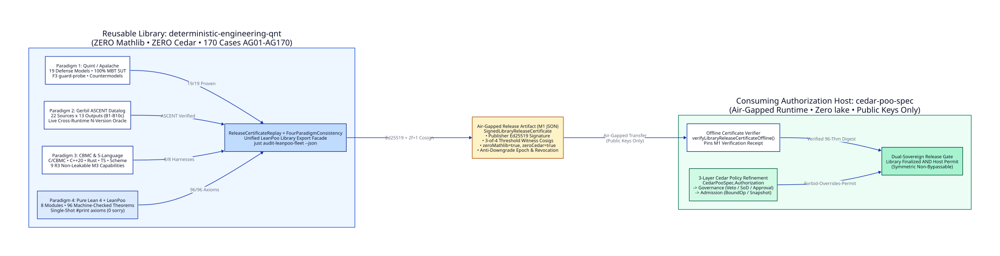

#+TITLE: 10.180 Air-Gapped Ed25519 Release Certificate Replay and 96-Theorem LeanPoo Library Milestone
#+AUTHOR: hardenedlinux Linux Team and Contributors
#+DATE: 2026-11-27
#+STARTUP: overview
# SPDX-FileCopyrightText: 2026 hardenedlinux Linux Team and Contributors
# SPDX-License-Identifier: LGPL-2.1-or-later

* Overview: Air-Gapped Ed25519 Certificate Bridge (deterministic-engineering-qnt -> cedar-poo-spec)
:PROPERTIES:
:CUSTOM_ID: arch10180-overview
:END:

Phase 32 closes the operational gap between **build-time four-paradigm formal
verification** and **runtime air-gapped consumption** in =cedar-poo-spec=.
Production authorization hosts do not invoke =lake= on every admission decision;
instead, =deterministic-engineering-qnt= issues an Ed25519 publisher-signed and
=2f+1= threshold-witness-cosigned `SignedLibraryReleaseCertificate`
([[file:../../../languages-engineering/ts/defense/agent-audit/release-certificate-replay.ts][release-certificate-replay.ts]])
backed by 10 new unbounded machine-checked theorems in
[[file:../../../packages/lean-models/DeterministicEngineering/Engineering/ReleaseCertificateReplay.lean][ReleaseCertificateReplay.lean]]
(**96 theorems across 8 `LeanPoo` modules**, **0 Mathlib**, **0 Cedar**).

#+CAPTION: Air-gapped 96-theorem LeanPoo Library to cedar-poo-spec runtime certificate bridge.

* Complete 96-Theorem LeanPoo Library Inventory (8 Modules, Zero Mathlib, Zero Cedar)
:PROPERTIES:
:CUSTOM_ID: arch10180-inventory
:END:

| # | LeanPoo Module | Theorems | Core Unbounded & Refinement Coverage |
|---+----------------+----------+--------------------------------------|
| 1 | [[file:../../../packages/lean-models/DeterministicEngineering/Engineering/DurableGovernanceQuorum.lean][DurableGovernanceQuorum.lean]] | 19 | =B3=, =B6= budget, =B10/B10b/B10c= quorum/handover/slashing, =R3= |
| 2 | [[file:../../../packages/lean-models/DeterministicEngineering/Engineering/HostAuthorizationBridge.lean][HostAuthorizationBridge.lean]] | 11 | Dual Sovereignty, =BoundOperation=, =PolicySnapshot=, =AuthorityConsumption= |
| 3 | [[file:../../../packages/lean-models/DeterministicEngineering/Engineering/InformationFlowAndTms.lean][InformationFlowAndTms.lean]] | 11 | =B7= DIFC/CaMeL, =B8= Doyle/ATMS retraction & immunization |
| 4 | [[file:../../../packages/lean-models/DeterministicEngineering/Engineering/SagaAndSsi.lean][SagaAndSsi.lean]] | 11 | =B6= Saga pivot/compensation, =B4= AST Symbol SSI & =DE01= |
| 5 | [[file:../../../packages/lean-models/DeterministicEngineering/Engineering/HitlAndCoevolution.lean][HitlAndCoevolution.lean]] | 12 | =B1/B5= HITL quorum =SoD=/veto, =R1= policy co-evolution, =B2/R5= AEAD |
| 6 | [[file:../../../packages/lean-models/DeterministicEngineering/Engineering/LibraryExportContract.lean][LibraryExportContract.lean]] | 12 | Unified export facade & 1/2/3-step =cedar-poo-spec= host refinement |
| 7 | [[file:../../../packages/lean-models/DeterministicEngineering/Engineering/FourParadigmConsistency.lean][FourParadigmConsistency.lean]] | 10 | Four-paradigm epistemic convergence, =∀ N= oracle list iff, anti-silent-ok |
| 8 | [[file:../../../packages/lean-models/DeterministicEngineering/Engineering/ReleaseCertificateReplay.lean][ReleaseCertificateReplay.lean]] | 10 | Air-gapped Ed25519 + =2f+1= offline cert verification, anti-downgrade, revocation, 0-Mathlib/0-Cedar purity, 2-step =LeanPoo= refinement + =Core.Transport= |
| **Total** | **8 Modules (1 Single Transitive Facade)** | **96** | **96/96 verified live in 1 batched =#print axioms= run** |

* Verification Receipts (AG166-AG170)
:PROPERTIES:
:CUSTOM_ID: arch10180-receipts
:END:

- Lean 4 / =LeanPoo= build:
  =(cd packages/lean-models && lake build DeterministicEngineering.Engineering.ReleaseCertificateReplay)=
- Standalone CLI attestation gate:
  =just audit-leanpoo-fleet --json=
- Offline Ed25519 certificate issuance & replay verifier:
  [[file:../../../languages-engineering/ts/defense/agent-audit/release-certificate-replay.ts][release-certificate-replay.ts]]
- Benchmark suite (=AG166=–=AG170=, expanding
  [[file:../../30-39-evaluation/30-benchmarks/30.05-agent-defensive-coding-benchmark.org][30.05]]
  to **170 cases**):
  [[file:../../../languages-engineering/ts/defense/agent-audit/release-certificate-replay.test.ts][release-certificate-replay.test.ts]]
- Editable architecture diagram source:
  [[file:../../90-99-views/90-architecture-views/90.150-leanpoo-96-theorem-library-to-cedar-poo-spec-airgapped-bridge.d2][90.150-leanpoo-96-theorem-library-to-cedar-poo-spec-airgapped-bridge.d2]]
