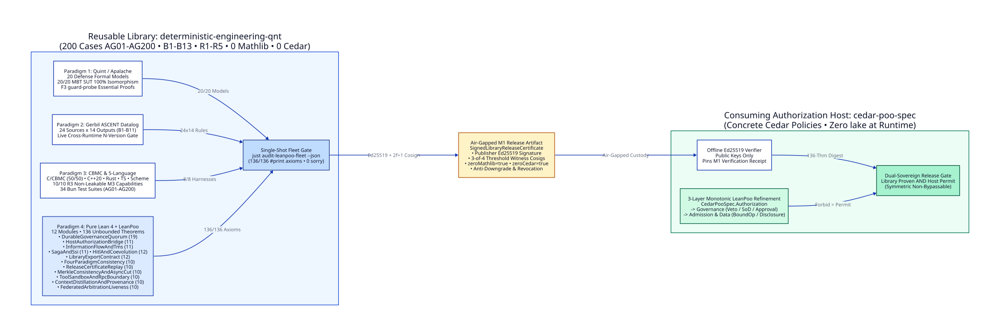

#+TITLE: 10.185 200-Case Grand Milestone & 12-Module / 136-Theorem LeanPoo Library (B13 Federated Arbitration Liveness)
#+AUTHOR: hardenedlinux Linux Team and Contributors
#+DATE: 2026-11-27
#+STARTUP: overview
# SPDX-FileCopyrightText: 2026 hardenedlinux Linux Team and Contributors
# SPDX-License-Identifier: LGPL-2.1-or-later

* Overview: 200-Case & 136-Theorem Grand Architectural Milestone
:PROPERTIES:
:CUSTOM_ID: arch10185-overview
:END:

Phase 37 reaches the **200-case benchmark milestone (=AG01=–=AG200=)** and the
**12-module, 136-theorem pure Lean 4 + =LeanPoo= formal library** (zero Mathlib,
zero Cedar dependency), introducing Business Extension **=B13=: Federated
Multi-Agent Arbitration, Deadlock Preemption, Bounded Liveness & Absorbing
Terminal Phases** ([[file:../../../packages/lean-models/DeterministicEngineering/Engineering/FederatedArbitrationLiveness.lean][FederatedArbitrationLiveness.lean]]
and [[file:../../../languages-engineering/ts/defense/agent-audit/federated-arbitration-liveness.ts][federated-arbitration-liveness.ts]]).

#+CAPTION: 200-case, 20-Quint-model, 24x14 ASCENT, 12-module / 136-theorem LeanPoo Library <-> cedar-poo-spec grand architecture.

* Complete 12-Module / 136-Theorem LeanPoo Library Inventory (Zero Mathlib, Zero Cedar)
:PROPERTIES:
:CUSTOM_ID: arch10185-inventory
:END:

| # | LeanPoo Module | Theorems | Core Scope |
|---+----------------+----------+------------|
| 1 | [[file:../../../packages/lean-models/DeterministicEngineering/Engineering/DurableGovernanceQuorum.lean][DurableGovernanceQuorum.lean]] | 19 | =B3=, =B6= budget, =B10/B10b/B10c= quorum/handover/slashing, =R3= |
| 2 | [[file:../../../packages/lean-models/DeterministicEngineering/Engineering/HostAuthorizationBridge.lean][HostAuthorizationBridge.lean]] | 11 | Dual Sovereignty, =BoundOperation=, =PolicySnapshot=, =AuthorityConsumption= |
| 3 | [[file:../../../packages/lean-models/DeterministicEngineering/Engineering/InformationFlowAndTms.lean][InformationFlowAndTms.lean]] | 11 | =B7= DIFC/CaMeL, =B8= Doyle/ATMS retraction & immunization |
| 4 | [[file:../../../packages/lean-models/DeterministicEngineering/Engineering/SagaAndSsi.lean][SagaAndSsi.lean]] | 11 | =B6= Saga pivot/compensation, =B4= AST Symbol SSI & =DE01= |
| 5 | [[file:../../../packages/lean-models/DeterministicEngineering/Engineering/HitlAndCoevolution.lean][HitlAndCoevolution.lean]] | 12 | =B1/B5= HITL quorum =SoD=/veto, =R1= policy co-evolution, =B2/R5= AEAD |
| 6 | [[file:../../../packages/lean-models/DeterministicEngineering/Engineering/LibraryExportContract.lean][LibraryExportContract.lean]] | 12 | Unified export facade & 1/2/3-step =cedar-poo-spec= host refinement |
| 7 | [[file:../../../packages/lean-models/DeterministicEngineering/Engineering/FourParadigmConsistency.lean][FourParadigmConsistency.lean]] | 10 | Four-paradigm epistemic convergence, =∀ N= oracle list iff, anti-silent-ok |
| 8 | [[file:../../../packages/lean-models/DeterministicEngineering/Engineering/ReleaseCertificateReplay.lean][ReleaseCertificateReplay.lean]] | 10 | Air-gapped Ed25519 + =2f+1= offline cert replay, anti-downgrade, revocation |
| 9 | [[file:../../../packages/lean-models/DeterministicEngineering/Engineering/MerkleConsistencyAndAsyncCut.lean][MerkleConsistencyAndAsyncCut.lean]] | 10 | =B9= append-only prefix/rollback/split-view, =R2= conflict-preserving merge, =R4= 4-axis drift |
| 10 | [[file:../../../packages/lean-models/DeterministicEngineering/Engineering/ToolSandboxAndRpcBoundary.lean][ToolSandboxAndRpcBoundary.lean]] | 10 | =B11= MCP schema rug-pull, shadow tool, scope escape, RPC timeout fence, response firewall |
| 11 | [[file:../../../packages/lean-models/DeterministicEngineering/Engineering/ContextDistillationAndProvenance.lean][ContextDistillationAndProvenance.lean]] | 10 | =B12= pinned =M1= retention, citation grounding, secrecy/integrity meet, token ceiling |
| 12 | [[file:../../../packages/lean-models/DeterministicEngineering/Engineering/FederatedArbitrationLiveness.lean][FederatedArbitrationLiveness.lean]] | 10 | =B13= bounded retry termination, deadlock preemption, absorbing terminal phases, non-auto-admit, 2-step =LeanPoo= refinement + =Core.Transport= |
| **Total** | **12 Modules (0 Mathlib, 0 Cedar)** | **136** | **136/136 verified live in 1 batched =#print axioms= run** |

* Verification Receipts (AG191-AG200, 200 Cases)
:PROPERTIES:
:CUSTOM_ID: arch10185-receipts
:END:

- Lean 4 / =LeanPoo= build (12 modules / 136 theorems):
  =(cd packages/lean-models && lake build DeterministicEngineering.Engineering.FederatedArbitrationLiveness)=
- Standalone CLI attestation gate:
  =just audit-leanpoo-fleet --json= (verifies **20/20 Quint models**, **24×14 ASCENT**, **8/8 harnesses**, **12 modules / 136 theorems**, **0 Mathlib**, **0 Cedar**)
- Benchmark suite (=AG191=–=AG200=, completing **200 cases** in
  [[file:../../30-39-evaluation/30-benchmarks/30.05-agent-defensive-coding-benchmark.org][30.05]]
  across **34 Bun test suites**):
  [[file:../../../languages-engineering/ts/defense/agent-audit/federated-arbitration-200-milestone.test.ts][federated-arbitration-200-milestone.test.ts]]
- Editable grand architecture diagram source:
  [[file:../../90-99-views/90-architecture-views/90.151-200-case-136-theorem-leanpoo-grand-architecture.d2][90.151-200-case-136-theorem-leanpoo-grand-architecture.d2]]
