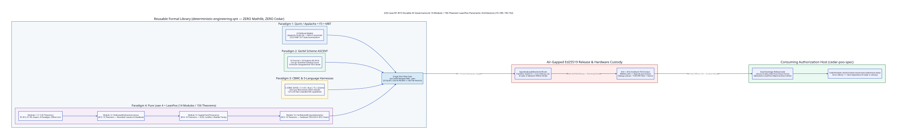

# SPDX-FileCopyrightText: 2026 hardenedlinux Linux Team and Contributors
# SPDX-License-Identifier: LGPL-2.1-or-later

#+TITLE: 10.189 LeanPoo B15 Confidential Compute / TEE Enclave Attestation, 14-Module / 156-Theorem Library & 220-Case Full Regression Seal (AG216-AG220, 90.152)
#+AUTHOR: Deterministic Engineering
#+DATE: 2026-11-27

* Executive Summary
:PROPERTIES:
:CUSTOM_ID: arch10189-summary
:STATUS: executed-verified
:END:

Following the =B14= four-paradigm symmetry closure in [[file:10.188-b14-four-paradigm-symmetry-23-quint-models-and-32x18-ascent.org][10.188]], Phase 41 introduces
Business Extension **=B15=: Confidential Compute / Hardware TEE Enclave Attestation
& Measured Key-Release**, sealing the complete **220-case (=AG01=–=AG220=), 23-Quint/MBT,
=32 × 18= ASCENT, 14-module / 156-theorem zero-Mathlib / zero-Cedar =LeanPoo= library**
alongside panoramic view :

1. **14th Pure =LeanPoo= Module (=ConfidentialEnclaveAttestation.lean=, 10 Theorems -> 156 Theorems Across 14 Modules)**:
   - [[file:../../../packages/lean-models/DeterministicEngineering/Engineering/ConfidentialEnclaveAttestation.lean][ConfidentialEnclaveAttestation.lean]] (ZERO Mathlib, ZERO Cedar, zero =sorry=, zero warnings)
     proves unboundedly:
     - =debug_enclave_always_refused= (production debug-mode lockout)
     - =enclave_measurement_mismatch_always_refused= (=MRENCLAVE=/=RTMR= pinning to =B14= artifact)
     - =tcb_svn_rollback_always_refused= (hardware firmware TCB SVN floor)
     - =replayed_or_mismatched_nonce_always_refused= (single-use anti-replay challenge binding)
     - =forged_or_revoked_hardware_quote_refused= (hardware root signature & platform revocation)
     - =b14_to_b15_end_to_end_chain_binds_running_binary= (direct cross-module composition proving
       =B14= 2-builder reproduced digest == =B15= running hardware enclave measurement)
     - =enclave_key_release_sound_and_complete= (exact iff characterization)
     - =enclaveAttestationContract_preserves_rejection= (2-step =LeanPoo= =ObjectContract.refine= + =cedar-poo-spec= Key-Release host)
     - =quoteCacheTtlTuning_preserves_certificate= & =disablingDebugLockout_invalidates_reuse= (=Core.Transport=)
2. **Air-Gapped Hardware TEE Quote Verifier & 12th =R3= Non-Leakable =M3= Capability**:
   - [[file:../../../languages-engineering/ts/defense/agent-audit/confidential-enclave-attestation.ts][confidential-enclave-attestation.ts]] implements =EnclaveRootAttestationKey= (12th =R3= non-leakable =M3= capability class) and 100% air-gapped Ed25519 TEE quote verification (=AG216=–=AG220= in [[file:../../../languages-engineering/ts/defense/agent-audit/confidential-enclave-attestation.test.ts][confidential-enclave-attestation.test.ts]]).
3. **Panoramic Architecture View =90.152= & Full Multi-Language Regression Seal**:
   - [[file:../../90-99-views/90-architecture-views/90.152-220-case-156-theorem-b1-b15-panoramic-architecture.d2][90.152 D2 source]] /  illustrates the unified four-paradigm stack from =B1=–=B15= through air-gapped Ed25519 & hardware TEE custody to =cedar-poo-spec=.
   - Full regression verified across all **38 Bun test suites**, C/CBMC (=0 of 50 failed=), C++20, Rust, Gerbil ASCENT, and standalone 156-theorem CLI JSON gate.

* Verification Receipts
:PROPERTIES:
:CUSTOM_ID: arch10189-receipts
:STATUS: executed-verified
:END:

- Pure Lean 4 / =LeanPoo= Build: =lake build DeterministicEngineering.Engineering.ConfidentialEnclaveAttestation= -> =Build completed successfully (86 jobs)= (zero =sorry=, zero warnings, zero Mathlib/Cedar).
- Live 156/156-Theorem Single-Shot CLI Gate: =just audit-leanpoo-fleet --json= -> =verdict: "Proven", quintModelCount: 23, ascentRulesPresent: true, moduleCount: 14, verifiedTheoremCount: 156, zeroMathlib: true, zeroCedar: true=.
- Full Multi-Language Regression Seal: all **38 Bun test suites** (including 23/23 MBT SUTs & =AG01=–=AG220=), C contrast + CBMC (=0 of 50 failed=), C++20, Rust, and Gerbil ASCENT (=governance-ascent-test.ss= & =agent-benchmark-test.ss=) 100% pass.
- Benchmark: [[file:../../30-39-evaluation/30-benchmarks/30.05-agent-defensive-coding-benchmark.org][30.05]] sealed at **220 cases (=AG01=–=AG220=)**.
