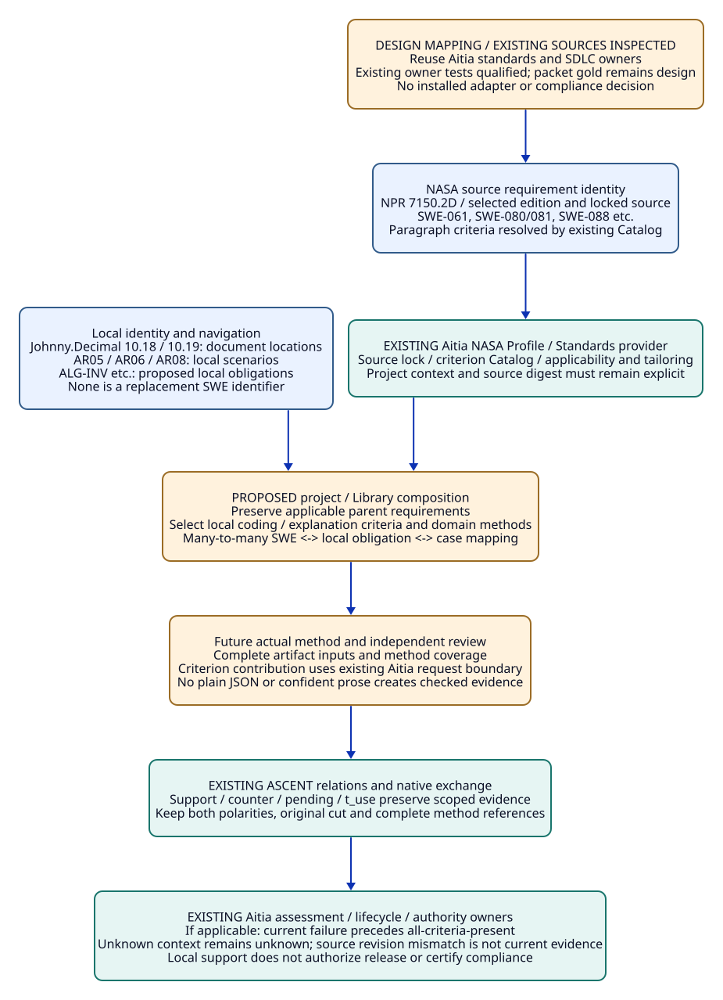
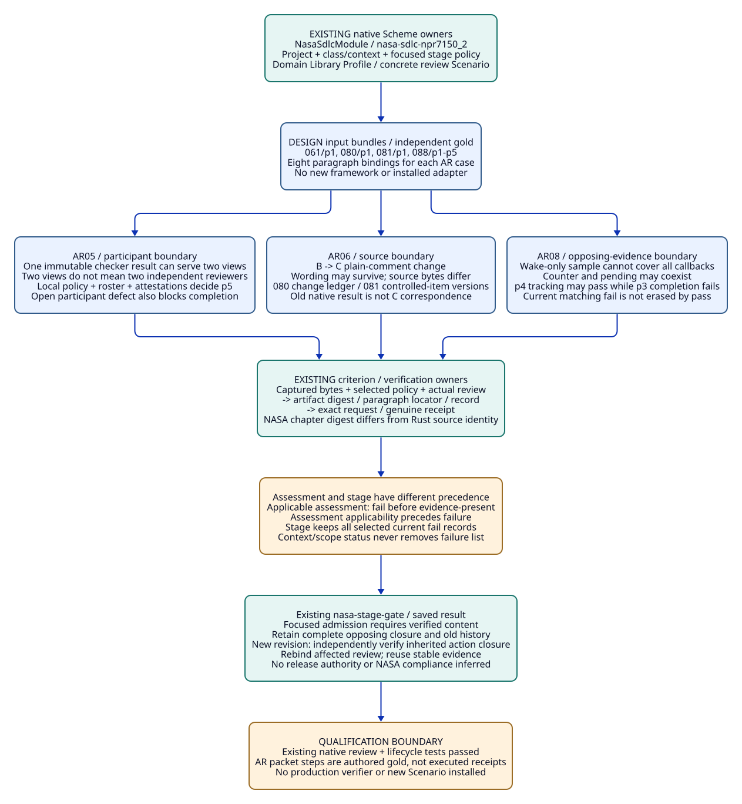
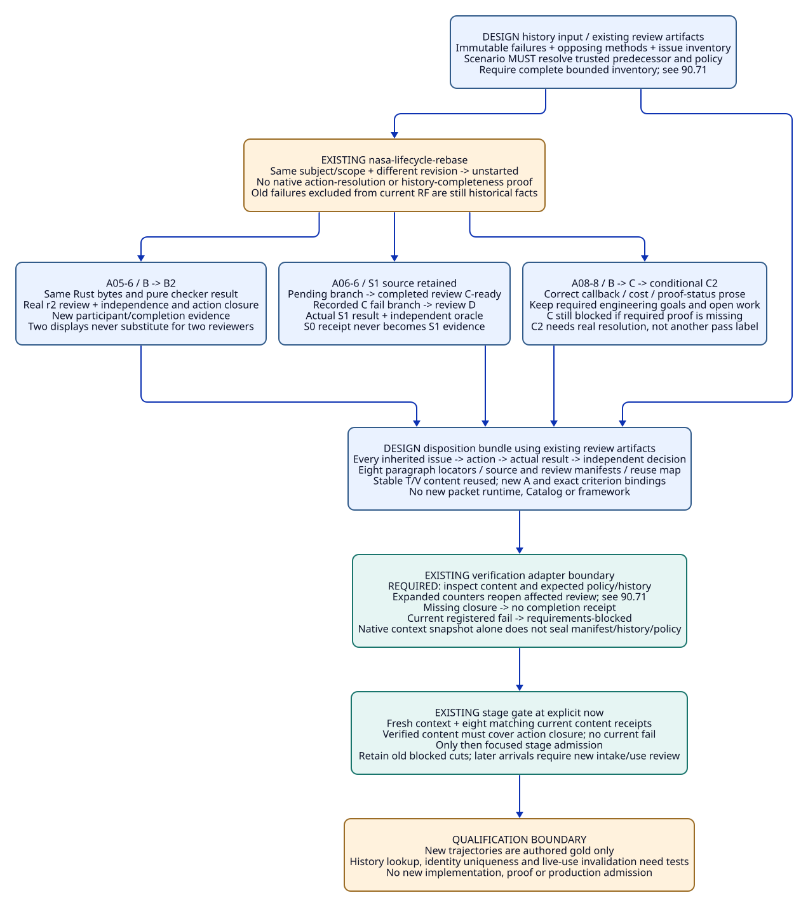
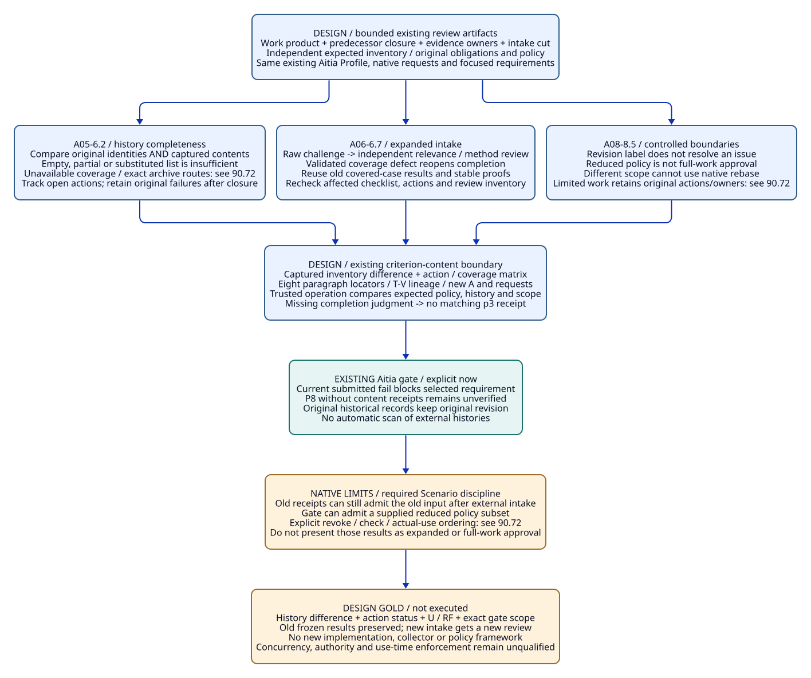
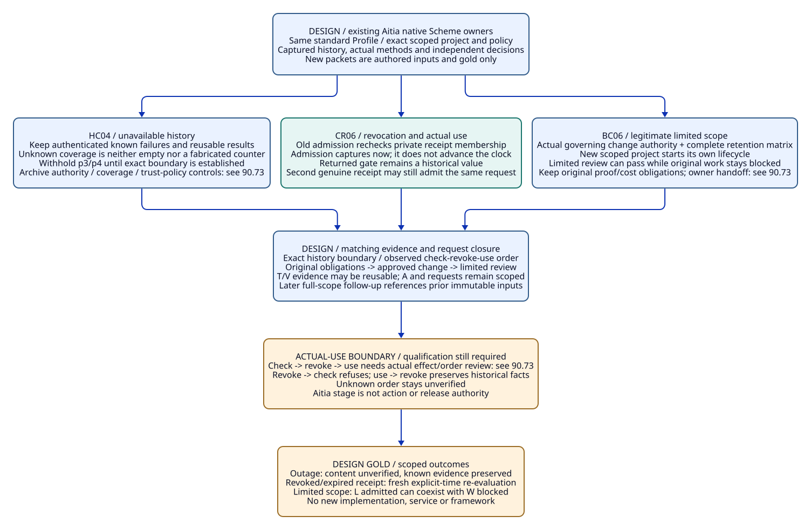
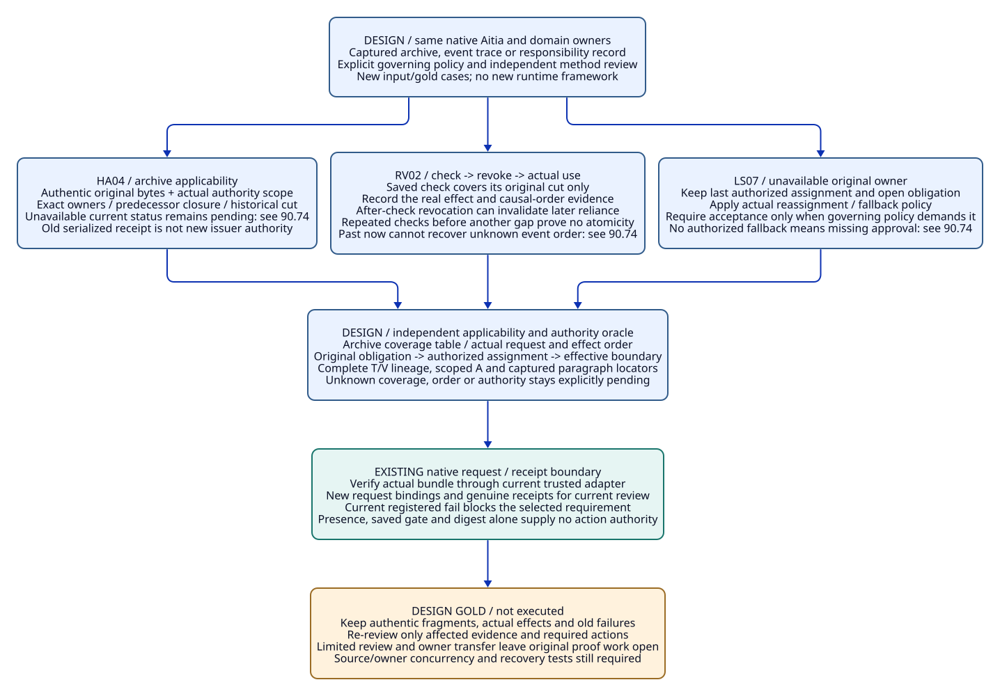
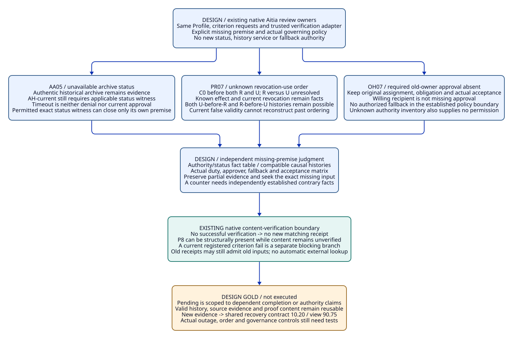

# SPDX-FileCopyrightText: 2026 hardenedlinux Linux Team and Contributors
#
# SPDX-License-Identifier: LGPL-2.1-or-later

#+TITLE: 10.19 Standard Identities and Lambda Aitia Review Traceability
#+LANGUAGE: en
#+PROPERTY: JD_ID 10.19
#+OPTIONS: toc:3 num:t
#+STARTUP: overview
#+TODO: DESIGN | REVIEWED QUALIFIED
#+FILETAGS: :standards:nasa:swe:poo:sdlc:traceability:
#+PROPERTY: header-args :eval never :tangle no :exports code

[[file:../../00-09-project/00-documentation/00.01-index.org][Index]] | [[file:10.18-agent-authored-engineering-and-review-contracts.org][Agent review cases]] | [[file:10.17-domain-libraries-and-atomic-specialization.org][Domain Libraries]]

The shared [[file:10.20-evidence-arrival-and-scoped-review-recovery.org][10.20 recovery contract]] consolidates evidence arrival, affected review,
reuse and preserved history across the detailed packets below. These packets
retain their individual inputs and independent gold.

* DESIGN Use existing standards as requirement sources
:PROPERTIES:
:CUSTOM_ID: standards-and-local-numbering
:STATUS: inspected-existing-owner-proposed-local-mapping
:END:

The engineering Library should derive relevant obligations from selected standards
through the existing Lambda Aitia owner. Local AR cases exercise those obligations;
they do not replace standard requirements or create an alternative SDLC policy.
The earlier AR-only presentation omitted this explicit standards traceability.

#+NAME: identifier-responsibilities
| Identifier | Owner / purpose | What it does not establish |
|------------+-----------------+----------------------------|
| 10.18, 10.19, 90.67 | Johnny.Decimal document/view location | Requirement identity, evidence identity or priority |
| Domain Library semantic key | Project-owned reusable contract | NASA applicability or compliance |
| AR05, AR06, AR08 | Stable local review-case identities inside 10.18 | External requirements; never rename them to SWE numbers |
| ALG-INV, ALG-COST, EXPLAIN-CURRENT | Proposed local obligation meanings | Text authored by NASA or an implemented validator |
| SWE-061, SWE-088 | NASA requirement identities in the selected edition | A unique criterion across every edition or a completed review |
| SWE-088/p2 | Existing Aitia paragraph-level criterion within that edition/source | A source-independent stable paragraph meaning |
| T/V/review/A reference | Actual reasoning, validation, method review and applicability binding | Authority inferred from a document label or a plausible string |

A case can address multiple standard criteria, and a criterion can need many
cases and evidence items. Keep those links explicit. Document moves preserve
semantic and case identity; requirement/source changes trigger mapping review
rather than silently changing a local identifier's meaning. No new SWE identifiers
are allocated by this repository.

* DESIGN Inspected NASA source and package ownership
:PROPERTIES:
:CUSTOM_ID: inspected-aitia-standard-owner
:END:

Read-only source inspection on 2026-10-19 found these existing owners in
[[file:../../../../poo-flow/packages/lambda-aitia/README.org][Lambda Aitia]]. The [[file:../../../.data/aitia-ar-standard-inspection-20261019/receipt.json][inspection receipt]] captures the local checkout and source identities.
That inspection did not execute imports or assessments. The later native-test
qualification is recorded under [[#native-review-qualification][Native review qualification]]; the packet gold below remains authored design.

#+NAME: existing-nasa-owner-map
| Existing owner | Capability inspected | Local integration boundary |
|----------------+----------------------+----------------------------|
| [[file:../../../../poo-flow/packages/lambda-aitia/user-interface/profiles/nasa/sdlc.ss][NASA SDLC Profile publication]] | Extends the existing SDLC NASA Profile and identifies the standard role/owner | Select/extend that owner; do not copy its Profile |
| [[file:../../../../poo-flow/packages/lambda-aitia/modules/sdlc/standards/sources.ss][Source declarations]] and [[file:../../../../poo-flow/packages/lambda-aitia/modules/sdlc/standards/source.lock.ss][source lock]] | Edition identity nasa/sdlc/npr-7150.2/D/2022-03-08 and locked source references | Requirement-source identity differs from package code version |
| [[file:../../../../poo-flow/packages/lambda-aitia/modules/sdlc/standards/nasa-standard-provider.ss][Standards provider]] | Existing POO Flow Standards resolve/materialize/validation-closure integration | Source materialization is explicit; no replacement resolver |
| [[file:../../../../poo-flow/packages/lambda-aitia/modules/sdlc/standards/nasa-7150-2d-catalog.ss][Criterion Catalog]] and [[file:../../../../poo-flow/packages/lambda-aitia/modules/sdlc/standards/nasa-review.ss][review owner]] | Source-bound paragraph criteria and subject/revision/scope review | An AR result is not automatically criterion evidence |
| [[file:../../../../poo-flow/packages/lambda-aitia/modules/sdlc/standards/nasa-lifecycle.ss][Lifecycle owner]] | Context, evidence and inventory verification requests and stage decisions | Reuse its admitted-request boundary when implemented |
| [[file:../../../../poo-flow/packages/lambda-aitia/modules/sdlc/standards/nasa-certification.ss][Dossier / decision owner]] | Separate dossier and externally verified authority decision | A support row does not authorize release or certify compliance |

Official NPR 7150.2D [[https://nodis3.gsfc.nasa.gov/displayDir.cfm?Internal_ID=N_PR_7150_002D_&page_name=Chapter3][Chapter 3]], [[https://nodis3.gsfc.nasa.gov/displayDir.cfm?Internal_ID=N_PR_7150_002D_&page_name=Chapter4][Chapter 4]] and [[https://nodis3.gsfc.nasa.gov/displayDir.cfm?Internal_ID=N_PR_7150_002D_&page_name=Chapter5][Chapter 5]] were checked
against the selected requirement topics on 2026-10-19. This names the inspected
edition, not an assertion about every NASA publication or future edition.
Code package management still owns upstream code versions; this document adds
no hard-coded Git-commit LINK abbreviations.

* DESIGN Standards to local obligation mapping
:PROPERTIES:
:CUSTOM_ID: swe-to-ar-obligation-mapping
:END:

The following is a proposed requirements mapping, not a compliance assessment.
NASA software class, institutional/project scope, conditions and any approved
tailoring belong to Aitia's existing applicability/policy process. No NASA class
is assigned to this repository by these examples. A project can also adopt a
local engineering policy inspired by a standard without claiming NASA status.
Missing applicability information remains unknown, not not-applicable.

#+NAME: selected-swe-review-crosswalk
| Official source | Requirement / criterion | Local contribution | Coverage limit |
|-----------------+-------------------------+--------------------+----------------|
| [[https://nodis3.gsfc.nasa.gov/displayDir.cfm?Internal_ID=N_PR_7150_002D_&page_name=Chapter3][Chapter 3]] | SWE-052: traceability | Link standard, project requirement, design, code, verification and issue records | One AR link is only a partial trace contribution |
| [[https://nodis3.gsfc.nasa.gov/displayDir.cfm?Internal_ID=N_PR_7150_002D_&page_name=Chapter4][Chapter 4]] | SWE-058/p1: lower-level design | Explain the selected mechanism/ownership design | No automatic whole-design coverage |
| [[https://nodis3.gsfc.nasa.gov/displayDir.cfm?Internal_ID=N_PR_7150_002D_&page_name=Chapter4][Chapter 4]] | SWE-061/p1: coding methods/criteria | Project-selectable type, invariant, comment and cost-explanation rules | Those local details are not verbatim NASA mandates |
| [[https://nodis3.gsfc.nasa.gov/displayDir.cfm?Internal_ID=N_PR_7150_002D_&page_name=Chapter4][Chapter 4]] | SWE-068/p1: result evaluation | Preserve accountable interpretation of actual test results | Analysis prose alone is not a test evaluation |
| [[https://nodis3.gsfc.nasa.gov/displayDir.cfm?Internal_ID=N_PR_7150_002D_&page_name=Chapter5][Chapter 5]] | SWE-080/p1, SWE-081/p1: changes/items | AR06 source-byte and explanation impact | Changed bytes require the selected configuration process |
| [[https://nodis3.gsfc.nasa.gov/displayDir.cfm?Internal_ID=N_PR_7150_002D_&page_name=Chapter5][Chapter 5]] | SWE-087: planned peer reviews | Identify the work product and actual review record | Coverage of a code example is not all work products |
| [[https://nodis3.gsfc.nasa.gov/displayDir.cfm?Internal_ID=N_PR_7150_002D_&page_name=Chapter5][Chapter 5]] | SWE-088/p2-p5: review procedure | Checklist, readiness/completion, actions and participants | Every selected paragraph needs its own evidence coverage |
| [[https://nodis3.gsfc.nasa.gov/displayDir.cfm?Internal_ID=N_PR_7150_002D_&page_name=Chapter5][Chapter 5]] | SWE-089/p1: review measurements | Record total review/validation/maintenance cost | No measured improvement is supplied by these packets |

The source descriptions above are short paraphrases; the official clauses and
Aitia's locked criterion Catalog remain authoritative. The inspected Catalog's
SWE-088/p1 is its introductory paragraph, p2 the reading/checklist criterion,
p3 readiness/completion, p4 action tracking and p5 required participants.
An introductory paragraph alone cannot discharge its remaining criteria.
Re-resolve those identities against the selected source digest after a source
update; paragraph numbering is not a substitute for source currentness.

A local Big-O explanation requirement belongs to the selected project coding and
analysis policy. It must not be advertised as the text of SWE-061, nor confused
with cyclomatic-complexity review under SWE-135. The types of complexity, their
metrics and validation methods are different.

#+NAME: focused-ar-standard-contributions
| Case | Primary proposed standard links | Concrete case contribution | Work outside that case |
|------+---------------------------------+----------------------------+------------------------|
| AR05 | SWE-088/p2-p5; SWE-089/p1 | Check reuse without losing required independent participants, actions or race checks | Actual participant authority, procedure adoption and review measurements |
| AR06 | SWE-061/p1; SWE-080/p1; SWE-081/p1 | Track comment meaning separately from actual source revision | Project configuration approval and complete change records |
| AR08 | SWE-058/p1; SWE-061/p1; SWE-088/p3-p4 | Evaluate claims and retain unresolved contradictory evidence | Actual standard review, required criteria and action closure |

These are review targets with partial coverage. Neither a mapped case nor
inherited NASA Profile is a certificate that an applicable clause has been met.

* DESIGN Composition and result interpretation through existing owners
:PROPERTIES:
:CUSTOM_ID: aitia-ascent-review-bridge
:END:

The intended composition is source-bound standard Profile -> project
applicability/policy -> selected domain Library and explanation obligations ->
actual validation -> scoped ASCENT evidence -> Aitia criterion/stage review.
This is a design mapping through existing owners, not an installed adapter.
The current local package has not installed this NASA integration. Existing
Aitia tests can import its owners directly through Scheme, as qualified below.

POO preserves the standard source/edition and applicable parent requirements.
A project extension selects concrete coding/explanation criteria and supported
Profiles; a Rust/Tokio specialization adds source and lifecycle premises. AR05,
AR06 and AR08 are test/review scenarios of that mapping. They cannot replace the
standard Catalog, silently remove applicable criteria or approve tailoring.

An eventual criterion record must use Aitia's existing requirement and criterion
identity, subject, revision, scope, source digest, producer and outcome. An
artifact-bound verification request and actual method/authority review remain
necessary at the selected Aitia boundary. Displaying a local witness label in an
Org table is not such a record. Criterion binding must preserve each contributing
claim, method review and complete closure; it cannot copy only a positive summary.

#+NAME: ascent-versus-aitia-status-boundary
| Evidence state | Existing local ASCENT interpretation | Inspected Aitia review behavior / required bridge |
|----------------+--------------------------------------+--------------------------------------------------|
| No matching checked pass | pending for the selected obligation | Missing/unknown/stale assessment depends on actual applicability and input completeness |
| Matching checked fail, no pass | counter and pending coexist | If applicable, current criterion failure produces reported-failure; otherwise preserve the actual applicability status |
| Matching checked pass and fail | support and counter coexist; that obligation may have no pending row | If applicable, current failure takes precedence; unknown applicability remains unknown; never infer evidence-present from absent pending |
| Wrong revision or standard-source digest | Inapplicable/refused under the actual closure | Not current criterion evidence; preserve historical records |
| Unknown applicability or unverified authority | No inference of standard satisfaction | Retain existing Aitia applicability/authority checks |

The Aitia review source explicitly filters current evidence by subject, revision,
scope and standard-source digest. After applicable status is established, it
chooses reported-failure before an all-criteria-present outcome. Its assessment keeps authority not-verified,
compliance not-evaluated and release-authorized false. The prospective bridge
must preserve that distinction from local relation membership. This document
inspects the source behavior; it does not claim a new executed assessment.

* DESIGN Minimum integration questions before implementation
:PROPERTIES:
:CUSTOM_ID: standards-integration-open-gates
:END:

1. Select the actual standard edition, project applicability and scope through
   the existing Aitia Profile/Standards provider. Existing owner imports are
   qualified below; installing a real local project composition still requires
   its own dependency/selection check, without another provider framework.
2. Review the proposed SWE-to-local-obligation links and their paragraph-level
   coverage with the actual project policy. Preserve unmapped requirements.
3. Define how independent method/analysis reviews contribute to Aitia criteria
   using its trusted request boundary; plain JSON and an LLM explanation cannot
   create checked records.
4. Exercise source-byte change, independent-producer multiplicity, failure/pass
   coexistence and late evidence as negative controls before stage admission.
5. Reuse one evidence artifact across genuinely matching criteria/uses only if
   each required binding, participant and action is preserved. Do not create a
   separate essay, validator run or copied Catalog for every SWE label.

#+CAPTION: Standard requirement identity is distinct from local navigation and cases; source-bound obligations and opposing evidence reach the existing Aitia assessment owner without a replacement framework.

* DESIGN Native Scheme selection and common review input
:PROPERTIES:
:CUSTOM_ID: native-aitia-review-packets
:STATUS: source-grounded-packets-not-executed
:END:

These packets specialize the [[file:10.18-agent-authored-engineering-and-review-contracts.org::#focused-ar-input-packets][existing AR05/AR06/AR08 packets]]. They do not
introduce a packet runtime, another Catalog or an alternate evidence registry.
The LLM-based AI agent discovers Library rules, proposes changes and selects
checks. Existing domain methods, independent review and Aitia's trusted verifier
must substantiate its claims. An LLM statement cannot issue its own verification
receipt or authenticate a participant.

** Module, Profile and Scenario responsibilities
:PROPERTIES:
:CUSTOM_ID: native-review-selection
:END:

The existing =NasaSdlcModule= publishes =nasa-sdlc-npr7150_2=, extending
=sdlc-nasa-7150-profile=. That standard Profile supplies =Nasa7150_2D=;
it does not execute a review. A project composition selects that Profile alongside
the applicable domain Library Profile. The Scenario supplies the concrete work
product, project snapshot, local policy, evidence and trusted verifier. No NASA
flag is added to the domain Module and no copy of the NASA Profile is created.
The backpressure/broadcast hierarchy in [[file:10.17-domain-libraries-and-atomic-specialization.org][10.17]] remains the domain design owner.

The following is a non-executed native API sketch, using existing exports. The
three project values are separate review work products; the example class =a=
below is an explicit synthetic input, not this repository's NASA classification.

#+NAME: native-aitia-api-selection
#+begin_src scheme
(import :poo-flow/lambda-aitia/user-interface/profiles/nasa/sdlc
        :poo-flow/lambda-aitia/modules/sdlc/objects
        :poo-flow/lambda-aitia/modules/sdlc/standards/nasa-review
        :poo-flow/lambda-aitia/modules/sdlc/standards/nasa-lifecycle)

(def focused-policy
  (nasa-stage-policy "ar-focused-review"
    '("SWE-061" "SWE-080" "SWE-081" "SWE-088")))
(def ar05-project (sdlc-project "library/backpressure/AR05" "B" "focused-review" #t))
(def ar06-before (sdlc-project "library/backpressure/AR06" "B" "focused-review" #t))
(def ar06-after (sdlc-project "library/backpressure/AR06" "C" "focused-review" #t))
(def ar08-project (sdlc-project "library/broadcast/AR08" "B" "focused-review" #t))
#+end_src

No foreign wrapper is required. Package/link resolution owns Scheme namespace
availability; a source link alone does not install a new dependency in this
repository. The sketch is not a change to =gerbil.pkg= or =init.ss=.
Selecting four requirements creates a focused stage, not the full project or
institutional baseline. =nasa-assess-project= still returns its complete Catalog
assessment; read only the selected rows for this focused stage and retain the
unselected obligations outside this result.

** Applicability and Profile inputs

#+NAME: native-review-applicability
| Input | Main packet value | Negative control / gold |
|-------+-------------------+-------------------------|
| Standard Profile | Existing NASA SDLC Profile, selected edition from its Catalog | No Profile selection means no claim of NASA assessment |
| Domain Profile | AR05 immutable checker; AR06 wording/native correspondence; AR08 broad callback/cost/proof claims from 10.18 | A wake-only Profile cannot cover the broad all-callback claim |
| Software class | Explicit example a | d: SWE-088 not-invoked; 061/080/081 applicable. e: all four not-invoked |
| Context | Every context key enumerated by nasa-context-request is explicitly false for this synthetic case | Real unknown facts remain unknown. Missing class must be resolved before assessment; unknown is not a valid class symbol |
| Context verification | Independent confirmation of class, complete scope and the revision-to-artifact manifest | A syntactically valid context object is not a receipt |
| Scope completeness | complete? true only for the declared focused work product | false yields incomplete-scope at the stage after context verification; it never means complete system coverage |
| Local review policy | Versioned coding/checklist policy; required participants and completion/action rules | Policy not supplied: content verification stays open; no invented default reviewer count |
| Authority | Project review, no tailoring requested | No authority, compliance or release assertion is inferred |

The complete synthetic context has these exact keys, all =#f=; it is not a
shortcut for treating an unclassified real project as noncritical:

#+NAME: native-review-explicit-context
#+begin_example
safety-critical? mission-critical? ivv-required? ivv-performed?
reaching-kdp-a? category-1? category-2? payload-risk-a-or-b?
mdaa-selected-ivv? approved-tailoring-exists? reused-component?
auto-generated-code? nasa-class-d-payload? communications-capable?
flight-qualification-tools? loaded-behavior-inputs? embedded-reused-component?
joint-audit? health-medical?
#+end_example

For this standard, SWE-088/p5 requires identifying the required participants.
The =two independent reviewers= control below is an explicit local policy choice,
not a universal NASA two-person rule. Roles, actual participation and independence
must be checked against that choice. An author and the author's second agent
session are not automatically independent reviewers.

** Common data and paragraph closure
:PROPERTIES:
:CUSTOM_ID: native-review-data-closure
:END:

=d(X)= means the SHA-256 of captured artifact bytes, to be computed when executing
these cases. B/C, E05-* and other labels here are symbolic test inputs, not issued
receipts, native evidence identities already registered, or fabricated hashes.
All main packets use the same selected requirement set; they provide eight
paragraph contributions: 061/p1, 080/p1, 081/p1 and 088/p1 through p5.

#+NAME: native-review-input-contract
| Existing input / owner | Required packet content and binding |
|------------------------+-------------------------------------|
| SdlcProject | Exact subject, revision, scope and complete?; revision maps to the captured manifest through verified context |
| Source/configuration manifest | Rust source bytes, Cargo.lock, features/tools, checker/oracle/model/proof identities actually relevant to this case; absent artifacts explicitly absent |
| Local policy artifact | Coding criteria, checklist, readiness/completion, participant roles/independence and action resolution rules with revision |
| Review artifacts | Work-product identity, method inputs/results, participant roster/attestations, change inventory and action ledger; stable locators within captured bytes |
| SdlcCriterionEvidence | Unique identity, subject/revision/scope, standard, requirement, criterion, Catalog chapter source-digest, producer and pass/fail outcome |
| Verifiable evidence | nasa-verifiable-evidence adds actual artifact-digest; digest binds the whole review bundle/manifest if several files are needed |
| Verification request | nasa-context-request or nasa-evidence-request; verifier independently checks request fields against captured bytes, policy and actual participants |
| Receipt use | Existing adapter, issuance, expiry, revocation and request-snapshot admission; a copied receipt-shaped object is insufficient |
| Stage | nasa-stage-gate with focused-policy, current project/class/context, complete evidence list, same trusted adapter, receipts and explicit now |

=nasa-criterion-evidence= binds the current Catalog chapter digest automatically.
That =source-digest= identifies NASA text, not the Rust file. The project revision
and artifact digest bind Rust/source-review content separately. Reconstructing an
old result with the new project or current Catalog factory does not prove that
its content applies; the independent content verifier must reject such relabeling.

#+NAME: native-review-paragraph-evidence
| Criterion | Required artifact section / exact claim under review | Independent content judgment |
|-----------+-----------------------------------------------------+------------------------------|
| SWE-061/p1 | coding-policy + adherence, including relevant type/ownership/comment/cost criteria | Was the selected policy defined and followed for this work product? Local Big-O rules are policy extensions |
| SWE-080/p1 | change-ledger: baseline/candidate delta, impact evaluation, dispositions | Are actual changes tracked and evaluated, including unchanged-code or metadata-only outcomes? |
| SWE-081/p1 | configuration-inventory: items, versions, source/lock/checker/model bindings | Is each selected controlled item identified and versioned, with no hidden source substitution? |
| SWE-088/p1 | planned-review: exact product and selected peer-review procedure | Does this record concern the planned review being assessed? p2-p5 alone leave p1 missing |
| SWE-088/p2 | checklist or reading technique + item results and evidence locators | Did the method evaluate the actual work product and cover its claim domain? |
| SWE-088/p3 | readiness/completion: entry checks, unresolved items and exit judgment | Are completion criteria actually met, including current failures and pending work? |
| SWE-088/p4 | action-ledger: issue, owner, disposition, evidence and resolution state | Are actions tracked until resolved? An open tracked action may satisfy tracking while completion remains blocked |
| SWE-088/p5 | participants: required roles, actual roster and attestations | Does the roster meet the selected policy? Producer strings alone prove neither attendance nor independence |

A failed engineering claim does not mechanically fail every SWE criterion.
For example, correctly recording an open defect can satisfy p4 tracking while
p3 completion fails. A p2 checklist may have been properly applied and find a
bug. The packet must state which policy/criterion was violated instead of copying
one counter into eight paragraph failures.

The acyclic reference closure is:

#+begin_example
source/configuration bytes + locked standard source + selected policy
  -> captured review bundle (including method results, roster and action ledger)
  -> paragraph locator + native criterion record + artifact digest
  -> exact context/evidence verification request -> genuine verification receipt
  -> stage evaluation at now -> saved result with immutable input/cut references
#+end_example

The gold does not hash itself into its own input. It is an independent expected
judgment over the captured inputs. ASCENT T references preserve claim, rule and
hypothesis lineage; V references preserve actual method result and independent
method review; A references bind those to this usage/cut. Aitia requests reference
that complete bundle, not just the support summary. A stage result is a downstream
consumer, never its own evidence. Later results create new cuts; they cannot
modify the saved input list or historical gold.

* DESIGN AR05: reuse one computation without inventing independent participants
:PROPERTIES:
:CUSTOM_ID: ar05-aitia-input-and-gold
:CASE_PACKET: AR05-Aitia-independent-participants
:END:

#+NAME: ar05-aitia-concrete-input
#+begin_example
project = library/backpressure/AR05, revision B, scope focused-review, complete true
class = a; context = all declared context keys false; no tailoring
Q05 = every payload_live row has reserved=true
rows = [(job0,cleanup,true,true),(job1,done,false,false)]
local policy P05-one = one authorized reviewer, immutable deterministic checker
alternate policy P05-two = two independent reviewers of the SAME captured product
U05-left and U05-right = two displays of the SAME frozen cut K05, not two reviews
bundle A05 = rows + checker/oracle identity + purity/effect review + P05
             + coding-policy/adherence + change-ledger(no source delta)
             + configuration-inventory + planned-review + checklist
             + readiness/completion + action-ledger + participants
participant roster initial = [reviewer-r1]; both displays refer to reviewer-r1
T05 = Q05/rule/premises; V05 = actual result + method review; A05-use = K05 binding
E05-061, E05-080, E05-081, E05-088-1..5 = distinct paragraph record identities
#+end_example

#+NAME: ar05-local-participant-policy
| Input | Concrete synthetic value | Oracle test |
|-------+--------------------------+-------------|
| Author | agent-author, the authoring principal for this captured product | An authoring session does not count as a required independent reviewer |
| P05-one required role | Authorized mechanism reviewer | r1 has that role, reviewed K05 and attested to the checklist |
| P05-two required roles | Mechanism reviewer plus independent method reviewer | r1 and r2 are distinct authorized principals, neither the author; separate actual reviews of K05 are recorded |
| Independence condition | Distinct principal identities and review attestations, no author self-review or delegated duplicate identity | Check authenticated roster/role records and the selected local policy, not spelling of names or producer fields |
| Initial roster | r1 only, with two display-use references | P05-one sufficient; P05-two incomplete |
| Duplicate control | r1 attestation submitted twice with distinct evidence IDs | Still one participant; no second role or review established |

For each E05 record use its row's requirement/criterion, project B, accountable
producer and =d(A05)=, with a locator to the corresponding section. Reusing this
bundle digest across criteria is allowed; each criterion still has its own
request binding. Under P05-two the p5 content must document both identities,
required roles, independent attestations and the policy's independence test.
Two records with different IDs but the same reviewer do not provide two people.
No extra checker run is required solely to count participants.

#+NAME: ar05-aitia-step-gold
| Step | Input/event | Independent gold and native boundary |
|------+-------------+--------------------------------------|
| A05-0 | Empty evidence, complete project, no context receipt | Selected rows missing-evidence; stage context-verification-required |
| A05-1 | Supply eight current pass records, no trusted content receipts | Assessment evidence-present for four rows is structural only; with verified context, stage content-verification-required |
| A05-2 | P05-one; independently verify immutable rows, checker/method and all eight sections | Conditional on genuine receipts, focused stage-admitted; share V05 between the two identical frozen displays |
| A05-3 | Branch from A05-1 with P05-two and roster [r1] | Oracle rejects p5 independence/coverage; no verified pass receipt for p5; content-verification-required, not a native automatic participant count |
| A05-4 | Register distinct current fail records E05-088-5-f and E05-088-3-f for the unmet participant/completion policy | SWE-088 reported-failure; verified-context, complete stage requirements-blocked even if the old pass records remain |
| A05-5 | Add actual authorized independent r2 review of the same cut | Can reuse checker result if its footprint is unchanged; new roster/completion bundle and new requests needed. Extra pass does not remove current fail |
| A05-6 | Resolve actions, retain B history and assess a separately captured revision B2 | B failures excluded in B2; all eight B2 contributions and context must be freshly bound/verified, possibly referencing reusable V05. Only then may focused admission occur; see [[#a05-6-disposition-packet][expanded A05-6]] |
| A05-7 | Change rows/effects/policy after check, or reuse into a new live usage | K05 stays frozen; no automatic A05-use transfer. Recheck the affected footprint and actual-use race; keep old valid V05 history |

The independent oracle is the explicit row truth table plus a separately checked
participant/role matrix and policy checklist. It must not call Aitia's assessment
as its content oracle or count displays/producer strings. The checker may be
reused only with the same rows, semantics, purity/effects and verified method.
A changed independence rule invalidates the p5/completion review, not the pure
row result. A receipt for the earlier policy/bundle cannot approve the new one.
Fail records have no native superseded flag; editing their identity/outcome or
omitting them from the complete current packet to get a pass is not action
resolution. B2 is a real review snapshot, not a string-only escape from B's defect.

* DESIGN AR06: comment meaning and source-byte identity are separate judgments
:PROPERTIES:
:CUSTOM_ID: ar06-aitia-input-and-gold
:CASE_PACKET: AR06-Aitia-source-change
:END:

#+NAME: ar06-aitia-concrete-input
#+begin_example
subject = library/backpressure/AR06; scope = focused-review
before = project B + captured S0; candidate = project C + captured S1
class = a; complete true only for the exact declared review inventory
S0 comment = // Field order makes payload disposal precede returning its resource permit.
S1 comment = // Payload disposal precedes permit return because fields drop in declaration order.
delta = exactly this one plain-comment replacement in the source identified in 10.18
local policy P06 = comment/type/ownership adherence + source/configuration change control
A06-C sections = coding-policy/adherence, change-ledger(B->C), configuration-inventory,
                planned-review, checklist, readiness/completion, action-ledger, participants
manifest C = source S1 + actual Cargo.lock/features/tools + affected checker/source map
wording review = Q06-wording with the semantic exclusions listed in 10.18
native result B = original exact-source lifecycle result, not a new execution for C
E06-C-061, E06-C-080, E06-C-081, E06-C-088-1..5 = candidate paragraph records
#+end_example

The input source is [[file:../../../library/concurrency/resource-control/backpressure-memory/rust/native/src/main.rs][the existing resource lifecycle example]] and the exact S1
candidate is the single replacement above; this task does not perform that edit.
Review must account for optional permit ownership and exclude directives,
doctests, unsafe preconditions or source-as-data effects before judging wording
unchanged. Those exclusions are assumptions to verify, not consequences of the
file extension. The actual-byte source correspondence remains a different claim.

SWE-080/p1's locator is the B-to-C delta and impact decision; SWE-081/p1's locator
is the versioned controlled-item inventory; SWE-061/p1's locator is the selected
comment/type policy and adherence review. The 088 locators are the C review's
procedure, method, completion, actions and actual participants. Each E06-C record
uses project C and =d(A06-C)=; old E06-B records stay bound to B.

#+NAME: ar06-aitia-step-gold
| Step | Input/event | Independent gold and native boundary |
|------+-------------+--------------------------------------|
| A06-0 | Valid B review/history exists; capture candidate C | Use nasa-lifecycle-rebase for the same subject/scope and different revision; no stage authority transported from B |
| A06-1 | Offer only B records/receipts to C, complete context verified | Selected rows stale-evidence; stage requirements-blocked. Old criterion IDs remain historical, not deleted |
| A06-2 | Copy B artifacts through the evidence factory with C labels and current chapter digest | Structural assessment may say evidence-present; independent verifier must reject false C-to-bytes mapping. With otherwise valid context, content-verification-required |
| A06-3 | Review unique comment delta and all semantic exclusions independently | Wording may be supported; exact-source native claim remains pending. 080 and 081 can pass for accurate impact/inventory while completion remains open |
| A06-4 | Supply actual C review bundle; policy requires current native correspondence but only B result exists | p3 completion cannot receive verified pass. If a current p3 fail is recorded, SWE-088 reported-failure and stage requirements-blocked |
| A06-5 | Obtain actual required C correspondence/method review, or a justified transport allowed by its typed contract | Reuse unaffected QNT/Lean knowledge under original premises; no automatic native receipt transport. Re-evaluate policy coverage and all affected paragraph content |
| A06-6 | A06-4 pending-only branch closes with all eight genuine current receipts | Focused stage may be stage-admitted. A06-4 fail branch instead requires resolved-action evidence and a new real review revision; a later pass cannot overwrite fail; see [[#a06-6-disposition-packet][expanded A06-6]] |
| A06-7 | Late B result or saved B query restored after C | Keep original source, revision and cut; neither late content nor a UI refresh can replace C evidence or mutate saved B output |

The independent oracle compares actual source bytes and AST/comment role, checks
the controlled-item inventory and evaluates the stated wording premises. It does
not accept a revision string or matching NASA chapter digest as a source check.
Unchanged Cargo.lock alone is insufficient. A chapter-text update separately
invalidates affected criterion mappings/request snapshots; it is not a Rust edit.

Aitia's four selected requirements do not automatically demand a native rerun.
That demand comes from the selected local completion/correspondence policy and
its independently verified content. If the policy permits a rigorous unchanged-
semantics transport, review that proof and its dependencies rather than rerunning
unrelated methods defensively. A focused stage must never be described as full
native acceptance or compliance.

* DESIGN AR08: preserve current failure alongside support and pending work
:PROPERTIES:
:CUSTOM_ID: ar08-aitia-input-and-gold
:CASE_PACKET: AR08-Aitia-current-failure
:END:

#+NAME: ar08-aitia-concrete-input
#+begin_example
project = library/broadcast/AR08, revision B, scope focused-review, complete true
class = a; context = explicit synthetic context; no tailoring
claims = all waker callbacks outside locks; shutdown O(1) independent of w;
         complete checked formal proof (all three retain the 10.18 claim domains)
source observation = clone under tail lock; wake/disposal outside mapped locks
sample = wake-only finite pass, not a proof of the broad callback claim
A08 = captured source/map + claim/cost domains + independent analysis/method review
      + coding-policy/adherence + tracked change + configuration-inventory
      + planned-review/checklist + readiness/completion + action-ledger + participants
action A08-callback = broad comment contradicted; open; assigned owner and repair target
action A08-cost = missing full cost-domain evidence; open
action A08-proof = missing admitted proof/correspondence; open
paragraph passes = E08-061,080,081,088-1,088-2,088-4,088-5 where actually justified
paragraph failure = E08-088-3-f, current B, completion violated
diagnostic extra pass = E08-088-3-p, different ID, same criterion/project/source
#+end_example

These are review inputs, not an executed broadcast test or Lean proof. The
source-analysis method must cover =clone= as well as =wake= and retain its exact
source closure. p2 may pass when the checklist correctly detects the defect;
p4 may pass while all three actions are tracked and still open. In this packet
p3 fails because the selected completion policy forbids unresolved contradictions
and missing required evidence. A 061 failure is appropriate only if its separately
selected adherence criteria are actually violated; it is not assumed here.

#+NAME: ar08-aitia-step-gold
| Step | Input/event | Independent gold and native boundary |
|------+-------------+--------------------------------------|
| A08-0 | No admitted domain evidence; no Aitia content/context receipts | Local broad claims 0 support / 0 counter / 3 pending; no criterion satisfaction inferred |
| A08-1 | Supply only wake-only sample and confident LLM explanation | Broad counts unchanged; no complete callback/cost/proof evidence, no valid completion receipt |
| A08-2 | Independently checked source counter arrives with full V/method closure | Local broad counts 0/1/3; counter and pending coexist. Record current p3 fail and complete action ledger |
| A08-3 | Register eight paragraph records, p3 fail, but no verified context | Applicable SWE-088 reported-failure; stage top status context-verification-required, reported-failures still contains the fail |
| A08-4 | Verify context with complete? false instead | Stage incomplete-scope precedes the top failure status, but reported-failures remains populated; no admission |
| A08-5 | Verify context with complete? true | Stage requirements-blocked; failure is not contingent on a positive receipt or absent pending |
| A08-6 | Add diagnostic matching broad pass and E08-088-3-p | Local 1/1/2 does not imply success. SWE-088 still reported-failure; stage requirements-blocked regardless of list/arrival order |
| A08-7 | Add foreign or late old-revision pass | Exclude from current coverage; preserve origin/history and frozen query. It cannot cancel B's failure |
| A08-8 | Correct/narrow claim, resolve actions and capture actual revision C | Old B failure remains historical; C must independently establish its source, coverage, participants and all paragraph receipts. No automatic pass by changing the label; see [[#a08-8-disposition-packet][expanded A08-8]] |

The independent oracle evaluates the source callback locations, explicit cost
variables and real proof inventory, then applies the project completion policy.
It is distinct from both ASCENT relation derivation and Aitia's presence/status
logic. Gold records the domain relation tuple, per-paragraph outcome, selected
assessment rows, stage status, reported-failures and missing/unverified criteria;
a single green/red summary would lose essential distinctions.

** Applicability and conservative failure intake

For class d the assessment reports SWE-088 =not-invoked= even with a current fail:
assessment applicability precedes failure. However, the inspected stage gate's
=reported-failures= filter conservatively includes every current fail for a
selected requirement, without an applicability filter or content receipt check.
Consequently that focused policy still yields =requirements-blocked= once
context is verified and scope complete. Do not claim these two layers have
identical precedence, or that the raw fail was authenticated by appearing there.

For class e with no failure records, all four selected rows are =not-invoked=;
verified context and complete scope can admit this focused stage vacuously.
It supplies no engineering evidence. Adding a current selected fail invokes the
same conservative stage blocker. Policy selection/applicability and trusted
intake must therefore be reviewed explicitly; dropping the fail to obtain a
pass is not permitted. This is a documented current behavior boundary, not a
source defect established by these authored packets.

The adapter verifies positive content; a raw selected current fail already blocks
the gate conservatively. Preserve its reported/unverified provenance while
investigating it. Do not call every blocking submission a validated domain counter
or let an untrusted sender become a trusted evidence issuer. A published global
status must retain both the context/scope blocker and the opposing-evidence list.

* DESIGN Independent oracle, reuse and review burden checklist
:PROPERTIES:
:CUSTOM_ID: native-review-oracle-and-burden
:END:

#+NAME: native-review-refusal-and-reuse
| Control | Required judgment / boundary | Avoidable burden |
|---------+------------------------------+------------------|
| Same ID reused for two native records | Native assessment rejects duplicate evidence identities | No need to rerun domain checker to detect identity collision |
| Different IDs, same reviewer | Content oracle enforces selected roles/independence; native uniqueness alone is insufficient | Two UI views or duplicate attestations add no independence |
| Unknown class or malformed context | Resolve/reject before issuing context receipt; do not invent native unknown-class output | Do not force irrelevant boolean values to get an admission |
| Missing 088/p1 | Missing criterion even if p2-p5 all present | Link one planned-review section rather than repeating its narrative |
| Changed source or policy | New context/request binding and affected content reviews; preserve old artifacts | Reuse pure checks/proofs only under actual stable dependencies |
| Chapter digest changed | Re-resolve paragraph semantics and all affected request snapshots | No source rerun solely because a document moved; review actual changed dependency |
| Current fail plus pass | Applicable assessment reported-failure; stage blockers retained, no last-write-wins | Investigate the opposing closure rather than requesting more duplicate passes |
| Open actions accurately tracked | p4 tracking can pass while p3 completion fails | Do not create eight failure/action duplicates for one defect |
| Expired/revoked/copied receipt | Existing admission rejects use; renew actual verification as required | Share artifact bytes, not forged or mismatched receipts |
| New cut or later arrival | New result references original event/cut and actual current applicability | Saved queries stay reproducible; no blanket deletion of reusable V evidence |

The content verifier must inspect the complete input bundle and return a genuine
receipt for the exact existing request. An always-true callback, a synthetic test
verifier, a digest-only comparison or using the expected gold as verification
input does not qualify. A verifier that cannot establish independence or source
correspondence leaves that criterion unverified; a positively established policy
violation is recorded as failure. Missing evidence is not a fabricated counter.

One review bundle and one immutable domain result may serve several paragraph
bindings. Each actual criterion and participant obligation remains explicit.
Measure total reviewer time, false alerts, actual verifier work and maintenance
before claiming reduced Review cost. No new essay per paragraph, separate
Catalog, agent harness, Scheme framework or automatic authority path is proposed.

#+CAPTION: Native Aitia selection and complete paragraph packets preserve participant, source and current-failure boundaries; gold is authored independently of actual receipts.

* DESIGN New revisions discharge actions through verified content
:PROPERTIES:
:CUSTOM_ID: revision-disposition-packets
:STATUS: authored-gold-not-executed
:END:

This section expands A05-6, A06-6 and A08-8 without adding a new runtime or
changing the eight-criterion focused policy. It uses the native Module/Profile
selection and Scenario responsibilities above. All example class/context inputs
remain synthetic. Artifact names, receipts and times below are design inputs;
no new native execution or ASCENT registration is claimed.

** What a rebase establishes, and what it leaves to review
:PROPERTIES:
:CUSTOM_ID: revision-native-boundary
:END:

Inspection of [[file:../../../../poo-flow/packages/lambda-aitia/modules/sdlc/standards/nasa-lifecycle.ss][nasa-lifecycle.ss]], [[file:../../../../poo-flow/packages/lambda-aitia/modules/sdlc/standards/nasa-review.ss][nasa-review.ss]] and
[[file:../../../../poo-flow/core/contribution/verification.ss][Core verification]] confirms these separate boundaries:

#+NAME: revision-native-guarantees
| Existing operation | Actual guarantee | Required independent judgment |
|--------------------+------------------+-------------------------------|
| nasa-lifecycle-rebase | Same subject/scope, different revision; returned state is unstarted | Revision uniqueness, predecessor authenticity, actual content delta and action disposition are not checked here |
| nasa-assess-project | Current evidence matches subject/revision/scope and chapter digest; current applicable fail precedes presence | Excluding an old-revision fail is not proof its defect was resolved |
| nasa-context-request | Snapshot includes subject/revision/scope, class, complete? and declared context values | It does not contain the artifact manifest, predecessor, action ledger or focused-policy value |
| nasa-evidence-request | Snapshot includes native criterion fields and artifact-digest | Old-failure inventory, policy and paragraph locator must be in the captured bundle inspected by the trusted content verifier |
| poo-flow-verify | Host-trusted operation must return true; snapshot must be unchanged across verification | Core does not inspect review content or authenticate an action closure automatically |
| nasa-stage-gate | Checks current context, records, receipts and selected policy at now | It does not query all historical failures or seal the supplied policy/history as an additional receipt field |
| nasa-transition | Checks project/state binding, configured predecessor stage and cumulative requirement union | It does not turn a caller-supplied stage label into independently verified history |

Thus a new revision is a new assessment context, not a native failure-supersession
operation. The current-failure rule still applies to every fail record bound to
that new context. Old fail records stay immutable in historical storage and are
included as historical context in these packets. Do not alter their revision or
outcome to manufacture a current pass or an artificial current fail.

The native interfaces do not force callers to supply a complete history. These
packets therefore require the existing Scenario's trusted review operation to
resolve the expected predecessor, policy and complete issue inventory from an
independently governed project snapshot, then compare them with the submitted
bundle. A caller's self-selected empty ledger is insufficient. This is a content
verification requirement at the existing Aitia adapter boundary, not a new
built-in Aitia history feature. If that governed snapshot cannot be established,
withhold completion/content verification; do not advertise revision safety as
already implemented. An always-true verifier can still admit relabeled records.

** Shared input closure and result notation
:PROPERTIES:
:CUSTOM_ID: revision-disposition-contract
:END:

Each bundle extends the existing eight sections with locators inside the same
captured review artifact. These are review data, not new public Scheme types.
=d(X)= continues to mean a digest computed from real bytes during later execution.

#+NAME: revision-disposition-input-contract
| Bundle section | Required concrete content | Independent check |
|----------------+---------------------------+-------------------|
| predecessor | Prior subject/revision/scope, prior stage/query/cut and immutable failure records with original locators/digests | Matches the independently governed predecessor, not just a submitted revision string |
| failure-inventory | Every inherited unresolved issue and negative dependency, plus all known current results through the selected intake cut | Completeness checked against the governed issue/evidence inventory, not inferred from absent pending |
| disposition | For each issue: original claim and criterion, action owner, actual change, resolution method/result, reviewer, remaining work and decision | Each closure cites evidence; unknown/pending is not converted to resolved |
| candidate-manifest | Source/configuration/review bytes and versions, selected Profile/policy, claim coverage, actual delta and inventory | New review metadata may change while Rust bytes stay equal; a changed label alone proves nothing |
| reuse-map | Original T/V/method references, exact stable dependencies, affected obligations and new usage bindings | Evidence content may be reused while old Aitia receipts remain revision-bound |
| review-sections | Updated 061/p1, 080/p1, 081/p1 and 088/p1-p5 contributions with precise section locators | All eight current criterion requests refer to the captured complete bundle |
| intake-and-use | Frozen evidence inventory/cut, verification interval, current invocation time and later-arrival handling | A stage result speaks for that cut; actual later use requires its own currentness/authority check |

The verifier's trusted lookup supplies the expected policy and predecessor; the
bundle supplies inspectable bytes. Since the native context request does not
seal a manifest, do not attach an ad hoc slot and assume it is authenticated.
The eight criterion requests bind the bundle digest containing the manifest and
policy. For these packets the adapter must refuse a reused revision with a
different manifest or predecessor. The native revision string alone does not
enforce that rule, monotonic order or ABA prevention.

A policy change is itself an evaluated controlled change. It cannot silently
remove P05-two, an unresolved source claim or an action from the completion
review. Any proposed scope reduction must retain its rationale, approvals under
the existing policy, affected requirements and explicit remaining work. These
packets keep the focused policy and required domain coverage unchanged unless a
branch explicitly says otherwise. They do not use tailoring to erase a failure.

#+NAME: revision-gold-notation
| Symbol used below | Exact expected observation |
|-------------------+----------------------------|
| P8 | Eight distinct current native pass records, one per selected criterion; all four selected assessment rows evidence-present structurally |
| V8 | Eight genuine, matching, unexpired and unrevoked content receipts from the same trusted adapter, plus a matching verified context receipt |
| H | Complete immutable predecessor/failure history supplied alongside the current records; old failures remain old-revision records |
| U | Explicit list of unverified current criteria, written using full criterion identities |
| RF | Native stage reported-failures list of selected current fail records; H failures are not current RF |
| admitted | Focused stage-admitted only; authority/compliance/release boundaries remain unchanged |

Every step below evaluates a fresh gate at =now= using its listed evidence and
receipts. Except where stated, scope is complete and context has a valid receipt.
The stage name remains =ar-focused-review=, with the same four requirements.
P8 without V8 can report evidence-present while refusing stage admission.
Negative branches are isolated inputs, not mutations of a previously sealed
artifact. Draft review revisions are distinct from the final revision. Receipt
arrival for an already captured bundle does not change its bytes; adding actual
review content does and requires a new full-review revision under this contract.
Where content cannot be established, the verifier returns no receipt. Where a
policy violation is independently established and a current fail is registered,
RF is populated and the stage becomes requirements-blocked. These are distinct
outcomes; refusing a receipt does not fabricate a fail record.

** Native call path for a candidate review

#+NAME: revision-native-call-path
#+begin_src scheme
;; Non-executed API path. The Scenario supplies these existing native values.
;; candidate-project: same subject/scope, new captured review revision.
(nasa-lifecycle-rebase predecessor-state candidate-project)
(nasa-context-request candidate-project 'a context)
;; For each actual paragraph result, bind its captured bundle bytes:
(nasa-verifiable-evidence
  (nasa-criterion-evidence evidence-id candidate-project
    requirement-id criterion-id accountable-producer actual-outcome)
  actual-bundle-sha256)
;; Existing trusted-adapter verifies the exact request; false yields no receipt.
(nasa-evidence-request candidate-criterion-record)
(poo-flow-verify trusted-adapter candidate-evidence-request now until)
(nasa-stage-gate focused-policy candidate-project 'a context
  complete-evidence-list trusted-adapter genuine-receipts now)
#+end_src

The =poo-flow-verify= export comes from the existing Core contribution verification
module. The names in this sketch denote supplied native objects, not a new API.
Issuing a fresh criterion record is necessary for revision binding, but does not
itself re-execute a reusable domain check. Conversely a saved stage result or an
old genuine receipt cannot approve the new revision's request.

* DESIGN A05-6 packet: a new review closes the participant defect
:PROPERTIES:
:CUSTOM_ID: a05-6-disposition-packet
:CASE_PACKET: A05-6-participant-disposition
:END:

#+NAME: a05-6-complete-input
#+begin_example
subject/scope = library/backpressure/AR05 / focused-review; class a; common context
predecessor = B / K05; native state may still be unstarted after blocked review
H05 = full B records, E05-088-5-f and E05-088-3-f, prior query and action ledger
issues = I05-participants(p5), I05-completion(p3); both open in B
policy = unchanged P05-two, with mechanism + independent method reviewer roles
rows/checker = exactly Q05 rows and pure checker/method closure from A05-2
new review revision = B2; source/Cargo.lock unchanged
actual review delta = authenticated r2 review of the same K05 + updated action ledger
                     + independent completion decision, all captured in bundle N05
roster = r1 and r2 as distinct non-author principals with policy-required roles
I05-participants resolution = r2 attestation + role/independence check of BOTH r1/r2
I05-completion resolution = complete issue inventory + participant closure review
E05-B2-061,080,081,088-1..5 = eight distinct current records, digest d(N05)
verification interval = [100,120); fresh stage now=110 (synthetic logical times)
#+end_example

The paragraph locators are N05's coding-policy/adherence, B-to-B2 review change,
controlled-item versions, planned review, completed checklist, completion,
action-ledger and participants sections respectively. The p4 section links both
B failures to their actions and independent closure. p5 cites the actual two-person
review; p3 cites the complete issue reconciliation. A new display or second
attestation by r1 is not this delta. The unchanged checker result V05 can be a
reference in N05; no second row-check run is needed for participant identity.

#+NAME: a05-6-step-gold
| Step | Complete input/event | Expected gold |
|------+----------------------+---------------|
| A05-6.0 | B current fail records plus later B pass; all B receipts otherwise valid | B remains reported-failure / requirements-blocked; RF has both B fail records |
| A05-6.1 | Rebase to B2-draft, P8+H05, but no r2 attestation or verified closure | B2-draft RF is empty because B failures are historical. With six other content receipts valid, U={SWE-088/p3,SWE-088/p5}; content-verification-required |
| A05-6.2 | Negative branch: omit H05 or declare empty inherited issues | Trusted predecessor/inventory check rejects completion verification; U includes SWE-088/p3, even if native assessment sees P8; see [[#a05-6-2-history-packet][expanded A05-6.2]] |
| A05-6.3 | Negative branch: duplicate r1 under a new evidence ID | Independence oracle rejects p5 and completion; no V8, no admission. Native duplicate-ID validation alone cannot detect this |
| A05-6.4 | Capture final B2/N05 with actual r2 review, role checks and complete closure for both issues | Independent oracle resolves both actions; all eight current content judgments may pass; old V05 reused under unchanged footprint |
| A05-6.5 | P8+H05+V8 for d(N05), now=110, no current B2 fail | RF empty, U empty, focused stage-admitted; B's original fail and saved blocked result remain unchanged |
| A05-6.6 | Negative branch: registered current B2 p5 fail accompanies V8 | B2 SWE-088 reported-failure and requirements-blocked; another B2 pass cannot override it |
| A05-6.7 | Receipt at now=120, or a late B result arrives after the frozen B2 cut | Expired receipts cannot admit; a B arrival retains its origin. If it reveals an unaccounted issue, open a new review/cut and reconsider B2 use without rewriting its frozen result |

Oracle: independently reconcile the two named B failures with actual authorized
participant attestations and policy roles, then apply the row truth table and
completion checklist. A Rust change is unnecessary for this review defect, but a
real review-content change and independently checked disposition are necessary.

* DESIGN A06-6 packet: distinguish pending completion from a recorded failure
:PROPERTIES:
:CUSTOM_ID: a06-6-disposition-packet
:CASE_PACKET: A06-6-source-correspondence-disposition
:END:

#+NAME: a06-6-complete-input
#+begin_example
subject/scope = library/backpressure/AR06 / focused-review; class a; common context
B = source S0 + old exact-source native result
C = source S1, the exact single-comment replacement from AR06
policy P06 unchanged = current native correspondence required for completion
branch P = C has no current fail; missing correspondence is pending only
branch F = C also has E06-C-088-3-f, citing open I06-correspondence
H06-F = B/C manifests, C fail, actual action ledger and all known opposing results
actual resolution = native S1 execution + independent lifecycle oracle/method review
                    with actual S1/Cargo.lock/features/tools capture
C-ready = fresh full-review revision for pending-only branch P, source still S1
N06-C-ready = source S1 + actual resolution + eight updated review sections
D = new REVIEW revision for branch F, source still S1; NOT a second Rust code edit
N06-D = H06-F reconciliation + same actual resolution + independent closure decision
E06-D-061,080,081,088-1..5 = distinct current native records, digest d(N06-D)
interval = [200,220); stage now=210
#+end_example

This packet chooses actual S1 execution for its positive branch. Typed transport
is an alternative only if the declared native correspondence contract permits it
and its independent proof closes the precise changed dependency. A theorem about
unchanged abstract QNT/Lean behavior alone does not transport an exact-source
native receipt. The D label identifies the source S1 plus a changed review bundle;
D's disposition must still link C's original failure and preserve the B-to-C diff.

The 061 locator is the same verified comment/type adherence; 080 records both
B-to-C source impact and C-to-D resolution; 081 versions the source and review
artifacts separately. The 088/p1-p2 locators describe D's re-review and its actual
methods; p3 cites current S1 correspondence; p4 cites I06-correspondence closure;
p5 identifies the actual authorized reviewers. No paragraph is closed merely
because D differs textually from C.

#+NAME: a06-6-step-gold
| Step | Complete input/event | Expected gold |
|------+----------------------+---------------|
| A06-6.0 | Branch P, C P8 with seven genuine receipts; p3 still lacks S1 correspondence | RF empty; U={SWE-088/p3}; content-verification-required |
| A06-6.1 | Branch P receives actual S1 resolution; capture C-ready/N06-C-ready and all eight fresh records/receipts | C-ready may admit after independent completion review; source remains S1. The pending issue is now fulfilled, not retroactively declared a C pass |
| A06-6.2 | Branch F adds current C p3 fail, even alongside valid pass receipts | C SWE-088 reported-failure, RF={E06-C-088-3-f}; requirements-blocked |
| A06-6.3 | Branch F rebases C to D-draft with P8 but no actual resolution in the bundle | Old C fail is excluded from current RF, yet content oracle refuses p3; U={SWE-088/p3}; content-verification-required |
| A06-6.4 | Negative D-draft branch claims execution but supplies only the old S0 result or a renamed C record | Independent bytes/coverage oracle rejects S1 correspondence; no p3 receipt, no admission |
| A06-6.5 | Capture final D/N06-D with real S1 result, complete method review and H06-F disposition | Reuse unchanged abstract-model evidence conditionally; validate S1 native coverage and close I06-correspondence independently |
| A06-6.6 | P8+H06-F+V8 for N06-D, now=210, no current D fail | Focused stage-admitted, U/RF empty; C remains historically blocked and S0 is not relabeled as S1 |
| A06-6.7 | Another current D counter or unaccounted inherited issue is discovered before verification | Completion cannot be verified; if a current p3 fail is registered, requirements-blocked. A byte-equal S1 file does not establish complete issue closure; see [[#a06-6-7-counter-packet][expanded A06-6.7]] |

These packets choose unique full-review-manifest identities. Therefore even the
pending-only branch uses C-ready when its captured bundle changes. The earlier
A06-6 summary permits admission in C only under a different explicit identity
policy: source/configuration revision C with separate immutable review-attempt
cuts and new evidence requests. That alternative must never be mixed with the
full-bundle identity used here. Native Aitia accepts strings and does not choose
or enforce this identity policy on the project's behalf. No new source edit is
required merely to identify a completed review attempt.

Oracle: compare S0/S1 bytes and actual execution capture, independently check the
lifecycle result and method coverage, then reconcile C's issue against D's closure.
Neither a fresh record factory nor a stage-label change proves actual execution.

* DESIGN A08-8 packet: narrowed claims do not erase unresolved engineering goals
:PROPERTIES:
:CUSTOM_ID: a08-8-disposition-packet
:CASE_PACKET: A08-8-opposing-evidence-disposition
:END:

#+NAME: a08-8-complete-input
#+begin_example
subject/scope = library/broadcast/AR08 / focused-review; class a; common context
B claims = all callbacks outside locks; whole shutdown O(1); complete formal proof
H08 = E08-088-3-f, original claims/source/map, complete opposing evidence/cut
issues = I08-callback, I08-cost, I08-proof, all open in B
selected domain requirements = reviewed lock/callback mapping, honest cost statement,
                               evidence-current explanation; closure correctness still required
C candidate = same Rust implementation, revised explanatory work product
Q08-C-callback = mapped wake/disposal outside locks; clone can occur under tail lock
Q08-C-cost = no whole-shutdown O(1) assertion; traversing w waiters costs at least w visits
             callback latency/contention are unbounded by this statement
Q08-C-proof = no claim that a complete formal proof exists; bounded evidence only
N08-C = captured source/map + exact comment/claim delta + issue dispositions
        + retained closure-correctness obligations + all eight review sections
I08-callback proposal = correct the false comment, with independent source-map review
I08-cost proposal = replace unsupported cost claim, retain performance goals as open
I08-proof proposal = correct proof-status text, retain required closure proof as open
policy P08 unchanged = no unresolved required correctness/proof obligation at completion
interval = [300,320); stage now=310
#+end_example

The lower-bound statement counts waiter visits only. It is not an O(w) wall-time
bound or a complete source cost proof. The independent oracle must inspect actual
traversal and premises before validating even this narrowed statement. Waker
behavior, lock interference and new generations remain separate obligations.
No Rust fix, independent broadcast test or formal proof is performed here.

The eight paragraph locators preserve the same coding, change, configuration and
review sections. p2 evaluates the candidate AND the retained required properties.
p4 tracks all three inherited issues and separates corrected wording from open
engineering work. p3 cannot pass while required I08-proof work remains. Removing
a false assertion is a valid editorial disposition, but cannot withdraw a parent
Library requirement or turn a missing proof into a successful theorem.

#+NAME: a08-8-step-gold
| Step | Complete input/event | Expected gold |
|------+----------------------+---------------|
| A08-8.0 | B broad matching fail and diagnostic pass coexist | B stays reported-failure / requirements-blocked; the old local 1/1/2 result is retained at its original cut |
| A08-8.1 | Negative C-no-history branch: supply P8 and unchanged-source revised comments, but omit H08 | Native RF may be empty; governed-history oracle refuses p3/p4 coverage. No admission from revision change |
| A08-8.2 | Supply final C/N08-C with full H08, captured method results and independently reviewed narrowed callback wording | I08-callback editorial correction may close; original broad counter remains true historical evidence. No evidence is transferred from a broad fail to a narrow pass automatically |
| A08-8.3 | Independent cost/proof-status review accepts honest narrower text | Misleading prose may be resolved; cost/proof engineering requirements stay separately open. With p3 receipt absent, U={SWE-088/p3}; content-verification-required |
| A08-8.4 | Register current C p3 fail because required proof is still absent | C SWE-088 reported-failure; RF contains that C fail; requirements-blocked. p4 tracking can still pass |
| A08-8.5 | Negative branch: silently remove proof requirement or change scope/policy to avoid the issue | Trusted policy/coverage comparison refuses completion verification; no authorized closure. A new subject/scope is a different work product, not resolution of this one; see [[#a08-8-5-boundary-change-packet][expanded A08-8.5]] |
| A08-8.6 | Conditional future actual proof/correctness work closes every retained requirement with independent review | C's current fail still blocks if registered. Capture a further genuine review revision C2 with H08 plus C history and the real disposition; do not add a pass to override C fail |
| A08-8.7 | C2 P8+complete history+V8, all required issues independently resolved, now=310 | Only under these explicit future inputs may the focused stage admit; no such proof or admission is supplied by this document |
| A08-8.8 | Late B broad counter, or a new counter relevant to the narrow C/C2 claim, arrives | Old-origin event cannot rewrite saved cuts. Independently assess relevance: the B fact may remain expected under narrowed wording; an unresolved current contradiction blocks the next completion review |

Gold is per-claim and per-criterion, not one merged count across B/C/C2. The B
counter concerns the broad claim; narrow-claim support requires its own method
and A usage binding. Correcting proof-status prose does not discharge the separate
closure proof. This prevents a misleading success result from disappearing
obligations while still allowing useful partial review and evidence reuse.

* DESIGN Reuse, rejection and closure audit for the three revisions
:PROPERTIES:
:CUSTOM_ID: revision-reuse-and-closure-audit
:END:

#+NAME: revision-evidence-reuse-matrix
| Evidence | A05 B->B2 | A06 C->D | A08 B->C/C2 |
|----------+-----------+----------+-------------|
| Immutable old failure, source and saved query | Retain original identity; cite in disposition | Retain C fail and B/C byte history | Retain broad-claim fail and all opposing methods |
| Pure checker/domain proof | V05 reusable under identical rows, algorithm, effects and admitted method | Unchanged abstract QNT/Lean facts reusable only under typed dependency/frame review | Unchanged lock/source observations reusable under stable actual scope, not as new claim satisfaction |
| Native exact-source result | No Rust delta: may remain a relevant V reference; review binding is new | S0 result cannot become S1 result; actual S1 result may be reused from C in D with method/applicability review | No new native broadcast execution implied; changed source would require fresh correspondence |
| Participant and action review | New r2/independence and completion evidence needed | Re-evaluate actual reviewers, S1 coverage and C action closure | Re-evaluate claim changes, retained goals, open proof and independent decisions |
| Criterion record / Aitia receipt | Fresh B2 record and receipt for each exact request | Fresh D bindings/receipts, even if S1 result reused | Fresh C/C2 bindings/receipts; no cross-revision transfer |
| ASCENT usage/cut | New A/T-use binding; keep original V/T lineage | New source/review cut, preserve actual execution origin | Distinct canonical claims and hypotheses; no pooled positive-only query |

#+NAME: revision-hidden-assumption-audit
| Hidden assumption / negative input | Required design correction | Remaining implementation-evidence boundary |
|------------------------------------+----------------------------+--------------------------------------------|
| Different revision means repaired | Require complete inherited issue/disposition content | Native rebase alone does not enforce it |
| Caller supplies all known failures | Resolve governed history independently; reconcile full inventory | Completeness lookup/trust and availability must be qualified when implemented |
| Omit current fail to get P8 | Compare current evidence set at captured intake cut; withhold completion if incomplete | Native gate is not a global evidence collector |
| Real new receipt guarantees good policy | Bind expected policy into inspected bundle; reject policy substitution | Receipt request does not separately encode stage policy; trusted verifier must compare it |
| Revise policy after verification but reuse same request | New bundle/identity/cut and re-verification, or revoke affected receipts | Core admission does not rerun trusted content lookup on every use |
| Same revision reused with different manifest or predecessor | Reject ambiguous identity/ABA in Scenario verification | Native string inequality is not an atomic global uniqueness service |
| Snapshot contains a context receipt so artifacts are covered | Inspect artifact-bound criterion bundle; context has no manifest field | Do not authenticate ad hoc unsealed fields |
| Byte-identical Rust means no review delta is possible | Distinguish source revision from review work-product revision | A05 can resolve a real participant defect without code churn |
| A missing proof and a disproved claim are interchangeable | Keep pending requirement, checked counter and action status separate | Review content oracle must understand actual method scope |
| Honest narrowed prose means all parent goals passed | Reconcile original engineering requirements, not just comment claims | No silent weakening via Profile, subject or scope changes |
| Late arrival automatically mutates saved review | Preserve cut; open a new intake and applicability review | Actual-use currentness remains distinct from historical gate output |
| More reruns imply more confidence | Reuse stable V evidence; redo only affected reviews/checks | Review-cost improvement remains unmeasured |

These rules are bounded review obligations within existing Library/POO/ASCENT and
Aitia owners. No new global history service, scheduler or rule engine is specified.
The LLM-based AI agent can propose dispositions and search reusable evidence; the
independent method/content review must verify closure and preserve open questions.
At design level the required inputs and refusal cases are explicit. Real governed
history lookup, concurrent intake, participant authentication and use-time
invalidation remain unqualified until implementation and adversarial tests exist.
Earlier native unit receipts do not validate these new recovery trajectories.

#+CAPTION: New revision admission requires independently checked action disposition and preserved evidence lineage; a new label only resets native lifecycle context.

* DESIGN Complete history, expanded counter intake and controlled boundary changes
:PROPERTIES:
:CUSTOM_ID: history-counter-policy-packets
:STATUS: authored-gold-not-executed
:END:

This section expands A05-6.2, A06-6.7 and A08-8.5 using the existing Aitia native
Scheme call path. P8, V8, H, U and RF retain their definitions above. Main inputs
select the existing NASA Profile, synthetic class a, explicit common context,
complete focused scope, the four-requirement policy and all eight criteria.
Negative branches are separate captured inputs, never in-place changes to sealed
review artifacts. New labels below identify review snapshots, not new code edits.

** A bounded completeness claim needs an independent inventory
:PROPERTIES:
:CUSTOM_ID: bounded-history-completeness
:END:

A claim of complete history must state its work-product boundary, predecessor
closure, included result/issue kinds, covered evidence owners and intake cut.
It cannot mean all future evidence or all unknown systems. The Scenario's trusted
verification operation must obtain the expected inventory independently of the
LLM-based AI agent's submitted bundle. The following fields are artifact content
for that operation, not new Scheme record types or an invented history API.

#+NAME: history-intake-contract
| Artifact section | Concrete input / check | Failure or uncertainty boundary |
|------------------+------------------------+---------------------------------|
| expected-inventory | Governed snapshot identity, work product, predecessor closure, issue/evidence owners, cut and complete enumeration with stable locators | A self-signed list or matching digest is not independent authority |
| submitted-history | Original native record identities plus subject/revision/scope, criterion/claim, outcome, byte identity and associated issue | Compare identities AND original content; count equality alone is insufficient |
| coverage | Which predecessor snapshots/owners have been enumerated through the cut, and explicit unavailable/unknown portions | Missing owner or unproven predecessor closure leaves completeness unverified |
| reconciliation | Each expected failure/issue maps to retained history and an action with actual disposition or explicit open status | A closed action does not delete its original failure from history |
| expanded-intake | Additional result identity, original source/claim/cut, arrival position and independent relevance/method decision | Raw report, validated counter and current Aitia criterion fail remain distinct |
| boundary-change | Before/after Profile, policy, requirement set, subject/scope and revision-to-manifest binding; authority/rationale if actually changed | Approved limited coverage never proves the omitted original obligations passed |
| gold-output | Expected inventory difference, action states, per-criterion judgment, U/RF, gate status and saved-cut/use boundary | No single success flag substitutes for these observations |

Completeness is equality against the expected original records within that
bounded domain, plus disposition coverage, not merely a subset or a statement
that there are no pending rows. Extra genuine records must be reconciled; they
are not discarded to restore equality. Unauthenticated or unresolved extra inputs
leave their intake decision open. All supplied native record IDs remain unique;
when the original same record is already in H, reference it once rather than
submit duplicate native evidence objects.

The independent oracle below uses explicit finite expected records and a manually
reviewed difference/disposition table. It does not call ASCENT or Aitia as its
truth oracle. Native assessment status is an output to compare with that gold,
not evidence of historical completeness.

* DESIGN A05-6.2: omitted historical failures cannot become an empty history
:PROPERTIES:
:CUSTOM_ID: a05-6-2-history-packet
:CASE_PACKET: A05-6.2-history-completeness
:END:

#+NAME: a05-6-2-full-input
#+begin_example
work product = library/backpressure/AR05 / focused-review
Profile/policy = existing NASA selection + unchanged P05-two; same four SWE requirements
expected predecessor = B/K05, including its two original criterion failures
expected finite history H05* =
  E05-088-5-f: B, SWE-088/p5, fail, I05-participants, original captured bytes
  E05-088-3-f: B, SWE-088/p3, fail, I05-completion, original captured bytes
expected issues = {I05-participants, I05-completion}; both initially open
trusted coverage = complete predecessor/issue-owner enumeration through intake cut IH05
candidate inputs (isolated branches) =
  B2-empty: submitted history {}, claims both actions closed
  B2-partial: submitted {E05-088-5-f}, claims complete inventory
  B2-substitute: two IDs supplied, but E05-088-3-f replaced by a foreign record
  B2-unavailable: correct two records, independent owner coverage unavailable
  B2-history-only: exact H05*, both actions accurately open
  B2-ready: H05* plus real r2/role review and independently reviewed closure of BOTH issues
records = eight current pass assertions per candidate; six non-p3/p4 receipts valid
N05-branch = captured history, source/checker reuse map, eight sections and issue ledger
request binding = candidate project + paragraph fields + d(N05-branch)
interval = [400,420); now = 410; matching context receipt for each candidate
#+end_example

All branch manifests retain the same Rust bytes, rows/checker and P05-two.
They supply authentic r1/r2 review and role evidence; this packet challenges
history completeness and action disposition rather than current roster identity.
For this packet the trusted operation withholds p3 completion and p4 tracking
verification until the inventory is independently reconciled. A truthful complete
ledger of open actions can verify p4, while p3 still cannot pass. This is stricter
than merely checking that some ledger file exists and does not assert that every
missing document is already a proven violation.

#+NAME: a05-6-2-step-gold
| Step | Input/event | Independent gold and native observation |
|------+-------------+------------------------------------------|
| HC00 | Governed H05* and original B records | Exact expected identities and content fixed; neither closure nor a new revision deletes them |
| HC01 | B2-empty P8; all native shapes/source digests current | Missing={both expected failures}; RF empty because B failures are old. U={SWE-088/p3,SWE-088/p4}; content-verification-required |
| HC02 | B2-partial P8 | Missing={E05-088-3-f}; a resolved p5 action cannot stand in for completion history. Same U and stage as HC01 |
| HC03 | B2-substitute P8 with two history entries | Cardinality matches but original-record comparison fails; record mismatch is explicit, not accepted as complete. No p3/p4 receipts |
| HC04 | B2-unavailable with correct submitted records | Completeness remains unknown without independent coverage; no invented missing record or fail. Same withheld receipts; see [[#hc04-unavailable-history-packet][expanded HC04]] |
| HC05 | B2-history-only; independently verified complete ledger of both open issues | p4 tracking may receive a genuine receipt; U={SWE-088/p3}; content-verification-required. Action disposition remains unverified; a valid current roster alone does not close inherited issues |
| HC06 | B2-ready, actual two-principal review and both action closures captured | Exact history/disposition oracle accepts; freshly verify all eight requests for the final bundle. P8+H05*+V8 may admit the focused stage |
| HC07 | Negative branch: new revision label, policy weakened to one reviewer, or scope renamed without controlled change | Expected identity/policy comparison refuses completion; no resolution is inferred. A cross-scope native rebase itself is rejected |

Paragraph locators are the existing eight sections. Specifically p4 contains the
original-record difference and action table, p3 contains its independent closure
review, and p5 contains the actual roster. 080/081 capture the review-content
change and versioned items. The six other valid receipts in HC01-HC04 are explicit
isolated test inputs, not an automatic claim of policy adherence in every case.
No old criterion receipt is relabeled; reusable V05 remains tied to its original
immutable rows/method, with new A/T-use and paragraph bindings.

* DESIGN A06-6.7: a newly admitted counter expands the review dependency set
:PROPERTIES:
:CUSTOM_ID: a06-6-7-counter-packet
:CASE_PACKET: A06-6.7-expanded-counter-intake
:END:

#+NAME: a06-6-7-full-input
#+begin_example
work product = library/backpressure/AR06 / focused-review
policy P06 = unchanged, native S1 correspondence required; class/context unchanged
D / KD0 = frozen review bundle N06-D, source S1, H06-F reconciled, P8+V8
KD0 known intake = complete declared inventory through IC06-0; no X06 then known
late report X06-raw = assertion that the S1 lifecycle method omitted cancellation coverage
X06-checked = conditional independent validation of that coverage defect,
              exact S1/Cargo.lock/features/tools + claim + method + original result references
affected claim = completeness of S1 native correspondence; not a claim of observed memory unsafety
new issue I06-coverage = completion blocker; prior I06-correspondence closure now needs review
IC06-1 = IC06-0 intake expanded by X06 with its original event/source identity
D2 = fresh review revision, same S1 bytes, bundle N06-D2 includes H06-F and X06 intake
E06-D2-088-3-f = optional actual current paragraph fail for unmet completion policy
existing fixed model theorem M06-model = separate unaffected abstract claim, if stability proven
verification interval = [500,540); KD0 gate at 510; report arrives 515; next review at 520
#+end_example

The report is a method-coverage challenge; a validated challenge can invalidate
reuse of the correspondence/completion judgment without proving the executable
itself faulty. p2's evaluated method checklist, p3's completion, p4's new action
and 080/081's changed review inventory need fresh examination. Unaffected coding,
planned-review and participant content may be reused as content only if X06 does
not challenge them. Since N06-D2 is a new bundle, every D2 criterion request and
receipt is new even when its underlying content is stable.

#+NAME: a06-6-7-step-gold
| Step | Input/event | Independent gold and native observation |
|------+-------------+------------------------------------------|
| CR00 | Evaluate KD0 at 510 with complete stated intake and valid V8 | Focused stage-admitted for KD0; preserve that historical result and its actual knowledge boundary |
| CR01 | Raw X06 arrives at 515 | Open relevance/method review; no automatic checked ASCENT counter or native fail. Required next-use reassessment cannot assert the expanded set has no unresolved challenge |
| CR02 | X06-checked independently establishes missing required coverage | Add I06-coverage; reopen affected completion review. Retain old execution V as a result for its covered cases, not as complete correspondence |
| CR03 | Capture D2 with P8 assertions, ledger correctly tracks X06 but completion remains unsupported | Assuming the other seven content judgments are verified, U={SWE-088/p3}; RF empty; content-verification-required |
| CR04 | Register E06-D2-088-3-f for independently established completion violation | SWE-088 reported-failure; RF contains that current fail; requirements-blocked even with a later D2 pass |
| CR05 | Negative control: invoke the old KD0 request/receipts at 520 and omit X06 | Native gate can still admit the old exact inputs while receipts remain valid. That is not a review of IC06-1; the Scenario must not present it as current expanded-intake approval |
| CR06 | Existing owner revokes the old p3 receipt through poo-flow-revoke-verification!, then evaluates the old P8 again | Provided no other matching p3 receipt exists, U includes SWE-088/p3 and admission fails. Revocation is an explicit effect; external intake alone does not trigger it automatically; see [[#cr06-revocation-use-packet][expanded CR06]] |
| CR07 | Future actual coverage repair or accepted independently checked method resolution is captured with full action disposition | Reuse stable model/theorem and still-valid observations only under their own dependencies. If a D2 fail was registered, use a genuine later review revision and fresh requests; a D2 pass does not override it |
| CR08 | Negative branch: a newly supplied counter is unrelated to the selected source/claim | Preserve its origin and independent mismatch decision; do not create this completion failure solely from a similar summary. Unknown relevance remains pending review |

CR03 assumes p2's fresh judgment verifies that the revised checklist accurately
identifies the incomplete method, not that the method was sufficient. p4 can pass
for tracking the open action. p3 cannot. An old p2 review that approved sufficient
coverage cannot simply be carried forward unchanged.

The independent oracle compares method coverage with the required S1 scenario
inventory and independently evaluates X06's source/claim applicability. It then
updates the finite issue/action table and verifies which dependency footprints
actually intersect. No reverse-dependency or unchanged-row result is treated as
a universal stability certificate. The old frozen query is never overwritten.
There is no native atomic transaction between external intake, verification and
actual use; a race-safe integration remains a required implementation test.

* DESIGN A08-8.5: controlled changes preserve the original unresolved obligations
:PROPERTIES:
:CUSTOM_ID: a08-8-5-boundary-change-packet
:CASE_PACKET: A08-8.5-policy-scope-revision-controls
:END:

#+NAME: a08-8-5-full-input
#+begin_example
original work product W = library/broadcast/AR08 / focused-review
expected Profile = NASA standard selection + retained broadcast correctness requirements
expected policy = P08, same four SWE requirements, complete proof/correctness before completion
expected history = H08 + C's E08-C-088-3-f + open I08-proof/I08-cost obligations
candidate changes (isolated) =
  L: C -> C-label-only, no verified disposition, same required scope/policy
  P: P08 -> P08-lite, silently drop proof duty and/or SWE-088 from stage requirements
  S: focused-review -> wording-only, exclude proof/correctness, claim original work completed
  R: reuse label B or C with a different manifest/predecessor (ABA/identity collision)
  A: legitimately reviewed wording-only work product, explicit original W still open
N08-change = original obligations + before/after policy/scope/revision + controlled-item delta
             + change authority/rationale + coverage/disposition matrix + eight section locators
main full-scope evidence = current fail retained, no real closure proof supplied
limited A evidence = actual authority under governing project change policy, independent content
                     review, new context/criterion requests for the limited work product only
interval = [600,640); stage now = 620
#+end_example

An approved local scope change is not automatically NASA tailoring or release
authority. Use Aitia's existing verified tailoring path only if the actual change
requires it; do not invent an approval by adding a field to a POO object. The
positive limited-work branch keeps all four selected SWE requirements and states
its narrow work-product coverage honestly. It never closes W's required proof.

#+NAME: a08-8-5-step-gold
| Step | Input/event | Independent gold and native observation |
|------+-------------+------------------------------------------|
| BC00 | Original C with current p3 fail and known open proof | Original full-scope requirements-blocked; p4 may pass for accurate tracking |
| BC01 | L, current pass assertions retagged with no disposition | Old C fail becomes historical under the new string, but full-scope content oracle refuses p3; no completion receipt or original-issue closure |
| BC02 | P, remove SWE-088 and keep only other verified requirements | Native gate evaluates the supplied reduced policy and can admit that subset. Governing policy comparison must reject its use as approval of W; no native policy-history validation is assumed |
| BC03 | P, keep SWE-088 but silently drop the proof condition in bundle | Under trusted unchanged P08, p3 verification is refused. A real change proposal needs original obligations, impact and actual authority; a new policy name is insufficient |
| BC04 | S, call nasa-lifecycle-rebase with the changed scope | Native rebase rejects different scope. Starting a new project is possible, but it does not inherit W's completion or discharge its failures |
| BC05 | R, change manifest or predecessor under a reused old label | Native inequality does not provide global uniqueness/ABA protection; trusted identity/history comparison rejects the conflicting candidate. Equal source bytes alone are insufficient |
| BC06 | A, actual authorized separate limited work with full reviewed change/coverage record | New project/context/criterion requests may admit the limited focused stage if genuinely verified; original W and its blocked result remain explicitly open; see [[#bc06-limited-scope-retention-packet][expanded BC06]] |
| BC07 | Any branch later supplies a real disposition of original proof/correctness obligations | Independently re-review W under its actual governing scope/policy and fresh review revision; only matching complete evidence may close original issues |
| BC08 | Attempt to reuse A's narrow receipts or saved green result for W | Subject/scope/request mismatch prevents receipt reuse; neither limited approval nor a UI summary grants full-scope satisfaction or release authority |

The independent oracle is a before/after obligation-coverage matrix, including the
original requirement source and actual project change authority. For each original
obligation it records: still required and open, independently discharged, or moved
to explicitly identified separate work with justified authority and retained
accountability. None of those entries is inferred from a policy/scope label.
The expected result must identify the work product, not merely say admitted.

** Native registration and bounded reuse across all three packets

Use =nasa-criterion-evidence= and =nasa-verifiable-evidence= for each actual new
paragraph record, with the full captured review bundle digest and original
paragraph source binding. Use =nasa-evidence-request= and =poo-flow-verify= at the
existing trusted boundary; a failed verification operation issues no receipt.
=nasa-stage-gate= must receive the intended current records, verified context,
exact policy, genuine receipts and explicit =now=. Historical references retain
their original binding and appear in the captured bundle rather than being
rewritten into current failures.

#+NAME: history-counter-boundary-reference-closure
| Packet | T / V / A and native request closure | Reuse limit |
|--------+--------------------------------------+-------------|
| A05-6.2 | Q05/rule -> original V05/method + independent H05* difference/roster review -> candidate usage/cut -> p3/p4/p5 bundle locators -> exact current requests | Reuse pure row result; repeat actual history/participant/disposition checks only where changed |
| A06-6.7 | Original S1 claim/result/method + X06 original event and relevance/method review -> expanded issue set IC06-1 -> new usage/cut -> updated paragraph bundle -> current requests | Preserve old covered-case V and stable abstract proof; no reuse of the old no-open-counter/completion judgment |
| A08-8.5 | Original domain/standard obligations + actual change authority/coverage -> specific full or limited work-product usage -> matching review bundle/requests | Share stable source observations; narrow approval and old receipts do not establish full-scope completion |

A cut's identity is determined by its selected inputs and request/query meaning,
not by the gold result that is later computed. Gold, receipt issuance and gate
output are downstream; none participates in its own input digest. The inventory
owner's identity and coverage must be validated separately from digest consistency.

#+NAME: history-counter-boundary-open-gates
| Hidden assumption | Design-level conclusion | Still requires implementation evidence |
|-------------------+-------------------------+----------------------------------------|
| Digest or matching count proves complete history | Exact original-record reconciliation plus independent bounded coverage is required | Authentic lookup, partial failure, partition and unavailable-owner tests |
| A valid receipt is continuously current | New intake can require reassessment; revoke affected receipts explicitly when needed | Intake/use race, revocation ordering and restart behavior |
| A new counter invalidates all proofs | Only affected footprints and completeness/coverage judgments need re-review | Actual dependency/frame qualification and negative relevance controls |
| Changing policy or starting a new scope resolves old work | Preserve original obligation/disposition mapping and actual change authority | Policy substitution, scope-boundary and ABA adversarial tests |
| A gate result authenticates its input policy/history | Native gate trusts its supplied policy and verified requests | Scenario ownership, fixed expected policy and complete-input enforcement |

These are additional finite review cases inside the existing Library/POO/ASCENT
and Aitia responsibilities. They add no collector, policy engine or replacement
verification framework. The LLM-based AI agent proposes review inputs and repair
options; the trusted independent operation must establish evidence applicability,
coverage and authority. All new results above remain authored gold.

#+CAPTION: Complete bounded history, expanded counter intake and explicit policy/scope coverage prevent relabeling from being mistaken for failure disposition; native gate limitations remain visible.

* DESIGN Availability, revocation/use ordering and retained full-scope obligations
:PROPERTIES:
:CUSTOM_ID: availability-revocation-scope-packets
:STATUS: authored-gold-not-executed
:END:

These packets expand HC04, CR06 and BC06. They reuse the native Aitia Profile,
project/evidence requests, trusted verification adapter and focused stage policy.
The common synthetic class/context, P8/V8/U/RF notation and eight paragraph
criteria still apply. Inputs are captured review artifacts, not additional public
Scheme types. All steps are authored gold, not executed concurrency tests or
production authority decisions. Each changed full review bundle has its own
revision; negative branches are isolated. Receipt times below are logical inputs.

* DESIGN HC04 packet: unavailable history is bounded uncertainty
:PROPERTIES:
:CUSTOM_ID: hc04-unavailable-history-packet
:CASE_PACKET: HC04-unavailable-history
:END:

#+NAME: hc04-complete-input
#+begin_example
subject/scope = library/backpressure/AR05 / focused-review; policy P05-two unchanged
candidate family = B3-outage, B3-archive, B3-restored, B3-expanded (distinct manifests)
known original failures = F5=E05-088-5-f, F3=E05-088-3-f, both B/K05
submitted artifact = original F5/F3 bytes + actual r1/r2 review + proposed action closures
required history boundary = predecessor B closure, declared issue/evidence owners, intake IH05
available fragment = local capture of F5/F3 with authenticated original record identities
unavailable portion = independent inventory owner's coverage/enumeration for IH05
availability observation = lookup failed; reason/time/owner recorded, no empty response invented
positive offline alternative = independently authenticated archived inventory AIH05,
  covering EXACTLY the declared owners, predecessor closure and IH05 boundary
restored alternative = independent owner returns complete inventory {F5,F3} for IH05
expanded alternative = new cut IH05+ also contains a newly relevant original failure FX
native inputs = P8, six valid non-p3/p4 receipts, valid context; no current candidate fail
interval = [700,730); fresh gate now=710
#+end_example

The outage does not erase the two known original failures, disprove their content
or prove there are additional failures. The proposed closures remain inspectable,
but their completeness is unverified. For this packet p4 means complete tracking
within the declared boundary, so the unknown owner coverage withholds p4 as well
as p3. A separately named fragment review can report what was checked without
claiming whole-boundary tracking; it is not this packet's p4 pass.

#+NAME: hc04-step-gold
| Step | Input/event | Independent gold and native observation |
|------+-------------+------------------------------------------|
| HA00 | Preserve the authenticated local F5/F3 fragment; owner lookup unavailable | Known history retained; coverage=unknown, not empty or complete. No invented current fail or checked ASCENT counter |
| HA01 | B3-outage P8 and six valid content receipts | Selected rows evidence-present structurally; RF empty; U={SWE-088/p3,SWE-088/p4}; content-verification-required |
| HA02 | Retry times out, or an LLM supplies an empty/guessed inventory | Same coverage uncertainty and withheld receipts. A timeout or plausible replacement does not establish completeness |
| HA03 | Cache contains genuine but incomplete/older inventory for a different boundary | May reuse authenticated original records as a fragment; cannot transfer completeness to IH05. HA01 remains blocked from admission |
| HA04 | B3-archive supplies valid AIH05 covering the exact boundary, plus actual complete action/participant review | Independent archive authority/coverage oracle can accept without a fresh network lookup. Freshly verify all eight requests for that bundle; focused admission may occur; see [[#ha04-archive-applicability-packet][expanded HA04]] |
| HA05 | B3-restored supplies independently authenticated complete {F5,F3} for IH05 and actual closure | Reconcile identities/content and both actions; new bundle/requests may admit. The old outage result remains historical and unverified |
| HA06 | B3-expanded selects IH05+ with FX unresolved | Retain F5/F3 dispositions where stable; add FX action and recheck completion. If seven other judgments are verified and no current fail is registered, U={SWE-088/p3}; otherwise retain all genuinely unverified criteria |
| HA07 | Negative branch: hide unavailable owner by narrowing the claimed boundary without authorized change | Reject the completeness claim for the original boundary; a truthful authorized fragment remains a different scope and does not close full-work obligations |

Independent oracle: compare authenticated record bytes and a separately checked
owner/predecessor/cut coverage table, then reconcile the exact actions. For HA04,
the archive's authority, complete enumeration and bound identity are positive
inputs to verify, not consequences of its digest. No routine online recheck is
required when those existing inputs already prove the exact historical claim.
An archive for IH05 does not prove absence of later relevant results at IH05+.

The p4 locator holds known records, unavailable coverage and any restored or
archived inventory; p3 holds the independent completion decision; 080/081 capture
the review-data change and versions. Preserve original V05 and genuine method
reviews under their unchanged dependencies. Reissue affected native requests for
the selected new bundle rather than delete useful evidence because of an outage.

* DESIGN CR06 packet: receipt revocation does not make check and use atomic
:PROPERTIES:
:CUSTOM_ID: cr06-revocation-use-packet
:CASE_PACKET: CR06-revocation-use-order
:END:

#+NAME: cr06-complete-input
#+begin_example
project/cut = library/backpressure/AR06 / focused-review, D/KD0; same source S1
policy/context = unchanged P06 and common class/context; complete selected scope
q3 = nasa-evidence-request for the exact current p3 pass record E06-D-088-3-p
ra = genuine receipt for q3, issued by adapter A at now=800, until=840
other receipts = genuine context + seven other criterion receipts, same adapter and bundle,
                 interval [800,880), so they remain valid in the expiry-only branch
optional rb = second genuinely issued receipt for EXACT q3, same interval (isolated branch)
admission a810 = poo-flow-verification-admission A [ra,...] 810
saved gate g810 = native stage-admitted result for KD0 at 810; release-authorized? false
counter intake = X06-checked / IC06-1, challenging completion-method coverage
revocation R = existing owner calls poo-flow-revoke-verification! A ra
check C(t) = fresh explicit-time validity/gate evaluation for the intended current input
use U = a consumer actually relies on completion in an engineering action
  (action authority and input/current-cut checks are separate requirements)
order branches = R before C before U; C before R before U; C before U before R;
                 or R/U ordering not established
#+end_example

Inspection of Core verification shows that an admission's request index and
=now= are captured at creation. Its predicate consults the current private issued
receipt entries again, so removing ra invalidates that receipt even through an
older admission. It does not advance the captured clock. A returned gate object
is an ordinary result value; changing issuance state does not rewrite that value.
These are source-derived serial semantics, not a native concurrency guarantee.

#+NAME: cr06-native-query-sketch
#+begin_src scheme
;; Non-executed calls using existing exports and exact supplied native objects.
(poo-flow-verification-admission-valid? a810 q3)
(poo-flow-revoke-verification! trusted-adapter ra)
(poo-flow-verification-valid? trusted-adapter ra q3 actual-use-now)
;; A fresh nasa-stage-gate invocation supplies explicit current now and inputs.
;; Neither a saved gate value nor this check authorizes a later action itself.
#+end_src

#+NAME: cr06-step-gold
| Step | Explicit input/order | Independent gold and native observation |
|------+----------------------+------------------------------------------|
| RV00 | ra is issued and all KD0 receipts valid at 810 | a810 admits q3; g810 records focused stage-admitted at that cut/time. It grants no action/release authority |
| RV01 | R completes before fresh C(820), no rb or other matching p3 evidence | ra invalid; old a810 also refuses q3. Fresh gate with P8 has U={SWE-088/p3}, RF empty, content-verification-required; compliant next use is withheld |
| RV02 | C(815) succeeds, R completes at 816, actual U occurs at 817 without another coupled check | Saved check/gate can remain positive; native API supplies no atomic check/use. This is the negative race trace: record the actual use and its failed currency contract, not a fictional prevention or retroactive no-use; see [[#rv02-post-check-revocation-packet][expanded RV02]] |
| RV03 | C(815) and authorized U(816) are established before R(817), with required input/currentness conditions met at U | Preserve historical use and its actual evidence. Revocation limits subsequent reliance; it does not prove that the earlier use violated receipt validity |
| RV04 | R and U both recorded but their order is unknown | Historical validity-at-use remains unverified; no fabricated ordering, authorized-use conclusion or automatic policy-violation counter. Withhold any dependent completion claim needing that fact |
| RV05 | Optional rb genuinely issued for q3, admission/gate includes both; revoke ra only | q3 can still be admitted through rb. Revoke/reassess every affected matching authorization for the intended completion claim; one revocation is not a family-wide operation |
| RV06 | No revocation, physical observation time is 845 but query old a810 | a810 may still admit q3 using captured now=810. Fresh validity at 845 refuses ra; with the other receipts still valid, U={SWE-088/p3} and fresh gate content-verification-required. Do not use old admission as a live clock |
| RV07 | R occurs after g810 returned | g810 remains a historical positive value, while fresh verification refuses ra. Replaying its display does not reauthorize current reliance |
| RV08 | Fresh result after actual method repair is offered | Independently check expanded IC06-1 and current action authority, with genuine new requests/receipts. Reissuing the same old content solely to evade revocation is not a repair |

RV05 uses the same trusted adapter and exact request, rather than a forged second
receipt or an adapter with the same printed identity. If there are other current
pass records for p3, the actual gate can also find those; the affected-coverage
review must account for them. Revocation is not a native requirement-wide ban.

The independent oracle is the observed event-order table, actual request/issuer
identity, private-boundary revocation result and explicit-time validity interval.
It separately checks the consumer's authority and selected input/cut. A successful
Aitia stage never supplies that action authority. If receipt expiry or receipt
identity differs, recompute those observations rather than generalize RV01.

The existing Scenario/effect owner must establish the intended actual-use boundary
and keep check, input selection and effect consistent there. Adding another check
before an unconstrained gap does not establish atomicity. No lock, lease, epoch
service or new harness is implemented or assumed here; serial observations and
unordered branches identify the acceptance tests still needed for the actual
owner and SMP/runtime integration. Already executed actions are retained as facts;
revocation neither cancels them nor proves cleanup/rollback happened.

* DESIGN BC06 packet: a legitimate limited scope retains original accountability
:PROPERTIES:
:CUSTOM_ID: bc06-limited-scope-retention-packet
:CASE_PACKET: BC06-authorized-limited-scope
:END:

#+NAME: bc06-complete-input
#+begin_example
W0 = library/broadcast/AR08 / focused-review, original C snapshot
original policy/domain coverage = P08, required closure correctness/proof and cost work
W0 evidence = H08 + E08-C-088-3-f; full-scope p3 blocked; original issue ledger retained
L = SAME subject, scope wording-only, revision L1 (separate native project)
approved change AC08 = actual change authority under governing project policy,
  W0 -> L coverage/rationale, retained obligations and responsible owners, actual approval
L domain coverage = honest wording/type/callback/cost/proof-status review only
L standard selection = existing NASA Profile, same four SWE requirements, all eight criteria
L bundle NL1 = W0 and AC08 references + source/claim delta + retention matrix
               + actual limited review/methods/participants + eight paragraph locators
L native input = new context and P8/V8 for L1/NL1, interval [900,940), now=920
retained work = original I08-callback engineering implications, I08-cost and I08-proof,
  each with explicit owner, state, source/claim, required evidence and next review
W1 follow-up = original full-scope action view recording L result and retained work;
              NOT a rewritten W0 result or automatic full-scope admission
#+end_example

AC08 must identify which authority is actually required by the project's existing
change policy and provide its genuine decision. No new NASA applicability class,
SWE exemption or tailoring approval is inferred. Scope L changes project/domain
coverage under that decision; it does not erase or weaken W's retained required
properties. Use =nasa-lifecycle-start= for L; =nasa-lifecycle-rebase= cannot move
W0 to a different scope. No duplicate NASA Module or Profile is introduced.

#+NAME: bc06-obligation-retention-matrix
| Original concern | What L can independently establish | Original full-scope state after L |
|------------------+------------------------------------+-----------------------------------|
| I08-callback / broad false comment | Corrected wording accurately distinguishes clone from mapped wake/disposal behavior | Editorial subaction may be resolved; any original engineering correctness requirement remains with its declared owner and actual evidence needs |
| I08-cost / unsupported whole-shutdown bound | Honest cost-domain limits and no unsupported constant-time assertion | Required performance/cost analysis remains open; narrower prose is not a performance result |
| I08-proof / unsupported proof assertion | Accurate statement that complete proof is not supplied | Required closure proof/correctness work remains open, with original source/claim and owner |
| E08-C-088-3-f / full-scope completion | L is a distinct review work product with its own criteria and receipts | Original C failure and blocked result remain immutable; L admission does not supersede them |

#+NAME: bc06-step-gold
| Step | Input/event | Independent gold and native observation |
|------+-------------+------------------------------------------|
| LS00 | Preserve W0, its current full-scope fail and retained issue inventory | W0 requirements-blocked remains the starting fact, including original source and policy |
| LS01 | Propose L but AC08 absent/unverified | Scope change authority/coverage remains pending; no trusted limited-completion receipt. Do not hide unknown authority by setting complete? true |
| LS02 | Verified AC08 exists but retention matrix omits I08-proof or its accountable owner | Completeness/retention oracle refuses p3 and p4 content for this packet; with six other verified judgments, U={SWE-088/p3,SWE-088/p4} and no admission |
| LS03 | NL1 has actual limited review, complete approved coverage and retained-owner/action mapping | Fresh L context and all eight content requests may verify; independent gold leaves original proof/cost work explicitly open |
| LS04 | Evaluate L1 P8/V8 at 920 under its actual authorized limited coverage | Focused stage-admitted for L only; RF empty for L. This is compatible with W0 still requirements-blocked |
| LS05 | Record W1 view with L's actual result and retained obligations | Reuse verified limited editorial evidence where applicable; no original required engineering issue closes without its own independent disposition |
| LS06 | Negative branch: use L's receipts or admitted display as full-scope completion | W subject/scope/request mismatch prevents those receipts serving W requests. Original full-scope fail/requirements persist; no release/action authority is created |
| LS07 | A retained owner is unavailable, declines required responsibility, or later evidence challenges L's wording | Respect governing acceptance/authority policy: ownership uncertainty remains pending; a relevant new counter triggers affected re-review. Do not mark retained work complete or mutate saved L result; see [[#ls07-unavailable-owner-handoff-packet][expanded LS07]] |
| LS08 | Future actual evidence closes every required original obligation | Capture genuine new full-scope review revision and complete action disposition, including relevant L evidence and new intake. Only its own matching current requests may support full-scope admission |

For LS02, p4 is this packet's complete retained-action/owner tracking criterion;
p3 requires the approved boundary and retention to be established. A policy that
does not require a recipient acknowledgement must not gain a new acknowledgement
check by default. Where actual handoff acceptance is required, its absence remains
pending. Simply naming an owner does not establish an acceptance decision.

Independent oracle: compare the approved before/after coverage and authority
record with every original issue and retained evidence need, then independently
review the limited work. It must report the pair of scoped outcomes, not combine
L's pass with W's block into one project success flag. If the original policy
forbids the proposed reduction or required authority is absent, LS04 cannot use
this positive branch.

The reference chain avoids a digest cycle: immutable W0 and actual AC08 precede
NL1; L's requests/receipts/gate consume NL1; only later does W1 reference L's result.
NL1 never hashes a future W1 record, its own gate result or expected gold into its
inputs. Restoring a saved W0/L query preserves that snapshot; a new current view
includes later records through an explicitly selected cut.

* DESIGN Shared refusal, reuse and remaining qualification
:PROPERTIES:
:CUSTOM_ID: availability-use-retention-audit
:END:

#+NAME: availability-use-retention-closure
| Packet | Required T / V / A and native reference closure | Reuse / invalidation boundary |
|--------+-----------------------------------------------+-------------------------------|
| HC04 | Q05 and original V05/method + authenticated fragment + independent exact-boundary inventory review -> new A/cut -> history/completion bundle -> matching p3/p4 requests | Preserve known evidence; withhold unsupported completeness. Exact authoritative archive can remove network dependency for that historical cut |
| CR06 | Original claim/result/method + X06 review + exact q3/issuer/receipt and observed R/C/U order -> actual-use applicability -> new gate/request observations | Old gate is historical; revocation can invalidate old admission, while elapsed time requires a fresh explicit now. Stable covered-case evidence remains useful |
| BC06 | Original obligations/failures + actual AC08 + complete retention matrix -> distinct L coverage/cut -> NL1 criterion requests/receipts -> later W1 follow-up | Reuse scoped editorial/source evidence; retain original engineering obligations, and never transport L receipt authority into W |

#+NAME: availability-use-retention-hidden-assumptions
| Hidden assumption | Design decision | Required future implementation test |
|-------------------+-----------------+-------------------------------------|
| Unavailable means empty, false or globally unusable | Unknown completeness preserves authentic known evidence and exact-scope archive routes | Partial owner failures and authority/coverage controls |
| Revocation changes saved gate outputs | Historical result stays fixed; current receipt use is a separate observation | Revoke before/after gate and actual use |
| Admission automatically tracks wall time | Native admission captures now; fresh use checks require explicit current time | Expiry crossed after admission creation |
| One revoked receipt bans a criterion | Other genuine matching receipts/records must be assessed | Multiple issuance, alternative matching records and revocation coverage |
| Check before use establishes atomicity | Explicit R/C/U ordering and actual-use contract are required | Concurrent revocation/use, unknown order, process restart and actual effect receipts |
| Scope approval settles original work | Distinct scoped outcomes and a complete retained-action/owner matrix | Orphaned obligations, unavailable owners and invalid authority |
| Retained obligation needs every conceivable defensive check | Apply only actual governing policy and affected dependencies | Verify existing evidence sufficiency and total review burden |

These remain finite input/gold cases in the existing owners, not a new availability
service, execution authority protocol or independent review framework. The
LLM-based AI agent may discover evidence, propose repairs and explain partial
results; independent verification establishes authority, applicability and closure.
Earlier native unit receipts do not qualify these new trajectories or any actual
check/use race. No source, test implementation or dependency declaration is added.

#+CAPTION: Unavailable history preserves bounded uncertainty, revocation requires an actual-use ordering contract, and limited-scope success retains the original engineering obligations.

* DESIGN Archive applicability, post-check revocation and unavailable owners
:PROPERTIES:
:CUSTOM_ID: archive-race-handoff-packets
:STATUS: authored-gold-not-executed
:END:

These packets expand HA04, RV02 and LS07 within the existing native Scheme
selection and request path. The prior eight-criterion policy, synthetic context,
P8/V8/U/RF notation and revision-to-captured-bundle discipline remain in force.
The artifact fields below are review inputs, not new runtime objects or a second
verification protocol. All negative variants use distinct captured inputs. Native
observations are source-derived serial expectations; no new execution is claimed.

* DESIGN HA04: an authoritative archive must apply to the exact historical claim
:PROPERTIES:
:CUSTOM_ID: ha04-archive-applicability-packet
:CASE_PACKET: HA04-archive-applicability
:END:

#+NAME: ha04-complete-input
#+begin_example
subject/scope = library/backpressure/AR05 / focused-review; policy P05-two unchanged
historical target = predecessor B/K05, complete declared owner set, cut IH05
AIH05 bytes = exact original F5/F3 records + inventory enumeration and coverage statement
             + original snapshot/source identities + actual archive authority decision
expected history = {E05-088-5-f, E05-088-3-f} within that declared boundary
archive authority = independently established project authority for those owners and IH05
trust policy AH = permits historical completeness review from that authenticated archive;
                  does not require a currently online source for this exact historical claim
actual actions = authenticated r1/r2 review and independent closure of both original issues
current candidate B4-archive / NB4 = AIH05 + AH + actions + eight review sections
native records = P8; six non-p3/p4 content receipts valid; matching context; RF empty
new verification interval = [1000,1040); native gate now=1020
isolated variants = wrong cut IH05-old; omitted owner; wrong authority namespace;
  authority status unresolved under a policy requiring current status; old receipt only;
  valid IH05 archive offered as proof of the later IH05+ inventory
#+end_example

Archive applicability requires three separate judgments: the bytes and original
records are authentic, the authority actually covers the declared domain, and the
coverage statement establishes completeness through the exact target cut. A
stored bundle hash or a known signature alone does not establish all three.
This document assumes no particular signature implementation or new trust store.
AH is an explicit project input, inspected by the existing trusted operation.

#+NAME: ha04-step-gold
| Step | Concrete input/event | Independent gold and native observation |
|------+----------------------+------------------------------------------|
| AA00 | Preserve AIH05 bytes while primary owner remains unavailable | Archive is a candidate witness; no automatic completeness or receipt issuance |
| AA01 | Independently establish authentic original records, authorized coverage statement and AH applicability for IH05 | Historical inventory oracle accepts {F5,F3} and exact owner/predecessor coverage; online lookup is unnecessary for this declared claim |
| AA02 | NB4 includes that decision and actual participant/action closure; freshly verify p3/p4 and all matching current requests | With P8/V8 and no current fail, focused stage may admit at 1020. Original failures remain historical, not erased |
| AA03 | Genuine archive but cut is IH05-old, or an owner/predecessor is omitted | Coverage oracle refuses completeness for IH05; with six other valid judgments, U={SWE-088/p3,SWE-088/p4}; content-verification-required |
| AA04 | Original record bytes authentic but archive authority covers a different namespace/domain | Authentic fragment remains usable; authoritative completeness is unverified. Same withheld p3/p4 receipts |
| AA05 | Alternative AH-current requires current authority/revocation status, and that status source is unavailable | Pending trust applicability; no new fail is invented. AH cannot be silently substituted for AH-current to obtain a pass; see [[#aa05-unavailable-authority-packet][expanded AA05]] |
| AA06 | AIH05 is offered for expanded IH05+ after additional intake | It still supports IH05 history, not absence of new relevant evidence. Reconcile the expanded inventory and affected actions before completion |
| AA07 | Only a serialized old receipt or saved admitted gate is restored into a new adapter/runtime | It is historical data, not a privately issued current receipt. Native admission cannot be recreated from its printed fields; verify archive content through the actual current trusted adapter |
| AA08 | Independent evidence shows a coverage statement false or an authority decision inapplicable | Preserve the original observation and record the actual contradiction/impact. If independently established and registered as a current criterion fail, current failure blocking applies; mere unavailability is not that failure |

The independent oracle is a finite table of exact record identities/content,
covered owners/predecessors/cut, actual authority scope and AH requirements. Its
positive inputs are reviewed independently of both Aitia presence status and the
LLM-based AI agent's summary. The chosen trust policy must explain whether a later
authority event affects the historical statement, present reuse, or both; no
blanket revocation semantics for archives is assumed.

Native =nasa-verifiable-evidence= binds NB4's actual bytes; its paragraph locators
identify inventory/authority review in p4 and closure in p3. The operation behind
=nasa-verification-adapter= must inspect those facts before =poo-flow-verify=
issues a current receipt. Aitia's chapter digest is still the NASA text identity,
not AIH05 authenticity. Reuse valid original V05/method and authentic history
fragments without copying old receipt authority into the new request.

* DESIGN RV02: actual use after revocation is a recorded race outcome
:PROPERTIES:
:CUSTOM_ID: rv02-post-check-revocation-packet
:CASE_PACKET: RV02-check-revoke-use
:END:

#+NAME: rv02-complete-input
#+begin_example
project/request = AR06 D/KD0, exact q3 and receipt ra from CR06
ra interval = [1100,1140); other context/seven receipts valid through 1180
counter = independently validated X06-checked, expanding required review to IC06-1
C0 at 1110 = fresh check/gate of OLD KD0 succeeds, input and receipt identities captured
R at 1111 = owner completes poo-flow-revoke-verification! for ra, no alternative p3 receipt
U at 1112 = consumer actually executes action using the saved C0/gate value
use contract = receipt must remain valid at actual use AND current intake/policy must apply
separate action authority = supplied/verified independently; never derived from Aitia stage
observed effect = actual operation identifier, selected inputs, result and ordering evidence
unknowns = cleanup/rollback absent unless actual outcome evidence is supplied
control branch C1 at 1111+ = fresh validity/gate after R, before proposed use
control branch U-before-R = actual ordered use occurred before completed revocation
#+end_example

C0 checks KD0, so its positive native result is not approval of expanded IC06-1.
This is separate from the receipt race: even an unrevoked receipt would not by
itself prove the changed intake was reviewed. The expected judgment preserves
both defects when applicable, rather than attributing all invalidity to R.
Only explicit established ordering supports a historical validity-at-use claim.
Wall-clock labels alone do not prove causality between distributed observations.

#+NAME: rv02-step-gold
| Step | Concrete input/event | Independent gold and native observation |
|------+----------------------+------------------------------------------|
| PR00 | C0 returns success at 1110 for KD0 with genuine receipts | Save positive check and its old cut; no claim about future validity or IC06-1 |
| PR01 | X06 is relevant and R completes at 1111 | ra no longer valid in the trusted adapter; old admission referencing only ra refuses q3. C0's returned gate value remains unchanged |
| PR02 | U actually executes at 1112 relying on C0 without a coupled actual-use check | Record U as executed. Under the stated contract, receipt validity at U fails and expanded-intake review is absent; never rewrite the event as prevented |
| PR03 | Independent method review validates the ordered trace and input/authority facts | A checked counter to the use-currentness claim may be registered with full T/V/A lineage; raw timestamps or an LLM accusation alone cannot issue that counter |
| PR04 | A new review bundle truthfully tracks U, X06 and unresolved impact | p4 can pass for complete action tracking; p3 cannot receive verified completion while required use/impact work is unresolved. A genuine current p3 fail, if registered, blocks the selected requirement |
| PR05 | Negative control U is proposed but not executed; C1 evaluates after R with the other seven receipts valid | Fresh gate has unverified-criteria={SWE-088/p3}, RF empty, content-verification-required. A compliant owner withholds the action; record no effect only with actual non-execution evidence |
| PR06 | A second fresh check succeeds before another unprotected gap and later revocation/use | Repetition alone proves no atomicity. Evaluate actual final ordering and current inputs; do not declare prevention from the number of checks |
| PR07 | U and R order cannot be established, or actual use inputs differ from captured check | Validity-at-use remains unverified or mismatched. Preserve known effects, withhold dependent closure and seek only missing ordering/input evidence; see [[#pr07-unknown-order-packet][expanded PR07]] |
| PR08 | U-before-R control with actual authority, valid receipt and correct current intake established at U | Retain valid historical use; later R restricts subsequent reliance. Receipt validity alone still does not prove overall action correctness |
| PR09 | A later repair, cancellation or cleanup is reported | Require its actual operation/result and dependency review. It may resolve an impact action; it does not delete PR02 or establish rollback, remote termination or original authorization retroactively |
| PR10 | After R, call native validity for ra with the earlier time 1110 | It returns false because the current private issuance entry is gone. This does not disprove the observed successful C0; supplying a past time does not rewind issuance/revocation history |

The independent oracle is the observed event/causal-order table, exact request,
issuer and input identities, receipt-state observations at the actual check,
expected intake cut and actual effect/authority records. Native validity combines
the supplied time with current private issuance state; it is not a historical
query over earlier revocation states. =poo-flow-verification-valid?= can observe
validity at a supplied instant; it does not bind a later external operation to
that observation. =nasa-stage-gate= returns no execution authorization or atomic
consume capability. No such guarantee is inferred from Core's before/after
snapshot comparison during receipt issuance either: it checks the serialized
verification request, not the later effect or external intake.

The existing Scenario/effect owner must make its actual consumption boundary
reviewable and qualify its ordering guarantees. No new transaction mechanism is
specified here. Once effects have happened, preserve them and separately review
containment, retry and cleanup obligations actually required by the case. Stable
source/model evidence may survive; a claim that current use was authorized or
that no effect occurred cannot be reused across the conflicting trace.

* DESIGN LS07: unavailable responsibility needs a policy-grounded handoff
:PROPERTIES:
:CUSTOM_ID: ls07-unavailable-owner-handoff-packet
:CASE_PACKET: LS07-retained-owner-handoff
:END:

#+NAME: ls07-complete-input
#+begin_example
original W0 = AR08 / focused-review, C; p3 fail and retained I08-cost/I08-proof open
limited L1 = AR08 / wording-only, NL1 and verified AC08; historical limited admission retained
retained owner O-old = actual last authorized owner for I08-proof; unavailable now
observed condition = contact attempt failed; no evidence of relinquishment or obligation closure
retained ledger = original claim/source/evidence need + O-old + open status + availability fact
handoff proposal H08 = O-old -> O-new for the SAME I08-proof, scope and evidence need
policy HP-accept = actual governing project policy requires authorized reassignment
                   AND explicit acceptance of the specified obligation by O-new
alternative HP-appoint = existing project policy permits authoritative appointment alone
authority record = actual authorized decision and boundaries; not merely proposer identity
acceptance record = O-new's actual acceptance of I08-proof, scope, duties and effective boundary
current candidate L2 = new limited review bundle with complete retained-work/handoff disposition
native shape = P8, context valid, six non-p3/p4 receipts valid, no current L2 fail
interval = [1200,1240); fresh gate now=1220
#+end_example

O-old's unavailability is not proof that no owner exists or that the original
assignment is invalid. Preserve the last authorized assignment and its uncertainty.
No original obligation is silently moved to the LLM-based AI agent that proposes
a replacement. HP-accept and HP-appoint are isolated policy inputs with genuinely
established authority, not toggles chosen by the submitter to get admission.
Neither policy is a NASA participant or tailoring rule invented by this case.

#+NAME: ls07-step-gold
| Step | Concrete input/event | Independent gold and native observation |
|------+----------------------+------------------------------------------|
| OH00 | O-old becomes unreachable after legitimate L1 admission | Preserve L1's historical result, original W0 fail, last authorized assignment and open proof duty. Unavailability alone does not invalidate every prior review |
| OH01 | Policy permits retained O-old responsibility during temporary absence; no mandatory current acceptance condition is violated | Truthful ledger may remain sufficient for the limited review. Keep proof work open and availability uncertain; do not add a default acknowledgement requirement |
| OH02 | HP-accept requires a completed handoff for the next limited-completion claim, but only O-new's name is supplied | Under this explicit policy, p3/p4 content receipts withheld; U={SWE-088/p3,SWE-088/p4}; content-verification-required. Naming a recipient is not acceptance |
| OH03 | Reassignment authority is authentic, but required acceptance is absent or recipient declines | Handoff remains incomplete. Preserve O-old's last assignment and record actual authoritative interim responsibility if supplied; do not infer that O-new now owns or has completed the proof |
| OH04 | Authentic acceptance exists but covers only wording review or a different obligation | Scope/obligation mismatch; it cannot accept I08-proof. Same withheld handoff-dependent receipts |
| OH05 | HP-accept supplies actual authorized reassignment and matching acceptance with complete retained-action mapping | Handoff oracle accepts responsibility transfer under its actual effective boundary; new L2/NL2 requests may verify. Original proof remains open with O-new, not discharged |
| OH06 | HP-appoint independently established, with sufficient authorized appointment and complete scope/owner record | Do not require an extra acceptance event that this policy does not demand. Matching limited content may verify; original proof remains open |
| OH07 | Policy requires O-old approval, but O-old is unavailable and no authorized fallback exists | Required approval remains pending. Neither a new revision nor a second agent supplies missing authority; no invented successful handoff; see [[#oh07-no-fallback-approval-packet][expanded OH07]] |
| OH08 | New evidence disputes prior ownership or reveals a relevant counter after transfer | Keep actual effective assignment history, examine the disputed authority/dependency, and reopen only affected review. Pending ownership and a validated engineering counter are different facts |
| OH09 | Later actual proof is produced by the accepted/appointed owner | Independently validate proof/mapping, complete original action disposition and capture a new full-scope review. Handoff records or a limited-stage pass alone never close original p3 failure |

OH02-OH04 explicitly define p4 as complete policy-required handoff tracking and
retention for the claimed completed handoff, not merely logging an open proposal.
A separate truthful review of the open proposal can establish tracking without
claiming completion. If the actual policy permits that open state at limited
completion, evaluate the OH01 branch rather than impose HP-accept universally.

The oracle compares I08-proof's original identity/source/duty with the actual
policy, authority and acceptance or appointment records, including their effective
boundary. If existing policy authorizes a fallback approver, inspect that actual
decision instead of requiring an impossible unavailable-owner signature. Absent
fallback authority remains absent; this case grants none.

The artifact chain is W0/AC08 and existing L1 -> actual availability/handoff
records -> NL2 -> L2 requests/receipts/result -> later full-scope follow-up.
No NL2 input references its own result or a future proof. The existing native
project/evidence factories bind these new bytes; they do not perform reassignment
or authenticate acceptance automatically. Original failures remain original
records; canonical obligation identity survives owner and revision changes.

* DESIGN Archive, use-race and handoff closure audit
:PROPERTIES:
:CUSTOM_ID: archive-race-handoff-audit
:END:

#+NAME: archive-race-handoff-reference-closure
| Packet | Required lineage and independent review | Reuse / refusal boundary |
|--------+-----------------------------------------+--------------------------|
| HA04 | Original V05/records + independently established archive authority, coverage and trust policy -> new cut/A -> captured inventory/closure sections -> exact native requests | Authenticated fragments and exact historical completeness may be reused within scope; no imported old receipt authority or future-intake claim |
| RV02 | Original source/method + X06 + exact C/R/U observations and effect/authority records -> independent use-currentness judgment -> review T/V/A -> updated action/completion requests | Stable underlying facts survive; saved pass cannot serve as current use evidence after the conflicting trace |
| LS07 | Original obligation/source/owner and policy + actual authority/acceptance or appointment -> effective assignment history -> retained-work bundle -> new limited requests | Handoff changes responsibility, not obligation meaning or proof status. Reuse unaffected source/editorial evidence; no relabeling of old completion |

#+NAME: archive-race-handoff-assumption-audit
| Hidden assumption | Bounded design conclusion | Future qualification still needed |
|-------------------+---------------------------+-----------------------------------|
| Trusted archive is universally applicable | Authority, covered owners, cut and trust policy must all match | Authority mismatch, archive incompleteness and policy/current-status controls |
| Serialization preserves receipt authority | New runtime needs genuine current issuer verification | Restart, copied-object and adapter-identity controls |
| Positive check prevents a later revoked use | Record actual causal order and effect; no native atomic consume is supplied | Actual owner/SMP check-use interleavings and unknown-order controls |
| A fresh check covers external counter intake | Match expected cut independently; issuance snapshot only seals request fields | External intake changing during/after verification |
| Supplying a past now reconstructs old validity | Preserve actual check/revocation observations; current issuer state is not a historical journal | Post-revocation past-time queries and preserved successful-check controls |
| Unreachable means unassigned, transferred or closed | Preserve last authorized responsibility and explicit uncertainty | Owner outage, refusal, conflicting assignment and actual authority decisions |
| Every handoff needs every possible signature | Enforce only actual policy and authorized fallback conditions | Compare acceptance-required and appointment-sufficient controls |

These inputs and gold remain within existing Library/POO/ASCENT and Aitia owners.
The LLM-based AI agent discovers evidence and proposes archive reuse, repairs or
handoffs; independent checks establish applicability and authority. No archive
service, transaction primitive, assignment engine, implementation test or new
runtime dependency is introduced. New concurrency and recovery behavior remains
unqualified until actual owner-level tests exist.

#+CAPTION: Archive authority and coverage must match the historical claim; post-check revocation needs actual-use evidence; retained obligation identity survives owner handoff.

* DESIGN Unavailable authority, unknown event order and absent fallback approval
:PROPERTIES:
:CUSTOM_ID: authority-order-approval-pending-packets
:STATUS: authored-gold-not-executed
:END:

These packets expand AA05, PR07 and OH07 through the existing native Scheme
request and verification boundary. They distinguish a missing premise from an
independently established contradiction. P8/V8/U/RF, the eight selected criteria,
synthetic class/context and immutable review-bundle identity remain as defined
above. Descriptive uncertainty labels below are oracle observations, not new
native Aitia status symbols. Every variant has its own captured input; no source,
verifier, test implementation or authority mechanism is introduced.

* DESIGN AA05: unavailable authorization status does not decide archive applicability
:PROPERTIES:
:CUSTOM_ID: aa05-unavailable-authority-packet
:CASE_PACKET: AA05-current-archive-authority-unavailable
:END:

#+NAME: aa05-full-input
#+begin_example
subject/scope = library/backpressure/AR05 / focused-review; P05-two unchanged
archive = authenticated AIH05 bytes, original F5/F3, exact owners/predecessor/cut IH05
known fact = historical archive authority and inventory coverage established at capture
actual governing policy = AH-current, requiring applicable authority/status evidence
  for the present review; AH historical-only is NOT the selected policy
status request target = authority identity/domain + required status boundary under AH-current
observation = status source unavailable; no authoritative current decision returned
candidate B5-pending / NB5 = archive + policy + outage observation + actual action review
native inputs = P8, valid context + six non-p3/p4 receipts; no current registered fail
interval = [1300,1340); fresh native gate now=1320
isolated controls = authoritative status witness allowed by AH-current;
  stale/wrong-domain witness; authentic denial; already-issued earlier review receipts
#+end_example

The historical authority fact and the current applicability premise are different
claims. Keep the authentic bytes and exact historical inventory; do not silently
change AH-current to AH or equate outage with denial. AH-current must specify the
status boundary and any acceptable validity/freshness interval. This case adds no
universal online-query or revocation-list requirement.

#+NAME: aa05-step-gold
| Step | Concrete input/event | Independent gold and native observation |
|------+----------------------+------------------------------------------|
| AS00 | AIH05 and historical coverage are independently valid; current status lookup unavailable | Historical facts retained; present trust applicability remains unknown. Neither an archive-wide failure nor a current-status pass is inferred |
| AS01 | NB5 P8 with six genuine other content receipts, context valid | Structural assessment evidence-present; RF empty; U={SWE-088/p3,SWE-088/p4}; content-verification-required because this packet requires applicable authority for completeness/tracking |
| AS02 | Retry timeout, cached positive UI summary, or a second agent says status is probably unchanged | Same pending premise; no new receipt or counter. Seek missing status evidence, not unrelated QNT/Lean or participant reruns |
| AS03 | An independently authenticated status witness meets AH-current's exact authority/domain, required boundary and allowed interval | Positive alternative can remove the missing premise without a redundant network lookup if AH-current permits it; independently complete the bundle and fresh request verification |
| AS04 | Witness is for a different authority/domain or falls outside AH-current's allowed interval | Retain it for its own scope; present applicability remains unverified. An older positive status is not automatically a current positive |
| AS05 | Authentic status decision establishes the archive is inapplicable for the selected review under AH-current | Record the actual negative decision and its historical/current impact. If validated and registered as a current criterion fail, failure blocking applies; this is a separate branch from outage |
| AS06 | Older exact review request still has valid privately issued receipts despite the external status outage | Native gate may still admit those old inputs. It does not re-run status lookup on admission; the Scenario must not present that result as the new unresolved-status review |
| AS07 | Status later becomes available or a genuinely authorized policy change is proposed | Capture new evidence/policy impact and re-review affected criteria with a new bundle/revision. No retroactive change to NB5 or implicit authorization to switch policies |

AS03 establishes only the claim its status witness and AH-current actually allow;
it does not prove that no later event can occur. A new relevant authority event
requires its own impact/currentness review. An archive status decision is also
not native receipt revocation: where existing receipt reliance must be withdrawn,
the existing owner must explicitly review/revoke affected receipts as appropriate.
No automatic coupling to external status is assumed.

Independent oracle: a separate fact table for archive authenticity, historical
coverage, selected policy identity, required status boundary, available witness
scope/interval and actual status decision. Unavailable fields stay unknown; the
oracle never calls the outage a denial. p4's locator holds that fact table and
known history; p3 holds the dependent completion judgment. The trusted operation
behind =nasa-verification-adapter= inspects them for the exact
=nasa-evidence-request=. Only actual successful =poo-flow-verify= issuance provides
a new native receipt. Preserve unchanged V05/method and authentic archive records.

* DESIGN PR07: unknown revocation/use order cannot be reconstructed from current status
:PROPERTIES:
:CUSTOM_ID: pr07-unknown-order-packet
:CASE_PACKET: PR07-unknown-revocation-use-order
:END:

#+NAME: pr07-full-input
#+begin_example
work product = AR06 D/KD0; exact q3, adapter A and privately issued receipt ra
interval = [1400,1440); other context/seven criterion receipts valid through 1480
observed C0 = genuine success before both R and U; exact KD0 input/request identities captured
observed R = ra revocation completed by A's owner; current ra validity is false
observed U = action executed, actual input identity and operation/result known
known time bounds = R and U occurred inside the receipt interval
unknown relation = whether U preceded or followed completed R
evidence gap = separate event sources lack an authenticated cross-event causal order;
               local timestamp values or message arrival order do not establish it
other dimensions = action authority independently checked; input match independently checked
separate intake premise = applicability to expanded IC06-1 still reviewed independently
new review project = same AR06 subject/scope, fresh full-review revision D3-pending
new review bundle NP07 = actual C0/R/U facts + explicit unknown order + open impact actions
native pending branch = current D3-pending P8, matching context and seven valid non-p3
  content receipts for NP07; no current D3-pending criterion fail
fresh review now = 1430; no alternative matching p3 receipt
#+end_example

The target claim is that the receipt-use condition held at U, not that U happened:
execution is a known fact here. Even proving U before R would establish only the
receipt/order dimension, not approval of expanded intake, overall correctness,
authority or cleanup. Any input-mismatch variant has a separate missing/mismatched
premise rather than being repaired by choosing a favorable event order.

#+NAME: pr07-step-gold
| Step | Concrete input/event | Independent gold and native observation |
|------+----------------------+------------------------------------------|
| EO00 | Preserve C0 success, completed R and observed U with matching identities | Execution and present revocation are known; receipt-valid-at-U remains unverified because R/U order is missing |
| EO01 | NP07 explicitly tracks the order gap and impact; seven other judgments verified | p4 may pass for truthful tracking; U={SWE-088/p3}, RF empty, content-verification-required. No checked use-validity pass or policy-violation counter is created solely from the gap |
| EO02 | Sort incomparable clock timestamps or sort message arrivals to infer U before R | Independent order oracle rejects the inference; EO01 stays pending |
| EO03 | Query native validity after R with a pre-R supplied now | False follows from current private revocation state; it does not prove R occurred before U or invalidate the observed past C0 success |
| EO04 | Independent authenticated causal evidence establishes completed R before U | Validate the use-currentness violation under the stated contract; a checked counter may then be registered with its method/trace closure. A current criterion fail, if actually registered, blocks admission |
| EO05 | Alternative actual causal evidence establishes U before completed R, with receipt interval and matching request established | Receipt/order condition can pass; current revocation still governs future reliance. Expanded-intake and other required premises must independently close before completion |
| EO06 | New evidence proves actual U inputs differed from C0 | Order remains a separate question; old check cannot support the different use. Record the actual mismatch and its independent review instead of importing C0 support |
| EO07 | Only partial order evidence arrives; no decisive R/U relation | Retain the stronger known partial order and execution facts. Withhold only conclusions needing the unresolved relation; no invented authorized use, no-effect or automatic violation |
| EO08 | A later trace resolves the historical question | New review/cut may incorporate it; saved EO01 remains its original pending result. Existing actual effects and cleanup/impact actions remain separately recorded |

The independent oracle enumerates the two remaining compatible histories,
=C0 < U < R= and =C0 < R < U=, while keeping all actual ordering constraints and
source identities. A receipt-valid-at-U assertion is not established while one
compatible history violates it. A violation assertion is likewise not established
while another compatible history satisfies that dimension. Stronger evidence can
eliminate a history; an LLM preference cannot.

This enumeration assumes C0 precedes U as well as R in the selected input.
If U's relationship to C0 is also unknown, include those additional compatible
histories instead of silently adding that ordering. Current private issuance
state is not a historical journal. Existing =poo-flow-verification-valid?=,
=nasa-stage-gate= and receipt revocation neither generate missing causal records
nor make actual use atomic. Future owner/SMP tests must check these distinctions.

* DESIGN OH07: required original approval remains missing without an authorized fallback
:PROPERTIES:
:CUSTOM_ID: oh07-no-fallback-approval-packet
:CASE_PACKET: OH07-original-approval-unavailable
:END:

#+NAME: oh07-full-input
#+begin_example
original work = AR08 W0 / focused-review, original failure and I08-proof still open
historical limited work = L1 / wording-only, prior legitimate result retained
actual governing policy HP-original = O-old approval required for this reassignment,
                                    matching O-new acceptance also required
authority inventory = independently established applicable roles/decision rules at cut HC08;
                      NO authorized fallback for O-old approval in this policy/scope
O-old = last authorized owner; unavailable and unable to provide the required approval now
O-new = identified, capable and willing; acceptance of I08-proof may be authentic
known facts = no matching O-old approval; no authorized delegation or fallback decision supplied
candidate L3 / NO07 = exact duty/source + original assignment + policy + authority inventory
                     + availability/acceptance facts + explicit incomplete handoff + eight sections
native pending branch = P8 + context and six non-p3/p4 content receipts; RF empty
interval = [1500,1540); fresh gate now=1520
separate truthful tracking variant = p4 review of the OPEN proposal, not completed handoff
#+end_example

The no-fallback input is established within HP-original's actual authority scope,
not by assuming that an organization has no other possible governance. If that
authority inventory is itself incomplete/unavailable, report fallback authority
as unknown instead; still do not infer permission. Neither unavailability nor
recipient willingness substitutes for the missing approval. This case does not
invent a right to override policy or require approval for unrelated engineering
work that the policy does not cover.

#+NAME: oh07-step-gold
| Step | Concrete input/event | Independent gold and native observation |
|------+----------------------+------------------------------------------|
| NA00 | O-old unavailable; valid last assignment and original issue/failure retained | Responsibility is not silently removed or transferred; proof work remains open. Historical L1 and W0 results stay fixed |
| NA01 | NO07 claims a completed handoff under HP-original without O-old approval | Completion/handoff-dependent p3/p4 content cannot verify; U={SWE-088/p3,SWE-088/p4}; RF empty; content-verification-required |
| NA02 | O-new genuinely accepts, or a second agent offers to perform the work | Acceptance/willingness may be recorded, but missing approval remains. No successful handoff or original proof closure is inferred |
| NA03 | A manager/proposer supplies a fallback decision outside the established authority rules | It does not meet HP-original; no completion receipt. If a forged-authority assertion is independently established, review that contradiction separately rather than calling mere absence a fail |
| NA04 | Authority inventory is unavailable rather than proving no fallback | Approval route remains unverified, not categorically nonexistent. Same missing-premise boundary; retain actual facts and seek authoritative coverage |
| NA05 | Truthful separate review accurately tracks the open proposal and missing approval | p4 may verify tracking; p3 remains unverified for the claimed completed handoff. With seven other valid judgments U={SWE-088/p3}; no admission |
| NA06 | O-old later supplies actual matching approval, with the required O-new acceptance | Freshly review authority, exact obligation/scope and effective boundary in a new captured bundle. Handoff may be established; original proof still needs its own result |
| NA07 | A genuine policy/authority change is established through an already authorized governance route | Review actual approval, applicability/effective boundary and retained obligations under the new policy. No retroactive transfer or self-authorized fallback is inferred; otherwise the case stays pending |
| NA08 | O-new produces a valid proof while approval is still missing | The proof may be independently checked under its own permitted method/authority. It does not establish reassignment or completed handoff; evaluate original action closure under its actual policy separately |

The independent oracle is a finite duty/authority matrix: original obligation,
required approver, actual approval, permitted delegation/fallback, recipient
acceptance and effective boundary. It tests those predicates independently of
person availability or document labels. Missing approval is a definite missing
input; inability to approve is not a fabricated rejection decision or evidence
that the software claim is false.

Use existing Aitia project/evidence objects to bind NO07 and its paragraph
locators, then actual native requests and trusted verification for any later
qualifying bundle. Factories cannot supply missing approval. Preserve last
assignment, actual acceptance and any independently validated proof as distinct
evidence. Do not discard useful proof content or force irrelevant reruns solely
because the handoff is incomplete. New owner/revision labels do not close W0's
original failure or establish missing effect authority.

* DESIGN Missing-premise closure and bounded reuse audit
:PROPERTIES:
:CUSTOM_ID: authority-order-approval-audit
:END:

#+NAME: authority-order-approval-reference-closure
| Packet | Required independent lineage -> native content binding | Reuse and missing boundary |
|--------+-------------------------------------------------------+----------------------------|
| AA05 | AIH05 authenticity/coverage + AH-current + exact required status witness or outage fact -> archive/completion bundle -> p3/p4 requests | Historical facts survive; present trust applicability needs its own permitted status evidence |
| PR07 | Actual C0/R/U events and identities + independently justified partial order -> historical use judgment -> new cut/A and action/completion requests | Known effects/methods survive; neither current false validity nor clock sorting proves historical order |
| OH07 | Original duty/assignment + actual authority matrix + genuine approval/acceptance or their absence -> handoff/retention bundle -> exact requests | Retain proof/assignment facts; no receipt or new label supplies missing governance authority |

#+NAME: authority-order-approval-assumption-audit
| Hidden assumption | Bounded design rule | Future implementation qualification |
|-------------------+---------------------+-------------------------------------|
| Unavailable status means denied or still valid | Preserve historical facts; leave present applicability unknown under the actual selected policy | Status outage, allowed cached witness, negative decision and policy-substitution controls |
| Current revoked status proves use was after revocation | Use actual causal evidence and compatible histories | Independent clocks, reordered delivery, absent trace and historical observation controls |
| Unknown order is itself an engineering violation | Withhold dependent conclusions; validate a counter only when its actual premises are established | Partial-order refinement and positive/negative historical-use controls |
| Missing approval can be supplied by willingness or a new label | Enforce the actual approver/fallback matrix; preserve open responsibility | Unavailable approver, recipient-only acceptance and unauthorized fallback controls |
| Incomplete authority inventory proves no route exists | Unknown authority remains unknown; no inferred permission | Missing governance source and actual bounded no-fallback controls |
| Pending handoff invalidates all proof content | Review proof truth/method and handoff authority as distinct obligations | Independent proof validity versus reassignment/closure controls |

All positive alternatives require actual supplied evidence and a new matching
review binding; repeated checks or new prose do not manufacture it. The
LLM-based AI agent may identify missing inputs and propose authorized next work,
but cannot declare those inputs present. New gold remains design-only; no native
status, framework, historical journal or fallback authority is added. Previous
unit-test receipts do not qualify these availability and ordering scenarios.

#+CAPTION: Missing authority status, event order or required approval leaves dependent conclusions unverified while preserving known evidence and original obligations.

* REVIEWED Native review qualification
:PROPERTIES:
:CUSTOM_ID: native-review-qualification
:STATUS: existing-owner-tests-only
:END:

On 2026-10-19, the following existing Aitia unit suites ran serially through
POO Flow's heap-fenced Just entrypoint. Both exited zero and produced
=MODULE-OK=, =HARNESS-OK= and final =OK=, without error/heap/stack markers.

#+NAME: native-aitia-review-test-results
| Existing command (from POO Flow) | Verified boundary |
|---------------------------------+-------------------|
| just test-contribute-atomic lambda-aitia sdlc unit/nasa-review-test.ss | Native imports, source-bound criteria, assessment, stale evidence, current failure and identity/input controls |
| just test-contribute-atomic lambda-aitia sdlc unit/nasa-lifecycle-test.ss | Artifact-bound request/admission, context verification, receipt expiry/revocation, failure blocking and lifecycle revision controls |

The [[file:../../../.data/aitia-native-review-20261019/receipt.json][local qualification receipt]] records commands, markers, logs and source
identities captured after testing. It does not certify unchanged source across
the runs. These suites use bounded test verifiers; they do not authenticate real
participants, inspect these AR bundles or constitute production authority checks.
The published NASA Profile was source-inspected; no new project selection was
installed. The AR05/AR06/AR08 steps above remain independent authored gold,
not newly executed assessments or ASCENT registrations.

No demonstrated source defect required a repair in this task. The distinction
between structural presence, content verification and conservative failure
blocking belongs in the integration contract; changing those semantics solely
to make the examples pass would weaken the review boundary. No new adapter,
Scenario, verifier, dependency declaration or implementation file was added.
