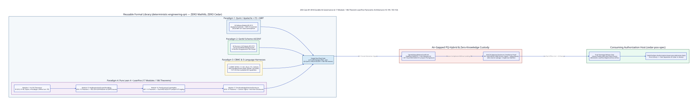

# SPDX-FileCopyrightText: 2026 hardenedlinux Linux Team and Contributors
# SPDX-License-Identifier: LGPL-2.1-or-later

#+TITLE: 10.195 LeanPoo B18 Zero-Knowledge Selective-Disclosure Compliance Proofs & 250-Case / 186-Theorem Grand Seal (AG246-AG250)
#+AUTHOR: Deterministic Engineering
#+DATE: 2026-11-27

* Executive Summary
:PROPERTIES:
:CUSTOM_ID: arch10195-summary
:STATUS: executed-verified
:END:

Phase 47 introduces **Business Extension =B18= (Verifiable Zero-Knowledge Selective-Disclosure
Compliance Proofs)** and seals the **250-case (=AG01=–=AG250=) / 17-module / 186-theorem**
reusable formal library across all four verification paradigms, five implementation languages,
and a panoramic architecture view ():

1. **17th Pure =LeanPoo= Module — 186 Machine-Checked Theorems (ZERO Mathlib, ZERO Cedar)**:
   - [[file:../../../packages/lean-models/DeterministicEngineering/Engineering/ZeroKnowledgeSelectiveDisclosure.lean][ZeroKnowledgeSelectiveDisclosure.lean]] adds 10 machine-checked theorems covering
     commitment-root binding, anti-over-disclosure of confidential fields, Fiat-Shamir Sigma
     soundness, single-use nullifier anti-replay, verifier nonce & policy-digest binding,
     mandatory public compliance predicates, exact iff soundness/completeness, 2-step =LeanPoo=
     refinement (+ =cedar-poo-spec= Privacy-Compliance host), and =Core.Transport= proof reuse
     + negative control.
   - [[file:../../../languages-engineering/ts/defense/agent-audit/leanpoo-export-manifest.ts][leanpoo-export-manifest.ts]] expands single-shot =#print axioms= attestation to **17
     modules / 186 theorems** via =LEANPOO_ZK_DISCLOSURE_FACADE_MODULE=.
2. **Zero-Dependency RFC 3526 MODP-2048 Schnorr Sigma NIZK & Salted Merkle Selective Disclosure**:
   - [[file:../../../languages-engineering/ts/defense/agent-audit/zk-selective-disclosure.ts][zk-selective-disclosure.ts]] implements real BigInt modular exponentiation over RFC 3526
     2048-bit MODP Group 14 (=p = 2q + 1=, prime-order subgroup generator =G = 4=), SHA-256
     Fiat-Shamir transcript challenges, salted Merkle attribute openings, prover-side
     confidential-field fencing, and **=ZkProverWitnessKey= (15th =R3= non-leakable =M3=
     capability class)**.
3. **Panoramic View =90.153= & 250-Case Full Multi-Language / CBMC / Gerbil Regression Seal**:
   - [[file:../../90-99-views/90-architecture-views/90.153-250-case-186-theorem-b1-b18-panoramic-architecture.d2][90.153.d2]] /  visualizes the complete 4-paradigm architecture (=26 Quint
     models × 44×24 ASCENT × 250 cases / 5 languages / CBMC × 17-module / 186-theorem LeanPoo=
     -> air-gapped PQ-hybrid + ZK custody -> =cedar-poo-spec=).
   - [[file:../../../languages-engineering/ts/defense/agent-audit/zk-selective-disclosure.test.ts][zk-selective-disclosure.test.ts]] verifies =AG246=–=AG250= including 15/15 =R3= non-leakage
     and end-to-end PQ-hybrid + ZK compliance + air-gapped Ed25519 =cedar-poo-spec= admission.

* Verification Receipts
:PROPERTIES:
:CUSTOM_ID: arch10195-receipts
:STATUS: executed-verified
:END:

- Lean 4 Build: =lake build DeterministicEngineering.Engineering.ZeroKnowledgeSelectiveDisclosure= -> 0 errors, 0 warnings, 0 =sorry=.
- Single-Shot 186-Theorem CLI Gate: =just audit-leanpoo-fleet --json= -> =verdict: "Proven", quintModelCount: 26, ascentRulesPresent: true, moduleCount: 17, verifiedTheoremCount: 186, zeroMathlib: true, zeroCedar: true=.
- Full 44-Suite Bun + C/CBMC (50/50) + C++20 + Rust + Gerbil ASCENT Regression Seal: **100% pass, 0 failures**.
- Static =G2= Audit: =agent-defense-audit.ts= -> =0 findings=; SPDX & Org links -> =MISSING_SPDX=0, BAD_LINKS=0=.
- Benchmark: [[file:../../30-39-evaluation/30-benchmarks/30.05-agent-defensive-coding-benchmark.org][30.05]] sealed at **250 cases (=AG01=–=AG250=)** across 44 Bun test suites.
