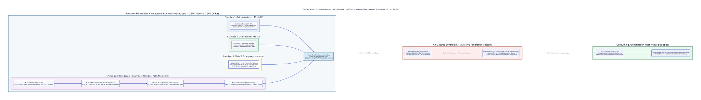

# SPDX-FileCopyrightText: 2026 hardenedlinux Linux Team and Contributors
# SPDX-License-Identifier: LGPL-2.1-or-later

#+TITLE: 10.199 LeanPoo B20 Multi-Org Federated Reciprocity, Dispute Arbitration & 19-Module / 206-Theorem Landmark (AG266-AG270)
#+AUTHOR: Deterministic Engineering
#+DATE: 2026-11-27

* Executive Summary
:PROPERTIES:
:CUSTOM_ID: arch10199-summary
:STATUS: executed-verified
:END:

Phase 51 introduces **Business Extension =B20= (Multi-Org Federated Reciprocity &
Cross-Domain Dispute Arbitration)** and crosses the historic **200+ machine-checked pure
=LeanPoo= theorem landmark** — reaching **19 modules and 206 machine-checked theorems**
(ZERO Mathlib, ZERO Cedar, ZERO =sorry=), **270 benchmark cases (=AG01=–=AG270=)**, and a
panoramic architecture view ():

1. **19th Pure =LeanPoo= Module — 206 Machine-Checked Theorems (ZERO Mathlib, ZERO Cedar)**:
   - [[file:../../../packages/lean-models/DeterministicEngineering/Engineering/FederatedOrgReciprocity.lean][FederatedOrgReciprocity.lean]] adds 10 machine-checked multi-org federation theorems
     covering bilateral countersignature necessity, anti-self-reciprocity spoofing,
     member-organization revocation, active dispute-freeze preemption, bilateral treaty
     ratification, treaty epoch expiration, exact iff soundness/completeness, 2-step
     =LeanPoo= refinement (+ =cedar-poo-spec= Federation host), and =Core.Transport= proof
     reuse + negative control.
   - [[file:../../../languages-engineering/ts/defense/agent-audit/leanpoo-export-manifest.ts][leanpoo-export-manifest.ts]] upgrades single-shot =#print axioms= attestation to **19
     modules / 206 theorems** via =LEANPOO_FEDERATED_ORG_FACADE_MODULE=.
2. **Zero-Dependency Multi-Org Reciprocity Runtime & 17th =R3= Non-Leakable Capability**:
   - [[file:../../../languages-engineering/ts/defense/agent-audit/federated-org-reciprocity.ts][federated-org-reciprocity.ts]] implements bilateral Ed25519 =OrgCountersignature=
     verification over ratified treaties with active dispute-freeze preemption, and
     **=FederatedOrgSigningKey= (17th =R3= non-leakable =M3= capability class)**.
3. **Panoramic View =90.154= & 270-Case Benchmark (=AG266=–=AG270=) Across 48 Bun Suites**:
   - [[file:../../90-99-views/90-architecture-views/90.154-270-case-206-theorem-b1-b20-panoramic-architecture.d2][90.154.d2]] /  visualizes the 270-case, 28-Quint, 52×28 ASCENT,
     19-module / 206-theorem =LeanPoo= -> =cedar-poo-spec= dual-sovereign architecture.
   - [[file:../../../languages-engineering/ts/defense/agent-audit/federated-org-reciprocity.test.ts][federated-org-reciprocity.test.ts]] verifies live 206/206-theorem fleet attestation,
     bilateral Org-A <-> Org-B countersigning, 6-vector federation attack matrix, all
     17/17 =R3= non-leakable capabilities, and 28-Quint × 206-theorem CLI + federated
     =cedar-poo-spec= admission.

* Verification Receipts
:PROPERTIES:
:CUSTOM_ID: arch10199-receipts
:STATUS: executed-verified
:END:

- Lean 4 Build: =lake build DeterministicEngineering.Engineering.FederatedOrgReciprocity= -> 0 errors, 0 warnings, 0 =sorry=.
- Standalone 206-Theorem CLI Gate: =just audit-leanpoo-fleet --json= -> =verdict: "Proven", quintModelCount: 28, ascentRulesPresent: true, moduleCount: 19, verifiedTheoremCount: 206, zeroMathlib: true, zeroCedar: true=.
- Bun Test Suites (=AG266=–=AG270= + Phase 49/50 regression): **15 pass / 0 fail**.
- Static =G2= Audit: =agent-defense-audit.ts= -> =0 findings=; SPDX & Org links -> =MISSING_SPDX=0, BAD_LINKS=0=.
- Benchmark: [[file:../../30-39-evaluation/30-benchmarks/30.05-agent-defensive-coding-benchmark.org][30.05]] extended to **270 cases (=AG01=–=AG270=)** across 48 Bun test suites.
